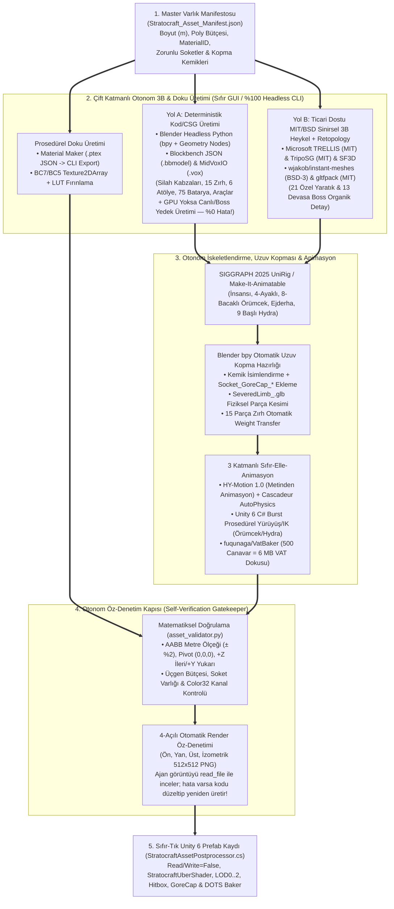

# **STRATOCRAFT: EVRENSEL OYUN TASARIM VE MANTIK ANAYASASI (GAME LOGIC BIBLE \- v7.0 TAM SÜRÜM)**

**Derin Mühendislik Raporu Eşliği:** [STRATOCRAFT\_ARKA\_PLAN\_MATEMATIKSEL\_SIMULASYON\_VE\_VOXEL\_ALGORITMALARI\_RAPORU.md](file:///d:/Oyunum/STRATOCRAFT_ARKA_PLAN_MATEMATIKSEL_SIMULASYON_VE_VOXEL_ALGORITMALARI_RAPORU.md) \| [STRATOCRAFT\_TEKNOLOJI\_AGACI\_MOTOR\_SECIMI\_VE\_ACIK\_KAYNAK\_MIMARI\_REHBERI.md](file:///d:/Oyunum/STRATOCRAFT_TEKNOLOJI_AGACI_MOTOR_SECIMI_VE_ACIK_KAYNAK_MIMARI_REHBERI.md)

---

## **İÇİNDEKİLER VE 16 BÖLÜMLÜK MİMARİ HARİTASI (HIZLI KILAVUZ)**

| Bölüm | Ana Başlık | Kapsadığı Oynanış Kuralları ve Matematiksel / Unity 6 C# Burst SIMD Motor Mimarisi |
| :---- | :---- | :---- |
| **Bölüm 1** | **Oyunun Temel Amacı, Felsefesi ve Sunucu Mimarisi** | Fiziksel Etkileşim Yasası, 4 Aşamalı Gelişim, 3 Katmanlı Sunucu Mimarisi, Hibrit LoD AI (`Active 3D -> 2.5D Agent -> 2D Macro`), Mod-First SDK & `15 ms` Bütçe |
| **Bölüm 2** | **Dünya Coğrafyası, Zorluk Halkaları, Mimari Ağırlık ve Akışkanlar** | 6 Eş-Merkezli Zorluk Halkası (`0–18.000 Birim`), 14 Cevher & Derinlik Dağılımı, Mevsimler, Sonlu Akışkan (`16-bit FluidCell`), **Gerçekçi Mimari Ağırlık / Domino Çöküşü (`Two-Phase DAG`)** ve 5 Seviye 4 Odalı Zindanlar |
| **Bölüm 3** | **Hayatta Kalma, Fiziksel Karakter, Tuş Atamaları ve 3D Envanter** | Çakışmasız Ana Tuş Tablosu, Karakter Hareketi (Eğilme, Kayma, Sürünme), Termal/Biyolojik/Oksijen Simülasyonu (`3D Flood-Fill`), Somut Görsel 3D Sırt Çantası, `4` Vücut Silah Kılıfı, **Madde Kristali (`IS_ITEM_BLOCK == 0` Doğal Kütle Vakumu)** |
| **Bölüm 4** | **Fizik Tabanlı Serbest Yakın Dövüş, Aktif Bloklama ve Zırh Sistemi** | `Sol/Sağ Tık` Kamera Debriyajı (`Camera-Clutch`) ve **`1€ Filter` + `Stable PD` Yarı-Otomatik Savurma Yardımı**, **Tahminsel Manyetik Bloklama / Saptırma / `Master Strike`**, Sıkı Destek Sınırları (`10–25 sn` Düello), 3 Katmanlı 15 Parça Zırh ve Materyal Özelliği (`Trait`) Sistemi |
| **Bölüm 5** | **Fiziksel Zanaatkarlık, Modüler Silah/Zırh Dövme ve 6 Ana Atölye** | Serbest Mikro-Voxel Çekiçleme (`16x32x4`), Keskinlik/CoM/Atalet Tensörü Hesabı, Su Verme (`Quenching`), **Üretim Öncesi Harmonizer Analizi** ve 6 Fiziksel Zanaat Atölyesi |
| **Bölüm 6** | **Ekosistem: Derin Tarım, Hayvancılık, Aşçılık ve Simya** | `NPK` Liebig Toprak Kimyası, `%0 CPU` Zaman Damgalı Gıda Bozulması (`ExpirationTimestamp`), `1★–5★` Hayvan Genetiği, `Maillard vs. Piroliz` Pişirme ve `2D Faz Uzayı` Simya Laboratuvarı |
| **Bölüm 7** | **Ölüm, Ağır Yaralanma, Dirilme ve Kalıcı Uyuyan Beden** | `30 sn Bleed-Out` ve `H` Tuşu Omuzda Taşıma (`Fireman's Carry`), 3 Ölüm Kayıp Modu, **`ARK` Tarzı Kalıcı Uyuyan Beden (`Persistent Offline Sleeper`)** ve Atomik Ceset Bölünmesi |
| **Bölüm 8** | **Klan, 3D Kesintisiz Çit Bölgesi, KGP ve Fiziksel Ritüeller** | Kesintisiz Çit (`6-Komşuluk BFS`) & `3D Flood-Fill`, Offline Kalkan (`Varsayılan 3 Gün`), **Mekansal Bölge Dahil Etme (`Spatial Territory KGP Inclusion`)** & `24h High-Water Mark` KGP, Fiziksel Klan Ritüelleri |
| **Bölüm 9** | **14 Klan Teknolojisi Yapısı, İşçi AI ve Özel Mühendislik Araçları** | 14 Aktif Klan Yapısı (`O(K)` Spatial Hash), Simya Kulesi Batarya Güçlendirmesi, Eğitimli Canlı İşçi AI (`3B A* + GOAP`), Planör/Kanca/Manyetik Huni ve Kara/Deniz/Hava Araçları Fizik Denklemleri |
| **Bölüm 10** | **Batarya Sistemi (`75 Fiziksel Tarif`) ve Büyü/Mühendislik Motoru** | **İtem Bloğu (`IS_ITEM_BLOCK == 1`) vs. Doğal Kütle (`0`) Ayrımı**, `B` Tuşu 3D Hayalet Şema (`T` Döndürme), **Eksiksiz 75 Batarya Tarifi (`25 Saldırı + 25 Oluşturma + 25 Destek/Savunma`)** ve Anti-Cheese Kuralları |
| **Bölüm 11** | **Tuzak Mühendisliği, Dinamik Gizlilik ve Karşı-İstihbarat** | **6 Yakıtlı Tuzak Çekirdeği (`3x3` Çerçeve) + `5 Alt Blok/Plaka × 5 Tetikleyici Öz = 25 Fiziksel Mayın`**, Yaprak/Toprak Kamuflaj Örtüsü (`0.65 -> 0.08` Görünürlük), Dedektör Küresi ve `E` Tuşu Fiziksel Tuzak Sökme |
| **Bölüm 12** | **Sunucu Güç Puanı (`SGP`), 12 Küresel Felaket ve Gece Dalgaları** | 3 Kategori **12 Küresel Felaket**, **`10.000m` Vektörel Yürüyüş Yolu (`Catmull-Rom + 2D Dijkstra`)**, Güneş Fırtınası (`3D Gökyüzü Raycast`), Gece Dalgaları (`Flow-Field`) ve Hava Yardım Sandıkları |
| **Bölüm 13** | **Canlılar (Seviye 1–5), 13 Efsanevi Boss ve Tarif Kitapları** | Zorluk Halkalarına Göre **21 Özel Yaratık Tablosu**, **13 Ritüel Boss'u (`1.500 – 25.000 HP`)**, `GENERATED_BY_BATTERY` Anti-Farm Koruması ve Fiziksel Tarif Kitabı Kopyalama (`Scribing Table`) |
| **Bölüm 14** | **Canlı Eğitme (`Taming`), Fiziksel Düdük Komutları ve Kuluçka** | Seviye & 13 Boss Eğitme Arenası (`<%20 HP` + Yapı Yıkım Tehlikesi), **Akustik Düdük Komut Sistemi ve Görev Çarkı**, Çiftleşme Yuvası, Termal Kuluçka (`Incubation`) ve Golem Çekirdek Kalıbı |
| **Bölüm 15** | **Kuşatma Silahları (`in-situ` Montaj), Kervanlar ve Fiziksel Ekonomi** | Parça Parça Kuşatma Silahı Kurulumu (`Polybolos, Mancınık, Top`), `60 dk` Kuşatma ve Beyaz Bayrak Kuralları, Fiziksel Lojistik Kervan Arabası, **Kan İmzalı Kontrat Bürosu (`Escrow`)** ve Fiziksel Pazar Tezgahları |
| **Bölüm 16** | **Sanat Tarzı, Yontulabilir `UV-Free Uber-Shader` ve `%100` Otonom Ajan 3B Model/Animasyon Fabrikası** | **Stilize Yontulmuş Fantezi (`MatCap + Biplanar + 3B Katı Doku`, `< 16 MB VRAM`)**, `4-Byte Color32` Örs/Bileme/Şam Çeliği Shader'ı, **İnsan Müdahalesiz (`Zero-Touch`) Otonom Ajan 3B Üretim Hattı (`Blender/Blockbench MCP + TRELLIS/TripoSG + UniRig + HY-Motion 1.0 + VatBaker`)** ve 4-Açılı Otomatik Öz-Denetim |

---

# **BÖLÜM 1: OYUNUN TEMEL AMACI, FELSEFESİ VE OYUNCU DÖNGÜSÜ**

## **1.1. Ana Amaç: Hayatta Kalmak Değil, Felaketlere Hükmetmek**

**Stratocraft**, oyuncuların tamamen değiştirilebilir, kazılabilir ve inşa edilebilir üç boyutlu bir dünyada doğduğu; ancak tek başına hayatta kalmanın imkansız olduğu sosyal, stratejik ve mühendislik tabanlı bir hayatta kalma (Survival Sandbox) oyunudur.  
(Not: dünya voxel dir ama bloklardan oluşmaz 7 Days to Die , Astroneer , Deep Rock Galactic gibi bir dünya mantığına sahiptir. dünya tam sonsuz değildir ama oldukça büyüktür.)

Bu dünyada asıl düşman sadece açlık, soğuk veya sıradan yaratıklar değildir; dünyanın kendisi belirli aralıklarla **Felaketler (Disasters)** üretir. Uzak diyarlarda uyanıp merkeze doğru yürüyen devasa Yürüyen Dağlar (Felaket Titanları), yeraltından kalelerin temellerini oyan **Hiçlik Solucanları**, yüzeydeki her şeyi kavuran **Güneş Fırtınaları** ve her gece yarısı başlayan **Gece Saldırı Dalgaları** oyuncuların kurduğu medeniyetleri yok etmeye çalışır. Oyuncunun nihai amacı, doğanın bu yıkıcı güçlerine ve rakip klanlara karşı mühendislik düzenekleri kurarak dünyaya hükmetmektir.

## **1.2. Tasarımın Altın Kuralı: "Soyut Komut Yok, Gerçekten Yapar Gibi Fiziksel Etkileşim ve Somut Görsel Envanter Var"**

Oyunda hiçbir sosyal, askeri veya üretim eylemi soyut metin komutlarıyla (`/clan invite` vb.) veya tek tıkla her şeyi bitiren ruhsuz menü butonlarıyla yapılmaz. Temel tasarım ilkesi; **oyuncunun bir işi yaparken gerçekten o işi fiziksel olarak icra ediyormuş gibi hissetmesidir**:

* **Somut ve Fiziksel Hissiyatlı Envanter / Sandık Arayüzleri (*The Forest* Mantığı):** Oyunda hiç arayüz/menü olmayacak diye bir kural yoktur; envanter ve sandık gibi sistemler doğal olarak bir ekran gerektirir. Ancak bunlar bile soyut Excel tabloları gibi değil, *The Forest / Sons of the Forest* oyunlarındaki gibi **Somut Görsel Envanter (Diegetic & Tactile Inventory)** mantığıyla çalışır: Oyuncu envanterini açtığında karakter sırt çantasını önüne/yere serer ve içindeki eşyaları fiziksel olarak görür; bir sandığı açtığında sandığın kapağı kalkar ve içindeki silahlar/madenler görsel olarak seçilir. Üretimde ise menüden "Kılıç Üret" butonuna basılmaz, örsün başında gerçekten çekiç sallanır.
* **Bölge Sahiplenme:** Haritada bir yeri sahiplenmek için menüden alan seçilmez; araziye fiziksel olarak birbirine kesintisiz bağlı sınır direkleri/çitler dizilir, kapalı bir 3 boyutlu alan oluşturulur ve merkezine **Klan Kristali** dikilir.  
* **Büyü ve Saldırı Gücü (Bataryalar):** Oyunda "büyü kitabı" veya "mana puanı" yoktur. Oyuncu dünyaya merkeze bir **Batarya Çekirdeği (`Battery Core`)** koyar, etrafına **aletle kırılıp envantere alınmış İtem Blokları veya İşlenmiş Blokları** (Madde Kristaliyle çekilen doğal kütleler hariç) belirli bir 3D geometrik sırayla dizer, eline değerli maden yakıtını alır ve çekirdeği ateşleyerek el yuvasına **Batarya** yükler.  
* **Sosyal Yönetim ve Diplomasi:** Klana üye almak, rütbe terfisi vermek, üye sürgün etmek veya başka bir klanla müttefik olmak için dünyada özel **Ritüel Çerçeveleri** kurulur ve fiziksel objelerle etkileşime girilir.  
* **Pasif Güç ve Teknoloji:** Bir klanın güçlenmesi, karakter ekranında puan dağıtmakla değil; klan arazisine **Simya Kulesi, Zehir Reaktörü, Tektonik Sabitleyici ve Gözetleme Kulesi** gibi fiziksel makineler inşa edip bunları çalıştırmakla gerçekleşir.

## **1.3. Oyuncu Gelişim Döngüsü (4 Aşamalı Yaşam Evresi)**

1. **Aşama 1 – İlk Günler ve Hayatta Kalma (`0 – 1.000 Birim Mesafe`):** Oyuncu dünyanın güvenli merkezine yakın doğar. Ağaç keser, taş ve temel cevherleri (Demir, Kömür, Kükürt, Boksit, Tuz Kayası) kazarak ilk aletlerini yapar. İklim ve açlıkla mücadele ederken müttefikler bulur ve ilk klan sınırlarını çevirir.  
2. **Aşama 2 – Klanlaşma ve Endüstrileşme (`1.000 – 3.000 Birim Mesafe`):** Klan Kristali dikilir, 24 saatlik başlangıç koruması altında üs tahkim edilir. **Titanyum** yataklarına inilir, **Simya Kulesi** ve **Zehir Reaktörü** kurulur, Seviye 1-2 **Bataryalar** (Ateş Topu, Yıldırım Asası) öğrenilir, **Ork ve Troll** gibi canlılar eğitilerek iş gücü ve muhafız ordusu kurulur.  
3. **Aşama 3 – Fetih, Lojistik ve Hava Hakimiyeti (`3.000 – 5.000 Birim Mesafe`):** Klan **Mithril** cevherine ulaşır. **Ejderha, Griffin ve T-Rex** gibi nadir yaratıklar ritüellerle eğitilip binek olarak kullanılır. Uzak şubeler arasında **Kervanlar** çıkarılır, **Kontrat Bürolarında** kan imzalı anlaşmalar yapılır, **Polybolos ve Mancınıklar** üretilerek rakip klanlara **Savaş Totemi** ile kuşatma açılır.  
4. **Aşama 4 – Felaketlere Hükmetme (`5.000 – 10.000+ Birim Mesafe`):** **Astral Cevheri** ve **Kızıl Elmas** çıkarılır. Efsanevi Bosslar (**Titan Golem, Hydra, Khaos Tanrısı**) çağrılıp kesilerek **Tarif Kitapları** ele geçirilir. Klan üssüne devasa **Tektonik Sabitleyici** dikilir ve dünyayı yıkmaya gelen Kategori 3 Felaket Bossları yok edilerek enkazlarından **Karanlık Madde, Yıldız Çekirdeği, Antik Dişli ve Hidrolik Piston** hasat edilir.
5. **İlk 15 Dakika Fiziksel Öğretici Akışı (`Diegetic Onboarding` — Sıfır Açılır Metin Penceresi):**
   Oyunda ekranı kaplayan yapay öğretici pencereler yoktur; yeni başlayan oyuncu oyunun kurallarını ilk 15 dakikada fiziksel dünyayla etkileşerek doğal sırayla öğrenir:
   * **Dakika 0–3 (Uyanış ve Rezonans Kristali):** Güvenli Merkez Vadide (`Halka 0–1`) uyanan oyuncu, sol bileğindeki çatlak Rezonans Kristali (`Tuş C`) ile ilk toprağı vakumlayıp yağmurdan/rüzgardan korunmak için ilk mağara kovuğunu kapatır.
   * **Dakika 3–6 (İlk Kazma ve `IS_ITEM_BLOCK` Keşfi):** Yerdeki çakmaktaşı ve dallarla ilk İlkel Kazmasını yapar; kristalle çekilen toprağın aksine kazmayla kırılan taşın **Fiziksel İtem (`BlockOriginState = 1`)** olarak yere serilen 3D Kumaş Çantaya (`Tuş I`) girdiğini bizzat görür.
   * **Dakika 6–10 (İlk Ocak ve Örste Kılıç Dövme):** Basit taş ocakta bakır/demir ısıtıp taş örs üzerinde (`16x32x4`) çekiçle ilk bıçağını döver, su oluğunda (`Quenching`) cızırtıyla soğutur ve bileme taşında keskin ağzı parlatır.
   * **Dakika 10–13 (Fiziksel Dövüş ve İlk `Deflect`):** Kamp alanındaki ahşap eğitim kuklasında ve ilk Yaban Domuzu/Goblin karşılaşmasında `Sol Tık` kamera debriyajıyla savurmayı ve `Sağ Tık` ile gelen darbeyi eğimli saptırmayı (`Deflect`) deneyimler.
   * **Dakika 13–15 (İlk Sınır Direği ve Kamp Ateşi):** Gece çökerken çit direklerini birbirine bağlayıp ilk kamp ateşini ve barınağını kurar.

---

## **1.4. Oyun Modları, Sunucu Mimarisi ve "Mod-First" (Tam Modlanabilirlik) Desteği**

Stratocraft, tam sanal alan (Sandbox) esnekliğinde hem tek başına hem de devasa çok oyunculu dünyalarda oynanabilecek şekilde tasarlanmıştır ve çekirdeğinden itibaren **Tam Modlama Desteği (Native Modding Architecture)** sunar:

### **A. 3 Katmanlı Oynanış ve Sunucu Mimarisi**

1. **Tek Oyunculu Dünya (Singleplayer Offline):**  
   * Oyuncu hiçbir sunucu veya internet bağlantısına ihtiyaç duymadan kendi bilgisayarında yerel bir dünya oluşturup oynayabilir.  
   * Tüm felaketler, gece saldırıları, kervanlar, tarım/hayvancılık ve boss döngüleri yerel dünyada eksiksiz çalışır; oyuncu eğitilen canlılar ve otonom klan yapılarıyla kendi imparatorluğunu kurabilir.  
2. **Kendi Dünyana İnsan Alma (Listen Server / Co-op Host):**  
   * Tek oyunculu dünyada oynayan bir oyuncu, menüden tek tıkla **"Dünyayı Paylaş (Host Ol)"** seçeneğini açarak arkadaşlarını veya diğer oyuncuları doğrudan kendi dünyasına davet edebilir (LAN veya P2P/Steam/Davet Kodu üzerinden).  
3. **Yüzlerce ve Binlerce Kişilik Devasa Sunucular (Dedicated MMO-Scale Servers):**  
   * Topluluklar ve sunucu sahipleri kendi **Adanmış Sunucularını (Dedicated Server)** kurabilir.  
   * Sunucu mimarisi dinamik bölge bölümleme (*Spatial Grid Sharding & Multi-Threaded Region Ticking*) kullandığı için, aynı dünyada **yüzlerce hatta binlerce oyuncu** aynı anda klanlar kurup devasa meydan ve kuşatma savaşları yapabilir.

### **B. Birinci Sınıf Modlama Desteği (Tam Modlanabilir Oyun Çekirdeği)**

Oyundaki **hiçbir içerik kaynak koda gömülü (hardcoded) değildir**. Oyunun tamamı mod yapımcılarının (Modders) her şeyi değiştirebilmesi ve yeni sistemler ekleyebilmesi üzerine inşa edilmiştir:

* **Veri Odaklı (Data-Driven) Mimarisi:** Oyundaki tüm silahlar, zırhlar, üretim cihazları, 75 batarya tarifi, ritüeller, 25 mayın, bosslar, yaratık yapay zekaları, biyomlar ve arayüzler açık **JSON/TOML veri paketleri** ve **Lua / C\# Mod API'si** üzerinden okunur.  
* **Mod Yapımcılarına Tam Yetki:** Bir mod yapımcısı oyuna sıfırdan yeni bir zanaat atölyesi, yeni bir fiziksel batarya geometrisi, yeni bir boss, özel binekler veya tamamen farklı savaş kuralları ekleyebilir; mevcut her mekaniği değiştirebilir.  
* **2-Katmanlı RCE Korumalı Mod Güvenlik Mimarisi (`Two-Tier Mod Security Sandbox`):**
  1. **Katman 1 — Sunucudan Otomatik İndirilen Güvenli Modlar (`Zero-Trust Auto-Sync`):** Bir topluluk sunucusuna bağlanırken oyuncunun bilgisayarına otomatik indirilen paketler **Uzaktan Kod Çalıştırma (RCE / Zararlı Yazılım) güvenliği gereği ASLA derlenmiş C# `.dll` veya `HarmonyX` yaması içeremez!** Otomatik senkronizasyon yalnızca **Veri Paketleri (`JSON / TOML`)**, **3B Model / Doku / Ses Varlıkları (`.glb, .vox, .ptex, .ogg`)** ve dosya sistemi (`System.IO`), ağ (`System.Net`) ve işletim sistemi çağrılarına erişimi tamamen kapatılmış **Korumalı Kum Havuzu Betikleri (`Sandboxed MoonSharp Lua` veya `WASM`)** için geçerlidir.
  2. **Katman 2 — Derin C# / `HarmonyX` Çekirdek Modları (`Explicit Workshop Trust`):** C# `.dll` (`BepInEx / HarmonyX`) modları yalnızca **Tek Oyunculu** modda veya oyuncunun **Steam Workshop / Resmi Mod Yöneticisi üzerinden bizzat kendi onayıyla abone olup indirdiği** (SHA-256 doğrulamalı) modlarda çalışır.

---

## **1.5. Evrensel Optimizasyon Anayasası: Matematiksel Arka Plan Simülasyonu ("Excel Tablosu" Mantığı), Sürü ve Chunk Algoritmaları**

Stratocraft'ta yüzlerce canavarın aynı anda bir kaleye saldırması, binlerce oyuncunun üs kurması ve arka planda binlerce hayvanın/tarlanın/makinenin çalışması **standart (klasik) oyun motoru mantığıyla yapılmaz**. Oyunun en temel mühendislik ilkesi **en düşük donanımlı bilgisayarlarda bile ("Patates PC" dahil) yüksek FPS ile akıcı çalışmaktır**. Bunun için oyunun her noktasında aşağıdaki **5 Optimizasyon Mekanizması** zorunlu olarak uygulanır:

### **1\. "Gözlemciye Bağlı Matematiksel Simülasyon" (Arka Planda Excel Tablosu Mantığı / Lazy Analytical Evaluation & DES)**

*(Tam Teknik Detaylar İçin Bkz: `STRATOCRAFT_ARKA_PLAN_MATEMATIKSEL_SIMULASYON_VE_VOXEL_ALGORITMALARI_RAPORU.md`)*

Oyuncunun o an bakmadığı (görüş açısı / *Camera Frustum* dışındaki) veya uzaktaki (*Unloaded / Semi-Loaded Chunk*) bölgelerde bulunan canlılar, işçiler, kervanlar ve üretim tesisleri **asla 3D olarak render edilmez, iskelet animasyonları oynatılmaz ve 3D fizik motorunu (`RigidBody / CapsuleCollider / Physics.Raycast`) kesinlikle çalıştırmaz\!** Bunun yerine her varlığın gerçek kimliği bellekte sadece **`64 Byte` (1 CPU Cache Line)** yer kaplayan ardışık bir veri tablosu (`OffScreenEntityRecord` - SoA) olarak tutulur ve arka planda **Ayrık Olay Simülasyonu (DES - Discrete Event Simulation)** ile **Parametrik Analitik İntegrasyon** birlikte yürütülür:

* **A. Somut Çalışma Örneği (Arkadaki İnek ve Taş Toplayan Goblin İşçi Senaryosu):**  
  1. **Bakmıyorken (Matematiksel Soyutlama ve `%0 CPU` Yükü):** Oyuncunun arkasında (görüş açısının dışında) bir inek `10 metre` ilerideki ota doğru yürüyor veya eğitilmiş bir Goblin işçi `30 metre` ötedeki taş yatağından Klan Sandığına taş taşıyor olsun. Görüş açısı dışına çıktığı salisede 3D modeli, animasyonu ve fiziği havuza (*Object Pool*) iade edilir. Arka planda her karede (`60 Hz`) çalışan bir `Update()` döngüsü **yoktur**; sadece `64 Byte`'lık tabloya başlangıç zamanı ($t_0$), 1D rota segmenti hızı ($v_{\text{eff}}$) ve bir sonraki olay zamanı ($t_{\text{event}} = t_0 + 6.6\text{ sn}$) kaydedilerek **Min-Heap Öncelik Kuyruğuna (DES Queue)** bırakılır.  
  2. **Oyuncu Kafasını Çevirip Baktığı An (Anlık Somutlaştırma / Just-In-Time Materialization):** Oyuncu 5 saniye sonra arkasını dönüp ineğe baktığı salisede, oyun motoru geçen süreyi ($\Delta t = 5\text{ sn}$) parametrik yol denklemine ($s(t) = s_0 + v_{\text{eff}} \cdot \Delta t$) koyar; ineği hiç ara animasyonla uğraşmadan doğrudan `7.5 metre` ilerlemiş son konumunda (veya 7 saniye sonra baktıysa otu çoktan yemiş son halinde) 3D olarak ekrana çizer! Aynı şekilde Goblin işçiye 100 saniye sonra bakıldığında, tamamlanan döngü sayısı ($\lfloor 100 / 28\text{ sn} \rfloor = 3\text{ sefer} \implies +30\text{ Taş}$) sandığa anında eklenir, kalan `16.0 saniyelik` kesirle işçinin dönüş yolunun tam kaçıncı metresinde olduğu $O(1)$ aritmetikle bulunup ekrana basılır!
* **B. 3D Raycast Açmadan Engellerin (Duvar, Uçurum, Lav, Çok Katlı Kale ve `Y = -80` Yeraltı Madeni) ve Tehditlerin (Mayın, Kurt) Tespiti:**  
  1. **Çok Katmanlı Sütun Özeti (`Multi-Span ChunkNavColumn` — Ortalama `1.89 KB / Chunk`) ve `NavVersion` Sayacı:** Bir chunk'ın 3D voxel verisi RAM'den silinse bile, her `16x16` chunk sütunu için `ushort ColumnSpanHeader[256]` başlığı ve her yürünebilir dikey katman (*Span*: `Span 0` Derin Maden `Y = -80`, `Span 1` Mağara/Zindan `Y = -25`, `Span 2` Zemin Kat, `Span 3+` Çok Katlı Kale/Köprü/`#47 Uçan Ada`) için **`4 Byte` (`uint`) `NavSpan`** özeti tutulur. Bu `4 Byte` içinde; katman taban yüksekliği ($Y_{\text{floor}}$), komşu basamak farkı ($\Delta Y_{\max} > 2\text{m}$ ise **Uçurum**), zemin/sıvı tipi (**Lav Çukuru, Derin Su, Klan Suru, Zindan Duvarı**), tavan açıklığı, **Mayın/Tuzak Bayrağı (`HAS_STATIC_HAZARD`)** ve o katmanın Klan ID'si yer alır. Böylece yeraltındaki madende (`Y = -80`) çalışan Goblin işçi ile yüzeydeki kervan veya köprü üstündeki muhafız birbirinin katmanına ışınlanmadan simüle edilir!  
  2. **Yeni Örülen Surların `~50 Nanosaniyede` Tespiti:** Oyuncu bir yere yeni bir duvar ördüğünde veya hendek kazdığında o chunk'ın `NavVersion` sayacı 1 artar. Arka planda yürüyen inek/kervan `NavVersion` değişimini gördüğü anda 3D Raycast açmaz; `4 Byte`'lık 2D tablo üzerinde **2D Bresenham Izgara Yürüyüşü** yaparak yoldaki yeni duvarı veya lav çukurunu `~50 nanosaniye` içinde fark edip durur veya HPA\* (Hierarchical Pathfinding) ile etrafından yeni rota alır.  
  3. **25 Mayın ve Tuzak Çekirdeklerinin Analitik Kesişimi (`Swept Segment vs. Circle`):** Dünyadaki 10.000 mayın fiziksel Collider olarak tutulmaz. Arka plandaki varlık `HAS_STATIC_HAZARD == 1` olan bir hücreden geçerken ikinci dereceden $(\mathbf{d}\cdot\mathbf{d})\tau^2 + 2(\mathbf{f}\cdot\mathbf{d})\tau + (\mathbf{f}\cdot\mathbf{f} - R^2) = 0$ denklemiyle hareket doğru parçasının mayın çemberini kestiği tam milisaniye ($t_{\text{patlama}} = t_0 + \tau^*\Delta t$) analitik olarak bulunur ve mayın etkisi tabloya uygulanır.  
  4. **Kurt Sürüleri ve Av-Avcı Karşılaşması (`32x32m Spatial Hash + CPA`):** Aynı veya komşu `32x32m` uzaysal hash kovasındaki iki arka plan varlığının birbirine en çok yaklaştığı an (**En Yakın Yaklaşım Zamanı - CPA**: $t_{\text{cpa}} = \operatorname{Clamp}\!\left(-\frac{\mathbf{r}_0 \cdot \mathbf{v}_{\text{rel}}}{\max(\|\mathbf{v}_{\text{rel}}\|^2, \, 10^{-6})}, \, 0, \, \Delta t\right)$) formülüyle sıfıra bölünme korumalı olarak hesaplanır; saldırı menziline girdikleri anda durumları `ABSTRACT_COMBAT` (Soyut Çatışma) moduna geçer.  
  5. **Factorio Tarzı Lojistik Akış Hattı (`Transport Line`) ve Başsız Kuşatma Koridoru (`Headless Warm Tier`):** Maden ile sandık arasında çalışan çoklu işçiler ve kervan konvoyları tekil 1D akış hattı olarak $O(1)$ zamanda güncellenir. Oyuncu `5.000m` uzaktayken üssüne bir **Felaket Bossu** girdiğinde ise 3D grafik/mesh açılmadan sadece Boss'un `30x30m` yürüyüş koridorundaki `NavCell` ve `SparseHazardList` verileri üzerinden **"Matematiksel Kuşatma Eleği"** çalıştırılarak mayın patlamaları ve sur yıkımları deterministik olarak hesaplanır.  
  6. **Takılmasız 2-Aşamalı Somutlaştırma (`VAT Proxy -> 0.5 ms Bütçeli Terfi`):** Oyuncu aniden arkasını döndüğünde görüş açısına giren 200 varlık **ilk karede (`0.1 ms`)** doğrudan **GPU Instanced VAT** olarak tek Draw Call'da çizilir (*Pop-in olmaz*); fiziksel Collider ve yerel AI bağlantısı ise kare başına maksimum `16 varlık` (`< 0.5 ms`) bütçesiyle zamana yayılır. Tüm dünya arka plan simülasyonunun (`10.000` canlı + `4.096` uzak çok-katmanlı chunk + `10.000` mayın) toplam bellek tüketimi **`~10.10 MB RAM`**'dir!
* **C. Uzaktaki Çiftlikler, Fırınlar ve Üreme Tesisleri (`O(1)` Zaman Damgası Hesabı):**  
  * Oyuncu üssünden uzaktayken bile tarlasındaki ekinler büyümeye, fırınındaki madenler erimeye ve çiftliğindeki hayvanlar üremeye devam eder; ancak bunlar arka planda her saniye işlemciyi (CPU) yormaz.  
  * Sistem sadece **"Son Bakılan Zamanı ($t_0$)"** kaydeder. Oyuncu üssüne geri döndüğü veya o yöne baktığı anda $\Delta t = t_{\text{şimdi}} - t_0$ farkını tek bir matematiksel çarpımla hesaplar ve tarlanın/fırının **son halini** anında oluşturur.

### **2\. Yüzlerce Canavar İçin Sürü Zekası (Flow-Field Swarm AI) ve Kümeleme**

Bir kaleye aynı anda **300 – 500 canavar** saldırdığında, her bir canavar için ayrı ayrı yol bulma (`A* Pathfinding`) ve ayrı fizik hesaplaması yapılırsa oyun çöker. Bunun yerine:

* **Tekil Akış Alanı (Flow-Field Pathfinding):** 500 canavar ayrı ayrı yol aramaz. Hedeflenen Klan Kristali için haritada **tek bir ortak Vektör Akış Haritası (Su akıntısı gibi)** oluşturulur; 500 canavarın tamamı işlemciyi hiç yormadan bu akış yönünü takip eder.  
* **Sürü Birleştirme (Swarm LoD & GPU Instancing):** Uzaktaki 100 Gece Gulyabanisi (Ghoul) / yaratık motor içinde 100 ayrı varlık değil, **tek bir matematiksel sürü kümesi** olarak hesaplanır. Ekran kartında **GPU Instancing ve Vertex Animation Textures (VAT)** kullanılarak 500 yaratık **tek bir çizim çağrısında (`1 Draw Call`)** sıfır performans kaybıyla ekrana basılır.

### **3\. Gelişmiş Chunk Algoritmaları, Greedy Meshing ve Occlusion Culling**

* **3D Kübik Chunk ve Octree Yapısı:** Dünya 3 boyutlu (`16x16x16`) kübik yığınlara (Chunk) ve **Sekizli Ağaç (Octree)** veri yapısına bölünmüştür. Sadece oyuncunun etrafındaki aktif chunk'lar bellekte tutulur.  
* **Açgözlü Yüzey Birleştirme (Greedy Meshing):** Yan yana duran yüzlerce aynı tip taş veya duvar hücresi binlerce küçük üçgen olarak çizilmez; motor bunları **tek bir büyük düzlemde birleştirerek** ekran kartına binen poligon yükünü **`%90` oranında azaltır**.  
* **Görünmeyeni Çizmeme (Aggressive Occlusion Culling):** Bir tepenin, duvarın veya kalenin arkasında kalan, yeraltındaki mağarada duran ya da oyuncunun kamerasının bakmadığı hiçbir blok, makine, sandık ve canlı GPU tarafından kesinlikle işlenmez.

### **4\. Efekt / Partikül Havuzlama (Object Pooling) ve Dinamik Efekt Birleştirme**

* Savaşta aynı noktaya 20 adet Ateş Topu veya Yıldırım Bataryası düştüğünde 20 ayrı patlama efekti üst üste binip FPS'i düşürmez; **Akıllı Efekt Birleştirici (VFX Merger)** aynı karedeki yakın partikülleri birleştirerek **tek bir optimize edilmiş büyük efekt** oynatır.  
* Bellekten sürekli veri silip oluşturmak (*Garbage Collection Stutter*) yerine tüm mermiler, oklar, blok parçaları ve yaratıklar önceden ayrılmış **Bellek Havuzlarından (Object Pools)** tekrar tekrar kullanılır. Bu sayede her sistemde "en optimize metot" standart olarak işletilir.

### **5\. Kesin GPU / CPU Görev Ayrımı, RAM ve SSD Koruması (Türkiye ve Dünyadaki En Güçsüz Bilgisayarlarda Bile Çalışma Garantisi)**

Oyunun geliştirilmesindeki en kritik donanım anayasası; **Türkiye'de ve dünyada bulunan en düşük donanımlı, eski veya ofis tipi bilgisayarlarda bile (Düşük RAM, eski işlemci, dahili ekran kartı) takılmadan, yüksek FPS ile açılıp oynanabilmesi**, aynı zamanda güçlü sistemlerde de en üst görsel kaliteye ölçeklenebilmesidir:

* **Kesin GPU vs. CPU Görev Dağılımı (Strict Hardware Workload Partitioning):**  
  * **Kesinlikle GPU'da (Ekran Kartında) Çalışacaklar:** Voxel arazi yüzey örme (*Compute Shader Meshing*), yüzlerce canavarın sürü animasyonları (*Vertex Animation Textures \- VAT*), binlerce çimen/yaprak/sınır partikülü, ışık/gölge hesaplamaları ve hava durumu/lav akış efektleri tamamen **GPU üzerinde paralel olarak** çalıştırılır; işlemciye (CPU) asla yük bindirmez.  
  * **Kesinlikle CPU'da (İşlemcide) Çalışacaklar:** Arka plan matematiksel ("Excel tablosu") dünya/çiftlik simülasyonu, savaş ve vuruş mantığı, kontrat/klan kuralları, yapısal bütünlük (*Structural Integrity*) hesapları, Sürü Akış Haritası (*Flow-Field*) yönlendirmeleri ve ağ (Network) paketleri işlemcinin tüm çekirdeklerine eşit bölünerek (**Multi-Threaded Job System & SIMD**) CPU'da çalıştırılır. GPU ve CPU birbirini asla beklemez (*Zero-Wait Asynchronous Pipeline*).  
* **Katı RAM (Bellek) Optimizasyonu ve Gerçekçi Minimum Sistem Hedefi (`8 GB Sistem RAM + Dahili GPU`):**  
  * Windows 10/11 işletim sistemi tek başına `~3 GB RAM` ve dahili GPU (`Intel UHD / Iris Xe / Vega iGPU`) paylaşımlı belleği `~1.5 GB RAM` tükettiği için, Stratocraft kendi çalışma zamanı bellek ayak izini **`< 2.5 GB RAM` ve `< 512 MB Toplam VRAM` (`< 16 MB Kaplama VRAM'i`)** altında tutacak şekilde **Bit-Packing (Bit Düzeyinde Sıkıştırma)** ile tasarlanmıştır. Bu sayede **Minimum Sistem Gereksinimi olan `8 GB Sistem RAM + Modern Dahili GPU veya 2 GB VRAM Harici GPU`** donanımlı eski/ofis bilgisayarlarında bile sıfır disk takası (*Zero Pagefile Swap Stutter*) ve **60+ FPS** ile çalışır.  
* **SSD ve Disk (HDD) Kullanımına Dikkat (I/O & SSD Ömrü Koruması):**  
  * Oyuncuların sürekli arazi kazıp inşa ettiği bir dünyada her saniye diske ham veri yazılırsa hem oyun takılır hem de oyuncunun SSD'sinin yazma ömrü (*TBW*) tükenir.  
  * Bunu önlemek için değişen dünya verileri önce RAM tamponunda toplanır, **LZ4 / Zstd Hızlı Sıkıştırma Algoritmasıyla** `%80` küçültülür ve sadece **"Değişen Farklar (Delta Compression)"** belirli aralıklarla arka planda asenkron olarak diske yazılır. Bu sayede SSD ömrü korunur, disk kullanımı minimumda tutulur ve eski tip mekanik HDD'lerde bile harita yükleme takılması yaşanmaz.

### **6\. Bölüm 1 Kod, Algoritma ve Matematiksel Motor Mimarisi (Arka Plan Simülasyonu, Sharding ve Disk Sıkıştırma)**

> [!IMPORTANT]
> Bu bölümdeki matematiksel modellerin ve veri yapılarının tam teknik raporu ayrıca [`STRATOCRAFT_ARKA_PLAN_MATEMATIKSEL_SIMULASYON_VE_VOXEL_ALGORITMALARI_RAPORU.md`](file:///d:/Oyunum/STRATOCRAFT_ARKA_PLAN_MATEMATIKSEL_SIMULASYON_VE_VOXEL_ALGORITMALARI_RAPORU.md) dosyasında yer almaktadır.

#### **A. Görüş Açısı Dışı (`Off-Screen`) Kapalı Form Matematiksel Simülasyon Denklemleri**
1. **1D Parametrik Eğri İlerlemesi ve Çok Katmanlı `Multi-Span NavSpan` Sütun Özeti:**
   * Uzaktaki varlıklar 3D `RigidBody` veya `Physics.Raycast` kullanmaz; HPA\* tarafından üretilen kırıklı doğru segmentleri üzerinde 1 boyutlu yay uzunluğu $s(t) = s_0 + (v_{\text{base}} \cdot \mu_{\text{terrain}} \cdot \mu_{\text{slope}})\Delta t$ ve `Q20.12 Sabit Noktalı (0.24 mm hassasiyetli)` koordinatlarla ilerler.
   * Her `16x16` chunk sütununda `ushort ColumnSpanHeader[256]` ve yürünebilir her dikey katman (*Derin Maden `Y = -80`, Mağara/Zindan, Zemin Kat, Çok Katlı Kale/Köprü*) için `4 Byte (uint)` **`NavSpan`** tutulur (`Bit 0..9`: Katman taban yüksekliği $Y_{\text{floor}}$, `Bit 10..13`: Maksimum basamak farkı $\Delta Y_{\max}$, `Bit 14..17`: Zemin/Lav/Duvar kodu, `Bit 18..20`: Tavan açıklığı, `Bit 21`: `HAS_STATIC_HAZARD`, `Bit 22..31`: Klan ID özeti).
   * Bir chunk içinde blok kırıldığında/konulduğunda `Chunk.NavVersion++` artar. Varlık sadece `CachedNavVersion != CurrentNavVersion` olduğunda kendi dikey katmanındaki (`NextSpan`) `NavSpan` dizisi üzerinde **`~65 ns`** süren **2D Bresenham Izgara Yürüyüşü** çalıştırarak yeni örülen surları veya lav çukurlarını Raycast açmadan tespit eder.
2. **Statik Mayın Kesişimi ve Dinamik Kurt/Avcı Yakalama (`CPA`):**
   * **Mayın Tetikleme:** `HAS_STATIC_HAZARD == 1` olan hücreden geçen varlık için $(\mathbf{d}\cdot\mathbf{d})\tau^2 + 2(\mathbf{f}\cdot\mathbf{d})\tau + (\mathbf{f}\cdot\mathbf{f} - R^2) = 0$ kuadratik denklemi çözülür; en küçük kök $\tau^* \in [0,1]$ ise varlık $t_0 + \tau^*\Delta t$ anında mayına basmıştır (*Tunneling* imkansızdır).
   * **Dinamik Avcı Yakalaması (Time of Closest Point of Approach):** Aynı `32x32m` uzaysal hash kovasındaki av ve avcı çiftleri için en yakın yaklaşım anı $t_{\text{cpa}} = \operatorname{Clamp}\!\left(-\frac{\mathbf{r}_0 \cdot \mathbf{v}_{\text{rel}}}{\max(\|\mathbf{v}_{\text{rel}}\|^2, \, 10^{-6})}, \, 0, \, \Delta t\right)$ analitik olarak (paralel/durağan varlıklarda sıfıra bölünme korumasıyla) hesaplanır; mesafe $\le R_{\text{aggro}}$ ise çatışma başlar.
3. **`ABSTRACT_COMBAT` (Hiperbolik Lanchester Çatışma Çözümü):**
   * İki arka plan grubu ($A$ ve $B$) çarpıştığında her saniye döngü çalıştırılmaz. Birim yıpratma katsayıları $\alpha, \beta$ ve $\omega = \sqrt{\alpha\beta}$ ile herhangi bir $\Delta t$ anındaki kalan grup güçleri kapalı formda hesaplanır:
     $$A(\Delta t) = A_0 \cosh(\omega \Delta t) - B_0 \sqrt{\frac{\beta}{\alpha}} \sinh(\omega \Delta t), \quad B(\Delta t) = B_0 \cosh(\omega \Delta t) - A_0 \sqrt{\frac{\alpha}{\beta}} \sinh(\omega \Delta t)$$
   * Çatışmanın kesin bitiş zamanı (eşit güçlü ordularda $\sqrt{\alpha}A_0 == \sqrt{\beta}B_0 \implies \operatorname{arctanh}(1.0) = \infty$ tekilliğini önleyen $0.9995$ sınırı ile) $t_{\text{end}} = t_0 + \frac{1}{\omega}\operatorname{arctanh}\!\left(\min\!\left(0.9995, \, \frac{\min(\sqrt{\alpha}A_0, \sqrt{\beta}B_0)}{\max(\sqrt{\alpha}A_0, \sqrt{\beta}B_0)}\right)\right)$ **DES Min-Heap** kuyruğuna **tek bir olay** olarak yazılır.
4. **Factorio Tarzı `LogisticsTransportLine` ($O(1)$ Otonom İşçi ve Kervan Üretim Bandı):**
   * Kaynak ile sandık arasında çalışan $N_{\text{worker}}$ adet Goblin/Golem işçi için tam tur süresi $T_{\text{cycle}} = \frac{L_{\text{path}}}{v_{\text{boş}}} + T_{\text{harvest}} + \frac{L_{\text{path}}}{v_{\text{dolu}}} + T_{\text{drop}}$ hesaplanır.
   * $\Delta t$ süresinde sandığa giren toplam maden sıfır döngüyle ($O(1)$) bulunur: $\Delta M(\Delta t) = \sum_{i=0}^{N_{\text{worker}}-1} Q_{\text{cap}} \left\lfloor \frac{\Delta t + \phi_{0,i}}{T_{\text{cycle}}} \right\rfloor$. Sandığın dolacağı an $t_{\text{saturate}}$ DES kuyruğuna tek bir olay olarak kaydedilir.
5. **`VFX Spatial Merger` (Enerji Korunumlu Çoklu Patlama Birleştirici):**
   * Aynı `50 ms` pencerede aynı $4\times 4\times 4\text{m}$ Morton kovasında patlayan $K$ adet mayın/bomba, tek bir ışık ve partikül sistemine birleştirilir. Patlama yarıçapı 3B hacimsel enerji korunumuyla (**$L_3$ küp kök normu**) büyür:
     $$R_{\text{merged}} = \min\!\left(R_{\text{cap}}, \, \left(\sum_{i=1}^K r_i^3\right)^{1/3}\right) \approx \bar{r} \cdot K^{1/3}, \quad N_{\text{particles}} = N_{\text{base}}(1 + 0.35\ln K)$$

#### **B. Çok Oyunculu Sunucu Sharding ve 4-Katmanlı SSD Korumalı Kayıt Mimarisi**
1. **Uzaysal Izgara Bölütleme (`512x512m Spatial Grid Sharding` & 4-Renk Dama Tahtası):**
   * Dünya `512x512m` (`32x32` chunk) büyüklüğünde **Bölge Hücrelerine (`ZoneTile`)** bölünür. İş parçacıklarının (*Worker Threads*) sınır komşularında Mutex kilidi beklemeden (*Lock-Free*) su akışı ve yapısal bütünlük hesaplaması için **4-Renk Dama Tahtası Çizelgelemesi (`Red-Black-Green-Yellow`)** ve `2 Voxel` genişliğinde **`Ghost Halo Buffer`** kullanılır.
2. **4-Katmanlı Bellek ve SSD Dostu Disk Sıkıştırma (`Palette + RLE + Seed Delta + Zstd`):**
   * **Katman 1 (RAM Palette Sıkıştırma):** Tek tip bloklu chunk'lar (saf Hava veya saf Taş) RAM'de **`0 Bit/Voxel` (`4 Byte` başlık)** yer kaplar; `2..16` blok tipli chunk'lar `4-bit` indeks dizisi (`2 KB`) olarak tutulur.
   * **Katman 2 (`Procedural Seed Delta`):** Diskteki `.scregion` dosyasına tüm arazi değil, sadece prosedürel dünya tohumuna (`WorldSeed`) kıyasla **oyuncunun değiştirdiği (`Modified`) voxeller** yazılır.
   * **Katman 3 (`Y-Axis RLE` + `LZ4/Zstd`):** Ağ paketleri `LZ4` (`> 2 GB/sn`), disk blokları `Zstd` ile sıkıştırılır.
   * **Katman 4 (`Write-Behind Dirty Chunk Buffer`):** Madde Kristali saniyede 45 blok kazarken diske anlık yazım (*IOPS*) yapılmaz; kirli chunk'lar RAM'de birleştirilip **60 saniyede bir** ardışık (*Sequential Append*) olarak diske yazılır (SSD yazma ömrünü **%98** korur).
   * **Katman 5 (`14 Günlük Pristine Chunk Decay` — Sonsuz Disk Şişmesi ve Sunucu Wipe Önlemi):** Yüzlerce oyuncunun aylarca rastgele tünel kazdığı bir sunucuda `.scregion` kayıt dosyalarının sonsuza kadar şişmesini önlemek için; herhangi bir **Klan Sınırı (`IsInsideClan == 0`) dışında** kalan, içinde oyuncu yapımı yapı bloğu (`BlockOriginState == 1`) bulunmayan ve **`14 gerçek gün` boyunca hiçbir oyuncunun değiştirmediği** vahşi doğa chunk'larının delta kayıtları arka planda silinerek `0 Byte` prosedürel tohum (`WorldSeed`) haline geri döndürülür (sahipsiz delikler doğa tarafından kapanır, maden damarları yenilenir ve disk boyutu sabit kalır).
3. **`18.000m` Dünya Sınırında `0.015 mm` Hassasiyet: `Chunk-Snapped Floating Origin` ve `Camera-Relative Rendering`:**
   * `18.000m` yarıçapta standart `32-bit float` hassasiyeti `~2 mm`'ye düşerek `240 Hz` kılıç çarpışmalarında ve 3B Şam çeliği shader'ında titreme (*Precision Jitter*) yaratır. Bunu `%100` önlemek için:
     1. **Fizik Motoru Kayan Merkezi (`Chunk-Snapped Floating Origin` — `256m` Eşikli):** Oyuncu yerel fizik orijininden $\|\mathbf{P}_{\text{local}}\|_{XZ} > 256\text{m}$ (`16 Chunk`) uzaklaştığında yerel fizik merkezi tam sayı chunk katına kaydırılır; böylece `18.000m` sınırında bile tüm kılıç ve fizik çarpışmaları $[-256\text{m}, +256\text{m}]$ aralığında (**`15 mikrometre`** hassasiyetle) çalışır.
     2. **Kamera-Merkezli Shader (`Camera-Relative Rendering`):** Tüm shader'larda (`StratocraftUberShader.hlsl`) köşe dönüşümleri `g_WorldCamRelOffset = ObjectOriginWS - CameraPosWS` üzerinden yapılır.

# **BÖLÜM 2: DÜNYA YAPISI, REZONANS KRİSTALİ İLE BÖLGE KIRMA/İNŞA, SINIRLAR VE EKOSİSTEM**

## **2.1. Küp Olmayan Voxel Dünyada Evrensel Birim (1 Birim \= 1m³) ve Şekil Seçim Sistemi**

Dünya pürüzsüz (smooth) araziye sahip olsa da, mesafelerin ölçülmesi ve `3x3`, `5x5`, `Batarya Çekirdeği etrafına dizilen bataryalar` gibi fiziksel mühendislik tariflerinin kusursuz çalışması için **Evrensel Hacim ve Izgara Sistemi** kullanılır ([7 Days to Die Blok Şekil Sistemi](https://steamcommunity.com/app/251570/discussions/0/3196989600441512302), [Enshrouded Voxel İnşaat Sistemi](https://enshrouded.featureupvote.com/suggestions/524025/?comments=all)):

1. **Standart Uzay Birimi (`1 Birim = 1 Metre = 1 Standart Yapı Hücresi`):**  
   * Dökümandaki tüm mesafeler (`1.000 birim`, `10.000 birim`) ve tüm yapı/ritüel/batarya boyutları (`3x3`, `5x5`, `7x7`, `9x9`) bu görünmez 3 boyutlu `1x1x1 metrelik` koordinat ızgarasına (Spatial Grid) göre hesaplanır.  
   * **Mikro Detay Hücresi (`0.25m` Alt-Voxel):** Hassas mimari detaylar, ince korkuluklar ve demircilikteki silah şekillendirme işlemleri için 1 standart birim kendi içinde `4x4x4` alt-birime (`25 cm` mikro-voxel) bölünebilir.  
2. **Radyal Şekil Seçim Menüsü (Dynamic Shape Wheel) ve Hacimsel Kimlik:**  
   * Oyuncu araziye bir malzeme (Taş, Kereste, Demir, Obsidyen, Magma) yerleştirirken tek bir küp koymak zorunda değildir; şekil tekerleğinden **Küp, Silindir/Yuvarlak Sütun, Üçgen Prizma, Eğimli Çatı/Rampa, Yarım Ay/Kemer, İnce Duvar, Küre veya Soketli Makine Kaidesi** seçip 360 derece döndürerek yerleştirebilir ([7 Days to Die Shape Menu](https://steamcommunity.com/app/251570/discussions/0/3196989600441512302)).  
   * **Ritüel ve Batarya Algılama Kuralı (Yalnızca İtem Bloklar ve İşlenmiş Bloklar):** Sistem parçanın dış şekline değil, o `1x1x1` metrelik hücrenin içindeki **Malzeme Kimliğine (Material ID)** ve **Elde Edilme Kaynağına (`IsItemBlock == true`)** bakar. Bir **Batarya Çekirdeğinin** etrafına aletle kırılıp envanterden yerleştirilmiş yuvarlak Magma sütunu veya üçgen Magma prizması dizmek de `Magma İtem Bloğu` sayılır ve ilgili bataryayı çalıştırır *(Ancak Madde Kristaliyle doğadan çekilip doğrudan yere konulan saf kütleler batarya veya ritüel çalıştırmaz\!)*.  
3. **Yapısal Bütünlük (Structural Integrity) ve Renkli Önizleme:** Havada asılı yapı kalamaz. Her malzemenin bir **Kütle (Mass)** ve **Yatay Destek Kapasitesi (Support Limit)** vardır. Yerleştirme öncesi hayalet önizleme rengi stabiliteyi gösterir: **Yeşil:** Tam sağlam (kolon üstü) \| **Sarı:** Yük biniyor ama durabilir \| **Kırmızı/Pembe:** Koyulduğu an ağırlığı taşıyamayıp çöker ([7 Days to Die Structural Integrity](https://steamcommunity.com/app/251570/discussions/0/3196989600441512302)).

## **2.2. Bölge Kırma, Arazi Şekillendirme ve İki Tip Materyal Sistemi (Madde Kristali vs. Aletlerle Kırılan İtem Bloklar)**

Oyunda **"Yapı Yapma / Arazi Şekillendirme (Terraforming)"** ile **"Aletle Kırarak İtem Elde Etme, Savunma Suru Örme ve Batarya Kurma"** birbirinden kesin kurallarla ayrılmıştır.

### **A. Tasarım Mantığı, İki Farklı Materyal Formu ve "Aletle Kırılan Bloğun Kristal Dokunulmazlığı" Yasası**

1. **Tip 1 – Kristal Hacim Maddesi (Doğadan Çekilen Saf/Bakir Arazi Matrisi – Sadece Arazi Şekillendirme İçin, Cevher Damarları Hariç!):**  
   * **Özel Kristal Yuvası (Dedicated Crystal Slot):** Her oyuncunun envanterinde, silah ve eşya yuvalarından tamamen bağımsız, karakterin sol bileğinde her zaman hazır bulunan **ayrı bir Kristal Slotu (`Tuş C`)** vardır. Oyuncu bu slotta **Madde / Rezonans Kristali** taşır.  
   * **Sadece Doğadaki Arazi/Kaya Matrisi ve Ağaç/Bitki Örtüsü (Cevher Rezonans Empedansı Yasası — Kervan Lojistiği Güvencesi):** Kristal doğadaki **hiçbir fiziksel aletle kırılmamış saf arazi, kayaç ve organik bitki matrislerini** (*Toprak, Çimenli Toprak, Kum, Çakıl, Kil, Ham Taş, Kireçtaşı, Bazalt, Granit, Mermer, Derin Kayaç, Kar, Buz, Doğal Magma, Doğal Ham Obsidyen ile Ağaç Gövdeleri, Kütükler, Dallar ve Yapraklar*) kırıp kendi içine çekebilir ve dünyaya geri yerleştirebilir. Çekilen odun ve yapraklar envantere eşya olarak gelmez, kristalin kütle deposunda sıkıştırılmış ham kütle olarak saklanır.
   * **Cevher ve Mücevher Damarlarının Kristal Vakumundan Muafiyeti (`ERR_ORE_RESONANCE_IMMUNE`):** Doğadaki **14 Metal Cevheri Damarı (*Bakır, Kalay, Demir, Gümüş, Altın, Titanyum, Mithril, Orichalcum, Cehennem Demiri, İlahi Metal, Astral, Adamantite, Hiçlik Metali*) ve Değerli Taş/Yakıt Damarları (*Kömür, Kükürt, Zümrüt, Elmas, Yakut, Safir, Buzul Kristali, Yıldırım Taşı, Kan/Boyut Kristali, Kızıl Elmas*)** yüksek kristal kafes empedansına sahip olduğu için Madde Kristali tarafından **KESİNLİKLE VAKUMLANAMAZ!** Oyuncu madende Madde Kristaliyle cevher damarının etrafındaki binlerce blok *Ham Taş / Granit / Bazalt* kütlesini saniyeler içinde eriterek cevher damarını çıplak olarak ortaya çıkarır ("Hızlı Galeri Açma ve Damar Soyma"); ancak açığa çıkan cevher damarını **yalnızca Fiziksel Kazma ile (veya Eğitilmiş Maden İşçileriyle)** kırarak gerçek kilogram ağırlığına sahip İtem olarak toplayabilir ve uzak madenlerden **Kervan Vagonlarıyla (`Bölüm 15.4`)** taşımak zorundadır!  
   * **Kristalle Konulan Kütlenin Kısıtlamaları (Batarya Yapılamaz & Düşman Çekebilir):**  
     * Kristalle yerden çekilen toprak veya taş, kristalin kendi iç haznesinde **Hacimsel Kütle** olarak depolanır; oyuncunun sırt çantasında (envanterinde) bir "Eşya (Item)" olarak yer kaplamaz ve ağırlık yapmaz.  
     * **Üretimde ve Bataryada Kullanılamaz:** Kristalin içindeki bu saf madde doğrudan hiçbir üretim tezgahında (Crafting), fırında veya ticarette kullanılamaz. Dahası, **kristalle dünyaya geri koyulan saf bloklarla KESİNLİKLE Batarya dizilemez, Ritüel yapılamaz ve Yapı Çekirdeği aktive edilemez\!**  
     * **Kuşatma Riski:** Kristalle çekilip dünyaya geri konulan saf kütleler hâlâ *"Doğal Kütle"* statüsündedir; yani bir oyuncu üşengeçlik edip kale duvarını doğrudan kristaliyle çektiği saf taş/obsidyen ile örerse, yeterli seviyede Madde Kristaline sahip başka bir oyuncu o duvarı kendi kristaliyle vakumlayıp çekebilir ve duvarı kolayca açabilir!
2. **Tip 2 – Fiziksel Envanter Eşyası / İtem Blok (Aletlerle Kırılarak Toplanan veya Atölyede Üretilen Bloklar):**  
   * **Kazma, Kürek ve Baltayla Kırma:** Oyuncu eline fiziksel bir **Kazma (Taş, Obsidyen, Buz, Magma ve Madenler için), Kürek (Toprak, Kum ve Kil için) veya Balta (Ağaçlar için)** alıp araziyi kazdığında, kırılan parçalar oyuncunun envanterine (sırt çantasına) **Fiziksel İtem (Item Material / Item Block)** olarak gelir.  
   * **YENİ ALTIN KURAL 1 – Aletle Kırılan Hiçbir Şey Bir Daha Kristalle Çekilemez:**  
     * Doğadaki bir taş, obsidyen, magma veya buz **bir kez fiziksel bir aletle (Kazma/Kürek/Balta) kırılıp oyuncunun envanterine "İtem" olarak girdikten sonra** (veya atölyelerde *Taş Tuğla, Obsidyen Tuğlası, Demir Blok, İşlenmiş Kereste* olarak üretildikten sonra), oyuncu bu İtem Bloğu envanterinden alıp dünyaya (yere) geri yerleştirdiğinde o blok artık kalıcı olarak **"İtem Blok (`Tool-Harvested / Crafted Item Block`)"** kimliği kazanır.  
     * **Artık hiçbir Madde Kristali (Seviye 5 Khaos Kristali dahil) aletle kırılıp envanterden konulmuş veya atölyede üretilmiş bir bloğu vakumlayamaz ve çekemez\!** Bu bloklar yalnızca fiziksel aletlerle, canlı/boss saldırılarıyla, kuşatma silahlarıyla veya bataryalarla kırılabilir.  
   * **YENİ ALTIN KURAL 2 – Sadece Bu İtem Bloklarla Batarya Yapılabilir:**  
     * Oyundaki **75 Bataryanın tamamı, Ritüel Çerçeveleri ve Yapılar SADECE aletle kırılıp envantere gelmiş İtem Bloklar veya atölyede üretilmiş İşlenmiş Bloklar** kullanılarak kurulabilir!  
3. **Kristalden İteme Dönüştürme Döngüsü (Arazi Taşları ve Ağaçlar İçin Pratik Kullanım & Anti-Exploit):**  
   * Oyuncu madende veya doğada kristaliyle hızlıca vakumlayıp kristalin içine topladığı bir taşı, graniti, bazaltı, buzu, doğal obsidyeni veya kütük/odun/yaprak kütlesini üretimde, marangozlukta ya da **Batarya yapımında (İtem Blok olarak)** kullanmak isterse; onu kristalin içindeyken doğrudan kullanamaz (fırına atamaz, marangoz tezgahında işleyemez).  
   * **Dönüşüm Adımı:** Oyuncu önce kristalin içindeki o saf kaya, obsidyen veya odun kütlesini dünyaya (yere) geri koyar (`BlockOriginState = 0`); ardından eline **Kazma, Kürek veya Balta** alarak yere koyduğu o kütleyi fiziksel emekle kırıp **İtem** halinde envanterine toplar (`BlockOriginState = 1`). Envanterine İtem olarak gelen bu bloğu tekrar yere koyduğunda artık hem **Batarya ve Zanaat yapımında çalışır** hem de **bir daha hiçbir Madde Kristaliyle çekilemez\!** *(Not: Cevher damarları kristalle vakumlanamadığı için doğrudan yerinde kazmayla kırılır).*

### **B. Sistemin Teknik ve Oynanış Uygulaması (Nasıl Çalışır?)**

* **Çift Modlu Kristal Kontrolü, Çift Halkalı Radyal Menü ve Çakışmasız Tuş Ataması:**  
  * **Kırma / Vakumlama Modu (`Kristal Aktifken Sol Tık Basılı Tutma`):** Kristal hedeflenen arazi noktasına bir rezonans ışını odaklar. Hedeflenen blok **doğal (aletle kırılmamış / üretilmemiş)** bir kütle ise ve sertliği kristalin gücüne uygunsa, arazi pürüzsüzce eriyerek kristalin içindeki ilgili madde haznesine (`Toprak Haznesi`, `Taş Haznesi`, `Granit Haznesi` vb. — toplam `64` bağımsız materyal haznesi) çekilir. Eğer hedeflenen blok daha önce bir aletle kırılıp envanterden konulmuş bir *İtem Blok* veya *İşlenmiş Tuğla* ise ışın reddedilir.  
  * **Koyma / İnşa Modu (`Kristal Aktifken Sağ Tık Basılı Tutma`) ve Çift Halkalı Radyal Menü (`V` Basılı Tutma):**
    * Oyuncu **`V` tuşuna basılı tuttuğunda** ekranda **Çift Halkalı Radyal İnşa Menüsü (`Dual-Ring Radial Wheel`)** açılır:
      1. **İç Halka (`64` Materyal Haznesi & `Delete` ile Boşaltma):** Kristalin içinde depolanan saf maddeleri (`Toprak`, `Ham Taş`, `Granit`, `Obsidyen` vb.) ve doluluk oranlarını gösterir. Oyuncu fare imlecini bir materyal haznesinin üzerine getirip **`Delete` (veya `Orta Tık`)** tuşuna basarsa, kristal kapasitesini dolduran istenmeyen toprağı/çakılı anında doğaya geri boşaltabilir (**`Purge Bin`**).
      2. **Dış Halka (`62` Geometrik Şekil — `ShapeID 1..62`):** Yerleştirilecek bloğun geometrik şeklini (Tam Küp, Silindir/Yuvarlak Sütun, Eğimli Çatı/Rampa, Kemer/Kilit Taşı, İnce Duvar, Küre, Soketli Kaide veya Doğal Arazi Fırçası) seçer.
    * **`1m` Tam Blok $\leftrightarrow$ `0.25m` (`4x4x4`) Mikro-Voxel Detay Modu Geçişi (`Alt + V`):** Oyuncu inşa modundayken **`Alt + V`** tuşuna basarak `1x1x1m` standart yapı ızgarası ile `0.25m` (`4x4x4`, `ShapeID = 63`) mikro-voxel hassas mimari detay ızgarası arasında anında geçiş yapar.
    * **Döndürme (`T` Tuşu veya `Alt + Fare Tekerleği`):** Bloğu, hayalet şemayı veya oluşturma bataryası önizlemesini yerleştirmeden önce **`T` tuşu** ile `90°` ortogonal eksenlerde, **`Alt + Fare Tekerleği (Scroll)`** ile `22.5° / 45°` hassas mimari açılarda `360°` döndürebilir. Sağ tık basılı tutulduğunda kristaldeki kütle dünyaya hızla inşa edilir *(Karakterin bulunduğu hücrenin içine blok koyulamaz; ancak etrafı tamamen boşluksuz kapatılan bir odada oksijen tükenmesi başlar - Bkz. Bölüm 3.2.C)*.  
* **Sertlik Eşiği (Hardness Check):** Doğadaki her katmanın bir **Sertlik Derecesi (`Sertlik 1 – 5`)** vardır. Oyuncunun elindeki kristalin seviyesi, kırılmak istenen doğal maddenin sertliğinden düşükse ışın yüzeyden seker ve *"Kristal Rezonans Gücü Yetersiz"* uyarısı verir.

### **C. Madde Kristali Seviyeleri (Boss Dropları), Kırma/Koyma Hızı ve Kapasite Tablosu**

Başlangıçta her oyuncunun kristal slotunda basit bir kristal bulunur. Daha sert doğal derinlik taşlarını ve ham maden kütlelerini vakumlayabilmek, ayrıca hem **kırma** hem de **koyma (inşa)** hızını katlamak için Bosslardan düşen üst seviye kristaller kuşanılır:

| Kristal Kademesi | Elde Edildiği Boss / Kaynak | Kırabildiği ve Çekebildiği Maksimum Doğal Arazi/Kayaç Sertliği *(Cevher Damarları, İtem Bloklar ve İşlenmiş Tuğlalar Hariç)* | Kırma (Vakum) Hızı | Koyma (İnşa) Hızı | Fırça / Alan Boyutu | Maksimum Depolama Hacmi |
| :---- | :---- | :---- | :---- | :---- | :---- | :---- |
| **Seviye 1: Çatlak Rezonans Kristali** | Başlangıç Ekipmanı / Goblin Kralı & Ork Şefi (Lv 1 Boss) | **Sertlik 1:** Sadece Doğal Yumuşak Zeminler (Toprak, Kum, Çamur, Çakıl) ve Doğal Yüzey Taşı | `1.0 Birim/sn` | `1.5 Birim/sn` | `1x1x1` (Tekil Hücre) | `500 Birim` |
| **Seviye 2: Yoğunlaştırılmış Kristal** | Troll Kralı (Lv 2 Boss) | **Sertlik 2:** Doğal Sert Kayaçlar, Kireçtaşı, Kil Yatakları, Kumtaşı ve Kaya Tuzu Matrisi | `2.5 Birim/sn` | `4.0 Birim/sn` | `1x1x1` – `2x2x2` | `1.500 Birim` |
| **Seviye 3: Ejderha / Kiklop Çekirdek Kristali** | Ejderha, T-Rex, Tek Gözlü Dev (Lv 3 Bosslar) | **Sertlik 3:** Doğal Derin Mağara Kayaçları, Bazalt, Granit, Mermer ve Buzul Kütleleri (Cevher etrafını hızlı soyma) | `5.0 Birim/sn` | `8.0 Birim/sn` | `1x1x1` – `3x3x3` | `4.000 Birim` |
| **Seviye 4: Tektonik Titan Kristali** | Titan Golem, Cehennem Ejderi, Hydra, Phoenix (Lv 4 Bosslar) | **Sertlik 4:** `Y: -40` Altı Doğal Yüksek Basınçlı Kayaçlar, Doğal Ham Obsidyen ve Doğal Magma Kayası | `12.0 Birim/sn` | `18.0 Birim/sn` | `1x1x1` – `5x5x5` | `12.000 Birim` |
| **Seviye 5: Khaos / Hiçlik Kristali** | Hiçlik Ejderi, Kaos Titani, Khaos Tanrısı (Lv 5 Bosslar) | **Sertlik 5:** `Y: -50` Altı En Sert Doğal Hiçlik/Bazalt Kayaçları (`Y: -105` Kırılmaz Katman, Cevher Damarları ve `BlockOriginState >= 1` bloklar hariç her doğal arazi kütlesi) | `30.0 Birim/sn` | `45.0 Birim/sn` (Anında devasa tepe/arazi inşası) | `1x1x1` – `7x7x7` | `50.000 Birim` |

## **2.3. Dünyanın Yatay ve Dikey Sınırları (Boyutsal Kırılma ve Magma Tabanı)**

* **Yatay Dünya Sınırı (`15.000+ Birim` Ötesi – Boyutsal Kırılma / Hiçlik Uçurumu):**  
  * **Seviye 5 Efsanevi Bölgeden (`10.000 – 15.000 Birim`)** sonra, `15.000 – 18.000 Birim` arasında **Aşırı Tehdit Kuşağı (Abyssal Border)** başlar. Burada gökyüzü kararır, yerçekimi bozulur ve sürüler halinde Seviye 5+ Hiçlik Yaratıkları doğar; ilerlemek neredeyse imkansızdır.  
  * **`18.000 Birim` Son Nokta – Boyutsal Kırılma Duvarı (Dimensional Rift):** Dünyanın bittiği yerde gökyüzünden yeraltına uzanan devasa bir boyutsal yırtık bulunur; tüm Felaket Bossları ve Hiçlik yaratıkları bu yırtıktan dünyaya sızmaktadır. Bu kırılmaya dokunan her oyuncu veya binek **anında parçalanarak ölür**.  
* **Dikey Dünya Sınırı (Derinlik Katmanları, Magma Denizi ve Boşluk):**  
  * `Y: 0 ile +300 Birim:` Yüzey, ormanlar ve yüksek dağ zirveleri.  
  * `Y: 0 ile -40 Birim:` Yeraltı mağaraları ve Zindan Katmanı (`%5` olasılık).  
  * `Y: -40 ile -80 Birim:` Derin Cevher Katmanı (**Titanyum `Y < -40`** ve **Kızıl Elmas `Y < -50`**).  
  * `Y: -80 ile -100 Birim:` Tüm dünyayı alttan kaplayan **Kesintisiz Kaynar Lav Denizi (Magma Layer)**.  
  * `Y: -105 Birim ve Altı:` Hiçbir güçle kırılamayan **Kırılmaz Kadim Katman (Unbreakable Mantle)** ve onun altında **Sonsuz Boşluk (The Void)**.

## **2.4. Merkezden Dışa Zorluk Halkaları (Radyal Dünya Mantığı ve Tutarlı `HP` Ölçeği)**

Dünya, `(0, 0)` koordinatındaki **Merkez Noktası** etrafında dışa doğru genişleyen eş merkezli halkalardan oluşur. Yatay uzaklık $\text{Uzaklık} = \sqrt{(X - X_0)^2 + (Z - Z_0)^2}$ formülüyle hesaplanır *(Not: Tüm canlılar ve Bosslar da oyuncular gibi etraftaki bloklara fiziksel hasar vererek blokları kırabilir)*:

| Zorluk Halkası | Merkeze Mesafe | İklim, Biyom ve Bitki Örtüsü | Çıkan Madenler ve Cevherler | Yerleşimler ve Yeraltı Zindanları (%5 Olasılık) | Bölgeye Özgü Canlılar ve Tehdit Seviyesi (`100 HP` Oyuncu Baz Ölçeği) |
| :---- | :---- | :---- | :---- | :---- | :---- |
| **Seviye 0 (Güvenli Merkez)** | `0 – 200 Birim` | Ilıman Merkez Vadi, sık meşe ağaçları, tatlı su kaynakları | Taş, Kömür, Bakır, Demir | Tarafsız Başlangıç Kampı (PvP ve Mayın Yasak) | Uysal av hayvanları (Geyik `60 HP`, Tavşan `25 HP`, Koyun `50 HP`), saldırgan yaratık yok |
| **Seviye 1 (Başlangıç)** | `200 – 1.000 Birim` | Yaprak döken ormanlar, geniş çayırlar, huş korulukları | Temel Madenler \+ **Kükürt (Sulfur)**, **Boksit (Bauxite)**, **Tuz Kayası (Rock Salt)** | Terk edilmiş avcı kulübeleri, **Seviye 1 Basit Mağara Zindanları** | Goblin (`80 HP`), Yaban Domuzu (`120 HP`), Kurt Sürüsü (`140 HP`), Yılan (`90 HP`), Kartal (`110 HP`), Ayı (`220 HP`) \| *Bölge Bossları: Goblin Kralı (`1.500 HP`), Ork Şefi (`2.200 HP`)* |
| **Seviye 2 (Orta)** | `1.000 – 3.000 Birim` | Soğuk Tayga çam ormanları, sisli bataklıklar, karanlık sık ormanlar | Seviye 1 Madenleri \+ **Titanyum Cevheri (`Y < -40`)** | Harabe gözetleme kuleleri, **Seviye 2 Taş Tuğla Yeraltı Zindanları** | Ork (`200 HP`), Troll (`350 HP`), İskelet Şövalye (`180 HP`), Karanlık Büyücü (`150 HP`), Kurt Adam (`240 HP`), Dev Örümcek (`190 HP`), Minotaur (`320 HP`), Harpy (`140 HP`), Basilisk (`280 HP`), Demir Golem (`450 HP`), Buz Ejderi (`550 HP`), Ateş Yılanı (`480 HP`), Toprak Dev (`650 HP`), Ruh Avcısı (`300 HP`) \| *Bölge Bossu: Troll Kralı (`3.200 HP`)* |
| **Seviye 3 (Zor)** | `3.000 – 5.000 Birim` | Tropikal vahşi ormanlar (dev sarmaşıklı ağaçlar), kurak savanlar, kızıl kanyonlar | Seviye 1-2 Madenleri \+ **Mithril Cevheri** | Antik sur kalıntıları, **Seviye 3 Karanlık Kale Zindanları** | Vahşi T-Rex (`900 HP`), Vahşi Cyclops (`800 HP`), Griffin (`750 HP`), Wraith (`400 HP` \- görünmez), Lich (`650 HP`), Kraken (`1.200 HP` \- derin deniz), Vahşi Phoenix (`700 HP`), Behemoth (`1.400 HP`), Gölge/Işık/Lav/Buz Ejderleri (`950-1.100 HP`), Fırtına Dev (`1.000 HP`) \| *Bölge Bossları: Kızıl Ejderha (`5.500 HP`), Alfa T-Rex (`6.500 HP`), Tek Gözlü Dev / Cyclops (`7.500 HP`)* |
| **Seviye 4 (Çok Zor)** | `5.000 – 10.000 Birim` | Volkanik kül ovaları, yanmış taşlaşmış ağaçlar, ruh vadileri ve kızıl ormanlar | Seviye 1-3 Madenleri \+ **Astral Cevheri**, **Yakut (Ruby)** | Yıkık imparatorluk kaleleri, **Seviye 4 Cehennem Kalesi Zindanları** | Kadim Ejderha (`1.500 HP`), Wyvern (`1.200 HP`), Korku Solucanı (`1.300 HP` \- Yeraltı), Savaş Ayısı (`900 HP`), Gölge Panteri (`850 HP`), Kızıl Şeytan (`1.400 HP`), Kara Ejder (`1.800 HP`), Ölüm Şövalyesi (`1.250 HP`), Kaos Ejderi (`2.000 HP`), Cehennem Şeytanı (`1.600 HP`) \| *Bölge Bossları: Güneş Ankası / Phoenix (`10.000 HP`), Antik Titan Golem (`11.000 HP`), Cehennem Ejderi (`13.000 HP`), Dokuz Başlı Hydra (`14.500 HP`)* |
| **Seviye 5 (Efsanevi)** | `10.000 – 15.000 Birim` | Parçalanmış hiçlik adaları, kristalize ağaçlar, yerçekimi anomalili çoraklıklar | Seviye 1-4 Madenleri \+ **Kızıl Elmas (`Y < -50`)**, Felaket kraterlerinde **Adamantite** | **Seviye 5 Antik Hiçlik Şehirleri** ve Felaket Doğum Noktaları | Hiçlik Solucanı (`2.200 HP`), Efsanevi Ejder (`3.200 HP`), Tanrı Katili (`3.800 HP`), Hiçlik Yaratığı (`2.600 HP`), Zaman Ejderi (`3.000 HP`), Kader Yaratığı (`2.800 HP`) \| *Bölge Bossları: Hiçlik Ejderi (`19.000 HP`), Kaos Titanı (`21.000 HP`), Khaos Tanrısı (`25.000 HP`)* |

## **2.5. Zaman Ölçeği (1 Oyun Günü \= Gerçek 1 Saat), Mevsimler ve Gece/Gündüz Döngüsü**

* **Kesin Zaman Ölçeği (Oyun İçi Zaman vs. Gerçek Dünya Zamanı):**  
  * **Oyun İçi `1 Tam Gün (Gündüz + Gece)` = Gerçek Hayatta `1 Saat (60 Dakika)`** sürer (`40 Dakika Gündüz + 20 Dakika Gece`).  
  * **Gerçek Dünya Günü (Real-Time) Bazlı Sistemler:** Dökümanda geçen **Felaket Çıkma Sıklıkları** (*Kategori 1: Her gün / 24 saatte bir*, *Kategori 2: 3 günde bir / 72 saatte bir*, *Kategori 3: 7 günde bir / 168 saatte bir*), **24 Saatlik Yeni Klan Başlangıç Koruması** ve **Varsayılan 3 Günlük (72 Saat) Offline Koruma Süresi** oyun içi saati değil, **gerçek hayattaki saatleri ve günleri (Real-Time)** ifade eder.  
* **Mevsim Döngüsü (`1 Mevsim = 24 Oyun Günü = Gerçek 24 Saat` \| `1 Tam Yıl = 96 Oyun Günü = Gerçek 4 Gün`):** Dünyada zaman ilerledikçe her biri **24 oyun günü (`Gerçek 24 Saat`)** süren **İlkbahar ($T_{\text{mevsim}} = +2^\circ\text{C}$), Yaz ($+14^\circ\text{C}$), Sonbahar ($-2^\circ\text{C}$) ve Kış ($-18^\circ\text{C}$)** mevsimleri yaşanır:  
  * *İlkbahar & Sonbahar:* Dengeli sıcaklık, tarım ve canlı üreme hızı normal, yağmurlar klan bataryalarının elektrik/yıldırım menzilini etkiler.  
  * *Yaz:* Kurak biyomlarda aşırı sıcaklık ve susuzluk; **Güneş Patlaması (Solar Flare)** felaketinin yüzeyde yangın çıkarma ihtimali artar. Gıdaları bozulmadan saklamak için **Tuz Kayası**ndan elde edilen **Tuz** ile salamura/koruma yapılması gerekir.  
  * *Kış:* Su yüzeyleri donar, hareket hızı düşer, yakıt tüketimi artar ve **Buzul Leviathan** ile donma tuzaklarının etkisi güçlenir.  
* **Gece/Gündüz ve "Kanlı Ay (`Blood Moon`)" Kuşatma Temposu:** Gündüzleri (`40 dk`) keşif, madencilik, kervan taşımacılığı ve mühendislik zamanıdır. Oyuncuların her 40 dakikada bir üsse dönmek zorunda kalıp yorulmaması (*Siege Fatigue* önlemi) için geceler (`20 dk`) iki kademeli işler:
  1. **Normal Geceler (3 Gecenin 2'si):** Vahşi doğada görüş mesafesi düşer, **Hayalet (Wraith)** gibi gece yaratıkları ve küçük devriyeler belirir; ancak kalelere topyekûn kuşatma ordusu saldırmaz (Tek oyunculu/Co-op modda oyuncular yatakta uyuyarak normal geceyi geçebilir).
  2. **Kanlı Ay Gece Kuşatması (`Her 3 Oyun Gecesinde Bir = Gerçek 3 Saatte Bir`):** Gökyüzü kızıla bürünür ve online olan klanların sınırlarının 50 birim ötesinde **Gece Saldırı Dalgası (Vahşi Yıkıcı ve Kararmış Şövalye Ordusu — Bkz. Bölüm 12.4)** tetiklenir.

## **2.6. Yeraltı Zindanları (Kırılma Kuralları), Sonlu Akışkan Su Fiziği ve Su Altı Ekosistemi**

### **A. Yeraltı Zindanları (Dungeons) ve Kadim Blok Kırma Şartları**

Dünyanın `Y: 0 ile -40` katmanları arasında ve uzak zorluk halkalarında `%5` olasılıkla **Seviye 1'den Seviye 5'e kadar Kadim Zindanlar** bulunur. Zindanlarda iç odalar, antik mekanik tuzaklar, zindan muhafızları ve merkezde **Tarif Kitapları / Boss Malzemeleri** barındıran hazine odaları yer alır:

* **Madde Kristali Yasağı:** Zindan duvarları işlenmiş kadim bloklardan oluştuğu için **hiçbir Madde Kristali zindan bloklarını çekemez ve özümseyemez**.  
* **Alet Seviyesi ve Usta Demirci Şartı (Zindan Duvarı Kırma Kuralları):**  
  * Normal şartlarda zindan duvarları kırılamazdır ve oyuncunun zindanı odalarından/tuzaklarından geçerek çözmesi gerekir. Ancak duvarları fiziksel olarak kırmak isteyen oyuncular için **Alet Seviyesi ve Özel Kırma Özelliği** kuralı işler:  
  * **Seviye 1 Zindan Blokları:** En az **Seviye 3 bir fiziksel alet (Kazma / Balyoz)** ile kırılabilir (Seviye 1 ve 2 aletler hasar veremez).  
  * **Seviye 2 Zindan Blokları:** En az **Seviye 4 bir alet** ile kırılabilir.  
  * **Seviye 3 ve 4 Zindan Blokları:** En az **Seviye 5 bir alet** ile uzun sürede kırılabilir.  
  * **Seviye 5 (Antik Hiçlik Zindanı) Blokları:** Sıradan bir Seviye 5 alet bile bu duvarları kıramaz\! Seviye 5 zindan duvarını kırabilmek için kullanılan **Seviye 5 Aletin**; **çok yüksek Demircilik Ustalığına sahip bir demirci tarafından kusursuz kütle/ağırlık merkeziyle dövülmüş olması VE üretim esnasında aletin üzerinde özel *"Kadim Yıkıcı / Zindan Kırma"* rastgele özelliğinin (Trait) çıkmış olması** zorunludur.
* **Sonlu Dünyada (`18.000m`) Madenlerin ve Zindanların Tükenmemesi (`Tektonik Damar Yenilenmesi & Zindan Mühür Döngüsü`):**
  1. **Maden Damarlarının Yenilenmesi:** Herhangi bir Klan Sınırı (`IsInsideClan == 0`) dışında kalan ve içinde oyuncu yapısı (`BlockOriginState == 1`) bulunmayan sahipsiz yeraltı galerileri, `14 gerçek gün` dokunulmadığında (`Pristine Chunk Decay`) veya `Bölüm 12`'deki **Deprem (`EARTHQUAKE`) ve Volkanik Patlama** felaketleri sırasında tektonik olarak kapanıp derin cevher damarlarını yeniden oluşturur; **Meteor Yağmuru** kraterleri ise yüzeye taze *Titanyum, Mithril, Astral ve Adamantite* damarları tohumlar.
  2. **Kadim Zindanların `48 Saatlik` Mühür Döngüsü:** Temizlenen bir Kadim Zindanın içinde `48 gerçek saat` boyunca hiçbir oyuncu bulunmadığında kadim mühür yenilenir; kırılan iç duvarlar onarılır, tuzaklar, zindan muhafızları ve `Tarif Kitabı` hazine sandığı yeniden doğar.

### **B. Sonsuz Olmayan (Sonlu Hacimsel) Voxel Su Fiziği**

* Oyundaki su ve sıvılar (Su, Lav, Asit) klasik blok oyunlarındaki gibi 2 kovayla "sonsuz su kaynağı" yapılabilen yapay mantıkla **çalışmaz**.  
* **Akınca Azalan Sonlu Su (Finite Volume Fluid):** Su gerçek bir hacimsel kütleye sahiptir; bir gölden veya nehirden kanal açıldığında su aşağıya doğru **akar ve aktığı yerden eksilir**. Bir nehrin önü taşlarla kapatılırsa alt yatak kurur, üst tarafta su birikerek baraj gölü oluşturur.  
* Akan suyun oluşturduğu gerçek fiziksel debi (akıntı gücü), üzerine yerleştirilen **Su Çarklarını ve Değirmenleri** döndürür (Su durgunsa veya akıp bittiyse değirmen dönmez).

### **C. Denizler ve Su Altı Ekosistemi**

* **Normal Su Altı Yaşamı:** Nehirlerde, göllerde ve açık denizlerde **Alabalık, Somon, Ton Balığı, Kılıç Balığı, İstiridye (İnci kaynağı), Ahtapot (Mürekkep kaynağı), Deniz Kaplumbağası ve Parlayan Mercan/Yosun** yatakları bulunur.  
* **Su Altı Canavarları ve Deniz Bossları:** Tıpkı karadaki zorluk halkaları gibi denizlerin derinliklerinde de tehdit kademeleri yükselir:  
  * *Kıyı ve Sığ Sular (Lv 1–2):* Piranha Sürüleri, Dev Yengeçler, Elektrikli Yılan Balıkları, Deniz Yılanları.  
  * *Açık Deniz ve Okyanus Çukurları (Lv 3–5):* Zırhlı Köpekbalıkları (Megalodon), Sirenler, Derin Deniz Golemleri, **Kraken (`1.200 HP`)**, **Dokuz Başlı Hydra (`14.500 HP`)** ve suları donduran **Buzul Leviathan**.  
  * Su altına inmek için nefes tutma kapasitesi (Akciğer Ustalığı), simyada yapılan **Solungaç İksiri**, dericilikte yapılan **Hava Tulumu** veya mekanik **Dalış Çanı / Denizaltı Küresi** kullanılır.

### **D. Gerçekçi Mimari Ağırlık, Taşıyıcı Sütun Kapasitesi, Kemer Mühendisliği ve Domino Çöküşü (`Progressive Collapse`)**

Stratocraft'ta hiçbir yapı veya blok havada asılı kalamaz ve klasik voxel oyunlarındaki gibi **"tek bir ince direğin üstünde 500 tonluk devasa taş kale tutma"** mantıksızlığına kesinlikle izin verilmez (*Medieval Engineers*, *Red Faction: Guerrilla Geo-Mod 2.0* ve *MIT/SIGGRAPH Kagir Yapı Analizi* prensipleriyle çalışır):

1. **Her Bloğun ve Eşyanın Gerçek Ağırlığı (`Dead Load + Live Load`):**
   * İnşa edilen her bloğun malzemesine göre gerçek bir ağırlığı vardır (Örn: *Saman/Çatı Kiremidi* $= 5\text{ Birim}$, *Ahşap* $= 10\text{ Birim}$, *Taş Tuğla* $= 40\text{ Birim}$, *Demir/Çelik* $= 80\text{ Birim}$, *Obsidyen/Titanyum* $= 100\text{ Birim}$).
   * Üstelik sadece duvarların/tavanların kendi ağırlığı değil; katların üzerine yerleştirilen **dolu sandıkların, ağır atölye makinelerinin, bataryaların ve kuşatma silahlarının ağırlığı da** o katı taşıyan kirişlere ve sütunlara gerçek zamanlı olarak biner!
2. **İki Boyutlu Taşıma Sınırı (`Yatay Konsol/Kesme` vs. `Dikey Sütun Basıncı`):**
   * **A. Yatay Uzama / Balkon ve Tavan Sınırı (`Shear / Cantilever Limit`):** Bir sütundan veya duvardan yanlara doğru desteksiz blok uzattıkça (balkon, köprü veya geniş oda tavanı), her blok kendi ağırlığı kadar yatay tutunma gücünü tüketir. İki sütun arasındaki mesafe çok açılırsa tavanın ortası kendi ağırlığını taşıyamaz ve çöker.
     * *Ahşap Kirişler* hafif olduğu için yatayda (tavan/balkon kirişi olarak) taştan daha uzağa uzanabilir; *Ham Taş* ise ağır olduğu için desteksiz yatayda çabuk düşer.
     * **Kemer (`Arch`), Payanda (`Buttress`) ve Kilit Taşı (`Keystone`) Mühendisliği:** Oyuncu düz tavan yapmak yerine alt-çaprazdan yükselen **Kemer** veya **Çapraz Payanda** blokları kullanırsa, yatay kesme kuvveti dikey basınca dönüşür ve desteksiz geçilebilen köprü/tavan açıklığı **2 katına** çıkar! Karşılıklı iki kemer kolunun ortasına **Kilit Taşı (`Keystone`)** oturtulduğunda yatay itki kuvvetleri birbirini dengeler ve geniş katedral tavanları inşa edilebilir.
   * **B. Dikey Sütun Taşıma Kapasitesi ve Sütun Sayısı Şartı (`Compressive Crush Limit`):**
     * Zemine oturan her sütunun veya duvar bloğunun, malzemesine göre **ezilmeden üstünde taşıyabileceği bir Maksimum Dikey Ağırlık Kapasitesi ($C_{\text{comp}}$)** vardır:
       * *Toprak / Çamur / Kum:* `80 Birim Ağırlık` (Üzerine ağır taş kale dikilemez; temel ezilir!)
       * *Ahşap Sütun / Direk:* `400 Birim Ağırlık` (1–2 katlı ahşap evi rahatça taşır ama üstüne ağır taş/demir katlar çıkılırsa ahşap sütunlar patlar!)
       * *Taş Tuğla Sütun:* `2.500 Birim Ağırlık`
       * *Demir / Çelik / Titanyum / Obsidyen Kolon:* `12.000 – 25.000 Birim Ağırlık` (Devasa çok katlı kaleleri ve ağır kuleleri taşır).
3. **Yetersiz Sütun ve Zincirleme Domino Çöküşü (`Progressive Domino Collapse`):**
   * Üst katların ve çatının toplam ağırlığı, aşağıdaki taşıyıcı sütunlara mesafeleri ve sertlikleriyle orantılı olarak bölüştürülür:
     * **Somut Örnek:** Toplam ağırlığı `1.000 Birim` olan taş bir tavanı, her birinin taşıma kapasitesi `350 Birim` olan **4 adet Taş Sütun** taşıyor olsun. Başlangıçta her sütuna `1.000 / 4 = 250 Birim` yük biner (`250 <= 350`, bina **Yeşil / Güvenli**).
     * Kuşatmada düşman mancınığı **1 sütunu yıkarsa**, `1.000 Birim` ağırlık kalan **3 sütuna** biner (`1.000 / 3 = 333 Birim <= 350`). Bina hala ayaktadır ama sütunlar `%95` kapasiteye dayandığı için **çatlar ve toz döker (Sarı/Turuncu Uyarı)**.
     * Düşman **2. sütunu da yıkarsa** (veya oyuncu en başta binayı 4 yerine sadece 2 sütunla yapmaya kalkarsa), kalan **2 sütunun** her birine `1.000 / 2 = 500 Birim` yük biner! `500 > 350` olduğu için kalan 2 sütun da üstteki ağırlığa dayanamaz!
   * **`1.5 Saniyelik` Çatırdama Uyarısı ve Fiziksel Moloz Yıkımı:**
     * Aşırı yük binen sütunlar yıkılmadan hemen önce **`1.5 saniye` boyunca yüksek sesle çatırdar, taş/ahşap kıymıkları fırlatır ve toz saçar** (içerideki oyunculara kaçmaları için hayati uyarı!).
     * Süre sonunda aşırı yüklenen sütunlar **ezilerek patlar**, yük yanlarındaki diğer sütunlara biner ve onlar da sırayla patlayarak **tüm bina domino taşı gibi (`Progressive Collapse`) gürültüyle çöker!**
     * Yukarıdan düşen tonlarca ağırlıktaki tavan/kat kümesi (`FallingBlockCluster`), alt katın döşemesine çarptığında **Kinetik Çarpışma Enerjisi ($E_{\text{impact}}$)** uygular; eğer üst kat çok ağırsa alt katları da delip geçerek altında kalan oyuncuları ve yaratıkları ezer! Yere düşüp duran molozlar ise fizik motorunu yormamak için `1.5 saniye` sonra yerde **Hasarlı Moloz Yığını (`Rubble Voxel`)** olarak dünyaya kaynar (oyuncu kürek/kazmayla bu enkazı kazıp malzemelerin bir kısmını geri toplayabilir).
4. **Madde Kristaliyle Yapılan Evlerin Çökmesi ve Desteksiz Genişletilen Mağaralarda "Maden Göçüğü (`Cave-In`)" Kuralı:**
   * **A. Madde Kristaliyle Yapılan Yapılar da Aynı Ağırlık Kurallarıyla Çöker (Sonsuz Güç Yoktur!):**
     * Yapısal ağırlık ve çökme sistemi `IS_ITEM_BLOCK == 0` (Doğal / Kristal kütlesi) ile `IS_ITEM_BLOCK == 1` (İtem Blok) arasında **hiçbir muafiyet tanımaz!**
     * Bir oyuncu **Madde Kristaliyle** toprak veya ham taş dizerek bir ev, kule ya da tavan yaparsa, o yapı da kendi ağırlığına ve sütun kapasitesine tabidir. Hatta kristalle koyulan kütle *Ham Toprak ($C_{\text{comp}}=80$)* veya *Ham Kaya ($C_{\text{comp}}=1.200$)* olduğu için, atölyede üretilmiş *İşlenmiş Taş Tuğladan ($C_{\text{comp}}=2.500$)* çok daha zayıftır; yeterli sütun koyulmazsa kristalle yapılan ev çok daha çabuk çöker!
   * **B. Doğal Mağaraların "Sıfır Hile / %100 Fiziksel" Oluşumu ve Desteksiz Genişletmede Maden Göçüğü (`Cave-In`):**
     * Doğal mağaralar "kodla çökmesi zorla engellendiği için" değil, **dünya üretilirken 3 Adımlı Jeolojik Fiziksel Mağara Üretimi (`Physics-Constrained Cave Generation`) ile gerçekten fiziğe uygun oyulduğu için** ayakta durur:
       1. **Parabolik Kubbe / Kemer Tavan (`Catenary Dome SDF`):** Prosedürel mağara algoritması tavanları düz kesmez; yukarı doğru daralan doğal kubbe/kemer eğrisiyle oyar (`Arch & Keystone` kilidi).
       2. **Geniş Mağara Salonlarında Doğal Kaya Sütunları (`Stalagnate Pillars`):** Mağara açıklığı kemer sınırını (`> 12–15m`) aştığında, algoritma odanın içinde tavandan tabana inen **doğal kaya sütunları (dev sarkıt-dikit kolonları)** bırakır.
       3. **Oluşum Anında `0.2 ms` Ön-Çökertme (`Generation-Time Pre-Settling`):** Bir mağara chunk'ı dünyada ilk kez oluşurken ağırlık/çökme algoritması 1 kez otomatik çalışır; gürültünün tesadüfen zayıf bıraktığı tüm çürük tavan parçaları daha oyuncu oraya gelmeden doğal olarak yere dökülür (`Rubble`) ve geriye %100 fiziksel dengedeki mağara kalır!
     * **Oyuncu Müdahalesi ve Maden Göçüğü (`Terzaghi Basınç Kubbesi`):** Oyuncu bu doğal mağaraya girip ortadaki **doğal kaya sütunlarını kazmayla/kristalle yıkarsa** veya **destek direği (`Ahşap Maden Tahkimatı / Taş Sütun / Kemer`) dikmeden mağarayı gereğinden fazla genişletirse**:
       1. Mağara tavanının desteksiz açıklığı büyüdüğü için tavanın hemen üstündeki kaya katmanları (**Terzaghi Gevşeme Kubbesi**) doğal kemer kilidini kaybeder ve tonlarca ağırlığını doğrudan mağara tavanına ve kenardaki kaya/ahşap direklere bindirir!
       2. Toprak/kum tavanlarda `3–4 birim`, ham kaya mağaralarda `7–8 birim` desteksiz genişlik aşıldığında (veya bırakılan kaya sütunları üstteki kubbe ağırlığını taşıyamadığında), mağara tavanı önce **`1.5 saniye` boyunca taş ve toz dökerek gümbürder (`Göçük Uyarısı`)**, ardından **devasa bir Maden Göçüğü (`Cave-In`) ile oyuncunun üzerine çöker!**
       3. Bu nedenle yeraltında geniş maden galerileri veya yeraltı üsleri açmak isteyen oyuncular, tıpkı gerçek madencilikte olduğu gibi tavanı **Ahşap Maden Direkleri, Taş Sütunlar veya Kemerlerle** desteklemek zorundadır.

## **2.7. Bölüm 2 Kod, Algoritma ve Matematiksel Motor Mimarisi (Hibrit Voxel Meshing, Bit-Packing, Yapısal Bütünlük ve Sonlu Akışkan)**

### **A. `1 Voxel = 4 Byte (uint)` Bağlama Duyarlı Bit-Packing Mimarisi, `12-Bit (4.096)` Mikro-Voxel İndeksi ve `2-Bit BlockOriginState`**
Her `16x16x16` chunk'taki ($4.096$ hücre) her bir voxel bellekte tam **`4 Byte` (`uint`)** yer kaplar (`16 KB / Chunk`):

| Bit Aralığı | Bit Sayısı | Alan Adı (`Field`) | Değer Aralığı ve Teknik Anlamı |
| :--- | :--- | :--- | :--- |
| **`Bits [0..7]`** | `8 Bit` | **`MaterialID`** | `0..239` (`0`: Hava, `1`: Toprak, `2`: Ham Taş, `14`: Obsidyen, `28`: Titanyum, `45`: Kızıl Elmas); `240..255`: **Kadim Zindan Duvarları** (`IsImmutableDungeon => MaterialID >= 240`). |
| **`Bits [8..14]`** | `7 Bit` *(veya `12 Bit`)* | **`Density / SDF` veya `LocalMicroPoolIndex`** | `ShapeID == 0` iken pürüzsüz arazi yoğunluğu $\rho = (\text{Density}-64)/63.0 \in [-1, +1]$. **`ShapeID == 63` (`4x4x4` Mikro-Voxel) iken `Bits [8..14]` (`7 bit`) ile `Bits [21..25]` (`5 bit Rotation`) birleşerek `12-Bit LocalMicroPoolIndex` (`0..4.095`) olur; böylece bir chunk'taki `4.096` bloğun `%100`'ü sıfır taşmayla mikro-voxel olabilir!** |
| **`Bits [15..20]`** | `6 Bit` | **`ShapeID`** | `0`: Pürüzsüz Doğal Arazi (*Smooth SDF*), `1`: Tam Küp (`1x1x1m`), `2..62`: Radyal Şekil Çarkı (Silindir, Kemer, Rampa, Küre), `63`: `4x4x4` Mikro-Voxel (`0.25m`). |
| **`Bits [21..25]`** | `5 Bit` | **`Rotation`** | `ShapeID != 63` iken `0..23` ortogonal + `24..31` $22.5^\circ / 45^\circ$ açılı dönüşler. (`ShapeID == 63` iken mikro-voxel yönelimi kendi `ulong` bitmask'ında olduğu için `LocalMicroPoolIndex` üst 5 bitidir). |
| **`Bits [26..27]`** | **`2 Bit`** | **`BlockOriginState`** | **`0` (`00` — `NATURAL_OR_CRYSTAL` / `IS_ITEM_BLOCK == 0`):** Doğal arazi kütlesi veya Madde Kristali ile koyulmuş kütle.<br>**`1` (`01` — `PLAYER_ITEM_BLOCK` / `IS_ITEM_BLOCK == 1`):** Aletle kırılıp envanterden koyulmuş İtem Blok veya İşlenmiş Blok (Batarya tarifinde kullanılır, KGP verir, kırılınca İtem düşer).<br>**`2` (`10` — `GENERATED_BY_BATTERY`):** Oluşturma Bataryası (`#26–#50`) ile inşa edilmiş yapı/kafes bloğu (**Oyuncular bu bloklarla oluşturulan kaleleri, yapıları ve Boss Eğitme Kafeslerini `%100` serbestçe kullanabilir!** Yalnızca `5 blokluk` bataryadan üretilen `13.500 bloğun` kazmayla kırılıp sonsuz maden kopyalanmaması için kırıldığında çantaya İtem düşürmez [`0 Drop`] ve yeni batarya tarifine hammadde olamaz).<br>**`3` (`11` — `VOXEL_LOCKED_ATOMIC`):** Batarya yükleme (`10.4.B`) sırasında atomik `Interlocked.CompareExchange` ile kilitlenen **`VoxelLockBit`** durumu. |
| **`Bits [28..31]`** | `4 Bit` | **`DamageState`** | `0..15`: Bloğun 16 kademeli (`%6.25` adımlı) anlık hasar durumu ($\text{HP}_{\%} = 1.0 - \text{DamageState}/16.0$). `15` aşıldığında blok kırılır. |

* **Madde Kristali 3D CSG Fırça Denklemi ve Cevher Muafiyetli Anti-Exploit Kapısı ($G_{\text{vac}}$):**
  Oyuncu Madde Kristaliyle $\mathbf{c}$ merkezli ve $R_b$ yarıçaplı fırçayı tuttuğunda, her $\mathbf{x}$ hücresi için vakumlama izni $O(1)$ bitmask ile denetlenir:
  $$G_{\text{vac}}(\mathbf{x}) = \mathbb{I}\!\left(\text{BlockOriginState}(\mathbf{x}) == 0\right) \times \mathbb{I}\!\left(\neg\text{IsOreOrGemVein}(\text{Mat}(\mathbf{x}))\right) \times \mathbb{I}\!\left(\text{Hardness}(\text{Mat}(\mathbf{x})) \le L_{\text{crystal}}\right) \times \mathbb{I}(y > -105) \times \mathbb{I}\!\left(\text{CanModifyClanZone}(\mathbf{x})\right)$$
  * Eğer $G_{\text{vac}}(\mathbf{x}) == 1$ ise yoğunluk $\rho(\mathbf{x}, t+\Delta t) = \max\!\left(-1, \, \rho(\mathbf{x},t) - V_{\text{vac}}(L_c)\Delta t \cdot \max(0, 1 - \|\mathbf{x}-\mathbf{c}\|/R_b)\right)$ azalır ve eksilen kütle doğrudan kristalin `CrystalMassStorage[MaterialID]` haznesine aktarılır.
  * Kristal sağ tıkla dünyaya blok koyduğunda daima **`BlockOriginState = 0` (`IS_ITEM_BLOCK = 0`)** yazar; böylece kristalle koyulan kütleyle **asla Batarya kurulamaz** ve düşman kristalleri tarafından vakumlanabilir!

### **B. "Pürüzsüz Arazi vs. Greedy Meshing" Çelişkisini Çözen İki Kanallı Hibrit Yüzey Örme**
Doğal arazi pürüzsüz (*Smooth Voxel*) iken oyuncu yapıları ve mikro-voxeller keskin mimari hatlara sahiptir. Bu iki yapıyı tek chunk içinde birleştirmek için **GPU Compute Shader Tabanlı İki Kanallı Hibrit Meshing** çalıştırılır:
1. **Kanal 1 (`ShapeID == 0` — Pürüzsüz Doğal Arazi):** `7-bit` SDF yoğunluk alanı üzerinde **Transvoxel / QEF Dual Contouring** çalıştırılır. Benzer normalli komşu üçgenler ($\|\hat{g}_i - \hat{g}_j\| < 0.02$) düzlemsel olarak birleştirilir (*Planar Decimation*). Doğal arazinin mimari bloklara (`ShapeID >= 1`) değdiği sınır yüzeylerinde çatlak (*Seam*) oluşmaması için **Skirt / Vertex Clamping** ($\rho_{\text{sınır}} = \max(\rho_{\text{arazi}}, +0.5)$) uygulanır.
2. **Kanal 2A (`ShapeID == 1` Tam Küp ve `ShapeID == 63` Mikro-Voxel):** Tam küpler ve `SparseMicroVoxelPool` içinde `uint64_t` (`8 Byte` = $4\times 4\times 4 = 64$ bit) olarak tutulan mikro-voxeller üzerinde **64-Bit Binary Greedy Meshing** (`mask & ~(mask << 1)` bit kaydırma) çalıştırılır; poligon sayısı **%90 azaltılır**.
3. **Kanal 2B (`ShapeID == 2..62` Radyal Şekil Çarkı):** Silindir, Kemer ve Rampalar için `FullFaceMask[ShapeID][Rotation]` (`6-bit`) tablosuyla kapalı komşu yüzeyler elenir ve kalan görünür yüzeyler GPU Instancing ile çizilir. Her vertex VRAM'de sadece **`8 Byte` (`uint2`)** yer kaplar.

### **C. Yapısal Bütünlük, Sütun Basınç Kapasitesi ve Domino Çöküşü (`Two-Phase Hybrid Geodesic & Tributary Load DAG Solver`)**
Stratocraft, *7 Days to Die* ve *Valheim*'daki "tek bir ince direğin sonsuz dikey yük taşıması" hatasını; *Whiting et al. (MIT SIGGRAPH 2009)*, *Heyman'ın Güvenli İtki Ağı Teoremi (Thrust Network Analysis)*, *Medieval Engineers* ve *Red Faction: Guerrilla (Geo-Mod 2.0)* mimarilerini birleştiren **2 Aşamalı Hibrit Yönlü Çevrimsiz Graf (`Bottom-Up Geodesic + Top-Down Y-Sorted DAG`)** algoritmasıyla **tekil blok değişimlerinde (`32x32x32` Lokal Dirty ROI) `< 0.25 ms`**, devasa bina/mağara yıkımlarında ise `1.5 saniyelik` çatırdama uyarısı boyunca kare başına en fazla **`0.45 ms` (`Frame-Budgeted Amortized Collapse Queue`)** harcayarak sıfır FPS düşüşüyle çözer:

1. **Bellek Yapısı (`4 Byte StructuralVoxelState`), 3-Eksenli Kuşatılmışlık (`Triaxial Confinement`) ve Terzaghi Mağara Göçüğü Yasası:**
   * **`IS_ITEM_BLOCK == 0` (Doğal / Kristal) ve `IS_ITEM_BLOCK == 1` (İtem Blok) Eşitliği:** Yapısal bütünlük motoru `IS_ITEM_BLOCK` bayrağına göre **hiçbir muafiyet vermez**; ister Madde Kristaliyle (`IS_ITEM_BLOCK = 0`) ev/sütun yapılsın, ister doğal mağara kazılsın, ister İtem Bloklarla (`IS_ITEM_BLOCK = 1`) kale dikilsin tüm bloklar aynı fiziksel ağırlık ve çökme denklemlerine tabidir!
   * **Dokunulmamış Dağların Çökmemesi vs. Kristal Evlerin ve Genişletilen Mağaraların Çökmesi (`Triaxial Lithostatic Confinement` $N_{\text{lat}} == 4$ & `3 Adımlı Fiziksel Mağara Üretimi`):**
     * Bir blok $u$ yalnızca **altı doluysa ($\Delta y = -1$ katı) VE 4 yatay yönünün tamamından ($\pm X, \pm Z \implies N_{\text{lat}}(u) == 4$) en az 2 blok derinliğinde katı kayaçla kuşatılmışsa** yanal kaçış alanı olmadığı için **Sıkışmış Masif Kaya Çapası (`Confined Lithostatic Anchor`, $d_{\text{sup}}(u) = 0$)** kabul edilir. Böylece dokunulmamış dağların içi kendi ağırlığıyla ezilmez.
     * Doğal mağaralar ise prosedürel üretim sırasında **(1) Parabolik Kubbe SDF ($\rho_{\text{cave}}$ üst yarıda katener kemer eğrisiyle daralır)**, **(2) Geniş açıklıklarda ($B_{\text{span}} > 12\text{m}$) Voronoi hücre merkezlerinde bırakılan Doğal Kaya Sütunları (`Stalagnate Pillars`)** ve **(3) Chunk ilk oluşurken 1 kez çalıştırılan `Generation-Time Pre-Settling` (`TwoPhaseStructuralCollapseJob`)** ile çürük kısımları önceden çökertilerek %100 gerçek fiziksel dengede üretilir (hiçbir yapay muafiyet/hile kullanılmaz!).
     * Oyuncu **Madde Kristaliyle** yer üstüne bir duvar/sütun/tavan ördüğünde veya **mağara içinde kazı yaparak** tavanı ve doğal kaya sütunlarını açığa çıkardığında/kestiğinde, o blokların yan/alt yüzeyleri **Havaya (`N_lat(u) < 4` veya altı boş)** açılır! Yanı veya altı açılan her blok (kristalle yapılan evler ve mağara tavanları/direkleri dahil) masif kaya kuşatmasını kaybeder ve doğrudan kendi malzemesinin **$C_{\text{comp}}$ (Sütun Ezilme)** ve **$C_{\text{shear}}$ (Yatay Kesme)** sınırlarına tabi olur!
   * **Desteksiz Mağara Genişletmede "Terzaghi Gevşeme Kubbesi (`Loosening Dome Cave-In`)" Denklemi:**
     * Yeraltında bir mağara tavanı bloğu $u$'nun en yakın sağlam duvara veya oyuncunun diktiği **Maden Direğine (`Mine Timber / Sütun`)** olan jeodezik destek mesafesi $d_{\text{sup}}(u) > 0$ arttıkça, mağara tavanının hemen üstündeki **$H_{\text{dome}}(u) = \min\!\left(H_{\text{üst\_kaya}}, \, \lceil 1.25 \cdot d_{\text{sup}}(u) \rceil\right)$** yüksekliğindeki kaya kubbesi (*Terzaghi Pressure Arch Loosening Zone*) doğal kemer kilidini kaybeder ve ağırlığını doğrudan mağara tavanına bindirir:
       $$L_{\text{cave\_roof}}(u) = \sum_{h=0}^{H_{\text{dome}}(u)} m_{\text{block}}(u + h\hat{\mathbf{y}})$$
     * Oyuncu mağaraya destek sütunları dikmeden mağarayı fazla genişletirse $d_{\text{sup}}(u)$ ve $H_{\text{dome}}(u)$ hızla büyür; $L_{\text{cave\_roof}}(u)$ ağırlığı tavanın $C_{\text{shear}}$ sınırını veya yanlardaki kaya/ahşap direklerin $C_{\text{comp}}$ sınırını aşarak **`1.5 sn` gümbürtü/taş dökülmesi uyarısı** sonrasında **Maden Göçüğü (`Cave-In`)** başlatır!
   * Her yapı bloğu için `4 Byte (uint) StructuralVoxelState` (`ushort AccumulatedLoad` $L(u) \in [0..65535]$, `byte SupportDistance` $d_{\text{sup}}(u) \in [0..255]$, `byte Flags` [`Bit 0`: ConfinedAnchor, `Bit 1`: ArchKeystone, `Bit 2`: CrackedWarning, `Bit 3`: Crushed, **`Bit 4`: `IS_SKY_ANCHOR` (#47 Floatstone Gökyüzü Çapası)**]) tutulur.
   * **Malzeme Yapısal Parametreleri (`VoxelMaterialSpec` — `8 Byte`):**

| Malzeme Türü | Blok Kütlesi ($m_k$) | Yatay Kesme Kapasitesi ($C_{\text{shear}}$) | Dikey Sütun Ezilme Sınırı ($C_{\text{comp}}$) | Yatay Adım Cezası ($\kappa_k$) | Rijitlik / Yük Çekme ($E_k$) |
| :--- | :---: | :---: | :---: | :---: | :---: |
| **Toprak / Çamur / Kum** | `15` | `20` | **`80`** *(Üstüne taş bina yapılamaz)* | `12` | `1` |
| **Saman / Çatı Kiremidi** | `5` | `35` | **`120`** | `4` | `2` |
| **İşlenmiş Ahşap / Kiriş** | `10` | `140` *(İyi yatay tavan kirişi)* | **`400`** *(1–2 katlı evi taşır)* | `3` | `5` |
| **Ham Taş / Kaya** | `45` | `110` | **`1.200`** | `7` | `12` |
| **Taş Tuğla (`Stone Brick`)** | `40` | `280` | **`2.500`** *(Kale duvarı/sütunu)* | `5` | `20` |
| **Demir / Çelik Blok** | `80` | `950` | **`12.000`** *(Ağır kule kolonu)* | `2` | `60` |
| **Titanyum / Mithril / Obsidyen** | `100` | `2.200` | **`25.000`** *(Devasa mega-yapı kolonu)* | `1` | `120` |

2. **Aşama 1 — Aşağıdan Yukarıya (`Bottom-Up`) JeodezikKonsol Desteği ve Kemer/Kilit Taşı Denklemi:**
   Zeminden veya sıkışmış masif kaya çapasından ($d_{\text{sup}} = 0$) başlayarak **Dial's Bucket Dijkstra** ile her bloğun en yakın dikey sütuna/temele olan efektif **Yatay Konsol Mesafesi ($d_{\text{sup}}$)** hesaplanır:
   $$d_{\text{sup}}(u) = \min_{p \in \mathcal{N}(u)} \Big( d_{\text{sup}}(p) + w_{\text{dir}}(p \to u) - \Delta_{\text{arch}}(p, u) \Big)$$
   * **Yön Maliyetleri ($w_{\text{dir}}$):** Tam alttan dikey sütun desteği ($\Delta y = +1$) yatay konsol mesafesini artırmaz ($w_{\text{vert}} = 0$; dikey sütunların yüksekliği Aşama 1'de değil, Aşama 2'deki kümülatif ağırlık ezilmesi $L(u) > C_{\text{comp}}$ ile sınırlanır!). Yandan yatay konsol ($\Delta y = 0$) için $w_{\text{horiz}} = \kappa_k$ cezası eklenir.
   * **Kemer/Payanda İndirimi ve Kilit Taşı (`Keystone`):** Bloğun tam altı boşsa ancak alt-çaprazında ($(\pm 1, -1, 0)$ veya $(0, -1, \pm 1)$) sağlam bir kemer/payanda bloğu varsa $w_{\text{arch}} = \lfloor \kappa_k / 2 \rfloor$ uygulanır. Karşılıklı iki yönden ($\pm X$ veya $\pm Z$) simetrik kemer kollarıyla desteklenen **Kilit Taşı (`Keystone`)** düğümünde yatay itki vektörleri ($\vec{H}_L + \vec{H}_R = \vec{0}$) birbirini sıfırlar ve $\Delta_{\text{arch}}$ bonusuyla açıklık kilitlenir.
   * **Konsol / Bağlantı Kopması:** $d_{\text{sup}}(u) \ge 64$ olan tüm bloklar (havada asılı kalanlar veya yatay balkon sınırını aşanlar) anında çökme listesine eklenir.

3. **Aşama 2 — Yukarıdan Aşağıya (`Top-Down` Y-Sıralı DAG) Kütle Birikimi, Sütun Paylaşımı ve Domino Çöküşü:**
   Aşama 1'den sağ çıkan tüm bloklar `(y << 6) | d_sup` indeksli **$O(N)$ Radix/Bucket Bağlı Listesi** ile **en üst kattan ($Y_{\max}$) en alt kata ($Y_{\min}$)** ve aynı katta **en uç konsoldan ($d_{\text{sup}}=63$) sütun merkezine ($d_{\text{sup}}=0$)** doğru (hiçbir $O(N\log N)$ sıralama yapmadan kesin Topolojik DAG sırasıyla) taranır:
   * **Toplam Blok Yükü (Ölü Yük + Canlı Yük):**
     $$L(v) = m_{\text{block}}(v) + m_{\text{contents}}(v) + L_{\text{in}}(v)$$
     *(Burada $m_{\text{contents}}(v)$; o bloğun üstünde duran dolu sandıkların, atölye makinelerinin, bataryaların ve kuşatma silahlarının ağırlığıdır).*
   * **Rijitlik Ağırlıklı Sütun Paylaşımı (`Tributary Load Sharing`):** $v$ bloğu toplam $L(v)$ yükünü, kendisini taşıyan geçerli destek komşularına $\mathcal{P}(v) = \{u \in \mathcal{N}(v) \mid \Delta y = -1 \lor d_{\text{sup}}(u) < d_{\text{sup}}(v)\}$ rijitlik ($E_u$), yön ($\alpha_{\text{vert}}=8, \alpha_{\text{diag}}=4, \alpha_{\text{horiz}}=2$) ve mesafe tersiyle orantılı olarak dağıtır:
     $$\omega(v \to u) = E_u \cdot \alpha_{\text{dir}}(v \to u) \cdot \frac{1}{1 + d_{\text{sup}}(u)}, \qquad \Delta L(v \to u) = L(v) \cdot \frac{\omega(v \to u)}{\sum_{q \in \mathcal{P}(v)} \omega(v \to q)}$$
   * **Yatay Kesme (`Shear`) ve Dikey Sütun Ezilmesi (`Compressive Crush`):**
     * Yatay bir kiriş bağlantısında ($\Delta y = 0$) aktarılan yük $\Delta L(v \to u) > C_{\text{shear}}(u)$ ise kiriş bağlantı noktasından **kesilerek kopar**.
     * Bir sütun veya duvar bloğunun üzerinde biriken toplam dikey yük $L(u) > C_{\text{comp}}(u)$ sınırını aşarsa **Sütun Aşırı Yükten Ezilir (`Compressive Crush`)**!
   * **`1.5 sn` Çatırdama Uyarısı ve Zincirleme Domino Döngüsü (`Progressive Collapse`):**
     * Sütunlardan biri kırıldığında (veya oyuncu yetersiz sütunla ağır çatı koyduğunda), kırılan sütunun taşıdığı yük bir sonraki mikro-geçişte kalan sağlam sütunlara biner ($L(u_{\text{kalan}}) \uparrow$). Kalan sütunlar da $C_{\text{comp}}$ sınırını aşarsa **`1.5 saniye` boyunca yüksek sesli çatırdama (`Steam Audio`) ve toz/kıymık uyarısı** verdikten sonra sırayla patlayarak tüm binayı domino taşı gibi yıkar!

4. **$O(1)$ (`< 20 ns`) Yeşil / Sarı / Turuncu / Kırmızı Hayalet Önizleme:**
   Oyuncu elinde blokla gezdiğinde hem yatay kesme oranı $\eta_{\text{shear}} = \Delta L / C_{\text{shear}}$ hem de en yakın taşıyıcı sütunun dikey basınç doluluk oranı $\eta_{\text{comp}} = (L(\text{pillar}) + m_{\text{new}}) / C_{\text{comp}}(\text{pillar})$ kontrol edilir ($\eta_{\max} = \max(\eta_{\text{shear}}, \eta_{\text{comp}})$):
   * **Yeşil ($\eta_{\max} \le 0.70$):** Tam güvenli.
   * **Sarı ($0.70 < \eta_{\max} \le 0.90$):** Yük biniyor ama taşır.
   * **Turuncu ($0.90 < \eta_{\max} \le 1.00$):** Sütunlar çatlama sınırında (`CrackedWarning`); üstüne ağır sandık/kat konursa çöker.
   * **Kırmızı ($\eta_{\max} > 1.00$ veya $d_{\text{sup}} \ge 64$):** Sütunlar veya kiriş taşıyamaz; koyulduğu an kırılır/çöker!

5. **Fiziksel Moloz Kümesi (`FallingBlockCluster`), Kinetik Alt Kat Kırma ($E_{\text{impact}}$) ve `Bake-to-Grid` Enkaz:**
   * Çöken bloklar tek tek `GameObject` yapılmaz; 6-komşuluklu Bağlantılı Bileşen Analizi (CCL) ile `FallingBlockCluster` kümelerine ayrılır ve Greedy Meshing kutularından **`Compound BoxCollider`** üretilir (`MeshCollider` pişirme maliyeti `0 ms`!).
   * Düşen üst kat kümesi alt kata çarptığında kinetik darbe enerjisi $E_{\text{impact}} = \frac{1}{2} M_{\text{cluster}} \|\vec{v}_{\text{rel}}\|^2 \cos\theta$, çarpılan alt kat bloklarına anlık darbe yükü ($+L_{\text{impact}}$) uygular; ağır bir taş çatı altındaki ahşap katları delip geçer!
   * Yere düşüp `1.5 sn` boyunca hareketsiz kalan ($\|\vec{v}\| < 0.1\text{ m/sn}$) moloz kümesi tekrar voxel ızgarasına **Hasarlı Moloz Bloğu (`Rubble Voxel`)** olarak gömülür (`Re-Voxelization`) ve aktif `Rigidbody` sayısı sıfırlanır.

```csharp
// Unity 6 C# Burst — < 0.25 ms 2 Aşamalı Yapısal Bütünlük, Sütun Ezilmesi ve Domino Çöküşü Çözücüsü
[BurstCompile(FloatPrecision.Standard, FloatMode.Fast, CompileSynchronously = true)]
public struct TwoPhaseStructuralCollapseJob : IJob
{
    public int3 BoundsSize;
    [ReadOnly] public NativeArray<byte> MaterialIds;
    [ReadOnly] public NativeArray<VoxelMaterialSpec> MaterialTable;
    public NativeArray<ushort> SupportDist;     // Aşama 1: Jeodezik destek ve kemer mesafesi d_sup(u)
    public NativeArray<uint> AccumulatedLoad;   // Aşama 2: Birikmiş dikey+yatay toplam ağırlık L(u)
    public NativeList<int> CollapsedIndices;    // Ezilen sütunlar ve çöken tavan blokları
    public NativeArray<int> LayerHeads;         // (y << 6) | d_sup Radix Bucket bağlı liste başları (O(N) DAG)
    public NativeArray<int> NextInBucket;

    public void Execute()
    {
        int totalVoxels = BoundsSize.x * BoundsSize.y * BoundsSize.z;
        int strideY = BoundsSize.x * BoundsSize.z;
        for (int i = 0; i < LayerHeads.Length; i++) LayerHeads[i] = -1;

        // AŞAMA 1 SONRASI: Sağ kalan blokları (Y, d_sup) Radix kovalarına O(1) zamanda yerleştir
        for (int idx = 0; idx < totalVoxels; idx++)
        {
            byte matId = MaterialIds[idx];
            if (matId == 0) continue;
            ushort d = SupportDist[idx];
            if (d >= 64) { CollapsedIndices.Add(idx); SupportDist[idx] = 0xFFFF; continue; }

            int y = idx / strideY;
            int bucketIdx = (y << 6) | d;
            NextInBucket[idx] = LayerHeads[bucketIdx];
            LayerHeads[bucketIdx] = idx;
            AccumulatedLoad[idx] += MaterialTable[matId].Mass; // Ölü yük + önceden yazılmış sandık/makine yükü
        }

        // AŞAMA 2: TOP-DOWN Y-SIRALI DAG KÜTLE BİRİKİMİ VE SÜTUN EZİLME (CRUSH) TESTİ
        for (int y = BoundsSize.y - 1; y >= 0; y--)
        {
            for (int d = 63; d >= 0; d--)
            {
                int u = LayerHeads[(y << 6) | d];
                while (u != -1)
                {
                    int nextU = NextInBucket[u];
                    VoxelMaterialSpec specU = MaterialTable[MaterialIds[u]];
                    uint loadU = AccumulatedLoad[u];

                    // Dikey Sütun Basınç Sınırı Aşıldı mı? (Yetersiz Sütun -> Ezilme ve Domino Çöküşü!)
                    if (loadU > specU.CrushCapacity)
                    {
                        CollapsedIndices.Add(u);
                        SupportDist[u] = 0xFFFF;
                        u = nextU;
                        continue;
                    }
                    if (y > 0 && d > 0)
                    {
                        int downIdx = u - strideY;
                        if (SupportDist[downIdx] < 0xFFFF && MaterialIds[downIdx] != 0)
                            AccumulatedLoad[downIdx] += loadU; // Doğrudan altındaki sütuna dikey yük aktarımı
                        else
                            DistributeToArchAndLateralSupports(u, y, d, loadU, strideY, BoundsSize.x);
                    }
                    u = nextU;
                }
            }
        }
    }
    // Kemer (alt-çapraz) ve yatay kiriş komşularına (d_sup(p) < d) rijitlik (Stiffness) oranında yük dağıtır
    private void DistributeToArchAndLateralSupports(int u, int y, int d, uint loadU, int strideY, int strideZ) { /* ... */ }
}
```

### **D. Sonlu Hacimsel Akışkan (`Finite Volume Fluid`), Pürüzsüz SDF Kıyı Etkileşimi, Tek Seferlik Obsidyen Tüketimi ve Su Çarkı Tork Denklemleri**
1. **`2 Byte (ushort) FluidCell`, Pürüzsüz SDF Arazi Gözenekliliği ve Kütlenin Korunumu:**
   * Her sıvı hücresi `byte FluidLevel` ($V \in [0..255]$) ve `byte FluidMeta` (`2-bit FluidType` [Su/Lav/Asit], `1-bit IsSettled`, `5-bit PressureHead` $H_p \in [0..31]$) olarak tutulur. Durağan (`IsSettled == 1`) okyanus ve göller **%0 CPU** tüketir.
   * **Pürüzsüz SDF Arazi (`ShapeID == 0`) ile Su Etkileşimi (`Porosity-Weighted Capacity` & `+0.35m Shoreline Skirt`):** Kısmi yoğunluklu ($\rho(\mathbf{x}) \in (-0.5, +0.5)$) eğimli kıyı hücrelerinde hücrenin alabileceği maksimum sıvı kapasitesi sabit `255` değil, boş hacim tamamlayıcısı olan $V_{\max}(\mathbf{x}) = \lfloor 255 \cdot (0.5 - \rho(\mathbf{x})) \rfloor$ değeridir. Su yüzeyi mesh'i örülürken kıyı kenarları komşu eğimli SDF arazi üçgenlerinin altına doğru **`+0.35m` yatay etek (`Shoreline Skirt`)** olarak uzatılır; böylece eğimli göl/nehir kıyılarında sıfır boşluk (*Zero Stair-Step Gap*) oluşur.
   * Her sıvı adımında ($20\text{ Hz}$) toplam sıvı hacmi mutlak olarak korunur ($\Delta V_A + \Delta V_B = 0$):
     1. **Yerçekimi Düşey Akış ($y \to y-1$):** $\Delta V_{\text{down}} = \min\!\left(V(u), \, V_{\max}(d) - V(d), \, \lfloor 255 \cdot \nu_{\text{akışkan}} \rfloor\right)$ ($\nu_{\text{su}} = 1.0, \nu_{\text{lav}} = 0.25$).
     2. **Red-Black Dama Tahtası Yatay Dengeleme:** $\Delta V_{\text{lat}} = \operatorname{Clamp}\!\left(\lfloor \frac{V(u) - V(n)}{4} \cdot \nu_{\text{akışkan}} \rfloor, 0, \min(V(u), V_{\max}(n) - V(n))\right)$.
     3. **U-Borusu Hidrostatik Yukarı Akış ($y \to y+1$):** Eğer $V(u) == V_{\max}(u)$ ve basınç yüksekliği $H_p(u) \ge H_p(u_{\text{üst}}) + 2$ ise sıvı kapalı borularda yukarı çıkar.
2. **Su + Lav Faz Geçişi (Tam Taktiksel Serbestlik + Tek Seferlik Yok Olma — Sonsuz Obsidyen Yok!):**
   * **Taktiksel Serbestlik:** Oyunculara kova veya sarnıçla su/lav taşıyıp savaşta ya da inşada istedikleri yere dökme (*Lava-Casting* dahil) konusunda **hiçbir yapay yasak uygulanmaz**; oyuncular tam serbestliğe sahiptir.
   * **Tek Seferlik Stokiyometrik Tüketim (`V_su = 0, V_lav = 0` — Sonsuz Obsidyen İmkansızlığı):** Su ($V_{\text{su}}$) ve Lav ($V_{\text{lav}}$) temas ettiği anda reaksiyon **yalnızca 1 kere** gerçekleşir ve **hem su hem de lav anında tamamen yok olur (`V_su = 0, V_lav = 0`)**:
     * Eğer iki yüksek yoğunluklu kütle ($V_{\text{su}} \ge 128 \land V_{\text{lav}} \ge 128$) çarpışırsa, **her iki sıvı da tamamen tükenerek yalnızca 1 blok Doğal Ham Obsidyen (`MaterialID = OBSIDIAN`, `BlockOriginState = 0`)** oluşturur (ve bu blok `BlockOriginState = 0` olduğu için direkt batarya olmaz, fiziksel bir kazmayla kazılması gerekir).
     * Eğer ince yayılan/az miktarda lav ($V_{\text{lav}} < 128$) suyla temas ederse **obsidyen bile oluşmaz**; su buharlaşıp uçarken lav da cüruf/kül olarak yok olur. Böylece oyunda **sonsuz obsidyen veya sonsuz taş üreten makine yapmak fiziksel olarak %100 imkansızdır!**
3. **Su Çarkı ve Değirmen Tork Denklemi ($\tau_{\text{water}}$):**
   * Akan suyun akı vektörü $\vec{Q}(\mathbf{x}) = (\Delta V_x, \Delta V_y, \Delta V_z) \cdot f_{\text{tick}}$, çark kanatlarında hem alttan vuran kinetik sürükleme torkunu hem de üstten dökülen yerçekimi kova torkunu üretir:
     $$\tau_{\text{water}}(\omega) = \sum_{b \in \text{Kanatlar}} \left[ \frac{1}{2}\rho_{\text{su}} C_d A_b r_{\perp,b} |u_{t,b} - \omega r_{\perp,b}|(u_{t,b} - \omega r_{\perp,b}) + \rho_{\text{su}} g \frac{\Delta V_{\text{down}}(b)}{255\text{ m}^{-3}} (\vec{r}_b \times (-\hat{y}))\cdot\hat{a} \right]$$
     $$I_{\text{wheel}} \frac{d\omega}{dt} = \tau_{\text{water}}(\omega) - \tau_{\text{load}} - \mu_{\text{axle}}\omega$$
   * Su durgunsa ($\vec{Q} = \vec{0}$ ve $\Delta V_{\text{down}} = 0$) üretilen tork $\tau_{\text{water}} = 0$ olur ve çark durur.

### **E. Yatay Dünya Sınırı (`15.000–18.000m` Aşırı Tehdit Kuşağı) ve Boyutsal Kırılma (`18.000m`) Denklemleri**
1. **Radyal Mesafe ve `15.000–18.000m` Yerçekimi Anomalisi ($g(r,t)$):**
   Merkeze olan yatay radyal uzaklık $r = \sqrt{X^2 + Z^2}$ için normalleştirilmiş anomali faktörü $\xi(r) = \operatorname{Clamp}\!\left(\frac{r - 15000}{3000}, 0, 1\right)$ tanımlanır. Aşırı Tehdit Kuşağında ($15.000 < r < 18.000\text{m}$) yerel yerçekimi vektörü zamanla salınım yapar ve yaratık doğum hızı $\lambda_{\text{void}}(r) = \lambda_0 (1 + 9\xi(r)^2)$ katlanır:
   $$\mathbf{g}_{\text{local}}(r, t) = -g_0 \left(1 - 0.65\,\xi(r) + 0.35\,\xi(r)\sin(2.5\,t + 0.02\,r)\right)\hat{\mathbf{y}} + 2.5\,\xi(r)^2 \hat{\mathbf{r}}_{\text{outward}}$$
2. **`18.000 Birim` Boyutsal Kırılma Duvarı (`Dimensional Rift` — Anında Moleküler Parçalanma):**
   * $r \ge 18.000\text{m}$ sınırına dokunan her oyuncu, binek veya araç için zırh, kalkan, ölümsüzlük buff'ı (`Phoenix Resurrection`) ve `Downed / Bleed-Out` aşamasını **%100 baypas eden** mutlak ölüm tetiklenir:
     $$r(\mathbf{P}_{\text{entity}}) \ge 18000.0\text{m} \implies \text{TriggerInstantFatalDeath}(\text{Entity}, \, \text{CAUSE\_DIMENSIONAL\_RIFT\_DISINTEGRATION})$$

### **F. `%5` Olasılıklı `SplitMix64` Prosedürel Zindan Üretimi ve Kadim Zindan Duvarı Kırma Denklemi ($D_{\text{dungeon}}$)**
1. **`64x64m` Makro-Hücrede Deterministik `%5` Zindan Tohumlama (`SplitMix64`):**
   Dünya `64x64m` ($4\times 4$ chunk) makro-hücrelere $(C_X, C_Z)$ bölünür. Merkeze uzaklığı $r \ge 200\text{m}$ (Seviye 1–5 halkaları) olan her makro-hücre için dünya tohumundan deterministik bir `uint64_t` sayı üretilir:
   $$H = \operatorname{SplitMix64}\!\left(\text{WorldSeed} \oplus (C_X \times \text{0x9E3779B97F4A7C15}) \oplus (C_Z \times \text{0xBF58476D1CE4E5B9})\right)$$
   $$\text{HasDungeon}(C_X, C_Z) \iff (r \ge 200\text{m}) \land \left((H \bmod 100) < 5\right) \quad (\mathbf{\%5\text{ Kesin Olasılık}})$$
   * Zindan çıktığında $Y_{\text{dungeon}} \in [-38, -12]$ derinliğinde **4 Odalı Yönlü Asiklik Graf (`Giriş Holü -> Mekanik Tuzak Koridoru -> Muhafız Arenası -> Hazine & Tarif Kitabı Odası`)** yerleştirilir ve tüm zindan duvarlarına **`MaterialID = 240 + Tier` (`IS_ITEM_BLOCK = 1`)** yazılır (*Madde Kristaliyle vakumlanması donanımsal olarak imkansızdır*).
2. **Kadim Zindan Duvarı Kırma Kapısı ve Hasar Denklemi ($D_{\text{dungeon}}$):**
   Zindan seviyesi $T_{\text{dung}} \in \{1..5\}$ ve oyuncunun elindeki fiziksel aletin (Kazma/Balyoz) seviyesi $L_{\text{tool}} \in \{1..5\}$ için gereken minimum alet seviyesi $L_{\text{req}}(T_{\text{dung}}) = \min(5, \, T_{\text{dung}} + 2)$ (`Lv1 Zindan -> Lv3 Alet`, `Lv2 Zindan -> Lv4 Alet`, `Lv3-4 Zindan -> Lv5 Alet`) olarak tanımlanır:
   $$D_{\text{dungeon}}(T_{\text{dung}}, \text{Tool}) = \begin{cases} 0 \text{ (Alet Seker, Hasar Veremez!)}, & \text{eğer } L_{\text{tool}} < \min(5, \, T_{\text{dung}} + 2) \\[6pt] 0 \text{ (Kadim Mühür Kıramaz!)}, & \text{eğer } T_{\text{dung}} == 5 \land \neg\left(L_{\text{tool}} == 5 \land Q_{\text{craft}} \ge 0.92 \land \text{HasTrait}(\text{TRAIT\_DUNGEON\_BREAKER})\right) \\[6pt] \dfrac{D_{\text{base}}(\text{Tool}) \cdot Q_{\text{craft}} \cdot \mathcal{E}_{\text{madencilik}}}{R_{\text{ancient}}(T_{\text{dung}})}, & \text{diğer durumlarda } (R_{\text{ancient}} \in \{4, 10, 25, 60, 150\}) \end{cases}$$

### **G. Su Altı Hidrostatik Basınç ($d_{\text{water}}$) ve Dalış Çanı (`Diving Bell`) Boyle-Mariotte Denklemi**
1. **Derinliğe Bağlı Akciğer Oksijen Tükenmesi ve `> 50m` Ezilme Hasarı:**
   Su yüzeyinden ($Y_{\text{surface}}$) aşağıya inilen derinlik $d_{\text{water}} = \max(0, Y_{\text{surface}} - y_{\text{head}})$ arttıkça hidrostatik basınç $P_{\text{hydro}}(d) = P_{\text{atm}} + \rho_{\text{su}} g d_{\text{water}}$ (`her 10m'de +1 atm`) artar. Dalış Çanı veya Kraken Derisi Zırhı olmayan oyuncunun akciğer barı $B_{\text{lung}} \in [0, B_{\max}]$ derinlikle hızlanarak erir:
   $$\frac{dB_{\text{lung}}}{dt} = -\frac{r_{\text{breath\_base}} \cdot \left(1 + 0.05 \cdot d_{\text{water}}\right)}{\left(1 + 0.008 \cdot M_{\text{akciğer}}\right) \cdot \left(1 + 3.0 \cdot \mathbb{I}_{\text{GillPotion}}\right)}$$
   * Ayrıca korumasız olarak $d_{\text{water}} > 50\text{m}$ (Okyanus Çukuru / Kraken & Hydra yuvası) altına inen oyuncuya saniyede $\dot{D}_{\text{crush}} = 0.25 \cdot (d_{\text{water}} - 50)\text{ HP/sn}$ **Hidrostatik Basınç Ezilme Hasarı** uygulanır.
2. **Dalış Çanı ve Mekanik Denizaltı Küresi (`Diving Bell`) Fiziği:**
   * İçinde **Hava Kristali (`Air Crystal`)** veya yüzeyden hava pompası bulunan Dalış Çanı, içerideki $1\text{ atm}$ basıncı korur ($\dot{D}_{\text{crush}} = 0$) ve mürettebata $T_{\text{bell\_air}} = \frac{V_{\text{bell}} \cdot 120\text{ sn} + 600\text{ sn} \cdot N_{\text{AirCrystal}}}{N_{\text{crew}}}$ boyunca kesintisiz nefes sağlar.
   * Dalış/Yükseliş dikey ivmesi balast tankındaki su doluluk oranı $\beta_{\text{ballast}} \in [0, 1]$ ile kontrol edilir:
     $$M_{\text{bell}}\frac{dv_y}{dt} = \left(\rho_{\text{su}} V_{\text{bell}} (1 - 0.35\beta_{\text{ballast}}) - M_{\text{bell}}\right)g - \frac{1}{2}\rho_{\text{su}} C_d A_{\text{bell}} |v_y|v_y$$

# **BÖLÜM 3: KARAKTER HAREKET FİZİĞİ (LOCOMOTION), HAYATTA KALMA, VÜCUT YUVALARI VE EVRENSEL USTALIK**

## **3.1. Çift Kamera (FPS / TPS), Gelişmiş Hareket Fiziği ve Evrensel Çakışmasız Tuş Ataması Tablosu**

Oyuncu tek bir tuşla (`F5`) **Birinci Şahıs (FPS \- Gözden Görünüm)** ve **Üçüncü Şahıs Omuz Üstü (TPS \- Dış Görünüm)** kameraları arasında anında geçiş yapabilir.

* **Yürüme (`4.0 Birim/sn`), Depar (`Shift` — `7.0 Birim/sn`), Eğilme (`Sol Ctrl` — `2.0 Birim/sn`) ve Yüzüstü Sürünme (`Z` — `1.0 Birim/sn`):** Eğilme (`Sol Ctrl`) ayak sesini `-%70` azaltır, `0.90m` alçak boşluklardan geçmeyi sağlar ve oyuncunun elinde ilgili **Değerli Maden / Aktivasyon Materyali** varken yaptığı tüm **Ritüel / Batarya / Yapı Çekirdeği aktivasyonlarının (`Eğilme [Sol Ctrl] + Sağ Tık`)** ana tetikleyicisidir *(Oyuncunun elinde kılıç/kalkan varken yaptığı bloklamayla çakışmaz; çünkü çekirdekler yalnızca elde geçerli bir aktivasyon materyali tutulduğunda tepki verir)*. Yüzüstü Sürünme (`Z`) ise `0.45m` havalandırma/tuzak tünellerinden geçmeyi sağlar ve çalı/ot içinde kamuflajı maksimize eder.
* **Koşarken Kayma (`Shift + Sol Ctrl` — `3.66 Birim`), Zıplama (`Space` — `1.20 Birim`), Kaçınma Adımı (`Yerde Yön + Space Çift Dokunuş / Mouse 5` — `Side-Step / Dodge`) ve Kenara Tutunup Tırmanma (`Havada Space` — `2.20 Birim`):** Duvar çıkıntılarına tutunup tırmanma, kaçınma adımı, yüzme, dalış ve **Uçuş Kanadı (Glider)** ile süzülme yer alır.

### **Evrensel Çakışmasız Ana Tuş Ataması Tablosu (`100% Conflict-Free Master Input Matrix`)**

| Kategori | Tuş / Girdi | Fiziksel Eylem ve Bağlam Duyarlı Davranışı (`Context-Sensitive State`) |
| :---- | :---- | :---- |
| **Hareket & Duruş** | **`W, A, S, D` + `Shift`** | Yürüme (`4.0 m/sn`) ve Depar (`Shift` Basılı Tutma — `7.0 m/sn`). |
| **Eğilme / Kayma / Sürünme** | **`Sol Ctrl`** (Eğilme/Kayma)<br>**`Z`** (Yüzüstü Sürünme) | Dururken/yürürken `Sol Ctrl`: Eğilme (`Crouch`). Depar atarken `Sol Ctrl`: **`15 EP` bacak itişiyle (`8.2 m/sn`) Kayma (`Slide`)**. `Z`: Yüzüstü Sürünme (`Prone`). |
| **Zıplama / Tırmanma / Kaçınma** | **`Space`** \| **`Mouse 5` (veya `Yön + Çift Space`)** | Yerde: Zıplama (`1.20m`). Duvar önünde havada: `3-Ray` Kenara Tutunup Tırmanma (`Vault 2.20m`). Sırtta Planör varken havada: Kanat Açma. **`Mouse 5` (veya `W/A/S/D + Çift Space`)**: **Kaçınma Adımı (`Side-Step / Dodge`)** (`Alt+LMB` sol el saldırısıyla asla çakışmaz!). |
| **Yakın Dövüş & Çift El** | **`Sol Tık (LMB)`**<br>**`Alt + Sol Tık`** | `LMB Tek Tık (<180 ms)`: İleri Saplama (`Thrust`). `LMB Basılı Tut + Fare`: Kamera-Debriyajlı `360°` Serbest Savurma (Çift elde ardışık basışta Sağ-Sol çapraz kombo). `Alt + LMB`: **Sol El Bağımsız Saldırı**. |
| **Blok / Saptırma / Counter** | **`Sağ Tık (RMB)`**<br>**`RMB + LMB`** | `RMB Basılı + Fare`: Yönlü Blok veya `25°–65°` süpürmeyle **Kılıç Saptırma (`Deflect`)** (Çift elde **`X`-Makas Bloğu**). Son `150 ms`'de `RMB + LMB`: **Kusursuz Counter (`Master Strike`)**. |
| **Tekme / Kalkan Çarpması** | **`F`** (Tek Tık)<br>**`RMB + F`** | Normal/Kenetlenme (`Clinch`) anında `F`: **Tekme veya Kabza Topuzu Darbesi**. Kalkanla blok tutarken **`RMB + F`**: **Kalkan Çarpması (`Shield Bash` — `16 EP`, `%100` Gard Kırma)**. |
| **Feyk (`Feint`) & `Morph`** | **`Q`** (Feyk)<br>**`Fare Tekerleği İleri`** | Hazırlık (`Wind-up < %85`) aşamasında `Q`: Saldırıyı iptal etme (**Feyk**). Hazırlıkta **`Fare Tekerleği İleri (Scroll Up)`**: **Hamle Değiştirme (`Morph` — `Savurma <-> Saplama`)**. |
| **Vücut Silah & Batarya Yuvaları** | **`1, 2`** (Sağ/Sol Bel)<br>**`3, 4`** (Sağ/Sol Sırt)<br>**`F1..F4` (veya `Alt + 1..4`)** | **`1..4`**: Silahı Sağ Ele (veya Çift Ele) çekme. **`F1..F4` (veya `Alt + 1..4`)**: Tek elli silahı/kalkanı **Sol Ele** çekme (`Dual-Wield`; eğer `3/4` sırt yuvasında çift elli silah varsa otomatik çift ele çeker). **Bataryalar doğrudan `1..4` el yuvalarına yüklenir**. |
| **Kemer Keseleri & 3B Çanta** | **`5, 6, 7, 8`** \| **`I`** *(Windows `Alt+Tab` Korumalı)* | `5..8`: Göğüs/kemer keselerinden Kunai, iksir, yemek, asa tozu çekme (`0.3 sn`). **`I`**: *The Forest* tarzı 3B Sırt Çantası Örtüsünü yere/önüne açma (`Tab` yerine `I` kullanılarak savaşta `Alt` basılıyken Windows `Alt + Tab` masaüstüne atma hatası **%100 engellenmiştir**!). |
| **Acil Silah Bırakma** | **`G`** (`Quick-Drop`) | Eldeki silahı kınına sokmadan **`0.0 saniyede` fiziksel olarak yere bırakıp** anında sırt/beldeki diğer silahı çekmeye başlama. |
| **3 Kaynaklı Aktif Skiller** | **`X`** \| **`V` (Silah Eldeyken)** \| **`Mouse 4 / Caps Lock`** | **`X`**: Silah Aktif Skilli (`15–30 sn` CD). **`V` (Silah Eldeyken `OnKeyDown` `0 ms`)**: İçsel Canavar Avı Skilli (`45–60 sn` CD). **`Mouse 4 / Caps Lock`**: Klan Yapısı Aktif Buff Skilli (`60 sn` CD). |
| **Madde Kristali & İnşa** | **`C`** \| **`V` (Kristal Aktifken Basılı)** \| **`Alt + V`** | **`C`**: Sol bilek Madde Kristalini açma/kapatma. **`V` (Yalnızca Kristal `C` Aktifken Basılı Tutma)**: Çift Halkalı Radyal İnşa Menüsü (İç: `64` Materyal + `Del` Boşaltma, Dış: `62` Şekil; savaşta yanlışlıkla açılmaz!). **`Alt + V`**: `1m` Tam Blok $\leftrightarrow$ `0.25m` Mikro-Voxel geçişi. |
| **3D Hayalet Şema & Döndürme** | **`B`** (Şema)<br>**`T`** (Döndürme) | **`B`**: Tarif Kitabı 3D Hayalet Şemasını (`Ghost Hologram`) açma / zemine sabitleme / kapatma. **`T` (veya `Alt + Scroll`)**: Blok, şema veya oluşturma bataryası önizlemesini `90° / 22.5°` döndürme. |
| **Fiziksel Etkileşim & Aktivasyon** | **`E`** (Öncelik Sıralı Etkileşim)<br>**`Sol Ctrl + Sağ Tık`** | **`E`**: Kesin Öncelik Sırasıyla (`1. Kalkana Saplı Ciriti Sökme [0.8 sn] -> 2. Yaralı Dosta Bandaj [4.0 sn] -> 3. Tuzak İmhası -> 4. Sandık/Kapı/Eşya -> 5. Binek/Dümen`). **`Sol Ctrl (Eğilme) + Sağ Tık`**: Elde yakıt/maden varken **Ritüel / Batarya / Yapı Çekirdeği Ateşleme**. |
| **Omuzda Beden Taşıma** | **`H`** (`0.8 sn` Basılı Tutma) | Ağır yaralı (`Downed`) dostu veya oyundan çıkmış kalıcı uyuyan bedeni (`Sleeping Body`) **omza alıp taşıma (`Fireman's Carry`) / yere bırakma** (`E` yağmalama tuşuyla asla çakışmaz!). |
| **Cephane / Arbalet / Düdük** | **`R`** (Sağ El) \| **`Alt + R`** (Sol El Düdük) | Sağ elde menzilli silah varken `R Tek Tık`: Arbalet kurma (`Reload`), `R Basılı`: Ok tipi seçimi. Sağ elde Canlı Düdüğü varken `R` (veya Sol elde Düdük varken **`Alt + R`**): **Akustik Düdük Komut Çarkı ve Mürettebat Ataması**. |

### **Minimalist Diyajetik HUD, 75 Batarya Görsel Rehberi ve Erişilebilirlik (`3.1.B`)**
* **Dinamik Gizlenen HUD (`Auto-Hide Diegetic HUD`):** Normal yürüyüş ve keşifte ekran `%100` temizdir. Can, Stamina ve Sıcaklık yalnızca değiştiğinde veya savaşta zarif barlar olarak belirir; kalan cephane ve silah durumu doğrudan karakterin belindeki/sırtındaki 4 fiziksel kılıftan ve yere serilen 3D çantadan (`Tuş I`) okunur.
* **Erişilebilirlik (`Accessibility`):** Yapısal bütünlük önizlemesi (Yeşil/Sarı/Turuncu/Kırmızı) ve `B` tuşu 3D Hayalet Şema hologramı (Mavi/Yeşil/Kırmızı) için **Renk Körlüğü Şekil/Çizgi Dokuları (Deuteranopia / Protanopia / Tritanopia)** ve **`1€ Filter` Fare Savurma Hassasiyet Kaydırıcısı** sunulur.

## **3.2. Gerçekçi Hayatta Kalma Sistemi: Stamina Tükenmişliği, Vücut Sıcaklığı, Islanma ve Kapalı Alan Oksijen Fiziği**

*ARK: Survival Evolved* ve benzeri derin hayatta kalma oyunlarındaki gibi karakterin fizyolojisi çevre koşullarıyla doğrudan etkileşime girer:

### **A. Can (`100 HP`), Açlık/Susuzluk ve Stamina (`100 EP`) Sıfırlanma Cezası**

* **Hibrit Açlık ve Susuzluk (`0–100`):** `%80–%100` arasında Maksimum Can/Stamina `+%20` ve yenilenme `+%25` bonus alır; `%25–%80` arası normaldir; `%1–%25` arasında hareket `-%15` yavaşlar; `%0`'da ise can yavaşça erir.  
* **Stamina Sıfırlanması (`0 EP` – Tükenmişlik Durumu):**  
  * Koşma, zıplama, yüzme, kazma, silah savurma ve bloklama Stamina harcar.  
  * **Stamina tamamen bittiğinde (`0 EP`) oyuncu yürüyemez / koşamaz hale gelir** (nefes nefese kalarak olduğu yerde tökezler), zıplayamaz ve silah savuramaz. Stamina en az `%15` dolana kadar karakter bitkin kalır; bu sırada darbe alırsa doğrudan yere yıkılır.

### **B. Vücut Sıcaklığı (Sıcaklama / Üşüme) ve Islaklık (`Wetness`) Etkileşimi**

| Durum | Nasıl Oluşur? | Fizyolojik Etkisi (Stamina, Su, Açlık) | Uzun Süre Kalınırsa Oluşan Ağır Etki & Debuff |
| :---- | :---- | :---- | :---- |
| **1\. Aşırı Sıcaklama (`Hyperthermia`)** | Yaz mevsimi, çöl/volkanik biyomlar, fırın/lav yanı veya kalın metal zırhla güneş altında koşmak. | Karakter terler; **çok daha fazla Stamina (`1.5x`) ve Su (`2.0x`) harcar**, Stamina yenilenmesi yarıya düşer. | **Yanma / Güneş Çarpması Efekti:** Yavaşça karakterin **Canı (`HP`) erimeye başlar** ve bir süreliğine **Sıcak Çarpması Debuff'ı** alır (**Düşmandan `+%25` ekstra hasar yeme**, bulanık görüş ve baş dönmesi). |
| **2\. Aşırı Üşüme (`Hypothermia`)** | Kış mevsimi, karlı tayga/buzul biyomları, gece rüzgarı veya ıslak kıyafetle soğukta kalmak. | Karakter titrer; **hareket ve saldırı hızı `-%20` düşer**, vücut ısınmak için **2 kat hızlı Açlık (Kalori)** tüketir. | **Donma (`Frostbite`) Efekti:** Yavaşça **Canı (`HP`) erimeye başlar** ve bir süreliğine **Donukluk Debuff'ı** alır (**Ezici darbelere karşı `+%30` ekstra kırılganlık hasarı yeme**, silah tutuş gücünün düşmesi ve kalkan tutamama). |
| **3\. Islaklık (`Wetness %0–%100`)** | Suya/nehre girmek, yağmur altında kalmak veya su bataryası/balonu yemek. | **Sıcağa İyi Gelir, Soğuğa Kötü Gelir\!**<br>*Sıcakta:* Vücudu anında serinletir, yanma efektini söndürür ve sıcaklama cezasını siler.<br>*Soğukta:* Üşüme hızını **`3 katına` çıkarır** ve hızla dondurur\! | **Ek Çevresel Etkiler:**<br>• Islakken kıyafetler ağırlaşır (`+%10` ağırlık).<br>• **Ateş hasarına karşı `+%30` direnç** sağlar.<br>• **Yıldırım / Elektrik bataryalarından ve şoku tuzaklarından `+%50` ekstra hasar** yenmesine yol açar.<br>• Üzerindeki asit/zehir veya çamur birikintisini yıkar. |

### **C. Kapalı Alanlarda Hacimsel Oksijen Tüketimi ve Havasızlıktan Boğulma (`Asphyxiation`) Mekaniği**

Oyunda tamamen kapalı (dış atmosferle hiçbir delik, pencere, mazgal veya havalandırma bacası bağlantısı olmayan) bir odanın, mağaranın veya kutunun içindeki **Oksijen miktarı sonludur**:

* **Oksijen Hacmi ve Tükenme Formülü:**  
  * Bir oyuncu veya grup etrafı tamamen sızdırmaz bloklarla kapandığında, sistem kapalı alanın içindeki boş hava voksellerinin sayısını ($V_{\text{hava}}$, `1 Birim = 1m³ Hava`) ve içerideki nefes alan canlı sayısını ($N_{\text{canlı}}$) ile yanan meşale/ocak sayısını ($N_{\text{ateş}}$) hesaplar:
  $$T_{\text{oksijen (saniye)}} = \frac{V_{\text{hava}} \times 15\text{ sn}}{N_{\text{canlı}} + (2 \times N_{\text{ateş}})}$$
* **Oynanış ve Savaş Etkisi:**  
  * **Kutuya Kapanma Önlemi:** Örneğin bir oyuncu savaşta veya Boss eğitirken hasar almamak için kendi etrafını `1x1x2` (`2 Birim Hava`) boyutunda kapalı bir kutuyla örerse, içerideki oksijen sadece **`30 saniye`** içinde tamamen tükenir!  
  * **Boğulma Cezası:** Oksijen bittiği an oyuncunun kendi **Nefes / Akciğer Barı** su altındaymış gibi hızla azalmaya başlar; nefes barı sıfırlandığında karakter öksürerek **saniyede `-10 HP` Boğulma Hasarı** alır ve duvarlardan en az birini kırıp temiz hava sokmazsa havasızlıktan ölür.  
  * **Mimari Mühendislik:** Derin yeraltı sığınakları, maden odaları ve kapalı kaleler inşa edilirken yüzeye uzanan dar **Havalandırma Bacaları (`Air Shafts`)**, **Demir Parmaklıklı Mazgallar** veya oksijen üreten **Yeraltı Parlayan Yosun / Kristal Bahçeleri** bırakılması zorunludur.

## **3.3. Fiziksel Vücut Üstü Kılıf Yuvaları (Body Holsters), El/Batarya Slot Kilidi ve Somut Görsel Envanter**

Oyuncunun silah taşıma ve kuşanma sistemi klasik oyunlardaki gibi eşyaların bir anda elde belirdiği soyut bir "ışınlanma barı (Hotbar)" değildir. **Her el ve hızlı erişim slotu karakterin vücudunun üstünde fiziksel bir yeri veya doğrudan oyuncunun elini temsil eder**:

### **A. Ulaşılabilir Vücut Üstü Fiziksel Yuvalar ve El/Batarya Kuşanma Haritası**

Karakterin çatışma esnasında elini uzatıp doğrudan çekebileceği silahlar yalnızca vücudun üzerindeki **Ulaşılabilir Yuvalara** takılmış olanlardır:

| Fiziksel Vücut / El Yuvası | Kısayol | Temsil Ettiği Fiziksel Bölge | Takılabilen Silah / Ekipman / Batarya Sınıfı | Kına Koyma (Sheathe) Süresi | Çekip Ele Alma (Draw) Süresi |
| :---- | :---- | :---- | :---- | :---- | :---- |
| **Sağ & Sol Aktif El** | `Aktif` | Sağ El ve Sol El | O an elde tutulan tek elli silahlar (`1..4` Sağ El, `Alt + 1..4` Sol El), çift elli silah, silah \+ kalkan veya aktif batarya | — | — |
| **Sağ Bel Kını (`Right Hip`)** | `Tuş 1` *(Sol El: `Alt+1`)* | Sağ Kalça / Kemer Kını | Tek elli kılıç, hançer, el baltası, gürz, sapan, kısa asa **veya Yüklenen Batarya** | `0.5 sn` | `0.6 sn` |
| **Sol Bel Kını (`Left Hip`)** | `Tuş 2` *(Sol El: `Alt+2`)* | Sol Kalça / Kemer Kını | Tek elli kılıç, hançer, el baltası, gürz, küçük kalkan **veya Yüklenen Batarya** | `0.5 sn` | `0.6 sn` |
| **Sağ Sırt Askısı (`Right Back`)** | `Tuş 3` *(Sol El: `Alt+3`)* | Sağ Omuz / Sırt Çapraz Askı | Uzun mızrak, çift elli büyük kılıç, tırpan, balyoz, yay, arbalet **veya Yüklenen Batarya** | `0.9 sn` | `1.3 sn` |
| **Sol Sırt Askısı (`Left Back`)** | `Tuş 4` *(Sol El: `Alt+4`)* | Sol Omuz / Sırt Askısı | Kule kalkanı, orta kalkan, ikinci mızrak/büyük silah, sadak **veya Yüklenen Batarya** | `0.9 sn` | `1.3 sn` |
| **Göğüs & Kemer Keseleri (4x)** | `5, 6, 7, 8` | Göğüs Çapraz Kayışı ve Kemer | Kunai destesi, fırlatma taşları/kapsülleri, iksir şişeleri, yemek, asa tozları | `0.2 sn` | `0.3 sn` |
| **Özel Kristal Bilekliği** | `Tuş C` | Sol Bilek / Özel Yuva | **Madde / Rezonans Kristali** (Sadece doğal bakir arazi kırma/koyma için) | `Anında` | `0.2 sn` |

* **Batarya Yüklü Slotun (`1, 2, 3, 4`) Kilitlenmesi ve "Ana El Önceliği" Kuralı (Çakışmasız Yuva Sistemi):**  
  * Oyunda `Q, E, R, F` tuşlarının savaş/etkileşim eylemleriyle (Feyk, Etkileşim, Cephane/Düdük, Tekme) asla çakışmaması için bataryalar ayrı harf tuşlarına değil, **doğrudan `1, 2, 3, 4` Ana El/Kılıf Yuvalarına** yüklenir. Oyuncu dünyada kurduğu bir bataryayı değerli madenle aktif edip herhangi bir el slotuna (örneğin `3. slota`) çektiğinde, **o slot batarya ateşlenip bitene kadar kilitlenir** (oraya başka eşya konulamaz).  
  * Oyuncu ana elini batarya yüklü olan o slota (`1–4`) getirdiği andan itibaren, **diğer eline ne almış olursa olsun (kılıç, kalkan, meşale vb.) artık elinde ne olduğunun hiçbir önemi yoktur; sadece o slottaki batarya geçerli olur ve `Sol Tık` yapıldığında doğrudan batarya ateşlenir\!**

### **B. Silahlar Arası Geçiş Fiziği (Kına Koyma \+ Sırttan Çekme Matematiği)**

1. **İki Aşamalı Gerçekçi Geçiş:** Vücut üzerindeki yuvalar arasında geçiş mümkündür ancak aşırı hızlı (anlık) değildir. Oyuncu elindeki kılıcı bırakıp sırtındaki mızrağa geçmek istediğinde (`Tuş 3`), karakter:  
   * **Adım 1 (Kına Sokma):** Önce elindeki kılıcı belindeki kınına geri sokar (`0.5 saniye`).  
   * **Adım 2 (Sırttan Çekme):** Ardından elini sırtına götürür ve mızrağı sırt askısından çekip iki eliyle kavrar (`1.3 saniye`).  
   * **Toplam Geçiş Süresi:** `0.5 + 1.3 = 1.8 saniye` sürer. Bu süre boyunca oyuncu yürüyebilir veya kaçınabilir ancak saldırı ve blok yapamaz.  
2. **Acil Durum Yere Atarak Geçiş (`Quick-Drop` \- `G` Tuşu):** Rakip üzerine hücum ederken kılıcı kınına sokacak `0.5 saniyelik` vakti bile olmayan oyuncu, `G` tuşuna basarak elindeki kılıcı doğrudan **yere bırakır (`0.0 sn`)** ve anında sırtındaki mızrağı çekmeye başlar (Ancak kılıç yerde fiziksel obje olarak kalır; savaş bitince yerden alınması gerekir).

### **C. Somut Görsel Sırt Çantası (*The Forest* Mantığı) ve Ham Materyal İstisnası**

* **Somut Görsel Envanter ve Sandık Düzeni:** Oyuncu sırt çantasını (Envanterini) açtığında soyut bir tablo değil, *The Forest* oyunundaki gibi karakterin önüne serdiği çanta örtüsü üzerinde fiziksel olarak dizilmiş yedek silahlarını, aletlerini ve materyal yığınlarını (`80 kg – 180 kg` kapasiteye kadar) görür. Aynı şekilde bir sandık açıldığında sandığın içindeki bölmeler görsel olarak etkileşime açılır.  
* **Çantadan Silah Çıkarma Süresi (`3.0 – 4.0 Saniye`):** Oyuncu çantanın içindeki bir silaha savaş sırasında tek tuşla ulaşamaz. Eğer çantadaki bir silahı kullanmak istiyorsa:  
  1. Envanterini açar (Karakter çantasını açma animasyonuna girer, hareket hızı `-%70` yavaşlar ve blok yapamaz).  
  2. Çantadaki silahı alıp vücut üzerindeki **ulaşılabilir bir Bel veya Sırt Yuvasına** yerleştirir (`3.0 – 4.0 saniye` kuşanma süresi).  
  3. Ancak bundan sonra o silahı eline çekebilir.  
* **Ham Arazi Kütleleri vs. Aletle Kırılan İtem/Maden İstisnası:** Bu fiziksel silah kuşanma ve geçiş zorluğu yerden kırılan **taş, toprak ve maden gibi materyaller için geçerli değildir**; el değmemiş doğal arazi kütleleri (taş, toprak, kum, kil, buz — **maden cevherleri ve değerli taşlar hariç**) doğrudan sol bilekteki **Madde Kristaline** vakumlanır (Bkz. Bölüm 2.2), kazma/kürek/baltayla kırılan **Maden Cevherleri, İtem Bloklar ve üretim materyalleri** ise doğrudan çanta yığınlarına akar.

## **3.4. Evrensel İstatistiksel Ustalık Sistemi (Genel \+ Spesifik Ustalık, Doğal Mikro-Artışlar ve Antrenman Yapıları)**

Stratocraft'ta ustalık sadece birkaç savaş yeteneğinden ibaret değildir; **oyunda istatistiksel olarak ölçülebilen ve tekrarlanabilen HER EYLEMDE, HER ÜRETİMDE ve HER VÜCUT DİRENCİNDE Ustalık (Mastery) sistemi çalışır\!**

### **A. Çift Katmanlı Ustalık Mimarisi: "Genel Dal Ustalığı" \+ "Spesifik Tekil Ustalık"**

Oyuncu bir işi yaptığında aynı anda **iki farklı ustalık sayacı** ilerler:

1. **Batarya Kullanım Ustalığı:**  
   * Bir oyuncu herhangi bir bataryayı ateşlediğinde **Genel Batarya Ustalığı** artar (tüm bataryaların yükleme hızı ve genel verimi yükselir).  
   * Aynı zamanda **spesifik olarak o kullandığı bataryadaki ustalığı** (Örn: *Cehennem Topu Bataryasını* 50 kez, 200 kez, 1.000 kez kullanmak) ayrıca artar\! Oyuncu tek bir bataryayı ne kadar çok kullanırsa, spesifik olarak o bataryanın hasarı, menzili ve mermi hızı o kadar güçlenir.  
2. **İksir / Simya ve Tüm Zanaat Üretim Ustalıkları:**  
   * Bir iksir yaparken hem **Genel Simya Ustalığı** artar hem de **spesifik olarak o iksiri** (Örn: *Yaşam İksiri* veya *Güç Özü*) kaç kere ürettiğine göre **o iksire özel ustalığı** artar (İksirin etki süresi uzar, saflığı artar, malzeme tüketimi düşer).  
   * Aynı kural **Demircilik, Marangozluk, Dericilik, Aşçılık ve Alet Üretiminde** de geçerlidir: Genel Demircilik ustalığının yanında spesifik olarak *Uzun Kılıç Dövme Ustalığı*, *Kazma Dövme Ustalığı* veya *Mithril İşleme Ustalığı* ayrı ayrı gelişir.  
3. **Silah ve Savaş Ustalıkları:**  
   * Genel Yakın Dövüş / Uzak Dövüş ustalığının yanında; spesifik olarak *Mızrak Ustalığı*, *Hançer Ustalığı*, *Yay Ustalığı*, *Saptırma (Deflect) Ustalığı* ve *Kalkan Blok Ustalığı* kullandıkça gelişir.

### **B. Fizyolojik Bağışıklıklar ve "Her An Çok Az Ama Kesintisiz Artış" Kuralı**

Karakterin vücudu maruz kaldığı her zorluğa yavaş yavaş adapte olur. Bu artışlar **her seferinde çok küçük mikro-oranlarda (`+%0.01 – +%0.05` gibi azar azar)** gerçekleşir, ancak **üst sınır olmaksızın sürekli devam eder**:

* **Sıcak Bağışıklığı:** Sıcak biyomlarda veya fırın başında çok duran kişinin sıcağa dayanıklılık eşiği azar azar yükselir.  
* **Soğuk Bağışıklığı:** Kışta ve buzullarda çok duran kişinin soğuk direnci azar azar artar.  
* **Açlık ve Susuzluk Bağışıklığı:** Sürekli aç veya susuz kalan kişinin metabolizması buna alışır; açlık/susuzluk barı daha yavaş düşer.  
* **Stamina ve Akciğer Kapasitesi:** Sürekli Staminasını sıfırlayana kadar koşan/savaşan oyuncunun **Maksimum Staminası (`100 -> 100.1 -> 100.2...`)** ve Stamina yenilenme hızı; su altında nefesini zorlayanın ise **Nefes Tutma Süresi** azar azar artar.  
* **Zehir, Ağır Yük ve Darbe Bağışıklığı:** Zehirlendikçe **Zehir Direnci**, ağır yükle yürüdükçe **Maksimum Taşıma Kapasitesi (`kg`)**, hasar aldıkça **Maksimum Can (`HP`) ve Fiziksel Dayanıklılık** mikro adımlarla yükselir.

### **C. Antrenman Yapıları ile Spesifik ve Hızlı Gelişim**

Doğada kendiliğinden gerçekleşen mikro-artışların yanı sıra, klanlarda ve şehirlerde kurulan **Antrenman Yapılarında (Training Grounds)** oyuncu geliştirmek istediği spesifik istatistiği seçerek doğrudan antrenman yapabilir:

* Antrenman yapısında yapılan özel çalışmalar (Ağır antrenman kuklası dövme, ağırlık kaldırma, sıcak/soğuk çile odaları, hedef tahtası atışları, batarya odaklama çemberi), dışarıdaki doğal artışa kıyasla **`3x – 5x` daha verimli ve hızlı** ustalık kazandırır.  
* Uzun süre hiç kullanılmayan ustalıklar çok yavaşça körelir (*Skill Decay*), ancak oyuncunun ulaştığı ana ustalık kademesinin taban sınırının altına asla düşmez.

## **3.5. Bölüm 3 Kod, Algoritma ve Matematiksel Motor Mimarisi (Oksijen BFS, Termodinamik ODE ve Evrensel Ustalık Denklemleri)**

### **A. Kapalı Alan Oksijen Tespiti (`Bounded 3D Flood-Fill BFS` — `< 0.05 ms` Sıfır Çöp Tahsisi)**
Her karede 3D arama yapmak yerine, algoritma yalnızca oyuncunun chunk'ında blok konulduğunda/kırıldığında veya oyuncu yeni bir odaya girdiğinde tetiklenir (`Event-Driven`):
1. **Sınırlı Statik Tampon (`MAX_BFS_VOXELS = 512`) ve 2 Erken Çıkış Kuralı:**
   * Oyuncunun kafa hücresinden ($\mathbf{p}_{\text{head}}$) başlayarak 6-komşuluklu BFS genişletilir (`IS_SOLID == 0` veya `IS_AIR_PERMEABLE == 1` [Demir Parmaklıklı Mazgal]).
   * **Erken Çıkış 1 (`O(1)` Gökyüzü Işığı / Baca Tespiti):** Ziyaret edilen herhangi bir hücrenin `SKY_LIGHT > 0` ise (dar bir `1x1` **Havalandırma Bacasının** altına bile ulaşılsa), yüzeye kadar yürümeye gerek kalmadan anında `IsSealed = false` (Açık Hava) döndürülür!
   * **Erken Çıkış 2 (Geniş Hacim Sınırı):** Sayılan hava hücresi $V_{\text{hava}} \ge 512\text{ m}^3$ sınırına ulaşırsa anında `IsSealed = false` döndürülür (Büyük mağara/salon).
2. **Hacimsel Oksijen ve Parlayan Yosun Fotosentez Diferansiyel Denklemi:**
   Eğer BFS kuyruğu $V_{\text{hava}} < 512$ iken biterse oda mühürlüdür (`IsSealed = true`). Başlangıç oksijen rezervi $O_{\max} = 15.0 \cdot V_{\text{hava}}$ birimdir ve saniyelik net değişim:
   $$\frac{dO}{dt} = \underbrace{0.25 \cdot N_{\text{yosun}}}_{\text{Parlayan Yosun Üretimi}} - \left( \sum_{i=1}^{N_{\text{canlı}}} \frac{1.0}{1 + 0.005 \cdot M_{\text{akciğer},i}} + 2.0 \cdot N_{\text{ateş}} \right)$$
   * **Kutuya Kapanma (`1x1x2` = `2 m³` Box-Cheese) Doğrulaması:** $V_{\text{hava}} = 2, N_{\text{canlı}} = 1, N_{\text{ateş}} = 0 \implies T_{\text{oksijen}} = \frac{2 \times 15}{1} = \mathbf{30.0\text{ saniye}}$. Oksijen sıfırlandığında karakterin akciğer barı $B_{\text{lung}}(t)$ erir ve $B_{\text{lung}} = 0$ olduğunda saniyede **`-10 HP` Boğulma Hasarı** uygulanır.

### **B. Çevre Sıcaklığı ($T_{\text{env}}$), Vücut İç Sıcaklığı ($T_{\text{core}}$), Islaklık ($W$) ve Stamina Histerezis Denklemleri**
1. **6-Bileşenli Çevre Sıcaklığı Denklemi ($T_{\text{env}}$):**
   $$T_{\text{env}}(\mathbf{x}, t) = T_{\text{biyom}} + T_{\text{mevsim}} + A_{\text{gün}} \sin\!\left(\frac{2\pi(t_{\text{saat}} - 9)}{24}\right) + \Gamma(y) - \Delta T_{\text{rüzgar}} \cdot (1 - E_{\text{çatı}}) + \sum_{i} \frac{Q_i}{\|\mathbf{x} - \mathbf{x}_i\|^2 + 1}$$
   * **Dikey Gradyan $\Gamma(y)$:** Yüzeyde ($y > 0$) her `100m` irtifada $-6.5^\circ\text{C}$ soğur; yeraltında ($y < -40$) Magma Denizine yaklaştıkça jeotermal olarak $+0.8^\circ\text{C/m}$ ısınır.
   * **Isı ve Soğuk Kaynakları ($Q_i$):** Kamp ateşi $+25^\circ\text{C}$, Ergitme Fırını $+60^\circ\text{C}$, Lav $+120^\circ\text{C}$; **Buzlu Kiler / Sıkıştırılmış Mavi Buz** ise **negatif ısı kaynağıdır ($Q_i = -90^\circ\text{C}$)**.
2. **Islaklık ($W \in [0,1]$), Homeostatik Denge ($\lambda_{\text{homeo}}$) ve Vücut İç Sıcaklığı ($T_{\text{core}}$, Normal $= 37.0^\circ\text{C}$) ODE'si:**
   $$\frac{dT_{\text{core}}}{dt} = -\lambda_{\text{homeo}}\left(T_{\text{core}} - 37.0^\circ\text{C}\right) + \begin{cases} K_{\text{heat}} \cdot \dfrac{T_{\text{env}} - T_{\text{target}}}{1 + I_{\text{heat}} + 0.5\ln(1+M_{\text{heat}})} + \dot{Q}_{\text{sprint}} - \dot{Q}_{\text{evap}}(W), & T_{\text{env}} > T_{\text{target}} \\[8pt] -K_{\text{cold}} \cdot (1 + \mathbf{2.0 \cdot W}) \cdot \dfrac{T_{\text{target}} - T_{\text{env}}}{1 + I_{\text{cold}}(1 - 0.6W) + 0.5\ln(1+M_{\text{cold}})} + \dot{Q}_{\text{sprint}}, & T_{\text{env}} \le T_{\text{target}} \end{cases}$$
   * **Homeostatik Geri Dönüş ($\lambda_{\text{homeo}}$):** Çölde veya buzda iç sıcaklığı bozulan bir oyuncu güvenli/normal sıcaklıktaki bir odaya ($T_{\text{env}} \approx T_{\text{target}}$) girdiğinde, $-\lambda_{\text{homeo}}(T_{\text{core}} - 37.0^\circ\text{C})$ terimi sayesinde vücut iç sıcaklığı kendiliğinden $37.0^\circ\text{C}$ dengesine geri döner.
   * **Islaklık Etkisi:** Tam ıslaklık ($W=1.0$) soğukta ısı kaybı katsayısını $(1 + 2.0\cdot 1.0) = \mathbf{3\text{ katına}}$ çıkarır ve kürk yalıtımını düşürür; sıcakta ise $\dot{Q}_{\text{evap}}(W)$ buharlaşma soğutmasıyla güneş çarpmasını siler. Savaşta $M_{\text{ateş}}(W) = 1 - 0.30W$ (`-%30` ateş hasarı) ve $M_{\text{yıldırım}}(W) = 1 + 0.50W$ (`+%50` elektrik hasarı) çarpanı uygular.
3. **Stamina Tükenmişlik Histerezis Kilidi (`Exhausted Lock`):**
   * `EP <= 0` olduğunda `IsExhausted = true` bayrağı kalkar (yürüme/koşma/saldırı/zıplama kilitlenir, darbe alınırsa `Knockdown` tetiklenir). Tuş spamlamayla titremeyi (*Jitter*) önlemek için kilit ancak **`EP >= 0.15 * EP_max` (`%15`)** eşiğine ulaştığında açılır.

### **C. Evrensel İstatistiksel Ustalık: Hiperbolik-Logaritmik Ölçekleme ve Kademe Kilitli Körelme**
1. **Sonsuz Mikro-Artış ama Kırılmaz Oyun Dengesi (`Michaelis-Menten + Micro-Log Tail`):**
   * **Ham Ustalık Puanı ($M$):** Her eylemde kazanılan $\Delta XP = XP_{\text{baz}} \cdot \mu_{\text{zorluk}} \cdot \mu_{\text{antrenman}}$ ($\mu_{\text{antrenman}} \in [3.0, 5.0]$) ile ustalık puanı **üst sınır olmaksızın** logaritmik büyür:
     $$M(XP) = 100 \cdot \ln\!\left(1 + \frac{XP}{XP_0}\right)$$
   * **Oyun İçi Efektif Bonus ($B(M)$):** Oyuncunun 10.000 saat sonunda bile her eylemde `+%0.01` geliştiğini hissetmesi, ancak oyunun matematiksel olarak kırılmaması (*1 vuruşta Boss teklememek*) için **Hiperbolik Doygunluk + Mikro-Logaritmik Kuyruk** fonksiyonu kullanılır:
     $$B(M) = B_{\max} \cdot \frac{M}{M + K_h} + \beta_{\infty} \cdot \ln\!\left(1 + \frac{M}{100}\right)$$
     *(Örn. Genel üretim/hayatta kalma dallarında $B_{\max} = 0.50$ [`+%50` ana tavan], yakın dövüş kas kontrolcüsü ustalığında (`Bölüm 4.2.E & 4.8.A`) $B_{\max,\text{combat}} = 0.65$ [`+%65` büyük usta tavanı], $K_h = 250$, $\beta_{\infty} = 0.015$ [sonsuz mikro-artış kuyruğu]).*
   * **Genel + Spesifik Sinerji Çarpanı ($\mathcal{E}_{\text{total}}$):**
     $$\mathcal{E}_{\text{total}} = 1.0 + 0.35 B(M_{\text{genel}}) + 0.55 B(M_{\text{spesifik}}) + 0.10 \sqrt{B(M_{\text{genel}}) \cdot B(M_{\text{spesifik}})}$$
2. **Kademe Taban Kilitli Üstel Körelme (`Floor-Locked Exponential Decay` — $O(1)$ Zaman Damgası):**
   * Ustalık kademe eşikleri $\mathcal{T} = \{0, 50, 120, 220, 350, 500\}$ için oyuncunun ulaştığı en yüksek kademe tabanı $M_{\text{floor}} = \max\{\tau \in \mathcal{T} \mid \tau \le M_{\text{peak}}\}$ olarak kilitlenir.
   * Her saniye arka plan döngüsü çalıştırılmaz; yetenek kullanıldığı anda son kullanım zamanı $t_{\text{last}}$ ve muafiyet süresi $T_{\text{grace}} = 48\text{ saat}$ üzerinden $O(1)$ olarak hesaplanır:
     $$M(t) = M_{\text{floor}} + \left(M_{\text{last}} - M_{\text{floor}}\right) \cdot e^{-\lambda_{\text{decay}} \cdot \max(0, \, t - t_{\text{last}} - T_{\text{grace}})}$$
   * Bu denklem sayesinde oyuncu aylarca oyuna girmese bile ustalığı **asla ulaştığı ana kademenin ($M_{\text{floor}}$) altına düşmez!**

### **D. İleri Hareket Fiziği: Kayma (`Slide 3.66m`), 3-Işınlı Tırmanma (`Vault/Mantle 2.2m`) ve Uçuş Kanadı (`Glider`) Aerodinamiği**
1. **Eğim Duyarlı Koşarken Kayma (`Slope-Aware Slide` — `3–4 Birim`):**
   Oyuncu depar (`v_0 = 7.0 m/sn`) atarken `Sol Ctrl (Crouch)` tuşuna bastığında kapsül yüksekliği $1.80\text{m} \to 0.90\text{m}$ iner, **`15 EP` Stamina karşılığında anlık bacak itiş darbesiyle ($\Delta v_{\text{push}} = +1.2\text{ m/sn}$) başlangıç kayma hızı $v_{\text{slide}}(0) = 7.0 + 1.2 = 8.2\text{ m/sn}$ olur** ve yüzey eğim açısı $\theta_{\text{slope}}$ ile sürtünme katsayısı $\mu_{\text{ground}}$ ($\mu_{\text{toprak}} = 0.94, \mu_{\text{buz}} = 0.08$) üzerinden ivmelenir:
   $$\frac{dv_{\text{slide}}}{dt} = g \sin\theta_{\text{slope}} - \mu_{\text{ground}} g \cos\theta_{\text{slope}} \quad \left(\text{Düz zeminde } d_{\text{stop}} = \frac{v_{\text{slide}}(0)^2}{2\mu_{\text{toprak}}g} = \frac{8.2^2}{2 \times 0.94 \times 9.81} = \mathbf{3.65\text{ Birim}} \ [\approx 3.66\text{m}]\right)$$
2. **Kenara Tutunup Tırmanma (`3-Ray Ledge Detection + Cubic Bézier Mantle` — `2.2m`):**
   Havada veya duvar önünde `Space` basıldığında **3 Işınlı Çıkıntı Tespiti** çalıştırılır:
   * `Ray 1 (Göğüs/Baş İleri):` Duvar yüzeyi var mı? ($d_{\text{wall}} \le 0.75\text{m}$)
   * `Ray 2 (Üst Boşluk):` $y_{\text{foot}} + 2.20\text{m}$ yüksekliğinde baş üstü boşluk açık mı?
   * `Ray 3 (Aşağıya Tutunma Noktası):` Üst boşluktan aşağıya atılan dikey ışın $h_{\text{ledge}} \in [0.80\text{m}, 2.20\text{m}]$ aralığında sağlam bir zemin (`SurfaceNormal.y >= 0.70`) buldu mu?
   * Üç koşul sağlanırsa karakter `0.55 sn` içinde **İki Fazlı Kübik Bézier Eğrisi** ($\mathbf{B}(u) = (1-u)^3\mathbf{P}_0 + 3(1-u)^2u\mathbf{P}_1 + 3(1-u)u^2\mathbf{P}_2 + u^3\mathbf{P}_3$, önce dikey çekiş sonra öne adım) ile çıkıntının üstüne tırmanır.
3. **Uçuş Kanadı (`Glider`) Kaldırma/Sürükleme Poları ve Termal Hava Akımı ($w_{\text{thermal}}$):**
   * Kanadın hücum açısı $\alpha$ için kaldırma katsayısı $C_L(\alpha) = C_{L0} + C_{L\alpha}\alpha$ ve sürükleme katsayısı $C_D(\alpha) = C_{D0} + k C_L(\alpha)^2$ ile hava akımına bağlı 3B ivme:
     $$\mathbf{v}_{\text{air}} = \mathbf{v}_{\text{player}} - \left(\vec{v}_{\text{wind}} + w_{\text{thermal}}(\mathbf{x})\hat{\mathbf{y}}\right), \quad m\frac{d\mathbf{v}}{dt} = m\mathbf{g} + \frac{1}{2}\rho A_{\text{wing}}\|\mathbf{v}_{\text{air}}\|^2 \left(C_L \hat{\mathbf{e}}_{\text{lift}} - C_D \hat{\mathbf{e}}_{\text{drag}}\right)$$
   * **Termal Yükseliş ($w_{\text{thermal}}$):** Lav denizleri, Magma blokları, yanan kamp ateşleri ve sıcak çöl kanyonlarının üzerinde dikey sıcak hava akımı $w_{\text{thermal}}(\mathbf{x}) = W_{\max} \exp\!\left(-\frac{r_{XZ}^2}{R_{\text{th}}^2} - \frac{\Delta y}{H_{\text{th}}}\right) \in [2.5, 8.5]\text{ m/sn}$ oluşur; oyuncu kanatla ateş/lav üstünde daire çizerek irtifa kazanabilir!

### **E. Evrensel İtem Veri Yapıları (`CrystalMass` vs. `StackableItem` vs. `UniqueEquipment`) ve Anti-Dupe Kuralları**
Oyundaki maddeler ve eşyalar CPU önbellek uyumu ve **`BlockOriginState` (`IS_ITEM_BLOCK`)** anayasasını donanım seviyesinde korumak için **3 Kesin Ayrık Bellek Yapısında** tutulur:

| Temsil Sınıfı | Bellek Boyutu | `BlockOriginState` (`Bits [26..27]`) | Çanta Ağırlığı (`kg`) | Temel Alanlar (`C# StructLayout`) ve Donanım Kuralı |
| :--- | :---: | :---: | :---: | :--- |
| **1. `CrystalMassStorage`** *(Sol Bilek Kristal Haznesi)* | `264 Byte` *(Oyuncu Başı)* | **`0`** *(Doğal Kütle)* | **`0.0 kg`** *(Ağırlıksız)* | `fixed uint SubVolumePerMaterialQ8[64]` ($1/256\text{ m}^3$ sabit noktalı alt-birim; **Ham Cevher Damarları ve Değerli Taşlar hariç**), `CrystalTier (1..5)`, `SelectedMaterialID`, `SelectedShapeID`, `SelectedRotation`. Yere konulduğunda daima `BlockOriginState = 0` yazar; **Batarya ve Surlarda çalışmaz!** |
| **2. `StackableItemSlot`** *(Yığınlanabilir İtem & Blok)* | **`16 Byte`** *(1 Cache Line = 4 Slot)* | **`1`** *(Kalıcı İtem Blok)* | $\text{Count} \times w_{\text{gram}} \times 10^{-3}$ | `ushort ItemID (2B)`, `ushort Count (2B)`, `byte QualityStar (1B: 1★..5★)`, `byte ItemFlags (1B: Salted, Smoked, Poisoned)`, `ushort AuxPurityOrData (2B: Cevher Saflığı / Tuzak Seviyesi)`, `uint LastSyncTimestamp (4B)`, `uint ExpirationTimestamp (4B)` (**Toplam $= 16\text{ Byte}$, sıfır derleyici boşluğu**). Yere konulduğunda `BlockOriginState = 1` yazar; **Madde Kristali bir daha asla çekemez!** |
| **3. `UniqueEquipmentInstance`** *(Özgün Silah, Zırh, Alet, Kitap)* | **`128 Byte`** *(2 CPU Cache Line)* | **`1`** (`MaxStack = 1`) | `TotalMassQ8 / 256.0f` *(Fırınlanmış)* | **`64 Byte` Ortak Başlık (`[StructLayout(LayoutKind.Sequential, Pack = 2, Size = 64)]` — Sıfır Padding):** `ulong UniqueInstanceID (8B)` [*Snowflake*], `ulong CustomVoxelMeshHash (8B)`, `ulong CrafterPlayerID (8B)`, `ulong BloodOwnerID (8B)` (**`32B`**) + `ushort ItemArchetypeID (2B)`, `byte MaterialTier (1B)`, `byte GraftedBossOrganID (1B)`, `byte HarmonizerCatalystID (1B)`, `byte SocketCount (1B)` (**`+6B = 38B`**) + `fixed ushort TraitIDs[4] (8B)` (**`+8B = 46B`**) + `ushort CurrentDurability (2B)`, `ushort MaxDurability (2B)`, `ushort TotalMassQ8 (2B — 1/256 kg hassasiyet)` (**`+6B = 52B`**) + `uint CustomTintAndFlags (4B)` (**`+4B = 56B`**) + `ulong ArmorUVMaskOrAuxHandle (8B)` (**`+8B = Tam 64 Byte`**) + **`64 Byte` Özel Payload** (`BakedWeaponPhysicsData (64B)` veya `RecipeTomePayload (64B)` = **Tam `128 Byte`**). |

* **Kısmi Hasarlı Bloğu Kristalle Vakumlama (`Partial-Damage Exploit`) Önlemi:**
  Kazmayla `%90` hasar verilmiş (`DamageState = 14/15`) doğal bir bloğu son anda Madde Kristaliyle çekip tekrar yere koyarak hasarını sıfırlama istismarını önlemek için, kristal yalnızca **kalan sağlam hacmi** vakumlar: $\Delta V_{\text{vac}} = V_{\text{cell}} \cdot (1 - \text{DamageState}/16.0)$ ve dünyaya tam blok koymak için en az `256/256` (`1.0 tam birim`) kütle şarttır. Aynı karede kazma kırma + kristal vakumlama yarış durumu ise `Interlocked.CompareExchange(ref chunk.Voxels[idx], lockedVal, expectedVal)` atomik CAS kilidiyle (`BlockOriginState = 3: VOXEL_LOCKED_ATOMIC`) engellenir.

### **F. *The Forest* Tarzı 3B Çanta Örtüsü (`Tactical Cloth Mat`), Görsel Sandık `CAS Lock` ve Kılıf (`Quick-Drop`) Durum Makinesi**
1. **3B Çanta Örtüsü ve `Instanced Grid Pyramid` Yığın Çizimi (`< 0.04 ms`):**
   * `I` tuşuna basıldığında (`Alt + Tab` masaüstüne atma çakışmasını önlemek için `Tab` yerine `I` kullanılır) karakterin önüne `1.40m x 1.00m` boyutunda 6 bölgeli (*Merkez Külçe/Blok Paleti, Sol İksir/Gıda Keseleri, Üst Deri Silah Rulosu [Max 6], Sağ Tarif Kitabı Cebi, Mücevher/Organ Kutusu, Ön Metal Kantar*) 3B çanta örtüsü serilir.
   * Sahnede yüzlerce fiziksel obje oluşmaması için her yığın (`Örn: 60x Demir Külçe`) tek bir `GPU Hardware Instanced` çağrısıyla $N_{\text{render}} = \min(\text{Count}, K_{\max})$ ($K_{\max}=20$ çapraz külçe kulesi veya $3\times 3\times 3 = 27$ mikro-blok paleti) olarak çizilir:
     $$\mathbf{p}_{\text{local}}(i) = \begin{cases} \left((c - 1.5)w_{\text{ingot}}, \, L \cdot h_{\text{ingot}}, \, 0\right), & L \bmod 2 == 0 \\ \left(0, \, L \cdot h_{\text{ingot}}, \, (c - 1.5)w_{\text{ingot}}\right), & L \bmod 2 == 1 \end{cases} \quad \left(L = \lfloor i/4 \rfloor, \; c = i \bmod 4\right)$$
2. **Çanta Açma Cezası (`-%70 Hız`) ve `3.0 – 4.0 sn` Kuşanma Zamanlayıcısı (`EquipProgressTimer`):**
   * Çanta açıkken (`bIsBackpackOpen == true`) hareket hızı $\min(M_{\text{speed}}, 0.30)$ (`-%70`) değerine düşer ve `bCanAttack = bCanBlock = bCanSprint = false` olur.
   * Çanta örtüsündeki yedek bir silahı vücut üstü kılıfa (`Bel 1–2` veya `Sırt 3–4`) sürüklemek $T_{\text{equip}} = \operatorname{Clamp}(3.0 + 0.12 M_{\text{item}} - 0.40 B(M_{\text{ustalık}}), \, 3.0\text{ sn}, \, 4.0\text{ sn})$ sürer; bu sürede darbe alınırsa kuşanma **anında iptal olur**!
3. **Görsel Bölmeli Sandıklarda Çok Oyunculu Anti-Dupe (`64-Bit Versioned CAS Lock`):**
   Sandık kapağı $\theta_{\text{lid}}(t) = 110^\circ(1 - e^{-8t})$ açıldığında oyuncular 3B bölmelerden `Raycast Slot Picking` ile eşya alır. İki oyuncunun aynı milisaniyede aynı eşyayı çekip kopyalamasını (*Dupe*) önlemek için her sandık bölmesinde `long VersionAndLock` (`Bit 63: Lock`, `Bits 0..62: MonotonicVersion`) üzerinde `Interlocked.CompareExchange(ref slot.VersionAndLock, desired, expected)` çalıştırılır; ikinci oyuncunun isteği donanım seviyesinde reddedilir.
4. **Vücut Üstü Kılıf Geçişi (`1.8 sn`) vs. `G` Tuşu Acil Bırakma (`0.0 sn Quick-Drop`) Durum Makinesi:**
   * Normal geçişte toplam süre $T_{\text{switch}} = t_{\text{sheathe}}(\text{Eski}) + t_{\text{draw}}(\text{Yeni})$ olarak işler (Örn. Beldeki Kılıcı kınına sokma `0.5 sn` + Sırttaki Mızrağı çekme `1.3 sn` = **`1.8 sn`**; bu sürede `bCanMove = bCanDodge = true` iken **`bCanAttack = bCanBlock = false`**).
   * Oyuncu **`G` (`Quick-Drop`)** tuşuna bastığında $t_{\text{sheathe}} = \mathbf{0.0\text{ sn}}$ olur (`STATE_SHEATHING` içindeyken bile kalan süre anında sıfırlanır!); eldeki silah $\mathbf{v}_0 = \mathbf{v}_{\text{player}} + 1.2\hat{\mathbf{f}}$ hızıyla dünya zeminine fiziksel `DroppedWeaponEntity` olarak düşer ve karakter `0.0 sn` gecikmeyle doğrudan yeni silahı çekmeye (`STATE_DRAWING`) başlar.

---

# **BÖLÜM 4: ÇOK KATMANLI SAVAŞ SİSTEMİ, SERBEST AÇILI SİLAH FİZİĞİ, ÇİFT EL ERGONOMİSİ VE BECERİLER (SKILLS)**

Stratocraft'ta savaş tek bir mekaniğe veya tuş spamlamaya indirgenmemiştir. Bir oyuncunun veya klanın düşmanını alt etmek için kullanabileceği **6 Ana Savaş Yolu**, tamamen oyuncunun fare açısına ve zamanlamasına dayanan **Kamera Kilitli Serbest Silah Fiziği**, gerçekçi **Çift El / Kılıf Ergonomisi** ve **3 Kaynaklı Skill (Yetenek) Mimarisi** bulunur.

---

## **4.1. Savaşmanın 6 Ana Yolu (Taktiksel Savaş Ekosistemi)**

Oyunda her oyuncu kendi oyun tarzına, klan içindeki rolüne ve karşılaştığı tehdidin türüne göre aşağıdaki **6 farklı savaş yolunu** tek başına veya birbiriyle harmanlayarak kullanabilir:

### **1\. Yakın Odaklı Silahlar (Melee Arsenal)**

Elde tutulan her yakın dövüş silahının kendine özgü kütle merkezi, menzili, savurma ivmesi ve zırh etkileşimi vardır:

| Silah Sınıfı | Alt Türler ve Örnekler | Hasar Tipi & Fiziksel Karakteristiği | Taktiksel Avantajı ve Dezavantajı |
| :---- | :---- | :---- | :---- |
| **Kılıçlar (Swords)** | Kısa Kılıç, Uzun Kılıç (*Longsword*), Çift Elli Büyük Kılıç (*Greatsword*), Eğri Kılıç / Katana | **Kesici & Delici:** Dengeli ağırlık merkezi, hem yatay/çapraz kesik hem de hızlı ileri saplama (*Thrust*). | En dengeli savunma/saptırma (*Deflect*) penceresine sahiptir; ağır plaka zırhlara karşı ezici silahlar kadar etkili değildir. |
| **Baltalar (Axes)** | El Baltası, Savaş Baltası (*Battleaxe*), Çift Elli Ağır Teber (*Great Axe*) | **Ağır Kesici:** Ağırlık uç kısımda toplandığı için yüksek momentum üretir. | Düşman kalkanlarına **`+%40` fazladan Stamina/Kırılma hasarı** vurur ve kancalı ağzıyla kalkanı kenara çekebilir; saplama (*Thrust*) yapamaz. |
| **Mızraklar ve Sırıklı Silahlar (Polearms)** | Kısa Mızrak, Uzun Kargı (*Pike*), Teber (*Halberd*), Üç Dişli Mızrak (*Trident*) | **Delici (veya Teberde Kesici):** Oyundaki en uzun yakın dövüş menzili (`2.5 – 3.8 Birim`). | Düşmanı yaklaştırmadan uzaktan mıhlar ve binekli hücumları durdurur; ancak düşman `1.2 birimden` daha yakına (dibine) girerse mızrağın ucu değil ahşap şaftı çarpar ve hasar `-%60` düşer. |
| **Gürzler ve Savaş Çekiçleri (Blunt)** | Demir Gürz (*Mace*), Savaş Çekici (*War Hammer*), Ağır Balyoz (*Maul*) | **Saf Ezici:** Zırhın üzerinden şok dalgası geçirir, kemik ve blok kırar. | Ağır zırhların korumasını **`%35 – %60` oranında yok sayar**, yüksek sersemletme (*Stagger*) uygular; ancak savurma hızı yavaştır ve boşa sallanırsa büyük açık verir. |
| **Hançerler (Daggers)** | Hançer, Çift Kris Bıçağı, Av Bıçağı, Zehirli Kama | **Hızlı Delici & Kesici:** Çok hafif (`0.3 – 0.4 sn` saldırı hızı), sıfır mesafe silahı. | Mızrak ve ağır silah kullananların dibine girip aralıksız saplama yapar, arkadan/gizli vuruşta **`3.0x` kritik hasar** vurur ve en geniş *Saptırma (Deflect)* süresine sahiptir; düz blok gücü çok düşüktür. |
| **Tırpanlar (Scythes)** | Savaş Tırpanı (*War Scythe*), Hiçlik Tırpanı, Kemik Tırpan | **Geniş Kavisli Kesici:** İçbükey bıçak yapısıyla `240°` genişliğinde biçme (*Cleave*). | Kalabalık grupları tek savurmada biçer ve içe kıvrık ucuyla düşman kalkanının arkasındaki omuza/sırta vurarak **blokların `%30`'unu deler**. |
| **Özel ve Boss Silahları** | **Gök Gürültüsü Yelpazesi (*War Fan*)**, Alev Kılıcı, Buzul Çekici, Kraken Kırbacı, Khaos Çift Bıçağı | **Fiziksel \+ Elementsel / Özel:** Kendine has aktif skill ve alan etkisi barındıran efsanevi silahlar. | Hem yakın dövüşte fiziksel vuruş/blok yapar hem de özel yetenek (Hortum, Lav Yarığı, Yıldırım Zinciri) ateşler. |

### **2\. Uzak Odaklı Silahlar ve Fırlatma Fiziği (Ranged & Thrown Weapons)**

Uzak mesafe savaşları mermi düşüşü (yerçekimi balistiği), germe kuvveti ve hareket cezalarıyla derinleştirilmiştir:

* **Ok ve Yay (*Shortbow, Longbow, Composite Bow*):** Sağ tıkla nişan alınıp sol tık basılı tutularak yay gerilir. Yay tam gerildiğinde maksimum menzil ve delici güce ulaşır; ancak kiriş 4 saniyeden fazla çekili tutulursa karakterin kolu titremeye başlar ve Stamina erir. *Ok Çeşitleri:* Zırh Delici Sivri Ok (*Bodkin*), Kanama Yapan Geniş Ok (*Broadhead*), Ateşli Ok, Zehirli Ok, Patlayıcı Ok ve Halatlı Ok.  
* **Arbalet (*Light, Heavy & Repeating Crossbow*):** Yaydan farklı olarak önceden kurulup (Reload) **sırtta kurulu halde taşınabilir**. Sırttan çekildiği an germe beklemeksizin ateşlenebilir ve yüksek hızla zırh deler; ancak yeni ok yerleştirmek için `2.5 – 4.0 saniyelik` kurma animasyonu gerekir.  
* **Kunai (Seri Fırlatma Bıçağı):** Göğüs/kemer keselerinden `0.3 saniyede` çekilip koşarken veya zıplarken peş peşe fırlatılabilen, yakın-orta menzilli (`15 birim`) çevik bıçaklardır. Özellikle ağır saldırı hazırlığındaki (eli havadaki) veya batarya/iksir kullanan rakipleri uzaktan dürtüp **hareketlerini bozmak (Interrupt)** için idealdir.  
* **Sapan (*Sling*):** Envanterde yer kaplamayan küçük taşları, demir bilyeleri veya simya tezgahında yapılan **Patlayıcı / Zehirli / Kör Edici Cam Küreleri** savurarak yüksek hızda fırlatır. Kafa vuruşlarında ezici sersemletme (*Concussion*) etkisi yaratır.  
* **Fırlatma Mızrağı (*Cirit / Javelin*):** Orta menzilde (`20 birim`) tüm vücut gücüyle fırlatılan ağır delici mızraktır. Bir düşmana saplandığında içerde kalarak hareket hızını `-%25` düşürür; düşmanın **kalkanına saplanırsa** kalkanın ağırlığını iki katına çıkarıp kalkanı aşağı çeker (düşman mızrağı kalkanından sökene kadar kalkanını rahat kaldıramaz).  
* **Taş ve Doğrudan Fırlatılabilir Çevresel Nesneler:** Oyuncu yerden anında taş/kaya parçası alıp fırlatabilir; ayrıca çevredeki patlayıcı barut fıçılarını, zehirli mantar sporlarını veya kor parçalarını kucaklayıp düşman grubunun üstüne atabilir.  
* **Büyülü Asalar ve Özel Menzilli Silahlar (*Elemental Staves*):** Boss çekirdekleri ve kristallerle işlenmiş asalar; fiziksel ok yerine odaklanmış ateş mermileri, buz mızrakları veya zincirleme ark elektriği gönderir.  
  * **Asa Bekleme Süresi (`Cooldown`) ve Özel Cephane Tozu Kuralı:** Oyunda sanal bir "mana barı" bulunmadığı için her asanın kendine özgü bir **Bekleme Süresi (`2.0 – 5.0 saniye Cooldown`)** vardır ve her ateşlemede oyuncunun kemer kesesinden veya çantasından **o asanın elementine özel fiziksel bir materyal/toz** tüketir:  
    * *Ateş / Magma Asası:* Her atışta `1x` **Kükürt (Sulfur) veya Magma Tozu** tüketir (`2.5 sn` Cooldown).  
    * *Buzul Asası:* Her atışta `1x` **Buzul Kristali Tozu veya Kırılmış Mavi Buz** tüketir (`3.0 sn` Cooldown).  
    * *Yıldırım / Ark Asası:* Her atışta `1x` **Bakır İletken Tozu veya Yıldırım Taşı Kıymığı** tüketir (`3.5 sn` Cooldown).  
    * *Zehir / Asit Asası:* Her atışta `1x` **Zehir Özü veya Kurutulmuş Örümcek Kesesi** tüketir (`3.0 sn` Cooldown).  
    * *Hiçlik / Astral Asa:* Her atışta `1x` **Karanlık Madde Tozu veya Boyut Kristali Tozu** tüketir (`5.0 sn` Cooldown).

### **3\. 75 Batarya ile Mühendislik Büyüleri (Combat Engineering)**

Oyuncu dünyada merkeze bir **Batarya Çekirdeği (`Battery Core`)** koyup etrafına **aletle kırılıp envantere gelmiş İtem Blokları veya İşlenmiş Blokları** (Madde Kristaliyle çekilen doğal kütleler hariç) özel 3D geometrik kombinasyonlarla dizerek el yuvasına yüklediği **Ateş Topu, Buz Duvarı, Yıldırım Asası, Fırtına Bataryası, Meteor Yağmuru, Demir Kafes, Tesla Kulesi ve Kıyamet Reaktörü** gibi 75 farklı bataryayı savaşta ateşler. Yakın dövüşle tam entegredir: Oyuncu *Buz Duvarı* veya *Demir Kafes* bataryasıyla rakibin kaçış yolunu kapatıp anında kılıcıyla üstüne çullanabilir.

### **4\. Fiziksel Tuzaklar ve 25 Mayın (Tactical Trapping)**

Savaş sadece kılıç sallamak değildir; zeki bir oyuncu çatışma alanını önceden veya kaçarken kurduğu **Barut Fıçısı/Patlayıcı Mayın, Zehir Bulutu, Dikenli Tuzak, Zayıflatma (Weakness), Körlük (Blindness), Çukur/Obsidyen Kafes ve Yukarı Zıplatma/Fırlatma (Launch)** tuzaklarıyla kontrol eder:

* *Savaş İçi Kombo Örneği:* Seni kovalayan ağır zırhlı bir düşmanı gizlenmiş bir **Zıplatma/Fırlatma Tuzağının** üstüne çekersin; düşman tuzağa basıp 10 metre havaya fırladığında arbaletinle havada vurur veya düştüğü yere **Diken / Patlayıcı Mayın Tuzağı** bırakırsın.

### **5\. Binekler ve Eğitilen Canavar Ordusu (Companions & Mounts)**

Eğitim Çekirdeği ile evcilleştirilen canlılar savaşta iki farklı rolde kullanılır:

* **A. Yanında Gezen Otonom Muhafız Canlılar (Foot Companions):**  
  * **Goblin & Goblin Kralı:** Goblinler sürü halinde hızlı saldırılar yapar ve düşen ganimetleri toplar; *Goblin Kralı* ise yanındaki tüm goblinlere saldırı hızı ve savaş çığlığı buff'ı verir.  
  * **Ulu Kurt (Direwolf):** Çok hızlıdır; kaçan düşmanları yakalayıp bacaklarından ısırarak yere yıkar (*Pin Down*).  
  * **Ork & Minotaur:** Ağır yakın dövüş muhafızlarıdır; düşman ön saflarını yarar.  
  * **Demir Golem & Titan Golem:** Devasa can havuzuna sahip yürüyen kalkanlardır; ok ve batarya ateşini göğüsler, düşman surlarını yumruklarıyla döver.  
* **B. Üzerine Binilen ve Bizzat Kontrol Edilen Savaş Binekleri (Controllable Mounts):**  
  * **Savaş Atı (Warhorse):** Dörtnala koşarken oyuncunun elindeki mızrağı koltuk altına sıkıştırarak (`Couched Lance`) hız çarpanıyla **`3.0x` Süvari Hücum Hasarı** vurmasını sağlar.  
  * **Yaban Domuzu (Giant Boar) & Savaş Ayısı:** Kısa mesafede patlayıcı hızlanma ve düşman kalkan duvarlarını sağa sola fırlatan boynuz/pençe darbesi vurur.  
  * **T-Rex & Behemoth:** Kara kuşatmalarının tankıdır; devasa çenesiyle düşmanları ısırıp savurur, yere vurduğunda sismik şok dalgası yayar ve ahşap/taş barikatları yürüyerek ezer.  
  * **Ejderha, Griffin & Wyvern:** Tam 3 boyutlu hava hakimiyeti sağlar. Oyuncu sırtındayken gökyüzünden düşman kalelerine **Ateş / Yıldırım Nefesi** püskürtebilir, pike yaparak yerdeki düşmanı pençeleriyle kapıp yüksekten bırakabilir.

### **6\. Ağır Savaş Yapıları (Siege Warfare Engines)**

Meydan savaşlarında ve kale kuşatmalarında kurulan 4 büyük mühendislik silahı:

1. **Mancınık (Catapult):** Yüksek kavisli (parabolik) açıyla devasa kaya kütleleri, patlayıcı magma varilleri veya zehir fıçıları fırlatır; surların arkasındaki yapıları ve kalabalık düşman gruplarını ezer.  
2. **Polybolos (Seri Atışlı Mekanik Arbalet):** Dişli çark ve zincir mekanizmasıyla çalışan, şarjör beslemeli dev arbalettir. Peş peşe ağır çelik oklar fırlatarak hem piyade dalgalarını biçer hem de gökyüzündeki **Ejderha ve Griffin** gibi uçan binekleri düşürmek için uçaksavar görevi görür.  
3. **Ateş Topu Atar (Fireball Launcher):** Magma çekirdeği ve kükürt basıncıyla çalışan termal topçu silahıdır. Düşman surlarına ve kulelerine çarptığında geniş çaplı yangın ve lav birikintisi bırakan ateş küreleri fırlatır.  
4. **Kuşatma Topu (Cannon):** Barut/kükürt ve ağır demir/titanyum gülle kullanan, düz ve çok yüksek hızlı atış yapan yıkım silahıdır. En kalın obsidyen ve taş surlarda bile birkaç atışta doğrudan gedik açar.

---

## **4.2. Kamera Kilitli Serbest Silah Savurma, Saplama ve Hava Kontrası (Camera-Clutch Free-Angle Combat)**

Stratocraft'ın yakın dövüş motoru, *Kingdom Come: Deliverance*'taki gibi oyuncuyu zorla tek bir hedefe kilitleyen (Hard Lock-On) ve 5 köşeli yıldıza hapseden hantal yapıyı kullanmaz. Bunun yerine **"Basılı Tutunca Sabitlenen Kamera Debriyajı (Camera-Clutch Free Swing)"** sistemiyle 1'e 1 düellolarda derinlik, 1'e 10 kalabalık savaşlarda ise tam özgürlük sunar:

### **A. Kamera ve Silah Kontrolü Nasıl Çalışır? (Temel Mekanik)**

1. **Tuşa Basılmadığında \-\> Serbest Kamera Dönüşü:**  
   * Oyuncu fare tuşlarına (Sol Tık veya Sağ Tık) basılı tutmadan fareyi sağa, sola veya yukarı-aşağı çevirdiğinde **sadece karakterin kafası ve bakış yönü (kamera) döner**. Kılıç sallanmaz; oyuncu normal şekilde etrafına bakar ve hareket eder.  
2. **Sol Tık Basılı Tutulduğunda \-\> Kamera Sabitlenir, Fare Hareketi Kılıcı Savurur:**  
   * Oyuncu bir yöne veya düşmana bakarken **Saldırı Tuşuna (Sol Tık) basılı tutar**.  
   * Tuşa basılı tutulduğu sürece **kamera yönü o noktaya kilitlenir (kamera dönmez)**.  
   * Oyuncu basılı tutarken fareyi **sola çevirirse kılıç sola**, **sağa çevirirse sağa**, **yukarıdan aşağıya çekerse yukarıdan aşağıya** veya istediği herhangi bir çapraz açıya (`360°` serbest vektörle) savrulur\!  
   * *Akış:* Sol Tık Basılı Tut \-\> Fareyi Saldırıyı Başlatmak İstediğin Yöne Çek (Kurma / Wind-up) \-\> Fareyi Hedefin Üzerinden Geçirerek Vur (veya Tuşu Bırakarak Savur).  
3. **Sadece Bir Kere Tıklandığında (Tap) \-\> Hızlı İleri Saplama (Thrust):**  
   * Oyuncu Sol Tık'a basılı tutup fareyi çevirmek yerine **sadece bir kere tıklarsa (`< 0.18 sn` tek tık)**, karakter silahı yana savurmaz; doğrudan baktığı merkez noktaya doğru ileriye **Saplama (Thrust / Stab)** hareketi yapar.  
4. **Zıplama ve Hava Saldırıları (Aerial Combat):**  
   * **Zıpla \+ Fareyi Yukarıdan Aşağıya Vur (`Space + Sol Tık Basılı Tutup Yukarıdan Aşağı Çekme`):** Karakter zıplar, havadayken kılıcını/balyozunu başının üstüne kaldırır ve yere inerken tüm vücut ağırlığıyla yukarıdan aşağıya **Ağır Dikey Darbe (Overhead Slam)** indirir.  
   * **Zıpla \+ Tek Tık (`Space + Tek Tık`):** Karakter zıplar, havada kılıcını veya mızrağını aşağıya doğru dik tutar ve rakibin tepesine **Havadan Saplama (Plunging Thrust)** hareketiyle saplanarak iner.

### **B. Açıktan Alma (Wind-Up) Fiziği: Saldırı Gücü vs. Açık Verme Riski**

Her saldırının fiziksel bir **Avantajı** ve **Dezavantajı** vardır; sistem fareyi ne kadar açıktan (geriden) çektiğini gerçek zamanlı ölçer:

| Saldırı Biçimi | Fare Hareketi ve Hazırlık (Wind-up) | Avantajı (Güç ve Etki) | Dezavantajı (Açık Oluşturma / Exposure Riski) |
| :---- | :---- | :---- | :---- |
| **Dar Açılı / Hızlı Kesik** | Fareyi merkezden çok az (`15°–30°`) yana çekip vurma (`0.25 – 0.35 sn`) | Çok hızlıdır, az Stamina harcar ve neredeyse hiç açık vermez. | İvme (momentum) kazanmadığı için hasarı düşüktür (`0.7x`) ve kalkan/zırh sarsamaz. *(Not: Ağır balyozla hafif vuruş yapılamaz).* |
| **Geniş / Açıktan Ağır Savurma** | Fareyi genişçe (`70°–120°`) sağa, sola veya geriye açarak vurma (`0.60 – 0.95 sn`) | Yüksek momentum kazanır; **`1.5x – 2.0x` Ağır Hasar** vurur, blokta yüksek Stamina eritir ve kalabalığı biçer. | Kılıç bir yöne genişçe açıldığı için **kılıcın olmadığı karşı yön tamamen korumasız (Açıkta / Exposed)** kalır. |
| **Zıplayarak Yukarıdan Ağır İndirme** | Zıplayıp kılıcı başın en tepesine kaldırma (`0.80 – 1.10 sn`) | Yerçekimiyle birleşen yıkıcı dikey darbe (`2.2x` Hasar); kalkanları ve kafataslarını ezer. | Karakter havadayken yön değiştiremez ve **göğüs/karın bölgesi aşağıdan gelecek saplamalara tamamen açık kalır**. |
| **Tek Tıkla Saplama (Thrust)** | Fareyi savurmadan tek tıkla doğrudan ileri uzatma (`0.20 – 0.30 sn`) | En kısa yoldan hedefe ulaşır (en yüksek hız ve menzil); açıktan vuruş hazırlığındaki rakipleri yakalar. | Çizgisel (dar) bir noktaya vurur; yana kaçan (*Side-Step*) veya saptırma (*Deflect*) yapan rakibe karşı boşa gider. |

### **C. Açık Yakalama ve Havada/Hazırlıkta Hareket Bozma (Counter-Hit & Interrupt)**

Bir oyuncu açıktan ağır bir vuruş hazırlığına girdiğinde, kılıcın bulunmadığı korumasız bölgesine darbe alırsa **Ciddi Sorun (Açık Yakalama Cezası)** yaşar:

* **Savaş İçi Somut Senaryo (Zıplayan Rakibi Havada Saplama ile Mıhlama):**  
  1. **Rakibin Hamlesi:** Karşındaki oyuncu ağır darbe vurmak için kılıcını yukarı kaldırdı ve zıpladı. Kılıcı tepede olduğu için göğsü ve karnı tamamen açıkta kaldı.  
  2. **Senin Tepkin:** Sen onun kılıcı kaldırdığını ve zıpladığını **daha o havadayken (vuruşu indirmeden önce)** fark ettin ve hızlı refleksle **Tek Tıkla Saplama (Thrust)** yaptın.  
  3. **Fiziksel Sonuç:** Senin saplama hareketin düz bir çizgide çok daha hızlı çıktığı için, rakip daha havadayken kılıcın onun açıkta kalan göğsüne saplanır\!  
  4. **Etki (`Counter-Hit` & `Interrupt`):** Rakip açıkta yakalandığı için **`1.5x` Ekstra Açık Hasarı (Counter-Hit Damage)** alır, havadaki dengesi ve **saldırı hareketi tamamen bozulur (Interrupt)**, indireceği ağır darbe iptal olur ve yere sersemlemiş olarak düşer.  
* **Yerdeki Açık Yakalama:** Aynı kural yerde de geçerlidir; rakip kılıcını sağdan genişçe savurmak için sağ geriye doğru açtığında, sen onun korumasız kalan sol/ön tarafına hızlı bir kesik veya saplama çıkarırsan rakibin saldırısı yarıda kesilir ve ağır hasar alır.

### **D. Feyk / Yanıltma (`Feint`), Hamle Değiştirme (`Morph`), Hızlandırma/Geciktirme (`Accel & Drag`) ve Kılıç Ağzı Hizalama (`Edge Alignment`)**

Basılı tutup fareyle kılıç savurma sistemi, ustalaştıkça açılan **4 derin fiziksel katmana** daha sahiptir:

1. **Kamera Debriyajı İçinde Yumuşak Boyun/Bel Takibi (`Soft Neck/Waist Turncap`):**
   * Oyuncu Sol Tık (veya Sağ Tık) basılı tuttuğunda küçük ve orta fare hareketlerinde kamera **%100 sabit** kalarak sadece kılıcı yönlendirir.
   * Ancak rakip oyuncunun etrafında dönmeye (`Circling`) başladığında oyuncu fareyi ekranın en kenarına doğru itmeye devam ederse, **kılıcın kurulu açısı hiç bozulmadan** karakterin boynu ve beli yumuşakça rakibe doğru döner! Böylece hem kılıç açısı korunur hem de etrafta dönen rakip ekrandan kaçmaz.
2. **Kılıç Ağzı Hizalama (`Edge Alignment` — Kesici Ağız vs. Yassı Yüz Şaplağı):**
   * *Half Sword* ve *Exanima*'da olduğu gibi kılıcın sadece hızla savrulması yetmez; savurma yönüyle **kılıcın kesici ağzı (`Cutting Edge`)** aynı düzlemde olmalıdır.
   * Oyuncu fareyi düzgün bir kavisle çekerse kesici ağız hedefi tam yarar (`%100 Kesici Hasar + Kanama + Uzuv Koparma`). Ancak savurma ortasında fareyi aniden ters/bozuk bir açıyla kırarsa veya kolu yaralı olduğu için bileği dönerse, hedefe kılıcın kesici ağzı değil **yassı yan yüzeyi (`Flat of the Blade`)** çarpar! Bu durumda kesici hasar iptal olur ve *"Şlak!"* sesiyle sadece **`-%65` cezalı ezici şaplak** vurur.
3. **Feyk Atma (`Feint` — `Q` veya `RMB` ile İptal) ve Hamle Değiştirme (`Morph` — `Fare Tekerleği İleri`):**
   * **Geri Dönülmez Nokta (`Commit Point`):** Bir saldırı yalnızca **hazırlık (`Wind-up`)** aşamasındayken (kılıç henüz ileri savrulmaya başlamadan önce, ilk `%85`'lik kurma süresinde) iptal edilebilir veya değiştirilebilir. Kılıç ileri doğru hızlandığı (`Release`) andan itibaren fiziksel momentum kazanır ve havada iptal edilemez!
   * **Feyk (`Feint`):** Oyuncu kılıcını sağdan ağır vuruş için kaldırıp rakibi panikle sağ bloğa zorladıktan sonra, vuruşu indirmeden **`Q` (veya `Sağ Tık`)** tuşuna basarak hamleyi iptal edebilir ve anında sol taraftan gerçek vuruşu indirebilir. *(Anti-Spam: Üst üste feyk atmak Stamina maliyetini her seferinde `1.65x` katlar; 3. ardışık feykten sonra `1 sn` feyk kilidi girer).*
   * **Hamle Değiştirme (`Morph` — `Savurma <-> Saplama`):** Oyuncu Sol Tık basılı tutup kılıcı yandan savurmak için geriye çekmişken, rakibin yan bloğa geçtiğini gördüğü anda **`Fare Tekerleği İleri (Scroll Up)`** yaparsa karakter bileğini burkarak yan savurmayı kesintisiz bir akışla **İleri Saplamaya (`Thrust`)** dönüştürür (veya saplama hazırlığındayken `Fare Tekerleği İleri` + fareyi hızla yana çekerek **Geniş Yan Kesiğe** çevirir)!
4. **Gövde Dönüşüyle Hızlandırma (`Accel`) ve Geciktirme (`Drag`) + Balerin Dönüşü Yasağı:**
   * Oyuncu kılıcı savururken gövdesini de vuruş yönüne doğru çevirirse (**`Accel`**), kılıç hedefe normalden **`100 ms` daha erken** çarpar. Gövdesini vuruş yönünün tersine doğru çekerse (**`Drag`**), kılıç hedefe **`180 ms` gecikmeli** iner ve erken parry basan rakibi açıkta yakalar.
   * **Balerin Dönüşü Yasağı (`Anti-Ballerina Spin`):** Savurma başladığı andan itibaren karakterin dönüş hızı silahın ağırlığına göre sınırlandırılır (`Turncap`). Kendi etrafında `> 145°` dönerek 360° vurmaya çalışan oyuncunun kılıç momentumu **sıfırlanır (`0 Hasar`)**!

### **E. Saldırıda Yarı-Otomatik Yönlendirme Desteği (`Semi-Auto Swing Assist`), Silah Fiziği ve Ustalık (`Mastery`) Etkisi**

2 boyutlu bir masaüstü faresini (`Sağ-Sol Δx, Yukarı-Aşağı Δy`), 3 boyutlu uzayda **6 Serbestlik Derecesine (`6-DoF`: $X, Y, Z$ Derinlik + `Yaw, Pitch, Roll` Bilek Dönüşü)** sahip fiziksel bir silaha `%100` ham olarak bağlamak (*Die by the Sword* örneğinde olduğu gibi) kılıcın havada titremesine ve oyuncunun derinliği ($Z$) göremediği için düşmanın `3 cm` önünden boşa sallamasına yol açar. Stratocraft bunu **Gerçek Fizik + Yarı-Otomatik Biyomekanik Destek (*Half Sword / Exanima / Hellish Quart / Blade & Sorcery* Hibriti)** ile çözer:

1. **Saldırıda Verilen 3 Yarı-Otomatik Destek (Oyuncunun Özgürlüğünü Kısıtlamadan Titremeyi ve Derinlik Körlüğünü Silme):**
   * **A) `1€ Adaptif Filtre` ve `3B Savurma Düzlemi Oturtma (Swing Plane Stabilization)`:** Oyuncu `0° ile 360°` arasında istediği her açıda vuruş başlatabilir. Ancak vuruş başladığı andan itibaren sistem son `100 ms` içindeki fare hareketinden omuz merkezli bir **3B Kesim Düzlemi** çıkarır ve oyuncunun elinin masadaki mikro-titremelerini (`Out-of-Plane Wobble`) **`%82` oranında bastırır**. Böylece kılıç havada yalpalamaz; pürüzsüz bir anatomik yay (`Great Circle / Hermite Spline`) çizerek akar!
   * **B) Otomatik Bilek ve Kesici Ağız Hizalaması (`Auto-Edge Alignment`):** Farede "bileği burkma (`Roll`)" tuşu olmadığı için, oyuncu fareyi düzgün bir kavisle savurduğunda karakterin bilek kasları kılıcın **kesici ağzını (`Cutting Edge`)** otomatik olarak vuruş yönüne çevirir. *(Ancak oyuncu fareyi rastgele zikzak sallarsa veya savurma ortasında açıyı ters kırarsa, bilek torku kılıcın ataletini yenemez ve kılıç hedefe **`-%65` cezalı yassı yüzüyle (`Flat-Blade Slap`)** çarpar!).*
   * **C) Hedef Derinlik Uzatma Desteği (`Soft Target-Depth Assist — ±12°`):** Oyuncu 2B ekranda düşmanın `1.4m` mi yoksa `1.7m` mi uzakta olduğunu milimetrik göremez. Menzil içinde bir hedef varsa, sistem **oyuncunun seçtiği vuruş açısını hiç değiştirmeden**, sadece kolun ileri uzanma derinliğini ($Z$) ve dikey eğimini `±12°` dar koni içinde hedef uzva doğru yumuşakça (`%28` ağırlıkla) tamamlar. *(Bu bir "Aimbot" değildir; düşman eğilirse, yana adım atarsa veya oyuncu yanlış yöne sallarsa vuruş `%100` boşa gider!).*
2. **Silahın Ağırlığı, Ağırlık Merkezi ($\mathbf{r}_{\text{CoM}}$), Uzunluğu ($L$), Aerodinamiği ($C_d$) ve Çift El Kaldıraç Fiziği:**
   * **Ağırlık Merkezi ve Uzunluk (`Sweet Spot` & Atalet):** Silahın ağırlık merkezi kabzadan ne kadar uzaktaysa (Örn: Balta, Gürz, Balyoz) ve silah ne kadar uzunsa, **Bilek Atalet Momenti ($I_{\text{wrist}} = \sum m_i r_i^2$)** karesel olarak büyür. Ağır silahlar fareyi ağır bir faz gecikmesiyle takip eder ancak vuruş anında (`Perküsyon Merkezi / Sweet Spot`) devasa momentum aktarır.
   * **Aerodinamik Kesit ($C_d$), Kan Oluğu (`Fuller`) ve "Rüzgar Gülü" Etkisi:** Hava direnci torku silah uzunluğunun 4. kuvvetiyle ($L^4$) ve hızın karesiyle ($\omega^2$) büyür. Örste kalın ve küt dövülen bir silah havayı yaramaz (`-%25` hız kaybı); ince-keskin dövülen ve ortasına **Kan Oluğu (`Fuller`)** açılan bir kılıç ise havayı ıslık çalarak **`+%20` daha hızlı** yarar ve yassı yüzeyin hava basıncı sayesinde havada giderken doğal bir **rüzgar gülü (*Weathervane*)** gibi keskin ağzını hedefe döndürür!
   * **Çift El Kaldıraç Çifti (`Fulcrum & Pommel Lever`):** İki elle tutulan silahlarda sağ el kabza üstünde **Dayanak Noktası (`Fulcrum`)**, sol el ise kabza topuzunda (`Pommel`) zıt yönde çekiş yapan **Kaldıraç Kolu** görevi görerek döndürme torkunu **`1.65x`** katlar.
3. **Antrenman ve Ustalık (`Mastery`) Sisteminin Fiziksel Kas Motoruna Doğrudan Etkisi:**
   Oyuncu antrenman kuklalarında ve savaşlarda ustalaştıkça ($\mathcal{B}(M) \in [0.0, 0.65]$), sadece soyut hasar artmaz; karakterin **fiziksel kas kontrolcüsü (`Stable PD`)** doğrudan güçlenir:
   * **Kas Torku ($\tau_{\max}$):** `+%55` artar (ağır silahları daha hızlı ivmelendirir ve daha sert vurur).
   * **Takip Sertliği ($K_p$) ve Kritik Sönümleme ($K_d$):** `+%70` artar (acemi oyuncu boşa salladığında silahın ağırlığıyla savrulurken, usta oyuncu silahı anında frenleyip ikinci kombo vuruşa [`Remise`] bağlar).
   * **Kesici Ağız Hizalama Gücü ($K_{\text{edge}}$):** `+%120` artar (en zorlu çapraz kombolarda bile bilek dönmez, her vuruş tam kesici ağızla oturur).

---

## **4.3. Yönlü Bloklama, Saptırma (Deflect), Counter (Master Strike / Chamber) ve Kılıç Kaldıraç Fiziği**

Savunma sistemi de saldırı ile birebir aynı **Kamera Kilitli Yönlü Fare** mantığıyla çalışır ve soyut bir "koruma kutusu" yerine **iki kılıç namlusunun 3 boyutlu uzayda gerçek fiziksel çarpışmasına** dayanır:

### **A. Bloklama Nasıl Yapılır?**

* Sağdan bir kılıç saldırısı geliyorsa, oyuncu **Blok Tuşuna (Sağ Tık) basılı tutar (veya tıklar) ve fareyi sağa doğru çevirir**.  
* Blok tuşuna basıldığı an kamera sabit kalır ve oyuncunun fareyi sağa çevirmesiyle karakter kendi kılıcını/kalkanını sağ tarafa götürerek gelen kılıcı karşılar. (Soldan geliyorsa sola, yukarıdan geliyorsa yukarıya, saplama geliyorsa merkeze/yana).

### **B. Savunma Çeşitlerini Belirleyen 4 Fiziksel Faktör (Açı, Saniye, Güç ve `Forte/Foible` Kaldıraç Noktası)**

Oyuncunun yaptığı savunmanın **Normal Bloklama**, **Saptırma (`Deflect`)**, **Counter (`Master Strike`)** veya **Ezici Aşırma (`Crush-Through`)** olacağı şu 4 fiziksel faktör tarafından dinamik olarak belirlenir:

1. **Faktör 1 – Karşılama Açısı (`Açı`):**  
   * *Dik Karşılama (`~90°`):* Gelen darbenin tam karşısına duvar gibi durmak \-\> **Normal Blok** veya güç yetiyorsa **Counter** doğurur.  
   * *Eğimli / Kaydırma Açısı (`25°–65°` Süpürme):* Gelen kılıca çapraz/teğet açıyla girip kılıcı yana doğru kaydırmak \-\> **Saptırma (`Deflect`)** doğurur.  
   * *Yanlış Açı:* Darbe sağdan gelirken kılıcı solda tutmak \-\> **Yanlış Yön Bloğu** (Kısmi koruma).  
2. **Faktör 2 – Karşılama Zamanlaması (`Saniye / Salise`) ve Blok Spam Koruması:**  
   * *Erken Basılı Tutma (`Darbeden > 0.30 sn önce`):* Garanti ve güvenli **Normal Blok**.  
   * *Son An Süpürmesi (`Darbeden 0.15 – 0.30 sn önce`):* **Saptırma (`Deflect`)** penceresi.  
   * *Tam Temas Anı (`Darbeden 0.00 – 0.15 sn önce`):* Kusursuz **Counter Atma (`Master Strike`)** penceresi.  
   * **Parry / Blok Spam Koruması (*Sekiro / Mordhau* Kuralı):** Oyuncu gelen darbeyi okumak yerine panikle art arda Sağ Tık (`RMB`) basıp çekerse (`Block Spam`), her boşa tıklamada `Deflect` (`300 ms -> 150 ms -> 100 ms` ceza tabanı) ve `Counter` (`150 ms -> 75 ms -> 60 ms` ceza tabanı — 60 FPS'te en az ~3.6 karelik adil pencere) süresi **yarı yarıya daralır**! *(Ancak kalabalık savaşta gerçekten gelen darbeleri peş peşe blokladığında pencere asla daralmaz, anında sıfırlanır).*
3. **Faktör 3 – Tarihsel Kılıç Kaldıraç Fiziği (`Forte` [Güçlü Kök] vs. `Foible` [Zayıf Uç]):**  
   * İki kılıç çarpıştığında **kılıcın neresiyle** blok yaptığın hayati önem taşır!  
   * **`Forte` (Kabzaya Yakın Kök Kısım) ile Blok:** Kılıcının kabzaya yakın ilk üçte birlik güçlü kısmıyla rakibin kılıcının **ucunu (`Foible`)** karşılarsan kaldıraç avantajıyla savunma gücün **`3.0 katına`** çıkar ve harcadığın Stamina **`-%67` düşer**!  
   * **`Foible` (Zayıf Uç Kısım) ile Blok:** Gelen ağır darbeyi kılıcının en ucuyla karşılamaya çalışırsan kaldıraç gücün **`-%56` çöker**, `2.2x` Stamina harcarsın ve kılıcın savrulur!  
   * **Balçak (`Crossguard`) Yakalaması ve El Kesilme Riski:** Çarpışan rakip kılıç namlu boyunca aşağıya (kabzaya doğru) kaydığında, Bölüm 5'te örste yaptığın **Balçağa (`Crossguard`)** çarparak durur ve iki kılıç birbirine kenetlenir (**`Blade Bind / Clinch`** — bu anda `F` tuşuna ilk basan kabza topuzuyla/tekmeyle rakibin suratına vurur). **Ancak örste kılıcına Balçak yapmadıysan (`Crossguard < 4 cm`), namludan kayan rakip kılıç doğrudan parmaklarını/elini doğrar ve kılıcını elinden düşürür (`Disarm`)!**
4. **Faktör 4 – Silahların Güç Oranı ve Ezici Aşırma (`Crush-Through`):**  
   * Eğer rakip çift elli dev bir **Balyoz / Teber** ile yukarıdan aşağıya (`Overhead`) tam güç darbe indiriyorsa ve sen elindeki küçük **Hançerle** saptırma yapmak yerine düz blok tutarsan, balyoz hançer bloğunu **ezip geçer (`Crush-Through`)**, hasarın **`%55`'ini** kafana indirir ve seni yere çökertir!  
   * Bunun yerine hançerle **Eğimli Açı vererek Saptırma (`Deflect`)** yapman veya çift hançerle **Makas Bloğu (`X-Block`)** kurman gerekir!

### **C. 7 Savunma ve Karşı-Saldırı Sonucu Tablosu**

| Savunma / Karşı-Saldırı Türü | Gereken Açı, Saniye ve Fiziksel Koşul | Fiziksel Çarpışma ve Savaş İçi Sonucu |
| :---- | :---- | :---- |
| **1\. Yanlış Yöne Blok (Kısmi Koruma)** | Blok tuşuna basıldı ancak fare yanlış yönde kaldı. | Ödül odaklı sistem gereği oyuncu tamamen savunmasız sayılmaz; hasarın **`%60 – %70`'i azaltılır** ancak `2.2x` Stamina gider ve karakter sarsılır. |
| **2\. Doğru Yöne Normal Bloklama** | Blok tuşuna önceden (`> 0.30 sn`) basılıp fare gelen saldırı yönüne çevrildi. | Kılıçlar çarpışır ve durur. Hasarın **`%90 – %100`'ü sönümlenir** (Kalkanlarda `%100`). `Forte/Foible` kaldıraç oranına göre Stamina harcanır. |
| **3\. Kılıç Saptırma (`Deflect` / Teğetsel Kaydırma)** | Darbeden `0.15 – 0.30 sn` önce fare, gelen kılıca **`25°–65°` eğimli/teğet açıyla** süpürüldü. (*Hançerle bile `10 kg` balyoz saptırılabilir!*). | Rakibin kılıcı senin namlunun üzerinden kıvılcımlar saçarak **yana/boşluğa doğru kayar**. **`0 Stamina`** harcanır (`+8 EP` yeniler); rakip kendi silahının ağırlığıyla **öne/yana savrulup boşa düşer (`Whiff Over-Extension`, `0.4–0.85 sn`)** ve sırtı tamamen açıkta kalır! |
| **4\. Kusursuz Counter (`Master Strike`)** | Darbenin temas ettiği son **`0.15 sn`** içinde, doğru açıya **`RMB + LMB`** yapıldı ve savunan silahın kaldıraçlı gücü ($R_{\text{power,eff}} \ge 0.65$) yetti. | Karakter kılıcının **`Forte` (kök)** kısmıyla rakibin kılıcını sertçe kenara ezerken **aynı tek hareketin devamında** kendi kılıcını rakibin açıkta kalan boynuna/göğsüne indirir (**`1.5x` Garantili Karşı-Kesik**, bloklanamaz!). |
| **5\. Saldırıyı Saldırıyla Karşılama (`Chamber`)** | Blok tuşuna basmadan, gelen darbeyle **birebir aynı/ayna açıdan** son **`0.20 sn`** içinde karşı saldırı (**`LMB`**) başlatma. | Senin başlattığın vuruş havada rakibin kılıcına çarparak onu yana iter ve kendi kılıcın hız kesmeden rakibin suratına iner! **Feyk (`Feint`) atan rakipleri `%100` cezalandırır**. |
| **6\. Kalkan Çarpması (`Shield Bash`) ve Sırtta Kalkan** | Kalkanla blok tutarken **`RMB + F`** (`16 EP Stamina` — `RMB + LMB` Counter tuşuyla asla çakışmaz!). | Kalkanla ileri vurarak rakibin bloğunu veya vuruş hazırlığını **%100 bozar**, `2.2m` geriye iter ve `0.8 sn` açık yaratır. *(Ayrıca sırta asılan kalkanlar arkadan gelen okları fiziksel olarak durdurur!).* |
| **7\. Çift El `X`-Makas Bloğu (`Scissor Bind`)** | İki elde iki kılıç/hançer varken `RMB` ile namluları **`X` şeklinde çapraz kavuşturma**. | İki namlu üçgen kafes kiriş oluşturarak blok gücünü **`1.75x`** katlar ve ağır silahları `X` oluğuna hapseder; hemen ardından `LMB` ile **`1.4x` Makas Kesiği** veya bilek burkmasıyla **Silah Düşürme (`Disarm`)** yapılır! |

### **D. Bloklamada Akıllı Manyetik Kesişme Yardımı (`Predictive Magnetic Assist`), 3'lü Niyet Sınıflandırıcı ve Desteğin Kesin Sınırları (Neden Dövüşler Sonsuza Kadar Sürmez?)**

2 boyutlu ekranda iki kılıç `1.5 cm` kalınlığında iki fiziksel kapsül olarak çarpıştığında, oyuncu doğru yöne ve doğru hızda fareyi oynatsa bile ekranın **ileri-geri derinliğini ($Z$ eksenini)** göremediği için bloğu `2 cm` farkla kaçırabilir. Diğer yandan, eğer savunmaya aşırı yardım verilirse iki oyuncu birbirini sonsuza kadar bloklar ve dövüş sıkıcılaşır. Stratocraft bu dengeyi **Tahmini Kesişme Mıknatısı + 3'lü Niyet Sınıflandırıcı + Katı Zamanlama/Fizik Sınırları** ile kurar:

1. **Neye Yardım Veriyoruz, Neye ASLA Yardım Vermiyoruz? (Altın Denge Kuralı):**
   * **EVET – Otomatik Yardım Verilenler (`Monitör Körlüğü Düzeltmesi`):** Oyuncu `Sağ Tık (RMB)` basıp fareyi gelen darbenin olduğu doğru sektöre ($\le 50^\circ$) ve yakınına ($\le 38\text{ cm}$) getirdiğinde; sistem oyuncunun 2B ekranda göremediği **İleri-Geri Derinliği ($Z$ ekseni)**, **Kılıç Ağzı Dönüşünü (`Roll`)** ve kılıcın **Güçlü Kök Noktasını (`Forte`, $u^* = 0.22$)** gelen kılıcın **Tahmini Kesişim Noktasına ($\mathbf{P}_{\text{intercept}}$)** yumuşak bir mıknatısla (`Soft IK Magnetic Cone`) hizalar. Böylece doğru refleks gösteren oyuncu asla *"2 santim derinlik farkıyla bloğu kaçırdım"* sorunu yaşamaz! *(Not: Mıknatıslanma yalnızca saldıranın kılıcı geri dönülmez `COMMIT_RELEASE` fazına girdiğinde çalışır; bu sayede rakip `Wind-up` aşamasında **Feyk (`Feint`)** attığında savunanın kılıcı yapay olarak oynamaz!).*
   * **HAYIR – `%0` Yardım Olanlar (`Tamamen Oyuncu Becerisi`):** Sistem oyuncunun **Yön Seçimine** (sağdan gelene sola bakarsa yardım `%0`), **Zamanlamasına (Erken veya Geç Kalma)**, **Kılıcın Fiziksel Yetişme Hızına ($I_{\text{wrist}}$)** ve **Stamina Yönetimine** **ASLA yardım etmez!**

2. **Oyuncunun Fare Hareketinden `Tam Blok` / `Saptırma (Deflect)` / `Counter (Master Strike)` Niyetini Ayırt Etme:**
   Oyuncu doğru yöne hamle yaptığında, motor son `80 ms` içindeki **Fare Hızı ($v_m$)**, **Karşılama Açısı ($\alpha_{\text{blade}}$)** ve **Zamanlamaya ($\Delta t$)** bakarak oyuncunun hangi savunmayı yapmak istediğini anlar ve kılıcı o tekniğin fiziğine göre destekler:
   * **1. Tam Blok (`Braced Block` — Erken Basılı Tutma veya Düşük Fare Hızı $v_m < 2.2\text{ birim/sn}$, Dik Açı $\sim 90^\circ$):** Sistem savunan kılıcın kökünü (`Forte`, $u^*=0.20$) kesişim noktasına, namluyu ise gelen darbeye **`90°` dik duvar** açısına hizalar ve kol kas sertliğini `1.35x` artırır. Darbeyi durdurur ama Stamina harcar.
   * **2. Kılıç Saptırma (`Deflect` — Son `300 ms` İçinde Yüksek Fare Hızı $v_m \ge 2.2\text{ birim/sn}$ + Eğik Açı `25°–65°`):** Oyuncu fareyi gelen kılıca çapraz/teğet süpürdüğünde sistem namluyu **`45°` eğik kaydırak (`Oblique Ramp`)** açısına yatırır ($u^*=0.35$). Çarpan düşman kılıcı durmaz; namlu üzerinden kıvılcımlar saçarak yana/boşluğa kayar (**`0 Stamina`**, saldırgan kendi silahının ağırlığıyla öne/yana tökezler!).
   * **3. Kusursuz Counter (`Master Strike` — Son `150 ms` İçinde `RMB + LMB` veya $v_m \ge 3.4\text{ birim/sn}$ Karşı-Kamçı + Güç $R_{\text{eff}} \ge 0.65$):** Sistem **Çift Kısıtlı IK Çözücüsünü (`Dual-Constraint Bind & Strike`)** çalıştırır: Savunan kılıcın **kökünü (`Forte`, $u^*=0.22$)** gelen düşman kılıcının ucuna ($\mathbf{P}_{\text{intercept}}$) kilitlerken, **aynı anda kılıcın kendi ucunu ($u=1.0$) doğrudan düşmanın açıkta kalan boynuna/göğsüne ($\mathbf{P}_{\text{vuln}}$) yönlendirir!** Böylece tek bir akıcı harekette hem rakip kılıç ezilir hem de rakibin suratına **`1.5x` Garantili Karşı-Kesik** iner!

3. **Neden Savaşlar Sonsuza Kadar Sürmez? (Erken / Geç Kalan veya Sürekli Blok Tutan Oyuncunun `10–25 Saniye` İçinde Yenilme Sebepleri ve Oyun Örnekleri):**
   * **A) Oyuncu GEÇ KALIRSA (`Late Input` — *Hellish Quart* ve *Half Sword* Kuralı):**
     * **Fiziksel Yol Alma Süresi Yetmez (`Işınlanma Yok`):** Sen kılıcını sol altta tutarken rakip sağ üst boynuna hızlı bir kesik çıkardıysa (`0.22 sn`), sen fareyi sağ üste çeksen ve destek devreye girse bile `1.5 kg` kılıcının sol alttan sağ üste fiziksel olarak çıkması `0.35 sn` sürer; kılıcın daha yoldayken rakip boynunu keser!
     * **Yarım Geç Kalma (`Foible` / Zayıf Uç Yakalanması):** Fareyi `0.05–0.10 sn` geç oynatırsan kılıcının güçlü kökü (`Forte`) yetişemez; darbeyi mecburen **kılıcının en ucuyla (`Foible`, $\Lambda = 0.44\times$)** karşılarsın. Rakibin ağır silahı o zayıf ucu **ittiği gibi ezip geçer (`Crush-Through`)** ve kafana vurur!
   * **B) Oyuncu ERKEN YAPARSA (`Early Input` — *Mordhau* ve *Chivalry 2* Kuralı):**
     * **Erken `Deflect / Counter` Boşa Düşmesi:** Oyuncu heyecanlanıp saptırma/counter süpürmesini `0.15 sn` erken yaparsa (veya rakip gövdesini geriye çekip **`Drag` [vuruşu `180 ms` geciktirme]** yaparsa), oyuncunun kılıcı havayı boşa süpürür ve `180 ms` sonra gelen kılıç oyuncunun açıkta kalan göğsünü biçer!
     * **`Feint` (Aldatma) ve `Morph` (Savurmayı Saplamaya Çevirme) Tuzağı:** Rakip sağdan ağır vuruş gösterip sen bloğu sağa kurduğun anda Tek Tıkla hamlesini **İleri Saplamaya (`Morph`)** çevirirse, kılıcın sağda kaldığı için göğsünün ortasından mıhlanırsın!
   * **C) "Hiç Risk Almayayım, Sürekli Düz Blok (`RMB Basılı`) Tutayım" Diyen Oyuncuyu Bitiren 3 Mekanik (*Sekiro / KCD* Kuralı):**
     1. **Çarpışma Geri Tepmesi (`Impact Recoil`):** Her düz blokta darbenin şiddeti savunanın kolunu `25–40 cm` yana savurur; rakip ters açıdan hızlı ikinci komboyu (`Follow-up`) vurduğunda sarsılan kol yetişemez.
     2. **Stamina Erimesi ve `Guard Break` (`1.6 sn` İnfaz):** Üst üste `3–4` darbe düz bloklayan oyuncunun Stamina'sı sıfırlanır, kolları iki yana açılır ve **`1.6x` İnfaz Darbesi** yer.
     3. **`F` Tuşu (Tekme / Kabza Darbesi / Kalkan Çarpması):** Sürekli blok tutan oyuncuya `F` tuşuyla tekme veya kalkan çarpması vurulduğu anda bloğu **%100 kırılır**!

| Savaş Unsuru | Otomatik Yardım Var mı? | Sınırı / Oranı | Erken / Geç / Yanlış Yapan Oyuncuya Ne Olur? |
| :--- | :---: | :---: | :--- |
| **1. İleri-Geri Derinlik ($Z$ Ekseni)** | **EVET (Tam Destek)** | `%100` *(2B ekranda derinlik görünmediği için)* | Doğru yöne yapılan blok veya vuruş `2 cm` derinlik farkıyla ıskalamaz. |
| **2. Kılıç Kesici Ağız Dönüşü (`Roll`)** | **EVET (Kas Torku)** | Ustalığa göre `%70–%100` | Düzgün savuruşta keskin ağız döner; rastgele zikzak sallamada **yassı yüz (`-%65` hasar)** çarpar! |
| **3. El Titremesi Silme (`1€ Filtre`)** | **EVET (Düzlem Koruma)** | `%82` titreme bastırma | Masadaki el titremesini siler ama yanlış yöne yapılan vuruşu düzeltmez. |
| **4. Yatay/Dikey Blok Açısı ($X, Y$)** | **ÇOK AZ (`Forte` Hizalama)** | Sadece doğru yöndeyse **`±14 cm`** | Yanlış yöne bakıyorsa (`> 50°`) yardım **`%0`**'dır; darbeyi doğrudan yer! |
| **5. Zamanlama (`Erken / Geç Kalma`)** | **HAYIR (`%0` Yardım!)** | **Tamamen Oyuncuda** | **Erken yaparsa:** Boşa sallar, `Feint/Drag` yer. **Geç kalırsa:** Kılıç yetişemez veya zayıf uçla (`Foible`) ezilir! |
| **6. Silah Hızı ve Stamina Yönetimi** | **HAYIR (`%0` Yardım!)** | **Tamamen Fiziksel ($I_{\text{wrist}}$)** | Sürekli düz blok tutan `3–4` darbede `Guard Break` (Gard Kırılması) yaşar ve infaz edilir. |

---

## **4.4. Çift El (Dual-Wielding) Özgürlüğü, Kontrolleri ve Uyumsuz Kombinasyon Cezaları**

Oyunda oyuncunun **Sağ Eli** ve **Sol Eli** birbirinden bağımsız iki slottur (`1, 2, 3, 4` tuşları kılıftaki silahı Sağ Ele/Çift Ele çeker; **`Alt + 1, 2, 3, 4`** ise seçilen tek elli silahı veya kalkanı **Sol Ele** çeker). Çift el kuşanıldığında **`Sol Tık (LMB)`** Sağ El ile saldırır (ardışık basışlarda Sağ-Sol çapraz kombo zinciri kurar), **`Alt + Sol Tık`** doğrudan Sol El ile bağımsız saldırı çıkarır, **`Sağ Tık (RMB)`** ise iki namluyu kavuşturarak **Çift El `X`-Makas Bloğu (`Scissor Bind`)** yapar. Oyuncu iki eline istediği her silah veya kalkan kombinasyonunu takabilir; ancak oyun her kombinasyonun **gerçekçi fiziksel ve ergonomik sonuçlarını** uygular:

### **A. Uyumlu vs. Uyumsuz Silah Kombinasyonları Tablosu**

| Sağ El & Sol El Kombinasyonu | Ergonomi Durumu | Saldırı Hızı & Güç Çarpanı | Bloklama ve Stamina Etkisi | Oynanış Karakteristiği |
| :---- | :---- | :---- | :---- | :---- |
| **Tek Silah (İki Elle Tutuş)** *(Büyük Kılıç, Mızrak, Balyoz, Uzun Kılıç)* | **Tam Uyumlu (İdeal)** | **Hız:** `%100` \| **Güç:** `+%25` (İki elin kaldıraç gücü) | **Blok Gücü:** `+%20` \| **Stamina:** Normal (`1.0x`) | Maksimum menzil, en yüksek darbe gücü ve ağır silahları Counter'layabilme. |
| **Tek Elli Silah \+ Kalkan** *(Kılıç/Balta/Gürz \+ Kalkan)* | **Tam Uyumlu (Dengeli)** | **Hız:** `%100` \| **Güç:** `%100` | **Blok Açısı:** Çok Geniş \| **Ok Bloklama:** Aktif | Güvenli cephe savunması, kalkanla itme (*Shield Bash*) ve tek elli seri vuruşlar. |
| **Çift Tek Elli Silah** *(İki Kılıç veya Kılıç \+ Hançer)* | **Uyumlu (Çevik)** | **Kombo Hızı:** `+%30` \| **Güç:** Sağ `%100`, Sol `%85` | **Çapraz Blok & Deflect Penceresi:** `+%25` Bonus | Sağ ve sol elle kesintisiz çapraz kombolar; iki bıçağı makas gibi birleştirerek saptırma. |
| **Mızrak \+ Kalkan** *(Kısa/Orta Mızrak \+ Kalkan)* | **Kısmi Uyumlu (Falanks)** | **Hız:** `-%15` \| **Güç:** `-%15` (Tek elle tutulduğu için) | **Blok:** Kalkanla yüksek, mızrakla hantal | Kalkan arkasından güvenli ileri saplama (*Thrust*); ancak mızrakla yana savurma çok zayıftır. |
| **Uyumsuz / Ağır Kombinasyonlar** *(Örn: Bir Elde Uzun Mızrak \+ Bir Elde Kılıç, veya İki Elde İki Ağır Silah)* | **UYUMSUZ (Ağır Fiziksel Ceza)** | **Saldırı Hızı:** **`-%40` Düşer** \| **Vuruş Gücü:** **`-%35` Düşer** | **Blok Hızı:** **`-%50` Yavaşlar** \| **Stamina Tüketimi:** **`1.8x` Katlanır** | *Aşağıdaki "Uyumsuz Kombinasyon Fiziği" kuralları devreye girer.* |

### **B. Neden "Bir Mızrak \+ Bir Kılıç" Gibi Kombinasyonlar Oyuncuyu Zorlar?**

Oyun oyuncuya yapay bir şekilde *"Elinde mızrak varken diğer eline kılıç alamazsın"* demez; almasına izin verir ancak oyuncuyu **her açıdan fiziksel olarak zorlar**:

1. **Tek El Kaldıraç ve Güç Kaybı:** Normalde iki elle dengelenmesi gereken uzun bir mızrak tek elle tutulduğunda, ağırlık merkezi bileğin çok ilerisinde kalır. Tek kolun torku yetmediği için hem mızrağın hem kılıcın **vuruş gücü `-%35` düşer**.  
2. **Hız ve Çarpışma Hantallığı:** Bir elde 2.5 metrelik mızrak, diğer elde kılıç varken iki silahın şaftları ve ağırlıkları birbirinin savrulma açısını engeller; **saldırı hazırlık ve savurma hızı `-%40` yavaşlar**, oyuncunun açık verme süresi uzar.  
3. **Bloklama ve Counter Zorluğu:** Gelen bir saldırıya karşı hem mızrağı hem kılıcı doğru açıya çevirmek çok daha hantal hale gelir (`Blok dönüş hızı -%50`); ağır darbelere karşı bilek gücü yetmediği için blok kırılır ve her harekette **`1.8 kat` fazla Stamina** harcanır.

---

## **4.5. Kalabalık Savaşlar (1'e Karşı 10), Hasar Türleri, Bölgesel Hitbox ve Uzuv Kopması**

### **A. Kalabalık Kontrolü (1'e Karşı 10 Anti-Gank Mekaniği)**

* **Geniş Yaylı Biçme (`180°–270° Cleave`):** Oyuncu Büyük Kılıç, Savaş Baltası, Teber veya Tırpan ile açıktan yatay bir savurma yaptığında, silah ilk çarptığı düşmanda durmaz; savurma yayı içindeki tüm düşmanları aynı anda biçer ve geriye savurur.  
* **Geniş Cephe Bloklaması ve Çoklu Savuşturma Şok Dalgası (`Active Riposte`):** **Kule Kalkanı** veya **Gök Gürültüsü Yelpazesi** ön cepheyi `160 derece` kapatır. Birden fazla düşman aynı anda vurduğunda oyuncu doğru zamanlamayla **Çoklu Savuşturma (Active Riposte)** yaparsa, etrafındaki tüm saldırganları sersemletip `3 birim` geriye iten bir şok dalgası patlatır.

### **B. Hasar Türleri, Bölgesel Hitbox Çarpanları ve Uzuv Kopması (Dismemberment)**

* **4 Hasar Türü:** **Kesici** (Hafif zırhlara yüksek hasar \+ Kanama), **Ezici** (Ağır plaka zırhları delme \+ Sersemletme \+ Blok/Sur yıkımı), **Delici** (Örme zırh delme \+ Kritik saplama), **Elementsel** (Ateş, Buz, Yıldırım, Zehir, Hiçlik).  
* **Bölgesel Vuruş Sistemi (Hitbox Locations):**  
  * **Kafa (`2.0x Hasar`):** En yüksek hasar; ezici silahlarda ekran bulanıklığı ve sersemletme.  
  * **Gövde (`1.0x Hasar`):** Standart merkez hasarı; saplamalarda iç kanama.  
  * **Kollar (`0.8x Hasar`):** Rakibin koluna vurulduğunda **saldırı hızı `-%25` düşer**; ağır bir darbeyle veya kol Stamina'sı sıfırlandığında vurulursa **rakip elindeki silahı yere düşürür (`Disarm`)**\!  
  * **Bacaklar (`0.8x Hasar`):** Rakibin bacağına vurulduğunda **hareket hızı `-%35` düşer (Topallama / Cripple)** ve zıplaması engellenir.  
* **Uzuv Kopması (Dismemberment):** Bitirici darbelerde veya büyük yaratıklarda/bosslarda (*Hydra kafası, Dev Örümcek bacağı, Ork/Troll kolu*) ilgili uzva yeterli kesici/ezici hasar biriktirildiğinde uzuv fiziksel olarak kopar ve yaratık o uzvuyla yaptığı saldırı yeteneğini kaybeder.

---

## **4.6. Üç Kaynaklı Aktif ve Pasif Skill (Yetenek) Sistemi (Tuş Atamaları, Bekleme Süreleri ve Yuva Sınırları)**

Stratocraft'ta oyuncular, temel silah savurma ve bataryaların yanı sıra **3 farklı kaynaktan** özel **Aktif Skiller (Yetenekler)** ve **Pasif Buff'lar** elde eder. Üç kaynağın her biri kendine ait bağımsız bir tuş, bekleme süresi (`Cooldown`), Stamina maliyeti ve kuşanma yuvası kuralıyla çalışır:

| Yetenek Kaynağı | Tetikleme Tuşu | Aktif Kuşanma Yuvası Sınırı | Bekleme Süresi (`CD`) & Maliyet | Değiştirme / Kuşanma Kuralı |
| :---- | :---: | :---: | :---: | :---- |
| **1. Silaha Bağlı Aktif Skill** | **`X` Tuşu** | O an aktif elde tutulan silahın yeteneği (`1 Yuva`) | `15 – 30 sn` CD \| `25 EP` Stamina + `%3` Silah Dayanıklılığı | Silah ele çekildiğinde (`1–4`) otomatik olarak o silahın yeteneği `X` tuşuna bağlanır. |
| **2. İçsel Canavar Avı Skilli** | **`V` (Savaşta Tek Tık)** *(Basılı tutma inşadır)* | **Maksimum `1 Aktif İçsel Yuva`** | `45 – 60 sn` CD \| `35 EP` Stamina | Görev/Av ile kalıcı öğrenilir; ancak çatışma dengesi için aynı anda **yalnızca 1 tanesi** aktif yuvaya takılabilir (Kamp ateşi veya Klan Kristali yanında değiştirilir). |
| **3. Klan Yapısı Aktif Buff Skilli** | **`Mouse 4`** *(veya `Caps Lock`)* | **Maksimum `1 Aktif Yapı Buff Yuvası`** (`30 dk` süre) | `60 sn` CD \| `20 EP` Stamina | Klan arazisindeki ilgili anıt yapıyla (`Tavşan, Ayı, Kurt, Kartal`) etkileşime girildiğinde kuşanılır. |

### **1\. Silahlardan Gelen Özel Skiller (`X` Tuşu — Weapon-Bound Skills)**

Özel üretilen, zindanlardan çıkan veya Boss parçalarıyla dövülen silahlar kuşanıldığında oyuncuya o silaha özgü aktif bir yetenek kazandırır:

* **Gök Gürültüsü Yelpazesi (`War Fan`) \-\> *Hortum / Kasırga Skilli (`20 sn CD`, `25 EP`)*:** Yelpaze savrulduğunda ileriye doğru büyüyen bir hortum gönderir; yolundaki düşmanları havaya savurur, okları saptırır ve sersemletir.  
* **Alev / Cehennem Kılıcı \-\> *Ateş Yarışı Skilli (`18 sn CD`, `25 EP`)*:** Kılıç yere saplandığında ileriye doğru 10 birimlik bir alev hattı yarar.  
* **Titan Balyozu \-\> *Sismik Çatlak Skilli (`25 sn CD`, `30 EP`)*:** Zıplayıp yere vurulduğunda `6 birim` yarıçaptaki tüm düşmanları havaya zıplatıp yere devirir.  
* **Hiçlik Tırpanı \-\> *Gölge Biçişi Skilli (`22 sn CD`, `25 EP`)*:** Kısa mesafede gölge gibi ileri atılarak içinden geçtiği rakiplerden can çalar.

### **2\. Görevlerden ve Canavar Avından Kazanılan İçsel Skiller (`V` Tek Tık — Monster Mastery & Quest Skills)**

Oyuncular Görev Loncasındaki özel av görevlerini tamamladıkça veya belirli bir elementteki canavarları/bossları avladıkça o doğanın gücünü kalıcı bir yetenek olarak öğrenir (aynı anda `1 Aktif İçsel Yuva` kuşanılır):

* **Ateş Canavarlarını Yenmekten Alınan \-\> *Volkan Patlaması Skilli (`45 sn CD`, `35 EP`)*:** Volkanik bölgedeki Ateş Yılanlarını, Cehennem Şeytanlarını ve Phoenix/Cehennem Ejderini alt etme görevini tamamlayan oyuncu, aktif edildiğinde etrafındaki zeminden (`8m` yarıçapta) **lav sütunları ve volkanik bazalt kayaları patlatan Volkan Skillini** kazanır.  
* **Buz Yaratıklarını Avlamaktan Alınan \-\> *Buzul Zırhı & Donmuş Nefes Skilli (`50 sn CD`, `35 EP`)*:** Buz Ejderi ve kış yaratıklarını avlayan oyuncu, vücudunu kırılmaz bir buz zırhıyla kaplayan veya önündeki düşmanları donduran aktif yeteneği açar.  
* **Fırtına / Yıldırım Canavarlarından Alınan \-\> *Şimşek Adımı Skilli (`45 sn CD`, `30 EP`)*:** Kısa süreliğine elektrik hızında (`2.5x` hız) hareket etmeyi ve dokunduğu düşmanları çarpmayı sağlar.

### **3\. Klan Yapılarından Gelen Aktif Skiller (`Mouse 4 / Caps Lock`) & Pasif Bufflar (Clan Structure Skills)**

Klan arazisine inşa edilen aktif yapılar klan üyelerine iki katmanlı güç sağlar:

* **A. Özel Klan Yapılarından Alınan Aktif Buff Skilleri (`60 sn CD`, `20 EP` — Structure Active Skills):**  
  * **Tavşan Çeviklik Yapısı \-\> *Süper Zıplama Buff Skilli*:** Klanındaki Tavşan Yapısıyla etkileşime giren oyuncu, aktif ettiğinde normalin **3 katı yükseğe (`1.20m * 3.0 = 3.60m`) sıçramasını**, düşüş hasarı almamasını ve havada ani yön değiştirmesini sağlayan *Zıplama Buff Skillini* kazanır.  
  * **Ayı Kuvvet Yapısı \-\> *Sarsılmaz Kükreme / Hyper-Armor Skilli*:** Aktif edildiğinde 10 saniye boyunca oyuncunun saldırılarının yarıda kesilmesini (*Interrupt*) engeller ve fiziksel hasar azaltımı sağlar.  
  * **Kurt Sürü Yapısı \-\> *Avcı Hızı Skilli*:** Yakındaki klan arkadaşlarıyla birlikte koşu ve saldırı hızını `%25` artıran sürü yeteneği verir.  
  * **Kartal Gözcü Yapısı \-\> *Şahin Gözü Skilli*:** Uzak silahlarla nişan alırken zamanı hafifçe yavaşlatır ve ok/arbalet menzilini ikiye katlar.  
* **B. Klan Binalarından Gelen Sürekli Pasif Bufflar (Structure Passive Buffs):**  
  * Aktif skillerin yanı sıra, klanda kurulu olan **Simya Kulesi** (Batarya gücü `+%10–%35`), **Zehir Reaktörü** (Bölgedeki düşmanlara sürekli zehir ve yavaşlık), **Tektonik Sabitleyici** (`%50–%90` felaket hasar koruması), **Gözetleme Kulesi** (Düşman radar/zırh analizi) ve **Eğitim Alanı** gibi yapılardan gelen pasif güçlendirmeler klan üyelerinin üzerinde sürekli çalışmaya devam eder.

---

## **4.7. Katmanlı Zırh Mimarisi, Bölgesel Koruma vs. Genel Bufflar, Ters Kıvrımlı Eklem Koruması ve Çevresel/Fantastik Zırh Etkileri**

### **A. Katmanlı ve Parçalı Zırh Giyim Sistemi (Layered & Modular Armor)**

Oyunda zırh tek parça bir kostüm değildir; karakterin her vücut bölgesi (**Kafa / Miğfer**, **Gövde / Göğüslük**, **Kollar / Omuzluk & Eldiven**, **Bacaklar / Dizlik**, **Ayaklar / Bot**) birbirinden tamamen bağımsız parçalar olarak kuşanılır ve **3 Katmanlı Giyim Mimarisi** desteklenir:

1. **1\. Katman – İç Astar (`Underlayer / Gambeson`):** İpek gömlek, pamuklu kapitone ceket (*Gambeson*), koyun yünü veya kürk astar. Ezici şok darbelerini emer, plaka zırhın vücudu tahriş etmesini önler ve sıcak/soğuk yalıtımı sağlar.  
2. **2\. Katman – Orta Esnek Katman (`Mail / Leather Layer`):** Kaynatılmış sığır derisi, örme zincir zırh (*Chainmail*) veya ejderha/basilisk derisi yelek. Kesici ve delici saldırılara karşı esnek koruma sunar.  
3. **3\. Katman – Dış Sert Plaka (`Outer Plate Layer`):** Demir, Çelik, Titanyum, Mithril, Adamantite veya Kemik/Kabuk plaka zırhlar. En yüksek fiziksel darbe sönümlemesini sağlar.

### **B. Bölgesel Koruma vs. Genel Karakter Buff'ları Ayrımı (Miğfersiz Kafa Vuruşu Örneği)**

Her zırh parçası iki farklı etki türüne sahiptir ve bunlar savaşta birbirinden ayrı hesaplanır:

1. **Fiziksel Bölgesel Zırh Koruması (Sadece Takıldığı Uzvu Korur):**  
   * Göğüslük sadece gövdeyi, dizlik sadece bacakları, miğfer sadece kafayı korur.  
   * **Somut Örnek:** Üzerinde en üst seviye Göğüslük, Kolluk ve Bot olan bir oyuncu **Miğfer takmamışsa**, kafasına darbe aldığında kafasında **hiç fiziksel zırh yokmuş gibi (`0 Zırh` ve `2.0x Kafa Çarpanı`)** çok ağır hasar yer\!  
2. **Zırh Parçasından Gelen Genel Buff'lar ve Rastgele Özellikler (Tüm Vücuda Etki Eder):**  
   * Oyuncunun taktığı diğer zırh parçalarının (örneğin **Botunun, Eldiveninin veya Göğüslüğünün**) üzerinde bulunan **Genel Özellikler ve Buff'lar** (Örn: Botun verdiği *"Genel `%8` Hasar Azaltma"*, *"Maksimum Can `+%15`"* veya *"Saldırgana Zehir/Yıldırım Yansıtma"* özelliği) sadece ayağa vurulduğunda değil, **karakterin kendisine doğrudan tanımlandığı için kafaya darbe alındığında da etki etmeye devam eder\!**

### **C. Zırh Tasarımında Boşluklar ve Gerçekçi "Ters Kıvrımlı Eklem Koruması" (`Flanged / Lapped Joints`)**

* **Tasarım Boşlukları ve Minimum Açıklık Eşiği:**  
  * Eklem aralarında oyuncuyu yoracak mikroskobik piksel boşlukları aranmaz. Ancak oyuncu serbest zırh tasarımı (Custom Voxel Design) yaparken zırhın bir yerinde **açıkça boş bir alan** bıraktıysa (belirlenen **minimum açıklık eşiği olan `2x2 mikro-voxel (5x5 cm)` ve üzeri** büyüklükte bir alanı metalle kapatmadıysa), o bölge fiziksel olarak **Açık (Korumasız)** sayılır ve oraya isabet eden saplama/ok doğrudan zırhsız hasar vurur.  
* **Gerçek Tarihsel Zırh Fiziği – Ters Kıvrımlı Eklem Dudakları (`Stop-Ribs & Flanged Gussets`):**  
  * Popüler kültürde insanların zırhların eklem aralarından kolayca vurulabildiği sanılır; oysa gerçek tarihteki usta işi plaka zırhlarda boyun, koltuk altı ve dirsek eklemlerinin kenarları **dışarıya/terse doğru kıvrılan metal çıkıntılarla (Ters Kıvrım / Kılıç Tutucu Dudak)** kapatılmıştır.  
  * Stratocraft'taki varsayılan (Default) zırhlarda ve usta demircilerin yaptığı zırhlarda da bu **Terse Kıvrılan Eklem Koruması** mevcuttur: Göğüs plakasına veya omuzluğa çarpan bir kılıç/mızrak ucu eklem boşluğuna doğru kaydığında, bu **ters kıvrımlı metal dudağa takılarak durur** ve eklem arasına giremez\!

### **D. Zırhların Fiziksel/Çevresel Cezaları ve Fantastik Materyal Zırhlarının Üstünlüğü**

* **Standart Ağır Zırhların (Demir, Çelik, Tunç) Çevre Etkisi:**  
  * Sıradan ağır metallerden yapılan plaka zırhlar ağırdır: Koşu hızını düşürür, Stamina tüketimini artırır, **suya girildiğinde oyuncuyu dibe batırır (yüzmeyi zorlaştırır)**, **yazın/çölde oyuncuyu hızla sıcaklatır (pişirir)**, kışın metal soğuğu iletir ve fırtınada yıldırım çeker.  
* **Fantastik Materyallerle Yapılan Efsanevi Zırhların İstisnası:**  
  * Oyunda çok sayıda fantastik materyal ve boss parçası bulunduğu için, üst kademe malzemelerle bu fiziksel cezaları tamamen ortadan kaldıran (hatta avantaja çeviren) zırhlar üretilebilir:  
    * **Mithril & Phoenix Tüyü Zırh:** Çelikten 3 kat daha sağlamdır ve kırılması çok zordur; ancak tüy kadar hafif olduğu için **suda batmaz (kolayca yüzer)**, koşu hızını hiç düşürmez ve soğuktan korur.  
    * **Kraken Derisi & Buzul Kristali Zırh:** Çok yüksek zırh koruması verirken **su altında nefes/yüzme hızı kazandırır** ve **volkanik/çöl sıcağında oyuncuyu hiç sıcaklatmadan serin tutar**.  
    * **Cehennem Ejderi Pulu & Obsidyen Zırh:** Kırılmaz koruma sağlar, lav/ateş hasarını tamamen engeller ve dondurucu kış biyomlarında oyuncuyu sıcak tutar.

---

## **4.8. Bölüm 4 Kod, Algoritma ve Matematiksel Motor Mimarisi (Kamera Debriyajı, 2-Kemik Kol IK + PD Tork, 6 Fazlı FSM, `Forte/Foible` 3B Kılıç CCD, Teğetsel Saptırma, Gecikme Telafisi ve Unity 6 C# Burst Çözücü)**

### **A. Kamera Debriyajı (`Camera-Clutch`), Yumuşak Boyun/Bel Dönüşü, 2-Kemik Kol IK, PD Atalet Kontrolcüsü ve Kılıç Ağzı Hizalama (`Edge Alignment`)**
1. **Radyal Ölü Bölgeli Kamera Debriyajı ve Yumuşak Boyun/Bel Kaydırma (`Soft Neck/Waist Turncap Blending`):**
   * `LMB` (Saldırı) veya `RMB` (Blok) basılı tutulduğu sürece ham 2B fare deltası $(\Delta x_m, \Delta y_m)$ doğrudan kameraya yazılmaz; birim daire içindeki **2B Silah İmleç Vektörü** $\mathbf{p}_m(t) = (p_x, p_y)$ üzerinde entegre edilir:
     $$\mathbf{p}_m(t + \Delta t) = \operatorname{Clamp}_{\|\mathbf{p}\| \le 1.0}\!\left(\mathbf{p}_m(t) + \kappa_{\text{mouse}} (\Delta x_m, -\Delta y_m)\right)$$
   * **3 Bölgeli Kamera-Kılıç Ayrıştırma ($r_{\text{inner}} = 0.35, r_{\text{outer}} = 0.85$):**
     * **Bölge 1 ($\|\mathbf{p}_m\| \le 0.35$ — Saf Kılıç Debriyajı):** Kamera **%100 kilitlidir** ($\boldsymbol{\omega}_{\text{cam}} = \mathbf{0}$). Tüm küçük/orta bilek ve kılıç açısı değişimleri kamerayı hiç oynatmaz.
     * **Bölge 2 ($0.35 < \|\mathbf{p}_m\| \le 0.85$ — Yumuşak Boyun/Bel Esnemesi):** Karakterin boynu ($\pm 25^\circ$) ve beli ($\pm 35^\circ$) `Smoothstep` ($3z^2 - 2z^3$) eğrisiyle kılıcın çekildiği yöne esner.
     * **Bölge 3 ($\|\mathbf{p}_m\| > 0.85$ — Çevresel Ayak Takibi):** Etrafında dönen (`Circling`) bir düşmanı takip etmek için oyuncu fareyi kenara itmeye devam ettiğinde, **kılıcın yerel kurma açısı ($\mathbf{p}_m$) hiç bozulmadan** kamera kontrollü bir açısal hızla döner:
       $$\omega_{\text{cam,yaw}}(t) = \operatorname{Clamp}\!\left(\operatorname{Smoothstep}(0.35, 0.85, \|\mathbf{p}_m\|) \cdot \frac{p_x}{\|\mathbf{p}_m\|} \omega_{\text{track}} + \kappa_{\text{over}}\max(0, |p_x| - 1)\operatorname{sgn}(\Delta x_m), \, -\omega_{\text{turncap}}, \, +\omega_{\text{turncap}}\right)$$
2. **Küresel Silah Kontrol Yüzeyi (`Spherical Reach Cap`), Analitik 2-Kemik Kol IK ve PD Tork Kontrolcüsü (`Active Ragdoll Torque`):**
   * İmleç vektörü $\mathbf{p}_m = (p_x, p_y)$, omuz merkezli küresel uzanma yüzeyinde azimut $\theta_{\text{az}} = p_x \cdot 115^\circ$ ve elevasyon $\phi_{\text{el}} = p_y \cdot 85^\circ$ açılarına eşlenir ($R_{\text{reach}}$ kurmada $0.58 L_{\text{arm}}$, savurmada $0.92 L_{\text{arm}}$, saplamada $0.98 L_{\text{arm}}$).
   * Üst kol ($L_1 = 0.33\text{m}$) ve ön kol ($L_2 = 0.29\text{m}$) eklem açıları **Kosinüs Teoremi** ile analitik ($O(1)$) çözülür:
     $$\theta_{\text{elbow}} = \pi - \arccos\!\left(\operatorname{Clamp}\!\left(\frac{L_1^2 + L_2^2 - d^2}{2 L_1 L_2}, -1, 1\right)\right)$$
   * **Yarı-Örtük Kararlı PD (`Jie Tan et al. 2011 Stable PD`) Kas Torku, Çift El Kaldıraç Çifti, Aerodinamik Sürükleme ve Ustalık Ölçeklemesi:**
     Standart açık (explicit) PD kontrolcüler yüksek sertlikte veya düşük FPS'te sayısal olarak patlar (*Overshoot*). Bunu önlemek için bir sonraki zaman adımındaki ($\Delta t$) konumu tahmin eden **Yarı-Örtük Stable PD (SPD)** denklemi, **Çift El Kaldıraç Çifti (`Fulcrum & Pommel Force-Couple`)**, **Aerodinamik Kesit Direnci ($\tau_{\text{aero}}$)** ve **Ustalık Bonusu ($\mathcal{B}(M) \in [0, 0.65]$)** birleştirilir:
     $$K_p(M) = K_{p0}\left(1 + 0.70\,\mathcal{B}(M)\right), \qquad \tau_{\max}(M) = \tau_{\text{baz}}\left(1 + 0.55\,\mathcal{B}(M)\right), \qquad I_{\text{eff},\Delta t} = I_{\text{wrist}} + I_{\text{arm}} + K_p(M)\Delta t^2 + K_d(M)\Delta t$$
     $$\boldsymbol{\tau}_{\text{SPD}} = \operatorname{Clamp}_{\|\boldsymbol{\tau}\| \le \tau_{\max}(M)}\!\left( \frac{I_{\text{wrist}} + I_{\text{arm}}}{I_{\text{eff},\Delta t}} \left[ K_p(M)\left(\boldsymbol{\theta}_{\text{target}} - \boldsymbol{\theta} - \Delta t\dot{\boldsymbol{\theta}}\right) - K_d(M)\left(\dot{\boldsymbol{\theta}} - \dot{\boldsymbol{\theta}}_{\text{target}}\right) \right] + \boldsymbol{\tau}_{\text{2H\_lever}} - \boldsymbol{\tau}_{\text{gravity}}(\mathbf{r}_{\text{CoM}}) + \boldsymbol{\tau}_{\text{aero}}(C_d, L) \right)$$
     * **Çift El Kaldıraç Torku ($\boldsymbol{\tau}_{\text{2H\_lever}}$):** Sağ el dayanak ($\mathbf{x}_1$), sol el kabza topuzu kaldıracı ($\mathbf{x}_2$) için $\boldsymbol{\tau}_{\text{2H\_lever}} = (\mathbf{x}_1 - \mathbf{r}_{\text{CoM}})\times\mathbf{F}_1 + (\mathbf{x}_2 - \mathbf{r}_{\text{CoM}})\times\mathbf{F}_2$.
     * **Aerodinamik Direnç ve Rüzgar Gülü Torku ($\boldsymbol{\tau}_{\text{aero}}$):** $\tau_{\text{aero}} = -\frac{1}{8}\rho_{\text{hava}}\omega^2 L^4 \left(C_{d,\text{edge}} w_{\text{thick}}|\cos\beta_{\text{edge}}| + C_{d,\text{flat}} w_{\text{width}}|\sin\beta_{\text{edge}}|\right)$ (Kan oluklu [`Fuller`] ve ince ağızlı kılıçlarda $C_{d,\text{edge}}$ düşer, hız `+%20` artar).
     * **`0.45 kg` Hançer ($I_{\text{wrist}} = 0.015$):** Doğal frekans $\omega_n = 38.0\text{ rad/sn}$ $\implies$ Fareyi **`35 ms` (anında)** takip eder.
     * **`1.45 kg` Uzun Kılıç ($I_{\text{wrist}} = 0.42$):** $\omega_n = 21.9\text{ rad/sn}$ $\implies$ **`85 ms`** dengeli takip.
     * **`10.0 kg` Ağır Balyoz ($I_{\text{wrist}} = 4.80$):** $\omega_n = 7.5\text{ rad/sn}$ $\implies$ Fareyi **`260 ms` ağır faz gecikmesiyle** takip eder; yerçekimi torku yukarı kaldırırken yavaşlatır, aşağı indirirken hızlandırır!
   * **Yarı-Otomatik Saldırı Yardımı (`1€ Adaptif Fare Filtresi + 3B Kesim Düzlemi + ±12° Hedef Derinlik Mıknatısı`):**
     1. **Gecikmesiz `1€ Filter` (Casiez et al. 2012):** Kesim frekansı $f_c = f_{c,\min} + \beta\|\dot{\mathbf{p}}_m\|$ fare hızıyla doğrusal büyür; yavaş tutuşta el titremesini `%100` siler, hızlı savurmada `0 ms` gecikmeyle anında tepki verir.
     2. **Ağırlıklı Açısal Momentumla `3B Kesim Düzlemi` ($\hat{\mathbf{n}}_{\text{plane}}$) ve Titreme Bastırma:** Son `100 ms` içindeki omuz merkezli el noktalarının çapraz çarpımından $\hat{\mathbf{n}}_{\text{plane}} = \operatorname{Normalize}\!\left(\sum w_i (\mathbf{p}_{i-1}-\mathbf{O}_{\text{omuz}})\times(\mathbf{p}_i-\mathbf{p}_{i-1})\right)$ bulunur ve düzlem dışı titreme $\mathbf{p}_{\text{clean}} = \mathbf{p}_{\text{raw}} - 0.82\left((\mathbf{p}_{\text{raw}}-\mathbf{O}_{\text{omuz}})\cdot\hat{\mathbf{n}}_{\text{plane}}\right)\hat{\mathbf{n}}_{\text{plane}}$ ile bastırılır.
     3. **Hedef Derinlik Uzatması ($\pm 12^\circ$ Koni):** Menzildeki düşman uzvuna açı farkı $\theta_{\text{diff}} \le 12^\circ$ ise, vuruş açısı değiştirilmeden yalnızca uzanma derinliği $\mathbf{P}_{\text{guided}} = \operatorname{Slerp}(\mathbf{P}_{\text{clean}}, \mathbf{P}_{\text{uzuv}}, 0.28)$ ile desteklenir.
3. **Kılıç Ağzı Hizalama (`Edge Alignment` $\cos\beta_{\text{edge}}$), Otomatik Bilek Torku ($\tau_{\text{align}}$) ve Yassı Yüz Şaplağı (`Flat-Blade Slap`):**
   Savurma sırasında bilek kasları kesici ağzı $\hat{t}_{\text{edge}}$ hız vektörü $\hat{v}_\perp$ yönüne $\tau_{\text{align}} = K_{\text{edge},0}(1 + 1.20\,\mathcal{B}(M))\theta_{\text{edge\_err}} - D_{\text{edge}}\omega_{\text{roll}}$ torkuyla otomatik çevirir. Çarpışma anında $\cos\beta_{\text{edge}} = |\hat{v}_\perp \cdot \hat{t}_{\text{edge}}|$ ölçülür:
   * **Kusursuz Kesik ($\beta_{\text{edge}} \le 20^\circ$):** $\Phi_{\text{slash}} = 1.00$ (`%100` Kesici hasar + Kanama + Uzuv Koparma).
   * **Eğik Sıyırma ($20^\circ < \beta_{\text{edge}} \le 55^\circ$):** $\Phi_{\text{slash}} = 0.35 + 0.65(\frac{\cos\beta_{\text{edge}} - 0.57}{0.37})^2$.
   * **Yassı Yüz Şaplağı (`Flat of the Blade`, $\beta_{\text{edge}} > 55^\circ$):** Kesici hasar iptal olur, **`-%65` cezalı ezici şaplağa (`0.35x Blunt Slap`, `0 Kanama`, `Uzuv Koparamaz`)** dönüşür!
4. **6 Fazlı Saldırı FSM (`IDLE -> WINDUP_HOLD / WINDUP_THRUST -> COMMIT_RELEASE -> IMPACT / WHIFF -> RECOVERY`), Feyk, Morph ve Anti-Ballerina Turncap:**
   * **Tek Tık Saplama vs. Basılı Tutup Açıktan Alma:** $t_{\text{hold}} < 180\text{ ms} \land \|\mathbf{d}\| < 0.12 \implies \text{THRUST}$ (İleri Saplama); aksi halde $\theta_{\text{windup}} = \operatorname{Clamp}(\|\mathbf{d}\|\kappa_{\text{sens}}, 15^\circ, 120^\circ)$ ile momentum çarpanı $M_{\text{mom}}(\theta_{\text{windup}}) = 0.70 + 1.30(\frac{\theta_{\text{windup}}-15^\circ}{105^\circ})^{1.35} \in [0.70, 2.00]$ (zıplayarak dikey indirmede $2.20$) ve karşı yönde **Açık Verme Konisi** $\phi_{\text{expose}} = 75^\circ \frac{\theta_{\text{windup}}-30^\circ}{90^\circ}$ (**`1.5x Counter-Hit + Interrupt`**) üretilir.
   * **Feyk (`Feint`) ve `Morph` Denklemi:** Yalnızca geri dönülmez nokta öncesinde ($\eta_{\text{windup}} < 0.85$) çalışır. Ardışık feyklerin Stamina maliyeti $\Delta EP_{\text{feint}}(k) = 10.0(1 + 0.45 I_{\text{wrist}})(1.65)^{k-1}$ üstel artar ($k=3 \implies 1.0\text{ sn}$ feyk kilidi). $\eta_{\text{windup}} \in [0.15, 0.75]$ içinde `Savurma <-> Saplama` geçişi (`Morph`, maksimum 1 kez) `140 ms` sürer.
   * **`Accel / Drag` ve Balerin Dönüşü Yasağı (`Anti-Ballerina Spin`):** `COMMIT_RELEASE` fazında gövde dönüş hızı $\omega_{\text{turncap,yaw}} = \frac{210^\circ/\text{sn}}{1 + 0.32 I_{\text{wrist}}}$ ile sınırlandırılır ve toplam dönüş açısı $\Delta\psi_{\text{cum}} = \int |\omega_{\text{torso}}|\,dt > 145^\circ$ sınırını aşarsa **momentum anında sıfırlanır ($M_{\text{mom}} \gets 0$)**!
   * **Sürekli Kılıç Şeridi (`Blade Ribbon`) ve Mızrak `< 1.2m` Şaft Cezası ($\Psi_{\text{polearm}} = 0.40$):** Namlu boyunca 8 izleyici nokta her karede üçgen şerit olarak taranır; sırıklı silahlarda $d_{\text{target}} < 1.20\text{m}$ veya $u_{\text{hit}} < u_{\text{head\_start}}$ ise hasar `-%60` düşer ve sadece ezici şaft vurur.

### **B. 3B Kılıç-Kılıca Çarpışma (`4x Sub-Step CCD`), `Forte vs. Foible` Kaldıraç Fiziği, Saptırma (`Deflect`), Counter, Sunucu Gecikme Telafisi (`256 ms Rewind`) ve Unity 6 C# Burst Çözücü**
1. **Alt-Adımlı (`240 Hz`) 3B Doğru Parçası Çarpışması (`Segment-to-Segment Closest Point CCD`) ve Çok Oyunculu Gecikme Telafisi (`Lag-Compensated Blade Rewind`):**
   * **Sunucu Taraflı `256 ms` Kılıç Poz Geçmişi (`PoseHistoryRingBuffer[16]`):** Çok oyunculu çatışmalarda `40–100 ms` ağ gecikmesi (`RTT`) nedeniyle istemcinin ekranda gördüğü kılıç konumu ile sunucudaki anlık konum farklı olabilir. *Mordhau* ve *Chivalry 2* mimarisinde olduğu gibi, sunucu her oyuncunun `HiltPos3D`, `BladeDir3D` ve `LimbTransforms` verisini son `256 ms` (`16 Tick`) boyunca dairesel tamponda saklar. Savunan oyuncu `Block / Deflect / Counter` paketi gönderdiğinde sunucu, saldırganın kılıç yörüngesini savunanın $\Delta t_{\text{rewind}} = \operatorname{Clamp}(\text{RTT}/2 + t_{\text{interp}}, \, 0\text{ ms}, \, 150\text{ ms})$ zaman damgasına geri sararak (`Hermite Cubic Interpolation`) çarpışmayı doğrular!
   * İki kılıcın birbirinin içinden geçmemesi için her kare 4 alt-adıma bölünür. Saldıran namlu $\mathbf{P}_A(v) = \mathbf{H}_A + v\mathbf{d}_A$ ($v \in [0,1]$) ve savunan namlu $\mathbf{P}_B(u) = \mathbf{H}_B + u\mathbf{d}_B$ ($u \in [0,1]$) arasındaki karesel mesafeyi minimize eden temas noktaları $(u^*, v^*) \in [0, 1]^2$ (paralel namlularda $D = ae - b^2 \le 10^{-6}$ sıfıra bölünme korumasıyla) analitik olarak çözülür:
     $$u^* = \begin{cases} \operatorname{Clamp}\!\left(\dfrac{bf - ce}{ae - b^2}, \, 0, \, 1\right), & ae - b^2 > 10^{-6} \\ 0.5, & ae - b^2 \le 10^{-6} \end{cases}, \qquad v^* = \begin{cases} \operatorname{Clamp}\!\left(\dfrac{b u^* + f}{\max(e, \, 10^{-6})}, \, 0, \, 1\right) \end{cases}$$
2. **Tarihsel Kılıç Kaldıraç Fiziği (`Forte` [Güçlü Kök, $u^* \in [0, 0.35]$] vs. `Foible` [Zayıf Uç, $u^* \in [0.65, 1.0]$]):**
   Savunan kılıcın temas noktası $u^*$ ve saldıran kılıcın temas noktası $v^*$ üzerinden **Mekanik Kaldıraç Çarpanı ($\Lambda_{\text{lever}}$)** ve **Efektif Savunma Güç Oranı ($R_{\text{power,eff}}$)**:
   $$\Lambda_{\text{lever}}(u^*, v^*) = \frac{0.30 + v^*}{0.30 + u^*} \in [0.23, \, 4.33], \qquad R_{\text{power,eff}}(u^*, v^*) = \left[\frac{M_{\text{def}} G_{\text{grip}} (1 + 0.25\mathbb{I}_{\text{2H}}) \mathcal{E}_{\text{block}}}{M_{\text{atk}} v_{\text{tip}} M_{\text{mom}}(\theta_{\text{windup}})}\right] \cdot \Lambda_{\text{lever}}(u^*, v^*)$$
   * **Kök ile Ucu Yakalama ($u^*=0.10, v^*=0.90$):** $\Lambda_{\text{lever}} = \mathbf{3.00\times}$ (`-%67` Stamina maliyeti, kolay Counter!).
   * **Uç ile Kökü Bloklama ($u^*=0.95, v^*=0.25$):** $\Lambda_{\text{lever}} = \mathbf{0.44\times}$ (`2.27x` Stamina kaybı ve `Crush-Through` riski!).
   * **Balçak (`CrossguardWidth`) Yakalaması vs. El Doğrama Cezası:** Namlu boyunca kabzaya kayan ($u(t) \to 0$) rakip kılıç, Bölüm 5'te örste yapılan balçak genişliği $W_{\text{guard}} \ge 4\text{ cm}$ ise balçağa takılıp **`0.65 sn` `BLADE_BIND_CLINCH`** (kılıç kenetlenmesi; `F` tuşuyla kabza topuzu/tekme darbesi) başlatır. **Eğer örste balçak yapılmadıysa ($W_{\text{guard}} < 4\text{ cm}$), kayan kılıç doğrudan savunanın elini (`Hand_R/L`) keser (`%45` hasar) ve kılıcı elinden düşürür (`Disarm`)!**
3. **Parry Spam Koruması (*Sekiro / Mordhau* Üstel Pencere Daralması — `100 ms / 60 ms` Adil Taban):**
   Boşa basılıp çekilen her `RMB` sonrasında ($1.20\text{ sn}$ içinde) `Deflect` ve `Counter` pencereleri yarı yarıya daralır (başarılı fiziksel temasta ise anında $N_{\text{spam}} \gets 0$ sıfırlanır):
   $$\tau_{\text{deflect}}(N_{\text{spam}}) = \max\!\left(100\text{ ms}, \, 300\text{ ms} \cdot 0.5^{N_{\text{spam}}}\right), \qquad \tau_{\text{counter}}(N_{\text{spam}}) = \max\!\left(60\text{ ms}, \, 150\text{ ms} \cdot 0.5^{N_{\text{spam}}}\right)$$
4. **Kılıç Saptırma (`Tangential Deflect`) 3B Vektör Denklemi ve Saldıranın Boşa Düşmesi (`Whiff Over-Extension`):**
   * **Koşul ($\Delta t \le \tau_{\text{deflect}} \land \alpha \in [25^\circ, 65^\circ] \land \|\mathbf{v}_{\text{sweep}}\| \ge 2.2\text{ m/sn}$):** $R_{\text{power}}$'dan **%100 bağımsızdır** (`0.45 kg` hançerle `10 kg` balyoz saptırılabilir). Savunan **`0 Stamina`** harcar (`+8 EP` kazanır).
   * **3B Teğetsel Hız Yönlendirme:** Gelen kılıcın hızı savunan namlunun eğimli teğeti $\hat{t}_{\text{def}}$ boyunca yana/aşağıya akıtılır:
     $$\mathbf{v}_{\text{atk,deflected}} = \left[(\mathbf{v}_{\text{atk}} \cdot \hat{t}_{\text{def}}) + 0.65(\mathbf{v}_{\text{sweep}} \cdot \hat{t}_{\text{def}})\right]\hat{t}_{\text{def}} + 0.18|\mathbf{v}_{\text{atk}} \cdot \hat{n}_{\text{def}}|\hat{n}_{\text{def}}$$
   * **Saldıranın Momentumuyla Tökezlemesi (`Whiff Over-Extension`):** Darbesi durdurulmak yerine boşa akıtılan saldırgan, kendi silahının ataletiyle ($I_{\text{wrist,atk}}\|\boldsymbol{\omega}_{\text{atk}}\|$) saptırılan yöne doğru $\Delta\theta_{\text{stumble}} = \operatorname{Clamp}(18^\circ + 12^\circ I_{\text{wrist,atk}} M_{\text{mom}}, 20^\circ, 65^\circ)$ açıyla **`0.40 – 0.85 sn` boyunca öne/yana savrulur** ve sırtı tamamen açıkta kalır!
5. **`Counter (Master Strike)`, `Chamber`, `Crush-Through`, `Guard Break`, `Shield Bash` ve Çift El `X`-Makas Bloğu (`Scissor Bind`):**
   * **Kusursuz Counter (`Master Strike`):** $\Delta t \le \tau_{\text{counter}} \land \text{LMB}=1 \land \alpha \in [70^\circ, 110^\circ] \land R_{\text{power,eff}} \ge 0.65 \implies$ Rakip kılıcı `Forte` ile ezerken tek akıcı harekette **`1.5x` Garantili Karşı-Kesik** indirir.
   * **`Chamber` (Saldırıyı Saldırıyla Karşılama):** Blok basmadan, son `200 ms` içinde gelen vuruşla ayna açıdan ($\Delta\theta_{\text{mirror}} \le 25^\circ$, $R_{\text{power,eff}} \ge 0.50$) karşı saldırı çıkarma; **Feyk atan rakipleri %100 cezalandırır**.
   * **Ezici Aşırma (`Bannerlord Crush-Through`):** Yukarıdan aşağıya dikey ağır darbede ($M_{\text{atk}} \ge 3.5\text{ kg}$) savunan oyuncu `Deflect` veya Kalkan kullanmak yerine hafif silahla düz blok tutarsa ve $R_{\text{power,eff}} < 0.35$ ise, ağır silah bloğu **ezip geçer (`%55` hasar + `1.1 sn` yere çökertme)**!
   * **Gard Kırma (`Guard Break`):** Blok sonrası $EP_{\text{def}} \le 0$ olursa kollar iki yana açılır ve **`1.60 sn` boyunca `STATE_GUARD_BROKEN` (`1.60x` İnfaz Penceresi)** açılır.
   * **Çift El (`Dual-Wield`) Ergonomi Cezası ($\xi$) vs. `X`-Makas Bloğu (`Scissor Truss 1.75x`):** Uyumsuz çift el silahlarında ($L_R + L_L > 2.20\text{m}$ veya $\tau_i > \tau_{\text{arm\_max}}$) hız `-%40`, güç `-%35`, blok hızı `-%50` düşer ve Stamina `1.8x` artar. Buna karşılık uyumlu çift kılıç/hançerle yapılan **`X`-Makas Bloğu**, iki namlunun üçgen kafes kiriş (`Truss`) oluşturması sayesinde savunma gücünü **$R_{\text{power,scissor}} = \mathbf{1.75} \cdot (R_{\text{power},R} + R_{\text{power},L})$** katına çıkararak ağır silahları `X` oluğunda yakalar ve **`1.40x` Makas Kesiği** veya **`-35 ArmStamina` Silah Düşürme (`Disarm Twist`)** tetikler!
6. **Akıllı Fiziksel Blok Yardımı (`Predictive Magnetic Blade Interception`) ve 3'lü Niyet Sınıflandırıcısı (`Intent Classifier`):**
   * **Tahmini Kesişim Noktası ($\mathbf{P}_{\text{intercept}}$):** Yalnızca saldıran kılıç `COMMIT_RELEASE` fazına girdiğinde (feyklerden etkilenmemek için) saldıranın zayıf uç kısmının ($v_{\text{foible}} = 0.75$) savunanın göğüs önü savunma düzlemine ($\Pi_{\text{guard}}$, $d = 0.52\text{m}$) varış süresi $\tau_{\text{hit}} \le 0.28\text{ sn}$ ve 3B kesişim noktası $\mathbf{P}_{\text{intercept}} = \mathbf{P}_{A,\text{foible}} + \mathbf{v}_{A,\text{foible}}\tau_{\text{hit}} + \frac{1}{2}\mathbf{a}_{\text{cent}}\tau_{\text{hit}}^2$ hesaplanır.
   * **Yumuşak Mıknatıslanma Konisi ($w_{\text{mag}} \in [0, 1]$):** Yanal ekran hatası $\Delta_\perp$ ($14\text{ cm}$ iç çekirdek, $38\text{ cm}$ dış sınır) ve sektör açısı $\theta_{\text{sector}} \le 50^\circ$ için:
     $$w_{\text{mag}} = \left(1 - \operatorname{Smoothstep}(0.14\text{m}, \, 0.38\text{m}(1+0.38\mathcal{B}(M)), \, \Delta_\perp)\right) \cdot \left(1 - \operatorname{Smoothstep}(22^\circ, 50^\circ, \theta_{\text{sector}})\right) \cdot \mathbb{I}(\tau_{\text{hit}} \le 0.28\text{ sn})$$
     *(Yanlış yöne bakıldığında $w_{\text{mag}} = 0$ olur; zamanlamaya veya kolun fiziksel yetişme hızına asla yardım edilmez!).*
   * **3'lü Niyet Sınıflandırması ve Otomatik `Derinlik (Z)` + `Forte` Hizalaması:**
     1. **Tam Blok (`STATIC_BRACED_BLOCK`):** $v_m < 2.2\text{ sn}^{-1}$ veya $\Delta t_{\text{block}} > \tau_{\text{deflect}}$ $\implies$ Kök $u_{\text{target}} = 0.20 \to \mathbf{P}_{\text{intercept}}$, namlu $\hat{d}_B \perp \hat{u}_{\text{atk}}$ (`90°` Dik Duvar), $K_p \times 1.35$.
     2. **Saptırma (`TANGENTIAL_DEFLECT`):** $\Delta t_{\text{block}} \le \tau_{\text{deflect}} \land v_m \ge 2.2\text{ sn}^{-1} \land \alpha_{\text{blade}} \in [25^\circ, 65^\circ]$ $\implies$ Orta-kök $u_{\text{target}} = 0.35 \to \mathbf{P}_{\text{intercept}}$, namlu $45^\circ$ eğik kaydırak (`Oblique Ramp`) açısına hizalanır.
     3. **Kusursuz Counter (`MASTER_STRIKE` — Çift Kısıtlı `Bind & Strike` Çözücüsü):** $\Delta t_{\text{block}} \le \tau_{\text{counter}} \land R_{\text{power,eff}} \ge 0.65 \land (\text{LMB} == 1 \lor (v_m \ge 3.4\text{ sn}^{-1} \land \psi_{\text{motion}} \le 35^\circ))$ $\implies$ Savunan kılıcın kökü ($u^* = 0.22$) $\mathbf{P}_{\text{intercept}}$ noktasında rakip kılıcı ezerken, ucu ($u = 1.0$) saldıranın açıkta kalan kafasına/göğsüne ($\mathbf{P}_{\text{vuln}}$) kilitlenir:
        $$\hat{\mathbf{d}}_{B,\text{master}} = \frac{\mathbf{P}_{\text{vuln}} - \mathbf{P}_{\text{intercept}}}{\|\mathbf{P}_{\text{vuln}} - \mathbf{P}_{\text{intercept}}\|}, \qquad \mathbf{H}_{B,\text{master}} = \mathbf{P}_{\text{intercept}} - 0.22 L_{\text{blade},B}\hat{\mathbf{d}}_{B,\text{master}}$$
7. **Deterministik Unity 6 C# Burst SIMD Yakın Dövüş ve Akıllı Blok/Saptırma/Counter Çözücü Çekirdeği (`Stratocraft.Combat` — Sıfır Bellek Tahsisatlı):**
   ```csharp
   using System.Runtime.CompilerServices;
   using System.Runtime.InteropServices;
   using Unity.Burst;
   using Unity.Mathematics;

   public enum EDefenseIntent : byte {
       NONE_OR_WRONG_SECTOR = 0, STATIC_BRACED_BLOCK = 1, TANGENTIAL_DEFLECT = 2,
       MASTER_STRIKE = 3, CHAMBER_COUNTER = 4, DUAL_SCISSOR_BIND = 5
   }

   [StructLayout(LayoutKind.Sequential)]
   public struct PredictiveParryAssistOutput {
       public EDefenseIntent Intent;
       public float          MagneticWeight;     // w_mag in [0, 1] (Yanlış yönde 0.0f)
       public float3         InterceptPoint3D;   // P_intercept (Saldıranın v=0.75 Foible noktası)
       public float3         AssistedHiltPos3D;  // Stable PD kontrolcüsüne verilen Z-Derinlik ve Forte hizalı kabza hedefi
       public float3         AssistedBladeDir3D; // Tam Blok (90°), Deflect (45°) veya Master Strike (P_vuln) namlu yönü
       public float          PDStiffnessBoost;
   }

   [BurstCompile(FloatPrecision.Standard, FloatMode.Deterministic)]
   public static class MeleeParrySolverBurst {
       [MethodImpl(MethodImplOptions.AggressiveInlining)]
       public static PredictiveParryAssistOutput SolvePredictiveParryAndIntent(
           in BakedWeaponPhysicsData AtkW, in BakedWeaponPhysicsData DefW,
           in MeleeCombatStateComponent AtkS, in MeleeCombatStateComponent DefS,
           float3 AtkHilt, float3 AtkDir, float3 AtkVel, float3 AtkOmega,
           float3 DefChest, float3 DefFwd, float3 DefRight, float3 DefUp,
           float3 RawDefHilt, float3 RawDefDir, float3 AtkVulnHeadOrChest,
           float2 MousePos, float2 MouseVel, bool bHoldRMB, bool bPressLMB, bool bDualScissor)
       {
           var Out = new PredictiveParryAssistOutput {
               Intent = EDefenseIntent.NONE_OR_WRONG_SECTOR, MagneticWeight = 0.0f,
               InterceptPoint3D = float3.zero, AssistedHiltPos3D = RawDefHilt,
               AssistedBladeDir3D = RawDefDir, PDStiffnessBoost = 1.0f
           };
           if (!AtkS.bIsInCommitRelease) return Out; // Wind-up aşamasında çalışmaz (Feykler bozulmaz!)

           float3 r_foible = AtkDir * (0.75f * AtkW.BladeLengthM);
           float3 P_foible = AtkHilt + r_foible;
           float3 V_foible = AtkVel + math.cross(AtkOmega, r_foible);
           float AppV      = -math.dot(V_foible, DefFwd);
           if (AppV <= 0.25f) return Out;

           float tau_hit = math.clamp(math.dot(P_foible - (DefChest + DefFwd * 0.52f), DefFwd) / math.max(0.5f, AppV), 0.0f, 0.35f);
           if (tau_hit > 0.28f) return Out;

           float3 AccCent     = math.cross(AtkOmega, math.cross(AtkOmega, r_foible));
           float3 P_intercept = P_foible + V_foible * tau_hit + AccCent * (0.5f * tau_hit * tau_hit);
           float3 u_atk       = math.normalizesafe(V_foible + AccCent * tau_hit);
           Out.InterceptPoint3D = P_intercept;

           float3 RelP       = P_intercept - DefChest;
           float2 IncSector2D= math.normalizesafe(new float2(math.dot(RelP, DefRight), math.dot(RelP, DefUp)));
           float2 AtkDir2D   = math.normalizesafe(new float2(math.dot(u_atk, DefRight), math.dot(u_atk, DefUp)));
           float v_m         = math.length(MouseVel);
           float2 PlayerDir2D= (v_m > 0.35f) ? math.normalizesafe(MouseVel) : math.normalizesafe(MousePos);
           float SectorDeg   = math.acos(math.clamp(math.dot(IncSector2D, PlayerDir2D), -1.0f, 1.0f)) * 57.29578f;

           float3 Diff   = P_intercept - (RawDefHilt + RawDefDir * (0.22f * DefW.BladeLengthM));
           float LatErr  = math.length(Diff - DefFwd * math.dot(Diff, DefFwd)); // Sadece X-Y hatası (Z derinliği ayrı tamamlanır)
           float MaxLatM = 0.38f * (1.0f + 0.38f * DefS.MasteryBonus);          // Ustalık B(M) mıknatıs konisi genişletmesi
           float w_mag   = (1.0f - math.smoothstep(0.14f, MaxLatM, LatErr)) *
                           (1.0f - math.smoothstep(22.0f, 50.0f, SectorDeg)) *
                           (1.0f - math.smoothstep(0.18f, 0.28f, tau_hit)) * DefS.ErgonomyMultiplier;
           if (w_mag <= 0.01f) return Out; // Yanlış yön (>50°) veya çok uzak -> %0 Yardım!
           Out.MagneticWeight = w_mag;

           float eta       = math.clamp((AtkS.WindupAngleDeg - 15.0f) / 105.0f, 0.0f, 1.0f);
           float M_mom     = 0.70f + 1.30f * math.pow(eta, 1.35f);
           float BaseReff  = (DefW.TotalMassKg * (((DefW.WeaponFlags & 1) != 0) ? 1.25f : 1.0f)) /
                             math.max(0.2f, AtkW.TotalMassKg * (math.length(V_foible) * 0.12f) * M_mom);
           float SpamScale = math.pow(0.5f, (float)DefS.ParrySpamCounter);
           float DeflectW  = math.max(0.100f, 0.300f * SpamScale), CounterW = math.max(0.060f, 0.150f * SpamScale);
           float BladeDeg  = math.acos(math.clamp(math.abs(math.dot(RawDefDir, u_atk)), 0.0f, 1.0f)) * 57.29578f;
           float MotionDeg = (v_m > 0.1f) ? math.acos(math.clamp(math.dot(math.normalizesafe(MouseVel), -AtkDir2D), -1.0f, 1.0f)) * 57.29578f : 90.0f;
           // Paralel saplama (Thrust: u_atk || DefFwd) durumunda sıfır vektör hatasını önleyen güvenli dik eksen
           float3 CrossFwd = math.cross(u_atk, DefFwd);
           float3 SafePerp = (math.lengthsq(CrossFwd) > 1e-4f) ? math.normalize(CrossFwd) : DefRight;

           float TargetU = 0.22f; float3 IdealDir = RawDefDir;
           if (!bHoldRMB && bPressLMB && DefS.WindupTimer <= 0.200f && MotionDeg <= 25.0f && (BaseReff * (1.05f / 0.55f)) >= 0.50f) {
               Out.Intent = EDefenseIntent.CHAMBER_COUNTER; Out.PDStiffnessBoost = 1.30f; TargetU = 0.25f;
               IdealDir   = math.normalizesafe(AtkVulnHeadOrChest - P_intercept);
           } else if (bHoldRMB && DefS.BlockActiveTimer <= CounterW && (BaseReff * (1.05f / 0.52f)) >= 0.65f && SectorDeg <= 35.0f &&
                      (bPressLMB || (v_m >= 3.40f && MotionDeg <= 35.0f))) {
               Out.Intent = EDefenseIntent.MASTER_STRIKE; Out.PDStiffnessBoost = 1.50f; TargetU = 0.22f;
               IdealDir   = math.normalizesafe(AtkVulnHeadOrChest - P_intercept); // Forte -> P_intercept, Uç (u=1) -> Rakip Kafa/Göğüs!
           } else if (bHoldRMB && DefS.BlockActiveTimer <= DeflectW && v_m >= 2.20f &&
                      ((BladeDeg >= 25.0f && BladeDeg <= 65.0f) || (MotionDeg >= 30.0f && MotionDeg <= 75.0f))) {
               Out.Intent = EDefenseIntent.TANGENTIAL_DEFLECT; Out.PDStiffnessBoost = 1.15f; TargetU = 0.35f;
               float3 Sweep3D = math.normalizesafe(DefRight * MouseVel.x + DefUp * MouseVel.y);
               IdealDir       = math.normalizesafe(u_atk * 0.7071f + Sweep3D * 0.7071f); // 45° Eğik Kaydırak (Oblique Ramp)
           } else if (bHoldRMB && bDualScissor) {
               Out.Intent = EDefenseIntent.DUAL_SCISSOR_BIND; Out.PDStiffnessBoost = 1.45f; TargetU = 0.28f;
               IdealDir   = math.normalizesafe(SafePerp * 0.866f + DefFwd * 0.500f);
           } else if (bHoldRMB) {
               Out.Intent = EDefenseIntent.STATIC_BRACED_BLOCK; Out.PDStiffnessBoost = 1.35f; TargetU = 0.20f;
               IdealDir   = SafePerp;
               if (math.dot(IdealDir, RawDefDir) < 0.0f) IdealDir = -IdealDir; // 90° Dik Duvar
           }

           Out.AssistedBladeDir3D = math.normalizesafe(math.lerp(RawDefDir, IdealDir, w_mag));
           float3 IdealHilt       = P_intercept - Out.AssistedBladeDir3D * (TargetU * DefW.BladeLengthM);
           float w_depth          = math.min(1.0f, 1.35f * w_mag); // 2B monitör derinlik körlüğünü (%100 Z-ekseni) tamamla
           float3 BlendedHilt     = math.lerp(RawDefHilt, IdealHilt, w_mag);
           Out.AssistedHiltPos3D  = BlendedHilt + DefFwd * (math.dot(IdealHilt - BlendedHilt, DefFwd) * (w_depth - w_mag));
           return Out;
       }

       [MethodImpl(MethodImplOptions.AggressiveInlining)]
       public static BladeCollisionResult ResolveBladeOnBladeCollision(
           in BakedWeaponPhysicsData AtkWeapon, in BakedWeaponPhysicsData DefWeapon,
           in MeleeCombatStateComponent AtkState, ref MeleeCombatStateComponent DefState,
           float u_def, float v_atk, float3 AtkBladeVel, float3 DefSweepVel,
           float InterceptAngleDeg, bool bPressedCounter, bool bIsDualWieldScissor)
       {
           var Res = new BladeCollisionResult();
           Res.LeverageMultiplier = (0.30f + v_atk) / (0.30f + u_def); // Forte (u*->0) vs Foible (v*->1)
           float eta   = math.clamp((AtkState.WindupAngleDeg - 15.0f) / 105.0f, 0.0f, 1.0f);
           float M_mom = 0.70f + 1.30f * math.pow(eta, 1.35f);
           float R_eff = ((DefWeapon.TotalMassKg * (((DefWeapon.WeaponFlags & 1) != 0) ? 1.25f : 1.0f)) /
                         math.max(0.2f, AtkWeapon.TotalMassKg * (math.length(AtkBladeVel) * 0.12f) * M_mom)) * Res.LeverageMultiplier;
           if (bIsDualWieldScissor) R_eff *= 1.75f; // X-Makas Kafes Kiriş Çarpanı

           float SpamScale     = math.pow(0.5f, (float)DefState.ParrySpamCounter);
           float DeflectWindow = math.max(0.100f, 0.300f * SpamScale);
           float CounterWindow = math.max(0.060f, 0.150f * SpamScale);
           DefState.ParrySpamCounter = 0; // Gerçek temasta spam sayacı sıfırlanır

           // 1. Kabzaya Kayma (u_def <= 0.05): Balçak (Crossguard) Yakalaması vs. El Doğrama!
           if (u_def <= 0.05f && (DefWeapon.WeaponFlags & 0x04) == 0) {
               if (DefWeapon.CrossguardWidthM >= 0.04f)
                   return new BladeCollisionResult { Outcome = EDefenseOutcome.CROSSGUARD_SLIDE_BIND, DefenderStaminaCost = 6.0f, DamagePassThroughMult = 0.0f, LeverageMultiplier = Res.LeverageMultiplier };
               return new BladeCollisionResult { Outcome = EDefenseOutcome.HAND_SLIDE_LACERATION, DefenderStaminaCost = 25.0f, DamagePassThroughMult = 0.45f, LeverageMultiplier = Res.LeverageMultiplier };
           }
           // 2. Kılıç Saptırma (Deflect): 25°-65° Teğet Açı + Süpürme Hızı (R_eff Bağımsız, 0 Stamina!)
           if (DefState.BlockActiveTimer <= DeflectWindow && InterceptAngleDeg >= 25.0f &&
               InterceptAngleDeg <= 65.0f && math.length(DefSweepVel) >= 2.2f) {
               float3 n_def = math.normalizesafe(DefState.BladeSurfaceNormal);
               float3 t_def = math.normalizesafe(AtkBladeVel - n_def * math.dot(AtkBladeVel, n_def));
               float3 v_out = t_def * (math.dot(AtkBladeVel, t_def) + 0.65f * math.dot(DefSweepVel, t_def)) + n_def * (0.18f * math.abs(math.dot(AtkBladeVel, n_def)));
               float Stumble = math.clamp(18.0f + 12.0f * AtkWeapon.WristInertia * M_mom, 20.0f, 65.0f);
               return new BladeCollisionResult { Outcome = EDefenseOutcome.TANGENTIAL_DEFLECT, DefenderStaminaCost = 0.0f, DamagePassThroughMult = 0.0f, LeverageMultiplier = Res.LeverageMultiplier, DeflectedAttackerVel = v_out, AttackerWhiffStumbleDeg = Stumble };
           }
           // 3. Kusursuz Counter (Master Strike): 0-150 ms (Taban 60 ms) + Dik Açı + R_eff >= 0.65
           if (DefState.BlockActiveTimer <= CounterWindow && bPressedCounter &&
               InterceptAngleDeg >= 70.0f && InterceptAngleDeg <= 110.0f && R_eff >= 0.65f)
               return new BladeCollisionResult { Outcome = EDefenseOutcome.MASTER_STRIKE_COUNTER, DefenderStaminaCost = 5.0f, DamagePassThroughMult = 0.0f, LeverageMultiplier = Res.LeverageMultiplier };
           // 4. Ezici Aşırma (Crush-Through): Ağır Dikey Darbe ve R_eff < 0.35
           if (math.normalizesafe(AtkBladeVel).y < -0.819f && AtkWeapon.TotalMassKg >= 3.5f && R_eff < 0.35f && (DefWeapon.WeaponFlags & 0x04) == 0)
               return new BladeCollisionResult { Outcome = EDefenseOutcome.CRUSHED_THROUGH, DefenderStaminaCost = 35.0f, DamagePassThroughMult = 0.55f, LeverageMultiplier = Res.LeverageMultiplier };
           // 5. Doğru Yöne Normal Blok vs. Yanlış Yöne Kısmi Blok
           float BaseStam = 14.0f * M_mom * (1.0f + 0.2f * AtkWeapon.TotalMassKg);
           if (InterceptAngleDeg >= 60.0f && InterceptAngleDeg <= 120.0f)
               return new BladeCollisionResult { Outcome = EDefenseOutcome.NORMAL_DIRECTIONAL, DefenderStaminaCost = BaseStam / math.clamp(R_eff, 0.35f, 2.5f), DamagePassThroughMult = ((DefWeapon.WeaponFlags & 4) != 0) ? 0.0f : 0.05f, LeverageMultiplier = Res.LeverageMultiplier };
           return new BladeCollisionResult { Outcome = EDefenseOutcome.WRONG_DIR_PARTIAL, DefenderStaminaCost = (2.2f * BaseStam) / math.clamp(R_eff, 0.35f, 2.0f), DamagePassThroughMult = 0.35f, LeverageMultiplier = Res.LeverageMultiplier };
       }
   }
   ```

### **C. 3 Katmanlı Zırh Sönümleme Denklemi, `Lv1–Lv5` Referans Zırh Kalibrasyon Tablosu, Dayanıklılık Erimesi ve `64x64` UV `Stop-Rib` Haritası ($O(1)$)**
1. **Bölgesel Fiziksel Zırh vs. Global Buff Ayrımı ve 3-Katmanlı Hasar Sönümleme Formülü:**
   * Darbe $z_{\text{hit}} \in \{\text{HEAD, TORSO, ARMS, LEGS, FEET}\}$ uzvuna isabet ettiğinde fiziksel zırh sönümlemesi **yalnızca o uzva takılı zırhın 3 katmanından** ($k=3$ Dış Plaka, $k=2$ Orta Zincir/Deri, $k=1$ İç Astar/Gambeson) sırayla hesaplanır (Miğfersiz kafada $A(\text{HEAD}) = 0$ ve $\mu_{\text{zone}} = 2.0\text{x}$).
   * **Katmandan Katmana Sıralı Sönümleme (`Sequential Layer Attenuation`):** Gelen ham darbe $D_{\text{in}}$ ve hasar tipi $t \in \{\text{SLASH, PIERCE, BLUNT, ELEMENTAL}\}$ için her katman ($k = 3 \to 2 \to 1$) kendi zırh puanı $A_k$, malzeme kalınlığı $h_k(\text{UV})$ ve zırh delme direnci $(1 - \mathcal{P}_t)$ oranında hasarı sönümler:
     $$D_{\text{after},k} = \max\!\left(0, \, D_{\text{in},k} - F_{\text{flat},k}(1 - \mathcal{P}_t)\right) \cdot \frac{100}{100 + A_k \cdot \mu_{\text{layer}}(k, t) \cdot (1 - \mathcal{P}_t)}$$
     *(Burada $\mu_{\text{layer}}(3,\text{SLASH}) = 1.40$ [Plaka kesiciyi durdurur], $\mu_{\text{layer}}(2,\text{PIERCE}) = 1.25$ [Zincir/Ejder derisi deliciyi tutar], $\mu_{\text{layer}}(1,\text{BLUNT}) = 1.25$ [İç Gambeson ezici şoku emer]).*
   * **5-Kademeli (`Lv1 – Lv5`) 3 Katmanlı Referans Zırh Kalibrasyon Tablosu ($F_{\text{flat},k}, A_k$) ve Boss Darbelerine Karşı Hayatta Kalma Garantisi (`100 HP` Baz Oyuncu Canı):**
     Oyuncuların sabit `100 HP` (Gurme yemek + zırh efsunuyla `130–160 HP`) can havuzuna sahip olduğu Stratocraft'ta, `Lv3–Lv5` Bossların `80 – 140 HP` ham vuruşları **zırhsız veya yanlış zırhlı oyuncuyu tek vuruşta Ağır Yaralı (`Bleed-Out`) durumuna düşürürken**, o halkaya uygun 3 katmanlı zırh giyen oyuncuda hasarı **`14 – 29 HP` (4 ila 6 vuruşluk adil savaş penceresi)** seviyesine indirir:

     | Zırh Kademesi (Tier) | 3. Katman: Dış Plaka ($F_{\text{flat},3} \mid A_3$) | 2. Katman: Orta Zincir/Deri ($F_{\text{flat},2} \mid A_2$) | 1. Katman: İç Gambeson/İpek ($F_{\text{flat},1} \mid A_1$) | Örnek Boss Ham Darbesi $\to$ **Zırhlı Oyuncunun Aldığı Net Hasar** |
     | :--- | :---: | :---: | :---: | :--- |
     | **Seviye 1** *(Tunç Plaka + Sığır Derisi + Yün)* | `3 HP` \| `A_3 = 20` | `2 HP` \| `A_2 = 15` | `1 HP` \| `A_1 = 10` | **Goblin Kralı / Ork Şefi (`45 HP` Kesici):** $45 \to 32.8 \to 25.9 \to \mathbf{22.6\text{ HP}}$ (`~5 vuruş`) |
     | **Seviye 2** *(Karbon Çeliği + Örme Zincir + Kapitone)* | `6 HP` \| `A_3 = 40` | `4 HP` \| `A_2 = 30` | `3 HP` \| `A_1 = 20` | **Troll Kralı (`55 HP` Ezici, $\mathcal{P}=0.35$):** $55 \to 41.2 \to 32.1 \to \mathbf{24.0\text{ HP}}$ (`~5 vuruş`) |
     | **Seviye 3** *(Titanyum/Mithril + Basilisk Derisi + Saf İpek)* | `10 HP` \| `A_3 = 70` | `6 HP` \| `A_2 = 50` | `4 HP` \| `A_1 = 35` | **Alfa T-Rex (`80 HP` Çene, $\mathcal{P}=0.25$):** $80 \to 41.4 \to 26.8 \to \mathbf{19.4\text{ HP}}$ (`~5-6 vuruş`) |
     | **Seviye 4** *(Orichalcum/Cehennem + Ejderha Pulu + Ruh İpeği)* | `15 HP` \| `A_3 = 110` | `10 HP` \| `A_2 = 80` | `6 HP` \| `A_1 = 50` | **Cehennem Ejderi (`110 HP` Lav/Kesici):** $110 \to 37.4 \to 18.9 \to \mathbf{14.2\text{ HP}}$ (`~7 vuruş`) |
     | **Seviye 5** *(Adamantite/Khaos + Hiçlik Derisi + Yggdrasil Astarı)* | `22 HP` \| `A_3 = 160` | `14 HP` \| `A_2 = 115` | `10 HP` \| `A_1 = 75` | **Kaos Titanı (`140 HP` Kıta Sarsıntısı, $\mathcal{P}=0.35$):** $140 \to 57.6 \to 30.8 \to \mathbf{20.1\text{ HP}}$<br>**Hiçlik Ejderi (`130 HP` %70 Zırh Delen Hiçlik Nefesi, $\mathcal{P}=0.70$):** $\mathbf{48.3\text{ HP}}$ (`3 sn` telgraflı, `2–3` vuruş!) |

   * **Zırh Dayanıklılık Erimesi (`Durability Loss`):** Her katman sönümlediği hasar miktarı ($\Delta D_{\text{absorbed},k} = D_{\text{in},k} - D_{\text{after},k}$) ve darbenin ezici/asit çarpanı ($\gamma_{\text{wear}}$: Kesici `0.15`, Delici `0.20`, Ezici Balyoz `0.45`, Asit `0.85`) ile orantılı olarak dayanıklılık kaybeder: $\Delta \text{Dur}_k = \Delta D_{\text{absorbed},k} \cdot \gamma_{\text{wear}} / Q_{\text{craft},k}$.
   * Buna karşılık tüm giyilen zırh parçalarındaki genel özellikler (`GlobalDamageReduction`, `ThornsReflect`, `MaxHPBonus`) karakterin `GlobalStatAggregator` tablosunda toplanır ve hangi uzuv vurulursa vurulsun aktif kalır.
2. **Savaşta Mikro-Voxel Raycast Yükünü Sıfırlayan `64x64` UV Kapsama & `Stop-Rib` Haritası (`4 KB`):**
   * Oyuncunun örste mikro-voxellerle tasarladığı zırh savaş sırasında her karede 3D mikro-voxel olarak taranmaz. Zırh **üretildiği anda (Craft-Time Baking)** uzvun `64x64` (`4 KB`) UV yüzey haritasına fırınlanır:
     1. **Morfolojik Kapama ($1\times 1$ Piksel Filtresi):** Oyuncuyu yormamak için $1\times 1$ mikro-voxellik (`2.5 cm`) tekil iğne delikleri otomatik kapatılır; yalnızca **$\ge 2\times 2$ mikro-voxel (`5x5 cm`)** açık alanlar `Thickness = 0` (Korumasız Boşluk) olarak işaretlenir.
     2. **Ters Kıvrımlı Eklem Dudağı (`HAS_STOP_RIB` Bitmask):** Zırhın kenar sınırlarında dışa doğru yükselen ($\Delta h \ge +1$ mikro-voxel) metal dudaklar `HAS_STOP_RIB = 1` ve teğet normal vektörü $\hat{n}_{\text{rib}}$ ile haritaya kodlanır.
   * **Savaş Anında (`~5 nanosaniye` $O(1)$ Sorgu):** Plakaya çarpıp eklem boşluğuna doğru kayan bir kılıç/mızrak vektörü $\mathbf{v}_{\text{slide}}$, UV haritasında `HAS_STOP_RIB == 1` hücresine değdiği an dudak tarafından yakalanır ($\mathbf{v}_{\text{slide}} \gets \mathbf{0}$) ve eklem arasına girmesi fiziksel olarak engellenir!

### **D. Bölgesel Hitbox (`16 Byte LimbHitboxState`), Silah Düşürme (`Disarm`), Topallama (`Cripple`) ve Sıfır-Tahsisatlı Uzuv Kopması (`Skeletal Dismemberment`)**
1. **Karakter / Yaratık Uzuv Durum Yapısı (`16 Byte LimbHitboxState` — C# Burst Struct):**
   Her insansı veya çok uzuvlu canlı için uzuv başına (`Head, Neck, Torso_Upper, Torso_Lower, Arm_L, Arm_R, Hand_L, Hand_R, Leg_L, Leg_R`) **`16 Byte`** bellek-hizalı yapı tutulur:
   ```csharp
   [StructLayout(LayoutKind.Sequential, Pack = 1, Size = 16)]
   public struct LimbHitboxState {
       public ushort AccumulatedSlashDamage; // 2B: Kesici/Delici birikimli hasar (Kopma eşiği için)
       public ushort AccumulatedBluntDamage; // 2B: Ezici birikimli hasar (Kemik kırılması/İç kanama için)
       public ushort SeverThreshold;         // 2B: Kopma eşiği (Örn. Kol/Bacak: %40 MaxHP, Boyun: %35 MaxHP)
       public ushort ArmStamina;             // 2B: Silah tutuş direnci (0 olduğunda Disarm tetiklenir)
       public byte   BoneIndex;              // 1B: İskelet matrisindeki kemik indeksi
       public byte   GoreCapSocketID;        // 1B: Kopma noktasındaki kesik doku/kemik kapağı soketi
       public byte   LimbFlags;              // 1B: Bit 0: IS_CRIPPLED, Bit 1: IS_DISARMED, Bit 2: IS_SEVERED, Bit 3: IS_CAUTERIZED
       public byte   BleedStacks;            // 1B: Aktif arteriyel kanama kademesi
       public float  InternalBleedTimer;     // 4B: Ezici darbe iç kanama sayacı (Toplam = Tam 16 Byte)
   }
   ```
2. **Kol Hasarı, Silah Düşürme (`Disarm`) ve Fırlayan Silah Fiziği:**
   * **Kol Tutuş Direnci ($S_{\text{arm}}$):** Kolun maksimum silah tutma direnci oyuncunun anlık Staminasına bağlıdır:
     $$S_{\text{arm\_max}} = 40.0 \cdot \left(0.30 + 0.70 \frac{EP_{\text{current}}}{EP_{\max}}\right)$$
   * **Silahın Elden Fırlaması (`Disarm` Koşulu):** Kola/ele gelen bir darbede $S_{\text{arm}} \le 0$ olursa veya tek vuruşta $D_{\text{arm}} \ge 0.30 \cdot \text{HP}_{\max}$ hasar alınırsa, eldeki silah anında `WorldDroppedWeapon` fiziksel varlığına dönüşerek elden fırlar:
     $$\mathbf{v}_{\text{drop}} = \mathbf{v}_{\text{char}} + 3.5\hat{u}_{\text{swing}} + 2.0\hat{\mathbf{j}}, \quad \boldsymbol{\omega}_{\text{drop}} = \omega_{\text{rand}}\hat{n}_{\text{spin}} \quad (\omega_{\text{rand}} \in [8, 25]\text{ rad/sn})$$
   * Ayrıca bir kolun aldığı kümülatif hasar $\ge 0.25 \cdot \text{HP}_{\max}$ olduğunda `IS_CRIPPLED` bayrağı kalkar ve o kolla yapılan saldırı hızı **`-%25`**, savurma torku **`-%30`** düşer.
3. **Bacak Hasarı, Topallama (`Cripple`) ve Prosedürel Pelvis-Çökme IK Denklemi:**
   * Bir bacağa gelen birikimli hasar $\ge 0.25 \cdot \text{HP}_{\max}$ eşiğini aştığında `Leg.LimbFlags |= IS_CRIPPLED` olur: Hareket hızı **`-%35`** düşer ve zıplama kilitlenir (`bCanJump = false`).
   * **Prosedürel Topallama (`Procedural Limp IK`):** Ayrı bir animasyon dosyasına gerek kalmadan, yürüyüş döngüsü fazı $\phi \in [0, 2\pi)$ içinde yaralı bacak ($s \in \{-1, +1\}$) yere bastığında pelvis kemiği aşağı çöker ve adım uzunluğu `%45` kısalır:
     $$\Delta Y_{\text{pelvis}}(\phi) = -0.14\text{m} \cdot \sin^2\!\left(\phi - s\frac{\pi}{2}\right), \quad L_{\text{stride,crippled}} = 0.55 \cdot L_{\text{stride,normal}}$$
4. **Sıfır-Tahsisatlı İskelet Uzuv Kopması (`Bone Scale Zeroing + Gore Cap + Pooled RagdollLimb`):**
   * **Kopma Tetikleyicisi (`Sever Condition`):** Kesici (`SLASH`) bir darbe uzuv zırhını aştıktan sonra:
     $$\left(\text{AccumulatedSlashDamage} \ge \text{SeverThreshold}\right) \land \left(D_{\text{single\_hit}} \ge 0.15 \cdot \text{HP}_{\max} \lor \text{TargetHP} \le 0\right)$$
     koşulunu sağlarsa uzuv fiziksel olarak kopar (*Mordhau / Chivalry 2* endüstri standardı).
   * **GPU Dostu 3 Adımlı Kopma Algoritması (`< 0.02 ms`, Sıfır Mesh Kesme Yükü):**
     1. **Kemik Ölçek Sıfırlama (`Bone Scale Zeroing`):** CPU üzerinde çalışma zamanında üçgen/poligon kesmek (*Runtime Mesh Slicing*) yerine, kopan kemiğin ($b_{\text{sever}}$) ve tüm alt kemiklerinin GPU İskelet Matrisindeki ölçek vektörü sıfırlanır: $\mathbf{S}(b_{\text{sever}}) = (0, 0, 0)$. Böylece kopan uzuv ana modelde anında görünmez olur.
     2. **Kesik Doku Kapağı (`GoreCapMesh`):** Ebeveyn kemiğin bağlantı soketinde (`GoreCapSocketID`) önceden modellenmiş kesik kemik/damar kapağı (`GoreCapMesh`) görünür yapılır ve arteriyel kan partikülü (`ArterialBloodEmitter`) başlatılır.
     3. **Havuzlanmış Fiziksel Uzuv (`PooledRagdollLimb`):** Nesne havuzundan (*Object Pool*) hazır 3 kapsüllü bir `RagdollLimb` çekilir, kılıç vuruş vektörü yönünde $\mathbf{J}_{\text{sever}} = M_{\text{limb}} (4.5\hat{u}_{\text{swing}} + 1.8\hat{\mathbf{j}})$ darbesiyle yere fırlatılır!
   * **Dağlama (`Cauterization`):** Eğer koparan silah **Ateş / Magma / Cehennem Demiri** özelliğine sahipse `IS_CAUTERIZED = 1` olur; yara anında dağlanır ve kanama yerine `%50` anlık termal şok hasarı verir.
5. **Uzuv Kaybı Sonrası Dinamik AI Durum Budaması (`uint16 ActiveLimbMask`):**
   Her canavarın ve Boss'un her saldırı animasyonu bir `RequiredLimbMask` bit maskesine sahiptir:
   $$\text{CanExecuteAction}(A) \iff (\text{Entity.ActiveLimbMask} \ \& \ A.\text{RequiredLimbMask}) == A.\text{RequiredLimbMask}$$
   * **Somut Örnekler:**
     * **Kızıl Ejderha (`Drake`):** Kanat zarı (`LIMB_WING_MEMBRANE`) yırtıldığında tüm havada süzülme/dalış durumları AI ağacından budanır; ejderha havadaysa **`400 HP` Çarpma Hasarı** alarak yere çakılır ve sadece kara saldırılarına (`GroundBreath, TailSwipe, Bite`) zorlanır.
     * **Dev Örümcek (8 Bacak):** Kesilen her bacak başına hız **`-%12`** düşer; $\ge 3$ bacak koptuğunda `LeapAttack` (Üzerine Atlama) yeteneği devre dışı kalır.
     * **Alfa T-Rex:** Diz eklemi (`LIMB_KNEE_TENDON`) kırıldığında **`6.0 saniyelik` Yere Yıkılma (`KNOCKDOWN_EXPOSED`)** durumuna girer ve kafa/boyun zayıf noktası yakın dövüşçülerin hizasına iner!

### **E. Silah Sınıflarına Özgü Fiziksel ve Vektörel Özel Denklemler**
1. **Baltalar (`Axes`) — Kalkan Çengelleme ve Çekip Açma (`Bearded Axe Shield Hook Pull`):**
   * Baltalar kalkan bloğuna karşı **`1.40x`** Stamina ve kalkan dayanıklılığı hasarı vurur.
   * **Kalkan Çengelleme (`Hook Pull`):** Balta ağzının alt çengeli (`HAS_BEARD_HOOK == 1`) kalkanın kenarına temas ettikten sonraki `0.25 sn` içinde oyuncu geriye doğru çekme (`S + RMB`) yaparsa, kalkanın savunma açısı fiziksel torkla yana doğru çekilip açılır:
     $$\Delta\theta_{\text{shield}} = \operatorname{Clamp}\!\left(\frac{F_{\text{pull}} \cdot L_{\text{arm}}}{I_{\text{shield}} + \kappa_{\text{stamina}} EP_{\text{def}}}, \, 25^\circ, \, 55^\circ\right)$$
     Rakip **`0.45 saniye` boyunca `GUARD_PULLED_OPEN`** (Gövdesi Tamamen Açık) durumuna düşer!
2. **Ezici Silahlar (`Mace, Hammer, Maul`) — Plaka Zırh Şok İletimi ($\mathcal{P}_{\text{blunt}}$):**
   * Ezici darbeler dış metal plakanın ($k=3$) kesici direncini **`%35 – %60` oranında doğrudan yok sayar** ($\mathcal{P}_{\text{blunt}} \in [0.35, 0.60]$); buna karşılık en alttaki **Yün/Deri İç Astar (`Gambeson`, $k=1$)** şoku `1.25x` verimle emer.
   * Gövdeye gelen ağır ezici darbe zırhı delmese bile **`6 sn` boyunca `3 HP/sn` İç Kanama (`InternalBleed`)**, kafaya gelen darbe ise **`0.5 – 2.0 sn` Beyin Sarsıntısı (`Concussion Stagger` + Kamera Bulanıklığı)** uygular.
3. **Hançerler (`Daggers`) — Sıfır Mesafe Üstünlüğü ve `3.0x` Sırt/Gizlilik Nokta Çarpımı:**
   * Hançerler $d < 1.20\text{m}$ dip dibe mesafede hiçbir şaft cezası almaz ($\Psi_{\text{dagger}} = 1.0$) ve zırh eklem boşluklarını (`Thickness == 0`) bulma yarıçapı `2.0x` geniştir.
   * **Arkadan Saplama (`Backstab 3.0x`) Koşulu:** Saldıranın ileri vektörü $\hat{f}_{\text{atk}}$, kurbanın ileri vektörü $\hat{f}_{\text{vic}}$ ve kurbandan saldırana yönelen vektör $\hat{d}_{\text{vic}\to\text{atk}}$ için:
     $$\text{IsBackstab} \iff \left(\hat{f}_{\text{atk}} \cdot \hat{f}_{\text{vic}} \ge \cos 45^\circ \ (0.707)\right) \land \left(\hat{f}_{\text{vic}} \cdot \hat{d}_{\text{vic}\to\text{atk}} \le -\cos 50^\circ \ (-0.642)\right)$$
     Bu geometrik koşul sağlandığında (veya hedef `AwarenessState == UNAWARE` ise) hasar **`3.0x`** çarpılır!
4. **Tırpanlar (`Scythes`) — `240°` İçbükey Süpürme ve `%30` Kalkan Arkası Bypass:**
   * Tırpanın içe kıvrık ucu ($\hat{n}_{\text{blade\_tip}}$), kalkanın dış normali $\hat{n}_{\text{shield}}$ ile ters açı yaptığında kalkanın etrafından dolanarak omuz/sırt bölgesine **`%30` Kalkan Bypass Hasarı** geçirir:
     $$\beta_{\text{bypass}} = \operatorname{Clamp}\!\left(0.30 \cdot \frac{\hat{n}_{\text{blade\_tip}} \cdot (-\hat{n}_{\text{shield}})}{\cos 25^\circ}, \, 0.0, \, 0.30\right)$$

### **F. Menzilli ve Fırlatmalı Silahların Balistik, Yorgunluk ve Kalkan-Ağırlaştırma (`Pilum`) Matematiği**
1. **Yaylar (`Shortbow, Longbow, Composite Bow`) — `> 4.0 sn` Lissajous Titreme Eğrisi ve 6 Ok Tipi:**
   * Yay germe oranı $\zeta(t) = \operatorname{Clamp}(\frac{t_{\text{draw}}}{T_{\text{opt}}}, 0, 1)^2$ ile çıkış hızı $v_0(\zeta) = v_{\min} + (v_{\max} - v_{\min})\zeta$ belirlenir.
   * **`> 4.0 Saniye` Kol Yorgunluğu ve Lissajous Nişan Kayması:** Yay $t_{\text{hold}} > 4.0\text{ sn}$ gerili tutulursa kol titremeye başlar ($\tau = t_{\text{hold}} - 4.0$), saniyede **`8 EP/sn` Stamina** yakar ve nişangah irrasyonel frekanslı ($\omega_1/\omega_2 = \sqrt{2}$) **Lissajous + Perlin** eğrisinde gezinir:
     $$\Delta\theta_{\text{yaw}}(\tau) = A_{\text{fatigue}}(\tau)\left[\sin(\omega_1 \tau) + 0.5\operatorname{Perlin}(\tau)\right], \quad \Delta\theta_{\text{pitch}}(\tau) = A_{\text{fatigue}}(\tau)\left[\sin(\sqrt{2}\omega_1 \tau + \tfrac{\pi}{3}) + 0.5\operatorname{Perlin}(\tau+17)\right]$$
   * **6 Ok Tipi Fiziği:** (1) *Bodkin (İğne Uç):* Dış plaka zırhın `%45`'ini deler; (2) *Broadhead (Geniş Kancalı):* Zırhsız/deri hedefte `1.4x` hasar + çıkarken ağır kanama; (3) *Ateş Oku:* Yağ/ahşap tutuşturur; (4) *Zehir Oku:* Nörotoksin uygular; (5) *Patlayıcı Ok:* Çarpışmada `2.5m` parça tesiri; (6) *Halatlı Ok (`Grapple Arrow`):* Arkasında Verlet ip fiziğiyle tırmanma halatı bırakır.
2. **Arbaletler (`Crossbows`) — Kalıcı `bIsCocked` Durumu ve `0.35 sn` Anında Ateşleme:**
   * Arbaletler `R` tuşuyla (`2.5 – 4.0 sn` çıkrık/kol animasyonuyla) kurulduğunda silah nesnesinin **`bIsCocked = true`** biti kalıcı olarak kaydedilir.
   * Oyuncu kurulu arbaleti sırtına veya beline kılıfladığında bile **mandal kurulu kalır**; savaşta silahı çektiği an germe süresi beklemeden **`0.35 saniyede` $v_0 = 85\text{ m/sn}$ düz yörüngeyle** ateşler!
3. **Fırlatma Bıçağı (`Kunai`) Kesme Garantisi ve Sapan (`Sling`) Açısal Momentum Fiziği:**
   * **Kunai (`0.30 sn` Hızlı Çekim):** Kemer kesesinden anında fırlatılır; hedef `HEAVY_WINDUP_EXPOSED` ($\theta_{\text{windup}} > 45^\circ$), `BATTERY_AIM_CHANNEL` veya `CONSUMING_POTION` durumundaysa **`%100 Garantili Eylem Kesme (`Action Interrupt`)`** uygular.
   * **Sapan (`Sling`):** Döndürme açısal hızı $\omega(t) = \omega_{\max}(1 - e^{-t/0.6})$ ve kayış yarıçapı $r_{\text{sling}} = 0.75\text{m}$ ile $v_0 = \omega r_{\text{sling}}$ (`65 m/sn`) teğet hız üretir. **Simya Cam Küreleri** fırlatıldığında $\frac{1}{2}m_{\text{orb}} v_\perp^2 > E_{\text{shatter}}$ koşuluyla çarptığı yüzeyde patlayarak `4m` yarıçapa Asit, Uyku Gazı veya Rum Ateşi saçar!
4. **Cirit (`Javelin / Pilum`) — Kalkan Ağırlaştırma ve Bilek Çökertme Fiziği:**
   * Canlı gövdesine saplanan cirit hızı **`-%25`** düşürür.
   * **Kalkana Saplanma (`Shield-Weighting`):** Yumuşak demir uçlu cirit düşman kalkanına saplandığında kırılmaz, yamularak kalkanda asılı kalır ($N_{\text{jav}}$ adet):
     $$M_{\text{shield\_eff}} = M_{\text{shield}} \cdot (1 + N_{\text{jav}}), \quad I_{\text{shield\_eff}} = I_{\text{shield},0} + \sum_{k=1}^{N_{\text{jav}}} \left(M_{\text{jav}} r_k^2 + \frac{1}{3}M_{\text{jav}} L_{\text{jav}}^2\right)$$
     Saplanan tek bir cirit bile kalkanın ağırlığını **`2 katına`** çıkarır, kalkan çevirme hızını **`-%55`** yavaşlatır ve aşağı yönlü yerçekimi torku ($\tau_{\text{gravity}} = M_{\text{jav}} g L_{\text{arm}}\cos\theta$) nedeniyle savunan oyuncudan saniyede **`4 EP/sn` Stamina** yakarak kalkanı aşağı düşmeye (`-18°/sn`) zorlar! *(Kurtulmak için `0.8 sn` boyunca `E` tuşuna basıp ciriti çekip çıkarmak gerekir).*
5. **Element Asaları (`Elemental Staves`) — Atomik Toz Tüketimi ve Islaklık/Metal Ağırlıklı Yıldırım Grafı:**
   * Asa ateşlendiğinde kemer kesesindeki ilgili kristal tozu `ConsumeItemAtomic(Pouch, ReagentID, Cost)` ile atomik olarak düşülür ve asanın `Durability` değeri azalır.
   * **Yıldırım Asası Sıçrama Ağırlığı:** Yıldırım arkı bir sonraki hedefi seçerken hedefin ıslaklığı ($W_j \in [0,1] \implies +\%50$ hasar) ve metal zırh oranına ($\mu_{\text{metal},j} \in [0,1]$) göre ağırlıklı graf araması yapar:
     $$W_{\text{arc}}(i \to j) = \frac{1.0 + 1.5 W_j + 2.0 \mu_{\text{metal},j}}{\|\mathbf{P}_j - \mathbf{P}_i\|^2}$$

### **G. Kalabalık Kontrolü (`1v10`), Süvari/Hava Savaşı ve 3 Kaynaklı Skill & Buff Motoru**
1. **`180°–270°` Geniş Süpürme (`Cleave Energy Budget`) ve `160°` Aktif Riposte:**
   * **Süpürme Enerji Bütçesi ($E_{\text{cleave}}$):** İki elli ağır silahlar savrulurken $E_{\text{cleave},0} = M_{\text{weapon}} v_{\text{tip}}^2 M_{\text{mom}}$ enerjisiyle başlar. Blok yapmayan hedeflerin içinden geçerken her hedefte hasar $D_i = D_0 \cdot (0.88)^{i-1}$ oranında azalır; **ancak darbe aktif bir Kalkan Bloğuna veya taş duvara çarptığı an $E_{\text{cleave}} \gets 0$ olur ve kılıç orada durur!**
   * **`160°` Çoklu Karşı-Vuruş (`Active Riposte`):** Oyuncu `0.40 sn` içinde $\ge 2$ farklı düşman saldırısını bloklarsa, sonraki karşı vuruşu `Hyper-Armor` kazanır ve $3.5\text{m}$ yarıçapta **`3.0m` Geri İtme + `1.2 sn` Sarsma** şok dalgası yayar.
2. **Süvari Kargı Hücumu (`Couched Lance`) ve Hava Bineği Pençe Kapma (`Aerial Swoop Grapple`):**
   * **Kargı Momentum Çarpanı:** Savaş atı üzerinde $v_{\text{rel}} = (\mathbf{v}_{\text{at}} - \mathbf{v}_{\text{hedef}}) \cdot \hat{f}_{\text{kargı}} \ge 6.0\text{ m/sn}$ hıza ulaşıldığında kargı koltuk altına kilitlenir (`STATE_COUCHED`) ve hasar **`3.0x`** katına kadar çıkar:
     $$M_{\text{lance}}(v_{\text{rel}}) = \operatorname{Clamp}\!\left(1.0 + 2.0 \cdot \left(\frac{v_{\text{rel}} - 6.0}{6.0}\right)^{\!1.2}, \, 1.0, \, 3.0\right)$$
   * **Ejderha / Griffin Pençeyle Kapıp Gökyüzünden Bırakma:** Hava bineği dalışta ($v_{\text{swoop}} \ge 12\text{ m/sn}$) hedefin toplam kütlesi $M_{\text{target\_total}} \le M_{\text{lift\_cap}}$ (`Griffin: 180 kg`, `Ejderha: 450 kg`) ise hedefi pençelerine kilitler (`GrappleSocket`) ve yüksekten bırakarak $\text{FallDamage} = \max(0, (v_{\text{impact}} - 9.0)^2 \cdot 1.8)$ terminal düşüş hasarıyla infaz eder!
3. **3 Kaynaklı Skill Motoru ve 5-Kovalı (`5-Bucket`) Buff İstifleme Denklemi:**
   * **Bölüm 4.6'daki Aktif/Pasif Yeteneklerin Fiziksel Denklemleri:**
     * *Hortum / Kasırga (`X` — Gök Gürültüsü Yelpazesi):* $r \le 4.5\text{m}$ silindir içinde teğet+merkezcil hız alanı üretir; içinden geçen okları $\frac{d\mathbf{v}_{\text{arrow}}}{dt} += \frac{\mathbf{F}_{\text{vortex}}}{M_{\text{arrow}}}$ ile saptırır.
     * *Sismik Çatlak (`X` — Titan Balyozu) & Volkan Patlaması (`V` — Ateş Canavarı Avı Skilli):* Sismik Çatlak `6.0m` yarıçapta konik zemin şoku yayar; Volkan Patlaması ise $R(t) = 8.0 \frac{t}{0.6}\text{m}$ hızla yayılan lav sütunları ve bazalt halkası oluşturur (`65 HP` + `5m` havaya fırlatma).
     * *Tavşan Yapısı Süper Zıplama (`Mouse 4` — `3.0x` Yükseklik = `3.60m`):* Normal zıplama yüksekliği $H_{\text{base}} = 1.20\text{m} = \frac{v_{y0}^2}{2g}$ olduğundan, tam **`3.0x`** dikey yükseklik (**`3.60m`**) için ilk dikey hız $v_{y0,\text{buff}} = \sqrt{3.0} \cdot v_{y0,\text{base}} \approx 1.732 \cdot v_{y0,\text{base}}$ olarak ölçeklenir.
     * *Ayı Yapısı Sarsılmazlık (`Mouse 4` — `Hyper-Armor`):* `PoiseThreshold = ∞` yapar (`Stagger` ve `Knockback` tamamen engellenir).
     * *Kartal Yapısı Şahin Gözü (`Mouse 4`):* Menzilli silahların `DropoffStart` mesafesini `2.0x` uzatır ve hareketli hedefler için kuadratik **Önleme Nişangahı (`Lead Indicator` $\mathbf{P}_{\text{lead}} = \mathbf{P}_t + \mathbf{v}_t \frac{d}{v_{\text{arrow}}}$)** açar.
   * **Sonsuz İstiflenmeyi Önleyen 5-Kovalı (`Max-Within-Bucket`) Buff Yasası:**
     Tüm bufflar 5 kaynağa ayrılır: `B1: Yemek/Aşçılık`, `B2: Simya İksiri`, `B3: Klan/Saha Yapısı Aurası`, `B4: Zırh/Silah Özelliği`, `B5: Destek Bataryası`. Aynı kova içindeki aynı tip bufflar toplanmaz, **en yüksek olanı (`max`)** alınır; farklı kovalar ise üst sınır (`Hard-Cap`: Maksimum `%80` Hasar Direnci, Maksimum `2.5x` Hız) dahilinde birleşir:
     $$\text{FinalDR} = \min\!\left(0.80, \, 1.0 - \prod_{b=1}^{5} \left(1.0 - \max_{e \in \text{Bucket}_b} \text{DR}_e\right)\right)$$

# **BÖLÜM 5: FİZİKSEL ETKİLEŞİMLİ ÜRETİM (GERÇEKÇİ ZANAAT MİNİ-OYUNLARI), ÇOK CİHAZLI ATÖLYELER, SERBEST SİLAH/EŞYA TASARIMI VE AERODİNAMİK FİZİĞİ**

Stratocraft'ta üretim (Crafting), tek bir "Çalışma Masası" menüsünü açıp envanterdeki malzemelere tıklayarak eşyanın anında çantaya düştüğü soyut bir sistem **değildir**. Oyundaki her meslek dalı, **gerçek dünyada o zanaat nasıl icra ediliyorsa** birebir aynı aşamaları takip eden **Fiziksel Cihaz Gruplarından (Atölyelerden)** ve her biri etkileşimli birer **Mini-Oyun (Fiziksel Simülasyon)** olan üretim adımlarından oluşur.

---

## **5.1. "Tek Tezgah Değil, Tam Donanımlı Atölye" Kuralı ve 6 Ana Zanaat Dalı**

Bir zanaatı icra etmek için tek bir masa yetmez; o mesleğin gerektirdiği tüm ocağın, potanın, örsün, çarkın ve tezgahın fiziksel olarak atölyeye kurulması ve malzemenin cihazdan cihaza taşınarak işlenmesi şarttır:

### **1\. Demircilik ve Metalürji Atölyesi (Blacksmithing & Metallurgy)**

Maden cevherinden efsanevi bir kılıç veya zırh üretmek için gereken **8 Zorunlu Cihaz ve Mini-Oyun Zinciri**:

| Sıra & Cihaz Adı | Fiziksel İşlevi | Gerçekçi Etkileşim ve Mini-Oyun Mekaniği |
| :---- | :---- | :---- |
| **1\. Kırıcı ve Öğütücü Değirmen (`Ore Crusher`)** | Ham cevheri kayadan ayırma | Kazmayla çıkarılan ham maden kayası değirmene atılır, kol çevrilerek (veya su çarkı bağlanarak) ezilir; elekten geçirilip taş cürufu elenir ve saf cevher tozu elde edilir. |
| **2\. Yüksek Fırın ve Körük (`Blast Furnace & Bellows`)** | Sıcaklık kontrolü ve eritme | Fırına kömür/kükürt atılır. Oyuncu **Körük Kolunu** ritmik olarak pompalayarak fırın sıcaklığını hedef metalin erime derecesinde (`Demir: 1538°C`, `Titanyum: 1668°C`, `Mithril: 2100°C`) tutar. Az pompalarsa metal donar, aşırı pompalarsa metal yanar. |
| **3\. Eritme Potası (`Crucible & Alloy Pot`)** | Sıvı metal karıştırma ve alaşım | Erimiş metaller seramik potada birleştirilir (Örn: `%98 Demir + %2 Kömür Karbonu = Çelik`). Oyuncu demir kepçeyle sıvının üstünde biriken kirli cüruf tabakasını sıyırıp atar. |
| **4\. Döküm Kalıbı Masası (`Casting Mold Bench`)** | Külçe veya kaba taslak dökümü | Pota maşayla tutulup kum veya taş kalıplara dikkatlice (taşmadan) dökülür; soğuduğunda **Külçe** veya dövülmeye hazır **Kaba Silah Taslağı (Blank)** çıkar. |
| **5\. Tav Ocağı (`Forge Hearth`)** | Dövme öncesi korlaştırma | Kaba metal maşayla kor kömürlerin arasına sokulur. Metalin rengi **Koyu Kırmızı \-\> Parlak Turuncu \-\> Sarı Kor** rengine geldiğinde dövülmeye hazırdır (Beyaz kıvılcım saçarsa metal erir/bozulur). |
| **6\. Örs, Çekiç ve 3B Zırh Mankeni İstasyonu (`Anvil, Hammer & Armor Form`)** | 3D Mikro-Voxel silah ve zırh şekillendirme | Kor metal örsün üzerine (zırhlarda ise kafa/gövde/uzuv kalıbı olan **3B Zırh Mankeni** üzerine) yatırılır. Oyuncu elindeki çekiçle metal soğuyana kadar vurarak silahın `16x32x4` formunu veya zırhın `Stop-Rib` eklem dudaklarını şekillendirir *(Detaylar Bölüm 5.2 ve 4.8.C'dedir)*. |
| **7\. Su Verme Oluğu (`Quenching Trough`)** | Sertleştirme ve Temperleme | Örsten çıkan kor haldeki silah doğru saniyede sıvı oluğuna (**Su, Tuzlu Su, Maden Yağı, Lav veya Sıvı Nitrojen**) daldırılır. *Mini-Oyun:* Buhar göstergesi yeşil çizgideyken çekilirse metal **`+%25` Sertlik ve Dayanıklılık** kazanır; geç çekilirse çatlar. |
| **8\. Bileme Çarkı ve Montaj Masası (`Grindstone & Assembly Bench`)** | Keskinleştirme ve kabza montajı | Ayak pedalıyla dönen bileme taşına kılıç doğru açıyla (`15°–25°`) tutularak kıvılcımlar eşliğinde keskinleştirilir. Son olarak **Montaj Masasında** namlu kuyruğu (*Tang*), balçak (*Crossguard*), kabza (*Grip*) ve kabza topuzu (*Pommel*) yuvalarına oturtulur; oyuncu çekiçle **Perçin Pimi (`Rivet Pin`)** çakıp deri sargıyı gererek parçaları sıfır boşlukla (`Rigidity = 1.0`) kilitler. |

### **2\. Marangozluk ve Ahşap Mühendisliği Atölyesi (Carpentry & Woodworking)**

Yaylar, arbaletler, mızrak şaftları, kalkan gövdeleri, kuşatma silahları (Mancınık/Polybolos) ve mobilyalar için gereken cihazlar:

1. **Tomruk Soyma Sehpası (`Debarking Trestle`):** Ormandan kesilen kütük sehpaya bağlanır; oyuncu iki elli soyma bıçağını (`Drawknife`) kendine çekerek ağacın kabuğunu soyar (Soyulan kabuklar dericilikte tanen olarak kullanılır).  
2. **Bıçkı / Hızar Tezgahı (`Sawmill Bench`):** Kütük tezgaha sabitlenir. Oyuncu testereyi ekrandaki kesim çizgisinden taşırmadan ileri-geri çekerek kütüğü düzgün **Kalaslara ve Kerestelere** biçer.  
3. **Rende ve Ahşap Torna Tezgahı (`Planer & Wood Lathe`):** Mızrak/ok şaftlarını ve mobilya sütunlarını pürüzsüz silindir haline getirmek için pedal çevrilerek dönen ahşap bıçakla yontulur.  
4. **Buharlı Bükme Kazanı (`Steam Bending Box`):** Uzun yayların (*Longbow*), kavisli kalkanların ve fıçıların kırılmadan esneyebilmesi için ahşap buhar kazanında yumuşatılır ve **Kalıp Mengenesinde** gerilerek eğimli formda sabitlenir.  
5. **Birleştirme, Tutkal ve Vernik Masası (`Joinery & Varnish Table`):** Parçalar zıvana delikleri açılarak birbirine geçirilir, kemik/reçine tutkalı sürülür ve çam reçinesi/balmumu ile cilalanarak çürümeye ve suya dayanıklı hale getirilir.

### **3\. Dokumacılık, Dericilik ve Terzilik Atölyesi (Tanning, Weaving & Tailoring)**

Hafif/orta zırhlar, zırh iç astarları, pelerinler, sırt çantaları, bel/sırt silah kılıfları (*Holsters*), eyerler ve kervan çadırları için gereken cihazlar:

1. **Deri Kazıma Kütüğü (`Fleshing Beam`):** Avlanan hayvanın ham postu eğimli kütüğe serilir; sıyırma bıçağıyla üzerindeki et ve yağ kalıntıları temizlenir.  
2. **Tabaklama Fıçısı (`Tanning Vat`) ve Germe Çerçevesi (`Stretching Rack`):** Post; su, tuz, kireç ve meşe kabuğu dolu fıçıda bekletilir, ardından ahşap çerçeveye iplerle gerilerek kurutulup işlenmiş **Sağlam Deriye** dönüştürülür.  
3. **Çıkrık ve Halat Bükme Çarkı (`Spinning Wheel & Rope Walk`):** Koyun yünü, keten lifi, pamuk veya Dev Örümcek ipeği çıkrıkta pedalla eğrilerek ipliğe; iplikler ise bükme çarkında burularak sağlam **Halatlara, Yay Kirişlerine ve Mithril İplerine** dönüştürülür.  
4. **Dokuma Tezgahı (`Loom`):** Dikey ipliklerin (*Çözgü*) arasından mekik (*Atkı*) sağa-sola geçirilip tarakla sıkıştırılarak kumaş, pelerin ve yelken bezi dokunur.  
5. **Boya Kazanı ve Terzi / Perçin Masası (`Dye Vat & Stitching Table`):** Kumaş ve deriler doğal bitkisel/mineral boyalarla kaynatılır; terzi masasında makasla kesilip iğne-iplik ve metal perçinlerle dikilir (Klan sancağı ve amblemi de burada işlenir).

### **4\. Haritacılık, Mühendislik ve Parşömen Atölyesi (Cartography & Scribing)**

Oyunda hazır açılan bir dünya haritası yoktur; keşif, navigasyon, kontratlar ve yapı şemaları bu atölyede üretilir:

1. **Kağıt Teknesi ve Pres (`Paper Vat & Press`):** Kamış/ağaç lifleri suda hamur haline getirilir, tel elekle süzülüp preste sıkıştırılarak kağıt; ince dana/ceylan derisinden ise **Parşömen** üretilir.  
2. **Mürekkep Havanı:** Kömür isi, ahtapot mürekkebi, altın tozu ve parlayan kristal özlerinden kalıcı mürekkepler ezilir.  
3. **Harita Çizim Masası, Pergel ve Sekstant (`Cartographer's Drafting Table`):**  
   * Oyuncu arazide gezerken elindeki **Sekstant, Pusula ve Casusluk Dürbünü** ile yüksek tepelere çıkıp çevreyi gözlemler (arazi verilerini taslak defterine kaydeder).  
   * Atölyedeki **Çizim Masasına** döndüğünde pergel ve tüy kalem kullanarak bu gözlemleri ana haritaya aktarır, maden yataklarını/zindanları işaretler, haritayı çoğaltıp klan arkadaşlarına dağıtır veya **Araştırma Tarif Kitaplarının / Mimari Şablonların** kopyalarını çıkarır.

### **5\. Camcılık, Çömlekçilik ve Kuyumculuk Atölyesi (Glassblowing, Pottery & Jewelry)**

* **Çömlekçi Çarkı ve Tuğla Fırını (`Potter's Wheel & Kiln`):** Islak kil dönen çarkta ellerle şekillendirilip fırınlanarak eritme potaları, salamura küpleri ve ateşe dayanıklı fırın tuğlaları üretilir.  
* **Cam Üfleme Ocağı (`Glassblowing Furnace`):** Kuvars kumu ve soda yüksek ısıda eritilir; oyuncu **Üfleme Borusuyla** erimiş camı nefes kontrolüyle şişirerek simya şişeleri, imbik boruları, dürbün mercekleri ve sapanla fırlatılan bomba kapsülleri üretir.  
* **Mücevher Tıraşlama (Taş Yontma) ve Mıhlama Tezgahı (`Gemcutting Bench`):** Elmas, Yakut, Zümrüt ve Kızıl Elmas gibi ham kristaller büyüteç altında elmas çarkla fasetli şekilde yontulur; silah kabzalarına ve takılara mıhlanarak element gücü kazandırılır.

### **6\. Taş Yontma, Mühendislik ve Kuşatma Mekanizmaları Atölyesi (Masonry, Precision Engineering & Siege Foundry)**

Kale sur blokları, sütun/kemer taşları, Batarya/Yapı/Tuzak Çekirdekleri, mekanik otomasyon parçaları ve ağır kuşatma silahı parçaları için gereken cihazlar:

1. **Su Soğutmalı Taş Kesme Testeresi ve Harç Teknesi (`Masonry Saw & Mortar Mixer`):** Kazmayla çıkarılan ham kaya, bazalt, mermer ve obsidyen blokları su soğutmalı elmas/çelik testerede kesilip kireç-kül harcıyla fırınlanarak yüksek basınç kapasiteli **Taş Tuğla (`C_comp = 2.500`), Obsidyen Tuğlası ve Kemer Kilit Taşlarına (`Keystone`)** dönüştürülür.
2. **Dişli, Şaft ve Hidrolik Torna Tezgahı (`Gear & Hydraulic Lathe`):** Otomasyon şaftları, **Hidrolik Pistonlar**, Arşimet burgulu huniler, basınç plakaları ve kuşatma silahlarının (*Polybolos, Mancınık, Kuşatma Topu*) dişli/namlu aksamları milimetrik toleransla işlenir.
3. **Kristal Rezonans ve Çekirdek Bobin Masası (`Core Coil & Resonance Bench`):** Demir/Titanyum çerçevelerin içine bakır bobinler, kuvars mercekler ve enerji kristalleri yerleştirilerek oyundaki tüm mühendislik sistemlerinin kalbi olan **Batarya Çekirdeği (`Battery Core`)**, **Yapı Çekirdeği (`Structure Core`)**, **Tuzak Çekirdeği (`Trap Core`)** ve **Eğitim/Çağırma Çekirdekleri** monte edilir.

---

## **5.2. Serbest Silah ve Eşya Tasarımı (Custom Voxel Crafting), Aerodinamik Fiziği ve Varsayılan (Default) Mod Ayarı**

Stratocraft'ta oyuncular sadece önceden çizilmiş kalıplara mahkum değildir; **silahlarını, kalkanlarını, zırh parçalarını, aletlerini ve eşyalarını** piksel/mikro-voxel bazında tamamen kendi tasarımları olarak üretebilirler.

### **A. Hazır Varsayılan (Default) Şablonlar ve Ayarlardan Açıp Kapatabilme (Toggle Option)**

* **Her Eşyanın Hazır Varsayılan (Default) Versiyonu Vardır:** Tasarımla uğraşmak istemeyen veya hızlı üretim yapmak isteyen oyuncular için oyundaki her kılıcın, baltanın, mızrağın, zırhın ve eşyanın profesyonelce dengelenmiş **Hazır Varsayılan (Default Blueprint)** modeli mevcuttur. Oyuncu örste veya tezgahta *"Varsayılan Tasarımı Kullan"* seçeneğine tıkladığında standart şekil kılavuzu açılır.  
* **Ayarlardan Açılıp Kapatılabilir Özel Tasarım (`Custom Design Toggle: ON / OFF`):**  
  * Dünya kurarken veya Sunucu Ayarlarında (`server.properties / config`), **"Özel Eşya ve Silah Tasarımı (`AllowCustomItemDesign`)"** adında bir ayar bulunur.  
  * Bu ayar **AÇIK (`ON`)** olduğunda oyuncular hem hazır (default) eşyaları yapabilir hem de kendi serbest tasarımlarını dövebilir.  
  * Bu ayar **KAPALI (`OFF`)** olduğunda ise serbest şekillendirme devre dışı kalır ve dünyadaki herkes yalnızca oyunun resmi **Varsayılan (Default)** silah ve eşya kalıplarını üretebilir.

### **B. Mikro-Voxel Serbest Şekillendirme Nasıl Çalışır?**

1. Oyuncu kor haldeki metali **Örs** üzerine (veya ahşabı/deriyi ilgili tezgaha) koyduğunda, malzeme `16 x 32 x 4` (büyük silahlarda `24 x 48 x 6`) çözünürlüğünde **3 Boyutlu Mikro-Voxel Izgarası** olarak karşısına gelir.  
2. Oyuncu elindeki **Dövme Çekici (Yuvarlak Uçlu, Düz Uçlu, Keski veya Oluk Açıcı)** ile hangi hücreye ne kadar sert vurursa, kor metal oradan incelir ve yanlara doğru uzar/genişler.  
3. Oyuncu isterse ince ve kavisli bir Katana, isterse ucu çatallı bir kılıç, isterse devasa çift ağızlı bir balta veya kendi klan sembolünü taşıyan özel bir kalkan/miğfer tasarlayabilir.

### **C. Gerçek Zamanlı Aerodinamik, Kütle Merkezi ve Silah Gücü Hesaplama Motoru**

Oyuncunun yaptığı tasarım sadece "görsel bir kostüm (skin)" **değildir\!** Oyun motoru, oyuncunun şekillendirdiği silahın 3 boyutlu geometrisini anlık olarak analiz eder ve silahın **Hasarını, Savurma Hızını, Menzilini, Stamina Tüketimini ve Blok Dengesini** aşağıdaki 4 fiziksel formülle doğrudan şekline göre hesaplar:

$$\text{Silah Verimi} = f(\text{Toplam Kütle } M, \, \text{Ağırlık Merkezi } CoM, \, \text{Aerodinamik Kesit } C_d, \, \text{Ağız Keskinliği } E_s)$$

| Fiziksel Parametre | Oyuncunun Tasarımında Nasıl Değişir? | Silahın Savaş İçi Gücüne ve Davranışına Etkisi |
| :---- | :---- | :---- |
| **1\. Toplam Kütle ($M$) ve Kalınlık** | Silaha ne kadar çok metal/voksel eklenirse ve gövde ne kadar kalın bırakılırsa kütle o kadar artar. | **Yüksek Kütle:** Ezici hasar, blok kırma gücü ve silah dayanıklılığı (kırılmazlık) artar; ancak **savurma hızı düşer** ve her vuruşta harcanan **Stamina artar**. |
| **2\. Ağırlık Merkezi ($CoM$ – Center of Mass)** | Kütle kabzaya (tutma yerine) mı yakın, yoksa silahın ucuna mı yığılmış? ($\text{CoM} = \frac{\sum (m_i \cdot x_i)}{\sum m_i}$) | **Kabzaya Yakın $CoM$ (Kabza Topuzu / Pommel ile dengelenmiş):** Silah elde tüy gibi dengeli durur; **Saldırı Hızı, Yön Değiştirme, Saptırma (*Deflect*) ve *Counter* penceresi maksimuma çıkar.**<br>**Uca Yakın $CoM$ (Balta/Gürz gibi uçta ağır):** Savurması geç başlar ve toparlanması zordur (açık verir); ancak hedefe indiğinde **Atalet Momenti ($I=\sum\limits_{}^{}{m}_{i}{r}_{i}^{2}$)** sayesinde **devasa parçalama ve zırh ezme hasarı** vurur\! |
| **3\. Aerodinamik Profil ve Oluk (${C}_{d}$)** | Silahın savrulma yönündeki inceliği, bıçak sırtı eğimi ve ortasına açılan **Kan Oluğu (*Fuller*)**. | **Yüksek Aerodinamik (İnce kesit \+ Oluklu):** Silah havayı sıfır dirençle yarar; **savurma hızı `+%20` artar** ve ıslık sesi çıkarır.<br>**Kötü Aerodinamik (Küt/Tuğla gibi tasarım):** Hava direncine takılır, hızı düşer ve kesici hasar yerine sadece hantal ezici hasar vurur. |
| **4\. Vuruş Yüzeyi ve Keskinlik Geometrisi (${E}_{s}$)** | Kenarların inceltilmesi (Kesici), ucun sivriltilmesi (Delici) veya yüzeyin küt/dikenli bırakılması (Ezici). | Kenarlar ince ve keskinse **Kesici Hasar ve Kanama**; uç sivriyse **Saplama (*Thrust*) Zırh Delme Gücü**; yüzey kalın ve boğumluysa **Ezici Sersemletme (*Stagger*)** verir. *(Not: Bıçak ağzı kağıt kadar aşırı ince yapılırsa ilk vurduğu demir zırhta ağız körelir/kırılır\!)*. |

---

## **5.3. Materyal Güç Hiyerarşisi ve Fantastik Malzeme Kataloğu (Metaller, Odunlar, Kristaller ve Boss Parçaları)**

### **A. Altın Kural: "Materyal Kademesi Her Şeyin Üstündedir" (Material Dominance Rule)**

Demircilikte işçilik, aerodinamik ve ağırlık merkezi ayarları **aynı seviyedeki (Tier)** iki silah arasında `%25 – %50` civarında büyük bir ustalık farkı yaratır; **ancak kullanılan materyalin kendi ham gücü, diğer tüm ince ayarların üstündedir\!**

* **Somut Örnek:** Bir usta demirci sıradan **Bakır** veya **Demir** kullanarak dünyanın en kusursuz aerodinamiğine ve ağırlık merkezine sahip kılıcını dövse bile; **Kızıl Elmas, Adamantite, İlahi Metal veya Şeytan Lordu Boynuzu** gibi çok üst düzey (Seviye 4–5) materyallerden kaba hatlarla dövülmüş bir kılıç, taban materyal gücü katbekat yüksek olduğu için demir kılıcı tek darbede kırıp geçer.  
* Kısacası: **İyi işçilik kendi liginde kazandırır; ancak üst kademe materyal ligin kendisini değiştirir.**

### **B. Oyundaki Normal ve Fantastik Üretim Materyalleri Kataloğu**

Silahlar, zırhlar, kalkanlar ve eşyalar sadece sıradan madenlerden yapılmaz; doğadaki nadir ağaçlar, derinlik kristalleri ve **Bossların/Canavarların Organları (Boynuz, Göz, Diş, Kalp, Pul)** doğrudan silahın namlusuna, kabzasına veya çekirdeğine işlenir:

| Materyal Grubu | Seviye 1–2 (Doğal & Temel) | Seviye 3 (Nadir & Büyülü) | Seviye 4 (Efsanevi & Elementsel) | Seviye 5 (Tanrısal, Cehennem & Hiçlik) |
| :---- | :---- | :---- | :---- | :---- |
| **1\. Metaller ve Cevherler** | Bakır, Kalay, Tunç (*Bronz*), Dökme Demir, Dövme Demir, Karbon Çeliği, Gümüş, Altın | **Titanyum**, **Mithril** (Tüy kadar hafif, çok sert gümüş-çelik), **Şam Çeliği** (*Damascus*) | **Orichalcum** (Güneş Metali), **Cehennem Demiri** (*Infernal Iron*), **İlahi Metal** (*Celestial Steel*), **Astral Cevheri** | **Adamantite** (Felaket kraterlerinden), **Hiçlik Metali** (*Void Metal*), **Khaos Alaşımı** |
| **2\. Odunlar ve Sap/Yay Malzemeleri** | Meşe, Çam, Huş, Dişbudak (*Ash* \- esnek mızrak şaftı), Porsuk Ağacı (*Yew* \- yay) | **Demir Ağacı** (*Ironwood* \- çelik sertliğinde odun), **Bataklık Abanozu** | **Taşlaşmış Volkanik Ağaç** (Yanmaz), **Ruh Ağacı** (*Spiritwood*), **Kan Ağacı** (*Bloodwood*) | **Kristalize Hiçlik Dalı**, **Dünya Ağacı Özü** (Yıldırım ve büyü iletkeni kadim ahşap) |
| **3\. Taşlar ve Kristaller** | Çakmaktaşı, Granit, Bazalt, Kuvars, Safir (Mavi Kristal), Kireçtaşı | **Obsidyen**, **Zümrüt**, **Elmas**, **Buzul Kristali**, **Yıldırım Taşı** | **Yakut**, **Kan Kristali** (*Blood Crystal*), **Güneş Taşı**, **Boyut Kristali** | **Kızıl Elmas**, **Yıldız Çekirdeği**, **Kaos Kristali**, **Karanlık Madde** |
| **4\. Boss & Canavar Organları (Biyo-Materyal)** | Goblin Kralı Tacı, Ork Şefi Dişi, Kurt Dişi, Yaban Domuzu Fildişi, Dev Örümcek Kıskacı | **Troll Kralı Kalbi** (Can yenileme), **Ejderha Pulu & Kemiği**, **T-Rex Dişi & Çene Kemiği**, **Cyclops (Tek Gözlü Dev) Gözü**, **Minotaur Boynuzu** | **Titan Golem Çekirdeği**, **Cehennem Ejderi Pulu**, **Hydra Zehirli Dişi & Kraken Dokunaçı**, **Phoenix (Anka) Tüyü**, **Basilisk Derisi** | **Şeytan Lordu Boynuzu**, **Hiçlik Ejderi Kalbi**, **Khaos Tanrısı Gözü**, **Wraith (Hayalet) Ruh Çekirdeği** |

---

## **5.4. İleri Demircilik Teknikleri: Karbonlama, Katmanlı Dövme ve Biyo-Alaşım**

Üst seviye silahlar tek bir külçeyi eritip dövmekle çıkmaz; demircinin aşağıdaki **4 İleri Metalürji Tekniğini** uygulaması gerekir:

1. **Karbonlama ve Sementasyon (`Carburizing & Case Hardening`):**  
   * Saf demir yumuşaktır ve çabuk eğilir. Demirci, eritme potasında veya kapalı seramik kutuda demiri **Odun Kömürü Tozu**, **Hayvan Kemiği Kömürü** veya üst seviyede **Öğütülmüş Ejderha/T-Rex Kemiği Tozu** ile birlikte fırınlayarak metale karbon emdirir.  
   * **Karbon Oranı Dengesi (`%0.2 – %1.5`):**  
     * *Düşük Karbon (`<%0.3`):* Kılıç kırılmaz (esnektir) ama keskinliğini hemen kaybeder, zırha vurunca ağzı döner.  
     * *İdeal Çelik Karbonu (`%0.6 – %0.9`):* Hem jilet gibi keskin hem de darbeye dayanıklı kusursuz çelik.  
     * *Aşırı Karbon (`>%1.3`):* Çok sert olur ancak cam gibi kırılganlaşır; ağır bir balyoz bloğunda ortadan ikiye kırılır.  
   * **Yüzey Karbonlama (*Case Hardening*):** Kılıcın sadece dış yüzeyine karbon ve kristal tozu emdirilip iç çekirdeği yumuşak/esnek bırakılır; böylece kılıç hem dıştan elmas gibi keser hem de içten kırılmaz olur.  
2. **Katmanlı Dövme / Şam Çeliği Tekniği (`Pattern Welding / Damascus Folding`):**  
   * Oyuncu örste iki farklı metali (Örn: Sert **Karbon Çeliği** ile hafif **Mithril**, veya **Cehennem Demiri** ile **Obsidyen**) kor haline getirip çekiçle vurarak üst üste katlar (`2 -> 16 -> 64 -> 256 Katman`).  
   * Katmanlı dövülen silahın üzerinde dalgalı *Şam Çeliği* desenleri oluşur ve kullanılan her iki metalin en güçlü özelliklerini (`+%30` keskinlik \+ `+%30` esneklik) tek namluda birleştirir.  
3. **Diferansiyel Su Verme (`Kil Kaplama / Hamon Tekniği`):**  
   * Su verme oluğuna daldırmadan önce kılıcın sırt kısmına özel **Ateş Kili** sürülür, kesici ağzı açık bırakılır. Sıvıya daldırıldığında açıkta kalan ağız anında soğuyup ultra sertleşirken, kilin altındaki sırt yavaş soğuyarak darbeyi emen yay çeliğine dönüşür.  
4. **Canavar Organı ve Göz/Boynuz Kaynaştırma (`Bio-Metallurgical Grafting`):**  
   * **Şeytan Lordu Boynuzu** veya **T-Rex Dişi** gibi organik boss parçaları doğrudan metal gibi eritilmez (ateşe atılırsa yanar). Bunun yerine namlunun ortasına **Oluk (*Fuller*) veya Yuva (*Socket*)** açılır; boss boynuzu/dişi kesici ağız olarak metal pençelerin arasına kenetlenir, **Cyclops Gözü** veya **Troll Kalbi** ise kabza ile namlunun birleştiği **Balçak Çekirdeğine (*Crossguard Core*)** canlı olarak mıhlanır.

---

## **5.5. Materyal Uyumu (Sinerji), Zıtlık Cezası ve Katalizör (Harmonizer) Sistemi**

Oyundaki her fantastik materyalin bir **Doğa / Element Kimliği (Affinity)** vardır: *Karanlık/Cehennem (Infernal)*, *İlahi/Kutsal (Celestial)*, *Kan/Yaşam (Sanguine)*, *Ateş (Pyro)*, *Buz (Cryo)*, *Zehir/Asit*, *Fırtına/Yıldırım* ve *Hiçlik/Kaos*. Bir silah veya zırh yaparken birleştirilen malzemelerin birbiriyle olan **Uyumu** silahın kaderini belirler:

### **1\. Uyumlu Malzemelerin Birleşimi (Sinerji Bonusu – Güç Patlaması)**

Birbirini destekleyen, aynı veya kardeş doğaya sahip malzemeler bir arada kullanıldığında **Materyal Uyumu (`+%35 ile +%75` Ekstra Güç ve Özel Yetenek)** ortaya çıkar:

* **Örnek 1 (Cehennem & Kan Uyumu):** **Şeytan Lordu Boynuzu \+ Kan Kristali \+ Cehennem Demiri** birleştirilerek dövülen bir kılıçta tam uyum vardır. Kılıç damar gibi atan kızıl bir enerjiyle kaplanır, taban gücü **`+%50` artar** ve her vuruşta düşmanın kanını emip oyuncuyu iyileştiren **Kanlı İnfaz** pasifini açar.  
* **Örnek 2 (Kutsal & Güneş Uyumu):** **İlahi Metal \+ Phoenix (Anka) Tüyü \+ Orichalcum** birleştirildiğinde tam uyum yakalanır; silah altın ışık saçar, gece yaratıklarına ve şeytanlara **`2.0x` Kutsal Hasar** vurur.  
* **Örnek 3 (Derin Deniz & Zehir Uyumu):** **Hydra Dişi \+ Kraken Dokunaçı \+ Zümrüt** birleştirildiğinde zırh eriten asidik zehir uyumu doğar.

### **2\. Zıt / Uyumsuz Malzemelerin Birleşimi (Çatışma Cezası – Güç Çöküşü)**

Doğaları birbirine düşman olan malzemeler doğrudan aynı silahta birleştirilirse **Materyal Çatışması (Dissonance Penalty)** yaşanır:

* **Somut Örnek:** Oyuncu **Şeytan Lordu Boynuzu** ve **Kan Kristali** ile yaptığı karanlık kılıcın içine **İlahi Metal** (veya *Cehennem Ejderi Pulu* olan kılıca *Buzul Kristali*) katarsa; karanlık kan enerjisi ile ilahi metal birbirini iter ve bastırır.  
* **Sonuç:** Uyum olmadığı için silahın gücü artmak yerine **`-%40 ile -%60` oranında düşer\!** Ayrıca dövme sırasında metalde kararsız enerji patlamaları yaşanır, silahın maksimum dayanıklılığı yarıya iner (`-%50 Durability`) ve özel yetenekleri tamamen kilitlenir.

### **3\. Zıtlıkları Birleştiren "Katalizör (Harmonizer)" Mekaniği**

Peki bir oyuncu bilerek **Şeytan Boynuzu \+ İlahi Metal** (veya **Ateş \+ Buz**) gibi iki zıt kutbu tek bir silahta birleştirip her ikisinin de gücünü aynı anda kullanmak isterse ne yapmalıdır?

* **Çözüm – Katalizör Kullanımı:** Zıt doğadaki malzemeleri kavga etmeden birbirine bağlamak için alaşım potasına veya silahın merkez yuvasına **Zıtlıkları Dengeleyen Nadir Bir Katalizör (Catalyst)** eklenmelidir\!  
* **Katalizör Malzemeler ve Etkileri:**

| Katalizör (Birleştirici) Malzeme | Elde Edildiği Kaynak | Birleştirebildiği Zıtlık Seviyesi | Zıtlık Birleştiğinde Doğan Yeni "Melez Güç" |
| :---- | :---- | :---- | :---- |
| **1\. Saf Simya Cıvası & Tuz Kristali** | Simya Laboratuvarı | **Seviye 1–3 Element Zıtlıkları** *(Ateş \+ Su/Buz, Toprak \+ Yıldırım)* | Ceza kalkar; **Termal Şok** (Düşmanı önce yakıp anında dondurarak zırhını çatlatma) etkisi doğar. |
| **2\. Titan Golem Çekirdeği / Boyut Kristali** | Titan Golem (Lv 4 Boss) | **Seviye 4 Fiziksel & Büyülü Zıtlıklar** *(Ağır Metal \+ Hafif Ruh Odunu, Ateş \+ Zehir)* | Ceza kalkar; her iki malzemenin bonusu **`%100` verimle** aynı anda çalışır. |
| **3\. Karanlık Madde (`Dark Matter`)** | Kategori 3 Felaket Bossları | **Seviye 5 Mutlak Zıtlıklar** *(Şeytan Boynuzu/Kan Kristali \+ İlahi Metal)* | Zıtlık cezası silinir ve **Alacakaranlık / Tutulma Uyumu (`Eclipse Synergy`)** doğar\! Silah hem İlahi hem Cehennem gücünü birleştirerek **`+%80` Kaotik Hasar** vurur. |
| **4\. Yıldız Çekirdeği & Khaos Kristali** | Khaos Tanrısı & Felaket Enkazı | **Tüm Elementleri ve Boss Organlarını Birleştirir** | Hiçbir malzeme birbiriyle çakışmaz; 3 veya 4 farklı boss organı tek bir **Tanrı Katili Silahında** kusursuz uyumla birleştirilebilir. |

---

## **5.6. Üretilen Her Zırh, Silah ve Alette "Materyale Bağlı Rastgele Özellik (Random Trait / Affix) Çıkma" Kuralı**

Stratocraft'ta demircilik, marangozluk, dericilik veya kuyumculukta bir eşya üretmenin en heyecan verici ve en temel yasalarından biri **"Materyal Ağırlıklı Rastgele Özellik (Weighted Random Trait Generation)"** sistemidir:

### **A. Kuralın Kapsamı: Sadece Zırhlar Değil, Her Türlü Silah ve Alet\!**

Bu rastgele özellik çıkma mekaniği **yalnızca zırhlarda değil**; oyunda üretilen **HER TÜRLÜ SİLAHTA (Kılıç, Balta, Mızrak, Yay, Arbalet, Kalkan, Asa), HER TÜRLÜ ZIRH PARÇASINDA (Miğfer, Göğüslük, Kolluk, Dizlik, Bot) ve HER TÜRLÜ ALETTE (Kazma, Balta, Kürek, Çapa, Orak, Kanca, Tuzak Kırma Aleti, Çekiç)** geçerlidir\!

### **B. Sistem Nasıl Çalışır? (Kullanılan Materyale Göre Olasılık Değişimi \+ Rastgelelik)**

1. **Rastgelelik (RNG) ve Ağırlıklı Havuz:**  
   * Bir eşya üretimi tamamlandığında (son montaj veya su verme aşamasında), eşya taban istatistiklerinin yanı sıra **1 ila 4 adet Ekstra Rastgele Özellik (Trait / Affix)** kazanır.  
   * Hangi özelliğin çıkacağı **rastgeledir**; **ANCAK kullanılan materyallerin doğası, o materyalle ilgili özelliklerin çıkma olasılığını (yüzdesini) doğrudan yükseltir\!**  
2. **Somut Örnekler:**  
   * **Örnek 1 (Zırh Üretimi – Karanlık Madde / Hydra Dişi Etkisi):** Oyuncu bir Göğüslük yaparken alaşıma **Karanlık Madde** veya **Hydra Dişi** kattığında; zırhtan kötücül/karanlık bir güç çıkma olasılığı **`%10`'dan `%75`'e fırlar** (Örn: *"Sana Vuran Saldırganı Otomatik Zehirleme"*, *"Vuranın Canını Sömürme"* veya *"Etrafındaki Düşmanlara Korku/Zayıflık Yayma"*). Yine de sonuç rastgele olduğu için oyuncu tam istediğini yakalamak adına birden fazla üretim deneyebilir.  
   * **Örnek 2 (Silah Üretimi – Yıldırım Taşı / Kan Kristali Etkisi):** Kılıç döverken **Kan Kristali** kullanılırsa *"Kanama Hasarı `+%40`"* veya *"Öldürme Başına Can Yenileme"* çıkma şansı çok yükselir; **Phoenix Tüyü** kullanılırsa *"Kritik Vuruşta Alev Patlaması"* veya *"Kırıldığında Küllerinden Kendini Tamir Etme"* özelliği çıkma ihtimali artar.  
   * **Örnek 3 (Alet Üretimi – Kazma, Balta ve Tuzak Çözücü):**  
     * Bir **Kazma (Pickaxe)** üretirken içine **Titanyum, Kızıl Elmas veya Titan Golem Çekirdeği** koyup yüksek demircilik ustalığıyla döversen; kazmada **"Kadim Zindan Duvarı Kırma (`Dungeon Breaker`)"** (Seviye 5 zindan duvarlarını kırabilme şartı\!), **"Damar Patlatma (`3x3` Maden Kırma)"**, **"Otomatik Cevher Eritme"** veya **"Elmas/Cevher Şansı `+%35`"** gibi efsanevi alet özellikleri çıkabilir\!  
     * Bir **Oduncu Baltasında** *"Ağacı Kökünden Devirme"*, bir **Tuzak Kırma Aletinde** ise *"Tuzak Kırma Hızı `+%50`"* veya *"Kırılan Mayını Envantere Sağlam Alma"* özelliği çıkabilir.

| Eşya Sınıfı | Kullanılan Materyal Eğilimi (Örnek) | Çıkma Olasılığı Yükselen Rastgele Özellikler (Traits) |
| :---- | :---- | :---- |
| **Zırhlar (Miğfer, Göğüslük, Bot vb.)** | *Karanlık Madde, Cehennem Pulu, Mithril, Troll Kalbi, Buzul Kristali* | • **Zehirli Diken:** Sana vuran düşmanı zehirler.<br>• **Can Rejenerasyonu:** Saniyede `+1.5 HP` yeniler.<br>• **Tüy Adım / Su Üstü:** Suda batmama ve düşüş hasarını `-%60` azaltma.<br>• **Genel Koruma:** Tüm vücuda gelen hasarı `-%8` azaltma. |
| **Silahlar (Kılıç, Mızrak, Yay vb.)** | *Şeytan Boynuzu, Kan Kristali, Yıldırım Taşı, Cyclops Gözü* | • **Vampirik Kesik:** Vurulan hasarın `%15`'i kadar can çalar.<br>• **Zırh Parçalayan:** Rakibin zırh dayanıklılığını `3x` hızlı eritir.<br>• **Şimşek Zinciri:** Vuruşlarda yakındaki 2 düşmana elektrik sıçrar.<br>• **İnfazcı:** Canı `%20` altındaki düşmana `2.0x` hasar vurur. |
| **Aletler (Kazma, Balta, Kürek, Tuzak Aleti)** | *Titan Çekirdeği, Adamantite, Kızıl Elmas, Ejderha Kemiği* | • **Kadim Yıkıcı (`Dungeon Breaker`):** Seviye 5 Zindan duvarlarını kırabilme yetkisi verir.<br>• **Sismik Kazı:** Tek vuruşta etraftaki tüm cevher damarını çatlatır.<br>• **Usta Eli:** Kırılan madenden `2x` cevher çıkma şansı.<br>• **Sönmez Tav:** Alet asla körelmez (`+%200` Dayanıklılık). |

---

## **5.7. Evrensel Tarif Kitapları (`Recipe Tomes`), 3D Hayalet Hologram Rehberi, Araştırma Kürsüsü ve Kopyalama Sistemi**

Stratocraft'ta oyuncular dünyadaki ileri seviye eşyaları, yapıları ve bataryaları ezbere veya doğuştan bilmezler. **Oyundaki HER ŞEYİN (Silahlar, Zırhlar, Aletler, 75 Batarya, Klan/Saha/Sosyal Yapılar, 25 Mayın, Tuzaklar, Ağır Kuşatma Silahları, Kara/Deniz/Hava/Fantastik Araçlar ve İleri Simya/Metalürji Alaşımları) fiziksel bir Tarif Kitabı (`Recipe Tome / Blueprint`) vardır**:

### **A. Tarif Kitaplarının 7 Ana Kategorisi ve Elde Edilme Kaynakları**

* **Başlangıç Bilgisi (Seviye 1 Temel Hayatta Kalma):** Yalnızca en temel Seviye 1 taş/bakır aletler, kamp ateşi, basit klan çiti ve temel eritme fırını oyuncu tarafından başlangıçta bilinir. Bunun dışındaki tüm orta ve ileri kademe üretimler ilgili **Tarif Kitabına** sahip olmayı gerektirir:
  1. **Batarya Tarif Kitapları (75 Adet):** Her bataryanın merkezdeki **Batarya Çekirdeği** etrafına hangi İtem Blokların hangi 3D açıyla dizileceğini ve hangi yakıtla tetikleneceğini gösteren mühendislik kitaplarıdır.
  2. **Yapı ve Otomasyon Tarif Kitapları:** *Simya Kulesi, Zehir Reaktörü, Tektonik Sabitleyici, Otomatik Taret, Canlı Diriltme Tapınağı, Eğitme Kafesleri ve Çiftleştirme/Kuluçka Tesislerinin* mimari şemalarıdır.
  3. **Silah, Zırh ve Alet Kalıp Kitapları:** Özel silahların (*Gök Gürültüsü Yelpazesi, Hiçlik Tırpanı, Katana, Arbalet*), 3 katmanlı zırhların ve ileri seviye aletlerin (*Tuzak Kırma Aleti, Titan Kancası*) demircilik/marangozluk döküm ve dövme şablonlarıdır.
  4. **Mayın ve Tuzak Tarif Kitapları (25 Mayın + Tuzak Çekirdekleri):** Nokta savunma düzeneklerinin kurulum şemalarıdır.
  5. **Kuşatma Silahları ve Araç Mühendislik Şemaları:** *Polybolos, Mancınık, Ateş Topu Atar, Kuşatma Topu, Kervan Vagonu, Savaş Kalyonu, Savaş Zeplini, Magma Gemisi ve Mekanik Yürüyen Kalenin* parça montaj planlarıdır.
  6. **Simya, Alaşım ve Katalizör Formül Kitapları:** *Şam Çeliği katlama, Karbonlama oranları, Yaşam/Güç İksirleri ve Zıt Materyal Katalizörlerinin* kimyasal reçeteleridir.
  7. **Otomasyon, Kinetik Ağ ve Lojistik Mühendislik Şemaları:** *Su Çarkı / Yel Değirmeni dişli ağları, Eksantrik Kam Mili zamanlayıcıları, Hidrolik Piston hatları, Arşimet Burgulu Huniler ve Manyetik Y-Oluklarının* mekanik kurulum şemalarıdır.
* **Nereden Elde Edilir?**
  * **Yeraltı Kadim Zindanları (`Lv1 – Lv5`):** Zindanların merkezindeki hazine odası sandıklarından,
  * **13 Çağrılan Boss (`%30 – %100` Şans):** Kesilen Boss'un seviyesine uygun Tarif Kitabı droplarından,
  * **Felaket Enkazları (`Wreckage`):** Yok edilen Kategori 2 ve 3 Felaket Bosslarının enkaz kazılarından,
  * **Supply Drop (Hava Yardımı) ve Görev Loncası:** Nadir hava yardımı sandıklarından ve uzman lonca görevlerinden elde edilir.

### **B. Nasıl Kullanılır? (Araştırma Kürsüsü ve `B` Tuşu 3D Hayalet Hologram Rehberi)**

1. **Kişisel Kullanım vs. Araştırma Kürsüsü (Klan & Şube Paylaşımı):**
   * Oyuncu bir Tarif Kitabını kendi çantasında/kemerinde taşıyarak tek başına kullanabilir.
   * Alternatif olarak kitap, klandaki **Tarif Kütüphanesi / Araştırma Yapısının (`Research Lectern`)** kürsüsüne fiziksel olarak yerleştirildiğinde, yapının **`10 birim` yarıçapındaki tüm oyuncular** (veya bağlı klan/şube atölyelerindeki klan üyeleri) atölyelerde o tarifi görebilir ve üretebilir! (Farklı atölyeler için birden fazla kürsü kurulabilir).
   * **Fiziksel Ganimet Riski:** Tarif Kitapları fiziksel eşyalardır; oyuncuya "tıklayıp sonsuza dek ezberleme" vermez! Eğer bir klan kuşatmada yenilir ve Araştırma Kürsüsündeki nadir **Seviye 5 Tarif Kitabını** düşmana kaptırırsa, kitabı tekrar bulana veya yedeğini çıkarana kadar o üretimi yapamaz.
2. **`B` Tuşu ile 3 Boyutlu Hayalet Tarif Gösterimi (`3D Ghost Hologram Projection`):**
   * Oyuncu dünyada fiziksel olarak dizilen bir şeyin (**75 Batarya, Klan/Saha Yapıları, 25 Mayın, Tuzak Çekirdeği, Kuşatma Silahları ve Gemi/Araç İskeletleri**) Tarif Kitabına erişimi varken **`B` tuşuna** basıp zeminde bir nokta seçtiğinde (`T` tuşu ile `90°` döndürebilir, tekrar `B` ile zemine sabitler veya kapatır);
   * Oyun dünyasında nereye **Çekirdeğin** ve etrafındaki hangi hücreye hangi **İtem Bloğun / Parçanın** konulacağını gösteren **Yarı Saydam 3D Hayalet Bloklar (Hologram)** belirir.
   * Oyuncu doğru bloğu hayalet görüntünün içine yerleştirdikçe o hücre yeşile döner; yanlış blok koyarsa kırmızı yanıp uyarır. Tüm bloklar tamamlandığında hologram kaybolur ve yapı/batarya aktivasyona hazır hale gelir!

### **C. Tarif Kitaplarının Kopyalanması ve Seviyeye Göre Artan Kopyalama Zorluğu**

Tarif Kitapları kullanıldığında **tüketilmez (yok olmaz)** ve **Haritacılık, Mühendislik ve Parşömen Atölyesindeki (Bölüm 5.1.4) Çizim/Yazman Masasında (`Scribing Table`)** çoğaltılıp kopyalanabilir (Şubelere göndermek, yedeklemek veya Pazar Yerinde başka klanlara satmak için). **Ancak kopyalanacak Tarif Kitabının seviyesi (`Lv1 -> Lv5`) yükseldikçe kopyalama işlemi katbekat zorlaşır ve çok nadir malzemeler ister**:

| Tarif Kitabı Seviyesi | Gereken Parşömen & Cilt Malzemesi | Gereken Özel Mürekkep & Kalem | Kopyalama Süresi & Ustalık Şartı | Kopyalama Mini-Oyunu Zorluğu ve Hata Riski |
| :---- | :---- | :---- | :---- | :---- |
| **Seviye 1 Tarif Kitabı** | `2x` Standart Kamış Kağıdı \+ İp | Kömür İsi Mürekkebi \+ Kaz Tüyü Kalem | `30 Saniye` \| Başlangıç (`Lv 1`) Yazmanlık | **Çok Kolay:** Geniş hata payı; kopyalama neredeyse her zaman başarılı olur. |
| **Seviye 2 Tarif Kitabı** | `4x` Dana/Keçi Derisi Parşömen \+ Deri Kapak | Ahtapot Mürekkebi \+ Bakır/Gümüş Tozu | `90 Saniye` \| Orta (`Lv 2`) Yazmanlık | **Orta:** Geometrik şemaları çizerken imleci çizgide tutma; hata yapılırsa sadece kağıt ziyan olur. |
| **Seviye 3 Tarif Kitabı** | `6x` İşlenmiş Ceylan Parşömeni \+ Demir Köşebentli Cilt | **Altın Tozu & Safir (Mavi Kristal) Mürekkebi** \+ Kartal Tüyü Kalem | `180 Saniye` \| İleri (`Lv 3`) Yazmanlık | **Zor:** Karmaşık 3D batarya/yapı kesitlerinin hassas pergel açılarıyla çizimi; hata payı dardır. |
| **Seviye 4 Tarif Kitabı** | `8x` **Basilisk / Wyvern Derisi Parşömeni** \+ Mithril Kilitli Cilt | **Yakut Tozu, Kan Kristali & Ejderha Kanı Mürekkebi** \+ Griffin Tüyü | `360 Saniye` \| Usta (`Lv 4`) Yazmanlık | **Çok Zor:** Yüksek hızda daralan odak halkaları; çizim şaşarsa kullanılan tüm pahalı parşömen ve kristal mürekkep yanıp kül olur *(Orijinal kitap zarar görmez)*. |
| **Seviye 5 Efsanevi Tarif Kitabı** *(Lv5 Batarya, Tektonik Sabitleyici, Tanrı Katili Silahlar)* | `12x` **Saf Ejderha Derisi Parşömeni** \+ **Orichalcum / Adamantite** Kaplama Cilt | **Öğütülmüş Kızıl Elmas, Karanlık Madde Özü & Yıldız Tozu Mürekkebi** \+ **Phoenix (Anka) Tüyü Kalem** | `600 Saniye (10 Dk)` \| **Büyük Usta (`Lv 5`)** Yazmanlık & Mühendislik | **İmkansıza Yakın (Sıfır Hata Şartı):** 10 dakika süren çok aşamalı mühendislik ve rün çizimi. Tek bir titreme veya hatada tüm Kızıl Elmas ve Karanlık Madde mürekkebi patlayarak yok olur! *(Bu yüzden Seviye 5 bir kitabın kopyası bile paha biçilemez bir hazinedir).* |

## **5.8. Bölüm 5 Kod, Algoritma ve Matematiksel Motor Mimarisi (Mikro-Voxel Dövme, Aerodinamik Tensör, Sinerji Matrisi ve `Vose's Alias Method`)**

### **A. Örste Hacim Korunumlu Voxel Kaydırma (`Volume-Conserving Voxel Displacement`) ve `64 Byte` Fizik Fırınlama**
1. **Yoktan Metal Üretmeyen Hacim Korunumu ($\sum \rho = \text{sabit}$):**
   * Örs üzerindeki `16x32x4` (veya `24x48x6`) mikro-voxel ızgarasında her hücre $\mathbf{v}=(i,j,k)$ bir doluluk oranı $\rho(\mathbf{v}) \in [0, 255]$ ve sıcaklık $T(\mathbf{v})$ tutar.
   * Çekiç $\mathbf{v}_0$ noktasına $F_{\text{hammer}}$ kuvvetiyle indiğinde, metalin plastik akışkanlığı $\Phi_{\text{temp}}(T) = \operatorname{Clamp}\!\left(\frac{T - T_{\text{min}}}{T_{\text{opt}} - T_{\text{min}}}, 0, 1\right)$ oranında $\Delta\rho$ kütlesi ezilir ve 4-komşulu yatay BFS ile en yakın yarı-dolu sınır hücrelerine ($\mathcal{N}_{\text{sınır}}$) $\Delta\rho_{\text{actual}} = \min\!\left(\Delta\rho, \, \sum_{\mathbf{u} \in \mathcal{N}_{\text{sınır}}} (255 - \rho(\mathbf{u}))\right)$ sınır kapasitesi korunarak eşit dağıtılır. Toplam metal kütlesi ($\sum \rho(\mathbf{v}) = M_{\text{külçe}}$) ızgara kenarlarında bile mutlak olarak korunur; oyuncu küçük bir külçeden devasa kılıç çıkaramaz!
2. **3B Mikro-Voxel Matrisinden Otomatik Fizik Hesabı (`64 Byte BakedWeaponPhysicsData`):**
   Silah tamamlandığı anda (tek seferlik $< 0.05\text{ ms}$) 3B matris taranarak savaş motorunun kullandığı **`64 Byte` (`16 x 4B`)** fizik paketi (`TotalMassKg`, `CenterOfMassLocal[3]`, `WristInertia`, `MaxAngularAccel`, `MaxSwingSpeed`, `AeroDragCoeff`, `EdgeBevelAngleRad`, `EdgeSharpness`, `FullerRatio`, `CrossguardWidthM`, `BladeLengthM`, `SweetSpotNormalized`, `FlexibilityModulus`, `PoiseBreakMult`) fırınlanır:
   * **Toplam Kütle ($M$) ve Ağırlık Merkezi ($\mathbf{r}_{\text{CoM}}$):**
     $$M = \sum_{\mathbf{v} \in \mathcal{V}} m(\mathbf{v}), \quad \mathbf{r}_{\text{CoM}} = \frac{1}{M}\sum_{\mathbf{v} \in \mathcal{V}} m(\mathbf{v})\mathbf{p}(\mathbf{v})$$
   * **Bilek Atalet Momenti ($I_{\text{wrist}}$ — Açısal İvme $\alpha_{\max}$ ve Tepe Savurma Hızı $\omega_{\max}$):**
     $$I_{\text{wrist}} = \sum_{\mathbf{v} \in \mathcal{V}} m(\mathbf{v}) \|\mathbf{p}(\mathbf{v}) - \mathbf{p}_{\text{grip}}\|^2 \implies \alpha_{\max} = \frac{\tau_{\text{oyuncu}}}{I_{\text{wrist}} + I_{\text{kol}}} \ \left(\text{rad/sn}^2\right), \quad \omega_{\max} = \sqrt{\frac{2 W_{\text{kas}}}{I_{\text{wrist}} + I_{\text{kol}}}} \ \left(\text{rad/sn}\right)$$
   * **Aerodinamik Kesit ve Kan Oluğu (`Fuller`) Çarpanı ($C_d$):** Savurma yönündeki ön kesit alanı $A_{\text{front}}$, kama açısı ve gövde ortasındaki içbükey **Kan Oluğu (`Fuller`)** oranı $R_{\text{fuller}}$ ile sürükleme katsayısı $C_d$ hesaplanır; hız çarpanı $M_{\text{aero}} = \operatorname{Clamp}(1.25 - 0.35 C_d, 0.70, 1.20)$ (`+%20` hız bonusu ve ıslık sesi) verir.
   * **Ağız Keskinliği ($E_s$) ve Kağıt Ağız Körelme Cezası:** Kenar hücrelerinin kama açısı $\theta_{\text{bevel}} = 2\arctan(\frac{h_{\text{sırt}}}{2 w_{\text{ağız}}})$ ölçülür. Eğer oyuncu hile yapmak için ağzı kağıt gibi tek piksel ($\theta_{\text{bevel}} < 12^\circ$) bırakırsa, zırha ilk vuruşta dayanıklılık kaybı $\Delta\text{Durability} \propto (\frac{15^\circ}{\theta_{\text{bevel}}})^3$ (**`15x` katlanarak**) kılıcın ağzını anında kırar!
3. **Hibrit Soket (`Socket_VoxelBlade`) ve UV'siz `4-Byte Color32` Görsel Fırınlama (`Bkz. Bölüm 16.2`):**
   * Örste dövülen `16x32x4` namlu mesh'i (`fastNaiveSurfaceNets / Dual Contouring`, `< 15 µs`), statik kabza/balçak modelinin ucundaki **`Socket_VoxelBlade`** soketine bağlanır. Her çekiç darbesinde ve bileme çarkı geçişinde köşelerin `Color32` (`R: MaterialID, G: Sıcaklık T^4, B: Bileme Keskinliği/Parlaklığı, A: Çekiç Çukurluğu Cavity AO + Kan`) verisi güncellenerek **sıfır UV açma maliyetiyle** gerçek Şam çeliği dalgaları ve ayna gibi parlayan keskin ağız elde edilir.

### **B. Metalürji, 8B Materyal Uyumu İç Çarpımı ve `Vose's Alias Method` ($O(1)$ Rastgele Trait)**
1. **Karbonlama Parabolü, Şam Çeliği ($\Lambda_{\text{fold}}$) ve Materyal Kademesi Baskınlığı:**
   * Karbon oranı $C \in [0\%, 1.5\%]$ için sertlik $H(C) = H_0 + \alpha_C \exp(-\frac{(C - 0.75\%)^2}{2(0.22\%)^2})$ eğrisini izler ($C = 0.75\%$ ideal çelik); kırılganlık ise $C > 1.0\%$ sonrasında üstel artar.
   * $N_{\text{layer}} = 2^n$ katmanlı **Şam Çeliği** dövmesi, her iki metalin en yüksek keskinlik ve tokluk değerlerini $\Lambda_{\text{fold}}(n) = 0.30 \cdot \frac{\min(n, 8)}{8}$ (`+%30`) bonusuyla birleştirir.
   * **Materyal Kademesi Baskınlık Garantisi:** Taban hasar $\text{BasePower}(T) = P_0 \cdot (1.85)^{T-1}$ üstel büyüdüğü için, kusursuz işçilikli (`1.50x`) Seviye 1 Demir silah ($100 \times 1.5 = 150$), en kaba işçilikli (`0.85x`) Seviye 5 Kızıl Elmas/Adamantite silahın ($1170 \times 0.85 = 994$) yanına bile yaklaşamaz.
2. **8 Boyutlu Materyal Uyumu Vektörü ($\mathbf{a}_i \in [-1, +1]^8$) ve Katalizör Operatörü ($\mathcal{H}_C$):**
   Her malzemenin 8 doğa ekseninde (*Infernal/Celestial, Pyro/Cryo, Sanguine/Void,Venom/Storm*) bir birim vektörü $\mathbf{a}_i$ vardır. İki malzeme birleştiğinde ham uyum skoru $s_{ij} = \mathbf{a}_i^T \mathbf{M}_{\text{syn}} \mathbf{a}_j \in [-1, +1]$ hesaplanır:
   * $s_{ij} \ge +0.35 \implies$ **Sinerji Bonusu (`+%35` ila `+%75` Güç)**.
   * $s_{ij} \le -0.35 \implies$ **Materyal Çatışması (`-%40` ila `-%60` Güç Çöküşü ve `-%50` Dayanıklılık)**.
   * **Katalizör (`Harmonizer`) Operatörü:** Alaşıma Seviye $L_{\text{cat}}$ katalizör (*Cıva, Titan Çekirdeği, Karanlık Madde, Yıldız Çekirdeği*) eklendiğinde, negatif çatışma skoru ($s_{ij} < 0$) mutlak değere alınarak (`+%80` tavan sınırı ile) pozitif melez güce dönüştürülür:
     $$\mathcal{H}_C(s_{ij}) = \min\!\left(0.80, \, \kappa_{\text{cat}} \cdot |s_{ij}|\right) \quad (\text{Tam zıtlık } |s_{ij}|=0.50 \text{ ve Karanlık Madde } \kappa_{\text{cat}} = 1.60 \implies \mathbf{+%80\text{ Alacakaranlık / Kaotik Hasar}})$$
3. **`Vose's Alias Method` ile $O(1)$ Materyal Ağırlıklı Rastgele Özellik (`Trait`) Çekilişi:**
   Eşyada kullanılan malzemelerin kütle oranları $\gamma_m$ ve malzeme-özellik eğilim matrisi $ A_{m,k}$ üzerinden her özelliğin ağırlığı $W(T_k) = W_{\text{base}}(T_k) \cdot \left(1 + \sum_m \gamma_m A_{m,k}\right) \cdot \mu_{\text{ustalık}}$ hesaplanır ve **Vose's Alias Method** tablosuyla $O(1)$ zamanda (`1–4 adet` tekrarsız) çekilir.
   * **Seviye 5 Zindan Duvarı Kırma (`TRAIT_DUNGEON_BREAKER`) Kapısı:** Yalnızca `ItemClass == TOOL_PICKAXE_OR_MAUL`, `MaterialTier == 5`, `CraftQuality >= 0.92` ve `SmithingMastery >= Tier 5` koşulları sağlandığında havuzda açılır!
4. **3D Hayalet Hologram Rehberi (`GhostHologramRenderPass`):**
   Araştırma Kürsüsüne (`10m` yarıçap) konulan veya elde tutulan Tarif Kitabı, seçilen koordinatta şablonun `SparseVoxelTemplate` dizisini tek bir **GPU Instanced Hologram Draw Call** ile çizer: Boş hücre `Mavi (%35 Saydam)`, doğru İtem Blok (`IS_ITEM_BLOCK == 1`) `Yeşil`, yanlış blok veya Madde Kristaliyle konmuş doğal blok (`IS_ITEM_BLOCK == 0`) ise `Kırmızı Yanıp Sönen Uyarı` verir.

### **C. Demircilik Atölyesinin Diğer 7 Cihazının Fiziksel ve Matematiksel Mini-Oyun Denklemleri**
1. **Kırıcı Değirmen (`Ore Crusher`) & Elek:**
   * **Bond Kırma Yasası (*Bond's Law of Comminution*):** Kol çevirme torku veya su çarkı gücü $P_{\text{crush}}$ ile cevher parçacık çapı $D(t)$ küçülür:
     $$\frac{dD}{dt} = -\frac{P_{\text{crush}}}{W_i \cdot M_{\text{cevher}}} \cdot D^{3/2}$$
   * **Elek Ayırma (`Froude Sayısı` $\Gamma$):** Elek sarsma frekansı $f$ ve genliği $A$ için $\Gamma = \frac{A(2\pi f)^2}{g} \in [1.8, 3.2]$ aralığında tutulduğunda taş cürufu elenir ve saf cevher tozu (`Purity >= 0.98`) ayrışır.
2. **Yüksek Fırın & Körük (`Blast Furnace & Bellows`) Termal ODE:**
   * Körük kolunun pompalanma debisi $u_{\text{bellows}}(t) \in [0, 1]$ ve ortamdaki oksijen oranı $\eta_{\text{O}_2}$ ile fırın sıcaklığı:
     $$\frac{dT}{dt} = \alpha_{\text{fuel}} \cdot u_{\text{bellows}}(t) \cdot \eta_{\text{O}_2} - \beta_{\text{conv}}(T - T_{\text{amb}}) - \gamma_{\text{rad}}(T^4 - T_{\text{amb}}^4)$$
   * Hedef erime bandı $[T_{\text{melt}}, T_{\text{burn}}]$ (*Demir: `1538–1650°C`, Titanyum: `1668–1780°C`, Mithril: `2100–2220°C`*) içinde $\int \mathbb{I}(T \in [T_{\text{melt}}, T_{\text{burn}}])\,dt \ge T_{\text{req}}$ tamamlanırsa cevher erir; $T > T_{\text{burn}}$ aşılırsa karbon yanar ve metal gevrekleşir (`OxidationPenalty`).
3. **Eritme Potası (`Crucible`) Cüruf Sıyırma (`Stokes Yasası`):**
   * Düşük yoğunluklu cüruf ($\rho_{\text{slag}} < \rho_{\text{metal}}$) **Stokes Yasası** ($v_{\text{rise}} = \frac{2(\rho_{\text{metal}}-\rho_{\text{slag}})g r^2}{9\mu}$) ile yüzeye çıkarak `64x64` `SlagThicknessMap` oluşturur. Oyuncu kepçeyi $d_{\text{scoop}} \le h_{\text{slag}}$ derinliğinde gezdirerek cürufu sıyırır; kepçeyi derine daldırırsa saf sıvı metal kaybedilir.
4. **Döküm Kalıbı (`Casting`) ve Tav Ocağı (`Forge Hearth`):**
   * Pota eğim açısı $\theta_{\text{tilt}}(t)$ ile döküm debisi $Q_{\text{pour}}(t) = C_d A_{\text{spout}}(\theta)\sqrt{2g h_{\text{metal}}}$; $Q_{\text{pour}} > Q_{\text{vent\_max}}$ olursa kalıpta hava kabarcığı (`PorosityDefect`) kalır.
   * Tav ocağında metalin rengi **Planck Kara Cisim Işıması** eğrisine göre Koyu Kırmızı (`700°C`) $\to$ Parlak Turuncu (`950°C`) $\to$ Sarı Kor (`1100°C` — İdeal Dövme) $\to$ Beyaz Kıvılcım (`>1300°C` — Yanma) olarak gerçek zamanlı shader ile gösterilir.
5. **Su Verme Oluğu (`Quenching Trough`) — 5 Sıvı Leidenfrost Soğutma Eğrisi:**
   * Kor metal sıvıya (*Maden Yağı, Su, Tuzlu Su, Sıvı Nitrojen, Magma*) daldırıldığında soğuma hızı $\dot{T} = -h_{\text{fluid}}(T) \frac{A}{M c_p}(T - T_{\text{fluid}})$ ile ilerler.
   * Buhar göstergesi **Martensitik Yeşil Pencerede** ($T_{\text{extract}} \in [180^\circ\text{C}, 260^\circ\text{C}]$) çekilirse **`+%25` Sertlik ve Dayanıklılık** kazanır; erken çekilirse yumuşak kalır, geç çekilirse termal gerilim $\sigma_{\text{thermal}} = E \alpha_{\text{CTE}} \Delta T > \sigma_{\text{UTS}}$ sınırını aşarak silahı çatlatır!
6. **Bileme Çarkı (`Grindstone` — *Kingdom Come* Modeli):**
   * Namlu 16 boylamsal segmente ($s \in \{0..15\}$) bölünür. Çark açısal hızı $\omega_{\text{wheel}}$, temas basıncı $F_n$ ve tutuş açısı $\theta_{\text{hold}}$ için **Archard Aşınma Yasası**:
     $$\frac{d\text{Sharpness}[s]}{dt} = \kappa_{\text{grind}} F_n \omega_{\text{wheel}} \cdot \left[\exp\!\left(-\frac{(\theta_{\text{hold}} - \theta_{\text{opt}})^2}{2(4.5^\circ)^2}\right) - 0.35\right]$$
   * İdeal açı $\theta_{\text{opt}} \in [15^\circ, 25^\circ]$ sarı kıvılcım saçar; $\theta_{\text{hold}} > 35^\circ$ mavi/siyah duman çıkararak ağzı köreltir.

### **D. Marangozluk Atölyesi (5 Cihaz): Kesim Spline Sapması, Torna Silindirliği ve Buharlı Bükme (`Euler-Bernoulli`)**
1. **Tomruk Soyma (`Debarking Trestle`):** `Drawknife` çekme açısı $\alpha \in [10^\circ, 20^\circ]$ iken kabuk tek parça soyularak dericilik için **Tanenli Ağaç Kabuğu (`TanninBark`)** verir; $\alpha > 25^\circ$ olursa bıçak odun damarına saplanır (`GougeDefect`).
2. **Bıçkı / Hızar Tezgahı (`Sawmill Bench`):**
   * Testere kesim çizgisi $\mathbf{C}(s)$ üzerinde ilerlerken oyuncunun sapması $e_\perp(s)$ ve kütükteki budak noktaları ($\mathbf{K}_m$, sertlik `2.5x`) testereyi saptırır. Testere sıkışma enerjisi $E_{\text{saw}} = \int (1 + \lambda_{\text{bind}} |\theta_{\text{yaw}}|) F_{\text{cut}}(s)\,ds$ ile kerestenin düzgünlük kalitesi $Q_{\text{lumber}} = \exp(-12.0 \overline{e_\perp^2})$ belirlenir.
3. **Ahşap Torna (`Wood Lathe`):** Dönen şaft 32 halkalı yarıçap dizisi $R[0..31]$ olarak modellenir. Bıçak geçişiyle yarıçap varyansı $\sigma_R^2 = \frac{1}{32}\sum (R_i - R_{\text{target}})^2 \to 0$ olduğunda üretilen ok ve mızrak şaftlarının hava sürüklemesi **`-%25`** düşer ve havada sapmadan uçar!
4. **Buharlı Bükme Kazanı (`Steam Bending Box`):**
   * Ahşap lignin camlaşma sıcaklığı $T_g \approx 85^\circ\text{C}$ ve nem $M_{\text{steam}}$ altında yumuşatılarak elastisite modülü $E_{\text{wood}}(T,M) = E_0 [1 - 0.65\sigma(T - T_g)]$ düşürülür.
   * Kalıp mengenesinde $\kappa_{\text{bend}} = 1/\rho_{\text{mold}}$ eğriliğine bükülen *Longbow* (Uzun Yay), soğuduğunda kırılmadan $\epsilon_{\text{max}} \to 2.2\epsilon_{\text{dry}}$ esneme kapasitesi ve yüksek depolanan potansiyel enerji ($U_{\text{bow}} = \frac{1}{2}\int E I \kappa(s)^2 ds$) kazanır!
5. **Birleştirme, Tutkal ve Vernik (`Joinery & Varnish`):** Zıvana geçme toleransı $|\Delta w| \le 0.4\text{ mm}$ ve reçine/balmumu vernik kalınlığı $h_{\text{varnish}} \in [80, 150]\,\mu\text{m}$ ahşap kalkan, yay ve gemi kalaslarına **`%92` Su/Çürüme Bağışıklığı** kazandırır.

### **E. Dokumacılık, Dericilik ve Terzilik (5 Cihaz): Fick Difüzyonu ve `Hearle` Halat Büküm Denklemi**
1. **Deri Kazıma (`Fleshing Beam`) ve Sepileme (`Tanning Vat` — Fick'in 2. Yasası):**
   * Kazıma bıçağı basıncı $P \in [P_{\text{fat}}, P_{\text{puncture}}]$ aralığında yağ dokusunu temizler; $P > P_{\text{puncture}}$ deriyi deler (`PunctureCount++`).
   * Tanenli fıçıda konsantrasyon $\frac{\partial C}{\partial t} = D_{\text{tan}} \frac{\partial^2 C}{\partial x^2}$ (**Fick'in 2. Difüzyon Yasası**) ile derinin merkezine ($x = L/2$) işler; sunucuda `StartTimestamp` üzerinden ($\Delta t \to 0$ başlangıç tekilliğini sönümleyen $[0,1]$ kıskacıyla) **$O(1)$ zamanda** çözülür:
     $$\text{TanningCompleteness}(\Delta t) = \operatorname{Clamp}\!\left(1 - \frac{4}{\pi}\exp\!\left(-\frac{\pi^2 D_{\text{tan}} \Delta t}{L^2}\right), \, 0.0, \, 1.0\right)$$
2. **Çıkrık ve Halat Bükme Tezgahı (`Spinning Wheel & Rope Walk` — Hearle Büküm Denklemi):**
   * Metre başına büküm sayısı $N_{\text{TPM}}$ ve helis açısı $\tan\alpha = 2\pi r N_{\text{TPM}}$ için halatın kopma mukavemeti (**Hearle Denklemi**, bükümsüz $\alpha \to 0$ sıfıra bölünme korumalı):
     $$F_{\text{break}}(N_{\text{TPM}}) = N_{\text{strand}} F_{\text{fiber}} \cos^2\!\alpha \cdot \max\!\left(0.0, \, 1 - \frac{k_{\text{slip}}}{\max(\epsilon, \sin\alpha)}\right) - \beta_{\text{shear}}\max(0, N_{\text{TPM}} - N_{\text{crit}})^2$$
   * İdeal bükümde ($N_{\text{opt}}$) **Mithril İpliği + Çelik Örümcek İpeği** halat **`45.000 N` (`4.5 Ton`)** çekme gücüne ulaşarak kopmayan **Titan Kancası** ve **Mancınık/Polybolos Burulma Kirişi** olur; aşırı bükülürse ($N_{\text{TPM}} > N_{\text{crit}}$) lifler kendi kendini keser!
3. **Dokuma Tezgahı (`Loom` DFA) ve Kalıp/Perçin Masası (`Stitching`):** `Shedding (Ayak Pedalı) -> Picking (Mekik Atma) -> Beating (Tarak Vurma)` 3 durumlu ritim makinesiyle dokuma sıklığı belirlenir; dikiş adım sapması $\sigma_{\text{pitch}}$ ise üretilen **3D Sırt Çantasının** ve **Silah Kılıflarının (`Holsters`)** maksimum ağırlık kapasitesini (`kg`) doğrudan çarpar.

### **F. Haritacılık, Sekstant Ufuk Budaması (`Horizon Culling`), `Lv1–Lv5` Tarif Kopyalama ve `O(1)` Kürsü Sorgusu**
1. **Gözetleme Noktasından Harita Çizimi (`2.5D Max-Slope Horizon Culling`) ve Sekstant Üçgenlemesi:**
   * Oyuncu yüksek bir tepeye/kuleye ($P_{\text{obs}}$) çıkıp **Sekstant + Pusula + Dürbün** ile baktığında, görüş konisi içindeki arazi sütunları taranırken dağların arkasının yanlışlıkla haritaya açılmaması için her açısal ışında **Maksimum Eğim Ufuk Açısı ($\theta_{\text{horizon}}$)** takip edilir:
     $$\theta_{\text{sample}}(r) = \arctan\!\left(\frac{Y_{\text{terrain}}(r) - Y_{\text{obs}}}{r}\right), \quad \text{IsVisible}(r) \iff \theta_{\text{sample}}(r) \ge \theta_{\text{horizon}} \quad (\text{Görünürse } \theta_{\text{horizon}} \gets \theta_{\text{sample}}(r))$$
   * **İki Noktalı Sekstant Üçgenlemesi (`Triangulation`):** Bilinen iki nirengi noktasına ($\mathbf{L}_1, \mathbf{L}_2$) ölçülen yatay açılar $\psi_1, \psi_2$ ile konum hatası $\sigma_{\text{pos}} \propto \frac{1}{\sin|\psi_1 - \psi_2|}$ hesaplanır ($\Delta\psi \approx 90^\circ$ iken harita `%100` keskinlikle çizilir).
   * Sahada tutulan `8 Byte DraftObservationEntry` kayıtları **Harita Birleştirme Masasında (`Drafting Table`)** klanın `MasterClanAtlas` (`512x512` `FogBitmask`) haritasına `Bitwise OR (|)` ve maksimum yükseklik doğruluğu ile birleştirilir.
2. **Yazman Masasında (`Scribing Table`) `Lv1 -> Lv5` Tarif Kitabı Kopyalama Matematiği ve `100%` Orijinal Kitap Koruması:**
   * Kopyalanacak kitabın seviyesi $T \in \{1..5\}$ ve oyuncunun Yazmanlık Ustalığı $M_{\text{scribe}} \in [0, 100]$ için izin verilen çizim hata koridoru $\varepsilon_{\text{tol}}(T)$ üstel olarak daralır:
     $$\varepsilon_{\text{tol}}(T, M_{\text{scribe}}) = \varepsilon_0 \cdot (0.42)^{T-1} \cdot \left(1.0 + 0.50 \cdot \mathcal{B}(M_{\text{scribe}})\right), \quad D_{\text{copy}}(T) \in \{30, 90, 180, 360, 600\text{ sn}\}$$
   * **Seviye 5 Efsanevi Kitap (`T = 5`, `600 sn / 10 Dk`):** Tolerans koridoru baz değerin **`%3.1`'ine** (`~2 piksel`) iner! Çizim sırasında imleç $\|\mathbf{P}_{\text{pen}}(t) - \mathbf{P}_{\text{rune}}(t)\| > \varepsilon_{\text{tol}}(5)$ sınırını tek bir kez aşarsa **Rün Rezonans Patlaması** tetiklenir:
     * **Atomik Orijinal Kitap Güvencesi (`ScribingTransactionGuard`):** Orijinal Tarif Kitabı masanın salt-okunur (`const ReadOnlySourceSlot`) yuvasında kilitlidir; patlama yalnızca `ConsumableInputSlot` içindeki **12x Ejderha Derisi Parşömeni + Kızıl Elmas / Karanlık Madde Mürekkebini** yok eder, **orijinal kitap `%100` dokunulmaz kalır!**
3. **Kişisel Çanta vs. `10m` Araştırma Kürsüsü (`Research Lectern`) `~15 ns` $O(1)$ Tarif Erişim Algoritması (Unity 6 C# Burst):**
   Oyuncu herhangi bir atölyede veya dünyada 3D Hayalet Hologram açmak istediğinde `CanAccessRecipe(in PlayerEntity P, ushort RecipeID)` fonksiyonu **hiçbir veritabanı/envanter taraması yapmadan `~15 nanosaniyede` ($O(1)$)** çalışır:
   ```csharp
   [BurstCompile]
   public static class RecipeAccessResolver {
       [MethodImpl(MethodImplOptions.AggressiveInlining)]
       public static bool CanAccessRecipe(in PlayerEntity P, ushort RecipeID, in SpatialLecternGrid WorldGrid) {
           // 1. Başlangıç Lv1 temel tarifler veya oyuncunun kendi çantasında/kemerinde taşıdığı kitaplar (512 Byte = 4096-Bit Bitset)
           if (P.PersonalBagRecipeBitset.TestBit(RecipeID)) return true;
           // 2. Oyuncunun bulunduğu 32x32m uzamsal hücredeki aktif Araştırma Kürsüleri veya Ana Klan / Şube Rezonans Kürsüleri
           ref readonly SpatialCell cell = ref WorldGrid.GetCell(P.Position);
           for (int i = 0; i < cell.ActiveLecterns.Length; i++) {
               ResearchLecternEntity L = cell.ActiveLecterns[i];
               if (L.CurrentStructureHP > 0 && L.MountedRecipeID == RecipeID) {
                   bool bHasPermission = L.bIsPublicLibrary || ClanHierarchy.AreSameOrParentClan(L.ClanID, P.ClanID);
                   if (bHasPermission && math.distancesq(P.Position, L.Position) <= 100.0f) return true; // 10.0m yarıçap
               }
           }
           // 3. Oyuncu kendi Ana Klanı veya bağlı Şubesi (Outpost) içindeyse, Ana Klandaki aktif kürsülerin tariflerini de görür
           if (P.ClanID != 0 && ClanTerritoryGrid.IsInsideClanOrOutpost(P.Position, P.ClanID)) {
               return ClanGlobalLecternRegistry.HasActiveRecipe(ClanHierarchy.GetRootClanID(P.ClanID), RecipeID);
           }
           return false; // Kürsü kırıldığı veya kitap çalındığı milisaniyede erişim kesilir!
       }
   }
   ```

### **G. Çömlekçilik, Cam Üfleme, Mücevher Yontma (`Snell Yasası`) ve `32 Byte WorkshopStationState`**
1. **Çömlekçi Çarkı (`Potter's Wheel`):** Merkezkaç gerilimi $\sigma_\theta = \rho_{\text{kil}} \omega^2 R^2$ ve duvar burkulma sınırı $H_{\max}(h_w) = c_{\text{kil}} h_w^{3/2}$ aşıldığında ($\sigma_\theta > \tau_{\text{yield}}$) ıslak kil vazo merkezkaç kuvvetiyle çöker.
2. **Cam Üfleme Borusu (`Glassblowing Pipe` — VFT Viskozite & Balon Patlama ODE'si):**
   * Erimiş kuvarsın viskozitesi **Vogel-Fulcher-Tammann (VFT)** yasasıyla ($T > T_0$ çalışma bandı korumalı olarak) $\mu(T) = \mu_0 \exp\!\left(\frac{B}{\max(\epsilon, \, T - T_0)}\right)$ değişir; oyuncunun nefes basıncı $P_{\text{breath}}$ ile cam küre yarıçapı $R(t)$ büyür:
     $$\frac{dR}{dt} = \frac{\pi P_{\text{breath}} R^3}{\mu(T) V_{\text{glass}}}$$
   * Hız $R^3$ ile büyüdüğü için oyuncu şişenin son aşamasında nefesini kısmazsa duvar kalınlığı $h = \frac{V_{\text{glass}}}{4\pi R^2} < h_{\text{min}}$ altına düşer ve cam balon patlar!
3. **Mücevher Yontma (`Gem Faceting Wheel` — 2B Snell Yasası ve Tam İç Yansıma):**
   * Elmas, Yakut veya Kuvars taşın yontulan faset açıları $\{\alpha_k\}$ üzerinde 16 ışınlı 2B **Snell Yasası** ($n_1\sin\theta_1 = n_2\sin\theta_2$) izlenir.
   * Alt pavyon fasetlerinde kritik açı $\theta_{\text{crit}} = \arcsin(1/n_{\text{gem}})$ (*Elmas $n=2.42 \implies \theta_{\text{crit}} = 24.4^\circ$*) aşılarak **Tam İç Yansıma (`Total Internal Reflection`)** sağlanırsa ışın taçtan geri çıkar ($\eta_{\text{optical}} \to 1.0$) ve üretilen mercek/mücevher asalara ve bataryalara **`+%15` ila `+%50` Odak Gücü** verir!
4. **Evrensel `32 Byte WorkshopStationState` Cihaz Durum Paketi:**
   Tüm 6 atölyedeki fiziksel cihazlar sunucuda tek bir kompakt **`32 Byte`** yapısıyla (`uint32 StationTypeAndFlags (4B)`, `uint32 ActiveWorkerEntityID (4B)`, `uint16 InputItemID (2B)`, `uint16 AuxiliaryFuelID (2B)`, `float TemperatureOrSpeed (4B)`, `float ProgressAccumulator (4B)`, `float QualityVarianceSum (4B)`, `uint32 CustomMiniGamePackedState (4B)`, `uint32 LastUpdateTimestamp (4B)` — **Toplam $= 32\text{ Byte}$**) temsil edilir; oyuncu başından ayrılsa bile yarım kalan iş parçası tezgahın üzerinde fiziksel olarak soğumaya/beklemeye devam eder.

---

# **BÖLÜM 6: DOĞAL EKOSİSTEM, DETAYLI TARIM (MEYVE/SEBZE), HAYVANCILIK, AŞÇILIK VE SİMYA**

Stratocraft'ta doğa canlıdır; tarım ve hayvancılık sadece "tohum ek, bekle, buğday al" şeklinde işlemez. Her bitki ve hayvan türünün kendine özgü biyolojik ihtiyaçları, bakım aletleri, hastalıkları ve kalite (`1 ★ – 5 ★`) genetiği vardır.

---

## **6.1. Detaylı Hayvancılık: Hayvan Türleri, Özel Bakım Yöntemleri ve Genetik**

Doğadaki uysal hayvanlar yakalanıp çiftlik ağıllarına getirildiğinde, her tür kendi doğasına uygun barınak, yem ve **Fiziksel Bakım Etkileşimi** ister:

| Hayvan Türü | İdeal Yem & Barınak İhtiyacı | Kendine Özgü Fiziksel Bakım Yöntemi | Ürettiği Kaynaklar ve Kullanım Alanı |
| :---- | :---- | :---- | :---- |
| **1\. Koyun ve Dağ Keçisi** | Kuru ot, yonca, tuz taşı \| Çitli mera ve yağmurdan koruyan sundurma | **Kırkım ve Sağım:** İlkbahar ve yaz başında **Kırkım Makası** ile yünü kırkılmalıdır (Yazın kırkılmazsa aşırı sıcaktan strese girip hastalanır). | **Yün** (Dokumacılık ve kışlık zırh astarı), **Keçi/Koyun Sütü** (Peynir yapımı), Koyun Eti ve Postu. |
| **2\. Sığır (İnek & Yük Öküzü)** | Arpa, silaj, taze çayır otu \| Geniş ahır ve temiz su yalağı | **Süt Sağımı ve Toynak Bakımı:** İneklerin her gün kova ile ritmik olarak sağılması gerekir. Öküzler ise ağır saban ve **Kervan Arabası** çekmek için boyunduruğa alıştırılır. | **Süt, Tereyağı, Kalın Sığır Derisi** (Ağır deri zırh ve kalkan kaplaması), Güçlü Boynuz, Sığır Eti ve yüksek miktarda **Gübre**. |
| **3\. Kümes Hayvanları (*Tavuk, Kaz, Bıldırcın*)** | Buğday/mısır kırığı, solucan \| Tünekli ve folluklu kapalı kümes | **Folluk Toplama ve Yırtıcı Koruması:** Folluklara saman serilmeli ve kümes etrafı tilki/yılan/gelincik sızmalarına karşı ince tel/çitle kapatılmalıdır. | **Yumurta**, Beyaz Et ve okçulukta okların arkasına takılan hayati **Ok Yeleği Tüyü (*Fletching Feather*)**. |
| **4\. At ve Savaş Atı** | Yulaf, elma, havuç, şeker küpü \| Ferah seyis ahırı | **Tımar ve Nallama:** Atın terledikten sonra **Tımar Fırçası** ile fırçalanması ve toynaklarına demircide dövülen **At Nalı (Demir/Mithril Nal)** çakılması şarttır (Nalsız at taşlık arazide topallar ve hızı `-%40` düşer). | Hızlı binek, süvari savaşı (`Couched Lance`) ve hafif posta/keşif arabası çekimi. |
| **5\. Domuz ve Evcil Yaban Domuzu** | Sebze/yemek artıkları, meşe palamudu, kökler \| Çamurlu ağıl | **Çamur Banyosu ve Trüf Arama:** Domuzların serinlemesi için ağılda su/çamur birikintisi olmalıdır. Eğitilmiş domuzlar ormanda gezdirilerek koklama yetenekleriyle toprağın altındaki nadir **Trüf ve Simya Mantarlarını** bulur. | Yüksek kalorili Domuz Eti, **Hayvansal İç Yağı** (Meşale, sabun, makine/silah yağlama ve merhem bazı). |
| **6\. Arıcılık (*Arı Kovanları*) ve İpek Böceği** | Çiçek tarlaları (Arı) / Dut ağacı yaprağı (İpek böceği) | **Tütsüleme ve Koza Haşlama:** Arı kovanından bal alırken arıların saldırmaması için önce **Tütsü Körüğü (`Smoker`)** ile duman verilmelidir. İpek böceği kozaları ise sıcak suda çözülerek ipek teli çekilir. | **Bal** (Bozulmayan enerji gıdası ve şifa), **Balmumu** (Yay kirişi cilası, mühür ve su geçirmezlik), **Saf İpek** (Ok ve büyü dirençli hafif iç zırh). |
| **7\. Egzotik Klan Çiftliği (*Dev Örümcek, Lav Semenderi*)** | Çiğ et (Örümcek), Kükürt/Kömür (Semender) \| Taş/Demir kafes | **Zehir Sağımı:** Özel kıskaç ve cam şişeyle Dev Örümceğin dişlerinden zehir sağılır; Lav Semenderinin sırtındaki ısı bezlerinden magma özü toplanır. | **Saf Örümcek Zehri**, **Çelik Örümcek İpeği** (Titan kancası ipi) ve **Termal Simya Özü**. |

* **Ağıl Hijyeni, Hastalıklar ve Veterinerlik:** Ağıllarda biriken hayvan dışkıları **Kürek** ile temizlenip gübre çukuruna atılmazsa ağılda **Parazit ve Çiftlik Vebası** başlar. Hasta hayvanlar halsizleşir ve diğerlerine bulaştırır; iyileştirmek için hayvanı **Karantina Bölmesine** ayırmak ve simyada hazırlanan **Bitkisel Antibiyotik / Merhem** ile tedavi etmek gerekir.  
* **Genetik Islah (`1 ★ -> 5 ★`):** Yüksek kaliteli yemle beslenen ve stresten uzak tutulan iki sağlıklı hayvan çiftleştirildiğinde, doğan yavru ebeveynlerinin en iyi özelliklerini (Örn: Atın koşu hızı ve Stamina'sı, Koyunun yün kalitesi) miras alarak bir üst yıldız kademesine çıkar.

---

## **6.2. Detaylı Çiftçilik: Toprak Kimyası, Sebzeler, Meyveler, Tahıllar ve Bakım Yöntemleri**

Her bitki her toprakta ve her mevsimde yetişmez. Çiftçilik; toprak hazırlığı, sulama mühendisliği ve bitkiye özel bakım adımlarından oluşur:

### **A. Toprak Hazırlığı, Gübreleme ve Sulama Mühendisliği**

1. **Sabanla Sürme ve Taş Ayıklama:** Ham toprak önce **Çapa** veya öküzün çektiği **Saban** ile sürülerek havalandırılır; içinden çıkan taşlar ayıklanır.  
2. **Toprak Mineralleri ve Gübreleme:** Toprağın **Nem (`%0–%100`)** ve **Besin Kalitesi (Azot, Fosfor, Potasyum)** vardır. Aynı tarlaya üst üste aynı ekin ekilirse toprak yorulur. Toprağı canlandırmak için hayvancılıktan elde edilen **Hayvan Gübresi**, **Odun Külü** veya **Kemik Unu** serpilmelidir.  
3. **Sulama Kanalları ve Seracılık:** Oyuncu kovayla tek tek sulayabileceği gibi; nehirden **Su Çarkı, Ahşap/Taş Su Kemerleri ve Delikli Bambu/Demir Borular** çekerek tarlasına otomatik sulama sistemi kurabilir. Kışın donmayı önlemek için camcılıkta üretilen camlarla **Isıtmalı Cam Sera** inşa edilir.

### **B. Bitki Kategorileri (Tahıllar, Sebzeler, Meyveler, Büyülü Bitkiler) ve Özel Bakımları**

| Bitki Kategorisi | Türler ve Örnekler | Yetişme Mevsimi & Toprak | Kendine Özgü Fiziksel Bakım ve Hasat Yöntemi |
| :---- | :---- | :---- | :---- |
| **1\. Tahıllar ve Lif Bitkileri** | **Buğday, Arpa, Yulaf, Çavdar, Mısır, Keten, Pamuk** | İlkbahar – Sonbahar (Geniş güneşli ovalar) | **Tırpanla Biçme ve Harman:** Olgunlaşan ekinler **Tırpan** ile genişçe biçilir; **Harman yerinde Döven** ile vurularak taneler samandan ayrılır (Saman hayvanlara yem olur, tahıl ise **Değirmende** una çevrilir). Kargalara karşı **Korkuluk** dikilmelidir. |
| **2\. Kök Sebzeler** | **Patates, Havuç, Soğan, Sarımsak, Şeker Pancarı, Turp** | İlkbahar – Geç Sonbahar (Soğuğa dayanıklı, gevşek toprak) | **Boğaz Doldurma ve Çapalama:** Toprağın altında büyüdükleri için aşırı sulanırsa çürürler. Büyürken etraflarındaki yabani otlar çapalanmalı ve toprakla boğazları doldurulmalıdır. |
| **3\. Sırık ve Bahçe Sebzeleri** | **Domates, Biber, Fasulye, Bezelye, Kabak, Lahana, Marul** | İlkbahar – Yaz (Ilıman ve bol sulu bahçe toprağı) | **Sırık Dikme ve Böcek İlaçlama:** Domates, fasulye ve bezelye fidelerinin büyürken toprağa yatıp çürümemesi için yanlarına **Ahşap Sırık (Destek Çubuğu) dikilmeli ve iple bağlanmalıdır**. Yaprak bitleri dadanırsa simyada hazırlanan **Kükürtlü/Sarımsaklı Su** püskürtülür. |
| **4\. Meyve Ağaçları ve Bağcılık** | **Elma, Kiraz, Şeftali, Armut, Zeytin, Ceviz, Limon ve Üzüm Bağları** | Çok yıllık kalıcı ağaçlar (Fidan dikildikten sonra her yıl ürün verir) | **Budama, Çardak ve Aşılama:** Meyve ağaçlarının her kış sonunda **Budama Makası** ile kuru dalları budanmalıdır (Budanmayan ağaç küçük ve kalitesiz meyve verir). Üzüm bağları için **Ahşap/Tel Çardak (Trellis)** kurulmalı; farklı ağaç dalları birbirine **Aşılanarak (`Grafting`)** `5 Yıldızlı` melez meyveler üretilmelidir. |
| **5\. Egzotik ve Simya Bitkileri** | **Güç Meyvesi, Ateş Çiçeği, Buz Lalesi, Ay Otu, Zehirli Sarmaşık, Kristal Mantar** | Özel Biyom veya İklimlendirilmiş Sera | **Özel Ortam Şartı:** *Ateş Çiçeği* sadece yanına **Magma Bloğu/Lav** konulan volkanik kül toprağında; *Kristal Mantar* sadece ışıksız derin mağara neminde; *Ay Otu* ise sadece gece yarısı ay ışığı altında çiçek açar ve o saatte hasat edilmelidir. |

---

## **6.3. Etkileşimli Aşçılık (Cooking Mini-Game) ve Tuzlama/Tütsüleme ile Saklama**

1. **Hazırlık ve Pişirme Mini-Oyunu:**  
   * **Doğrama Tezgahı:** Sebzeler ve etler bıçakla doğranır, baharatlarla (Tuz, Karabiber, Sarımsak, Biberiye) marine edilir.  
   * **Ateş Harı ve Zamanlama:** Yemek **Taş Fırında**, **Kaynayan Kazanda** veya **Dönen Izgara Şişinde** pişirilir. Oyuncu odun/kömür atarak ateşin harını ayarlar, tencereyi kepçeyle karıştırır veya şişteki eti zamanında çevirir. Tam kıvamında alınan yemek **Gurme Kalitesinde (`+%30` Can/Stamina/Ustalık Bonusu)** olur; unutulursa yanıp kömüre döner.  
2. **Gıda Bozulması ve Saklama Mühendisliği (Tuzlama, Tütsüleme, Fermantasyon):**  
   * Taze etler ve yemekler (özellikle Yaz mevsiminde) birkaç gün içinde bozulur.  
   * **Tuzlama Fıçısı:** Madenlerden çıkarılan **Tuz Kayası** değirmende öğütülerek **Tuz** elde edilir. Et, balık ve sebzeler tuzla kaplanıp fıçılara basıldığında (`Salamura / Kurutulmuş Et`) **aylarca bozulmadan** kalır.  
   * **Tütsüleme Ocağı (`Smokehouse`) ve Mahzen:** Etler ve peynirler odun dumanında tütsülenerek veya yeraltına kazılan soğuk **Buzlu Kilerlerde** depolanarak uzun kervan ve kuşatma seferleri için saklanır.

---

## **6.4. Gerçekçi Simya Laboratuvarı (Multi-Apparatus Alchemy Mechanics)**

Simya, bitkilerin ve canavar özlerinin kimyasal olarak ayrıştırıldığı 4 aşamalı bir laboratuvar sürecidir:

1. **Havan ve Tokmak (`Mortar & Pestle`):** Kurutulmuş bitkiler, maden kristalleri ve canavar organları (Örümcek gözü, T-Rex kemiği, Phoenix tüyü) havanda ezilerek homojen toz haline getirilir.  
2. **Sıvı Baz Seçimi ve Kaynatma Kazanı (`Cauldron`):** Cam balona sıvı baz (**Saf Su, Damıtılmış Alkol, Zeytinyağı, Ejderha Kanı veya Cıva**) konur. Altındaki ispirto/kömür ocağının ısısı ayarlanarak malzemeler belirli sırayla eklenir ve cam çubukla saat yönünde/tersine karıştırılır.  
3. **İmbik ve Soğutma Spirali (`Alembic & Condenser`):** Kaynayan karışımın buharı bakır/cam imbik borusundan ve soğuk su spiralinden geçirilerek damla damla **Saf İksir Özü** olarak şişeye damıtılır.  
4. **Simya Ürünleri:** *Yaşam İksiri*, *Güç Meyvesi Özü (`+%35` [`1.35x`] yakın dövüş hasarı — 5-Kovalı Buff Yasasına tam uyumlu)*, *Hız/Çeviklik İksiri*, *Ateş/Buz Direnci Merhemi*, kılıçlara sürülen *Felç/Kanama Zehirleri* ve sapanla atılan *Sis/Körlük/Asit Kapsülleri*.

## **6.5. Bölüm 6 Kod, Algoritma ve Matematiksel Motor Mimarisi (NPK Liebig Minimum Yasası, `%0 CPU` Gıda Bozulması ve `1★–5★` Genetik)**

### **A. Toprak Kimyası (`4 Byte FarmlandCell`) ve Liebig Minimum Yasası**
1. **Toprak Hücresi Bit-Packing (`4 Byte / Tarla Bloğu`):**
   Her sürülmüş tarla bloğu `uint8 Nitrogen (N)`, `uint8 Phosphorus (P)`, `uint8 Potassium (K)` (`0..255`) ve `uint8 Moisture_Weeds_Tilled` (`5-bit` Nem, `2-bit` Yabani Ot, `1-bit` Sürülmüş) olarak saklanır.
2. **Liebig'in Minimum Yasası ile Büyüme Hızı ($\frac{dG}{dt}$):**
   Bitkinin büyümesi en bol minerale göre değil, **en kıt olan minerale göre** sınırlanır:
   $$\Phi_{\text{NPK}} = \min\!\left(1.0, \, \frac{N}{N_{\text{req}}}, \, \frac{P}{P_{\text{req}}}, \, \frac{K}{K_{\text{req}}}\right), \quad \frac{dG}{dt} = r_{\text{base}} \cdot \Phi_{\text{NPK}} \cdot \Phi_{\text{nem}}(M) \cdot \Phi_{\text{ısı}}(T_{\text{env}}) \cdot (1 - 0.15 \cdot \text{Weeds})$$
   * **Kök Çürümesi (`Root Rot`):** Kök sebzelerde (Patates, Havuç) nem $M > 85\%$ olursa $\Phi_{\text{nem}}(M)$ hızla sıfıra düşer ve bitki çürür.
   * **Ekin Nöbeti ve Gübreleme:** Baklagiller (Fasulye/Bezelye) hasat edildiğinde toprağa $+18\text{ N}$ azot bağlar. Hayvan Gübresi $(+40N, +20P, +20K)$, Kemik Unu $(+60P)$, Odun Külü $(+60K)$ kazandırır.
   * **Meyve Ağacı Aşılama (`Grafting`):** Anaç ($A$) ve kalem ($B$) dallarının birleşiminden çıkan melez meyvenin yıldız kalitesi $S_{\text{graft}} = \min\!\left(5, \lfloor \frac{S_A + S_B}{2} + 0.5\Phi_{\text{NPK}} + 0.5 B(M_{\text{tarım}}) + \epsilon \rfloor\right)$ denklemiyle `5 ★` kademesine ulaşır.

### **B. `%0 CPU` Yüküyle Çalışan $O(1)$ Zaman Damgalı Gıda Bozulması (`ExpirationTimestamp`)**
Dünyadaki yüz binlerce et, yemek ve sebze için **kesinlikle saniyelik döngü (*Tick*) çalıştırılmaz!** Her gıda yığını sadece iki zaman damgası (`LastSyncTime` $t_{\text{sync}}$ ve `ExpirationTimestamp` $t_{\text{expire}}$) tutar:
1. **$Q_{10}$ Sıcaklık Katsayısı ve Saklama Çarpanları ($\Lambda_{\text{total}}$):**
   $$\Lambda_{\text{total}} = 2^{\frac{T_{\text{container}} - 20.0}{10.0}} \times M_{\text{saklama}} \times M_{\text{kap}}$$
   * **İşleme Çarpanı ($M_{\text{saklama}}$):** Çiğ/Taze $= 1.00$, Pişmiş $= 0.60$, Tütsülenmiş (`Smoked`) $= 0.20$, **Tuzlanmış / Salamura (`Salted`) $= 0.05$ (`20x` ömür!)**, Bal $= 0.00$ (Asla bozulmaz).
   * **Kap Çarpanı ($M_{\text{kap}}$):** Oyuncu Çantası $= 1.00$, Salamura Küpü $= 0.35$, **Buzlu Kiler (`Ice Cellar` $T \approx -5^\circ\text{C}$) $= 0.15$**.
2. **Sadece Sandık Açıldığında / Taşındığında Yeniden Hesaplama ($O(1)$):**
   Bir gıda çantadan Buzlu Kilere konulduğunda (Bal için $\Lambda_{\text{yeni}} = 0 \implies \text{UINT32\_MAX}$ sıfıra bölünme korumasıyla) yalnızca tek bir bölme işlemi yapılır:
   $$D_{\text{now}} = D_0 + \frac{t_{\text{now}} - t_{\text{sync}}}{\tau_{\text{base}}} \Lambda_{\text{eski}}, \quad t_{\text{expire}} = \begin{cases} \infty \ (\text{UINT32\_MAX}), & \Lambda_{\text{yeni}} == 0 \\ t_{\text{now}} + \dfrac{(1.0 - D_{\text{now}}) \cdot \tau_{\text{base}}}{\Lambda_{\text{yeni}}}, & \Lambda_{\text{yeni}} > 0 \end{cases}$$
   Eğer $t_{\text{now}} \ge t_{\text{expire}}$ ise gıda sandık açıldığı anda *Çürük Et / Küflü Gıda* (gübre veya zehir hammaddesi) olarak görünür.

### **C. `1 ★ – 5 ★` Hayvan Genetiği ve Ağıl Hijyeni / Çiftlik Vebası (`SIR` Modeli)**
1. **Genetik Kalıtım Denklemi:** Anne ($A$) ve Baba ($B$) hayvanın gen vektörleri $\mathbf{G}_A, \mathbf{G}_B$ üzerinden yavrunun özelliği:
   $$G_{\text{yavru},k} = \frac{G_{A,k} + G_{B,k}}{2} + \beta_{\text{bakım}} + \beta_{\text{kuluçka}} + \mathcal{N}(0, \sigma_{\text{mut}}^2)$$
   *(Mükemmel kuluçka sıcaklığında $\beta_{\text{kuluçka}} = +0.10$ [`+%10` kalıcı stat bonusu] eklenir).*
2. **Ağıl Hijyeni ve Veba Bulaşma Olasılığı ($P_{\text{infect}}$):**
   Ağılda kürekle temizlenmeyen dışkı miktarı $F(t)$ eşiği ($F_{\text{crit}}$) aştığında saatlik hastalık çıkma ve bulaşma olasılığı:
   $$P_{\text{infect}} = 1 - \exp\!\left( -\lambda_0 \cdot \max(0, F(t) - F_{\text{crit}})^2 - \beta_{\text{contagion}} \cdot N_{\text{hasta}} \right)$$
   Hasta hayvan **Karantina Bölmesine** ayrılıp ($N_{\text{hasta}} \to 0$) **Bitkisel Antibiyotik** uygulanmazsa tüm sürü hastalanır.

### **D. Fiziksel Aşçılık Matematiği (Doğrama Varyansı ve `Maillard` vs. `Piroliz` Pişirme İntegrali)**
1. **Kesme Tahtası Doğrama Varyansı ($\sigma_{\text{chop}}^2$):**
   Bıçak vuruş koordinatları $x_1 < x_2 < \dots < x_n$ arasındaki dilim kalınlıkları $\Delta x_k = x_k - x_{k-1}$ için varyans $\sigma_{\text{chop}}^2 = \frac{1}{n}\sum (\Delta x_k - \mu_x)^2$ ölçülür. Eşit doğranan malzemeler ($\sigma_{\text{chop}} \to 0$) tencerede homojen pişer; iri-ufak karışık doğranan parçaların küçükleri yanarken büyükleri çiğ kalır.
2. **Ateş Kontrolü, `Maillard` Lezzet Reaksiyonu (`155°C`) ve Yanma (`Piroliz > 180°C`) ODE'si:**
   * Ocak/tencere sıcaklığı $T(t)$ için lezzet gelişimi ($\mathcal{M}$, **Maillard Reaksiyonu**) ve kömürleşme ($\mathcal{C}$, **Piroliz**) diferansiyel denklemleri:
     $$\frac{d\mathcal{M}}{dt} = k_M \cdot \exp\!\left(-\frac{(T(t) - 155^\circ\text{C})^2}{2(22^\circ\text{C})^2}\right) \cdot \left(1 + 0.15\omega_{\text{karıştırma}}\right), \quad \frac{d\mathcal{C}}{dt} = k_{\text{burn}} \cdot \max(0, T(t) - 180^\circ\text{C})^{1.8}$$
   * **Gurme Ziyafet (`+%30 Buff`) Koşulu:** $\mathcal{M}(t_{\text{son}}) \in [0.88, 1.05]$ ve $\mathcal{C}(t_{\text{son}}) < 0.08$ olduğunda yemek **Gurme (`+%30` Maksimum Can/Stamina/İyileşme)** kalitesine ulaşır; $\mathcal{C} \ge 0.35$ olursa yemek yanıp kömürleşir (`Gıda Zehirlenmesi`).

### **E. 4 Aşamalı Fiziksel Simya Laboratuvarı (`2D Kimyasal Faz Uzayı Yörüngesi` ve `Raoult` Damıtma)**
1. **Aşama 1 – Havan ve Tokmak (`Mortar & Pestle` — Rosin-Rammler Öğütme):**
   Dairesel ezme enerjisi $E_{\text{grind}} = \int \tau_{\text{pestle}} \omega\,dt$ ile otların/kristallerin medyan tanecik çapı $d_{50}(E) = d_{\max} \exp(-\kappa_g E_{\text{grind}}^{0.75})$ küçülür ve yüzey alanı $A_{\text{surface}} \propto 1/d_{50}$ artarak kazandaki çözünme hızını **`2.0x`** katlar.
2. **Aşama 2 & 3 – Kaynatma Kazanı (`2D Chemical Phase-Space Trajectory` — *Potion Craft* + Termodinamik Modeli):**
   * Her iksir tarifi, 2 boyutlu kimyasal faz düzleminde ($\mathbf{X}(t) = (X_{\text{reaktivite}}, Y_{\text{polarite}}) \in \mathbb{R}^2$) başlangıç noktasından hedef iksir düğümüne $\mathbf{X}_{\text{target},i}$ giden bir yörünge olarak modellenir:
     $$\frac{d\mathbf{X}}{dt} = \mathbf{v}_{\text{heat}}(T) + \mathbf{R}(-90^\circ)\cdot \omega_{\text{stir}}(t)\cdot (\mathbf{X} - \mathbf{X}_{\text{vortex}}) + \sum_{k} \Delta\mathbf{I}_k \cdot \delta(t - t_k), \qquad \mathbf{R}(-90^\circ) = \begin{bmatrix} 0 & 1 \\ -1 & 0 \end{bmatrix}$$
   * **Saat Yönü (`+ω`) vs. Saat Yönünün Tersi (`-ω`) Karıştırma:** Kepçeyi saat yönünde çevirmek ($\omega_{\text{stir}} > 0$, $\mathbf{R}(-90^\circ)$ operatörüyle) kimyasal vektörü girdap merkezinin etrafında **sağa/saat yönüne doğru**, saat yönünün tersine çevirmek ($\omega_{\text{stir}} < 0$) ise **sola/saat yönünün tersine doğru** bükerek faz düzlemindeki **Kararsız Patlama Bölgelerinin (`Instability Zones` $\mathcal{U}_m$)** etrafından dolaşmayı sağlar!
   * Eğer sıcaklık $T > T_{\text{boil\_crit}}$ aşılır veya yörünge kararsız bölgeye ($\|\mathbf{X}(t) - \mathbf{U}_m\| < r_m$) girerse kazan **Kimyasal Patlama (`75 HP` Asit/Ateş Hasarı)** ile havaya uçar!
3. **Aşama 4 – İmbik ve Damıtma (`Alembic Distillation` — Raoult Yasası):**
   * Kaynayan karışımdaki saf iksir özünün ($\text{Bilesen } A$, kaynama noktası $T_{b,A} = 95^\circ\text{C}$) toksik yan ürünlerden ($\text{Bilesen } B$, $T_{b,B} = 135^\circ\text{C}$) ayrılması **Raoult Yasası** ve bağıl uçuculuk $\alpha_{AB}(T)$ ile hesaplanır.
   * Yoğuşturucu borusuna (*Condenser Coil*) kar/soğuk su beslenerek $T_{\text{cond}} \le 25^\circ\text{C}$ tutulduğunda damıtılan iksirin saflığı $\mathcal{P}_{\text{potion}} \ge 0.96$ (**`Saf İksir`: `1.5x` Güç ve `0` Toksisite**) olur!

---

# **BÖLÜM 7: ÖLÜM, YARALANMA, DİRİLME (RESPAWN) VE AYARLANABİLİR KAYIP KURALLARI**

## **7.1. Ağır Yaralanma (Downed / Bleed-Out) ve Savaş Alanında Kurtarma**

* Oyuncunun canı `0 HP`'ye düştüğünde (kafa kopması, lavda erime veya devasa tekil patlama hasarı hariç) anında ölmez; **Ağır Yaralı (Yerde Sürünme / Bleed-Out)** durumuna geçer ve `30 saniyelik` kanama sayacı başlar.  
* Yaralı oyuncu çok yavaşça bir siperin arkasına sürünebilir ancak silah kullanamaz.  
* **`H` Tuşu ile Omuzda Taşıma ve İlk Yardım:** Bir klan arkadaşı yaralı oyuncunun yanına gelip **`E` tuşuyla Bandaj / Yaşam İksiri** uygulayarak (`4 saniye` etkileşim) onu tekrar ayağa kaldırabilir veya düşman ateşi altındaysa **`H` tuşuna (`0.8 sn` basılı tutarak)** yaralı arkadaşını **omzuna alıp taşıyarak (`Fireman's Carry`)** güvenli bir yere götürebilir (`H` tuşu tekrar basıldığında yere bırakır).

## **7.2. Fiziksel Dirilme Noktaları (Yatak, Klan Reviri ve İleri Savaş Çadırı)**

Kanama süresi biter veya düşman bitirici darbe (*Finisher*) vurursa oyuncu ölür ve aşağıdaki fiziksel noktalardan birinde yeniden uyanır:

1. **Kişisel Yatak:** Oyuncunun evinde/odasında uyuyarak bağlandığı yatak.  
2. **Klan Reviri (`Clan Infirmary`):** Klan bölgesinde şifalı otlar ve bandajlarla desteklenen revir binası (Diriliş sonrası can yenilenmesini `2x` hızlandırır).  
3. **İleri Savaş Çadırı (`Siege Tent`):** Uzak zindan seferlerinde veya düşman klan kuşatmalarında savaş alanının dışına (`<= 1.500m`) kurulan geçici dirilme çadırı. Çadırın içindeki erzak sandığından **her dirilişte `1x Bandaj + 1x Pişmiş Erzak` tüketilir** (Maksimum `20` dirilme kapasitesi; erzak biterse veya çadır yıkılırsa devre dışı kalır).

## **7.3. Dünya / Sunucu Ayarlarından Seçilebilir 3 Ölüm Kayıp Modu**

Her oyuncu veya sunucu yöneticisi, dünyanın zorluk tercihine göre aşağıdaki **3 Ölüm Kayıp Modundan** birini seçebilir:

| Ölüm Kayıp Modu | Sırt Çantası (Envanter) Durumu | Vücut Üstü Silahlar & Zırhlar | Kilitli Bataryalar & Aktif Bufflar | Hangi Oyuncu / Sunucu Tipi İçin Uygun? |
| :---- | :---- | :---- | :---- | :---- |
| **Mod 1: Tam Kayıp Modu (`Full Corpse Loot` \- Varsayılan)** | Ölüm noktasında fiziksel **Ceset / Mezar Taşı** oluşur; çantadaki tüm eşyalar orada kalır (Herkes yağmalayabilir). | Üzerindeki tüm zırhlar ve bel/sırt yuvasındaki silahlar da mezar taşına düşer. *(Madde Kristali özel yuvasında kalır, içindeki saf taş/toprağın `%50`'si dökülür).* | Yüklü tüm Bataryalar (`1–4`) ve aktif iksir/yapı buff'ları tamamen silinir. | **Hardcore PvP / Tam Rekabetçi Klan Sunucuları** (Yüksek risk, yüksek ganimet). |
| **Mod 2: Kısmi Kayıp Modu (`Backpack Drop Only`)** | Sadece **Sırt Çantasının (Backpack)** içindeki materyaller ve yedek eşyalar mezar taşına düşer. | Oyuncunun giydiği **Zırhlar** ve vücut üstü kılıflarındaki (**2 Bel \+ 2 Sırt**) silahları üstünde kalır; ancak **`%15` Dayanıklılık (Durability) hasarı** alır. | Yüklü Bataryalar (`1–4`) ve aktif buff'lar silinir. | **Dengeli PvPvE Sunucular** (Emekle dövülen ana silahlar kaybolmaz ama toplanan ganimetler için savaşılır). |
| **Mod 3: Eşya Koruma Modu (`Keep Inventory`)** | Çantadaki hiçbir eşya yere düşmez; oyuncu tüm envanteriyle dirilir. | Tüm zırhlar ve silahlar oyuncunun üzerinde kalır; yalnızca **`%10` Dayanıklılık aşınması** ve tamir maliyeti uygulanır. | **`1–4` el yuvalarındaki yüklü Bataryalar korunur**; yalnızca aktif iksir/yemek buff'ları silinir. | **Tek Oyunculu (Singleplayer), Co-op Arkadaş Grupları ve Rahat/İnşa Odaklı Sunucular.** |

## **7.4. Oyundan Çıkışta Kalıcı Uyuyan Beden (`ARK: Survival Evolved` Tarzı `Persistent Offline Sleeper Body`)**

Stratocraft'ta bir oyuncu oyundan çıktığında (`Logout / Disconnect`) karakteri ve çantası dünyadan buharlaşıp yok olmaz; *ARK: Survival Evolved* ve *Rust* mantığıyla karakterin fiziksel bedeni olduğu yerde **Uyuyan Beden (`Sleeping Body`)** olarak dünyada kalmaya devam eder:

1. **Fiziksel Varlık ve Tam Envanter Kalıcılığı:**  
   * Oyundan çıkan oyuncunun bedeni son durduğu koordinatta yere uzanmış/uyur halde kalır; üzerindeki tüm **Zırhlar, 4 Vücut Silah Kılıfı ve 3D Sırt Çantası envanteri** fiziksel olarak bedenin içinde durmaya devam eder.  
2. **Diğer Oyuncuların Uyuyan Bedeni Taşıması, Yağmalaması ve Öldürmesi:**  
   * **Envanter Erişimi (`E` Tuşu):** Klan arkadaşları (veya açık alanda/kuşatmada bedene ulaşan diğer oyuncular) `E` tuşuna basarak uyuyan bedenin envanterini açıp içinden eşya alabilir, zırhını değiştirebilir veya içine eşya bırakabilir.  
   * **Bedeni Hareket Ettirme (`H` Tuşu ile Omuzda Taşıma / Sürükleme):** Diğer oyuncular uyuyan bir bedeni **`H` tuşuna (`0.8 sn` basılı tutarak) omzuna alıp taşıyabilir (`Fireman's Carry`)** veya yerde sürükleyerek hareket ettirebilir (Örn: Klan arkadaşları açıkta oyundan çıkan üyelerini güvenli bir odaya taşıyabilir ya da klan sınırları içinde istenmeyen yabancı bir uyuyan bedeni `H` ile omuzlayıp **klan sınırlarının dışına atabilir**!).  
   * **Saldırı ve Ölüm:** Düşman oyuncular ve vahşi yaratıklar/canavarlar korumasız bir uyuyan bedene saldırıp onu **öldürebilir** (Öldüğünde sunucunun seçili Ölüm Kayıp Moduna göre ceset/mezar taşı oluşur ve oyuncu tekrar oyuna girdiğinde dirilme ekranıyla karşılaşır).  
3. **Çevre Etkilerinden Gerçek Zamanlı Etkilenme (Oksijen, Sıcaklık, Lav ve Gaz):**  
   * Uyuyan beden çevresel simülasyondan muaf değildir; tıpkı oyundaymış gibi tüm çevre fiziğinden etkilenir:  
     * Eğer oyuncu havalandırması olmayan tamamen kapalı dar bir taş/obsidyen kutunun içinde oyundan çıkarsa, içerideki **Oksijen (Bkz. Bölüm 3.2.C)** tükendiğinde uyuyan beden **havasızlıktan boğularak ölür**!  
     * Aynı şekilde dondurucu soğukta (`Hipotermi`), aşırı sıcakta, yükselen su/lav altında veya zehirli gaz bulutu içinde bırakılan uyuyan beden gerçek zamanlı hasar alarak ölür.  
4. **Klan Güç Puanı (`KGP`) ve Yan Çar (`Alt-Account`) Riski:**  
   * Oyuncular oyundan çıksa bile bedenleri ve envanterleri dünyada kalmaya devam ettiği için **Klan Güç Puanı (`KGP`) hesaplamasına kesintisiz dahil edilirler**.  
   * Değerli eşyaları klansız bir yan çara aktarıp oyundan çıkmak oyuncu için **aşırı büyük bir risktir** (klan dışında çıkarsa herkes o uyuyan bedeni öldürüp soyabilir; klan sınırları içinde çıkarsa da Bölüm 8.4.A gereği o bedenin tüm gücü yine klanın KGP'sine eklenir!).

## **7.5. Bölüm 7 Kod, Algoritma ve Matematiksel Motor Mimarisi (`Downed` Durum Makinesi, Kalıcı Uyuyan Beden, Omuzda Taşıma IK ve Atomik Ölüm Bölünmesi)**

1. **Anında Ölüm (`IsInstantFatal`) vs. Ağır Yaralanma (`30 sn Bleed-Out`) Karar Kapısı:**
   Oyuncunun canı $\text{HP} \le 0$ olduğunda önce anında ölüm şartları kontrol edilir (Normal ağır balyoz/kritik darbelerin `30 sn Bleed-Out` sürecini atlamaması için tek vuruşta anında ölüm eşiği `3.00 * HP_max [300 HP]` olarak belirlenmiştir):
   $$\text{IsInstantFatal} \iff (\text{Head.IsSevered}) \lor (\text{InLavaSubmerged}) \lor (D_{\text{single\_hit}} \ge 3.00 \cdot \text{HP}_{\max} \ [300\text{ HP}]) \lor (R_{\text{world}} \ge 18.000\text{m}) \lor (B_{\text{lung}} \le 0 \land \text{HP} \le 0)$$
   * Eğer `IsInstantFatal == false` ise oyuncu `STATE_DOWNED_BLEEDOUT` durumuna geçer: `BleedOutHP = 100.0` havuzu açılır ve taban $\dot{B} = \frac{100.0}{30.0\text{ sn}} = 3.333\text{ HP/sn}$ hızıyla erir ($v_{\text{crawl}} = 0.15 v_{\text{walk}}$, kapsül yüksekliği $0.55\text{m}$).
2. **`H` Tuşu ile Omuzda Taşıma (`Fireman's Carry`) Kinematik Soketi ve Kanama Yavaşlatması (`0.5x`):**
   * Bir oyuncu ağır yaralı (`STATE_DOWNED_BLEEDOUT`) veya oyundan çıkmış uyuyan (`STATE_OFFLINE_SLEEPING`) bir bedenin yanında **`H` tuşuna (`0.8 sn` basılı tutarak)** bastığında bedenin fizik kapsülü devre dışı bırakılır (`Collision = Disabled`) ve taşıyıcının `Spine_Upper_CarrySocket` kemiğine bağlanır.
   * **Omuzda Taşıma Avantajı ve Kısıtları:** Omuzda taşınırken basınç noktası kapandığı için yaralının kanama hızı **yarı yarıya yavaşlar** ($\dot{B}_{\text{carried}} = 0.50 \cdot \dot{B}_{\text{base}} \implies \mathbf{60\text{ sn}}$ süre kazandırır!). Taşıyıcının hareket hızı `-%25` düşer ve iki elli silah/kalkan kullanamaz (yalnızca tek elli yan silah kullanabilir).
   * **İlk Yardım (`4.0 sn` Kanal):** Bandaj (`%25 HP` ile kaldırır) veya Yaşam İksiri (`%60 HP` ile kaldırır) kesintisiz `4.0 sn` uygulanırsa oyuncu ayağa kalkar; arka arkaya düşüşlerde (`DownCount`) kanama süresi $T_{\text{bleed}} = \max(8\text{ sn}, 30 - 7 \cdot \text{DownCount})$ kısalır.
3. **Kalıcı Uyuyan Beden (`PersistentOfflineSleeper`) Durum Geçişi ve Çevresel Tick Denklemi:**
   * Oyuncu bağlantısı kesildiği (`OnPlayerDisconnect`) anda `PlayerEntity` silinmez; ağ soketi ayrılır (`NetConnection = null`), durumu `STATE_OFFLINE_SLEEPING` olarak işaretlenir ve kapsül boyutu $1.80\text{m} \to 0.45\text{m}$ (yatay uyku pozu) olarak güncellenir.
   * Uyuyan beden her `1.0 sn` çevresel adımda (`SleeperEnvTick`) bulunduğu hücrenin oksijenini ($O_2$), sıvı batmasını (`FluidSubmersion`), sıcaklığını ($T_{\text{env}}$) ve zehirli gazını kontrol eder:
     $$\Delta\text{HP}_{\text{sleeper}} = -\left(10.0 \cdot \mathbb{I}(B_{\text{lung}} \le 0) + D_{\text{thermal}}(T_{\text{core}}) + D_{\text{lava\_acid}}\right)\Delta t$$
   * Diğer oyuncular uyuyan bedene yaklaşıp `E` tuşuna bastığında (Klan içinde dost rütbeli üyeler serbestçe, klan dışında veya aktif kuşatmada herkes) bedenin `3D Sırt Çantası + Zırh + Kılıf` envanterine doğrudan `64-Bit CAS` kilidiyle erişebilir; **`H` tuşuyla** bedeni omuzlayıp taşıyabilir veya klan sınırları dışına atabilir.
4. **3 Ölüm Kayıp Modu İçin Atomik Envanter Bölünmesi (`ProcessPlayerDeathAtomic` — Sıfır Dupe Garantisi):**
   Ölüm gerçekleştiği karede `Interlocked.CompareExchange(ref player.DeathProcessedFlag, 1, 0)` C# atomik CAS bayrağı ile envanter tek bir atomik işlemde bölünür:
   * **Her 3 Modda Ortak:** Aktif yemek/iksir buffları sıfırlanır; **Madde Kristali** her zaman oyuncunun özel kristal yuvasında kalır.
   * **Mod 1 (`Full Corpse Loot`):** `3D Sırt Çantası + 4 Vücut Silah Kılıfı + 15 Zırh Parçası` atomik referans takasıyla ölüm noktasında oluşturulan fiziksel `CorpseGravestoneEntity` içine taşınır; yüklü Bataryalar (`LockedBatterySlots[0..3]`) silinir ve Madde Kristalinin içindeki saf doğal kütlelerin `%50`'si ($\lfloor M_{\text{crystal}}[m] \times 0.50 \rfloor$) yere gerçek voxel yığını olarak dökülür.
   * **Mod 2 (`Backpack Drop Only`):** Yalnızca `3D Sırt Çantası` mezar taşına taşınır ve yüklü Bataryalar silinir; giyilen zırhlar ve `2 Bel + 2 Sırt` kılıfındaki silahlar oyuncuda kalır ancak $\text{Durability} \gets \max(1, \lfloor \text{Durability} \times 0.85 \rfloor)$ (`-%15` hasar) uygulanır.
   * **Mod 3 (`Keep Inventory`):** Hiçbir eşya düşmez ve `1–4` yuvalarındaki yüklü Bataryalar korunur; tüm zırh ve silahlara `-%10` dayanıklılık aşınması ($\times 0.90$) uygulanır.
   * **Dirilme Noktası Seçim Önceliği:** `(1) Aktif İleri Savaş Çadırı (Siege Tent, mesafe <= 1.500m ve Bandaj+Erzak Supply >= 1 [her dirilişte 1 set düşer]) -> (2) Klan Reviri (Clan Infirmary, 2.0x HP Regen) -> (3) Kişisel Yatak -> (4) Başlangıç Çemberi`.

# **BÖLÜM 8: KLAN, BÖLGE (3D KESİNTİSİZ ÇİT & FLOOD-FILL) VE FİZİKSEL RİTÜEL SİSTEMİ**

## **8.1. Klan Kurma, Kesintisiz Bağlı Çit Kuralı, Dikey (`Y`) Sınırlar, Genişletme ve Kristal Taşıma**

1. **Malzeme Hazırlığı:** Oyuncu ahşap ve demir külçeleri birleştirerek **Klan Çiti (Sınır Direği)**; elmas bloklar, **Boyut Kristali** ve obsidyen kullanarak **Klan Kristali** üretir.  
2. **Kesintisiz Bağlı Alan Çevreleme (Boşluksuz Bağlantı Şartı):**  
   * Seçilen arazide minimum `10x10` büyüklüğünde (maksimum sınır yoktur; klan büyüdükçe `20x20 -> 40x40 -> 70x70 -> 100x100+` olarak genişletilebilir) kapalı bir çevre oluşturulur.  
   * **Kesintisiz Temas Kuralı:** **Tüm Klan Çitleri doğrudan birbirine bağlı (bitişik) olmak zorundadır\!** Çitler arasında boşluk bırakılamaz; eğer çitler birbirine doğrudan bağlı değilse veya çevrede tek bir kopukluk varsa bölge kurulumu kesinlikle çalışmaz.  
3. **Yükseklik ve Derinliğin (`Y` Ekseni) Çitle Belirlenmesi:**  
   * Klan bölgesinin dikeyde ne kadar yukarıyı (gökyüzünü) ve ne kadar aşağıyı (yeraltını) koruma altına alacağı, **klanın çitleri fiziksel olarak ne kadar yukarı çektiğine ve yerin altına ne kadar derinliğe kadar indirdiğine göre** doğrudan belirlenir!  
   * Çit hattının ulaştığı en yüksek dikey nokta ($Y_{\max}$) klanın üst hava sınırını, çitlerin yeraltında indirildiği en derin nokta ($Y_{\min}$) ise klanın yeraltı sınırını oluşturur.  
4. **Kristal Yerleştirme ve Yayılım Algoritması:** Oyuncu çevrelenen alanın içine girip **Klan Kristalini** yere diktiğinde, sistem kristalden başlayarak dört yöne doğru yayılan bir **Alan Doldurma (Flood-Fill)** taraması başlatır:  
   * Dalga, kesintisiz birbirine bağlı Klan Çitlerine çarptığında durur.  
   * Eğer dalga çitlerin dışına sızmadan tamamen bağlı kapalı bir sınır tespit ederse, içeride kalan tüm 3 boyutlu hacim **Klan Bölgesi** olarak tescillenir, gökyüzünden şimşek çakar ve sınır çizgisi boyunca oyuncular yaklaştıkça yoğunlaşan (10 birimden yakınken her 2 birimde 1, 10-30 birim arası 5 birimde 1, 30 birimden uzakken 10 birimde 1) **Dinamik Sınır Partikülleri** oluşur.  
5. **Kurulum Sonrası Çit Kırılması ve Bölge Genişletme (`Expand`) Mekaniği:**  
   * **Çit Kırılması:** Bölge bir kez başarıyla kurulup tescillendikten sonra, dışarıdaki çitlerden birinin kırılması mevcut bölge korumasını **bozmaz** (bölge Klan Kristali kırılana kadar aktif kalır).  
   * **Bölgeyi Büyütme (Genişletme):** Klan arazisini büyütmek istediğinde; ya yeni sınırı baştan sona kesintisiz çitlerle çevirmeli ya da mevcut çitler kırılmadıysa onların üzerinden devam ederek yeni katmak istediği alanı kesintisiz çitlerle kapatmalı ve ardından **Klan Kristaline giderek "Bölgeyi Genişlet (Expand Territory)" emri** vermelidir.  
6. **Klan Kristalinin Yerini Değiştirme (Taşıma), Nefes Alan Taht Odası Kuralı (`Anti-Entombment`), Kuşatma Kilidi ve `Lv1–Lv5` Kristal Yükseltme Tablosu:**  
   * **Elde Taşıma ve Kuşatma Yasağı (`Siege Lock`):** Klan Sahibi (Lider), barış zamanında kurulu olan **Klan Kristalini** yerden söküp **eline alabilir** ve klan sınırları içinde daha güvenli bir odaya veya yeni inşa edilen iç kaleye taşıyarak yerini değiştirebilir. **ANCAK klana karşı aktif bir Savaş Totemi dikildiği andan itibaren (`bSiegeLocked == true`), Klan Kristali zemine kilitlenir ve kuşatma bitene kadar kesinlikle ele alınamaz veya yeri değiştirilemez\!**  
   * **"Nefes Alan Kristal / Erişilebilir Taht Odası" Kuralı (`Anti-Obsidian Entombment` — `60 Dk` Kuşatma İstismarı Önlemi):** Savunan klanın Klan Kristalini `Y = -80` derinlikte `20 katman` som Obsidyen/Adamantite küpün içine tamamen gömerek (`Entombment`) 60 dakikalık kuşatma süresini haksız yere doldurmasını önlemek için, Klan Kristalinin etrafında en az **`3x3x3` açık iç oda hacmi** bulunmak ve bu odadan yüzeye/dış sınıra yalnızca **Hava + Kapılar (`Ahşap/Demir/Titanyum Kale Kapısı`) + Tuzaklı Koridorlar** üzerinden ulaşabilen geçerli bir **3B Koridor Yolu (`Breachable Door/Hallway Path`)** olmak zorundadır! Eğer savunan klan kristalin koridorunu kapı yerine tamamen katı sur bloklarıyla örüp mühürlerse (`IsCrystalEntombed == true`), kristal **"Rezonans Boğulması (`Resonance Suffocation`)"** durumuna girer ve mühür açılana kadar kristalin aldığı kuşatma hasarı **`5.0x` katlanır**!
   * **Sınır Dışı Yasağı:** Klan Lideri elinde Klan Kristali varken **kesinlikle klan sınırlarının dışına çıkamaz** (sınır bariyeri kristalle çıkışı engeller).  
   * **Taşırken Ölme Kuralı:** Eğer Klan Lideri elinde Klan Kristalini taşırken **ölürse**, kristal çantaya düşmez veya yok olmaz; **Liderin öldüğü tam noktaya otomatik olarak dikilir ve orada kurulur\!**  
   * **Klan Kristali `Lv1 – Lv5` Yükseltme Kademeleri:** Klan Kristaline üst kademe madenler ve boss çekirdekleriyle `Eğilme (Sol Ctrl) + Sağ Tık` yapılarak kristalin kendi canı (`HP`) ve klana verdiği taban `KGP` ikiye katlanır:
     * **Lv 1 Kristal (Başlangıç):** `5.000 HP` \| `+500 KGP` *(Boyut Kristali + Elmas Blok)*
     * **Lv 2 Kristal:** `10.000 HP` \| `+1.000 KGP` *(16x Titanyum Bloğu + Troll Kralı Kalbi)*
     * **Lv 3 Kristal:** `20.000 HP` \| `+2.000 KGP` *(16x Mithril Bloğu + Ejderha Çekirdeği)*
     * **Lv 4 Kristal:** `40.000 HP` \| `+4.000 KGP` *(16x Orichalcum/Astral Blok + Titan Golem Çekirdeği)*
     * **Lv 5 Kristal:** `80.000 HP` \| `+8.000 KGP` *(16x Kızıl Elmas / Adamantite Blok + Yıldız Çekirdeği)*

## **8.2. Bölge Korumaları, Seviye Farkı, İkili Kuşatılabilirlik (`Binary Siegeability`) ve Offline Kalkan Enerjisi**

* **Başlangıç Koruması (Grace Period):** Yeni kurulan her klan ilk **24 saat (Gerçek Dünya Saati)** boyunca mutlak koruma altındadır; kuşatma açılamaz ve saldırı yapılamaz.  
* **Ezici Güç Koruması (3 Seviye Kuralı):** Güçlü klanların yeni klanları ezmesini önlemek için, bir klan kendisinden **3 veya daha fazla seviye aşağıdaki** bir klana kuşatma başlatamaz ve açık dünyada o klanın oyuncularına vurduğunda hasar **%95 oranında azaltılır** (Örn: Seviye 5 klan üyesi Seviye 1 klan üyesine `100 HP` yerine sadece **`5 HP`** vurabilir).  
* **Standart Bölge Kuralları:** Klan bölgesi içinde düşmanlar blok kıramaz, blok koyamaz ve ışınlanma araçları ile içeri sızamaz. Klan üyeleri bölge içinde birbirine hasar veremez (Dost Ateşi kapalıdır).  
* **Offline Kalkan Enerjisi, `%1–%34` Gri Bölge Kapatması (`Binary Siegeability`) ve Sahte Üye Şişirme (`Roster Padding`) Önlemi:** Klanın kuşatmaya karşı korunması için Klan Kristaline önceden yakıt beslenmiş olmalıdır:  
  * **Yakıt Süreleri:** Kömür \= `+2 Saat` \| Kükürt \= `+4 Saat` \| Karanlık Madde \= `+12 Saat` (Maksimum depolama kapasitesi 72 saate kadar artırılabilir).  
  * **3-Yollu Kuşatılabilirlik Yüklemi (`IsSiegeable(C)` — Sahte Yan Çar / Roster Padding Koruması):** Bir klanın klana 50 adet `0 SGP`'li sahte yan çar (alt-account) doldurup `%35` online oranına ulaşılmasını imkansız kılmasını önlemek için, aşağıdaki **3 koşuldan HERHANGİ BİRİ** sağlandığında klan resmi olarak **Kuşatılabilir (`IsSiegeable(C) == true`)** kabul edilir:
    $$\text{IsSiegeable}(C) \iff \underbrace{\left(\frac{N_{\text{online,active\_7d}}}{N_{\text{total,active\_7d}}} \ge 0.35\right)}_{\text{Son 7 Günde Aktif Üyelerin \%35'i}} \ \lor \ \underbrace{\left(\frac{\sum_{P \in \text{Online}(C)} \text{SGP}(P)}{\sum_{P \in \text{Members}(C)} \text{SGP}(P)} \ge 0.35\right)}_{\text{Toplam Üye SGP Gücünün \%35'i Online}} \ \lor \ \underbrace{\left(N_{\text{online,Leader/General}} \ge 1 \land N_{\text{online}} \ge 3\right)}_{\text{En Az 1 Komutan + Toplam 3+ Üye Online}}$$
  * **İkili Kalkan Yakıt Tüketim Yasası (`%1–%34` Gri Bölge İstismarının Tam Kapanışı):**
    * **Durum 1 (`IsSiegeable(C) == true` — Klan Aktif Savunmada):** Kalkan yakıtı **harcanmaz (`0 yakıt/saat`)**; ancak rakip klanlar Savaş Totemi dikip resmi kuşatma başlatabilir.
    * **Durum 2 (`IsSiegeable(C) == false` — Klan Offline VEYA Sadece `1–2` Üyesi Online [`%1–%34`]):** Klan resmi kuşatmaya karşı **Offline Kalkan Koruması** altındadır; **ANCAK içeride tek 1 nöbetçi oyuncu (`%1–%34`) online dursa bile Offline Kalkan Yakıtı saatlik olarak erimeye devam eder!** Böylece klanın içeride tek 1 AFK hesap bırakarak *"Hem kuşatılamaz olalım hem de hiç kalkan yakıtı harcamayalım"* istismarı **%100 imkansızdır**! Dışarıdan yapılan tacizleri ise kalkan sönümler (bloğa vurma `-10 dk`, kristale vurma `-20 dk`, totem denemesi `-1 saat` yakıt götürür).  
  * **İnaktiflik / Koruma Sona Erme Süresi (`OfflineProtectionExpireDays`):** Bir klanın üyeleri sunucu ayarlarından değiştirilebilen ve **varsayılan (default) değeri `3 Gerçek Gün (72 Saat)`** olan süre boyunca hiç oyuna girmezse (veya kalkan yakıtı tamamen sıfırlanırsa), **Offline Koruması otomatik olarak düşer (`IsSiegeable = true`)\!** Koruma düştüğü andan itibaren online oyuncu şartı aranmaksızın rakip klanlar kuşatma açabilir ve üssü yıkabilir.

## **8.3. Rütbe Hiyerarşisi ve Fiziksel Klan Ritüelleri**

Klan içi yetkiler 5 rütbeye ayrılır:

1. **Lider (Leader):** Tüm inşaat, yıkım, sandık, kristal taşıma, bölge genişletme, isim değiştirme, liderlik devri ve diplomasi yetkilerine sahiptir.  
2. **General:** İnşaat, yıkım, sandık erişimi, üye alma, terfi verme, savaş açma ve savaşta pes etme (Beyaz Bayrak) yetkisine sahiptir.  
3. **Elit (Elite):** İnşaat, yıkım, sandık erişimi ve klana yeni üye alma ritüelini yapabilir.  
4. **Üye (Member):** Klan sandıklarını kullanabilir, **klan yapılarını inşa edip kullanabilir** ve **klan içinde Batarya da kurup ateşleyebilir**. Ancak içeriden sabotaj/grief önlemi olarak klanın mevcut surlarını/binalarını kıramaz; klan içinde ateşlediği bataryaların blok kırma veya blok değiştirme etkisi varsa **klan sınırları içindeki bloklara hiçbir şey olmaz** ve klan dahilindeki **hiçbir dosta zarar veremez**.  
5. **Acemi (Recruit):** Klan bölgesinde korunur ancak inşaat, yıkım ve sandık açma yetkisi yoktur.

**Tüm Sosyal İşlemlerin Fiziksel Ritüel Karşılıkları:**

* **Üye Alma Ritüeli:** Yere `5x5` boyutunda **Soyulmuş Odun Kütüğü** çerçevesi (ortadaki `3x3` alan tamamen boş) dizilir. Klansız oyuncu boşluğa girer; Elit/General/Lider elinde **Çakmak (Ateşleyici)** ile eğilerek (`Sol Ctrl + Sağ Tık`) çerçeveyi ateşler. Alev partikülleri yükselir ve oyuncu klana Acemi (`Recruit`) olarak katılır.  
* **Terfi Ritüeli (`Acemi -> Üye -> Elit -> General`):** Aynı `5x5` Soyulmuş Kütük çerçevesi içinde General veya Lider, sol elinde **Demir Külçe** (`Acemi -> Üye`), **Altın veya Titanyum Külçe** (`Üye -> Elit`) ya da **Mithril Külçesi / Elmas Blok** (`Elit -> General`) tutarken çakmakla (`Sol Ctrl + Sağ Tık`) çerçeveyi ateşler.  
* **Klandan Çıkma Ritüeli:** Yere `5x5` **Taş Tuğla** çerçeve (içi boş) kurulur. Ayrılmak isteyen üye (Lider hariç) içine girip çakmakla çerçeveyi ateşleyerek yeminini bozar ve klandan çıkar.  
* **Sürgün Ateşi (Üye Atma):** Lider, atılacak oyuncunun adını bir parşömene/etikete işler ve bunu yanan bir **Ruh Ateşinin** içine atar. Kağıt yanarken oyuncu klandan sürgün edilir.  
* **Taç Geçişi (Liderlik Devri):** Klan Kristalinin 10 birim yakınında Lider, eline **Altın Miğfer (Taç)** alır ve eğilerek (**`Sol Ctrl + Sağ Tık`**) hedef üyeye sağ tıklar. Taç tüketilir, üye yeni Lider olur, eski lider General rütbesine geçer.  
* **Kan Anlaşması (Klan İttifakı):** İki farklı klanın lideri birbirine 3 birim yaklaşır, ellerine birer **Elmas** alır ve eğilerek (**`Sol Ctrl + Sağ Tık`**) birbirlerine sağ tıklarlar. Elmaslar tüketilir ve kalıcı ittifak kurulur. (Müttefik klana saldıran klanın kasasından otomatik %20 ceza kesilir ve "Hain" damgası vurulur).

## **8.4. Klan Güç Puanı (KGP) Formülü, Klan Seviye Atlama Tablosu (`Lv1 -> Lv5`) ve Şube (Outpost) Sistemi**

### **A. Klan Güç Puanı (`KGP`) Hesaplama Formülü (Yapılar \+ Üyeler \+ Materyaller)**

Bir klanın hangi seviyede (`Seviye 1 – Seviye 5`) olduğu soyut bir seviye atlama tuşuyla değil; **klan sınırları içinde bulunan her bir yapının, her bir üyenin/canlının ve her bir materyalin/bloğun** gerçek zamanlı güç toplamıyla belirlenir:

$$\text{Toplam Klan Gücü (KGP)} = \sum \text{Yapı Gücü} + \sum \text{Üye ve Canlı Gücü} + \sum \text{Materyal ve Blok Gücü}$$

1. **1\. Bileşen – Klandaki Her Bir Yapının Gücü ($\sum \text{Yapı Gücü}$):**  
   * Klan sınırları içinde aktif edilmiş her yapı seviyesine göre doğrudan güç puanı verir:  
     * **Ana Klan Kristali:** `+500 Puan` (Her kristal yükseltmesinde `x2` katlanır)  
     * **Seviye 1 Aktif Yapılar:** Yapı başına `+150 Puan`  
     * **Seviye 2 Aktif Yapılar:** Yapı başına `+400 Puan`  
     * **Seviye 3 Aktif Yapılar:** Yapı başına `+1.000 Puan`  
     * **Seviye 4 Aktif Yapılar:** Yapı başına `+2.500 Puan`  
     * **Seviye 5 Efsanevi Yapılar (*Tektonik Sabitleyici Lv3, Kıyamet Kulesi vb.*):** Yapı başına `+6.000 Puan`  
2. **2\. Bileşen – Klandaki Her Bir Üyenin (Online + Uyuyan Beden), Klan Sınırları İçindeki Yabancıların ve Eğitilmiş Canlının Gücü ($\sum \text{Üye ve Alan İçi Oyuncu Gücü}$):**  
   * **Online ve Offline (Uyuyan) Tüm Klan Üyeleri:** Klana kayıtlı her oyuncunun — **oyunda (Online) olsun ya da oyundan çıkmış olup dünyada Uyuyan Beden (`Sleeping Body`) olarak dursun** — kendi **Bireysel Güç Puanı (`SGP` \- Silah, Zırh, Ustalık ve Çantasındaki Materyallerin toplamı)** kesintisiz olarak klan gücüne eklenir (Oyuncu başına ortalama `+100` ila `+3.500 Puan` + taşıdığı materyal puanları).  
   * **Klan Sınırları İçinde Bulunan Klansız / İlişkili Yan Çarlar (`IsAffiliatedMule_C` — Yan Çar İstismar Koruması & Tersine Sabotaj Önlemi):**  
     * Eğer klandan olmayan ancak **klanla geçmiş veya envanter ilişkisi bulunan bir yan çar / işbirlikçi (`IsAffiliatedMule_C(P) == true`)** — yani *(a)* son `7 gün` içinde o klanda üyeliği bulunmuş, *(b)* çantasındaki eşyaların `>%20`'sini o klanın sandıklarından/üyelerinden (`OriginClanID == C`) almış veya *(c)* klanın açık kapılarından saldırı almadan içeri girip güvenli odada oyundan çıkmış (`STATE_OFFLINE_SLEEPING`) bir oyuncu — klan sınırları içinde duruyorsa, o oyuncunun kendi gücü (`SGP`) ve envanterindeki materyallerin gücü **otomatik olarak o klanın `KGP` puanına eklenir\!**  
     * **Düşman "Truva Atı" (`Reverse-KGP Sabotage`) Koruması:** Buna karşılık klana tamamen yabancı/düşman bir Seviye 5 oyuncunun, Seviye 1 bir başlangıç klanının bahçesine yürüyüp veya çit dışından içeriye değerli eşya atıp **Seviye 1 klanın KGP'sini zorla Seviye 5'e şişirerek onun "3 Seviye Ezici Güç Korumasını" düşürmesi `%100` engellenmiştir!** Çünkü `IsAffiliatedMule_C(P) == false` olan yabancı/düşman oyuncular ve klan dışından atılan sahipsiz eşyalar hedef klanın KGP'sini **asla artırmaz**; ayrıca hiçbir dış etken bir klanın savaş seviyesini klanın kendi öz kaynaklarıyla ulaştığı tarihi maksimum seviyenin (`L_own_historical_max`) üzerine çıkaramaz!
     * **Klanın Karşı-Önlemi:** İstenmeyen bir yabancı klan içinde oyundan çıkarsa, klan üyeleri **o oyuncuyu/uyuyan bedeni öldürebilir ya da `H` tuşuyla omuzlayıp (`Fireman's Carry`) cesedini/bedenini klan sınırlarının dışına atabilir\!**  
   * **Eğitilmiş Canlılar:** Klan sınırları içindeki **Eğitilmiş Canavarlar ve Binekler** de seviyelerine göre puan katar (**Lv1 Canlı:** `+25`, **Lv2 Canlı:** `+75`, **Lv3 Canlı:** `+250`, **Lv4 Canlı:** `+750`, **Lv5 / Eğitilmiş Boss:** `+2.000 Puan`).  
3. **3\. Bileşen – Klan İçinde Bulunan Her Bir Materyalin ve İnşa Bloğunun Gücü ($\sum \text{Materyal Gücü}$ — `KGP` ve `SGP` Birleşik Puan Tablosu):**  
   * Klan sınırları içindeki **Klan Bankası / Sandıklarda depolanan her bir materyal**, oyuncuların çantalarındaki madenler ve **kaleyi örmek için yere yerleştirilmiş her bir işlenmiş blok (`IS_ITEM_BLOCK == 1`)**, hem **Klan Güç Puanında (`KGP`)** hem de **Sunucu Güç Puanında (`SGP` — Bkz. Bölüm 12.1.A)** birebir aynı birleşik ağırlık tablosuyla puan kazandırır:  
     * *Temel Materyaller (Kömür, Taş Tuğla, İşlenmiş Kereste, Bakır):* Adet başına **`+0.2 Puan`**  
     * *Orta Materyaller (Demir Külçe/Blok, Karbon Çeliği, Kükürt, Altın, Gümüş):* Adet başına **`+2.0 Puan`**  
     * *İleri Materyaller (Titanyum Külçe/Blok, Elmas, Zümrüt, Obsidyen Tuğlası, Akuamarin):* Adet başına **`+10.0 Puan`**  
     * *Üst Kademe Büyülü Metaller (Mithril Külçe/Blok, Şam Çeliği, Buzul Kristali, Yıldırım Taşı):* Adet başına **`+25.0 Puan`**  
     * *Efsanevi Materyaller (Astral Cevheri, Orichalcum, Cehennem Demiri, İlahi Metal, Yakut, Kan/Boyut Kristali, Boss Organları):* Adet başına **`+50.0 Puan`**  
     * *Kıyamet / Tanrısal Materyaller (Kızıl Elmas, Adamantite, Hiçlik Metali):* Adet başına **`+100.0 Puan`**  
     * *Kozmik / Felaket Çekirdek Materyalleri (Karanlık Madde, Yıldız Çekirdeği, Khaos Kristali):* Adet başına **`+150.0 Puan`**

### **B. Klan Seviye Atlama Eşikleri Tablosu (`Seviye 1 -> Seviye 5`)**

Klanın Toplam Güç Puanı (`KGP`) aşağıdaki eşikleri geçtiğinde klan otomatik olarak seviye atlar (veya savaşta/yağmada yapılarını ve materyallerini kaybederse seviyesi düşer):

| Klan Seviyesi | Gereken Toplam Klan Gücü (`KGP`) | Açılan Maksimum Şube Sayısı | Klan Seviyesinin Sağladığı Stratejik Yetkiler ve Korumalar |
| :---- | :---- | :---- | :---- |
| **Seviye 1 (Başlangıç Klanı)** | `500 – 4.999 KGP` | `1 Şube` | Temel bölge koruması, Seviye 1-2 klan yapıları kurabilme. *(Seviye 4 ve 5 klanlar tarafından kuşatılamaz \- 3 Seviye Kuralı).* |
| **Seviye 2 (Gelişen Klan)** | `5.000 – 19.999 KGP` | `2 Şube` | Seviye 3 klan yapılarını, Kervan İstasyonunu ve Orta Otomatik Taretleri kurabilme; Seviye 5 klanlara karşı ezici güç koruması. |
| **Seviye 3 (Bölgesel Güç)** | `20.000 – 59.999 KGP` | `3 Şube` | Ağır kuşatma silahları, Zehir Reaktörü Lv3, Savaş Gemileri/Zeplin tersanesi ve Seviye 4 yapıları aktif edebilme. |
| **Seviye 4 (İmparatorluk Klanı)** | `60.000 – 149.999 KGP` | `5 Şube` | Tektonik Sabitleyici ve Seviye 5 yapıları kurabilme; Seviye 1 klanlara saldıramaz. |
| **Seviye 5 (Hükmedici / Tanrısal Klan)** | `150.000+ KGP` | `8 Şube` | Tüm efsanevi klan yapıları ve maksimum kalkan kapasitesi aktif olur; yalnızca Seviye 3, 4 ve 5 klanlarla savaşabilir. |

### **C. Bağlı Şube (Outpost) Sistemi: "Rezonansla Buff ve Tarif Paylaşan, Ancak Fiziksel Kervan Lojistiği Zorunlu Olan Ağ"**

Klanlar uzak maden yataklarını (Titanyum, Mithril, Kızıl Elmas bölgeleri) kontrol etmek veya Kervan İstasyonları kurmak için **Şubeler (Outposts)** açabilir:

* **Fiziksel Kurulum (Ayrı Klan Bölgesi Mantığı) ve `300m` Kuşatma Ablukası Mesafe Sınırı (`Anti-Encirclement Buffer`):** Bir şube, tıpkı yeni bir klan kuruluyormuş gibi uzak bir arazinin **Klan Çitleriyle çevrilmesi** ve merkezine **Şube Kristali (Ana Klan Kristaline rezonansla bağlı alt kristal)** dikilmesiyle kurulur. Kendi sınırları, kendi surları ve kendi yerel koruması vardır. **Ancak güçlü bir klanın zayıf bir klanın kapısının önüne `8 adet` şube dikip onu ablukaya almasını (*Grief Encirclement*) önlemek için, müttefik olmayan başka bir klanın sınırlarına `300 metreden` (`d_min >= 300m`) daha yakına Şube Kristali veya yeni Klan Kristali kurulamaz!**  
* **Ana Klana Rezonans Bağlılığı (Buff ve Tarif Bilgi Mirası) vs. Fiziksel Klan Bankası Yasası (`Işınlanma Yok!`):**  
  * **1. Rezonans Üzerinden Paylaşılanlar (`Pasif/Aktif Bufflar ve Tarif Bilgisi`):** Ana Klanda kurulu olan **Simya Kulesi (Batarya güçlendirme)**, **Tektonik Sabitleyici (Felaket koruması)**, **Tarif Kütüphanesi (Araştırma Kürsüsündeki kitapların 3B Hayalet Şema bilgisi)** ve **Aktif/Pasif Buff Yapılarının (Tavşan, Ayı, Kurt, Kartal Yapıları)** dalga enerjisi ve bilgisi, kristal rezonansı sayesinde şube sınırları içindeyken de **birebir aktif olarak çalışır\!** Şubeye bu devasa binaları sıfırdan tekrar kurmak gerekmez.  
  * **2. Fiziksel Klan Bankası ve Kervan Lojistiği Zorunluluğu (`Physical Vault — Eşya Işınlama Kesinlikle Yoktur!`):** **Klan Bankası (`Clan Bank`) "bulut envanter / ender sandığı" değildir; somut fiziksel bir hazine kasasıdır\!** Uzak bir şubede (örneğin `8.000m` ötedeki Kızıl Elmas maden şubesinde) kazılan cevherler ve külçeler şubenin yerel sandığına/kasasına konulduğunda **Ana Klanın kasasına ışınlanmaz\!** Oyuncuların sırt çantası ağırlık/hacim sınırı (`80–180 kg`) dar olduğu için, şubelerde çıkarılan tonlarca ağırlıktaki madenlerin Ana Klana veya Pazar Şehirlerine ulaştırılması **yalnızca Ağır Kervan Vagonları (`Caravan Wagons` — Bkz. Bölüm 15.4), Savaş Kalyonları veya Zeplinlerle fiziksel olarak taşınarak** gerçekleştirilebilir!  
  * **3. Şube Kuşatması:** Rakip bir klan Ana Klan yerine sadece bir Şubeye Savaş Totemi dikip kuşatma açabilir. Şube Kristali kırılırsa sadece o şube (ve o şubenin yerel kasasındaki henüz kervanla taşınmamış madenler!) kaybedilir, Ana Klan yıkılmaz.

## **8.5. Bölüm 8 Kod, Algoritma ve Matematiksel Motor Mimarisi (2.5B Engebeli Çit Flood-Fill, `~5 ns` Bitmask Sorgusu ve KGP Anti-Exploit)**

### **A. Engebeli Arazide Çit Sürekliliği (`2D Column Projection`) ve Scanline Flood-Fill (`< 0.15 ms`)**
Düz 3B Flood-Fill algoritması yokuşlu/tepelik arazide çitlerin altından veya üstünden dünyaya sızarak hata verir. Bunu çözmek için **2.5 Boyutlu Sütun Projeksiyonu + 2D Scanline Flood-Fill** kullanılır:
1. **Dikey Çit Sütunu ve $|\Delta Y| \le 1$ Basamak Sürekliliği:**
   * Her $(x,z)$ koordinatındaki birbirine bağlı dikey Klan Çiti blokları $[y_{\text{alt}}(x,z), \, y_{\text{üst}}(x,z)]$ aralığı olarak 2B düzleme izdüşürülür.
   * İki komşu $(x_1,z_1)$ ve $(x_2,z_2)$ çit sütununun "Kesintisiz Bağlı" sayılması için dikey aralıklarının en az 1 blok örtüşmesi veya en fazla $\pm 1$ basamak farkıyla birleşmesi şarttır:
     $$\text{IsConnected}(p_1, p_2) \iff \|p_1 - p_2\|_1 = 1 \land \max(y_{\text{alt}}(p_1), y_{\text{alt}}(p_2)) \le \min(y_{\text{üst}}(p_1), y_{\text{üst}}(p_2)) + 1$$
2. **2D Scanline Flood-Fill ve Dikey Prizma Sınırları ($[Y_{\min}^{\text{klan}}, Y_{\max}^{\text{klan}}]$):**
   * Klan Kristali $(X_c, Y_c, Z_c)$ konulduğunda 2B $(X,Z)$ düzleminde `MAX_RADIUS = 256` sınırıyla **Scanline Flood-Fill** (`< 0.15 ms`) çalıştırılır. Dalga `MAX_RADIUS` sınırına ulaşırsa *"Çit Hattında Kopukluk Var!"* hatası döner.
   * Dalga kapalı kalırsa, temas edilen tüm sınır çitlerinin en derin noktası $Y_{\min}^{\text{klan}} = \min_{p \in \partial\Omega} y_{\text{alt}}(p)$ ve en yüksek noktası $Y_{\max}^{\text{klan}} = \max_{p \in \partial\Omega} y_{\text{üst}}(p)$ klanın 3B koruma prizması $\mathcal{V}_{\text{klan}} = \Omega_{XZ} \times [Y_{\min}^{\text{klan}}, Y_{\max}^{\text{klan}}]$ olarak mühürlenir.
3. **`64 Byte / ChunkColumn` Çift Katmanlı (`Multi-Span`) 256-Bit Maske ile `~3–5 Nanosaniye` ($O(1)$) Bölge Sorgusu:**
   Her `16x16` chunk sütununda aynı $(X,Z)$ koordinatında hem **Yüzey/Gökyüzü Klanını (`Span 0`)** hem de **Yeraltı Maden Şubesini (`Span 1`)** destekleyen `fixed ulong inside_mask[4]` (`256 bit` = $16\times 16$ hücre) ve 2 adet dikey aralık (`ushort clan_id_0, short y_min_0, short y_max_0` + `ushort clan_id_1, short y_min_1, short y_max_1` — **Toplam `64 Byte / ChunkColumn` = Tam 1 CPU Cache Line**) tutulur. Herhangi bir $(x,y,z)$ noktasının hangi klan içinde olduğu **tek bir bit kaydırma işlemiyle (`~3–5 ns`)** bulunur:
   $$\text{GetClanAt}(x,y,z) : \quad \text{bit\_set} = \left(\left(\text{inside\_mask}[\text{bit} \gg 6] \gg (\text{bit} \ \& \ 63)\right) \ \& \ 1\right) == 1, \quad \text{ClanID} = \begin{cases} \text{clan\_id}_0, & \text{bit\_set} \land y \in [y_{\min,0}, y_{\max,0}] \\ \text{clan\_id}_1, & \text{bit\_set} \land y \in [y_{\min,1}, y_{\max,1}] \\ 0, & \text{aksi halde} \end{cases}$$
4. **Mesafeye Göre Seyreltilen Sınır Partikülleri (`Distance-Strided Boundary LOD`):**
   Çevre dizisi $\mathcal{B}$ üzerinde oyuncuya olan mesafe $d_i = \|\mathbf{P}_{\text{oyuncu}} - \mathbf{P}_i\|$ için adım aralığı $\text{Stride}(d) = 2$ ($d < 10\text{m}$), $5$ ($10 \le d \le 30\text{m}$) ve $10$ ($d > 30\text{m}$) uygulanır; sadece $(i \bmod \text{Stride}(d) == 0)$ olan noktalar GPU `AppendStructuredBuffer` ile çizilir.

### **B. Artımlı $\Delta\text{KGP}$ Motoru, İlişkili Yan Çar (`IsAffiliatedMule_C`) Filtresi ve `24h High-Water Mark` Anti-Exploit Kilidi**
1. **$O(1)$ Olay Güdümlü $\Delta\text{KGP}$ Güncellemesi ve Tersine-Sabotaj Korumalı KGP Kümesi ($\mathcal{P}_{\text{eff}}(C)$):**
   Klan sınırları içindeki binlerce blok ve sandık her saniye taranmaz. Sadece blok konulduğunda/kırıldığında, sandığa eşya girdiğinde/çıktığında veya bir oyuncu/uyuyan beden/ceset klan sınırına girdiğinde/çıktığında $\text{KGP}_{\text{raw}}(C)$ $O(1)$ zamanda güncellenir. Düşman oyuncuların Seviye 1 bir klanın bahçesine girerek KGP şişirmesi (*Reverse-KGP Sabotage*) ile klanın kendi yan çarına eşya saklaması (*Mule Exploit*) şu yüklemle birbirinden ayrılır:
   $$\text{IsAffiliatedMule}_C(P) \iff \left(t_{\text{now}} - P.\text{LastLeftClanTime}_C \le 7\text{ gün}\right) \ \lor \ \left(\frac{\text{MatPowerFromClan}_C(P)}{\max(1, \text{MatPowerTotal}(P))} \ge 0.20\right) \ \lor \ \left(P.\text{State} == \text{OFFLINE\_SLEEPING} \land P.\text{HasDoorAccessIn}_C\right)$$
   $$\mathcal{P}_{\text{eff}}(C) = \left\{ P \ \middle|\ (P.\text{ClanID} == C) \ \lor \ \left(\text{IsInsideClan}_C(P.\text{Position}) == 1 \ \land \ \text{IsAffiliatedMule}_C(P)\right) \right\}$$
   $$\text{KGP}_{\text{raw}}(C, t) = \sum_{S \in \text{Yapılar}(C)} \text{Power}(S) + \sum_{M \in \text{Canlılar}(C)} \text{Power}(M) + \sum_{B \in \text{BlokVeSandıklar}(C)} \text{MatPower}(B) + \sum_{P \in \mathcal{P}_{\text{eff}}(C)} \text{SGP}_{\text{total}}(P)$$
   *(Not: $\text{SGP}_{\text{total}}(P) = \text{SGP}_{\text{ekipman+ustalık}}(P) + \sum_{I \in \text{Inv}(P)} w(I)\cdot\text{Count}(I)$ zaten oyuncunun çantasındaki materyal puanlarını içerdiği için envanter materyalleri asla iki kez toplanmaz).*
   * **Yan Çara (`Alt-Account`) Aktarıp Çıkma İstismarının ve Düşman Sabotajının Tam Kapanışı:**
     1. Eğer klan, Kızıl Elmaslarını klandan yeni çıkan veya klan sandığından eşya alan bir yan çara yükleyip onu **klan sınırları içinde** tutarsa, $\text{IsAffiliatedMule}_C(P) == \text{true}$ olduğu için yan çarın tüm gücü ve elmasları **klanın KGP'sine sayılmaya devam eder!**
     2. Eğer klanla hiçbir bağı olmayan düşman bir Seviye 5 oyuncu Seviye 1 klanın arazisine girerse, $\text{IsAffiliatedMule}_C(P) == \text{false}$ olduğu için Seviye 1 klanın KGP'si **hiç değişmez (`+0 KGP`)**!
     3. Ayrıca bir klanın etkin savaş seviyesi asla klanın kendi öz kaynaklarıyla (`OwnMembers + OwnVaults + OwnStructures`) ulaştığı tarihi maksimum seviyenin (`L_own_historical_max`) üzerine çıkamaz:
        $$L_{\text{etkin\_savaş}}(C) = \min\!\left(L_{\text{own\_historical\_max}}(C), \; \text{LevelFromKGP}\!\left(\max_{t - 24\text{sa} \le \tau \le t} \text{KGP}_{\text{raw}}(C, \tau)\right)\right), \qquad L_{\text{yetki}}(C) = \text{LevelFromKGP}\!\left(\text{KGP}_{\text{raw}}(C, t)\right)$$
   * Böylece klan içindeki materyaller dışarı kaçırılsa bile klanın kendi yapı/şube yetkisi ($L_{\text{yetki}}$) anında düşerken, savaş ve kuşatma eşleşmelerindeki seviyesi ($L_{\text{etkin\_savaş}}$) **24 saat boyunca Seviye 5 kalmaya devam eder**; ne zayıf klanlara saldırabilir ne de güçlü rakiplerinden `%95` koruma kalkanı alabilir! Ayrıca aktif kuşatma totemi dikildiği andan itibaren klan seviyesi ve Klan Kristalinin konumu kuşatma bitene kadar dondurulur (`bSiegeLocked = true`).

### **C. Fiziksel Klan Ritüelleri (`5x5` Çerçeve Doğrulayıcı) ve Kan Anlaşması `%20` İhanet İnfaz Algoritması**
1. **`5x5` Ritüel Çerçevesi (`16 Çevre + 9 İç Boşluk`) $O(1)$ Geometri Doğrulayıcısı:**
   Oyuncu elinde **Çakmak (`Flint & Steel`)** ile eğilerek (`Sol Ctrl + Sağ Tık`) $(X_0, Y_0, Z_0)$ bloğuna sağ tıkladığında, bu bloğun geçerli bir `5x5` çerçevenin (`16` çevre bloğu) parçası olup olmadığı maksimum `8` aday merkez $(C_x, Y_0, C_z)$ üzerinden sabit `25` voxel okumasıyla (`< 0.01 ms`) doğrulanır:
   $$\text{IsValidRitualFrame}(C, B_{\text{frame}}) \iff \left(\forall (dx,dz) \in [-2,2]^2 \setminus [-1,1]^2 : \text{Block}(C+(dx,0,dz)) == B_{\text{frame}}\right) \land \left(\forall (dx,dz) \in [-1,1]^2 : \text{Block}(C+(dx,0,dz)) == \text{AIR}\right)$$
   * **Üye Alma (`B_frame = STRIPPED_LOG`):** Ortadaki `3x3` boşlukta $\text{Target}.\text{ClanID} == 0$ olan oyuncu varsa ve ateşleyen kişinin rütbesi $\ge \text{ELITE}$ ise oyuncu klana kaydedilir.
   * **Terfi (`B_frame = STRIPPED_LOG`):** Ateşleyenin rütbesi $\ge \text{GENERAL}$ ve sol elinde **Demir Külçe** (`RECRUIT -> MEMBER`), **Altın / Titanyum Külçe** (`MEMBER -> ELITE`) veya **Mithril Külçesi / Elmas Blok** (`ELITE -> GENERAL`) varsa materyal atomik olarak tüketilir ve rütbe yükseltilir.
   * **Klandan Çıkma (`B_frame = STONE_BRICK`):** Ortadaki üye ($\text{Rank} \neq \text{LEADER}$) çerçeveyi kendisi ateşlediğinde `ClanRoster` listesinden silinir.
2. **Sürgün Ateşi (`Exile Fire`), Taç Geçişi ve Kan Anlaşması (`Blood Pact`) `%20` Otomatik Kasa İnfazı:**
   * **Sürgün Ateşi:** Liderin fırlattığı `WrittenParchmentItem` varlığının AABB'si yanan bir **Ruh Ateşi (`BLOCK_SOUL_FIRE`)** voxeline değdiği karede `TargetMemberID = ResolvePlayerByName(Parchment.InscibedName)` çözülür, kağıt mavi alevle yok edilir ve hedef üye (offline olsa bile) klandan ihraç edilir.
   * **Taç Geçişi:** $\|P_{\text{Leader}} - P_{\text{ClanCrystal}}\| \le 10.0\text{m}$ iken Lider eğilerek (`bIsCrouching == true`) elindeki **Altın Miğfer (`ITEM_GOLDEN_CROWN`)** ile hedef üyeye sağ tıkladığında taç tüketilir ve liderlik atomik olarak devredilir.
   * **Kan Anlaşması (`Blood Pact`) ve `%20` İhanet Cezası (`ExecuteAllianceBetrayalPenalty`):**
     * İki klan lideri $\|P_{L1} - P_{L2}\| \le 3.0\text{m}$ mesafede eğilerek ellerindeki **Elmas** ile birbirine sağ tıkladığında `250 ms` karşılıklı el sıkışma penceresi içinde her iki elmas tüketilir ve `AllianceMatrix.SetBit(ClanA, ClanB, true)` yazılır.
     * **İhanet Algılama ve `%20` Kasa Müsaderesi:** Müttefik `ClanA` üyesi `ClanB` üyesine veya yapısına doğrudan savaş hasarı verdiği anda ittifak bozulur ve `ClanA`'nın **Klan Bankası (`ClanBankVault`)** ile klan sandıklarındaki her bir değerli maden yığınından tam **`%20`** ($\Delta Q_i = \lceil 0.20 \times Q_i \rceil$) atomik olarak kesilerek mağdur `ClanB`'nin Klan Bankasına (`Escrow Overflow Buffer`) aktarılır; ihanet eden klan `72 saat` boyunca **Hain (`TRAITOR_BRAND`: İsim yanında Kırmızı Kuru Kafa ve `-%15` Kalkan Direnci)** damgası yer!

---

# **BÖLÜM 9: YAPI ÇEKİRDEĞİ, 3 KATEGORİLİ AKTİF YAPILAR, İLKEL OTOMASYON VE ARAÇLAR (KARA, DENİZ, HAVA & FANTASTİK)**

Stratocraft'ta binalar sadece boş duvarlardan ibaret değildir; her özel yapı merkezindeki **Yapı Çekirdeği (Structure Core)** ve etrafına dizilen fiziksel materyal bloklarıyla çalışan birer **Makinedir**. *(Not: Oyunda soyut "sunak/büyü taşı" kavramı yoktur; tüm aktif/pasif güçler, eğitimler ve üretimler inşa edilen **Yapılar** üzerinden çalışır).*

---

## **9.1. Yapı Çekirdeği ve Yapıların 3 Ana Kategorisi**

Bir yapıyı aktifleştirmek için önce merkeze **Yapı Çekirdeği** konur, etrafına o yapının tarifindeki **İtem Bloklar veya İşlenmiş Bloklar** (Madde Kristaliyle çekilen doğal kütleler hariç; 3D Hayalet Tarif hologramı rehberliğinde) dizilir ve eldeki **Aktivasyon Materyali** ile çekirdeğe sağ tıklanır. Oyundaki tüm yapılar kurulabildikleri yere ve kullanım yetkisine göre **3 Kesin Kategoriye** ayrılır:

1. **Kategori 1 – Klan İçinde Yapılabilir Klan Yapıları (`CLAN_INTERNAL`):** Sadece klanın (veya şubenin) kendi sınırları içine kurulabilen, klana üretim, yönetim, savunma, ölen canlıları diriltme ve aktif/pasif savaş skilleri veren kalıcı ana yapılardır.  
2. **Kategori 2 – Klan Dışında Yapılabilir Klan Yapıları (`CLAN_EXTERNAL / Saha Yapıları`):** Klan sınırlarının dışındaki vahşi doğaya, maden yataklarına, boss arenalarına veya düşman klan surlarının önüne kurulabilen; ancak **yalnızca o klanın üyeleri (ve müttefikleri) tarafından kullanılabilen** dış operasyon yapılarıdır.  
3. **Kategori 3 – Herkese Açık Sosyal Yapılar (`PUBLIC`):** Tarafsız arazilere ve yol kavşaklarına kurulabilen; klansız oyuncular dahil **dünyadaki herkesin** etkileşime girebildiği ticaret, kontrat ve görev yapılarıdır.

---

## **9.2. Kategori 1: Klan İçinde Yapılabilir Klan Yapıları (`CLAN_INTERNAL`)**

| Yapı Adı ve Boyutu | Gereken Yeni/Standart İnşa Blokları | Aktivasyon Materyali | Fiziksel İşlevi ve Klana Sağladığı Güç |
| :---- | :---- | :---- | :---- |
| **1\. Ana Klan Kristali Yapısı (`3x3x5`)** | Merkezde Klan Kristali \+ `8x` Obsidyen Tuğlası/Ejderha Pulu Kaide \+ Köşelerde `4x` Işık Feneri | **Boyut Kristali \+ Elmas Blok** | Klanın kalbidir (`+500 KGP`). Offline kalkan yakıtı buraya beslenir; kırılırsa klan dağılır. |
| **2\. Simya ve Batarya Kulesi (`5x5x10`)** | Merkezde Yapı Çekirdeği \+ `3x3` Kitaplık ve **Ruh Ağacı Kerestesi** sütunu \+ **Orichalcum** kubbe | **32x Altın Külçe \+ 16x Kuvars/Elmas** | Klan ve şubelerdeki tüm **Bataryaların** hasarını ve etki alanını artırır (**Lv1:** `+%10`, **Lv2:** `+%20`, **Lv3:** `+%35`). |
| **3\. Zehir ve Asit Reaktörü (`7x7x8`)** | `3x3x4` **Akuamarin / Derin Deniz Taşı** ve Bazalt Tuğla gövde \+ **Hydra Dişi** boruları \+ Üstte Yeşil Kristal Fener | **16x Akuamarin Taşı \+ 8x Dev Örümcek Kıskacı / Zehir Özü** | Klan sınırından içeri giren düşmanlara `30 birim` yarıçapta sürekli aşındırıcı Zehir ve Yavaşlık uygular (**Lv1–Lv3**). |
| **4\. Tektonik Sabitleyici (`9x9x12`)** | Ağır **Titanyum Bloğu** ve **Obsidyen Tuğlası** sismik kaide *(Boss Tarif Kitabı gerektirir)* | **16x Titanyum Külçesi \+ 8x Hidrolik Piston \+ Titan Çekirdeği** | Felaket Bosslarının ve doğa felaketlerinin klan bölgesine verdiği yıkımı sönümler (**Lv1:** `%50`, **Lv2:** `%70`, **Lv3:** `%90` koruma). |
| **5\. Gözetleme ve Radar Kulesi (`3x3x15`)** | `10–15 birim` yüksekliğinde **Taş Tuğla / Demir Ağacı** kule \+ Tepede **Cyclops Gözü Merceği** | **4x Cam Mercek \+ 1x Cyclops Gözü / Yıldırım Taşı** | Yaklaşan düşmanları ve felaketleri önceden tespit eder (**Lv1–2 [100m]:** Yön \| **Lv3–4 [200m]:** Sayı ve Zırh \| **Lv5 [300m]:** Tam Envanter ve Tehdit Analizi). |
| **6\. Otomatik Savunma Tareti (`3x3x4`)** | `2x2` **Çelik / Titanyum Blok** kaide \+ Döner Mekanik Arbalet/Top Kulesi | **4x Antik Dişli \+ 2x Hidrolik Piston** | `25 birim` menzildeki düşmanlara ve gece yaratıklarına otomatik ateş eder (**Lv1:** Ok \| **Lv2:** Alevli/Cehennem Oku \| **Lv3:** Patlayıcı Gülle). |
| **7\. Tavşan Çeviklik Yapısı (`5x5x6`)** | **Dişbudak / Ruh Ağacı** sütunlar \+ **Mithril** yaylı zemin plakaları | **16x Tavşan Postu \+ 4x Rüzgar/Fırtına Kristali** | Etkileşime giren klan üyelerine **Aktif Süper Zıplama Skilli** (`3x` zıplama yüksekliği [`3.60m`] ve düşüş hasarı bağışıklığı) kazandırır. |
| **8\. Ayı Kuvvet Yapısı (`5x5x6`)** | **Granit Tuğla** \+ **Demir Ağacı** dikmeler \+ **Minotaur / Ayı Kafatası** kemeri | **8x Savaş Ayısı Postu \+ 8x Karbon Çeliği Külçesi** | Klan üyelerine **Aktif Sarsılmaz Kükreme (Hyper-Armor) Skilli** (10 sn boyunca saldırıların yarıda kesilmemesi ve `+%25` zırh) verir. |
| **9\. Kurt Sürü Yapısı (`5x5x6`)** | **Koyu Meşe / Kan Ağacı** gövde \+ **Gümüş ve Ulu Kurt Dişi** işlemeli çember | **12x Kurt Dişi \+ 4x Kan Kristali** | Klan üyelerine **Aktif Avcı Hızı Skilli** (Yakındaki klan dostlarıyla birlikte `+%25` koşu ve saldırı hızı) verir. |
| **10\. Kartal Gözcü Yapısı (`5x5x8`)** | Yüksek **Mermer / Kuvars** sütunlar \+ **Phoenix / Kartal Tüyü** odak halkası | **16x Kartal Yeleği \+ 2x Phoenix Tüyü \+ Elmas Mercek** | Klan üyelerine **Aktif Şahin Gözü Skilli** (Nişan alırken odaklanma ve `2x` ok/arbalet menzili) kazandırır. |
| **11\. Klan Antrenman Yapısı (`9x9x5`)** | **Demir Ağacı** kuklalar, ağırlık istasyonları, sıcak/soğuk çile odaları ve atış hedefleri | **16x Demir Blok \+ 16x Saman Balyası \+ 4x Magma/Buz Bloğu** | Oyuncuların seçtikleri spesifik **Ustalığı (Mastery)** doğal artıştan **`3x–5x` daha hızlı** geliştirmesini sağlar. |
| **12\. Çiftleştirme ve Kuluçka Tesisi (`5x5` – `9x9x6`)** | Merkeze **Üreme Çekirdeği** \+ İklimlendirilmiş sıcak/soğuk yumurta odaları (`Lv1: 5x5` -> `Lv5: 9x9`) | **8x Altın Güç Meyvesi \+ 4x Troll Kalbi / Yaşam Özü** | Eğitilmiş canlıların ve Bossların çiftleştirildiği, yumurtaların gerçekçi ısı kontrolüyle kuluçkaya yatırıldığı yapıdır *(Bkz. Bölüm 14.3)*. |
| **13\. Ruh Bağlama ve Canlı/Boss Diriltme Tapınağı (`9x9x8`)** | Merkezde **Diriltme Çekirdeği** \+ `9x9` **Obsidyen Tuğlası & Ruh Ağacı** taban \+ `4` köşede **Orichalcum / Kan Kristali** dikmeler | **Diriltilecek Canlının/Boss'un Sönmüş Ruh Özü** \+ Seviyeye Özel Ağır Bedel *(Bkz. Bölüm 14.4)* | Savaşta ölen eğitilmiş canlıları ve Bossları, canlının seviyesine göre **aşırı fazla ve çok zor bulunan materyaller** (*Phoenix Tüyü, Troll Kalbi, Kızıl Elmas, Karanlık Madde, Yıldız Çekirdeği*) karşılığında yeniden hayata döndürür. |
| **14\. Klan Yönetim, Fiziksel Banka, Revir ve Kervan Yapıları** | • **Yönetim Merkezi (`3x3x4`):** Demir Blok \+ Çekirdek<br>• **Klan Bankası (`5x5x5`):** Altın/Titanyum Zırhlı Kasa<br>• **Klan Reviri (`5x5x4`):** Mermer \+ `6x` Yatak<br>• **Kervan İstasyonu (`7x7x5`):** Taş Rampa \+ Ahşap Vinç | • **Yönetim:** `8x Demir Blok + 4x Altın Külçe`<br>• **Banka:** `16x Titanyum Külçesi + 4x Elmas Blok`<br>• **Revir:** `8x Yaşam Özü + 32x İpek Bandaj`<br>• **Kervan:** `8x Antik Dişli + 16x Demir Ağacı Kalas` | • **Yönetim:** Diplomasi, şube ve rütbe takibi.<br>• **Banka:** Fiziksel ortak materyal kasası *(şubeler arası ışınlama yapmaz, kervan şarttır)*.<br>• **Revir:** Dirilme noktası ve `2.0x` hızlı iyileşme.<br>• **Kervan:** Ağır yük vagonlarının vinçle yükleme/boşaltma istasyonu. |

---

## **9.3. Kategori 2: Klan Dışında Yapılabilir Klan Yapıları (`CLAN_EXTERNAL / Saha Yapıları`)**

Klan sınırlarının dışındaki vahşi dünyada, düşman kalelerinin önünde veya uzak diyarlarda klan operasyonları yürütmek için kurulan ve **sadece kuran klanın (ve müttefiklerinin) kullanabildiği** yapılardır:

| Dış Saha Klan Yapısı | Kurulduğu Yer ve Boyutu | Gereken İnşa Materyalleri | Stratejik Saha İşlevi |
| :---- | :---- | :---- | :---- |
| **1\. Savaş (Kuşatma) Totemi Yapısı (`2x2x2`)** | Düşman klan sınırının `50 birim` yakını | Alt katmana `2x Altın Blok`, üst katmana `2x Demir/Çelik Blok` | Rakip klana resmi kuşatma başlatır; 5 dakika sonunda iki klanın kalkanlarını birbirine açar. |
| **2\. İleri Kuşatma Çadırı ve Saha Reviri (`5x5x4`)** | Kuşatma alanı dışı (`<=1.500m`) veya Zindan girişleri | **İşlenmiş Deri / İpek Çadır Bezi** \+ **Demir Ağacı Direkler** \+ `4x` Revir Yatağı \+ Bandaj Sandığı | Savaşta veya zindanda ölen klan üyelerinin çatışma yakınında dirilmesini sağlar *(Her dirilişte sandıktan `1x Bandaj + 1x Pişmiş Erzak` tüketir; maksimum `20` dirilme kapasitesi)*. |
| **3\. Saha Canlı / Boss Eğitme Yapıları (`3x3` – `13x13`)** | Vahşi doğa (Zorluk Halkaları 1–5) | Merkeze **Eğitim Çekirdeği** \+ Seviyeye/Boss'a özel zırhlı taban ve **Takviyeli Obsidyen/Titanyum/Adamantite Kafes Duvarlar** | Vahşi yaratıkları (`3x3–9x9`) ve 13 Boss'u (`5x5–13x13`) içine çekip `%20` can altında tutarak eğitmek için doğaya kurulan sağlamlaştırılmış kafes yapısıdır *(Bkz. Bölüm 14.1)*. |
| **4\. Boss Çağırma Platformu (`3x3` – `9x9`)** | Açık dünya arenaları | Merkeze **Çağırma Çekirdeği** \+ Boss'un seviyesine özel blok deseni *(Ham Taş İtem Bloğundan Adamantite Bloğuna kadar)* | 13 Boss'u dünyaya çağırmak için kurulan ritüel yapısıdır *(Bkz. Bölüm 13.2)*. |
| **5\. Derin Maden Sondaj Kulesi (`5x5x8`)** | Klan dışı zengin maden damarları üstü | **Titanyum Çerçeve** \+ **Antik Dişli** \+ **Elmas Matkap Ucu** \+ Buhar/Kömür Kazanı | Uzak bölgelerdeki derin maden yataklarını otomatik kazıp Kervan Vagonlarına yüklemeye hazır hale getirir (Düşman saldırısına açıktır, korunmalıdır). |
| **6\. Kervan Konaklama ve Tamir Karakolu (`7x7x5`)** | Uzak kervan yolları üzeri | **Taş Tuğla** duvar \+ **Ahşap Vinç** \+ Yedek Tekerlek/Örs Tezgahı \+ Hayvan Yalağı | Uzun yolculuklarda kervan hayvanlarının dinlendiği ve kırılan vagon tekerleklerinin/akslarının hızla tamir edildiği yol üstü klan yapısıdır. |

---

## **9.4. Kategori 3: Herkese Açık Sosyal Yapılar (`PUBLIC`)**

Başlangıç merkezinde veya tarafsız yollarda kurulan, klansız oyuncular dahil herkesin kullanabildiği yapılardır:

1. **Kişisel Görev Loncası (`3x3x4`):** *Taş Tuğla \+ Yapı Çekirdeği \+ Meşe Kürsü.* Her oyuncunun bireysel av, keşif ve üretim görevleri alıp ödül kazandığı yapıdır.  
2. **Kontrat Bürosu (`5x5x5`):** *Taş Tuğla \+ Yapı Çekirdeği \+ Haritacı/Noter Masası.* Oyuncuların ve klanların birbirleriyle **Kan İmzalı Kontratlar (`-15 HP`)** imzaladığı resmi hukuk yapısıdır. Kontrat konusu olan yüksek tonajlı maden/materyal teslimatları ışınlanmaz; fiziksel olarak **Kervan Vagonları (`Caravan Wagons`)** ile hedef klanın veya Kontrat Bürosunun teslimat sandığına taşınarak tamamlanır.  
3. **Pazar Yeri / Takas Tezgahı (`5x5x4`):** *Kömür/Bazalt Bloğu \+ Yapı Çekirdeği \+ Çelik Kasalı Sandık \+ Tabela.* Oyuncuların materyal karşılığı materyal sattığı ve takas teklifleri bıraktığı yapıdır. Küçük hacimli eşyalar doğrudan tezgahın çelik kasasından teslim alınırken, tonlarca ağırlıktaki toplu hammadde alımları tezgah yanına yanaştırılan **Kervan Vagonlarına** fiziksel olarak yüklenerek taşınır.  
4. **Tarif Kütüphanesi / Araştırma Yapısı (`5x5x6`):** *Kitaplıklar \+ Ruh Ağacı Kürsü \+ Yapı Çekirdeği.* Kürsüsüne **Tarif Kitabı** konulduğunda `10 birim` yakındaki herkesin o ileri seviye eşyayı/yapıyı **`B` tuşu 3B Hayalet Hologram** rehberliğinde üretmesine izin verir *(Bkz. Bölüm 5.7)*.

---

## **9.5. İlkel Otomasyon, Sonlu Su Gücü (Değirmenler) ve Yaratıcı Farm Sistemleri**

Stratocraft'ta her şeyi kendi kendine yapan modern fabrikalar **yoktur**; bunun yerine **gerçekçi, nispeten ilkel mekanik güç aktarımları** ve **oyuncunun kendi mühendislik yaratıcılığına dayanan fiziksel farmlar** vardır:

1. **Akan Sonlu Su ve Rüzgar ile Çalışan İlkel Mekanik Güç:**  
   * **Su Çarkı / Su Değirmeni (`Waterwheel`):** Oyuncu doğal bir nehrin akıntısına veya kendi kazdığı bir su kanalına (su sonsuz olmadığı ve akınca gittiği için suyun gerçek akış yönüne) ahşap/demir bir **Su Çarkı** yerleştirdiğinde, akan suyun itme kuvvetiyle çark fiziksel olarak dönmeye başlar.  
   * **Yel Değirmeni (`Windmill`):** Yüksek tepelere ve rüzgarlı ovalara kurulan yelken bezli kanatlar rüzgar hızıyla döner.  
   * **Basit Dişli ve Şaft Aktarımı:** Dönen su çarkına veya yel değirmenine bağlanan **Ahşap/Demir Şaftlar ve Dişli Çarklar**; doğrudan **Cevher Kırıcı Değirmeni**, **Tahıl Un Değirmenini**, **Demirci Yüksek Fırın Körüğünü** (oyuncunun elle pompalamasına gerek kalmadan otomatik üfler\!) veya **Bıçkı Testeresini** çalıştırır.  
2. **Oyuncu Yaratıcılığına Dayalı Fiziksel Farmlar (Açık Uçlu Mekanik Mühendislik):**  
   * Karmaşık otomasyon menüleri yerine oyuncu; **akan su kanallarını, Hidrolik Pistonları, açılır-kapanır tuzak kapaklarını, dikenli/ateşli tuzakları, mıknatıslı/hunili sandıkları ve eğitilmiş canlıları** birleştirerek kendi yaratıcı otomatik hasat veya canavar farmlarını tasarlar.

---

## **9.6. Araçlar Sistemi (Kara, Deniz, Hava ve Fantastik Araçlar), Hareketli Voxel Mimarisi ve Gemi / Hava Savaşları**

Stratocraft'ta ulaşım, ağır yük lojistiği ve büyük çaplı savaşlar sadece yürüyerek veya bineklerle yapılmaz. Marangozluk, demircilik ve mühendislik atölyelerinde üretilen parçaların fiziksel olarak birleştirilmesiyle **4 Kategoride Araçlar** inşa edilir:

### **0. Gemi ve Zeplinlerin "Hareketli Voxel Izgarası (`Moving Voxel Sub-Grid`)" Mimarisi**

Oyundaki büyük deniz ve hava araçları (**Yelkenli Keşif Gemisi, Savaş Kalyonu, Sıcak Hava Balonu, Savaş Zeplini, Obsidyen Magma Gemisi, Astral Uçan Kalyon**) tek parça statik birer 3B model **değildir**; tamamen **Hareketli Voxel (`Moving Voxel Grid`)** mimarisiyle çalışır:
* **Blok Blok Fiziksel İnşa ve Aktivasyon:** Oyuncu tersanede veya açık alanda merkeze bir **Gemi Omurga Çekirdeği (`Keel Core`)** ya da **Uçuş İskelet Çekirdeği (`Airship Frame Core`)** koyar ve Tarif Kitabının **3B Hayalet Hologramına** bakarak gövde kalaslarını, zırh plakalarını, yelken direklerini, dümeni ve güverte toplarını **voxel bloklar halinde tek tek** inşa eder. Yapı tamamlandığında çekirdek aktif edilir ve tüm bağlı voxel kümesi dünya ızgarasından ayrılıp bağımsız bir **Yerel Fiziksel Voxel Izgarasına (`Local Rigid-Body Voxel Grid`)** dönüşür.
* **Güvertede Serbest Gezinme:** Gemi veya zeplin denizde/havada hareket ederken ve dalgalarda sallanırken, mürettebat olan oyuncular güverte voxellerinin üzerinde serbestçe koşabilir, alt güverteye inip sandıklardan gülle taşıyabilir, topları doldurabilir veya dümeni devralabilir.
* **Bölgesel Voxel Yıkımı, Su/Gaz Sızıntısı ve Fiziksel Yamama:** Savaş sırasında düşman Kuşatma Topu, Polybolos veya Saldırı Bataryası gemiyi vurduğunda "geminin genel can barı" azalmaz; **güllenin çarptığı noktadaki spesifik gövde/balon voxel blokları kırılır (`Blok HP` sıfırlanır)!**
  * Su kesiminin altındaki gövde voxelleri kırılan bir gemi o delikten **gerçek zamanlı su almaya (`Flooding`)** başlar; delik sayısı arttıkça geminin ağırlık merkezi ağırlaşır, yan yatar ve kovalarla su boşaltılıp kırılan voxellerin yerine **Marangoz Çekici + Kalas / Titanyum Zırh Plakası** çakılarak fiziksel olarak yamanmazsa gemi batar!
  * Benzer şekilde Savaş Zeplininin balon kubbesindeki voxeller delinirse kaldırma gazı kaçar ve zeplin irtifa kaybeder; mürettebatın halatlara tırmanıp **İpek/Deri Yama** ile balon voxellerini onarması gerekir.

### **A. Kara Araçları (Lojistik ve Meydan Savaşı)**

| Kara Aracı | Yapım Malzemeleri & Çekici Güç | Kapasite & Mürettebat | Fiziksel Davranışı ve Kullanım Amacı |
| :---- | :---- | :---- | :---- |
| **1\. El Arabası ve Küçük Yük Arabası** | Meşe/Çam Kerestesi \+ `1–2` Ahşap Tekerlek *(Oyuncu iter veya Eşek/At çeker)* | `1 Kişi` \| `300 – 800 kg` Yük | Madenden veya tarladan yakın mesafeye taş, cevher ve buğday taşımak için temel araç. |
| **2\. Ağır Kervan Vagonu (`Caravan Wagon`)** | **Demir Ağacı Gövde** \+ **Çelik Çemberli `4` Tekerlek** \+ Deri Tente *(2 Öküz, 2 Savaş Atı veya 1 T-Rex/Behemoth çeker)* | `1 Sürücü + 2 Muhafız` \| **`5.000 – 15.000 kg` (Tonlarca Yük)** | Çiftliklerden çıkan tonlarca buğdayı veya madenleri şehirler arası taşır. Üzerine ok siperi ve küçük arbalet takılabilir; aşırı yükte veya çukurda tekerleği kırılabilir. |
| **3\. Savaş Arabası (`War Chariot`)** | **Bronz / Karbon Çeliği Zırhlı Gövde** \+ Tekerleklerde dönen **Tırpan Bıçakları** *(2 Hızlı Savaş Atı veya Ulu Kurt çeker)* | `1 Sürücü + 1 Okçu/Mızrakçı` | Düşman piyade hatlarının içinden hızla geçerken tekerlek bıçaklarıyla bacakları biçer; arkasındaki oyuncu mızrak/yay kullanır. |
| **4\. Raylı Maden Vagonu (`Rail Ore Cart`)** | Demir Küvet \+ Demir Tekerlekler *(Demir Raylar üzerinde gider)* | `1.500 kg` Cevher | Derin yeraltı madenlerinden (`Y: -80`) yüzeye vinç veya buhar pistonuyla tonlarca cevher çıkarmak için kullanılır. |

### **B. Deniz Araçları ve Gemi Savaşları (Naval Warfare)**

Denizlerde rüzgar yönü, yelken açısı, gemi gövde ağırlığı ve su alma (batma) fiziği çalışır:

| Deniz Aracı | Yapım Malzemeleri | Mürettebat & Silah Yuvası | Deniz Savaşı ve Keşif Mekaniği |
| :---- | :---- | :---- | :---- |
| **1\. Ahşap Sal ve Kürekli Kayık** | Kütükler, Halat, Kürek *(1–3 Kişi)* | Silahsız \| `400 kg` Yük | Nehir geçişleri, kıyı balıkçılığı ve sığ su keşfi. |
| **2\. Yelkenli Keşif Gemisi (`Caravel / Sloop`)** | **Vernikli Çam/Meşe Kalas** \+ Dokuma Yelken Bezi \+ Dümen | `1–4 Kişi` \| Burunda **1x Polybolos / Zıpkın Topu** | Hızlıdır, rüzgarı arkasına aldığında yüksek hıza çıkar; deniz canavarlarını (*Megalodon, Deniz Yılanı*) zıpkınla avlamak için idealdir. |
| **3\. Savaş Kalyonu (`War Galleon`)** | **Demir Ağacı Gövde** \+ **Çelik/Titanyum Zırh Plakaları** \+ `3` Direkli Dev Yelken | `4–15 Kişi` \| Yanlarda **`6x` Kuşatma Topu**, Güvertede **`2x` Polybolos & Ateş Topu Atar**, Burunda **Koçbaşı (`Naval Ram`)** | **Tam Deniz Savaşı:** Bir oyuncu dümeni tutar, diğerleri yelken iplerini çeker, topçular ise alt güvertedeki topları barut/gülle ile doldurup düşman gemisinin su kesimini vurur\! Gövdesi delinen gemi su almaya başlar (kovalarla su boşaltılmaz ve kalasla yamanmazsa batar). **Bordalama Kancaları** atılarak düşman gemisine çıkılıp göğüs göğüse kılıç savaşı yapılır. |
| **4\. Dalış Çanı ve Mekanik Denizaltı Küresi** | **Kalın Bronz / Titanyum Küre** \+ **Kristal Cam Gözetleme** \+ Hava Pompası / Hava Kristali | `1–2 Kişi` | Okyanusun en dibindeki zindanlara, batık gemilere ve **Kraken / Hydra** yuvalarına basınçtan etkilenmeden inmek için kullanılır. |

* **Tek Oyunculu (`Singleplayer`) ve Solo Oyuncular İçin Eğitilmiş Canlı Mürettebat Ataması (`Socket_Crew_Oarsman / Sail / Cannon`):**
  Tek başına oynayan bir oyuncunun `4–15 kişilik` **Savaş Kalyonu** veya `2–8 kişilik` **Savaş Zeplini** gibi devasa araçları tam kapasiteyle kullanabilmesi için, Bölüm 14.2'deki **`R Basılı Tutma` Görev Düdüğü** ile eli/kolu olan **Eğitilmiş İnsansı Canlılar (*Goblin, Ork, Kararmış Şövalye, Minotaur, Kaya/Demir Golem*)** geminin `Socket_Crew_Sail` (yelken halatı çekme), `Socket_Crew_Cannon` (alt güverte top doldurma ve oyuncunun dümenden verdiği hedefe ateşleme) ve `Socket_Crew_BilgePump` (delinen gövdeden kova ile su tahliye etme) istasyonlarına mürettebat olarak atanabilir! Böylece solo bir kaptan kendi eğittiği mürettebatıyla okyanus ve gökyüzü savaşlarına eksiksiz katılabilir.

### **C. Hava Araçları (Aerial Vehicles)**

* **1\. Uçuş Kanadı (`Glider`):** Ahşap/Mithril çıtalar ve ipek/deri kumaştan yapılan sırt kanadı. Yüksek dağlardan veya kulelerden atlayıp hava akımlarıyla süzülmeyi sağlar.  
* **2\. Sıcak Hava Balonu (`Hot Air Balloon`):** Dev ipek/keten balon kubbesi, altında **Magma Bloğu / Kömür Brülörü** ve hasır/ahşap sepet (`1–3 Kişi`). Ateş harlandıkça yükselir, kısıldıkça alçalır; rüzgar yönünde sessizce süzülerek düşman kalelerini gökyüzünden gözetlemek ve el bombası/ateş topu bırakmak için kullanılır.  
* **3\. Savaş Zeplini (`Armored Airship`):** **Mithril İskelet**, **Ejderha Derisi / Çelik Örümcek İpeği Balon Gövdesi** ve **Buhar/Kükürt Türbinli Pervanelerle** çalışan, istenilen yöne sürülebilen hava gemisi (`2–8 Kişi`). Güvertesine **Polybolos** ve **Bomba Kapakları** takılır; ancak düşman *Polybolos* atışlarına ve *Ejderhalara* karşı balon kısmı korunmalıdır.

### **D. Fantastik ve Efsanevi Mühendislik Araçları, Sürüş Kontrolleri, Demirleme ve Yakıt Kuralları**

Üst seviye Boss parçaları, Felaket enkazlarından çıkan **Antik Dişliler / Hidrolik Pistonlar** ve **Boyut/Yıldız Kristalleri** kullanılarak inşa edilen oyun sonu fantastik araçlar:

1. **Obsidyen Magma Gemisi (`Lava Skiff`):** **Saf Obsidyen Tuğlası, Cehennem Demiri ve Cehennem Ejderi Pullarından** inşa edilen, yanmaz zırhlı tekne. `Y: -80 ile -100` arasındaki **Kaynar Lav Denizinin (Magma Layer)** üzerinde yüzebilen tek araçtır\! Oyuncular bu gemiyle lav denizinin ortasındaki nadir *Kızıl Elmas* adalarına ve volkanik bosslara ulaşır.  
2. **Mekanik Yürüyen Kale / Örümcek Tank (`Mechanical Crawler`):** **Titan Golem Çekirdeği**, **16x Hidrolik Piston**, **32x Antik Dişli** ve **Titanyum Zırh Bloklarıyla** yapılan, 6 mekanik bacak üzerinde yürüyen zırhlı kuşatma aracı. Tekerlekli vagonların çıkamadığı dik kayalıklara ve sur yıkıntılarına tırmanabilir; sırtında ağır bir **Ateş Topu Atar** veya **Kuşatma Topu** taşır.  
3. **Fırtına Kızağı (`Anti-Gravity Hover Skiff`):** Altına **Boyut Kristalleri** ve **Yıldırım Taşları** yerleştirilmiş, yerden `1.5 metre` yüksekte süzülerek (Hover) hem karada hem su/buz üstünde sürtünmesiz kayan yüksek hızlı keşif aracı.  
4. **Astral Uçan Kalyon (`Astral Sky-Galleon`):** **Ruh Ağacı Kerestesi**, **Orichalcum**, **Phoenix Tüyleri** ve merkezde **Yıldız Çekirdeği** ile inşa edilen efsanevi uçan savaş gemisi. Kendi enerji kalkanına sahiptir ve gökyüzünde **Felaket Khaos Ejderi** ile kafa kafaya savaşabilir.  
5. **Araç Sürüş Kontrolleri, Demirleme (`Docking`) ve Yakıt Tüketimi:**  
   * **Sürüş Kontrolleri (`E` ile Dümene/Koltuğa Geçiş):** **`W / S`**: İtki / Yelken Açıklığı / Buhar Türbini Gücü (`0%–100%`). **`A / D`**: Dümen / Yön Dönüşü (`Yaw`). **`Space / Sol Ctrl`** (Hava ve Denizaltı Araçlarında): Brülör Harlama veya Balast Valfi ile Yükselme (`+Y`) ve Alçalma (`-Y`).  
   * **Demirleme ve Sabitleme (`Anchor & Mooring`):** Deniz gemilerinde ve uçan zeplinlerde güvertedeki **Çapa / Halat Çıkrığına (`E`)** basılarak yere/deniz tabanına **Demir Çapa (`Iron Anchor`)** indirilir veya iskeledeki **Halat Babasına (`Mooring Bollard`)** bağlanır; demirlenen araç rüzgar ve akıntıyla sürüklenmez (`IsAnchored = true`).  
   * **Yakıt Tüketimi:** Yelkenli gemiler rüzgarla, vagonlar ise koşulan hayvanların Stamina/Yem gücüyle çalışır. Buharlı ve fantastik araçların yakıt kazanları ise aktif sürüş dakikası başına: *Sıcak Hava Balonu:* `1x Kömür/dk` \| *Savaş Zeplini & Örümcek Tank:* `1x Kükürt veya 2x Kömür / dk` \| *Fırtına Kızağı:* `1x Yıldırım Taşı Kıymığı / 5 dk` \| *Astral Uçan Kalyon:* `1x Astral/Boyut Kristali Tozu / 10 dk` tüketir.

## **9.7. Bölüm 9 Kod, Algoritma ve Matematiksel Motor Mimarisi (1B Kinetik Ağ, `MovingVoxelSubGrid`, Torricelli Su Alma ve Örümcek Tank IK)**

### **A. İlkel Otomasyon: `1D Kinetic Network Graph` (*Create Mod* Mimarisi — Çalışma Zamanında $O(1)$)**
Su çarkları, yel değirmenleri, şaftlar ve dişliler her karede 3B fiziksel çarpışmayla döndürülmez:
1. **Topoloji Değişiminde BFS Derlemesi ($O(V+E)$ — Sadece Blok Konulduğunda/Kırıldığında):**
   * Bir mekanik blok eklendiğinde/kırıldığında bağlı bileşen BFS ile taranır. Kök düğüme göre her düğümün **Bağıl Hız Oranı** $r_v = r_u \cdot \left(-\frac{N_{\text{diş}, u}}{N_{\text{diş}, v}}\right)$ olarak önbelleğe alınır.
   * Aynı ağ içinde iki dişli zıt yönlerde kilitlenirse (`Gear Lock`: $r_v \neq r_u \cdot \rho_{u \to v}$), sistem bağlantıyı reddeder veya ahşap dişliyi kırar.
2. **Çalışma Zamanında Sıfır-Döngü ($O(1)$) Hız, Stres ve Ahşap Şaft Kırılması:**
   * Ağın toplam stres kapasitesi $C_{\text{toplam}} = \sum_{g \in \text{Üreteçler}} \tau_g |\omega_g|$ ve toplam yükü $L_{\text{toplam}} = \sum_{m \in \text{Makineler}} S_m |\omega_m|$ yalnızca **ağ başına 1 kez ($O(1)$)** kontrol edilir.
   * Eğer $L_{\text{toplam}} > C_{\text{toplam}}$ ise ağ **Aşırı Yük (`Overstressed`)** durumuna geçip durur. Ayrıca ince bir **Ahşap Şaft** üzerinden geçen yerel burulma torku $\tau_{\text{yerel},i} = \frac{P_{\text{akış}}}{\max(|\omega_i|, \, \omega_{\min})} > \tau_{\text{kırılma,ahşap}}$ (`120 Nm`, $\omega_{\min} = 0.1\text{ rad/sn}$ sıfıra bölünme korumalı) sınırını aşarsa ahşap şaft burularak kırılır (*oyuncuyu Demir/Titanyum şafta geçmeye zorlar*).

### **B. `MovingVoxelSubGrid`: Gemi/Zeplin $SE(3)$ Fiziği, Güverte Ebeveynleme ve `SVO` Çarpıştırıcı**
1. **Eylemsiz Güverte Karakter Ebeveynleme (`Inertial Reference Frame`):**
   * Gemi veya zeplin güvertesine basan oyuncu, geminin $SE(3)$ dönüşüm matrisine ($\mathbf{P}_{\text{world}}(t) = \mathbf{R}_{\text{grid}}(t)\mathbf{P}_{\text{local}} + \mathbf{X}_{\text{CoM}}(t)$) bağlanır.
   * Dalgalarda sallanan gemide oyuncunun kayıp düşmemesi için $\theta_{\text{eğim}} \le 35^\circ$ iken yerel yerçekimi güverte normaline kilitlenir ($\mathbf{g}_{\text{local}} = (0, -g, 0)$) ve Coriolis/Euler savrulma kuvvetleri $\gamma_{\text{inertial}} = 0.10$ ile sönümlenir. Oyuncu güverteden zıpladığında veya bordalama yaptığında geminin o anki çizgisel + açısal teğet hızını ($\mathbf{v}_{\text{CoM}} + \boldsymbol{\omega}\times\mathbf{r}$) miras alır.
2. **`3D Greedy Box Merging + Sparse Voxel Octree (SVO)` Çarpışma Optimizasyonu:**
   * `8.000` blokluk bir Savaş Kalyonuna 8.000 ayrı `BoxCollider` takılmaz. İnşa bittiğinde bitişik bloklar **3B Greedy Box Merging** ile `~150` adet birleşik dikdörtgen prizma (`Compound AABB`) yapısına sıkıştırılır ve **8-derinlikli SVO** ağacına konur.
   * Savaşta gülle isabet edip bir gövde bloğu kırıldığında tüm gemi yeniden hesaplanmaz; sadece kırılan bloğun bulunduğu $8\times 8\times 8$ SVO yaprağı **`0.1 ms`** içinde yerel olarak güncellenir!

### **C. Ayrık Voxel Kaldırma Kuvveti (`Buoyancy`), Torricelli Su Alma (`Flooding`) ve Alabora Torku**
1. **Su ve Magma Denizi Kaldırma Kuvveti:**
   Su altındaki her gövde bloğu ve sağlam gövdenin içindeki kapalı hava voxelleri (`Enclosed Hull Air`), yerini değiştirdiği sıvının yoğunluğuna ($\rho_{\text{su}} = 1000\text{ kg/m}^3$, **Kaynar Magma Denizi** $\rho_{\text{magma}} = 2850\text{ kg/m}^3$) göre Arşimet kuvveti üretir:
   $$\mathbf{F}_{\text{buoy},i} = \rho_{\text{sıvı}} \cdot g \cdot V_{\text{sub},i} \cdot \hat{\mathbf{j}} \quad (\text{Obsidyen Magma Gemisi } T_{\text{erime}} = 3500^\circ\text{C} > T_{\text{magma}} = 1400^\circ\text{C})$$
2. **Torricelli Yasası ile Su Alma Debisi ($Q_{\text{in}}$) ve Alabora (`Capsizing`) Fiziği:**
   * Su kesimi ($Y_{\text{dış\_su}}$) altındaki bir gövde bloğu kırıldığında, etkin hidrostatik yükseklik farkı $h_{\text{derinlik},h}(t) = \max\!\left(0, \, Y_{\text{dış\_su}} - \max(y_h, Y_{\text{iç\_su}}(t))\right) > 0$ üzerinden delikten geminin içine **Torricelli Yasası** ile su dolar:
     $$Q_{\text{in}}(t) = \sum_{h \in \text{Delikler}} C_d A_{\text{delik},h} \sqrt{2 g \cdot h_{\text{derinlik},h}(t)}, \quad \frac{dV_{\text{su}}}{dt} = Q_{\text{in}}(t) - N_{\text{kova}} q_{\text{kova}}$$
   * **Ağırlık Merkezi Kayması ve Yan Yatma:** İçeri dolan her su hücresi ($w_k \in [0,1]$) o hücrenin kaldırma kuvvetini sıfırlar ve geminin o tarafına $m_{\text{su},k} = \rho_{\text{su}} w_k$ ek kütle bindirir. Serbest yüzey etkisiyle metasentrik yükseklik $GM_{\text{eff}} = GM_0 - \frac{\rho_{\text{su}} I_{\text{free}}}{\Delta_{\text{kütle}}}$ ($\Delta_{\text{kütle}}$: geminin toplam deplasman kütlesi $[\text{kg}]$) negatife düştüğünde, $\boldsymbol{\tau}_{\text{toplam}} = \sum (\mathbf{r}_i - \mathbf{r}_{\text{CoM}}) \times \mathbf{F}_i$ torku gemiyi **delinen tarafa doğru yan yatırır (Alabora)** ve batırır!
3. **Sıcak Hava Balonu ve Zeplin Gaz Kaçağı ODE'si:**
   * İrtifa yoğunluğu $\rho_{\text{hava}}(y) = \rho_0 e^{-y/H}$ için kaldırma kuvveti $F_{\text{lift}} = V_{\text{zarf}} g \rho_{\text{hava}}(y)\!\left(1 - \frac{T_{\text{dış}}}{T_{\text{brülör}}}\right)$ ile üretilir.
   * *Polybolos* veya ok isabetiyle balon kubbesinde $N_{\text{delik}}$ adet voxel delindiğinde sıcak hava/gaz $Q_{\text{kaçak}} = N_{\text{delik}} C_{\text{orifice}} A_{\text{voxel}} \sqrt{2\Delta P / \rho_{\text{gaz}}}$ hızıyla boşalır; mürettebat halatlara tırmanıp **İpek/Deri Yama** ile delikleri kapatmazsa zeplin hızla irtifa kaybedip çakılır.

### **D. 6-Bacaklı Mekanik Yürüyen Kale (`Tripod Gait + 3-DoF Ters Kinematik`)**
1. **Üçlü Adım Döngüsü (`Tripod Gait`):** 6 bacak iki üçgene ayrılır: $\mathcal{G}_A = \{L_1, R_2, L_3\}$ ve $\mathcal{G}_B = \{R_1, L_2, R_3\}$. Her an en az bir üçgen ($\ge 3$ bacak) yerde sabit durarak (`Stance`) gövdeyi taşırken, diğer üçgen parabolik yörüngeyle yeni basma noktasına (`Swing`) adım atar.
2. **Voxel Raycast ve 3 Eklemli Ters Kinematik (`Closed-Form Law of Cosines IK`):**
   * Adım atılacak hedef $(X,Z)$ noktasında yukarıdan aşağıya Voxel Raycast atılarak kayalık/yıkıntı yüksekliği $Y_{\text{ayak}}$ bulunur ($\le 45^\circ$ eğime kadar tırmanır).
   * Kalça ($\theta_1$), Uyluk ($\theta_2$, uzunluk $L_1$) ve Kaval ($\theta_3$, uzunluk $L_2$) eklemlerinin açıları **Kosinüs Teoremi** ile analitik ($O(1)$) olarak çözülür:
     $$\theta_1 = \operatorname{atan2}(z', x'), \quad \cos\theta_3 = \operatorname{Clamp}\!\left(\frac{r^2 + y'^2 - L_1^2 - L_2^2}{2 L_1 L_2}, -1, 1\right)$$
   * Gövde eğimi, 6 ayağın bastığı noktaların en küçük kareler düzlemi (*Least-Squares Plane Normal* $\hat{\mathbf{n}}_{\text{fit}}$) ile $40\%$ oranında hizalanır; böylece üstündeki **Kuşatma Topu / Ateş Topu Atar** dik yamaçlarda bile dengeli ateş eder.

### **E. Aktif Klan Yapılarının Algoritmaları: Gözetleme Kulesi (`Radar Masking`), Zehir Reaktörü ve Taret Balistiği**
1. **Gözetleme Kulesi (`Watchtower / Radar Lv1–Lv5`) — Sunucu Taraflı Paket Maskeleme (`100m – 300m`, Wallhack/ESP Önlemi):**
   İstemcide (Client) hile yazılımlarının radar verisini okuyamaması için, kule taraması ($R_{\text{radar}}(L) \in \{100, 150, 200, 250, 300\text{m}\}$, her `2.0 sn`'de bir) tamamen sunucuda yapılır ve istemciye **kulenin seviyesine göre bit-maskelenmiş** `RadarContactPacket` gönderilir:
   * **Seviye 1–2 Kule (`100m – 150m`):** Yalnızca `OctantDirection (3-bit: K, KD, D, GD, G, GB, B, KB)` gönderilir; kesin koordinat, sayı ve isim alanları sunucuda sıfırlanır (`0x00`).
   * **Seviye 3–4 Kule (`200m – 250m`):** `QuantizedPosXZ`, `EnemyCount` ve `AvgArmorTier` alanları açılır.
   * **Seviye 5 Kule (`300m`):** `PlayerNameID`, `ComputedSGP`, `ActiveWeaponID` ve `CarriedSiegePayloadMask` (üzerindeki Savaş Totemi, Barut veya Yüklü Batarya) tam istihbarat olarak gönderilir. *(Bölüm 10.3 `#70 Wraith Gölge Perdesi` aktif olan düşmanlar Seviye 5 hariç tüm radarlardan gizlenir).*
2. **Zehir ve Asit Reaktörü (`Poison & Acid Reactor Lv1–Lv3` — `30m` Aşındırıcı Bölge Aurası):**
   Klan sınırları içindeki reaktör aktifken (`FuelEnergy > 0`), $R_{\text{reactor}} = 30.0\text{m}$ yarıçap içinde bulunan tüm düşman oyunculara ve vahşi/kuşatma yaratıklarına ($\text{ClanID} \neq \text{OwnerClanID} \land \neg\text{IsAllied}$) her saniye kademeli asit-zehir hasarı, hareket yavaşlatması ve zırh aşındırması uygular:
   $$\dot{D}_{\text{reactor}}(L) = \{4.0, \, 8.0, \, 14.0\}\text{ HP/sn}, \quad \Delta v_{\text{slow}}(L) = \{-15\%, \, -25\%, \, -35\%\}, \quad \dot{\text{Dur}}_{\text{armor}}(L) = -0.5 \cdot L\text{ Puan/sn}$$
3. **Otomatik Taret (`Auto-Turret`) Kuadratik Önleme (`Quadratic Lead Prediction`) ve Yakıt/Cephane Denklemi:**
   Taret konumundan $\mathbf{P}_{\text{turret}}$ hedefe $\mathbf{r} = \mathbf{P}_{\text{target}} - \mathbf{P}_{\text{turret}}$ (hedef hızı $\mathbf{v}_t$, mermi çıkış hızı $s_p$, yerçekimi $\mathbf{g} = (0, -9.81, 0)\text{ m/sn}^2$) ateş edilirken; önce doğrusal kesişme süresi $t_{\text{hit}} > 0$ ikinci dereceden $(\|\mathbf{v}_t\|^2 - s_p^2) t_{\text{hit}}^2 + 2(\mathbf{r}\cdot\mathbf{v}_t)t_{\text{hit}} + \|\mathbf{r}\|^2 = 0$ denkleminin en küçük pozitif kökünden bulunur, ardından merminin uçuş süresince maruz kalacağı $\frac{1}{2}\mathbf{g}t_{\text{hit}}^2$ yerçekimi düşüşünü telafi etmek için hedef nişan noktası $+\frac{1}{2}g t_{\text{hit}}^2\hat{\mathbf{j}} = -\frac{1}{2}\mathbf{g}t_{\text{hit}}^2$ kadar yukarı kaldırılarak birim atış vektörü $\hat{\mathbf{u}}_{\text{aim}}$ elde edilir:
   $$\mathbf{P}_{\text{aim}} = \mathbf{P}_{\text{target}} + \mathbf{v}_t t_{\text{hit}} + \frac{1}{2}(0, +9.81, 0)t_{\text{hit}}^2 \implies \hat{\mathbf{u}}_{\text{aim}} = \operatorname{Normalize}\!\left(\mathbf{P}_{\text{aim}} - \mathbf{P}_{\text{turret}}\right) = \operatorname{Normalize}\!\left(\mathbf{r} + \mathbf{v}_t t_{\text{hit}} - \frac{1}{2}\mathbf{g}t_{\text{hit}}^2\right)$$
   Her atışta taretin dahili haznesinden `1x Cephane (Ok / Barutlu Çelik Çekirdek)` ve `FuelEnergy` atomik olarak düşülür.

### **F. Yaratıcı Fiziksel Farmlar (Açık Uçlu Mekanik Otomasyon): Akışkan Sürükleme ve `Streamline` Kümeleme**
Stratocraft'ta oyuncular soyut "oto-çiftlik" menüleri kullanmaz; oyunun su/rüzgar fiziğini, buz sürtünmesini, pistonları ve mekanik tetikleyicileri birleştirerek kendi yaratıcı farmlarını inşa ederler:
1. **Sonlu Akışkan (`Finite Fluid`) Eşya ve Canlı Sürükleme Fiziği:**
   Su veya lav akıntısı içindeki her düşmüş eşya ve canlıya yerel akış hızı $\mathbf{u}_{\text{fluid}}(\mathbf{x})$ üzerinden hidrodinamik sürükleme kuvveti uygulanır:
   $$\mathbf{F}_{\text{drag}} = \frac{1}{2}\rho_{\text{fluid}} C_d A_{\text{proj}} \|\mathbf{u}_{\text{fluid}} - \mathbf{v}_{\text{entity}}\| (\mathbf{u}_{\text{fluid}} - \mathbf{v}_{\text{entity}}) - \mu_{\text{floor}} N \hat{\mathbf{v}}_{\text{entity}}$$
   * **Mavi Buzul / Paketlenmiş Buz Konveyörleri:** Normal taş zeminde sürtünme katsayısı $\mu_{\text{taş}} = 0.60$ iken, su kanalının tabanına **Paketlenmiş Buz ($\mu_{\text{buz}} = 0.05$)** veya **Mavi Buzul ($\mu_{\text{mavi\_buz}} = 0.02$)** döşendiğinde eşyalar su akıntısıyla **`3.5x` daha hızlı (`~8.5 m/sn`)** kayarak taşınır!
2. **`10.000+` Eşyalı Farmlarda FPS Çökmesini Önleyen 2 Aşamalı Kümeleme (`Item Clumping & Belt-Line Coalescing`):**
   Devasa bir çiftlik aynı anda `10.000` adet buğday veya cevher ürettiğinde 10.000 ayrı rigid-body fizik nesnesi oluşturulmaz:
   * **Aşama 1 – Uzamsal Yığın Birleştirme (`Spatial Hash Item Clumping`):** Aynı `2x2x2m` hücre içinde birbirine $d \le 1.0\text{m}$ yaklaşan aynı tür (`ItemID`) düşmüş eşyalar tek bir `WorldItemClump` varlığında (`TotalCount` artırılarak, görsel olarak 1–5 kademeli yığın modeliyle) birleştirilir.
   * **Aşama 2 – 1B Akım Çizgisi Konveyörü (`1D Streamline Belt-Line Coalescing` — *Factorio* Optimizasyonu):** Bir su kanalı veya oluk içinde ardışık hareket eden eşyalar tespit edildiğinde, 3B çarpışma fiziği tamamen uyutulur (`PhysicsState = STREAMLINE_1D`). Tüm kanal tek bir 1B bağlı liste (`BeltSegment`) olarak ele alınır ve yüzlerce eşya kümesi her karede sadece $s_i(t+\Delta t) = \min(s_{i-1} - d_{\text{spacing}}, \, s_i(t) + v_{\text{kanal}}\Delta t)$ denklemiyle **$O(1)$ CPU maliyetiyle (`< 0.02 ms`)** akar!

### **G. Hidrolik Pistonlar (`1D Block Train Solver`), Anti-Quarry Kuralı ve 6 Mekanik Tetikleyici**
1. **Hidrolik Piston (`Hydraulic Piston`) ve Yapışkan Piston (`Sticky Resin Piston`) Blok Treni Çözücüsü:**
   * Kinetik şafttan veya basınç plakasından güç alan bir piston ileri uzarken önündeki blokları $K_{\max} = 12$ bloğa kadar tarar:
     $$\text{CanPushTrain} \iff \left(K \le 12\right) \land \left(\forall k \in [1..K] : \text{Block}[k].\text{ImmovableFlag} == 0 \ \land \ \text{Block}[k].\text{HP} < 5.000\right)$$
     *(Zindan duvarları, Klan Kristalleri, Yapı/Batarya Çekirdekleri ve Obsidyen/Adamantite surlar itilemez).*
   * **ALTIN ANTI-EXPLOIT KURALI (`IS_ITEM_BLOCK` Bit-Korunumu — Sonsuz Otomatik Taş/Maden Kazma Yasağı):**
     * Piston bir bloğu ittiğinde, bloğun `32-bit` voxel verisi hedef hücreye **bit-bit (`IS_ITEM_BLOCK` bayrağı hiç değiştirilmeden)** kopyalanır!
     * Pistonlar katı taşları veya maden cevherlerini sıkıştırarak **kıramaz** (iki piston arasında kalan katı blok pistonu durdurur / `Stall`). Böylece oyuncuların pistonla doğadaki `IS_ITEM_BLOCK = 0` taşları otomatik kırıp bedavadan `IS_ITEM_BLOCK = 1` batarya bloğu üreten AFK maden makineleri (*Auto-Quarry Exploit*) kurması **%100 engellenmiştir!**
     * **Tarımsal Hasat İstisnası (`FRAGILE_HARVEST`):** Yalnızca `MaterialClass == FRAGILE_ORGANIC` olan olgunlaşmış ekinler (*Buğday, Mısır, Şeker Kamışı, Balkabağı, Simya Mantarı*) ve sarkıtlar piston koluyla itildiğinde kökünden kırılarak hasat edilir ve su kanalına düşer!
   * **Canlı Ezme Hasarı (`Piston Crusher`):** Piston başı ile katı bir duvar arasında kalan (`Clearance < 0.25m`) yaratıklara ve oyunculara piston torkuna bağlı ezme hasarı uygulanır:
     $$D_{\text{crush}} = \operatorname{Clamp}\!\left(\frac{\tau_{\text{piston}}}{15.0}, \, 25\text{ HP}, \, 120\text{ HP}\right) \text{ (Dikenli Plaka takılıysa } \mathbf{1.8x\text{ Kesici/Delici Hasar}}\text{)}$$
2. **Tuzak Kapakları (`Trapdoors`) ve 6 Fiziksel Mekanik Tetikleyici (Saf Mekanik Otomasyon):**
   Stratocraft'ta soyut elektrik tozu yoktur; sinyaller **Gergi Telleri (`Pull-Wires`), Dişli Şaftlar ve Hidrolik Borularla** iletilir:
   * **1. Ahşap Basınç Plakası (`Wooden Plate`):** $M_{\text{toplam}} \ge 0.5\text{ kg}$ (tek bir düşmüş eşya, ok veya tavuk bile tetikler).
   * **2. Taş Basınç Plakası (`Stone Plate`):** $M_{\text{toplam}} \ge 45.0\text{ kg}$ (yalnızca oyuncular, büyük hayvanlar ve yaratıklar tetikler; düşen eşyalar tetiklemez).
   * **3. Tartılı Çelik Plaka (`Weighted Steel Scale Plate`):** Üzerindeki toplam kütleyi $\theta_{\text{out}} = \operatorname{Clamp}(\frac{M_{\text{toplam}}}{500\text{ kg}}, 0, 1)$ oranında mekanik açıya çevirir (Örn: Sandık veya vagon tam dolduğunda kapıyı kapatır!).
   * **4. Gergi İpi (`Tripwire Hook`):** İki kanca arasındaki $L \le 16\text{m}$ ipin AABB'sine değen herhangi bir varlık ipi çekerek bağlı tuzak kapağını (`Trapdoor`) veya pistonu anında tetikler.
   * **5. Şamandıra Valfi (`Fluid Float Switch` — Schmitt Trigger):** Su/lav seviyesi $h_{\text{fluid}} \ge 0.80$ olduğunda açılır, $h_{\text{fluid}} \le 0.20$ olduğunda kapanır; su kanallarını periyodik olarak yıkayan **Otomatik Taşkın Hasat Barajları (`Floodgate Harvester`)** kurmayı sağlar.
   * **6. Eksantrik Kam Mili (`Camshaft Drum`):** Su çarkı veya yel değirmenine bağlı dönen kütük üzerindeki çıkıntılar (`Pegs`), her tam turda ($\phi \in [\phi_{\text{start}}, \phi_{\text{end}}]$) bağlı pistonu veya körüğü ritmik olarak iter (saat devresi kurmadan doğal mekanik zamanlayıcı).

### **H. Huni (`Hopper`), Mıknatıslı Oluklar, Fiziksel Eşya Ayırıcılar (`Item Sorters`) ve 4 Yaratıcı Farm Mimarisi**
1. **3 Kademeli Huni ve Aktarım Oluğu (`Chute & Hopper`) Kapasitesi:**
   * **Yerçekimi Hunisi (`Gravity Hopper`):** Üstündeki $1.2\times 1.2\times 0.8\text{m}$ yakalama kutusuna gelen eşyaları saniyede **`8 eşya/sn`** hızıyla altındaki **3D Bölmeli Sandığın** ilk uygun yuvasına aktarır.
   * **Arşimet Burgulu Huni (`Archimedes Screw Hopper`):** Kinetik şaftla döndürülür; eşyaları **yukarı yönde (`+Y`)** bile taşıyabilir ve aktarım hızı $\text{Rate} = \min(128\text{ eşya/sn}, \, 4 \cdot \text{RPM})$ değerine ulaşır!
   * **Mıknatıs Taşlı Huni (`Magnetic Lodestone Hopper`):** Ferromanyetik eşyaları (`Demir, Çelik, Titanyum, Mithril, Cevherler, Ok Uçları`: $\chi_{\text{mag}} > 0$) $R = 3.5\text{m}$ yarıçaptan Plummer yumuşatmalı ($r_0 = 0.35\text{m}$, merkezde $r \to 0$ tekilliğini önleyen) $\mathbf{F}_{\text{mag}} = \frac{\kappa_{\text{mag}}\chi_{\text{mag}}}{(r^2 + r_0^2)^{3/2}}\mathbf{r}$ kuvvetiyle havadan kendine çeker!
2. **Menüsüz 3 Fiziksel Eşya Ayırma (`Physical Item Sorting`) Yöntemi:**
   1. **Numune Çerçeveli Filtre Oluğu (`Counterweight Filter Chute`):** Oluğun yanındaki fiziksel çerçeveye `1 adet` numune eşya (Örn. *Demir Cevheri*) konur; yalnızca `Incoming.ItemID == Sample.ItemID` olanlar alt sandığa düşer, diğerleri düz devam eder.
   2. **Kalibre Elek Izgarası (`Mesh Sieve Grate`):** Küçük/toz eşyalar (`Tohum, Cevher Tozu, Kum, Ok`: `SizeClass <= SMALL`) ızgaradan alt oluğa düşerken, büyük eşyalar (`Kütük, Zırh, Kaya`: `SizeClass >= MEDIUM`) ızgaranın üstünden kayıp ayrı sandığa gider.
   3. **Manyetik Y-Oluğu (`Magnetic Y-Junction`):** Karışık ganimet oluktan akarken yan duvardaki **Mıknatıs Taşı Bloğu** metal eşyaları sağ kola çekerken, organik/taş eşyalar sol koldan akar!
3. **Oyuncuların Kurabileceği 4 Somut Yaratıcı Farm Mimarisi:**
   * **1. Su Çarkı + Kam Mili + Pistonlu Otomatik Tarla:** Kam mili belirli aralıklarla şamandıra kapısını açar; su kanalı ve pistonlar olgun ekinleri biçip **Mavi Buzul** kanalından hunilere ve **Bölmeli Ambar Sandıklarına** doldurur.
   * **2. Feromon Yemli Av/Üreme Ağılı + Su/Buz Oluk Kanalı + Hidrolik Ezici & Zehir Sağım Hattı:** Doğadaki yaratıkları veya egzotik çiftlik canlılarını (*Dev Örümcek, Lav Semenderi, Goblin/Kurt sürüleri*) simyada yapılan **Av Feromonu / Kan Yemi** ile geniş tuzak kapaklı (`Trapdoor`) ağıllara çeken oyuncular; gergi ipi (`Tripwire`) tetiklendiğinde kapakları açarak avları eğimli **Mavi Buzul + Su Oluk Kanalına** düşürür. Akıntıyla sürüklenen canlılar alt odadaki **Dikenli Hidrolik Piston Ezici (`Piston Crusher`)** ve **Mekanik Döner Testere (`Sawmill Blade`)** hattında biçilir; düşen zehir keseleri, postlar ve metaller **Manyetik Y-Oluğu** ile otomatik ayrıştırılarak sandıklara depolanır!
   * **3. Otomatik Cevher Kırma ve Yüksek Fırın Hattı:** Raylı maden vagonuyla gelen ham cevherler Arşimet burgusuyla **Kırıcı Değirmene (`Ore Crusher`)**, oradan titreşimli eleğe ve kam miliyle otomatik pompalanan **Körüklü Yüksek Fırına** beslenir.
   * **4. Otomatik Hayvan Bakım, Süt/Zehir Sağım ve Gübre Toplayıcı:** Zemini ızgaralı ağıllarda biriken gübreler alt su kanalından kompost fıçılarına taşınır (**Çiftlik Vebası riskini `%0`'a indirir!**).

### **I. Sunucuyu Çökerten "Lag Makinelerine (`Lag Machines`)" Karşı 3 Katmanlı Fiziksel Koruma**
Oyuncuların saniyede binlerce kez açılıp kapanan piston döngüleri veya sonsuz eşya tuzakları kurarak sunucuyu yavaşlatmasını önlemek için soyut yasaklar yerine **3 Fiziksel Mühendislik Kuralı** çalışır:
1. **Mekanik Sürtünme Isınması (`Mechanical Friction Heat` — Hızlı Saat Devresi Koruması):**
   Her piston ve tuzak kapağı bir `uint8 MechanicalHeat` sayacı tutar. Bir mekanizma saniyede $> 2$ kez yön değiştirirse sürtünmeden ısınır (`Heat += 25`); `Heat >= 200` olduğunda piston **Termal Sıkışma (`THERMAL_JAMMED` — Duman çıkararak `30 sn` kilitlenme)** durumuna girer (Su akıntısıyla soğutulursa `2x` dayanır).
2. **Atalet Darbe Yükü (`3x Inertial Surge Stress`):**
   Bir pistonun yön değiştirdiği ilk karede kinetik ağa bindirdiği stres yükü `3.0x` katlanır; aynı şafta 50 piston bağlayıp aynı anda tetiklemeye çalışan oyuncunun **Ahşap/Demir Şaftı burularak kırılır**!
3. **Chunk Başına Donanım Zaman Bütçesi (`100 µs / 64 Op`) ve Yerel Zaman Genleşmesi (`AIMD Local Time-Dilation`):**
   Her `16x16` chunk sütununa tick başına maksimum **`100 mikrosaniye`** (veya `64` piston/akışkan işlemi) bütçe tanınır. Bütçeyi aşan aşırı yoğun fabrika chunk'larında sunucu TPS'i **asla düşmez**; sadece o chunk'ın yerel otomasyon adımı (`TickStride` $\in [1, 20]$) yavaşlatılır!

# **BÖLÜM 10: EVRENSEL MATERYAL ANSİKLOPEDİSİ (DOĞAL KÜTLELER & İTEM BLOKLARI) VE YENİ 75 BATARYA SİSTEMİ**

Stratocraft'ın fiziksel dünyası ve mühendislik büyüleri (Bataryalar) tamamen dünyadaki materyallerin **elde edilme biçimi** üzerine kuruludur. Batarya tariflerine geçmeden önce, oyunda bulunan **Madde Kristaliyle Çekilebilen Saf Doğal Kütleler (`IS_ITEM_BLOCK = 0`)** ile **Aletle Kırılarak veya Üretilerek Elde Edilen İtem Blokları (`IS_ITEM_BLOCK = 1`)** arasındaki mutlak ayrım ve tam materyal listesi aşağıdadır:

---

## **10.1. Evrensel Materyal Kataloğu: Saf Kristal Kütleleri, Aletle Kırılan İtem Blokları, Madenler ve Boss Eşyaları**

> [!IMPORTANT]
> **ALTIN KURAL – ALETLE KIRILAN HER BLOK ARTIK "İTEM BLOĞU" OLUR:**
> 1. **Kristalle Çekilen Saf Kütle (`IS_ITEM_BLOCK = 0`):** Aşağıdaki *Liste 1*'de yer alan doğal bloklar doğadan doğrudan **Madde Kristali** ile vakumlanıp başka bir yere koyulursa **"Saf Doğal Kütle"** olarak kalır. Bu kütleler düşman kristalleriyle tekrar çekilebilir ve **kesinlikle Batarya yapımında kullanılamaz!**
> 2. **Aletle Kırılan İtem Bloğu (`IS_ITEM_BLOCK = 1`):** *Liste 1*'deki herhangi bir doğal blok (taş, toprak, buz, magma, obsidyen vb.) **Kazma, Kürek veya Balta** ile fiziksel olarak kırıldığında oyuncunun envanterine **İtem** olarak gelir. Envantere İtem olarak giren bu blok dünyaya geri yerleştirildiği andan itibaren kalıcı olarak **"İtem Bloğu (`IS_ITEM_BLOCK = 1`)"** kimliği kazanır; **artık hiçbir Madde Kristali tarafından bir daha asla çekilemez** ve **Batarya dizilimlerinde yalnızca bu İtem Blokları (veya atölyede üretilen bloklar) kullanılabilir!**

### **A. Liste 1: Doğada Bulunan Saf Doğal Kütleler (El Değmemişken Kristalle Çekilebilir \| Aletle Kırılınca İtem Bloğuna Dönüşür)**

| Doğal Madde Adı | Kristal Sertlik Seviyesi | Bulunduğu Biyom ve Derinlik (`Y`) | Fiziksel Sağlamlığı (`HP`) & Aletle Kırıldığında İtem Bloğu Özelliği |
| :---- | :---- | :---- | :---- |
| **1\. Toprak, Çimenli Toprak, Çamur, Kum, Çakıl** | **Sertlik 1 (Başlangıç)** | Yüzey (`Y: 0 – +150`), nehir kıyıları ve çöller | `50 – 80 HP` \| Kürekle kırılırsa *Toprak/Kum İtem Bloğu* olur; tarım ve siper dolgusunda kullanılır. |
| **2\. Doğal Kil, Tebeşir Taşı, Kireçtaşı, Kumtaşı** | **Sertlik 1 – 2** | Nehir yatakları ve sığ mağaralar (`Y: +50 – -20`) | `150 – 250 HP` \| Kazma/kürekle kırıldığında fırın tuğlası, harç ve panzehir bataryası hammaddesi olur. |
| **3\. Yüzey Kayaçları (Boztaş, Arduvaz, Kaya Tuzu Katmanı)** | **Sertlik 2** | Seviye 1–2 Halkaları (`200 – 3.000m`) | `300 HP` \| Kazmayla kırıldığında *Ham Taş / Kaya Tuzu İtem Bloğu* olur (Kristalle çekilemez). |
| **4\. Paketlenmiş Buz, Kar Kütlesi ve Mavi Buzul** | **Sertlik 2 – 3** | Kış/Tayga biyomları ve Buzul dağ zirveleri | `250 – 600 HP` \| Kazmayla kırılıp İtem Bloğu olarak alındığında **Buz Bataryalarının** ana bileşenidir. |
| **5\. Granit, Bazalt, Mermer ve Kuvars Damarı** | **Sertlik 3** | Derin mağaralar (`Y: -10 – -50`) ve dağ içleri | `600 – 900 HP` \| Kazmayla kırıldığında ağır mimari ve savunma bataryası bloğu olur. |
| **6\. Fosforlu Işık Kayası & Parlayan Kristal Kaya** | **Sertlik 3** | Yeraltı Mantar ve Kristal Mağaraları (`Y: -30`) | `500 HP` \| Doğal biyolüminesans ışık yayar; kazmayla kırıldığında ışık/fırtına bataryalarında kullanılır. |
| **7\. Cehennem Taşı, Kükürt Kayası ve Magma Bloğu** | **Sertlik 3 – 4** | Volkanik Kül Ovaları (Lv 4) ve Lav Katmanı (`Y: -70`) | `800 – 1.200 HP` \| Sürekli ısı yayar; kazmayla kırılıp İtem Bloğu yapıldığında **Ateş Bataryalarında** kullanılır. |
| **8\. Ruh Kumu (`Soul Sand`) ve Kanlı Toprak** | **Sertlik 4** | Ruh Vadileri ve Kızıl Ormanlar (`5.000 – 10.000m`) | `700 HP` \| Üzerinde yürüyen canlıların hızını `-%40` düşürür; kürekle kırılınca hapishane/ritüel bataryalarına girer. |
| **9\. Saf Obsidyen ve Derinlik Bazaltı** | **Sertlik 4** | Lav ve suyun buluştuğu derin fay hatları (`Y: -40 – -80`) | `2.500 HP` \| Kristalle çekilirse saf kütle kalır; Seviye 4 kazmayla kırılırsa kristalle çekilemeyen *Obsidyen İtem Bloğu* olur. |
| **10\. Ham Cevher Damar Kütleleri ve Değerli Taş Yatakları (*Kristalle Çekilemez!*)** | **Kristal Yasağı (`Cevher Rezonans Reddi`)** | İlgili maden derinlikleri (`Y: 0 – -80`) | `400 – 2.000 HP` \| **Bölüm 2.2 Kuralı gereği yüksek metalik/kristal yoğunluğu nedeniyle Madde Kristaliyle vakumlanamaz!** Yalnızca kazmayla kırılıp ağır cevher itemine (`IS_ITEM_BLOCK = 1`) dönüştürülerek **Kervan Vagonlarıyla** taşınır. |
| **11\. Yerçekimi Anomali Kayası (`Floatstone`) ve Hiçlik Kayası (`Voidstone`)** | **Sertlik 5** | Seviye 5 Parçalanmış Hiçlik Adaları (`10.000 – 15.000m`) | `5.000 HP` \| Seviye 5 kazmayla kırıldığında uçan platform ve hiçlik kubbesi bataryalarının İtem Bloğu olur. |

---

### **B. Liste 2: Aletle Toplanan Madenler, Boss Parçaları, İşlenmiş Bloklar ve Özel Batarya Mühendislik Blokları (`IS_ITEM_BLOCK = 1`)**

Bu materyaller doğadan aletle toplanır veya atölyelerde üretilir. **Hiçbiri Madde Kristaliyle çekilemez** ve oyundaki **parasız materyal ekonomisi** ile **75 Batarya Sistemi** doğrudan bu bloklar/itemler üzerinden çalışır:

| Kategori | Materyal / Blok Adı (Stratocraft Evreni) | Seviye (Tier) | Elde Edildiği Yer / Kaynak | Güç Çarpanı & Ekonomik Değeri | Üretimde, Savaşta ve Bataryalarda Verdiği Özel Etki |
| :---- | :---- | :---- | :---- | :---- | :---- |
| **1\. Madenler ve Metal Alaşımları** | **Bakır, Kalay, Tunç (*Bronz*), Kurşun** | **Lv 1** | Yüzey Madenleri (`0 – 1.000m`) | `1.0x Güç` \| `2–5 Değer` | Başlangıç silahları, borular, **Bakır İletken Bloğu** ve elektrik iletimi. |
|  | **Dövme Demir, Karbon Çeliği, Gümüş, Altın** | **Lv 2** | Orta Katmanlar (`1.000 – 3.000m`) | `1.8x Güç` \| `10–50 Değer` | **Çelik:** Keskinlik. **Gümüş:** Hayalet (*Wraith*) ve Kararmış Şövalyelere `1.5x` hasar. **Altın:** Yüksek batarya rezonans iletkenliği. |
|  | **Titanyum, Mithril, Şam Çeliği (*Damascus*), Akuamarin Taşı (Derin Deniz Taşı)** | **Lv 3** | `Y < -40` Derinlikler ve Lv 3 Bölgesi (`3.000 – 5.000m`) | `3.2x Güç` \| `250–500 Değer` | **Titanyum:** Yüksek zırh/yapı dayanıklılığı. **Mithril:** `%50` hafif, suda batmaz, `+%25` saldırı hızı. **Akuamarin:** Deniz ve şifa bataryaları. |
|  | **Orichalcum (Güneş Metali), Cehennem Demiri, İlahi Metal, Astral Cevheri** | **Lv 4** | Volkanlar, Gökyüzü Kraterleri ve Lv 4 Bölgesi (`5.000 – 10.000m`) | `5.5x Güç` \| `800–1.200 Değer` | **Cehennem Demiri:** Yakma ve zırh eritme. **İlahi Metal:** Kutsal parlama, karanlık yaratıklara `2.0x` hasar. **Astral:** Zaman/uzay bataryaları. |
|  | **Adamantite, Hiçlik Metali (*Void Metal*), Khaos Alaşımı** | **Lv 5** | Felaket Kraterleri ve Lv 5 Hiçlik Bölgesi (`10.000 – 15.000m`) | **`10.0x Güç`** \| `2.500+ Değer` | Kırılmazlık, zırh delme (`+%60`), yerçekimi bükme ve Seviye 5 Batarya/Zindan mimarisi. |
| **2\. Değerli Taşlar ve Batarya Yakıt Kristalleri** | **Kömür, Kükürt (*Sulfur*), Kaya Tuzu, Boksit, Kuvars, Safir (Mavi Kristal)** | **Lv 1–2** | Yüzey ve Mağaralar | `Yakıt: 1.0x` \| `1–15 Değer` | Barut, asa cephane tozu, cam mercek ve temel fırın/kalkan yakıtı. |
|  | **Zümrüt, Elmas, Buzul Kristali, Yıldırım Taşı (*Storm Gem*)** | **Lv 3** | Derin Damarlar ve Zindanlar | `Yakıt: 2.5x` \| `80–200 Değer` | Batarya aktivasyon yakıtı; silahlara Zehir (Zümrüt), Buz (Buzul) veya Şimşek (Yıldırım Taşı) katar. |
|  | **Yakut (*Ruby*), Kan Kristali, Güneş Taşı, Boyut Kristali** | **Lv 4** | `Y < -45` ve Lv 4 Zindanlar | `Yakıt: 4.0x` \| `500–900 Değer` | **Kan Kristali:** Can çalma (*Lifesteal*) `%60`. **Boyut Kristali:** Işınlanma, uçan araçlar ve alan bataryaları. |
|  | **Kızıl Elmas (`Y < -50`), Karanlık Madde, Yıldız Çekirdeği, Khaos Kristali** | **Lv 5** | En Derin Magma Üstü & Felaket / Lv 5 Bossları | **`Yakıt: 5.0x – 10.0x`** \| `1.500–5.000 Değer` | Oyundaki en güçlü batarya aktivasyon yakıtları ve zıt materyalleri birleştiren **Evrensel Katalizörler**. |
| **3\. Ahşap, Lif ve Deri Materyalleri** | **Meşe, Çam, Huş, Dişbudak (*Ash*), Porsuk Ağacı (*Yew*), Sığır Derisi, Yün, Keten, Saman Balyası** | **Lv 1–2** | Ormanlar ve Çiftlikler | `1.0x – 1.5x` | Yay gövdesi, mızrak şaftı, kalkan, deri zırh ve Seviye 1 siper/destek bataryaları. |
|  | **Demir Ağacı (*Ironwood*), Bataklık Abanozu, Çelik Örümcek İpeği, Basilisk Derisi** | **Lv 3** | Lv 2–3 Karanlık Ormanlar ve Canavarlar | `3.0x Güç` | Çelik sertliğinde ahşap şaftlar, kopmayan **Titan Kancası** ipi, taşlaşma/zehir dirençli zırh. |
|  | **Taşlaşmış Volkanik Ağaç, Ruh Ağacı, Kan Ağacı, Ejderha & Kraken Derisi** | **Lv 4** | Lv 4 Biyomları ve Ejderhalar | `5.0x Güç` | Yanmaz kuşatma silahları, uçan kalyon gövdesi, ateşe ve derin deniz basıncına tam bağışıklı zırhlar. |
|  | **Kristalize Hiçlik Dalı, Dünya Ağacı Özü (`Yggdrasil Heartwood`)** | **Lv 5** | Lv 5 Hiçlik Adaları | `9.0x Güç` | Kendi kendine can yenileyen ve büyü/batarya enerjisini ikiye katlayan efsanevi asa ve yay materyali. |
| **4\. Boss & Canavar Organları ve Kutup/Trofe Blokları (`IS_ITEM_BLOCK = 1`)** | **Goblin Kralı Tacı, Ork Şefi Amuleti/Dişi, Ulu Kurt Dişi, Yaban Domuzu Fildişi** | **Lv 1–2** | Lv 1–2 Boss ve Elitler | `100–300 Değer` | Liderlik/sürü hızı bonusu, kesici kanama dişi ve zırh/silah aşılama. |
|  | **Troll Kralı Kalbi Bloğu, Ejderha Pulu & Kemiği, T-Rex Dişi, Cyclops Gözü, Minotaur Boynuzu** | **Lv 3** | Lv 2–3 Bosslar | `400–800 Değer` | **Troll Kalbi:** Sürekli HP yenilenmesi (`#61` Batarya Kutup Bloğu olarak doğrudan yere yerleştirilebilir). **Cyclops Gözü:** Zayıf nokta ve gizli tuzak görme. **T-Rex Dişi:** Zırh parçalama. |
|  | **Titan Golem Çekirdeği Bloğu, Cehennem Ejderi Kalbi/Pulu Bloğu, Hydra Kafası/Dişi Bloğu, Phoenix Tüyü/Kalbi Bloğu, Wraith Ruh Özü Bloğu** | **Lv 4** | Lv 4 Bosslar | `1.000–2.000 Değer` | **Doğrudan Yerleştirilebilir Kutup/Trofe Blokları (`BlockOriginState = 1`):** Tüm Boss kalpleri, çekirdekleri ve kafaları dünyaya doğrudan `1x1x1m` **Kutup/Trofe İtem Bloğu** olarak koyulabilir (`#19, #22, #23, #24, #46, #50, #70, #71` bataryalarının üst/alt kutuplarında kullanılır!). |
|  | **Şeytan Lordu Boynuzu Bloğu, Hiçlik Ejderi Kalbi Bloğu, Khaos Tanrısı Gözü Bloğu, Antik Dişli Bloğu & Hidrolik Piston Bloğu** | **Lv 5** | Lv 5 Bosslar & Felaket Enkazları | `3.000–6.000 Değer` | Tanrı Katili silahların, Otomatik Taretlerin, Tektonik Sabitleyicinin ve Seviye 4–5 Bataryaların (`#21, #23, #41, #46, #65, #73, #74, #75`) doğrudan yere konulabilen çekirdek/kutup blokları. |
| **5\. Özel Batarya & Mühendislik Blokları (Stratocraft Özel)** | **Batarya Çekirdeği (`Battery Core`)** | **Lv 1–5** | Demirci / Mühendislik Atölyesi (`Demir Çerçeve + Kuvars Mercek + Bakır Bobin`) | `800 Blok HP` | **Tüm 75 Bataryanın tam merkezine (`0,0,0`) konulması zorunlu olan ana rezonans çekirdeği.** |
|  | **Bakır İletken Bloğu (`Copper Coil Block`) & Mıknatıs Taşı Bloğu** | **Lv 1–2** | Metalürji Atölyesi (`Bakır Tel + Demir + Kuvars`) | `1.000 Blok HP` | Elektrik, şok dalgası, manyetik kalkan ve yıldırım bataryalarının ana iletken bloğu. |
|  | **Asit Reçinesi Bloğu (`Acid Resin Block`) & Zehir Özü Bloğu** | **Lv 2–3** | Simya / Biyo-Atölye (`Bataklık Reçinesi + Kükürt + Zehir Kesesi`) | `900 Blok HP` | Asit yağmuru, zehir bombası ve aşındırıcı bataryaların reaksiyon bloğu. |
|  | **Kuvars Mercek Bloğu & Kristal Odak Feneri (`Crystal Focus Beacon`)** | **Lv 2–5** | Cam / Mühendislik Atölyesi (`Kuvars Cam + Fosforlu Kaya + Altın/Orichalcum`) | `1.200 – 3.500 Blok HP` | Işık, lazer, yansıtma ve Seviye 5 Kıyamet/Khaos bataryalarının odaklayıcı alt/üst fener bloğu. |
| **6\. İşlenmiş İnşaat & Sur Blokları (Kristalle Çekilemez\!)** | **Taş Tuğla, İşlenmiş Kereste, Fırınlanmış Kil Tuğla, Demir Blok** | **Lv 1–2** | Marangoz ve Taş/Demir Atölyesi | `500 – 1.500 Blok HP` | Üretilmiş İtem Bloğu olduğu için düşman Madde Kristaliyle çekilemeyen temel kale duvarları. |
|  | **Obsidyen Tuğlası (`Obsidian Brick`), Çelik Zırh Bloğu, Akuamarin Tuğla** | **Lv 3–4** | İleri Taş ve Metalürji Atölyesi | `4.000 – 8.000 Blok HP` | Kuşatma toplarına ve bataryalara karşı yüksek dirençli kale surları. |
|  | **Ağır Titanyum Zırh Bloğu, Adamantite Kale Bloğu, Runik Mühürlü Duvar** | **Lv 5** | Efsanevi Mühendislik Atölyesi | **`15.000 – 30.000 Blok HP`** | Yalnızca Seviye 5 Bataryalar, Felaket Titanları veya uzun süreli Kuşatma Topu bombardımanıyla yıkılabilen nihai sur blokları. |

---

## **10.2. Yeni Batarya Anayasası (Çekirdek Merkezli 3B Kombinasyon ve Alt-Küme Yasağı)**

Stratocraft'ta büyü veya soyut mana yoktur; **Batarya Sistemi**, oyuncunun dünyaya fiziksel bloklar dizerek kurduğu ve elindeki değerli bir madenle ateşlediği **3 Boyutlu Mühendislik Silahlarıdır**. Eski tekdüze kurallar kaldırılmış olup, tüm bataryalar aşağıdaki **5 Kesin Mühendislik Kuralına** göre çalışır:

### **Kural 1 – Merkezde "Batarya Çekirdeği (`Battery Core`)" Zorunluluğu ve 3B Bağıl Koordinat Sözlüğü**
* Her batarya kombinasyonunun tam merkezinde (`Merkez [0,0,0]`) mutlaka **`1 adet` Batarya Çekirdeği** yer alır.
* Bataryayı oluşturan diğer tüm bloklar bu çekirdeğin etrafındaki 3 boyutlu yönlere fiziksel olarak yerleştirilir (**3B Bağıl Koordinat Sözlüğü**):
  * **1. Halka (6 Ortogonal Yüzey Komşusu):** `Üst = (0,+1,0)`, `Alt = (0,-1,0)`, `Sağ = (+1,0,0)`, `Sol = (-1,0,0)`, `Ön = (0,0,+1)`, `Arka = (0,0,-1)`.
  * **2. Halka (Uzatılmış Eksen Komşuları):** `Üst-2 = (0,+2,0)`, `Alt-2 = (0,-2,0)`, `Sağ-2 = (+2,0,0)`, `Sol-2 = (-2,0,0)`, `Ön-2 = (0,0,+2)`, `Arka-2 = (0,0,-2)`.
  * **Çapraz Kenar ve Köşe Komşuları:** `Sağ-Üst = (+1,+1,0)`, `Sol-Üst = (-1,+1,0)`, `4 Yatay Köşe = (±1, 0, ±1)` (Çekirdekle aynı yatay $Y=0$ düzlemindeki 4 diyagonal köşe), `4 Dikey Köşe = (±1, ±1, 0)` (Çekirdeğin sağ/sol üst ve alt diyagonal köşeleri).

### **Kural 2 – Yalnızca "Aletle Kırılmış İtem Blokları veya Üretilmiş Bloklar" Kullanılabilir (`Kristal Kütlesi Yasağı`)**
* Madde Kristali ile doğadan vakumlanıp yere bırakılan **Saf Doğal Kütleler (`IS_ITEM_BLOCK = 0`)** batarya çekirdeğiyle rezonansa girmez ve batarya oluşturmaz.
* Batarya Çekirdeğinin etrafına dizilen her bir blok; ya **Kazma, Kürek, Balta** ile kırılarak envantere **İtem** olarak girmiş bir blok (`IS_ITEM_BLOCK = 1`) ya da bir atölyede işlenerek üretilmiş blok olmak **zorundadır**.

### **Kural 3 – Aynı Blokla Birden Fazla Batarya Yapılabilir AMA "Alt-Küme İçerme Yasağı (`Strict Non-Containment Rule`)" Mutlaktır**
* **Çoklu Kullanım Serbestliği:** Aynı blok türü (örneğin *Demir Blok*, *Magma Bloğu* veya *Paketlenmiş Buz*) farklı yön dizilimlerinde veya farklı yardımcı bloklarla birleştirilerek **birden fazla bataryada** kullanılabilir. Ayrıca eski *"Seviye 1 = 3 blok, Seviye 2 = 5 blok..."* gibi tek tip üst üste kule zorunluluğu kaldırılmıştır; her batarya kendi seviyesine uygun özgün bir 3B geometriye sahiptir.
* **KESİN YASAK (Alt-Küme / Kapsama Yasağı):** **Hiçbir bataryanın 3B blok kombinasyonu, başka bir bataryanın blok kombinasyonunu kendi içinde alt-küme (`Subset`) olarak barındıramaz!**
  * **Neden Bu Kural Var? (Somut Çakışma Örneği):**
    * Diyelim ki **Batarya A (Yıldırım Asası)**; `[Üstte Demir Blok + Merkezde Batarya Çekirdeği + Altta Demir Blok]` olarak tanımlandı.
    * Eğer başka bir **Batarya B**; `[En Üstte Altın Blok + Üstte Demir Blok + Merkezde Batarya Çekirdeği + Altta Demir Blok]` olarak tanımlansaydı, Batarya B'nin içinde Batarya A'nın **birebir tüm blokları aynı konumda** yer alacaktı! Bu durumda oyuncu Batarya B'yi dizdiğinde veya çekirdeğe tıkladığında sistemin Batarya A'yı mı yoksa Batarya B'yi mi aktive edeceği karışır. **Bu yüzden böyle kapsayıcı (üstüne/yanına blok ekleyerek büyüyen) kombinasyonlar kesinlikle yasaktır!**
  * **Nasıl Doğru Tasarlanır? (3 Mühendislik Çözümü ve "Dikey Kutup Kilidi"):**
    1. **Dikey Kutup Kilidi (`Vertical Pole Lock` – Yatay Döndürme Çakışmasını %100 Sıfırlayan Yasa):** Yatay eksende (`Sağ/Sol` ve `Ön/Arka`) oyuncunun bakış açısına göre `90°` döndürme simetrisi olduğu için, çekirdeğin **dikey eksenindeki `Üst (+Y)` ve `Alt (-Y)` komşuları** her bataryanın sabit **"Kutup İmzası"** olarak kullanılır. Seviye 1'deki 15 bataryanın tamamı saf dikey (`[Üst: Blok A] + [Çekirdek] + [Alt: Blok B]`) olarak tanımlanmıştır ve **75 bataryanın hiçbirinde aynı `(Üst, Alt)` çekirdek komşusu çifti daha üst seviyede tekrar kullanılmaz!** Yerçekimi ekseni (`+Y / -Y`) yatay döndürmeyle asla değişmediği için, iki bataryanın `(Üst, Alt)` kutup çifti farklı olduğunda birinin diğerini alt-küme olarak içermesi **matematiksel olarak %100 imkansızdır!**
    2. **Çekirdek Komşusu (İç Halka) Değiştirme Çözümü:** Örneğin, Seviye 1 **Yıldırım Asası (#1)** dikey eksende `[Üst: Demir + Merkez: Çekirdek + Alt: Demir]` iken; Seviye 2 **Zincirleme Yıldırım Arkı (#7)** çekirdeğin üstüne *Altın Blok*, altına *Bakır İletken* alır ve *Demir Blokları* sağa/sola açar (`[Üst: Altın + Alt: Bakır İletken + Sağ/Sol: 2x Demir]`). Seviye 3 **Gök Gürültüsü Bombardımanı (#12)** ise çekirdeğin üstüne ve altına *Elmas Blok* koyar (`[Üst/Alt: 2x Elmas + 4 Yan: 4x Demir]`). Böylece hiçbir kademe bir alt kademenin dikey kutbunu içermez!
    3. **Simetrik Kutu / Köşe Çerçeve Çözümü:** Üst seviye bataryalarda çekirdeğin 6 ana yüzeyi (`Üst, Alt, Sağ, Sol, Ön, Arka`) ve köşeleri o seviyeye özgü çekirdek modülleriyle (*Elmas Blok, Cehennem Demiri, Titanyum, Boyut Kristali, Yıldız Çekirdeği*) mühürlenir.

### **Kural 4 – Karışıklıkları Önleyen 3 Sistem Güvencesi (İzolasyon, Taşıyıcı Zemin Kesmesi, Yön Normalizasyonu ve Maden Aktivasyonu)**
1. **Bağlı Bileşen (`Connected-Component`) Tam Eşleşme ve Taşıyıcı Zemin Düzlemi Kesmesi (`Support-Floor Plane Cutoff` — Havada Kurma Zorunluluğunu Ortadan Kaldıran Yasa):**
   * Oyuncu Batarya Çekirdeğine tıkladığında oyun motoru çekirdeğe temas eden tüm İtem Bloklarını (`BlockOriginState == 1`) tarar.
   * **Taşıyıcı Zemin İstisnası (`Support-Floor Plane Cutoff`):** Oyuncuların bataryaları havada asılı kurmak zorunda kalmaması ve doğrudan doğal toprağın (`BlockOriginState == 0`) veya kale döşemesinin (`BlockOriginState == 1`) üstüne dizebilmesi için; çekirdeğin altında en fazla `-2` birim inen tarif sınırı ($dy_{\min} \in \{-1, -2\}$) tespit edilir ve **en alt batarya bloğunun bastığı taşıyıcı zemin düzlemi ($y_{\text{floor}} = Y_{\text{core}} + dy_{\min} - 1$) BFS taramasından tamamen hariç tutulur ($dy \ge dy_{\min}$ kesmesi)!**
   * Zemin düzleminin ($y \ge Y_{\text{core}} + dy_{\min}$) üstünde kalan bağlantılı blok kümesinde ise tarifteki şablondan **1 blok bile eksik veya 1 blok bile fazladan yabancı yan blok** varsa batarya **aktive olmaz** (*"Batarya Geometrisi Hatalı veya Yabancı Duvara Temas Ediyor"* uyarısı verir). Bu sayede bataryalar her türlü zemin üzerinde rahatça kurulurken, yan duvarlara bitişik kurulan bataryaların kale duvarını içine çekip silmesi `%100` önlenir!
2. **Yatay Döndürme Simetrisi (`Yaw-Invariance`):** Yatay eksende (`Sağ/Sol` veya `Ön/Arka`) tanımlanan bir batarya, oyuncunun pusulada Kuzeye, Güneye, Doğuya veya Batıya bakarak dizmesinden etkilenmez (`0°, 90°, 180°, 270°` yatay dönüşler otomatik eşleşir). Ancak yerçekimi ekseni olan **`Üst (+Y)`** ve **`Alt (-Y)`** yönleri sabittir; baş aşağı kurulan batarya çalışmaz.
3. **Değerli Maden Aktivasyonu, El Yuvası Kilitlenmesi, Su Altı Kısa Devresi ve Güvenli Boşaltma:**
   * Bataryayı yüklemek için oyuncu sağ eline **Değerli Bir Maden / Yakıt** alıp **Batarya Çekirdeğine `Eğilme + Sağ Tık`** yapar (Elinde kılıç, kalkan, kazma veya boş el varken tıklarsa hiçbir şey olmaz).
   * Yükleme gerçekleştiği an yerdeki **Batarya Çekirdeği + tüm bağlı İtem Blokları + eldeki yakıt madeni** fiziksel olarak tüketilir ve batarya oyuncunun seçili kemer/sırt yuvasına (**`1, 2, 3, 4`**) yüklenip **ateşlenene kadar o yuvayı kilitler**. Oyuncu ana elini o slota getirdiğinde diğer elinde ne tuttuğuna bakılmaksızın **`Sol Tık`** ile bataryayı ateşler (Oluşturma bataryalarında önizleme yönünü **`T` tuşuyla** `90°` döndürebilir).
   * **Su Altı Kısa Devre Cezası (`Water Submersion Short-Circuit`):** Üzerinde yüklü bir batarya bulunan oyuncu suya tamamen dalarsa (`HeadSubmerged == 1`), batarya su altında kısa devre yaparak infilak eder; oyuncuya **`-15 HP` Elektrik Şoku** vurur, batarya deşarj olur ve yuva kilidi açılır.
   * **Güvenli Batarya Boşaltma (`Safe Discharge / Unload`):** Oyuncu yanlışlıkla yüklediği veya çatışma bittiğinde elinden çıkarmak istediği bir bataryayı boşa ateşlemek zorunda değildir; bir **Klan Kristaline** veya boş bir **Batarya Çekirdeğine** yaklaşarak **`Eğilme + E Basılı Tutma (2.0 sn)`** yaptığında batarya güvenli şekilde sönümlenir, el yuvası kilidi açılır ve sağ eldeki aktivasyon yakıtının **`%50` değeri** oyuncuya iade edilir.

### **Kural 5 – Yakıt Çarpanı, Sol El Amplifikatörü ve Mutlak İşlev Benzersizliği**
* **Sağ El Aktivasyon Yakıtı Çarpanı:** Bataryayı yüklerken sağ elde tutulan değerli maden bataryanın **Baz Hasarını (`HP`), Kalkan/Şifa Gücünü ve Etki Süresini** doğrudan çarpar:
  * **Bakır / Demir Külçe:** `1.0x` (Standart Baz Güç)
  * **Altın Külçe / Safir (Mavi Kristal):** `1.5x`
  * **Zümrüt / Elmas / Yıldırım Taşı:** `2.5x`
  * **Yakut / Kan Kristali / Boyut Kristali:** `4.0x`
  * **Kızıl Elmas:** `5.0x`
  * **Karanlık Madde / Yıldız Çekirdeği / Khaos Kristali:** **`10.0x` (Maksimum Yıkım Çarpanı!)**
* **Sol El Boss Amplifikatörü (`+%100` Alan ve Özel Çarpan):** Yükleme anında oyuncunun sol elinde ilgili elementin **Boss Amplifikatörü** (*Titan Çekirdeği, Cehennem Ejderi Pulu, Hydra Kafası, Phoenix Tüyü, Khaos Gözü*) varsa, bataryanın patlama/etki yarıçapı **`2x` katına** çıkar, süresi `+%50` uzar ve toplam gücü ekstra **`2.0x`** daha çarpılır (Örn: `10.0x` Karanlık Madde + `2.0x` Amplifikatör = **`20.0x` Toplam Güç**!).
* **Mutlak İşlev Benzersizliği:** 75 bataryanın her biri benzersiz bir fiziksel/taktiksel işlev üretir; hiçbiri diğerinin basit bir kopyası değildir.

---

## **10.3. 75 Batarya Kataloğu (3 Kategori × 5 Seviye × 5 Batarya – Çakışmasız Yeni 3B Kombinasyonlar ve `HP` Değerleri)**

> [!NOTE]
> **Katalog Gösterim Standardı ve %100 Alt-Küme (Non-Containment) Garantisi:**
> * Aşağıdaki 75 bataryanın tamamında **`[Çekirdek]`** ifadesi tam merkezdeki (`0,0,0`) **Batarya Çekirdeğini** ifade eder.
> * Tüm bloklar **Aletle Kırılmış İtem Bloğu (`IS_ITEM_BLOCK = 1`)** veya **Atölyede İşlenmiş Blok** olmak zorundadır.
> * **Dikey Kutup Kilidi ve Alt-Küme Garantisi:** Seviye 1–4 arasındaki 60 bataryanın her birine **%100 benzersiz bir `(Üst [+Y], Alt [-Y])` çekirdek komşusu çifti** atanmış, Seviye 5'teki 15 bataryada ise alt seviyelerde hiç kullanılmayan **Boss/Yıldız/Hiçlik Kutup Çekirdekleri** kullanılmıştır. Dikey eksen (`Üst/Alt`) yatay döndürmeden (`Yaw-Invariance`) etkilenmediği için, 75 bataryanın hiçbiri (hangi yöne döndürülürse döndürülsün) başka bir bataryanın kombinasyonunu alt-küme olarak **kesinlikle içeremez**!
> * Tüm hasar, şifa ve kalkan değerleri **`100 HP` temel oyuncu canı** ölçeğindedir (*Baz değerlerdir; sağ eldeki yakıtla `1.0x – 10.0x`, sol eldeki amplifikatörle `2.0x` katına kadar büyür*).

### **A. Saldırı Bataryaları (25 Adet – Baktığın Yöne/Hedefe Ateşlenir)**

#### **Seviye 1 Saldırı Bataryaları (`3 Bloklu Dikey Çekirdek Dizilimi` \| Menzil: `12 Birim`)**
1. **Yıldırım Asası:**
   * **3B Kombinasyon:** `[Üst: Demir Blok] + [Çekirdek] + [Alt: Demir Blok]` *(Dikey Demir Kutbu - 3 Blok)*
   * **Baz Hasar & Etki:** **`35 HP`** elektrik hasarı \| Baktığın tek noktaya anında nişanlı yıldırım düşürür; metal zırhlı hedefleri `1.5 sn` sarsar (*Stagger*).
2. **Cehennem Topu:**
   * **3B Kombinasyon:** `[Üst: Magma Bloğu] + [Çekirdek] + [Alt: Magma Bloğu]` *(Dikey Magma Kutbu - 3 Blok)*
   * **Baz Hasar & Etki:** **`30 HP`** patlama hasarı + `5 sn` boyunca **`5 HP/sn` Yanma** \| Düz bir çizgide uçup çarptığı yerde patlayan ateş küresi fırlatır.
3. **Buz Küresi:**
   * **3B Kombinasyon:** `[Üst: Paketlenmiş Buz] + [Çekirdek] + [Alt: Paketlenmiş Buz]` *(Dikey Buz Kutbu - 3 Blok)*
   * **Baz Hasar & Etki:** **`25 HP`** soğuk hasarı + **`6 sn` `-%40` Hareket/Saldırı Yavaşlatması** \| Çarptığı zemini `3x3` kaygan buza çeviren dondurucu küre atar.
4. **Zehir Mızrağı:**
   * **3B Kombinasyon:** `[Üst: Zümrüt Blok] + [Çekirdek] + [Alt: Kükürt Kayası]` *(Dikey Zehir Kutbu - 3 Blok)*
   * **Baz Hasar & Etki:** **`25 HP`** delici hasar + `8 sn` boyunca **`4 HP/sn` Zırh Delen Zehir** \| Kalkan ve zırhı delip geçen yüksek hızlı zehirli kristal mızrak fırlatır.
5. **Sonik Şok Dalgası:**
   * **3B Kombinasyon:** `[Üst: Bakır İletken Bloğu] + [Çekirdek] + [Alt: Bakır İletken Bloğu]` *(Dikey Bakır Kutbu - 3 Blok)*
   * **Baz Hasar & Etki:** **`30 HP`** basınç hasarı \| Oyuncunun önündeki konik alanda düşmanları **`8 birim` geriye fırlatan** dairesel şok dalgası yayar (Uçurumdan düşürmek için idealdir).

#### **Seviye 2 Saldırı Bataryaları (`5 Bloklu Çekirdek Dizilimi` \| Menzil: `18 Birim`)**
6. **İkiz Magma Havanı:**
   * **3B Kombinasyon:** `[Sağ: Magma Bloğu] + [Sol: Magma Bloğu] + [Çekirdek] + [Üst: Cehennem Taşı] + [Alt: Kükürt Kayası]` *(5 Blok - Çekirdek üst/altı Magma olmadığı için #2'yi içermez)*
   * **Baz Hasar & Etki:** Küre başı **`45 HP`** (Toplam **`90 HP`**) \| Parabolik açıyla ardışık iki ağır magma küresi fırlatır; düştüğü yerde `4 sn` lav birikintisi bırakır.
7. **Zincirleme Yıldırım Arkı:**
   * **3B Kombinasyon:** `[Sağ: Demir Blok] + [Sol: Demir Blok] + [Çekirdek] + [Üst: Altın Blok] + [Alt: Bakır İletken Bloğu]` *(5 Blok - Çekirdek üst/altı Demir olmadığı için #1'i içermez)*
   * **Baz Hasar & Etki:** İlk hedefe **`65 HP`**, sıçradığı `3` ek düşmana **`45 HP`** \| Çarptığı hedeften `6 birim` yakındaki diğer düşmanlara otomatik zıplayan elektrik arkı.
8. **Buzul Şarapnel Fırtınası:**
   * **3B Kombinasyon:** `[Sağ: Paketlenmiş Buz] + [Sol: Paketlenmiş Buz] + [Çekirdek] + [Üst: Mavi Buzul] + [Alt: Kuvars Bloğu]` *(5 Blok - #3'ü içermez)*
   * **Baz Hasar & Etki:** Şarapnel başı **`12 HP`** (10 adet saçma = Tam isabette **`120 HP`**) \| Pompalı tüfek gibi konik yayılımla 10 adet keskin buz şarapneli saçar ve kanama açar.
9. **Korrozyon Asit Yağmuru:**
   * **3B Kombinasyon:** `[Üst: Asit Reçinesi Bloğu] + [Alt: Asit Reçinesi Bloğu] + [Çekirdek] + [Sağ: Zümrüt Blok] + [Sol: Zümrüt Blok]` *(5 Blok - #4'ü içermez)*
   * **Baz Hasar & Etki:** `6 sn` boyunca saniyede **`15 HP`** (Toplam **`90 HP`**) + **Zırh Dayanıklılığını `-%25` Eritme** \| Hedef `6x6` alana metal zırhları ve kalkanları eriten asit bulutu yağdırır.
10. **Statik Elektrik Ağı:**
    * **3B Kombinasyon:** `[Üst: Safir Bloğu] + [Alt: Safir Bloğu] + [Çekirdek] + [Ön: Bakır İletken] + [Arka: Mıknatıs Taşı Bloğu]` *(5 Blok - #5'i içermez)*
    * **Baz Hasar & Etki:** **`60 HP`** şok hasarı + **`4 sn` Yere Mıhlama (`Root`)** \| Hedef zeminde `5` bağlantılı elektrik direği oluşturup içindeki düşmanları elektrik ağıyla hareketsiz bırakır.

#### **Seviye 3 Saldırı Bataryaları (`7 Bloklu Çekirdek Dizilimi` \| Menzil: `25 Birim`)**
11. **Gökyüzü Meteor Yağmuru:**
    * **3B Kombinasyon:** `[Üst: Magma] + [Üst-2: Obsidyen] + [Çekirdek] + [Alt: Cehennem Taşı] + [Sağ/Sol/Ön: 3x Bazalt Bloğu]` *(7 Blok - Altı Magma olmadığı için #2'yi içermez)*
    * **Baz Hasar & Etki:** Meteor başı **`60 HP`** (5 Meteor = **`300 HP` Alan Hasarı**) \| Gökyüzünden hedef bölgeye 5 adet kor meteor düşürür; kuşatma alanlarında düşman çatılarını ve surlarını (`1.500 Blok HP` hasarla) kırar.
12. **Gök Gürültüsü Bombardımanı:**
    * **3B Kombinasyon:** `[Üst: Elmas Blok] + [Alt: Elmas Blok] + [Çekirdek] + [Sağ/Sol/Ön/Arka: 4x Demir Blok]` *(7 Blok - Çekirdek +X/-X/Üst/Alt #1 ve #7'den tamamen farklı)*
    * **Baz Hasar & Etki:** Yıldırım başı **`50 HP`** (5'li yıldırım = **`250 HP`**) \| Hedef `8x8` bölgeye art arda 5 yıkıcı yıldırım indirir ve elektronik/mekanik taretleri `10 sn` devre dışı bırakır.
13. **Mutlak Sıfır (Buz Çağı):**
    * **3B Kombinasyon:** `[Üst: Buzul Kristali Bloğu] + [Alt: Buzul Kristali Bloğu] + [Çekirdek] + [Sağ/Sol/Ön/Arka: 4x Paketlenmiş Buz]` *(7 Blok)*
    * **Baz Hasar & Etki:** **`150 HP`** dondurma hasarı + **`8 sn` Tam Dondurma (`Frozen Solid`)** \| `10 birim` yarıçaptaki tüm suları, lavları ve düşmanları buz kütlesi içine hapseder.
14. **Veba ve Zehir Bombası:**
    * **3B Kombinasyon:** `[Üst: Zehir Özü Bloğu] + [Alt: Kükürt Kayası] + [Çekirdek] + [Sağ/Sol/Ön/Arka: 4x Zümrüt Blok]` *(7 Blok)*
    * **Baz Hasar & Etki:** **`140 HP`** patlama + `10 sn` boyunca **`12 HP/sn` Çürütme Zehri** \| `10 sn` süren aşındırıcı zehir patlaması yapar; ahşap/deri yapıları eritir ve düşmanın aldığı şifayı `-%75` keser.
15. **Plazma Fırtına Küresi:**
    * **3B Kombinasyon:** `[Üst: Fosforlu Işık Kayası] + [Alt: Fosforlu Işık Kayası] + [Çekirdek] + [Sağ/Sol/Ön/Arka: 4x Bakır İletken Bloğu]` *(7 Blok)*
    * **Baz Hasar & Etki:** Saniyede **`40 HP`** (`6 sn` boyunca toplam **`240 HP`**) \| Hedef noktada havada asılı kalan bir plazma küresi oluşturur ve `7 birim` yarıçaptaki herkese kesintisiz şimşek çakar.

#### **Seviye 4 Saldırı Bataryaları (`9 Bloklu Çekirdek Dizilimi` \| Menzil: `35 Birim`)**
16. **Volkanik Cehennem Yarığı:**
    * **3B Kombinasyon:** `[Üst/Alt: 2x Cehennem Demiri Bloğu] + [Çekirdek] + [Sağ/Sol/Ön/Arka: 4x Magma Bloğu] + [Sağ-Üst / Sol-Üst: 2x Obsidyen Tuğlası]` *(9 Blok)*
    * **Baz Hasar & Etki:** **`380 HP`** doğrudan yanma/erime hasarı \| Zemini yararak `12x4` boyutunda gerçek bir **Magma ve Lav Fayı** açar; `10 sn` boyunca üzerindeki surları ve canlıları eritir.
17. **Otomatik Tesla Bobin Kulesi:**
    * **3B Kombinasyon:** `[Üst/Alt: 2x Yıldırım Taşı Bloğu] + [Çekirdek] + [Sağ/Sol/Ön/Arka: 4x Altın Blok] + [Üst-2 / Alt-2: 2x Bakır İletken Bloğu]` *(9 Blok)*
    * **Baz Hasar & Etki:** Atış başı **`55 HP`** (`30 sn` boyunca her `2 sn`'de bir = Toplam **`825 HP`** potansiyel) \| Ateşlendiği noktada `30 sn` boyunca yaşayan, yakındaki düşmanlara otomatik elektrik çakan geçici bir Tesla Kulesi kurar.
18. **Buzul Kalesi Hapsi:**
    * **3B Kombinasyon:** `[Üst/Alt: 2x Mavi Buzul] + [Çekirdek] + [Sağ/Sol/Ön/Arka: 4x Kar Bloğu] + [Sağ-2 / Sol-2: 2x Paketlenmiş Buz]` *(9 Blok)*
    * **Baz Hasar & Etki:** **`320 HP`** dondurucu darbe \| Hedef düşman grubuna ağır soğuk hasarı verirken etraflarını anında `7x7x5` boyutunda kalın buz duvarlarıyla kapatıp içeride dondurur.
19. **Hydra Ölüm Bulutu:**
    * **3B Kombinasyon:** `[Üst: Hydra Kafası/Dişi Bloğu] + [Alt: Asit Reçinesi] + [Çekirdek] + [Sağ/Sol/Ön/Arka: 4x Zehir Özü Bloğu] + [Ön-2 / Arka-2: 2x Zümrüt Blok]` *(9 Blok)*
    * **Baz Hasar & Etki:** `15 sn` boyunca saniyede **`35 HP`** (Toplam **`525 HP`**) \| Rüzgarla yavaşça ilerleyen, içindeki tüm canlıları ve taş/metal blokları (`3.000 Blok HP` aşındırma) eriten ölümcül mor asit bulutu.
20. **Boyutsal Yıldırım Fırtınası:**
    * **3B Kombinasyon:** `[Üst/Alt: 2x Boyut Kristali Bloğu] + [Çekirdek] + [Sağ/Sol/Ön/Arka: 4x Safir Bloğu] + [Sağ-Üst / Sol-Üst: 2x Yıldırım Taşı]` *(9 Blok)*
    * **Baz Hasar & Etki:** **`420 HP`** alan şoku + **Rastgele Kısa Işınlama (Pozisyon Bozma)** \| `12 birim` yarıçapta `8 sn` boyunca yüksek voltajlı boyut şimşekleri çakar; vurulan düşmanların kalkan tutuşunu bozar.

#### **Seviye 5 Saldırı Bataryaları (`11–13 Bloklu Nihai Mühendislik Silahları` \| Menzil: `50 Birim`)**
*(Not: Bu bataryaları ve `10.0x` Karanlık Madde yakıtını üretmek oyunun en zorlu mühendislik hedefidir. Tam yakıt ve amplifikatörle ateşlendiğinde bir dağı, düşman kalesini veya bir Boss'u tek vuruşta silebilir!)*

21. **Tektonik Dağ Yok Edici (`Mountain Eraser`):**
    * **3B Kombinasyon:** `[Üst: Yıldız Çekirdeği] + [Alt: Antik Dişli Bloğu] + [Çekirdek] + [Sağ/Sol/Ön/Arka: 4x Titanyum Bloğu] + [4 Yatay Köşe: 4x Obsidyen Tuğlası]` *(11 Blok)*
    * **Baz Hasar & Etki:** **`2.500 HP`** (`10x` Yakıt + Amplifikatörle **`50.000 HP`!**) \| `50 birim` menzilde, **`30x30x15` hacmindeki tüm araziyi, dağı ve düşman klan surlarını** tek seferde parçalayıp krater açar (`10.0` maksimum patlama gücü).
22. **Magma Tsunami Tufanı:**
    * **3B Kombinasyon:** `[Üst: Cehennem Ejderi Kalbi/Pulu] + [Alt: Cehennem Demiri] + [Çekirdek] + [Sağ/Sol/Ön/Arka: 4x Obsidyen Tuğlası] + [4 Yatay Köşe: 4x Magma Bloğu]` *(11 Blok)*
    * **Baz Hasar & Etki:** **`1.800 HP`** başlangıç dalgası + `60 sn` boyunca **`100 HP/sn` Lav Tufanı** \| Baktığın yöne doğru `25 birim` genişliğinde ilerleyen ve önüne çıkan her şeyi yutan dev bir lav tsunamisi başlatır.
23. **Tanrı ve Boss Katili (`Godslayer Lance`):**
    * **3B Kombinasyon:** `[Üst: Hiçlik Ejderi Kalbi] + [Alt: Titan Golem Çekirdeği] + [Çekirdek] + [Sağ/Sol/Ön/Arka: 4x Ağır Titanyum Zırh Bloğu] + [4 Dikey Köşe: 4x Orichalcum Bloğu]` *(11 Blok)*
    * **Baz Hasar & Etki:** Normal canlılara **`600 HP`**, Bosslara ve Felaketlere ise **`2.500 HP` Baz Kesici/Zırh Delici Hasar** (`10x` Karanlık Madde yakıtıyla **`25.000 HP`** — **Khaos Tanrısı dahil herhangi bir Boss'a tek atabilir!**) \| Hedefe gökyüzünden altın-siyah bir boyut mızrağı indirir.
24. **Yerçekimi Tekilliği (Kara Delik Alan Yok Edici):**
    * **3B Kombinasyon:** `[Üst: Titan Golem Çekirdeği] + [Alt: Boyut Kristali] + [Çekirdek] + [Sağ/Sol/Ön/Arka: 4x Elmas Blok] + [4 Yatay Köşe: 4x Hiçlik Kayası]` *(11 Blok)*
    * **Baz Hasar & Etki:** **`2.200 HP`** içe çökme hasarı \| `30x30` alandaki tüm düşmanları, araçları ve sökülen blokları `5 sn` boyunca merkeze vakumlayıp ardından devasa bir yerçekimi patlamasıyla alanı dümdüz eder.
25. **Khaos Kıyamet Reaktörü (`Doomsday Reactor`):**
    * **3B Kombinasyon:** `[Üst: Khaos Kristali] + [Alt: Kristal Odak Feneri] + [Çekirdek] + [Sağ/Sol/Ön/Arka: 4x Adamantite Bloğu] + [4 Yatay Köşe: 4x Kızıl Elmas Bloğu]` *(11 Blok)*
    * **Baz Hasar & Etki:** **`3.500 HP`** (`10x` Yakıtla **`35.000 HP`!**) \| `40x40` alanda **Meteor Yağmuru, Yıldırım Fırtınası, Hydra Ölüm Bulutu ve Mutlak Sıfır Buz Çağını** aynı anda tetikleyen nihai kıyamet silahı.

---

### **B. Oluşturma Bataryaları (25 Adet – Savaş/Kuşatma Alanlarında Anında Taktiksel Yapı İnşa Eder)**

Savaş sırasında ok yağmurundan korunmak, uçurumları/hendekleri aşmak, kaçan düşmanı hapsetmek veya kuşatma ordusuna anında ileri kale kurmak için kullanılır. *(Oluşturulan taktiksel bloklar geçici veya kalıcı mühendislik yapılarıdır ve Madde Kristaliyle çekilemezler)*:

#### **Seviye 1 Oluşturma Bataryaları (`3 Bloklu Dikey Çekirdek Dizilimi` \| Menzil: `10 Birim`)**
26. **Ahşap Siper Barikatı:**
    * **3B Kombinasyon:** `[Üst: Meşe Kütüğü] + [Çekirdek] + [Alt: Meşe Kütüğü]` *(Dikey Meşe Kutbu - 3 Blok)*
    * **Yapı & İşlev:** Oyuncunun önüne anında `5x2x2` boyutunda (`600 Blok HP`) mazgallı okçu ve piyade siperi diker.
27. **Taş Hücum Köprüsü:**
    * **3B Kombinasyon:** `[Üst: Taş Tuğla] + [Çekirdek] + [Alt: Taş Tuğla]` *(Dikey Taş Tuğla Kutbu - 3 Blok)*
    * **Yapı & İşlev:** Baktığın yöne doğru hendekleri, lav kanallarını ve nehirleri aşan `10x3` boyutunda taş köprü uzatır.
28. **Demir Parmaklık Kafesi:**
    * **3B Kombinasyon:** `[Üst: Demir Parmaklık Bloğu] + [Çekirdek] + [Alt: Karbon Çeliği Bloğu]` *(3 Blok)*
    * **Yapı & İşlev:** Hedeflenen düşmanın etrafına `5x5x3` boyutunda demir parmaklıklı kafes indirir (Düşman kazmayla veya silahla `1.200 HP` parmaklığı kırmadan çıkamaz).
29. **Kuvars Cam Siper:**
    * **3B Kombinasyon:** `[Üst: Kuvars Cam Bloğu] + [Çekirdek] + [Alt: Kuvars Cam Bloğu]` *(Dikey Cam Kutbu - 3 Blok)*
    * **Yapı & İşlev:** `5x5x3` boyutunda okları, asaları ve mermileri durduran ancak arkası net görünen şeffaf gözetleme siperi örer.
30. **Acil Obsidyen Kalkan Duvarı:**
    * **3B Kombinasyon:** `[Üst: Obsidyen İtem Bloğu] + [Çekirdek] + [Alt: Bazalt Bloğu]` *(3 Blok)*
    * **Yapı & İşlev:** Düşmanın ağır saldırı bataryasını veya mancınık güllesini göğüslemek için `5x4x3` (`2.500 Blok HP`) acil obsidyen duvar yükseltir.

#### **Seviye 2 Oluşturma Bataryaları (`5 Bloklu Çekirdek Dizilimi` \| Menzil: `15 Birim`)**
31. **Ahşap Gözetleme ve Okçu Kulesi:**
    * **3B Kombinasyon:** `[Üst/Alt: 2x Çam Kalas Bloğu] + [Çekirdek] + [Sağ/Sol: 2x Demir Ağacı Kütüğü]` *(5 Blok - #26'yı içermez)*
    * **Yapı & İşlev:** İçinde hazır tırmanma merdiveni ve üstünde mazgallı balkon bulunan `5x5x8` yüksekliğinde anlık okçu kulesi kurar.
32. **Korkuluklu Geniş Kervan Köprüsü:**
    * **3B Kombinasyon:** `[Üst/Alt: 2x Bazalt Tuğla] + [Çekirdek] + [Ön/Arka: 2x Taş Tuğla]` *(5 Blok - Üst/Alt Bazalt Tuğla olduğu için #27'yi kesinlikle içermez)*
    * **Yapı & İşlev:** Yanları ok siperli ve Kervan Vagonlarının güvenle geçebileceği `20x5` boyutunda geniş kemerli taş köprü inşa eder.
33. **Dikenli Demir Sur:**
    * **3B Kombinasyon:** `[Üst/Alt: 2x Çelik Diken Bloğu] + [Çekirdek] + [Sağ/Sol: 2x Karbon Çeliği Bloğu]` *(5 Blok - #28'i içermez)*
    * **Yapı & İşlev:** `10x5x3` boyutunda, üzerine tırmanmaya veya çarpmaya çalışan düşmanlara **`20 HP` kanama hasarı** veren dikenli çelik sur diker.
34. **İzoleli Cam Geçiş Tüneli:**
    * **3B Kombinasyon:** `[Üst: Kuvars Cam Bloğu] + [Alt: Bakır İletken Bloğu] + [Çekirdek] + [Sağ/Sol: 2x Kuvars Cam Bloğu]` *(5 Blok - Altı Bakır İletken olduğu için #29'u içermez)*
    * **Yapı & İşlev:** Zehir bulutunun, kum fırtınasının veya su/lav altının içinden nefes alarak geçmek için `15 birim` uzunluğunda hava sızdırmaz kapalı tünel oluşturur.
35. **Karanlık Obsidyen Hücresi:**
    * **3B Kombinasyon:** `[Üst: Obsidyen Tuğlası] + [Alt: Demir Blok] + [Çekirdek] + [Sağ/Sol: 2x Obsidyen Tuğlası]` *(5 Blok - #1 ve #30'u içermez)*
    * **Yapı & İşlev:** Hedef düşman grubunu `8x8x5` boyutunda tamamen ışıksız ve kapalı bir obsidyen odaya hapseder *(İçerideki oksijen hızla tükenir; Bkz. Bölüm 3.2.C!)*.

#### **Seviye 3 Oluşturma Bataryaları (`7 Bloklu Çekirdek Dizilimi` \| Menzil: `20 Birim`)**
36. **İleri Taş Savunma Karakolu:**
    * **3B Kombinasyon:** `[Üst: Karbon Çeliği Bloğu] + [Alt: Taş Tuğla] + [Çekirdek] + [Sağ/Sol/Ön/Arka: 4x Taş Tuğla]` *(7 Blok - Benzersiz `(Karbon Çeliği, Taş Tuğla)` kutbu sayesinde #1, #27 ve #32 ile asla çakışmaz)*
    * **Yapı & İşlev:** Savaş alanının ortasına demir kapılı, mazgallı ve 2 katlı `15x15x10` taş savunma karakolu indirir.
37. **Zırhlı Kuşatma Viyadüğü:**
    * **3B Kombinasyon:** `[Üst: Titanyum Bloğu] + [Alt: Bazalt Tuğla] + [Çekirdek] + [Sağ/Sol/Ön/Arka: 4x Bazalt Tuğla]` *(7 Blok - Benzersiz `(Titanyum, Bazalt Tuğla)` kutbu)*
    * **Yapı & İşlev:** Kuşatma Toplarının, Mancınıkların ve Ağır Kervanların kanyonları aşması için `30x6` boyutunda yıkılmaz zırhlı viyadük kurar.
38. **Ruh Kumu Hapishanesi:**
    * **3B Kombinasyon:** `[Üst/Alt: 2x Ruh Kumu Bloğu] + [Çekirdek] + [Sağ/Sol/Ön/Arka: 4x Karbon Çeliği Bloğu]` *(7 Blok)*
    * **Yapı & İşlev:** `15x15x8` boyutunda, zemini Ruh Kumu kaplı olduğu için içindekilerin zıplamasını ve yürümesini `-%40` yavaşlatan çok bölmeli çelik hapishane diker.
39. **Aydınlatıcı Kristal Gözetleme Kulesi:**
    * **3B Kombinasyon:** `[Üst/Alt: 2x Kuvars Mercek Bloğu] + [Çekirdek] + [Sağ/Sol/Ön/Arka: 4x Fosforlu Işık Kayası]` *(7 Blok)*
    * **Yapı & İşlev:** `10x10x15` boyutunda, `40 birim` çevreyi gündüz gibi aydınlatan ve gece baskınlarında gizlenen düşmanları ortaya çıkaran yüksek kristal kule kurar.
40. **Termal Obsidyen Sur:**
    * **3B Kombinasyon:** `[Üst/Alt: 2x Obsidyen Tuğlası] + [Çekirdek] + [Sağ/Sol/Ön/Arka: 4x Cehennem Taşı]` *(7 Blok)*
    * **Yapı & İşlev:** Kuşatma güllelerini durduran (`6.000 Blok HP`) ve dibine yaklaşan düşmanları ısıyla yakan (`10 HP/sn`) `15x6x4` kalınlığında termal sur örer.

#### **Seviye 4 Oluşturma Bataryaları (`9 Bloklu Çekirdek Dizilimi` \| Menzil: `30 Birim`)**
41. **Zırhlı Kuşatma Rampası ve Hücum Kulesi:**
    * **3B Kombinasyon:** `[Üst/Alt: 2x Hidrolik Piston Bloğu] + [Çekirdek] + [Sağ/Sol/Ön/Arka: 4x Demir Ağacı Bloğu] + [Ön-2 / Arka-2: 2x Çelik Zırh Bloğu]` *(9 Blok)*
    * **Yapı & İşlev:** Düşman kale surlarının yüksekliğine (`20 birim`) kadar uzanan, üstü ok kalkanıyla kapalı geniş bir zırhlı hücum rampası dayar.
42. **Titanyum Bombardımandan Koruma Kubbesi:**
    * **3B Kombinasyon:** `[Üst/Alt: 2x Titanyum Bloğu] + [Çekirdek] + [Sağ/Sol/Ön/Arka: 4x Kuvars Mercek Bloğu] + [Üst-2 / Alt-2: 2x Titanyum Bloğu]` *(9 Blok - Benzersiz `(Titanyum, Titanyum)` kutbu)*
    * **Yapı & İşlev:** Meteor yağmuru, Güneş Patlaması veya düşman batarya bombardımanı anında klan ordusunun üstünü kapatan `15x15x8` (`8.000 Blok HP`) sığınak kubbesi örer.
43. **Lav Hendekli İleri Kuşatma Kalesi:**
    * **3B Kombinasyon:** `[Üst: Obsidyen Tuğlası] + [Alt: Cehennem Demiri Bloğu] + [Çekirdek] + [Sağ/Sol/Ön/Arka: 4x Cehennem Demiri Bloğu] + [Sağ-2 / Sol-2: 2x Magma Bloğu]` *(9 Blok - Benzersiz `(Obsidyen Tuğlası, Cehennem Demiri)` kutbu)*
    * **Yapı & İşlev:** Etrafı `3 birim` genişliğinde kaynar lav hendeğiyle çevrili ve asma köprülü `20x20x10` ileri kuşatma kalesi kurar.
44. **Aynalı Mermi/Büyü Yansıtma Duvarı:**
    * **3B Kombinasyon:** `[Üst: Mithril Bloğu] + [Alt: Kuvars Mercek Bloğu] + [Çekirdek] + [Sağ/Sol/Ön/Arka: 4x Kuvars Mercek Bloğu] + [Sağ-2 / Sol-2: 2x Elmas Blok]` *(9 Blok - Benzersiz `(Mithril, Kuvars Mercek)` kutbu)*
    * **Yapı & İşlev:** `20x6x3` boyutunda, üzerine gelen okları, Polybolos mızraklarını ve Seviye 1–3 saldırı bataryası mermilerini doğrudan saldıranlara geri sektiren aynalı duvar kurar.
45. **Biyolojik Kan ve Diken Labirenti:**
    * **3B Kombinasyon:** `[Üst/Alt: 2x Kan Ağacı Kütüğü] + [Çekirdek] + [Sağ/Sol/Ön/Arka: 4x Asit Reçinesi Bloğu] + [Sağ-2 / Sol-2: 2x Zehir Özü Bloğu]` *(9 Blok)*
    * **Yapı & İşlev:** Hedef `25x25` alanı düşman ordusunun formasyonunu parçalayan, duvarlarına değeni zehirleyip kanatan (`15 HP/sn`) canlı bir diken labirentine çevirir.

#### **Seviye 5 Oluşturma Bataryaları (`11 Bloklu Nihai Mimari Silahlar` \| Menzil: `40 Birim`)**
46. **İmparatorluk Zırhlı Savaş Kalesi:**
    * **3B Kombinasyon:** `[Üst: Titan Golem Çekirdeği] + [Alt: Antik Dişli Bloğu] + [Çekirdek] + [Sağ/Sol/Ön/Arka: 4x Ağır Titanyum Zırh Bloğu] + [4 Yatay Köşe: 4x Çelik Zırh Bloğu]` *(11 Blok)*
    * **Yapı & İşlev:** Savaş alanında anında 4 gözetleme kuleli, çift çelik kapılı, iç avlusunda top mevzileri olan `30x30x15` tam teşekküllü zırhlı kale yükseltir.
47. **Uçan Gökyüzü Kalesi (Anomali Adası):**
    * **3B Kombinasyon:** `[Üst: Boyut Kristali] + [Alt: Yıldız Çekirdeği] + [Çekirdek] + [Sağ/Sol/Ön/Arka: 4x Yerçekimi Anomali Kayası (Floatstone)] + [4 Yatay Köşe: 4x Mithril Bloğu]` *(11 Blok)*
    * **Yapı & İşlev:** Yerden `25 birim` yukarıda havada asılı duran, zeplinlerin yanaşabildiği ve aşağıya ateş açılabilen `20x20` uçan ada üssü oluşturur.
48. **Sızdırmaz Hiçlik Arena Kubbesi (`Void Dome`):**
    * **3B Kombinasyon:** `[Üst: Khaos Kristali] + [Alt: Boyut Kristali] + [Çekirdek] + [Sağ/Sol/Ön/Arka: 4x Hiçlik Kayası] + [4 Yatay Köşe: 4x Obsidyen Tuğlası]` *(11 Blok)*
    * **Yapı & İşlev:** `35x35` alanı dışarıdan hiçbir merminin/oyuncunun giremeyeceği ve içeriden kimsenin ışınlanarak bile kaçamayacağı (`25.000 Blok HP`) mutlak bir ölüm arenasına kapatır (`60 sn`).
49. **Kıtalararası Orichalcum Enerji Köprüsü:**
    * **3B Kombinasyon:** `[Üst: Yıldız Çekirdeği] + [Alt: Kristal Odak Feneri] + [Çekirdek] + [Sağ/Sol/Ön/Arka: 4x Orichalcum Bloğu] + [4 Yatay Köşe: 4x Güneş Taşı Bloğu]` *(11 Blok)*
    * **Yapı & İşlev:** Denizlerin, lav okyanuslarının veya dev kanyonların üzerinden geçen ve üzerindeki dost ordunun hızını `+%40` artıran `60x8` boyutunda altın enerji köprüsü kurar.
50. **Adamantite Kıyamet Sığınağı (`Bunker`):**
    * **3B Kombinasyon:** `[Üst: Titan Golem Çekirdeği] + [Alt: Kristal Odak Feneri] + [Çekirdek] + [Sağ/Sol/Ön/Arka: 4x Adamantite Kale Bloğu] + [4 Yatay Köşe: 4x Ağır Titanyum Zırh Bloğu]` *(11 Blok)*
    * **Yapı & İşlev:** Kategori 3 Felaketlere ve Seviye 5 saldırı bataryalarına bile dayanabilen (`30.000 Blok HP`), içinde kendi temiz hava/oksijen filtresi bulunan `25x25x12` mutlak sığınak inşa eder.

---

### **C. Destek Bataryaları (25 Adet – Oyuncuya ve Yakındaki Klan Ordusuna Buff, Şifa ve Kalkan Sağlar)**

Klan savaşlarında dost birliği hayatta tutmak, Stamina/Oksijen yenilemek, hızlandırmak ve düşman ateşine karşı korumak için ateşlenen 25 mühendislik destek bataryası:

#### **Seviye 1 Destek Bataryaları (`3 Bloklu Dikey Çekirdek Dizilimi` \| Etki Yarıçapı: `8 Birim`)**
51. **Canlandırıcı Orman Esintisi:**
    * **3B Kombinasyon:** `[Üst: Huş Kütüğü] + [Çekirdek] + [Alt: Meşe Yaprağı Bloğu]` *(3 Blok)*
    * **Destek Etkisi:** `8 birim` yakındaki tüm dostların anında **`+25 HP`** canını yeniler ve kapalı alanlardaki **Oksijen (`%100`)** seviyesini tazeler.
52. **Tüy Adımı (Sessiz Yürüyüş):**
    * **3B Kombinasyon:** `[Üst: Yün Bloğu] + [Çekirdek] + [Alt: Yün Bloğu]` *(Dikey Yün Kutbu - 3 Blok)*
    * **Destek Etkisi:** Dostlara `20 sn` boyunca **`+%15` Hareket Hızı**, yüksekten düşüş hasarında `-%50` azalma ve tamamen sessiz ayak izi sağlar.
53. **Granit Deri Sertleştirmesi:**
    * **3B Kombinasyon:** `[Üst: Granit Bloğu] + [Çekirdek] + [Alt: Granit Bloğu]` *(Dikey Granit Kutbu - 3 Blok)*
    * **Destek Etkisi:** Dostların fiziksel zırh direncini `20 sn` boyunca **`+%15`** artırır ve ok sarsıntısını azaltır.
54. **İkinci Nefes (Stamina Patlaması):**
    * **3B Kombinasyon:** `[Üst: Saman Balyası] + [Çekirdek] + [Alt: Saman Balyası]` *(Dikey Saman Kutbu - 3 Blok)*
    * **Destek Etkisi:** Yakındaki klan üyelerinin **Staminasını (`+50 EP`)** anında doldurur ve `15 sn` boyunca Stamina yenilenmesini `+%30` hızlandırır.
55. **Termal Kamp Isısı:**
    * **3B Kombinasyon:** `[Üst: Kömür Bloğu] + [Çekirdek] + [Alt: Kömür Bloğu]` *(Dikey Kömür Kutbu - 3 Blok)*
    * **Destek Etkisi:** `8 birim` alandaki ıslaklığı anında kurutur ve kış/buzul biyomlarındaki **Üşüme / Hipotermi** cezasını `60 sn` boyunca tamamen kaldırır.

#### **Seviye 2 Destek Bataryaları (`5 Bloklu Çekirdek Dizilimi` \| Etki Yarıçapı: `12 Birim`)**
56. **Akuamarin Şifa Pınarı:**
    * **3B Kombinasyon:** `[Üst/Alt: 2x Akuamarin Bloğu] + [Çekirdek] + [Sağ/Sol: 2x Fosforlu Işık Kayası]` *(5 Blok)*
    * **Destek Etkisi:** Zeminde `10 sn` boyunca kalan şifalı bir su pınarı açar; içindeki dostlara saniyede **`+6 HP`** (Toplam **`+60 HP`**) can verir ve yanmayı söndürür.
57. **Statik Diken Kalkanı:**
    * **3B Kombinasyon:** `[Üst: Bakır İletken Bloğu] + [Alt: Demir Blok] + [Çekirdek] + [Sağ/Sol: 2x Demir Blok]` *(5 Blok - Benzersiz `(Bakır İletken, Demir)` kutbu sayesinde #1 ve #5 ile asla çakışmaz)*
    * **Destek Etkisi:** Dostların etrafında **`45 HP` hasar emen** ve yakın dövüşte vuran düşmana **`15 HP` elektrik şoku** geri yansıtan statik kalkan oluşturur.
58. **Savaş Borazanı Rezonansı:**
    * **3B Kombinasyon:** `[Üst/Alt: 2x Karbon Çeliği Bloğu] + [Çekirdek] + [Ön/Arka: 2x Kemik Bloğu]` *(5 Blok)*
    * **Destek Etkisi:** Klan üyelerinin yakın dövüş silah savurma hızını ve fiziksel hasarını `20 sn` boyunca **`+%20`** artırır.
59. **Arındırıcı Panzehir Buharı:**
    * **3B Kombinasyon:** `[Üst/Alt: 2x Kaya Tuzu Bloğu] + [Çekirdek] + [Sağ/Sol: 2x Kireçtaşı Bloğu]` *(5 Blok)*
    * **Destek Etkisi:** Dostların üzerindeki tüm **Zehir, Asit, Kanama, Körlük ve Zayıflık** negatif etkilerini anında siler ve `15 sn` zehir bağışıklığı verir.
60. **Serinletici Vaha Rüzgarı:**
    * **3B Kombinasyon:** `[Üst: Paketlenmiş Buz] + [Alt: Doğal Kil Bloğu] + [Çekirdek] + [Sağ/Sol: 2x Paketlenmiş Buz]` *(5 Blok - Benzersiz `(Paketlenmiş Buz, Kil)` kutbu sayesinde #3 ve #8 ile çakışmaz)*
    * **Destek Etkisi:** Çöl ve volkan savaşlarında dostların **Aşırı Sıcaklama / Güneş Çarpması** etkisini siler ve koşu Stamina tüketimini `-%30` düşürür.

#### **Seviye 3 Destek Bataryaları (`7 Bloklu Çekirdek Dizilimi` \| Etki Yarıçapı: `18 Birim`)**
61. **Troll Kalbi Rejenerasyon Alanı:**
    * **3B Kombinasyon:** `[Üst: Troll Kralı Kalbi Bloğu] + [Alt: Zümrüt Blok] + [Çekirdek] + [Sağ/Sol/Ön/Arka: 4x Huş Kütüğü]` *(7 Blok)*
    * **Destek Etkisi:** `20 sn` boyunca dostların ağır kanamalarını kapatır ve saniyede **`+5 HP`** (Toplam **`+100 HP`**, yani tam can!) rejenerasyon sağlar.
62. **Manyetik Ok ve Mızrak Saptırıcı:**
    * **3B Kombinasyon:** `[Üst/Alt: 2x Mıknatıs Taşı Bloğu] + [Çekirdek] + [Sağ/Sol/Ön/Arka: 4x Karbon Çeliği Bloğu]` *(7 Blok - Benzersiz `(Mıknatıs Taşı, Mıknatıs Taşı)` dikey kutbu sayesinde #10, #28, #33, #38 ve #58 ile asla çakışmaz)*
    * **Destek Etkisi:** `15 sn` boyunca `18 birim` alandaki dostlara gelen tüm düşman oklarını, arbalet civatalarını, kunaileri ve fırlatma mızraklarını manyetik alanla havada saptırır.
63. **Mithril Rüzgar Çevikliği:**
    * **3B Kombinasyon:** `[Üst/Alt: 2x Mithril Bloğu] + [Çekirdek] + [Sağ/Sol/Ön/Arka: 4x Yün Bloğu]` *(7 Blok - Üst/Alt Mithril olduğu için #52 Dikey Yün Kutbunu asla içermez)*
    * **Destek Etkisi:** Dostların ağır zırh ağırlık cezasını `20 sn` boyunca sıfırlar, **`+%35` Koşu Hızı** ve `2 blok` yüksekliğe zıplama çevikliği verir.
64. **Magma ve Ateş Bağışıklığı:**
    * **3B Kombinasyon:** `[Üst: Altın Blok] + [Alt: Kükürt Kayası] + [Çekirdek] + [Sağ/Sol/Ön/Arka: 4x Kükürt Kayası]` *(7 Blok - Benzersiz `(Altın, Kükürt)` dikey kutbu sayesinde #4, #6, #7, #14 ve #69 ile asla çakışmaz)*
    * **Destek Etkisi:** Klan ordusuna `30 sn` boyunca tüm Ateş Bataryalarına, Ejderha nefesine ve lavlara karşı **`%80` Hasar Direnci** kazandırır.
65. **Kuşatma Mühendisi Overclock Desteği:**
    * **3B Kombinasyon:** `[Üst/Alt: 2x Antik Dişli Bloğu] + [Çekirdek] + [Sağ/Sol/Ön/Arka: 4x Tunç (Bronz) Bloğu]` *(7 Blok)*
    * **Destek Etkisi:** `18 birim` yakındaki dost **Mancınık, Polybolos, Ateş Topu Atar ve Kuşatma Toplarının** dolum/kurulum hızını **`2x` katlar** ve hasarlı araç voxellerini (`+500 Blok HP`) onarır.

#### **Seviye 4 Destek Bataryaları (`9 Bloklu Çekirdek Dizilimi` \| Etki Yarıçapı: `25 Birim`)**
66. **Kutsal Güneş Şifası ve Hakikat Işığı:**
    * **3B Kombinasyon:** `[Üst/Alt: 2x Güneş Taşı Bloğu] + [Çekirdek] + [Sağ/Sol/Ön/Arka: 4x Orichalcum Bloğu] + [Üst-2 / Alt-2: 2x Kuvars Mercek]` *(9 Blok)*
    * **Destek Etkisi:** `25 birim` alanda dostlara anında **`+80 HP` Şifa** verirken, alana giren tüm görünmez düşmanları (*Wraith*, Gölge Perdesi kullanan suikastçılar) ve gizli tuzakları açığa çıkarıp düşmanları `4 sn` kör eder.
67. **Kan Kristali Vampirik Coşkusu:**
    * **3B Kombinasyon:** `[Üst/Alt: 2x Kan Kristali Bloğu] + [Çekirdek] + [Sağ/Sol/Ön/Arka: 4x Kan Ağacı Kütüğü] + [Sağ-2 / Sol-2: 2x Yakut Bloğu]` *(9 Blok - #45 ile çakışmaz)*
    * **Destek Etkisi:** `20 sn` boyunca klan ordusunun yaptığı her yakın dövüş ve menzilli vuruşun verdiği hasarın **`%30`'u kadar Can Çalmasını (`Lifesteal HP`)** sağlar.
68. **Sarsılmaz Titan Zırhı (`Hyper-Armor`):**
    * **3B Kombinasyon:** `[Üst: Titanyum Bloğu] + [Alt: Granit Bloğu] + [Çekirdek] + [Sağ/Sol/Ön/Arka: 4x Granit Bloğu] + [Ön-2 / Arka-2: 2x Obsidyen Tuğlası]` *(9 Blok - Benzersiz `(Titanyum, Granit)` kutbu sayesinde #37, #42 ve #53 ile çakışmaz)*
    * **Destek Etkisi:** Dostlara **`+100 HP` Geçici Kalkan** verir ve `15 sn` boyunca tüm sersemletme (*Stagger*), yere yıkılma ve havaya fırlatılma etkilerine karşı **%100 Bağışıklık (`Hyper-Armor`)** kazandırır.
69. **Fırtına Ordusu Yürüyüşü:**
    * **3B Kombinasyon:** `[Üst/Alt: 2x Altın Blok] + [Çekirdek] + [Sağ/Sol/Ön/Arka: 4x Yıldırım Taşı Bloğu] + [Sağ-2 / Sol-2: 2x Mithril Bloğu]` *(9 Blok - #64 ile çakışmaz)*
    * **Destek Etkisi:** Tüm klan birliğine `15 sn` boyunca **`+%50` Hareket Hızı, `+%35` Saldırı Hızı ve Sınırsız Stamina** verir.
70. **Wraith Gölge Perdesi (Ordu Gizleme):**
    * **3B Kombinasyon:** `[Üst/Alt: 2x Wraith Ruh Özü Bloğu] + [Çekirdek] + [Sağ/Sol/Ön/Arka: 4x Bataklık Abanozu] + [Ön-2 / Arka-2: 2x Ruh Kumu]` *(9 Blok)*
    * **Destek Etkisi:** Baskın yapan klan ordusunu `20 sn` boyunca **yarı-görünmez** yapar, ayak/zırh seslerini tamamen susturur ve düşman Gözetleme Kulelerinin/Taretlerinin hedef almasını engeller.

#### **Seviye 5 Destek Bataryaları (`11 Bloklu Efsanevi Ordu Destekleri` \| Etki Yarıçapı: `40 Birim`)**
71. **Anka Küllerinden Doğuş (`Phoenix Resurrection`):**
    * **3B Kombinasyon:** `[Üst: Phoenix Tüyü/Kalbi Bloğu] + [Alt: Güneş Taşı Bloğu] + [Çekirdek] + [Sağ/Sol/Ön/Arka: 4x İlahi Metal Bloğu] + [4 Yatay Köşe: 4x Altın Blok]` *(11 Blok)*
    * **Destek Etkisi:** `40 birim` yarıçapta **Ağır Yaralı (yerde sürünen)** tüm dost klan üyelerini ve eğitilmiş canlıları aynı anda **`100 HP` tam canla** ayağa kaldırır ve `8 sn` boyunca ölümcül hasar almama (Ölümsüzlük) kalkanı verir!
72. **Aegis Mutlak Enerji Kubbesi:**
    * **3B Kombinasyon:** `[Üst: Yıldız Çekirdeği] + [Alt: Boyut Kristali] + [Çekirdek] + [Sağ/Sol/Ön/Arka: 4x Adamantite Bloğu] + [4 Yatay Köşe: 4x Kuvars Mercek Bloğu]` *(11 Blok - #25 ve #50 ile çakışmaz)*
    * **Destek Etkisi:** `20 sn` boyunca dışarıdan gelen tüm düşman Saldırı Bataryalarını, Mancınık kayalarını ve Kuşatma Topu güllelerini **`%100` durduran** tek yönlü (içeriden dışarıya ateş edilebilen) altın bir enerji kubbesi açar.
73. **Savaş Tanrılarının Gazabı:**
    * **3B Kombinasyon:** `[Üst: Şeytan Lordu Boynuzu Bloğu] + [Alt: Kan Kristali Bloğu] + [Çekirdek] + [Sağ/Sol/Ön/Arka: 4x Cehennem Demiri Bloğu] + [4 Yatay Köşe: 4x Orichalcum Bloğu]` *(11 Blok - #43 ile çakışmaz)*
    * **Destek Etkisi:** `40 birim` içindeki klan ordusunun ve eğitilmiş Bossların tüm fiziksel, asa ve batarya hasarını `20 sn` boyunca **`2.0 katına` (`+%100`)** çıkarır.
74. **Astral Zaman Bükümü (`Chronos Field`):**
    * **3B Kombinasyon:** `[Üst: Boyut Kristali] + [Alt: Antik Dişli Bloğu] + [Çekirdek] + [Sağ/Sol/Ön/Arka: 4x Astral Cevher Bloğu] + [4 Yatay Köşe: 4x Elmas Blok]` *(11 Blok)*
    * **Destek Etkisi:** Alan içindeki dost oyuncuları **`+%40` hızlandırırken**, alana giren tüm düşman oyuncuları, yaratıkları ve havada uçan düşman mermilerini **`-%60` ağır çekime (yavaşlığa)** sokar (`15 sn`).
75. **Khaos Evrimi (`Chaos Ascension`):**
    * **3B Kombinasyon:** `[Üst: Khaos Tanrısı Gözü Bloğu] + [Alt: Kristal Odak Feneri] + [Çekirdek] + [Sağ/Sol/Ön/Arka: 4x Khaos Alaşım Bloğu] + [4 Yatay Köşe: 4x Yıldız Çekirdeği]` *(11 Blok)*
    * **Destek Etkisi:** Klan üyelerinin maksimum canını `30 sn` boyunca **`2x` katına (`200 HP`)** çıkarır, tüm aktif silah/asa bekleme sürelerini sıfırlar ve yapılan her vuruşa **`+40 HP` kaotik patlama** ekler.

## **10.4. Bölüm 10 Kod, Algoritma ve Matematiksel Motor Mimarisi (`< 500 ns` $O(1)$ Kanonik `FNV-1a` Batarya Tanıma ve Alt-Küme Doğrulayıcı)**

### **A. 75 Batarya İçin `< 500 Nanosaniye` ($O(1)$) 3B Çok-Bloklu Desen Tanıma Algoritması**
Oyuncu sağ elinde geçerli bir yakıt madeniyle `Battery Core [0,0,0]` bloğuna `Eğilme + Sağ Tık` yaptığında, 75 batarya tarifini tek tek 3B uzayda döndürüp aramak yerine **3 Aşamalı Kanonik Hash (`Canonical FNV-1a 64-Bit Hash`)** çalıştırılır:
1. **Aşama 1 – Taşıyıcı Zemin Kesmeli (`Support-Floor Plane Cutoff`) Sınırlı 6-Komşuluklu BFS ve Yabancı Blok İzolasyonu (`MaxNodes = 16`):**
   * Önce çekirdeğin altındaki dikey kutup blokları ($dx = 0, dz = 0, dy \in \{-1, -2\}$) kontrol edilerek bataryanın en alt yerel katmanı $dy_{\min} \in \{-1, -2\}$ belirlenir.
   * **Taşıyıcı Zemin Düzlemi Kesmesi ($dy \ge dy_{\min}$):** Bataryanın üzerine kurulduğu doğal zemin veya oyuncu döşemesi düzlemi ($y_{\text{floor}} = Y_{\text{core}} + dy_{\min} - 1$) BFS genişlemesinden tamamen hariç tutulur! Çekirdekten $(0,0,0)$ başlayarak yalnızca $dy \ge dy_{\min}$ yarı-uzayında 6 ortogonal yönde ($\pm X, \pm Y, \pm Z$) statik BFS (`VisitedBitmask` `16x16x16`) çalıştırılır.
   * **Kesin Filtreler:**
     1. $dy \ge dy_{\min}$ yarı-uzayında ziyaret edilen herhangi bir katı bloğun `BlockOriginState != 1` (`IS_ITEM_BLOCK == 0` doğal kütle veya `GENERATED_BY_BATTERY == 2`) ise, anında **`ERR_NATURAL_OR_BATTERY_MASS_FORBIDDEN`** hatası döner!
     2. Herhangi bir bağlı bloğun çekirdeğe uzaklığı $|dx| > 2 \lor dy > 2 \lor dy < dy_{\min} \lor |dz| > 2$ ise veya toplam bağlı blok sayısı $N > 13$ ise (batarya yan duvara bitişik kurulmuşsa), kale duvarının yanlışlıkla bataryaya çekilip silinmesini önlemek için anında **`ERR_FOREIGN_BLOCK_ATTACHED`** hatası döner!
2. **Aşama 2 – 4 Yatay Dönüş (`Yaw-Invariance`) Leksikografik Normalizasyon:**
   * Toplanan $N$ adet bağıl düğüm $(dx_i, dy_i, dz_i, \text{MatID}_i)$ için yerçekimi ekseni ($+Y / -Y$) sabit tutularak 4 yatay dönüş matrisi $R_y(0^\circ), R_y(90^\circ), R_y(180^\circ), R_y(270^\circ)$ uygulanır:
     $$R_y(0^\circ)=(dx,dy,dz), \quad R_y(90^\circ)=(-dz,dy,dx), \quad R_y(180^\circ)=(-dx,dy,-dz), \quad R_y(270^\circ)=(dz,dy,-dx)$$
   * Her dönüş için düğümler `32-bit` tam sayı anahtarına (`Key = ((dy+3)<<24) | ((dx+3)<<19) | ((dz+3)<<14) | MatID`) paketlenir ve Insertion Sort ile sıralanır ($N \le 13$ için `~30 CPU döngüsü`).
   * 4 sıralı diziden **leksikografik olarak en küçük olanı** kanonik imza ($S_{\text{canonical}}$) olarak seçilir ve `FNV-1a 64-Bit` hash değeri hesaplanarak `BATTERY_HASH_TABLE` içinde **$O(1)$ zamanda** eşleştirilir!
3. **Aşama 3 – Nihai Batarya Güç ve Yarıçap Denklemi:**
   $$\text{FinalPower} = \text{BasePower}(B) \times M_{\text{yakıt}}(\text{RightHand}) \times \left(1 + \mathbb{I}_{\text{BossAmp}}(\text{LeftHand})\right) \times \left(1 + \text{AlchTowerBonus}\right) \times \mathcal{E}_{\text{batarya\_ustalığı}}$$
   $$\text{FinalRadius} = R_{\text{base}}(B) \times \left(1 + \mathbb{I}_{\text{BossAmp}}(\text{LeftHand})\right)$$
4. **Derleme Zamanı Alt-Küme Doğrulayıcı (`Compile-Time Subset Validator`):**
   Oyun açılırken (veya mod yapımcıları yeni batarya eklediğinde) `validate_all_battery_patterns()` fonksiyonu tüm $(A, B)$ batarya çiftlerinin 4 yatay dönüşünü karşılaştırır ($R_y(\theta)(P_A) \subseteq P_B$). Mevcut 75 bataryanın tamamı bu matematiksel testten **%100 Sıfır Alt-Küme Çakışması** ile geçmektedir.

### **B. Batarya Yükleme (`ChunkVoxelBatchRemove`), El Yuvası Kilidi (`Slot Lock`) ve Ana El Öncelik Otomatı**
1. **`32 Byte BatteryChargeData` Yapısı ve Atomik Yükleme (`Two-Phase CAS Voxel Consume`):**
   * Oyuncu sağ elinde geçerli bir yakıt madeniyle `Battery Core [0,0,0]` bloğuna `Eğilme + Sağ Tık` yaptığında, BFS ile doğrulanan $N \in [3, 13]$ adet blok koordinatı $\mathcal{C} = \{\mathbf{p}_0, \dots, \mathbf{p}_{N-1}\}$ üzerinde **İki Aşamalı Atomik CAS Kilidi** çalıştırılır:
     1. İlgili tüm blokların `BlockOriginState` alanı (`Bits [26..27]`) `Interlocked.CompareExchange` ile atomik olarak `3 (VOXEL_LOCKED_ATOMIC)` durumuna kilitlenir (iki oyuncunun aynı anda aynı bataryaya tıklayarak **çift batarya kopyalaması / Dupe yapması `%100` imkansızdır**).
     2. Sağ eldeki yakıt madeni (`1x`) ve sol eldeki opsiyonel Boss Amplifikatörü (`1x`) atomik olarak düşülür; $\mathcal{C}$ kümesindeki tüm bloklar `ChunkVoxelBatchRemove(C, SuppressPhysics=true)` ile tek seferde silinir (yok edilen batarya blokları üstlerindeki çatıyı çökertmez, sadece sonunda tek bir `ChunkDirty` bayrağı kaldırır).
   * Seçili el yuvasına (`1, 2, 3, 4`) aşağıdaki **`32 Byte`** veri paketi yazılır ve yuva ateşlenene, güvenli boşaltılana (`Eğilme + E 2.0 sn`) veya suya dalıp kısa devre yapana kadar kilitlenir (`bIsLocked = 1`):
     ```csharp
     [StructLayout(LayoutKind.Sequential, Pack = 1, Size = 32)]
     public unsafe struct BatteryChargeData {
         public ushort BatteryID;          // 2B: 1..75 Batarya Kimliği
         public byte   Category;           // 1B: 0: Saldırı (1-25), 1: Oluşturma (26-50), 2: Destek (51-75)
         public byte   Tier;               // 1B: Seviye 1..5
         public float  FinalPowerMult;     // 4B: Yakıt (1x-10x) * BossAmp (1x-2x) * SimyaKulesi * Ustalık
         public float  FinalRadiusMult;    // 4B: BossAmp (1.0x veya 2.0x)
         public float  FinalDurationMult;  // 4B: BossAmp (1.0x veya 1.5x)
         public ushort CreationYawQuant;   // 2B: Kurulum yönü (0, 90, 180, 270 derece)
         public byte   bIsLocked;          // 1B: 1: Ateşlenene, ölene veya suya girene kadar yuva kilitli!
         public fixed byte ReservedPadding[13]; // 13B: 19 + 13 = Tam 32 Byte (Yarım CPU Cache Line)
     }
     ```
2. **Ana El Önceliği (`Main-Hand Priority DFA`):**
   Oyuncu kilitli batarya yuvasını aktif eline aldığında, diğer elinde Kalkan, Meşale, Kılıç veya İksir olmasına bakılmaksızın girdi yönlendiricisi `LMB_Down` tuşunu **`%100` öncelikle `FireBattery(ActiveSlot)`** fonksiyonuna bağlar (Oluşturma bataryalarında **`T` tuşu** `90°` önizleme döndürme yaparken, `RMB_Down` sol eldeki kalkanla blok yapma veya nişan alma işlevini korur).

### **C. 25 Saldırı Bataryasının (`#1–#25`) 5 Fiziksel Arketipi ve Parametre Tablosu**
25 Saldırı Bataryası oyun motorunda **5 Fiziksel Çözücü Arketipi** üzerinden çalışır:
1. **Arketip A1 – Anında Raycast & Elektrik Ark Grafı (`#1, #5, #7, #10, #12, #15, #20, #23`):**
   * `#1 Yıldırım Asası`, `#7 Zincirleme Ark`, `#12 Gök Gürültüsü`: Hedef noktaya Voxel DDA Raycast atılır; isabet noktasından itibaren Bölüm 4.8.F'deki ıslaklık/metal ağırlıklı graf ile komşu hedeflere sıçrar ve otomatik taretleri `EMP_DisableTimer = 10.0s` ile susturur.
   * **`#23 Tanrı ve Boss Katili (`Godslayer Lance` — `2.500 HP` Baz):** $\mathbf{P}_{\text{eye}}$ noktasından $50\text{m}$ boyunca $r = 1.2\text{m}$ silindirik plazma kanalı açar; tüm zırh katmanlarını, kalkanları ve `#72 Aegis` dışındaki enerji kubbelerini `%100` delip geçer ($\text{ArmorPen} = 1.0$). `10.0x` Karanlık Madde yakıtıyla **`25.000 HP`** (Simya Kulesi Lv3 `1.35x` ile **`33.750 HP`**, Sol El Boss Amplifikatörü `2.0x` ile **`50.000 HP`**) vurarak Khaos Tanrısı dahil herhangi bir Boss'u tek atışta infaz eder!
2. **Arketip A2 – Balistik Parabol & Fibonacci Küresi Şarapnel Dağılımı (`#2, #3, #4, #6, #8, #11, #14`):**
   * `#8 Buzul Şarapnel` (10 saçma): $k \in \{0..9\}$ için altın açı $\phi = \pi(3-\sqrt{5})$ kullanılarak **Fibonacci Küresi Koni Dağılımı** ile deterministik saçılır.
   * `#11 Gökyüzü Meteor Yağmuru`: Hedef $\mathbf{P}_{\text{hit}}$ noktasının $\Delta Y = +60\text{m}$ üstünden $\mathbf{v}_0 = (8\cos\alpha_k, -45, 8\sin\alpha_k)\text{ m/sn}$ hızla 5 meteor indirir; her meteor çarptığı noktada $R = 4\text{m}$ yarıçaplı sur/çatı voxellerine **`1.500 Blok HP` × Çarpan** yıkım uygular.
3. **Arketip A3 – Voxel Faz Dönüşümü ve Soliton Dalga Denklemi (`#13, #16, #18, #22`):**
   * `#13 Mutlak Sıfır`: $R=10\text{m}$ küre içindeki tüm `WATER -> PACKED_ICE` ve `LAVA -> OBSIDIAN` voxellerini dönüştürür, düşmanları `FrozenCage` içine kilitler.
   * `#16 Volkanik Cehennem Yarığı`: Oyuncunun bakış yönünde $12\times 4\times 3\text{m}$ kama hacmindeki zemin bloklarını eritip `MAGMA_SOURCE` ile doldurur.
   * `#22 Magma Tsunami Tufanı`: Bakış yönünde $\mathbf{d}_{\text{fwd}}$ ilerleyen **1B Soliton Dalga Denklemi** $H_{\text{dalga}}(x,t) = H_0 \operatorname{sech}^2(\frac{x - v_{\text{wave}}t}{W})$ ile `25m` genişliğinde gerçek sıvı lav dalgası (`1.800 HP` baz + `60 sn` boyunca `100 HP/sn` erime) yürütür!
4. **Arketip A4 – Rüzgarla Sürüklenen Hücresel Otomat Bulutları ve Otonom Kule (`#9, #17, #19`):**
   * `#9 Asit Yağmuru` ve `#19 Hydra Ölüm Bulutu`: Dünya rüzgar vektörüyle ($\frac{d\mathbf{C}}{dt} = 0.35\mathbf{v}_{\text{rüzgar}}$) sürüklenir; içindeki zırhların dayanıklılığını ve taş/metal surların `Blok HP` değerini (`3.000 Blok HP`) saniye saniye eritir.
   * `#17 Otomatik Tesla Kulesi`: Ateşlendiği noktada `30 sn` yaşayan geçici bir `TeslaEmitterEntity` doğurur ve her `2.0 sn`'de bir en yakın düşmana `55 HP × Çarpan` şimşek çakar.
5. **Arketip A5 – Yıkıcı Voxel Silme, Tekillik Çekimi ve Kıyamet Reaktörü (`#21, #24, #25`):**
   * **`#21 Tektonik Dağ Yok Edici (`30x30x15` Voxel Silici):** Bakış yönündeki $30\times 30\times 15\text{m}$ (`13.500 Voxel`) prizma içinde `VoxelHP <= 15.000 * FinalPowerMult` olan tüm dağ, kaya ve kale suru bloklarını `ChunkVoxelBatchRemove` ile (`< 1.8 ms` içinde) buharlaştırır! *(Zindan duvarları `IMMUTABLE_DUNGEON` ve Klan Kristalleri muaftır).*
   * **`#24 Yerçekimi Tekilliği (`Gravitational Singularity`):** `5 sn` boyunca $30\times 30\text{m}$ alandaki tüm canlılara, mermilere ve kopan bloklara tekillik çekim kuvveti uygular ve süre sonunda `2.200 HP × Çarpan` içe çökme hasarıyla patlar:
     $$\mathbf{F}_{\text{pull}}(\mathbf{r}) = M_{\text{entity}} \cdot \frac{G_{\text{void}} \cdot \text{FinalPowerMult}}{\|\mathbf{r}\|^2 + \epsilon_0^2} \hat{\mathbf{r}} \quad (\text{5 sn sonunda merkezde } \mathbf{2.200\text{ HP} \times \text{Çarpan}}\text{ İçe Çökme Hasarı})$$
   * **`#25 Khaos Kıyamet Reaktörü:** `5.0 sn` geri sayım (`WarningSiren`) sonunda $40\times 40\text{m}$ yarıçapta küresel `3D DDA` şok dalgası (`3.500 HP × Çarpan` baz oyuncu/Boss hasarı [Tam yakıt + Amplifikatör ile **`70.000 HP`**!] ve `30.000 Blok HP` sur yıkımı) patlatır!

| # | Saldırı Bataryası Adı | Lv | Çözücü Arketipi | Baz Hasar (`HP`) | Sur/Blok Hasarı | Menzil / Alan | Özel Fiziksel Durum Etkisi |
| :- | :--- | :-: | :--- | :-: | :-: | :-: | :--- |
| **#1–#5** | Yıldırım / Cehennem / Buz / Zehir / Sonik | 1 | `A1 / A2` | `25–35 HP` | `150–300` | `12m` | `1.5s Stagger`, `Yanma`, `3x3 Buz`, `8m İtme` |
| **#6–#10** | İkiz Havan / Ark / Şarapnel / Asit / Statik Ağ | 2 | `A2 / A1 / A4` | `60–120 HP` | `400–800` | `18m` | `3 Sıçrama`, `10 Saçma`, `-%25 Zırh Eritme`, `4s Root` |
| **#11–#15** | Meteor / Bombardıman / Buz Çağı / Veba / Plazma | 3 | `A2 / A1 / A3` | `140–300 HP` | `1.500–2.500` | `25m` | `5 Meteor`, `10s Taret EMP`, `8s Tam Dondurma`, `-%75 Şifa` |
| **#16–#20** | Volkanik Yarık / Tesla / Buzul Hapsi / Hydra / Boyut | 4 | `A3 / A4 / A1` | `320–825 HP` | `3.000–6.000` | `35m` | `12x4 Lav Fayı`, `30s Oto-Kule`, `7x7x5 Buz Hapsi`, `Teleport Stagger` |
| **#21–#25** | Dağ Yok Edici / Tsunami / Tanrı Katili / Kara Delik / Kıyamet | 5 | `A5 / A3 / A1` | `600–3.500 HP` | `15.000–30.000` | `50m` | `30x30x15 Silme`, `25m Lav Dalgası`, `%100 Zırh Delme`, `30x30 Çekim` |

### **D. 25 Oluşturma / İnşa Bataryasının (`#26–#50`) 5 Mühendislik Kuralı (`Entity Push-Out`, `Foundation Skirt` ve `#47 Floatstone`)**
Savaş alanında anında siper, köprü, kafes veya `30x30x15` kale yükselten 25 Oluşturma Bataryası aşağıdaki **5 Kesin Fizik Kuralı** ile çalışır:
1. **Kural 1 – Blok Üzerine Yazma Önceliği (`CanOverwriteVoxel`), Tam İnşa/Kafes Özgürlüğü ve Sonsuz Eşya Kopyalama (`Dupe`) Önlemi:**
   Oluşturma bataryasının hedef hücresindeki mevcut blok $V_{\text{old}}$ yalnızca şu şartlarda yeni yapı bloğu $V_{\text{new}}$ ile değiştirilebilir:
   $$\text{CanOverwrite}(V_{\text{old}}, V_{\text{new}}) \iff \neg V_{\text{old}}.\text{IsImmutableDungeon} \land \neg V_{\text{old}}.\text{IsCoreBlock} \land \left(V_{\text{old}}.\text{IsAirOrFluid} \lor V_{\text{old}}.\text{HP}_{\text{current}} < 0.50 \cdot V_{\text{new}}.\text{HP}_{\text{final}}\right)$$
   *(Aktif kuşatma yoksa başka bir klanın korumalı bölgesinin içine yapı bataryası açılamaz. Kendi klan sınırları içinde ise dost ateşini/sabotajı önlemek adına, `#28, #35, #38, #45, #48` gibi kapalı kafes bataryaları dost bir oyuncunun veya `STATE_OFFLINE_SLEEPING` uyuyan klan arkadaşının üzerine ateşlenirse, kafesin tavan merkez bloğu otomatik olarak hava geçirgen demir mazgal [`IS_AIR_PERMEABLE = 1`] olarak oluşur; böylece uyuyan klan arkadaşlarını içeriden boğarak öldürmek imkansızdır).*
   * **Oyuncu Özgürlüğü (Kale, Sığınak ve Canlı/Boss Eğitme Kafesi Olarak `%100` Serbest Kullanım):**
     Oyuncular **25 Oluşturma Bataryası (`#26–#50`)** ile ürettikleri tüm yapıları (`BlockOriginState = 2 / GENERATED_BY_BATTERY`); **kalıcı savunma kalesi, köprü, sığınak, kule VEYA içine Eğitim Çekirdeği (`Training Core`) ve katalizör yerleştirerek Canlı / Boss Eğitme Kafesi (`Bölüm 14.1`) olarak `%100` serbestçe kullanabilirler!** Ayrıca bu bloklar Bossların Dinamik Arena Dönüşümüne karşı da tıpkı İtem Bloklar gibi `%100` dokunulmazdır ve Madde Kristaliyle çekilemezler.
   * **Neden `BlockOriginState == 2 (GENERATED_BY_BATTERY)` Bayrağı Vardır? (Sadece Kazmayla Kırıp Çantaya Atarak Sonsuz Blok Kopyalamayı Önlemek İçin!):**
     Örneğin bir oyuncu sadece **`5 ila 11 adet blok`** harcayarak `#35 Karanlık Obsidyen Hücresi` (`180 blok`) veya `#46 İmparatorluk Kalesi` (`30x30x15 = 13.500 blok`) ateşlediğinde, eğer bu `13.500` blok kazmayla kırılınca çantaya tekrar `13.500 adet İtem Blok` olarak düşseydi, oyuncu `11 bloktan` `13.500 blok` üretip bunlarla `1.200 tane daha` batarya yapabilirdi (**Sonsuz Maden/Eşya Kopyalama — Infinite Item Dupe**). İşte `GENERATED_BY_BATTERY` bayrağının **tek görevi** budur: Bataryayla oluşturulan yapı dünyadayken **gerçek bir kale, gerçek bir duvar ve gerçek bir Boss Eğitme Kafesi olarak `%100` işlev görür**; yalnızca kazmayla kırıldığında yere tekrar çantaya alınabilir İtem düşürmez (`DropCount = 0`) ve yeni bir bataryanın çekirdek diziliminde hammadde olarak kullanılamaz!
2. **Kural 2 – Canlı Sıkışmasını Önleyen Çift Modlu SDF İtme (`Dual-Mode Entity Push-Out`):**
   Yapı yükselirken AABB'si yeni katı bloklarla kesişen oyuncular ve canlılar asla duvarın içinde boğulmaz; şablonun türüne göre **İşaretli Mesafe Alanı (`SDF` $-\nabla\Phi$)** boyunca güvenli boşluğa itilir:
   * **Mod A – Kafes ve Arena Şablonları (`#28 Demir Kafes, #35 Karanlık Obsidyen Hücresi, #38 Ruh Kumu Hapishanesi, #45 Kan ve Diken Labirenti, #48 Hiçlik Arena Kubbesi`):** Yakalama hacmi içindeki hedefler **merkeze (iç boşluğa $\mathcal{V}_{\text{interior}}$)** itilir; böylece hedef düşman/canavar kafesin duvarına sıkışmak yerine **%100 kafesin içine hapsolur!**
   * **Mod B – Köprü, Kule ve Kale Şablonları (`#27, #31, #32, #36, #37, #39, #41, #46, #49`):** Dost oyuncular yapının **üst yürüme platformuna (`+Y Top Deck`)** kaldırılırken, dış sınırda kalanlar $-\nabla\Phi$ yönünde dışarı itilir.
3. **Kural 3 – Eğimli Arazide Otomatik Temel Uzatma (`Foundation Skirt`) vs. `#47 Floatstone` Gökyüzü Çapası:**
   * **Eğimli Arazi (`#26–#46, #48–#50`):** Şablonun taban katmanı ($y_{\text{local}} = 0$) altında uçurum veya yokuş varsa, her $(x,z)$ taban sütunundan aşağıya doğru maksimum $h_{\text{skirt}} \le 12\text{m}$ boyunca otomatik **Taşıyıcı Temel Direkleri (`Foundation Pillars`)** indirilerek Bölüm 2.7.C'deki toprağa bağlılık ($d_{\text{sup}}(u)=0$) sağlanır.
   * **`#47 Uçan Gökyüzü Kalesi (Anomali Adası)` İstisnası:** Şablonun içindeki **`4x Yerçekimi Anomali Kayası (Floatstone)`** blokları Bölüm 2.7.C'deki yapısal bütünlük grafında **Gökyüzü Çapası (`IS_SKY_ANCHOR = 1`, $d_{\text{sup}}(u)=0$)** olarak tanımlanır ve adayı yerden `25m` yukarıda havada tutar! **Karşı-Oyun (Counterplay):** Eğer düşman *Kuşatma Topu* veya *Saldırı Bataryası* ile uçan adanın altındaki 4 `Floatstone` bloğunu kırarsa, gökyüzü çapası kaybolur ve **tüm `20x20` uçan ada yerçekimiyle (`FallingBlockCluster`) aşağıdaki ordunun üzerine çöker!**
4. **Kural 4 – `#44 Aynalı Mermi/Büyü Yansıtma Duvarı` Vektör Yansıtma Denklemi:**
   `#44` numaralı bataryanın oluşturduğu ayna duvarına ($\hat{\mathbf{n}}_{\text{mirror}}$) çarpan düşman okları, asaları ve mermileri yok olmaz; hız vektörü ayna normaline göre yansıtılır ve merminin sahibi (`OwnerID`) duvarın sahibine çevrilerek düşmanın kendisine geri döner:
   $$\mathbf{v}_{\text{out}} = \mathbf{v}_{\text{in}} - 2(\mathbf{v}_{\text{in}} \cdot \hat{\mathbf{n}}_{\text{mirror}})\hat{\mathbf{n}}_{\text{mirror}}, \quad \text{Projectile.OwnerID} \gets \text{MirrorWall.OwnerID}$$
5. **Kural 5 – FPS Düşürmeyen Aşağıdan Yukarıya Dilimli İnşa (`1 Y-Layer per 50ms Tick`):**
   `#46 İmparatorluk Zırhlı Savaş Kalesi (30x30x15 = 13.500 blok)` ateşlendiğinde 13.500 blok tek karede konulup istemciyi dondurmaz. Yapı aşağıdan yukarıya ($y = 0 \to 14$) **her `50 ms` sunucu adımında 1 yatay katman (`1 Y-Layer / Tick`)** olarak taş sesleri ve toz partikülleri eşliğinde **`0.75 saniye` içinde** yerden yükselir!

| # | Oluşturma Bataryası Adı (`Bölüm 10.3.B` Tam Senkron) | Lv | Boyut ($X\times Z\times Y$) | Baz Blok `HP` | Kalıcılık & Süre Ayrımı | `Push-Out` Modu ve Özel Mühendislik Mekaniği |
| :- | :--- | :-: | :-: | :-: | :-: | :--- |
| **#26–#30** | Ahşap Siper / Taş Köprü / Demir Kafes / Cam Siper / Acil Obsidyen Duvar | 1 | `5x2x2` – `10x3` | `600–2.500` | **Kalıcı:** `#26, #27, #29`<br>**Geçici (`15s`):** `#28, #30` | `#28`: İçeri Hapseder (`Mod A`), `#29`: Şeffaf Atış Mazgalı |
| **#31–#35** | Okçu Kulesi / Kervan Köprüsü / Dikenli Demir Sur / Cam Tünel / Obsidyen Hücre | 2 | `5x5x8` – `20x5` | `1.500–3.500` | **Kalıcı:** `#31, #32, #33`<br>**Geçici (`30s`):** `#34, #35` | `#33`: Yakın Saldırana `20 HP` Diken, `#34`: Lav/Su Altı Hava Tüneli |
| **#36–#40** | Taş Karakol / Zırhlı Viyadük / Ruh Kumu Hapis / Kristal Kule / Termal Obsidyen Sur | 3 | `15x15x10` – `30x6` | `4.000–6.000` | **Kalıcı:** `#36, #37, #39, #40`<br>**Geçici (`25s`):** `#38` | `#38`: `-%40` Yavaşlatan Hapishane, `#40`: Yakına `10 HP/sn` Yanma |
| **#41–#45** | Kuşatma Rampası / Titanyum Kubbe / Lav Hendekli Kale / Aynalı Duvar / Kan Labirenti | 4 | `15x15x8` – `25x25` | `8.000–12.000` | **Kalıcı:** `#41, #43`<br>**Geçici (`45s`):** `#42, #44, #45` | `#44`: Mermileri $\mathbf{v}-2(\mathbf{v}\cdot\hat{\mathbf{n}})\hat{\mathbf{n}}$ İle Geri Yansıtır! |
| **#46–#50** | İmparatorluk Kalesi / Uçan Ada / Hiçlik Kubbesi / Orichalcum Köprü / Kıyamet Sığınağı | 5 | `30x30x15` – `60x8` | `15.000–30.000` | **Kalıcı:** `#46, #47, #49, #50`<br>**Geçici (`60s`):** `#48` | `#47`: `Floatstone` Gökyüzü Çapası, `#48`: Işınlanma Yasağı |

### **E. 25 Destek Bataryasının (`#51–#75`) Fiziksel Alan Denklemleri (`Lorentz`, `Aegis` ve `Chronos`)**
1. **`#62 Manyetik Ok ve Mızrak Saptırıcı` — Lorentz Manyetik Saptırma Kuvveti:**
   $R = 18\text{m}$ kubbe içine giren tüm düşman mermilerine (ok, arbalet civatası, kunai, cirit) dışa doğru teğet/radyal manyetik kuvvet uygulanarak yörüngeleri dost oyunculardan uzağa bükülür:
   $$\frac{d\mathbf{v}_{\text{proj}}}{dt} = \frac{q_{\text{mag}}}{m_{\text{proj}}}\left(\mathbf{v}_{\text{proj}} \times \mathbf{B}_{\text{up}} + \kappa_{\text{repel}}\hat{\mathbf{r}}_{\text{out}}\right)$$
2. **`#70 Wraith Gölge Perdesi` vs. `#66 Hakikat Işığı` Görünürlük Bitmaskesi Çatışması:**
   * `#70 Wraith Gölge Perdesi`: Dost ordunun opaklığını $\alpha_{\text{render}} = 0.08$ yapar, ayak/zırh seslerini sıfırlar (`AudioGain = 0`) ve `VisibilityFlags &= ~(DETECTABLE_BY_TURRET | DETECTABLE_BY_RADAR_LV1_4)` bitlerini indirir.
   * **Karşı-Oyun (`#66 Kutsal Güneş Şifası ve Hakikat Işığı`):** `PurgeMask = REVEAL_STEALTH | REVEAL_TRAPS` yayarak $R = 25\text{m}$ içindeki tüm `#70 Wraith` gizliliğini anında siler ve gizlenenleri `4.0 sn` kör eder!
3. **`#72 Aegis Mutlak Enerji Kubbesi` — Tek Yönlü (`One-Way`) Normal İç Çarpım Filtresi:**
   Kubbe yüzeyindeki çarpışma noktasında dışa bakan birim normal $\hat{\mathbf{n}}_{\text{outward}} = \frac{\mathbf{P}_{\text{hit}} - \mathbf{C}_{\text{dome}}}{R_{\text{dome}}}$ ve merminin hız vektörü $\mathbf{v}_{\text{proj}}$ için:
   $$\text{BlockProjectile} \iff \left(\text{Projectile.ClanID} \neq \text{Dome.ClanID}\right) \land \left(\mathbf{v}_{\text{proj}} \cdot \hat{\mathbf{n}}_{\text{outward}} < 0\right)$$
   Böylece dışarıdan içeriye ($\mathbf{v}\cdot\hat{\mathbf{n}} < 0$) gelen tüm düşman bataryaları, mancınık kayaları ve top gülleleri **`%100` durdurulurken**, içerideki dost ordunun dışarıya ($\mathbf{v}\cdot\hat{\mathbf{n}} > 0$) attığı tüm oklar ve bataryalar kubbeden engelsiz geçer!
4. **`#74 Astral Zaman Bükümü (Chronos Field)` — Yörünge Korunumlu Yerel Zaman Ölçeği ($\tau_{\text{local}}$):**
   $R = 40\text{m}$ alan içindeki her varlığa yerel zaman çarpanı $\tau_{\text{local}}(e) = 1.40$ (**Dost: `+%40` Hız**) veya $\tau_{\text{local}}(e) = 0.40$ (**Düşman ve Düşman Mermileri: `-%60` Ağır Çekim**) atanır. Parabolik mermilerin ağır çekimde yere erken düşmemesi (yörüngenin bozulmaması) için konum $\Delta\mathbf{x} = \mathbf{v} (\tau_{\text{local}}\Delta t)$ ve yerçekimi ivmesi $\Delta\mathbf{v} = \mathbf{g} (\tau_{\text{local}}\Delta t)$ birlikte ölçeklenir!

| # | Destek Bataryası Adı | Lv | Yarıçap | Baz Şifa / Kalkan | Süre | Sağladığı Özel Taktiksel ve Fiziksel Etki |
| :- | :--- | :-: | :-: | :-: | :-: | :--- |
| **#51–#55** | Orman Esintisi / Tüy Adımı / Granit / İkinci Nefes / Kamp Isısı | 1 | `8m` | `+25 HP` / `+50 EP` | `15–60s` | `%100 O2 Tazeler`, `-%50 Düşüş Hasarı`, `+%15 Zırh`, `Hipotermi Siler` |
| **#56–#60** | Akuamarin Pınarı / Diken Kalkan / Borazan / Panzehir / Vaha | 2 | `12m` | `+60 HP` / `45 Kalkan` | `10–20s` | `15 HP Elektrik Yansıtma`, `+%20 Saldırı Hızı`, `Zehir/Asit Temizler` |
| **#61–#65** | Troll Rejen / Manyetik Saptırıcı / Mithril / Magma / Overclock | 3 | `18m` | `+100 HP` / `+500 Araç` | `15–30s` | `Ok/Cirit Saptırma`, `0 Zırh Ağırlığı`, `%80 Ateş Direnci`, `2x Mancınık Hızı` |
| **#66–#70** | Güneş Hakikat / Vampirik / Titan Hyper-Armor / Fırtına / Wraith | 4 | `25m` | `+80 HP` / `+100 Kalkan` | `15–20s` | `Görünmezlik Açar`, `%30 Can Çalma`, `%100 Stagger Bağışıklığı`, `Ordu Gizleme` |
| **#71–#75** | Anka Diriliş / Aegis Kubbesi / Savaş Tanrısı / Chronos / Khaos | 5 | `40m` | `Toplu Diriltme` / `2x HP` | `15–30s` | `Yaralıları 100 HP Kaldırır`, `Tek Yönlü Kubbe`, `2.0x Hasar`, `-%60 Ağır Çekim` |

---

# **BÖLÜM 11: TUZAK ÇEKİRDEĞİ, 25 MAYIN, FİZİKSEL TUZAKLAR, SEVİYELİ TESPİT VE TUZAK KIRMA SİSTEMİ**

Klan ve saha savunması; yakıtlı tuzak çekirdekleri, 25 benzersiz mayın ve fiziksel tuzaklarla kurulur; bunlara karşı koymak için ise **Seviyeli Tuzak Tespit İtemleri** ve **Özel Tuzak Kırma Aletleri** kullanılır. *(Not: Tuzak ve mayın kurulumunda kullanılan tüm kaide/çerçeve blokları **Aletle Kırılmış İtem Bloğu (`IS_ITEM_BLOCK = 1`)** veya işlenmiş blok olmak zorundadır; Madde Kristaliyle çekilen saf kütlelerle tuzak kurulamaz ve kurulu tuzak blokları düşman kristaliyle çekilemez).*

## **11.1. Yakıtlı Tuzak Çekirdeği (Multi-Block Trap Core)**

* **Fiziksel Kurulum:** Merkeze **Tuzak Çekirdeği** yerleştirilir ve etrafındaki `3x3` alana en az 6 (tam çerçevede 8) adet kazmayla kırılmış **Magma İtem Bloğu** dizilir.  
* **Yakıt Süresi (6 Yakıt Türünün Tam Aktif Kalma Süreleri):** Çekirdeğe eklenen yakıt hem tuzağın kimliğini hem de aktif kalma süresini belirler: **Kömür (`10 dk`)**, **Paketlenmiş Buz (`20 dk`)**, **Barut Fıçısı (`20 dk`)**, **Zehir Özü (`30 dk`)**, **Lav Kovası (`30 dk`)**, **Magma Çekirdeği / Yıldırım Taşı (`60 dk`)**, **Karanlık Madde Katalizörü (`360 dk / 6 saat`)**.  
* **Yakıta Göre Tuzak Kimliği (`100 HP` Oyuncu Can Ölçeğinde):**  
  1. *Ateş Tuzağı (Lav Kovası / Magma Çekirdeği Yakıtı):* `2 birim` yaklaşan düşmana ateş püskürtür (**`25 HP`** doğrudan hasar \+ `10 sn` boyunca `4 HP/sn` yanma, `5 sn` dolum süresi).  
  2. *Şok Tuzağı (Yıldırım Taşı Yakıtı):* Şimşek çakar (**`40 HP`** elektrik hasarı \+ `3 sn` sersemletme, `10 sn` dolum).  
  3. *Zehir Tuzağı (Zehir Özü Yakıtı):* `3 birim` çapında Kademe 2 Zehir bulutu yayar (`15 sn` boyunca **`5 HP/sn`**, `8 sn` dolum).  
  4. *Donma Tuzağı (Paketlenmiş Buz Yakıtı):* Düşmanı dondurur (**`20 HP`** soğuk hasarı), altını buza çevirir (`10 sn` `-%60` Yavaşlık, `5 sn` dolum).  
  5. *Patlayıcı Tuzak (Barut Fıçısı Yakıtı):* **`60 HP`** merkez patlama hasarı verir ve `3 birim` yarıçaptaki blokları kırar (`15 sn` dolum).  
  6. *Temel Tuzak (Kömür Yakıtı):* **`15 HP`** darbe hasarı ve `4 birim` geri itme uygular (`3 sn` dolum).  
  * *Kural:* Tuzak Çekirdekleri dost klan üyelerine ve klanın eğitilmiş canlılarına zarar vermez.

## **11.2. 25 Benzersiz Mayın (`Alt Blok + Plaka + Tetikleyici Öz`), Hayalet Tarif ve Gizleme Aleti**

Mayınlar; **Alt Kaide Bloğu (`IS_ITEM_BLOCK = 1`) + Tetikleyici Çekirdek Özü (`Core Reagent`) + Üst Basınç Plakası** birleşiminden oluşan 5 seviyeli (toplam 25 adet) nokta savunma silahlarıdır:

* **3 Bileşenli Çakışmasız Mayın Kurulumu (`Alt Blok + Tetikleyici Öz + Plaka`):** Aynı seviyedeki 5 mayının birbirine karışmaması için oyuncu önce alt kaide bloğunu koyar, üzerine aşağıdaki tablodaki **Sütun Tetikleyici Özünü (`1.` Barut/Kükürt, `2.` Zehir/Asit Özü, `3.` Buz Kristali/Reçine, `4.` Magma/Lav Özü, `5.` Yıldırım Taşı/Mıknatıs)** yerleştirir ve en üste basınç plakasını kapatır.
* **Hayalet Tarif (`B` Tuşu Hologram) Gösterimi:** Oyuncu mayın tarif kitabını açıp **`B` tuşuna** bastığında (`T` ile döndürme), dünyada nereye hangi alt bloğu, tetikleyici özü ve plakayı koyacağını yarı saydam bir **Hayalet Blok (Hologram)** olarak görür *(Bkz. Bölüm 5.7)*; doğru bileşenler konulduğunda hayalet görüntü kaybolur ve mayın kurulur.  
* **Gizleme Aleti (`Mine Concealer`):** Mayına Gizleme Aleti ile `Eğilme + Sağ Tık` yapıldığında mayın düşman oyunculara **tamamen görünmez** olur. Sadece mayının sahibi ve klan arkadaşları (`10 birim` yakınlıkta her saniye güncellenen dost görüşüyle) mayının yerini ve ismini görebilir.  
* **Kapasite Sınırları ve Çağrılan Muhafız Kuralı (`0 Ganimet`):** Başlangıç merkezinin `100 birim` yakınına mayın kurulamaz. Oyuncu başına maksimum `100`, klan başına `500`, dünya genelinde `10.000` aktif mayın bulunabilir. Mayınlar üstüne basan herkese (dost/düşman) etki eder. *Canavar / Muhafız Çağıran Mayınlar (`#8, #20, #23`)* tetiklendiğinde çıkan muhafızlar **`60 saniye`** boyunca yaşar ve `GENERATED_BY_BATTERY = 1` bayrağı taşıdıkları için **öldürüldüklerinde `0` eşya/ganimet düşürür** (mayınla sınırsız Boss/mob farmı yapılması `%100` engellenir).

| Seviye | Alt İtem Bloğu \+ Plaka (`+ Sütun Tetikleyici Özü`) | `Sütun 1 (Barut / Kükürt Özü)` | `Sütun 2 (Zehir / Asit Özü)` | `Sütun 3 (Buz Kristali / Reçine)` | `Sütun 4 (Magma / Lav Özü)` | `Sütun 5 (Yıldırım Taşı / Mıknatıs)` |
| :---- | :---- | :---- | :---- | :---- | :---- | :---- |
| **Seviye 1** | **Ham Taş İtem Bloğu \+ Taş Plaka** | **1\. Patlama (`EXPLOSIVE`):** **`35 HP`** (`3.0` güçte patlama) | **2\. Zehir (`POISON`):** `10 sn` Zehir (`30 HP`) | **3\. Yavaşlık (`SLOWNESS`):** `10 sn` `-%40` Yavaşlık | **4\. Ateş (`FIRE`):** **`20 HP`** \+ `5 sn` yanma | **5\. Yıldırım (`LIGHTNING`):** Tekli yıldırım (**`35 HP`**) |
| **Seviye 2** | **Taş Tuğla \+ Meşe Plaka** | **6\. Kafes (`CAGE`):** Hedefi `10 sn` boyunca `3x3x3` obsidyen kafese hapseder | **7\. Körlük (`BLINDNESS`):** `10 sn` zifiri körlük bulutu | **8\. Canavar (`MOB_SPAWN`):** `60 sn` yaşayan 2 muhafız yaratık çıkarır (`0 Drop`) | **9\. Fırlatma (`LAUNCH`):** Hedefi havaya fırlatır (**`40 HP`** düşüş hasarı) | **10\. Zayıflık (`WEAKNESS`):** `10 sn` `-%30` Hasar Zayıflığı |
| **Seviye 3** | **Demir Blok \+ Bazalt Plaka** | **11\. Yorgunluk (`FATIGUE`):** `15 sn` Kazı/Saldırı Yorgunluğu (duvar kırmayı önler) | **12\. Zehir Bulutu (`POISON_CLOUD`):** `5 birim` yarıçapta **`65 HP`** alan zehiri | **13\. Dondurma (`FREEZE`):** **`50 HP`** \+ `10 sn` tam dondurma ve kazı engeli | **14\. Karışıklık (`CONFUSION`):** `10 sn` baş dönmesi ve sarsıntı | **15\. Yıldırım Fırtınası (`LIGHTNING_STORM`):** `0.5 sn` arayla 3 yıldırım (**`90 HP`**) |
| **Seviye 4** | **Elmas Blok \+ Ağır Çelik Plaka** | **16\. Büyük Patlama (`MEGA_EXPLOSIVE`):** **`140 HP`** (`6.0` güçte yıkıcı patlama) | **17\. Çoklu Efekt (`MULTI_EFFECT`):** Zehir \+ Yavaşlık \+ Körlük \+ Zayıflık aynı anda | **18\. Büyük Kafes (`LARGE_CAGE`):** `20 sn` boyunca `5x5x5` obsidyen grup kafesi | **19\. Süper Fırlatma (`SUPER_LAUNCH`):** Çok yükseğe fırlatma (**`95 HP`** düşüş) | **20\. Elit Muhafız (`ELITE_MOB_SPAWN`):** `60 sn` yaşayan 5 Elit Gulyabani \+ 2 Kararmış Şövalye (`0 Drop`) |
| **Seviye 5** | **Titanyum Bloğu \+ Mithril Plaka** | **21\. Nükleer Patlama (`NUCLEAR_EXPLOSIVE`):** **`350 HP`** (`10.0` güçte devasa patlama) | **22\. Ölüm Bulutu (`DEATH_CLOUD`):** `20 sn` Kademe 4 Korrozyon Zehri \+ **`200 HP`** hasar \+ yoğun duman | **23\. Boss Tuzağı (`BOSS_SPAWN`):** `60 sn` yaşayan Ağır Boss Muhafızı çağırır (`0 Drop`) | **24\. Kaos (`CHAOS`):** Patlama (**`250 HP`**) \+ Zehir \+ Yavaşlık \+ Körlük \+ Ateş \+ Yıldırım birleşimi | **25\. Gök Gürültüsü (`THUNDERSTORM`):** 10 ardışık yıldırım (**`300 HP`**) |

---

## **11.3. Seviyeli Tuzak Tespit İtemleri ve Özel Tuzak Kırma (İmha) Aletleri**

Gizlenmiş mayınları ve tuzakları fark etmek ile onları etkisiz hale getirmek (kırmak) **iki ayrı ekipman sınıfı** gerektirir:

### **A. Seviyeli Tuzak Tespit İtemleri (`Trap Detectors` – Seviye 1'den Seviye 5'e)**

Düşmanın *Gizleme Aleti* ile görünmez yaptığı mayınları veya kamufle edilmiş çukur/tel tuzaklarını görebilmek için oyuncunun elinde (veya kemer yuvasında) **Tuzak Tespit İtemi** bulunmalıdır. **Her tespit itemi yalnızca kendi seviyesine (ve altındaki seviyelere) kadar olan tuzakları keşfedebilir**:

| Tespit İtemi Seviyesi & Adı | Üretim Materyalleri | Tespit Menzili | Keşfedebildiği Tuzak Seviyesi |
| :---- | :---- | :---- | :---- |
| **Seviye 1: Bakır Sarkaç / Arama Çubuğu** | Bakır Tel \+ Kuvars Kristali | `6 Birim` | Yalnızca **Seviye 1** gizli mayın ve basit tel tuzaklarını kırmızı parıltıyla gösterir. |
| **Seviye 2: Manyetik Rezonans Pusulası** | Demir/Altın Gövde \+ Mıknatıs Taşı | `8 Birim` | **Seviye 1 ve Seviye 2** tuzakları tespit eder; yaklaştıkça tik-tak sesi hızlanır. |
| **Seviye 3: Zümrüt / Elmas Termal Mercek** | İşlenmiş Cam Mercek \+ Elmas \+ Gümüş | `12 Birim` | **Seviye 1, 2 ve 3** tuzakları ve yeraltı Tuzak Çekirdeklerini gösterir. |
| **Seviye 4: Cyclops Gözü Dedektörü** | **Cyclops Gözü** \+ Titanyum Çerçeve \+ Boyut Kristali | `18 Birim` | **Seviye 1–4** arası tüm tuzakları ve zindan içi antik tuzakları duvar arkasından bile işaretler. |
| **Seviye 5: Khaos / Hakikat Feneri** | **Khaos Tanrısı Gözü** \+ Orichalcum \+ Yıldız Çekirdeği | `25 Birim` | **Seviye 1–5 (Nükleer ve Kaos Mayınları dahil)** dünyadaki tüm gizli tuzakları ve görünmez birimleri anında açığa çıkarır. |

### **B. Özel Tuzak Kırma Aletleri (`Trap Disarmers / Breakers`) ve Seviye Farkı Süresi**

Bir tuzağı tespit etmek onu yok etmez; üzerine basılırsa veya normal kılıçla vurulursa tuzak patlar\! Tuzağı patlatmadan kırmak için demircide üretilen özel **Tuzak Kırma Aleti (İmha Kıskacı / İzoleli Sökücü)** elindeyken tuzağa yaklaşıp **`E` tuşuna basılı tutarak** imha etmek gerekir:

* **Zaman ve Seviye Oranı Kuralı:**  
  * Tuzağı kırmak **belirli bir süre** alır ve bu süre **Tuzak Kırma Aletinin Seviyesi** ile **Tuzağın Seviyesi** arasındaki farka göre değişir:  
  * **Eşit Seviye (`Alet Seviyesi == Tuzak Seviyesi`):** Standart kırma süresi **`5.0 saniye`** sürer (Örn: Seviye 3 İmha Kıskacı ile Seviye 3 Mayını kırmak `5 sn` alır).  
  * **Yüksek Seviyeli Aletle Düşük Seviyeli Tuzağı Kırma (`Alet > Tuzak`):** Her seviye farkında kırma süresi **yarı yarıya kısalır\!**  
    * *Örnek:* **Seviye 5 (Adamantite/Khaos) Tuzak Kırma Aleti** ile; Seviye 4 tuzak `2.5 sn`, Seviye 3 tuzak `1.2 sn`, Seviye 1 ve 2 tuzaklar ise **`0.5 saniyede` (neredeyse anında)** kırılıp temizlenir\!  
  * **Düşük Seviyeli Aletle Yüksek Seviyeli Tuzağı Kırma (`Alet < Tuzak`):**  
    * `1 Seviye Düşük Aletle:` Süre **`12.0 saniyeye`** uzar ve `%25` ihtimalle alet kırılır veya tuzak yüzüne patlar.  
    * `2+ Seviye Düşük Aletle:` Kırılamaz (*"Alet Seviyesi Yetersiz"* uyarısı verir).

## **11.4. Bölüm 11 Kod, Algoritma ve Matematiksel Motor Mimarisi (Tuzak Tespit ve İmha Süresi Kapalı Form Denklemleri)**

1. **Gizli Tuzak Görünürlük Yüklemi ($\text{IsVisible}$ — $O(1)$):**
   Gizleme Aleti (`is_concealed = 1`) uygulanmış bir mayının $P$ oyuncusuna görünür olması için:
   $$\text{IsVisible}(P, M) \iff (M.\text{is\_concealed} == 0) \lor \left((P.\text{ClanID} == M.\text{ClanID}) \land d(P,M) \le 10\text{m}\right) \lor \left((P.\text{DetectorLevel} \ge M.\text{Level}) \land d(P,M) \le R_{\text{det}}(P.\text{DetectorLevel})\right)$$
2. **Tuzak Kırma (İmha) Süresi Kapalı Form Fonksiyonu ($T_{\text{disarm}}$) ve Arıza Olasılığı ($P_{\text{misfire}}$):**
   Seviye farkı $\Delta L = L_{\text{tuzak}} - L_{\text{alet}}$ ve aletin rastgele özelliği $\eta_{\text{trait}} \in \{1.0, 0.50\}$ (*"Tuzak Kırma Hızı +%50"*) için:
   $$T_{\text{disarm}}(\Delta L) = \eta_{\text{trait}} \times \begin{cases} 0.5\text{ sn}, & \Delta L \le -3 \quad (\text{Lv5 Alet ile Lv1 ve Lv2 tuzak } \implies \mathbf{0.5\text{ sn}}) \\ 5.0\text{ sn} \times 2^{\Delta L}, & \Delta L \in \{-2, -1, 0\} \quad (\Delta L=0 \implies 5.0\text{ sn}, \Delta L=-1 \implies 2.5\text{ sn}, \Delta L=-2 \implies 1.25\text{ sn}) \\ 12.0\text{ sn}, & \Delta L = +1 \quad (P_{\text{misfire}} = 0.25 \text{ — \%25 ihtimalle alet kırılır veya mayın patlar}) \\ \infty \text{ (Kırılamaz)}, & \Delta L \ge +2 \end{cases}$$

# **BÖLÜM 12: SGP (GÜÇ SİSTEMİ), GERÇEK ZAMANLI FELAKETLER VE GECE SALDIRI DALGALARI**

## **12.1. Stratocraft Güç Sistemi (SGP) ve Dinamik Zorluk Formülü**

Felaketlerin gücü sabit değildir; dünyadaki oyuncuların ve klanların gerçek gelişim seviyesine göre dinamik olarak ölçeklenir:

* **Oyuncu Güç Puanı (`SGP`):**

$$\text{SGP} = (\text{Savaş Gücü} \times 0.6) + (\text{İlerleme Gücü} \times 0.4)$$

* *Savaş Gücü (Combat Power):* Silah Seviyesi (`Lv1: 60` ... `Lv5: 1600 puan`) \+ Zırh Seviyesi (Parça başı `Lv1: 40` ... `Lv5: 1000 puan`, tam sette `+%10` bonus) \+ Aktif İksir/Klan Buffları.  
* *İlerleme Gücü (Progression Power):* Ritüel Ustalık Puanı:

$$\text{Ustalık Puanı} = 150 \times \left(\frac{\text{Ustalık}\%}{100}\right)^{1.4}$$

* **Evrensel Materyal Güç Tablosu (`Bölüm 8.4.A` İle Birebir Senkron):** Taş/Ahşap: `0.2`, Demir/Bakır/Çelik: `2.0`, Elmas/Titanyum: `10.0`, Mithril: `25.0`, Astral/Orichalcum: `50.0`, Kızıl Elmas: `100.0`, Karanlık Madde/Adamantite: `150.0` puan \+ Klan Yapı Puanı.  
* **Sunucu ve Felaket Ölçekleme Formülü (`2.500.0` Orta-Oyun Ölçekleme Paydası):**  
  * $\text{Sunucu Güç Puanı} = \text{Ortalama Oyuncu Gücü} \times \text{Oyuncu Sayısı Çarpanı}$ (1 Oyuncu: `1.0x`, 5 Oyuncu: `1.2x`, 10 Oyuncu: `1.5x`, 20+ Oyuncu: `2.0x`)  
  * $\text{Felaket Güç Çarpanı} = \operatorname{Sınırla}\left(1.0 + \left(\frac{\text{Sunucu Güç Puanı}}{2500.0}\right) \times 1.0, \, 0.5x, \, 5.0x\right)$  
  * *(Not: Paydanın `2.500.0` olması sayesinde Seviye 1 başlangıç klanları `~1.05x` yumuşak zorlukla karşılaşırken, `5.0x` maksimum kıyamet çarpanına yalnızca `Sunucu Güç Puanı >= 10.000` olan Seviye 5 oyun-sonu sunucularda ulaşılır).*
  * $\text{Felaket Canı} = \text{Temel Can} \times \text{Felaket Güç Çarpanı}$  
  * $\text{Felaket Hasarı} = \text{Temel Hasar} \times \text{Felaket Güç Çarpanı}$

## **12.2. Felaket Mekaniği, Klan Kristali Hedefleme, Baz Hız (`2.0 m/sn`) ve 4 Fazlı Evrim**

Felaket Bossları, hedef seçilen en yakın aktif Klan Kristalinden **`3.000 – 3.600 birim` (`3.0 – 3.6 km`)** uzakta (ve başlangıç güvenli çemberinin en az `5.000m` dışında) doğar (`10.000m` değeri sunucunun önbelleğe aldığı maksimum spline ufuk menzilidir). Normal bosslardan farklı olarak **eğitilemezler** ve yoldaki oyuncularla oyalanmazlar; tek öncelikleri **en yakın aktif Klan Kristaline yürüyüp onu yıkmaktır**. Önlerine çıkan tüm blokları (`Blok HP` değerini aşındırarak) ve surları ezerek ilerler, kristale `5 birim` yaklaştıklarında kristali kırıp bir sonraki en yakın klan kristaline yönelirler. *(Not: Aktif Offline Koruması altındaki çevrimdışı klanlar Felaket hedef listesinden muaf tutulur).*

* **Felaket Titanı Baz Yürüyüş Hızı ($v_{\text{titan,base}} = 2.0\text{ m/sn}$) ve `30 Dakikalık` Stratejik Savunma Penceresi:**
  Felaket Titanının baz yürüyüş hızı **`2.0 m/sn`** olarak kalibre edilmiştir:
  * Böylece `3.600m` uzakta doğan bir Felaket Titanı, `30 dakikalık` (`1.800 sn`) felaket süresi içinde hedef klana tam zamanında (`3.600m / 2.0 m/sn = 30.0 dk`) ulaşır ve klana dış savunma hatları, mayın tarlaları ve kuşatma topları kurmak için gerçek bir hazırlık penceresi tanır.
  * Ayrıca Titan son evresinde (`Faz 4: 2.0x Hız`) bile **`4.0 m/sn`** hıza ulaşır; bu hız oyuncunun normal yürüyüş hızına (`4.0 m/sn`) eşit ve depar hızından (`7.0 m/sn`) düşük olduğu için oyuncular Titanın etrafında taktiksel manevra yapabilir, kancalarla (`Titan Grappling Hook`) sırtına tırmanabilir ve geri çekilebilir!

Felaket canı azaldıkça **4 Fazlı Davranış Evrimi** geçirir ve tüm dünyaya uyarı geçilir:

1. **Faz 1 – Keşif (`%100 – %75 Can`):** `1.0x` Hareket Hızı (`2.0 m/sn`) \| `120 saniyede bir` yakındaki oyunculara ağır saldırı \| Özel yetenek yok.  
2. **Faz 2 – Saldırı (`%75 – %50 Can`):** `1.2x` Hareket Hızı (`2.4 m/sn`) \| `90 saniyede bir` saldırı \| `1` özel yıkım yeteneği aktif.  
3. **Faz 3 – Öfke (`%50 – %25 Can`):** `1.5x` Hareket Hızı (`3.0 m/sn`) \| `60 saniyede bir` saldırı \| `2` özel yıkım yeteneği aktif.  
4. **Faz 4 – Çaresizlik (`%25 – %0 Can`):** `2.0x` Maksimum Hız (`4.0 m/sn`) \| `30 saniyede bir` saldırı \| `3` özel yetenek aynı anda aktif (Son çare yıkımı).

## **12.3. Felaket Türleri Tablosu ve Zaman Ölçeği Kuralı (`1 Oyun Günü = 1 Gerçek Saat`)**

> [!IMPORTANT]
> **ZAMAN ÖLÇEĞİ KURALI (`OYUN GÜNÜ vs. GERÇEK GÜN`):**
> * Stratocraft'ta **`1 Oyun Günü (Gündüz + Gece döngüsü) = Gerçek Hayatta 1 Saat (60 Dakika)`** sürer (`40 dk` Gündüz + `20 dk` Gece).
> * Aşağıdaki tabloda yer alan Felaket çıkma sıklıkları (**Her Gün, 3 Günde Bir, 7 Günde Bir**) oyun içi saatleri değil, **Gerçek Hayattaki Günleri (`24 Saat, 72 Saat, 168 Saat`)** ifade eder!

| Felaket Adı | Tür & Alt Grup | Kategori & Gerçek Zaman Sıklığı | Süre & Baz Can (`HP`) | Davranış ve Hayatta Kalma Mantığı (`100 HP` Oyuncu Ölçeği) |
| :---- | :---- | :---- | :---- | :---- |
| **Felaket Titanı (`CATASTROPHIC_TITAN`)** | Canavar (Tekil Boss) | Kategori 3 (**Gerçek 7 Günde Bir**) | 30 dk \| **`30.000 – 100.000 HP`** (`2.0x` çarpan) | 30 birim boyunda yürüyen dağ. Kaya fırlatır (**`90 HP`**), sismik şok dalgası yaratır, doğrudan klan kristallerini ezer. |
| **Felaket Khaos Ejderi** | Canavar (Tekil Boss) | Kategori 3 (**Gerçek 7 Günde Bir**) | 30 dk \| **`30.000 – 100.000 HP`** | Havadan klan kristallerini bombardımana tutar, ateş ve yıldırım fırtınası (**`85 HP`**) yaratır. |
| **Felaket Boşluk Titanı** | Canavar (Tekil Boss) | Kategori 3 (**Gerçek 7 Günde Bir**) | 30 dk \| **`30.000 – 100.000 HP`** | Boyut yarıkları açarak klan surlarını siler ve oyuncuları içine çeker. |
| **Felaket Hiçlik Solucanı** | Canavar (Tekil Boss) | Kategori 2 (**Gerçek 3 Günde Bir**) | 20 dk \| **`12.000 – 35.000 HP`** (`1.5x` çarpan) | Yeraltından ilerleyerek kalelerin taşıyıcı temellerini kazar ve binaları çökertir (**`60 HP`** darbe). |
| **Felaket Buzul Leviathan** | Canavar (Tekil Boss) | Kategori 2 (**Gerçek 3 Günde Bir**) | 20 dk \| **`12.000 – 35.000 HP`** | Su yollarından ilerler, kıyıdaki üsleri, gemileri ve taretleri dondurur. |
| **Gulyabani Ordusu / Kararmış Şövalye Lejyonu / Örümcek Sürüsü** | Canavar (30'lu Grup) | Kategori 2 (**Gerçek 3 Günde Bir**) | 20 dk \| Birim başı **`600 – 2.000 HP`** | 30 adet ağır güçlendirilmiş elit yaratık aynı anda en yakın kristale yürür. |
| **Vahşi Yıkıcı / Gulyabani Dalgası** | Canavar (100–500 Mini Dalga) | Kategori 1 (**Gerçek Her Gün / 24 Saatte Bir**) | 10 dk \| Birim başı **`150 – 500 HP`** | 100 ila 500 adet yaratık surları kuşatır ve blokları kazmaya çalışır. |
| **Güneş Patlaması (`SOLAR_FLARE`)** | Doğa Olayı | Kategori 1 (**Gerçek Her Gün**) | 10 dk | Çatısız yüzeydeki oyuncuları (**`8 HP/sn` yanma**) ve ahşap/yaprak blokları yakar, yüzeyde lav birikintileri oluşturur. Korunmak için `Y: 0` altına, taş/obsidyen çatı altına veya klan kalkanına sığınılmalıdır. |
| **Deprem (`EARTHQUAKE`)** | Doğa Olayı | Kategori 2 (**Gerçek 3 Günde Bir**) | 5 dk | Rastgele yeraltı göçükleri yaratır, mağara tavanlarından bloklar düşürür, açık alandakilere 2 saniyede bir **`10 HP` sarsıntı hasarı** verir (**Tektonik Sabitleyici** klanı korur). |
| **Fırtına (`STORM`) & Meteor Yağmuru** | Doğa Olayı | Kategori 2 (**Gerçek 3 Günde Bir**) | 20 dk | Oyuncuların yakınına sürekli yıldırım (**`35 HP`**) ve gökyüzünden blok kıran meteorlar (**`75 HP`**) düşürür. Obsidyen çatı ve klan kalkanı korur. |
| **Volkanik Patlama** | Doğa Olayı | Kategori 3 (**Gerçek 7 Günde Bir**) | 60 dk | Geniş çaplı lav akıntıları ve açıkta nefes alanların oksijenini tüketen boğucu kül bulutlarıyla haritayı kaplar. |
| **Mini Felaketler** | Dünya Olayı | Gerçek Günde 2–5 Kez (Rastgele) | 5–15 dk | **Boss Güçlenme Dalgası** (Bosslar `+%50` güçlenir), **Mob İstilası** (50 elit yaratık), **Oyuncu Buff Dalgası** (Oyunculara `+%25` hasar, `+%15` savunma). |

* **Felaket Enkazı (`Wreckage`) ve Kahraman Buff'ı:**  
  * Bir Felaket Bossu öldürüldüğünde `%50` şansla **Karanlık Madde (`1–3`)**, `%50` şansla **Yıldız Çekirdeği (`1`)** düşürür ve öldüğü noktada `5x5x3` boyutunda **Enkaz Yığını** oluşur. Oyuncular bu enkazı kazarak yüksek teknoloji yapıları için zorunlu olan **Antik Dişli (`5–10 adet`)**, **Hidrolik Piston (`3–7 adet`)** ve nadir **Tarif Kitapları** çıkarır.  
  * Eğer felaket bir klanın kristalini yıkmayı başarırsa, evini kaybeden klan üyelerine intikam alıp yeniden kurulabilmeleri için gerçek zamanla `48 saat` boyunca **Kahraman Buff'ı (`+%30` Hasar, `+%20` Savunma, `+%15` Hareket Hızı ve Mavi Parıltı)** verilir.

## **12.4. Kanlı Ay Gece Saldırı Dalgası (`Her 3. Gece`), Vahşi Yıkıcılar (`Wild Chargers`) ve Offline Klan Muafiyeti**

Bölüm 2.5'teki gece/gündüz temposuyla birebir uyumlu olarak; normal gecelerde (`1.` ve `2.` oyun geceleri) klanların etrafında yalnızca hafif yerel gece yaratığı devriyeleri dolaşırken, **her `3.` oyun gecesinde (gerçek zamanla her `3 saatte bir` gerçekleşen `20 dakikalık` Kanlı Ay Kuşatması — `Blood Moon Siege` evresinde)** **aktif savunmada olan (`IsSiegeable == true` veya en az 1 aktif üyesi bulunan)** klanların sınırlarının `50 birim` ötesinde tam ölçekli gece kuşatması başlar:

* **Offline Klan Dokunulmazlığı:** Eğer bir klanda o an hiçbir oyuncu online değilse (klan aktif **Offline Koruması** altındaysa), o klanın etrafında gece saldırı dalgası **doğmaz** ve çevrimdışı klanlar gece yaratıkları tarafından yıkılmaz!  
* **Doğum Sıklığı:** İlk dakika her `10 saniyede` bir, sonrasında her `5 saniyede` bir yaratık grupları doğar (`%50` Özel Mob, `%20` Kararmış Şövalye, `%30` Vahşi Yıkıcı).  
* **Vahşi Yıkıcılar (`Wild Chargers`):** Normal patlayıcı yaratıklardan **3 kat daha güçlü (`90 HP` oyuncu hasarı, `1.500 Blok HP` sur hasarı)** patlayan, kazılan hendeklerin üzerinden **zıplayabilen** ve klan sınırına `3 birim` yaklaştığında (veya engellendiği en yakın sur noktasında) kendini patlatarak Klan Kristali kalkanına doğrudan `15.0` baz hasar vuran özel gece yaratıklarıdır.

## **12.5. Bölüm 12 Kod, Algoritma ve Matematiksel Motor Mimarisi (3 Aşamalı Flow-Field, Vahşi Yıkıcı Balistiği ve `Headless Siege Sieve`)**

1. **500 Canavarlık Kuşatmalar İçin 3 Aşamalı Flow-Field (`128x128m` Izgara — `2 Hz`):**
   500 canavarın aynı anda Klan Kristaline yürüdüğü kuşatmalarda bireysel A\* yerine hedef kristalden dışarıya doğru tek bir **Dijkstra Entegrasyon Alanı** hesaplanır:
   * **Maliyet Alanı ($C(x,z)$):** Düz zemin $= 1$, Çamur $= 3$, Lav $= 255$, Oyuncu Suru $= 1 + \left\lceil \frac{\text{ColumnHP}(x,z)}{\text{SwarmAvgSiegeDPS} \cdot 2.0} \right\rceil$.
   * **Akış Vektörü ($\vec{F}(x,z)$ — Hücre Başına `1 Byte`):** $-\nabla I(x,z)$ gradyanı ile en düşük maliyetli komşuyu gösterir. Böylece sürü surdaki **en zayıf veya yarı kırılmış gediğe** kendiliğinden yönelir!
2. **Vahşi Yıkıcılar (`Wild Chargers`) Hendek Atlama Balistiği ve Kendini İmha Kuralı:**
   * Akış vektörü yönündeki komşu hücrede $\Delta Y_{\text{drop}} > 2.5\text{m}$ (hendek) tespit eden Vahşi Yıkıcı, ileri yönde $k \in [2, 6]\text{m}$ boyunca 1D `NavCell` taraması yapar.
   * Karşı kıyıyı bulursa ve $d > \Delta y + 0.25\text{m}$ (tanım kümesi koruması) sağlanırsa $\theta = 45^\circ$ açıyla balistik fırlama hızını hesaplar: $v_0 = \sqrt{\frac{g \cdot d^2}{\max(0.25, \, d - \Delta y)}}$. Eğer $v_0 \le v_{\text{max\_jump}}$ ise hendeğin üzerinden uçar!
   * **Kendini İmha (`Self-Detonate`) Koşulu:** `(DistToClanCrystal <= 3.0m) || (IsBlockedByWall && CannotJump) || (StuckTimer > 4.0s)` olduğunda anında patlar (`90 HP` oyuncu hasarı, `1.500 Blok HP` sur yıkımı ve `15.0` kalkan hasarı).
3. **Uzaktaki Üsse Felaket Bossu Girme Senaryosu (`Headless Siege Sieve` — Kuşatma Eleği):**
   Oyuncu `5.000m` uzaktayken üssüne giren **Felaket Titanı** ($W = 30\text{m}$), 3B mesh açmadan üssü `1m` kalınlığında 1B kesitlere ($\mathcal{S}(s)$) böler:
   $$\Delta t_{\text{breach}}(s) = \frac{1\text{m}}{v_{\text{titan}}} + \frac{H_{\text{wall}}(s)}{\text{TitanSiegeDPS} \cdot \mu_{\text{tectonic}}}, \quad \text{TitanHP} \gets \text{TitanHP} - D_{\text{trap}}(s) - \sum_{k \in \text{Turrets}} \text{DPS}_k \cdot \min\!\left(\Delta t_{\text{breach}}(s), \, \frac{\text{Ammo}_k}{\text{FireRate}_k}\right)$$
   *(Tektonik Sabitleyici Lv1–Lv3 için $\mu_{\text{tectonic}} \in \{0.50, 0.30, 0.10\}$ sur yıkım hızını %50–%90 yavaşlatır; taret hasarı sandıktaki mevcut cephane $\text{Ammo}_k$ ile sınırlanır).*

---

# **BÖLÜM 13: 21 ÖZEL YARATIK EKOSİSTEMİ, YENİLENMİŞ 13 BOSS SİSTEMİ, ZAYIF NOKTALAR, BLOK YIKIMI VE DİNAMİK ARENA DÖNÜŞÜMÜ**

Felaketlerden bağımsız olarak, Stratocraft'ın 5 zorluk halkasında yaşayan **21 Özel Yaratık (`Lv1–Lv5`)** ve oyuncuların özel biyo-parçalar ile **Tarif Kitapları** elde etmek için kendi iradeleriyle çağırdığı (veya doğada nadiren karşılaştığı) **13 Boss** bulunur.

## **13.0. 5 Zorluk Halkasına Göre 21 Özel Yaratık Ekosistemi (`Lv1 – Lv5`)**

| Halka & Seviye | Özel Yaratık Türleri (`Toplam 21 Yaratık`) | Can (`HP`) & Anatomi Sınıfı | Özel Savaş Mekaniği, Eğitilebilirlik & Düşürdüğü Hammadde |
| :---- | :---- | :---- | :---- |
| **Seviye 1 (`200–1.000m`)** | **1. Goblin İşçi/Avcı**, **2. Yaban Domuzu**, **3. Ulu Kurt (*Direwolf*)**, **4. Gece Gulyabanisi (*Ghoul*)**, **5. Savaş Atı** | `120 – 350 HP`<br>(#1, #4 İnsansı; #2, #3, #5 4-Ayaklı) | **Goblin:** Elle taş/odun kazar (`CAP_HARVEST_HANDS`). **Kurt:** Sürü kanaması açar. **At/Domuz:** İlk binek ve kervan hayvanları. *Drop:* Deri, Kemik, Kurt Dişi, Fildişi. |
| **Seviye 2 (`1.000–3.000m`)** | **6. Ork Savaşçısı**, **7. Kararmış Şövalye**, **8. Vahşi Yıkıcı (*Wild Charger*)**, **9. Çelik Ağ Örümceği**, **10. Savaş Ayısı** | `400 – 900 HP`<br>(#6, #7 İnsansı; #8–#10 Çok Ayaklı) | **Ork & Şövalye:** Kalkan tutar, eğitilince maden/odun işçisi ve muhafız olur. **Vahşi Yıkıcı:** Hendek atlar ve sur patlatır. **Örümcek:** Yavaşlatıcı ağ atar (`Çelik İpek`). |
| **Seviye 3 (`3.000–5.000m`)** | **11. Kaya / Demir Golemi**, **12. Bataklık Basiliski**, **13. Minotaur Savaşçısı**, **14. Griffin**, **15. Zırhlı Çöl Akrebi** | `1.100 – 2.800 HP`<br>(#11, #13 İki Ayaklı; #14 Uçan Binek) | **Golem & Minotaur:** Ağır maden kazıcı ve kervan muhafızı. **Basilisk:** Taşlaştırıcı zehir nefesi (`Basilisk Derisi`). **Griffin:** İlk uçan binek (`CAP_MOUNT_FLYING`). |
| **Seviye 4 (`5.000–10.000m`)** | **16. Fırtına Wyvern'i**, **17. Lav Golemi**, **18. Hayalet Suikastçı (*Wraith*)**, **19. Zırhlı Behemoth** | `3.200 – 6.500 HP`<br>(#16 Uçan; #19 Ağır Kervan/Kuşatma) | **Wyvern:** Havadan yıldırım/zehir dalışı. **Wraith:** Yarı-görünmez (`#66 Hakikat Işığı` açığa çıkarır, `Wraith Ruh Özü`). **Behemoth:** `15.000 kg` kervan ve platform binek. |
| **Seviye 5 (`10.000–15.000m`)** | **20. Antik Mekanik Gözcü (*Automaton*)**, **21. Hiçlik Avcısı (*Void Stalker*)** | `7.500 – 12.000 HP`<br>(Elit Seviye 5 Yaratıklar) | **Mekanik Gözcü:** Termal lazer atar (`Antik Dişli & Hidrolik Piston` düşürür). **Hiçlik Avcısı:** Kısa mesafe boyut sıçraması yapar (`Boyut Kristali` ve `Hiçlik Derisi`). |

## **13.1. Çağırma Çekirdeği (`Summon Core`), Boss Blok Kırma Fiziği ve 13 Boss Tablosu**

* **Fiziksel Çağırma Kuralı:** Her Boss, merkeze yerleştirilen **Çağırma Çekirdeğinin** bir birim altına kurulan özel geometrik **İtem Bloğu (`IS_ITEM_BLOCK = 1`)** deseni ve aktivasyon eşyasıyla çağrılır.  
* **Bossların ve Canlıların Blok Kırma Yeteneği:** Stratocraft'ta hiçbir Boss (veya normal yaratık) basit bir taş/toprak duvarın arkasına saklanılarak ("Cheese" yapılarak) kesilemez! **Tüm Bosslar önlerine çıkan blokların `Blok HP` değerine doğrudan ağır yıkım hasarı vurarak duvarları, siperleri ve tavanları parçalayabilir.**  
* **Mühendislik Ödülü ("Tek Atma" Kuralı):** Normal kılıç, yay ve asalarla bir Boss'u kesmek zorlu bir klan koordinasyonu, zayıf nokta takibi ve kuşatma silahı gerektirir; ancak yapımı ve yakıtı (`Karanlık Madde + Amplifikatör`) aşırı zor olan **Seviye 5 Tanrı/Boss Katili Bataryayı** hazırlamayı başaran oyuncular, mühendislik ödülü olarak bir Boss'u tek vuruşta yok edebilir!

| Seviye | Boss Adı | Toplam Can (`HP`) & Faz Sayısı | Element Direnci & Zayıflığı (`2x Hasar`) + Zayıf Nokta (`3x Kritik`) | Çağırma Platformu (`IS_ITEM_BLOCK = 1`) & Aktivasyon Eşyası | Özel Savaş, Blok Yıkımı ve Faz Yetenekleri | `%100` Garantili Özel Drop (+ Tarif Kitabı Şansı) |
| :---- | :---- | :---- | :---- | :---- | :---- | :---- |
| **Lv 1** | **1\. Goblin Kralı** | **`1.500 HP`** \| 2 Faz (`%50`) | **Zayıflık:** Yıldırım (`1.5x`)<br>**Zayıf Nokta:** Sırtındaki Barut Küfesine Ok/Ateş Vuruşu (`3x`) | `3x3` Ham Taş İtem Bloğu \+ **Bozulmuş Çiğ Et & Altın Külçe** | **Faz 1:** Mızraklı Goblin Muhafızları çağırma, Koşu Saldırısı (`30 HP`).<br>**Faz 2 (`<%50 HP`):** Etrafa barut fıçıları fırlatıp ahşap/taş siperleri patlatır (`600 Blok HP` yıkım). | **Goblin Kralı Tacı** (`+%50` Lv 1 Tarif Kitabı) |
| **Lv 1–2** | **2\. Ork Şefi (Savaşbeyi)** | **`2.200 HP`** \| 2 Faz (`%50`) | **Zayıflık:** Ateş (`1.5x`)<br>**Zayıf Nokta:** Kükreme Anında Açılan Boğaz/Göğüs (`3x`) | `3x3` Taş Tuğla \+ **Demir Kılıç & Yaban Domuzu Dişi** | **Faz 1:** Ağır Balta Savurma (`45 HP` + Kalkan Kırma), Kaya Söküp Fırlatma.<br>**Faz 2 (`<%50 HP`):** *Kan Öfkesi* (`+%40` hız), önündeki taş duvarları omuzlayarak yıkar (`1.200 Blok HP`). | **Ork Şefi Amuleti & Dişi** (`+%60` Lv 1–2 Tarif Kitabı) |
| **Lv 2** | **3\. Troll Kralı** | **`3.200 HP`** \| 2 Faz (`%50`) | **Zayıflık:** **Ateş & Asit (`2x` - Rejenerasyonu Durdurur\!)**<br>**Zayıf Nokta:** Kafa / Ense (`3x`) | `3x3` Bazalt Tuğla \+ **Karbon Çeliği Balta & Kemik** | **Pasif:** Ateş veya asitle yakılmazsa saniyede `+25 HP` can yeniler\!<br>**Yetenekler:** Dev ağaç kütüğüyle `360°` süpürme (`55 HP`), Yere Vurup Sismik Şok Dalgası yayma ve zemini çökertme. | **Troll Kralı Kalbi** (`+%70` Lv 2 Tarif Kitabı) |
| **Lv 3** | **4\. Kızıl Ejderha (*Drake*)** | **`5.500 HP`** \| 2 Faz (`%50`) | **Zayıflık:** Buz / Buzul Kristali (`2x`)<br>**Zayıf Nokta:** Kanat Zarı (*Uçuşu Düşürür*) ve Göğüs Pulları (`3x`) | `5x5` İçi Boş Obsidyen Tuğla Çerçeve \+ **Kükürt & Altın Blok** | **Faz 1:** Havadan Konik Ateş Nefesi (`65 HP`), Pençe Dalışı.<br>**Faz 2 (`<%50 HP`):** Gökyüzünden Alev Mermileri yağdırır, kanat çırpışıyla oyuncuları geri savurur ve taş kuleleri eritir (`3.000 Blok HP`). | **Ejderha Pulu & Kemiği** (`+%75` Lv 3 Tarif Kitabı) |
| **Lv 3** | **5\. Alfa T-Rex** | **`6.500 HP`** \| 2 Faz (`%40`) | **Zayıflık:** Elektrik / Yıldırım (`2x`)<br>**Zayıf Nokta:** Çene Altı ve Diz Eklemleri (`3x` - *Yere Yıkar*) | `5x5` Taş Tuğla (4 Köşesi Elmas Blok) \+ **Dev Kemik & Taze Et** | **Yetenekler:** Zırh Delen Çene Kapma (**`80 HP`** + Ağır Kanama), Kuyruk Savurma, **Sur Yıkıcı Hücum** (`4.000 Blok HP` altındaki tüm duvarları delip geçer), Kükreyerek oyuncuları `2 sn` korkutma/sarsma. | **T-Rex Dişi & Derisi** (`+%75` Lv 3 Tarif Kitabı) |
| **Lv 3–4** | **6\. Tek Gözlü Dev (*Cyclops*)** | **`7.500 HP`** \| 2 Faz (`%60`) | **Zayıflık:** Işık / Güneş Merceği (`2x`)<br>**Zayıf Nokta:** **Tek Gözü (`3x Kritik` + `5 sn` Körlük\!)** | `5x5` Granit Tuğla (Köşeler Altın Blok) \+ **Kuvars Mercek & Demir Topuz** | **Faz 1:** Yerden `3x3` kaya kütlesi söküp fırlatma (`75 HP`), Deprem Adımı.<br>**Faz 2 (`<%60 HP`):** Gözünden **Odaklanmış Termal Lazer** ateşler (`90 HP` ve baktığı çizgideki blokları patlatır). | **Cyclops Gözü** (`+%80` Lv 3–4 Tarif Kitabı) |
| **Lv 4** | **7\. Antik Titan Golem** | **`11.000 HP`** \| 3 Faz (`%66 / %33`) | **Tam Bağışıklık:** Oklar ve Zehir (`0 Hasar`)<br>**Zayıflık:** Magma/Ateş & Balyoza Karşı (`2x`)<br>**Zayıf Nokta:** Göğüs Reaktör Çekirdeği (`3x`) | `7x7` Obsidyen Tuğlası (Köşeler Elmas Blok) \+ **Mıknatıs Taşı & Titanyum** | **Faz 1:** Manyetik Çekim (Demir zırhlı oyuncuları kendine çeker) + Balyoz Yumruğu (`95 HP`).<br>**Faz 2:** `4x` Kaya/Demir Golem Muhafızı çağırır, `%70` Yansıtıcı Kalkan açar.<br>**Faz 3:** Sismik Yıkım (`6.000 Blok HP` sur kırma) ve Yıldırım Deşarjı. | **Titan Golem Çekirdeği** (`+%85` Lv 4 Tarif Kitabı) |
| **Lv 4** | **8\. Cehennem Ejderi (*Hellfire Dragon*)** | **`13.000 HP`** \| 3 Faz (`%66 / %33`) | **Tam Bağışıklık:** Ateş ve Lav (`%100`)<br>**Zayıflık:** **Su ve Buzul (`2x Hasar`)**<br>**Zayıf Nokta:** Boyun Magma Kesesi (`3x`) | `7x7` Cehennem Taşı (Köşeler Obsidyen Tuğla) \+ **Cehennem Demiri & Magma Özü** | **Faz 1:** Lav Dalgası Nefesi (`110 HP`), Kısa Boyut Işınlanması.<br>**Faz 2:** Arenada Magma Sütunları yükseltir ve Kükürt Dumanıyla oksijeni tüketir.<br>**Faz 3:** Gökyüzünden Cehennem Meteorları yağdırır (`8.000 Blok HP` yıkım). | **Cehennem Ejderi Pulu & Kalbi** (`+%90` Lv 4 Tarif Kitabı) |
| **Lv 4–5** | **9\. Dokuz Başlı Hydra** | **`14.500 HP`** \| 3 Faz (`%66 / %33`) | **Tam Bağışıklık:** **Zehir ve Asit (`%100 Bağışıklı`)**<br>**Zayıflık:** **Ateş ve Yıldırım (`2x Hasar`)**<br>**Zayıf Nokta:** **Kesilen Boyun Kökünü Ateşle Dağlama (`3x`)** | `7x7` Akuamarin Tuğla (Köşeler Zümrüt Blok) \+ **Buzul Kristali & Zehir Özü** | **Özel Boyun Dağlama Mekaniği:** Hydra'nın her `%20` can kaybında bir başı kopar; kopan boyun kökü `5 sn` içinde **Ateş Silahı / Ateş Asası / Ateş Bataryası** ile dağlanmazsa **2 yeni baş çıkar** ve `%15` can (`+2.175 HP`) yeniler\!<br>**Yetenekler:** Zırh Eriten Asit Yağmuru, Su Girdabı, Zehirli Dalga (`105 HP`). | **Hydra Kafası & Zehir Dişi** (`+%90` Lv 4–5 Tarif Kitabı) |
| **Lv 4** | **10\. Güneş Ankası (*Phoenix*)** | **`10.000 HP`** \| 2 Faz (`Küllerinden Doğuş`) | **Tam Bağışıklık:** Ateş ve Körlük (`%100`)<br>**Zayıflık:** **Su, Buz ve Karanlık/Hiçlik (`2x`)**<br>**Zayıf Nokta:** Taç Tüyleri ve Küllerinden Doğarkenki **Kor Yumurta (`3x`)** | `5x5` Orichalcum / Cehennem Taşı Çerçeve \+ **Güneş Taşı & Altın Güç Meyvesi** | **Faz 1:** Güneş Patlaması Dalışı (`100 HP` + Körlük), Alev Kasırgası.<br>**Faz 2 (Küllerinden Doğuş):** Canı `0 HP`'ye ilk indiğinde ölmez; yerde `10 sn` boyunca **`2.500 HP` cana sahip bir Kor Yumurtaya** dönüşür. Yumurta `10 sn` içinde kırılmazsa Phoenix **`%60` canla (`6.000 HP`)** ve `1.5x` hasarla yeniden doğar\! | **Phoenix Tüyü & Kalbi** (`+%90` Lv 4 Tarif Kitabı) |
| **Lv 5** | **11\. Hiçlik Ejderi (*Void Dragon*)** | **`19.000 HP`** \| 3 Faz (`%66 / %33`) | **Zayıflık:** **İlahi Metal & Kutsal Güneş Işığı (`2x`)**<br>**Zayıf Nokta:** Boyut Yarığı Kalbi (`3x`) | `7x7` Hiçlik Kayası (Köşeler Boyut Kristali) \+ **Yıldız Çekirdeği** | **Faz 1:** `%70` Zırh Delen Hiçlik Nefesi (`130 HP` Ham / Tam Lv5 Zırhta `~48 HP` Net Hasar, `3.0 sn` önceden mor rün uyarılı), Boyut Kapısıyla oyuncu arkasına ışınlanma.<br>**Faz 2:** Yerçekimini tersine çevirip oyuncuları havaya kaldırır ve yere çarpar.<br>**Faz 3:** *Kara Delik Küresi* (`15.000 Blok HP` altındaki tüm surları vakumlayıp siler). | **Hiçlik Ejderi Kalbi** (`%100` Lv 5 Tarif Kitabı) |
| **Lv 5** | **12\. Kaos Titanı (*Behemoth Lord*)** | **`21.000 HP`** \| 3 Faz (`%66 / %33`) | **Zayıflık:** **Buzul + Yıldırım Kombo Kırılması (`2x`)**<br>**Zayıf Nokta:** Sırtındaki Omurga Kristalleri (`3x`) | `7x7` Ağır Titanyum Zırh Bloğu (İç Köşeler Kızıl Elmas) \+ **Titan Çekirdeği & Yıldız Çekirdeği** | **Faz 1:** Kıta Sarsıntısı (`140 HP` alan hasarı), Titanyum Surları Tek Yumrukta Parçalama (`20.000 Blok HP`).<br>**Faz 2:** Lav ve Yıldırım Golemleri çağırır.<br>**Faz 3:** *Sismik Kıyamet* (Her 5 saniyede bir tüm arenada şok dalgası). | **Şeytan Lordu Boynuzu** (`%100` Lv 5 Tarif Kitabı) |
| **Lv 5** | **13\. Khaos Tanrısı (*Avatar of Chaos*)** | **`25.000 HP`** \| 4 Faz (`%75 / %50 / %25`) | **Element Adaptasyonu:** Her fazda zayıf olduğu element değişir (*Cyclops Dedektörü/Gözlem ile renginden anlaşılır: Kırmızı [Ateş]=Su/Buz `2x`, Mavi [Buz]=Ateş `2x`, Yeşil [Asit]=Toprak/Ateş `2x`, Mor [Hiçlik]=İlahi Metal `2x`*)<br>**Zayıf Nokta:** Alnındaki **Khaos Gözü (`3x`)** | `9x9` Adamantite Bloğu (Dış Köşeler Ağır Titanyum, İç Köşeler Obsidyen Tuğla) \+ **Karanlık Madde & Yıldız Çekirdeği** | **Nihai Boss:** Diğer 12 Boss'un tüm imza yeteneklerini (Ateş Tufanı, Yıldırım Bombardımanı, Hydra Asidi, Zaman/Yerçekimi Bükümü, Minyon Lejyonu ve `30.000 Blok HP` Adamantite duvar yıkımı) sırayla kullanır. | **Khaos Tanrısı Gözü & Khaos Kristali** (`%100` 2x Lv 5 Efsanevi Tarif Kitabı) |

* **Tehdit Uyarısı ve Kalkan Mekaniği:** Bosslar ağır yıkım yeteneklerini kullanmadan **`3 saniye` önce** net bir görsel/işitsel tehdit uyarısı verir (oyuncuya kaçma, siper alma veya kalkanla savuşturma fırsatı tanır). Ayrıca Seviye 3–5 Bosslar belirli aralıklarla `3 saniyeliğine` **`%70` hasar azaltan Kalkan** açar ve ağır saldırılarının hemen ardından `5 saniyeliğine` **Zayıf Noktalarını (`3x Kritik Hasar`)** açıkta bırakırlar.

## **13.2. Dinamik Arena Transformasyon Sistemi ve Klan / Yapı Koruma Kuralı**

Bir Boss doğduğu anda etrafındaki vahşi dünya statik kalmaz; Boss kendi doğasına göre araziyi canlı olarak dönüştürür:

1. **Dinamik Yayılma:** Dönüşüm alanı her `2 saniyede` bir `1.2 birim` dışa doğru genişler (Maksimum yarıçap Seviye 1'de `15 birim`, Seviye 2'de `20 birim`, Seviye 3'te `25 birim`, Seviye 4'te `30 birim`, Seviye 5'te `35 birim`).  
2. **Zemin Dönüşümü ve Yükselen Kuleler:** Her döngüde yerdeki `8 doğal blok` Boss'un temasına dönüşür (*Titan Golem*'de bazalt/demir, *Cehennem Ejderi*'nde magma/cehennem taşı, *Hydra*'da akuamarin taşı). Boss doğduğunda ve sonrasında her `60 saniyede` bir arenada rastgele `2–15 birim` yüksekliğinde **5 ila 9 adet Doğal Kaya/Kristal Kule** yükselir.  
3. **Çevresel Tehlikeler:** Her `2 saniyede` bir arena içinde `12–19 adet` çevresel engel (`%45` yavaşlatıcı ağ, `%40` lav çukuru, `%15` su girdabı) oluşur.  
4. **Klan Sınırları, Oyuncu Yapıları, Batarya Yapıları ve Eğitme Kafesleri Koruma Kuralı (`BlockOriginState != 0` Dokunulmazlığı):**  
   * **Dinamik Arena Dönüşümü yalnızca el değmemiş Saf Doğal Kütleleri (`BlockOriginState == 0 / IS_ITEM_BLOCK == 0`) dönüştürebilir!**  
   * Arena dönüşüm dalgası; **aktif bir Klan Bölgesinin sınırları içindeki blokları, oyuncuların aletle kırıp koyduğu/ürettiği İtem Bloklarını (`BlockOriginState == 1`), Oluşturma Bataryalarıyla (`#26–#50`) inşa edilen yapıları/kafesleri (`BlockOriginState == 2 / GENERATED_BY_BATTERY`) veya Canlı/Boss Eğitme Kafeslerinin duvarlarını asla başka bir bloğa dönüştüremez ve silemez** (Boss'un bir eğitme kafesini veya oyuncu/batarya duvarını yıkması için ona fiziksel olarak saldırıp `Blok HP` değerini sıfırlaması gerekir).

## **13.3. Bölüm 13 Kod, Algoritma ve Matematiksel Motor Mimarisi (`Destructible Voxel A*`, 13 Boss HFSM ve Dinamik Arena Filtresi)**

### **A. Yıkılabilir Voxel A\* (`Destructible Voxel A*` — "Duvar Örme ve Kuleye Çıkma" Anti-Cheese Algoritması)**
Canavarların ve Bossların bir oyuncuyu basit bir taş duvarın arkasında veya ince bir sütunun tepesinde sıkışıp beklememesi için A\* adım maliyeti blokların `Blok HP` değerini **Eşdeğer Yürüme Mesafesine** çevirir:
$$\text{Cost}_{\text{step}}(u \to v) = d_{\text{move}} \cdot \mu_{\text{terrain}}(v) + \lambda_{\text{aggro}} \cdot v_{\text{move}} \sum_{b \in \text{Clearance}(v)} \frac{\text{BlockHP}(b)}{\text{MobBlockDPS}} + P_{\text{vertical}}(\Delta y)$$
* **Durum 1 (İnce Duvar Kırma):** Oyuncu kapıyı taş tuğla ile ördüğünde, etraftan dolaşmak `80m` iken duvarı kırmak `4 saniye` ($\approx 20\text{m}$ eşdeğer maliyet) tutuyorsa, A\* doğrudan duvarın içinden rota çizer ve Boss `BREACHING_OBSTACLE` durumunda duvarı parçalayarak içeri girer!
* **Durum 2 (`TARGET_SUPPORT_PILLARS` — Kuleye Çıkma / Havada Durma Önlemi):** Oyuncu $\Delta Y > 3\text{m}$ yüksekliğinde dik bir sütunun tepesine çıkarsa ve tırmanma yolu yoksa, Boss hedefini oyuncudan alıp doğrudan oyuncunun altındaki bloğu taşıyan **`IsGroundedPillar == 1` Temel Kolonuna** çevirir; kolonu kırarak Yapısal Bütünlük (*Structural Integrity*) çökmesiyle oyuncuyu aşağı düşürür!

### **B. Özgün Boss HFSM (Hiyerarşik Durum Makinesi) ve Matematiksel Kuralları**
1. **Troll Kralı (`RegenLockTimer`):** Ateş veya Asit hasarı aldığında `t_burn_lock = 5.0 sn` sayacı başlar:
   $$\frac{d\text{HP}}{dt} = \begin{cases} +25.0\text{ HP/sn}, & t_{\text{burn\_lock}} \le 0 \land \text{HP} > 0 \\ 0, & t_{\text{burn\_lock}} > 0 \end{cases}$$
2. **Dokuz Başlı Hydra (Boyun Kökü Dağlama Durum Makinesi):**
   * Her $\Delta\text{HP}_{\text{kayıp}} \ge 0.20 \cdot \text{HP}_{\max}$ (`2.900 HP`) eşiğinde `ActiveHeads--` olur ve `Stump[i] = OPEN_BLEEDING` (`t_cauterize = 5.0 sn`) penceresi açılır.
   * Bu `5.0 sn` içinde boyun köküne **Ateş (`DAMAGE_FIRE`)** vurulursa `Stump[i] = CAUTERIZED_SEALED` olarak mühürlenir ve **`3x` Kritik Hasar** alır.
   * Süre dolana kadar ateş vurulmazsa `ActiveHeads += 2` (**2 yeni baş çıkar!**) ve $\text{HP} \gets \min(\text{HP}_{\max}, \text{HP} + 0.15\text{HP}_{\max} \text{ [`+2.175 HP`]})$ yenilenir!
3. **Güneş Ankası / Phoenix (`Kor Yumurta` Fazı):**
   `HP <= 0` olduğunda `bRebornUsed == false` ise ölmez; `STATE_EMBER_EGG` durumuna geçer ($\text{EggHP} = 2.500$, $t_{\text{egg}} = 10.0\text{ sn}$, Zayıf Nokta `3x`). `10 sn` içinde `EggHP > 0` kalırsa $\text{HP} = 6.000\text{ HP}$ (`%60`) ve `DamageMult = 1.5x` ile yeniden doğar.
4. **Khaos Tanrısı (4 Fazlı Element Adaptasyon Matrisi):**
   Faz geçişlerinde ($\text{HP} \in \{100\%, 75\%, 50\%, 25\%\}$) aktif aura durumu $S_{\text{aura}} \in \{\text{KIRMIZI (Ateş)}, \text{MAVİ (Buz)}, \text{YEŞİL (Asit)}, \text{MOR (Hiçlik)}\}$ değişir; kendi elementine `%100` bağışıklık kazanırken zıt elemente (`Kırmızı -> Su/Buz 2.0x`, `Mavi -> Ateş 2.0x`, `Yeşil -> Toprak/Ateş 2.0x`, `Mor -> İlahi Metal 2.0x`) açık verir.
5. **Dinamik Arena Dönüşümünün $O(1)$ Dokunulmazlık Filtresi:**
   Her `2.0 sn`'de $R(t) = \min(R_{\max}, R_0 + 1.2\lfloor t/2 \rfloor)$ halkasında seçilen aday blok $\mathbf{p}$ için:
   $$\text{CanTransform}(\mathbf{p}) \iff \left(\text{Voxel}(\mathbf{p}).\text{BlockOriginState} == 0\right) \land \neg\text{IsInsideClan}(\mathbf{p}) \land \neg\text{IsInsideTamingCage}(\mathbf{p})$$
   Bu bitmask kontrolü sayesinde klan surları, eğitme kafesleri, aletle kırılıp konmuş İtem Bloklar (`BlockOriginState == 1`) ve Oluşturma Bataryalarıyla yükseltilmiş yapılar (`BlockOriginState == 2`) arena dönüşümüyle asla silinemez!

---

# **BÖLÜM 14: CANLI VE BOSS EĞİTME YAPILARI, SINIRSIZ ORDU, DÜDÜK SİSTEMİ, BOSS ÇİFTLEŞTİRME VE DİRİLTME TAPINAĞI**

## **14.1. Canlı ve Boss Eğitme Yapıları, Sınırsız Kapasite, `%20 Can` Şartı ve Yapı Kırma / Oksijen Mücadelesi**

Doğadaki yaratıklar ve 13 Boss (Felaket Bossları hariç) öldürülmek yerine **eğitilerek** klan ordusuna ve iş gücüne katılabilir.

* **Sınırsız Eğitme ve Sınırsız Aktif Savaş/Kuşatma Ordusu (`No Taming Cap & No Follow/Party Limit`):** Stratocraft'ta bir oyuncunun veya klanın eğitebileceği, yanına alıp savaşa/kuşatmaya götürebileceği canlı ya da Boss sayısında **hiçbir yapay üst sınır (kapasite limiti veya parti sınırı) yoktur**! Bir canlıyı veya Boss'u eğitmek, zırhlı kafeste hayatta kalmak ve beslemek zaten yüksek emek ve ustalık gerektirdiği için oyunculara hiçbir yapay sayı kısıtlaması uygulanmaz; klan gerekli eğitme yapılarını kurabildiği, canlıları koruyabildiği ve besleyebildiği sürece isterse yüzlerce savaş kurdu, onlarca T-Rex ve birden fazla Boss'tan oluşan devasa bir orduyla düşman kalesine yürüyebilir. *(Yüzlerce canlının aynı anda ekranda olduğu savaşlarda performans, Bölüm 16.3'teki `6 MB FP16 VAT` GPU Sürü Çizimi ve Bölüm 12.5'teki Paylaşımlı Flow-Field ile sıfır FPS düşüşüyle çözülür).*
* **Oluşturma Bataryalarıyla (`#26–#50`) Kurulan Kafes ve Kalelerin Eğitmede `%100` Serbest Kullanımı:** Oyuncular bir yaratığı veya Boss'u yakalayıp eğitmek için duvarları tek tek elle örebilecekleri gibi, **Oluşturma Bataryalarını (`#28 Demir Parmaklık Kafesi, #35 Karanlık Obsidyen Hücresi, #38 Ruh Kumu Hapishanesi, #43 Lav Hendekli Kale, #46 İmparatorluk Kalesi, #48 Sızdırmaz Hiçlik Kubbesi, #50 Adamantite Kıyamet Sığınağı` vb. — `BlockOriginState == 2 / GENERATED_BY_BATTERY`) ateşleyerek oluşturdukları kafes ve yapıları da Canlı / Boss Eğitme Yapısı olarak `%100` serbestçe kullanabilirler!** Oyuncunun bataryayla kafesi yaratığın/Boss'un etrafına indirip içine **Eğitim Çekirdeğini (`Training Core`)** ve ilgili köşe katalizör bloklarını yerleştirmesi eğitimi başlatmak için tamamen yeterlidir.

### **A. Seviye Eğitme Yapıları ve Bosslara Özel Eğitme Yapıları**

1. **Boss Olmayan Canlılar İçin Genel Seviye Eğitme Yapıları (`Lv1 – Lv5`):**  
   * Normal yaratıklar için her zorluk halkasının (`Seviye 1 – Seviye 5`) kendine ait bir **Genel Eğitme Yapısı** vardır:  
     * **Seviye 1 Genel Eğitme Yapısı (`200 – 1.000m`):** Merkezde Eğitim Çekirdeği \+ `3x3` Ham Taş İtem Bloğu ve Saman Balyası taban (Aktivasyon: **Buğday** \| Süre: **`30 Saniye`**).  
     * **Seviye 2 Genel Eğitme Yapısı (`1.000 – 3.000m`):** `5x5` Taş Tuğla \+ Demir Blok çerçeve (Aktivasyon: **Havuç / Çiğ Et** \| Süre: **`60 Saniye`**).  
     * **Seviye 3 Genel Eğitme Yapısı (`3.000 – 5.000m`):** `7x7` Obsidyen Tuğlası \+ Elmas Blok köşeler (Aktivasyon: **Altın Güç Meyvesi** \| Süre: **`90 Saniye`**).  
     * **Seviye 4 Genel Eğitme Yapısı (`5.000 – 10.000m`):** `9x9` Obsidyen Tuğlası \+ Ağır Çelik/Titanyum Zırh Bloğu (Aktivasyon: **Kristal Güç Meyvesi / Yaşam Özü** \| Süre: **`150 Saniye`**).  
     * **Seviye 5 Genel Eğitme Yapısı (`10.000 – 15.000+m`):** `11x11` Titanyum / Adamantite Bloğu \+ Boyut Kristali (Aktivasyon: **Yıldız Çekirdeği** \| Süre: **`240 Saniye`**).  
2. **Her Boss'un Kendine Özel Eğitme Yapısı (`Boss-Specific Training Structures` — 13 Boss Tam Tablosu):**  
   * Bosslar genel yapılarda eğitilemez; **13 Boss'un her birinin kendi doğasına ve boyutuna özel bir Eğitme Yapısı** vardır:

| # & Boss Adı | Özel Eğitme Yapısı Boyutu & Zorunlu Çerçeve Blokları (`BlockOriginState = 1` İtem Blok **veya** `BlockOriginState = 2` Oluşturma Bataryası Yapısı) | Aktivasyon Katalizörü | Eğitim Süresi |
| :---- | :---- | :---- | :----: |
| **1. Goblin Kralı** | `5x5x4` Taş Tuğla Taban \+ Demir Parmaklık Kafes \+ 4 Köşede Altın Blok | `2x Altın Güç Meyvesi + 10x Altın Külçe` | `120 sn` |
| **2. Ork Şefi** | `5x5x5` Bazalt Tuğla Taban \+ Karbon Çeliği Kafes \+ Kemik Sancak Direkleri | `3x Altın Güç Meyvesi + 10x Pişmiş Biftek` | `150 sn` |
| **3. Troll Kralı** | `7x7x6` Granit/Bazalt Tuğla \+ Demir Ağacı Sütunlar \+ Merkezde Ateş Çukuru | `5x Altın Güç Meyvesi + 5x Zümrüt Blok` | `180 sn` |
| **4. Kızıl Ejderha** | `9x9x8` Obsidyen Tuğlası Taban \+ Çelik Zırh Kemerler \+ 4 Köşede Magma Bloğu | `3x Kristal Güç Meyvesi + 5x Yakut Blok` | `210 sn` |
| **5. Alfa T-Rex** | `9x9x7` Obsidyen Tuğlası \+ Ağır Demir Ağacı Parmaklık \+ Elmas Köşe Kilitleri | `3x Kristal Güç Meyvesi + 20x Kaliteli Et` | `210 sn` |
| **6. Tek Gözlü Dev (Cyclops)** | `9x9x8` Granit/Obsidyen Tuğla \+ 4 Köşede Kuvars Mercek Feneri \+ Çelik Duvar | `4x Kristal Güç Meyvesi + 4x Altın Blok` | `210 sn` |
| **7. Antik Titan Golem** | `11x11x9` Ağır Titanyum Zırh Tabanı \+ 4 Köşede Bakır İletken & Yıldırım Taşı | `2x Yıldız Çekirdeği + 8x Mıknatıs Taşı` | `240 sn` |
| **8. Cehennem Ejderi** | `11x11x9` Cehennem Demiri Çerçeve \+ Obsidyen Tuğla \+ Magma Kanalı | `2x Yıldız Çekirdeği + 5x Kan Kristali` | `240 sn` |
| **9. Dokuz Başlı Hydra** | `11x11x9` Akuamarin Tuğla Havuzu \+ Zümrüt Blok Köşeler \+ Asit Reçinesi | `2x Yıldız Çekirdeği + 5x Buzul Kristali` | `270 sn` |
| **10. Güneş Ankası (Phoenix)** | `9x9x9` Orichalcum Çerçeve \+ Güneş Taşı Kaideleri \+ Kuvars Mercek Tavan | `3x Yıldız Çekirdeği + 5x Güneş Taşı` | `240 sn` |
| **11. Hiçlik Ejderi** | `13x13x10` Hiçlik Kayası Taban \+ Boyut Kristali Sütunlar \+ Titanyum Kafes | `3x Karanlık Madde + 3x Yıldız Çekirdeği` | `300 sn` |
| **12. Kaos Titanı** | `13x13x10` Ağır Titanyum Zırh Bloğu \+ Kızıl Elmas Köşe Kilitleri | `4x Karanlık Madde + 2x Khaos Kristali` | `300 sn` |
| **13. Khaos Tanrısı** | `15x15x12` Adamantite Kale Bloğu \+ 4 Köşede Kristal Odak Feneri \+ Orichalcum | `5x Karanlık Madde + 5x Khaos Kristali` | `300 sn` |

### **B. Eğitimin 3 Zorunlu Şartı, Canlıların Blok Kırma Fiziği ve "Kendini Kutuya Kapatma" Engeli**

Bir yaratığı veya Boss'u eğitebilmek için aşağıdaki 3 şartın eksiksiz tamamlanması gerekir:

1. **Yapının İçine Sokma:** Hedef canlı kovalanarak, yemlenerek veya tuzaklarla çekilerek ilgili **Eğitme Yapısının sınırları içine** sokulmalıdır.  
2. **Canının `%20` Altında Olması (`<%20 HP`):** Canlı tam canla eğitilemez; oyuncunun canlının canını öldürmeden **`%20`'nin altına** indirmesi şarttır.  
3. **Süre Boyunca Yapının İçinde Hayatta Kalma, Blok Kırma ve Oksijen Kuralı:**  
   * Oyuncu aktivasyon eşyasıyla Eğitim Çekirdeğine tıkladığında **Eğitim Sayacı** başlar. Bu süre boyunca **hem yaratık hem de oyuncu eğitme yapısının içinde kalmak zorundadır\!**  
   * **Tüm Canlıların ve Bossların Blok Kırma Yeteneği:** Eğitim süresi boyunca canı azalmış olan yaratık/Boss çılgına döner; **hem eğitme yapısının dış duvarlarını ve çekirdeğini kırıp kaçmaya çalışır hem de yapının içindeki oyuncuya saldırır!** Oyundaki tüm canlılar ve Bosslar tıpkı oyuncular gibi bloklara hasar vererek (`Blok HP` değerine göre) duvarları kırabilir; üstelik *T-Rex, Titan Golem, Kaos Titanı* gibi Bossların doğrudan yer ve duvar yıkma yetenekleri vardır.  
   * **"Kendini Kutuya Kapatma (`Box-Cheese`)" Neden İşe Yaramaz?** Eğer oyuncu eğitme kafesinin içinde kendini `2x2` kapalı bir obsidyen/titanyum kutunun içine hapsederse:  
     1. Boss ağır yıkım yetenekleriyle o kutunun bloklarını dışarıdan parçalayabilir,  
     2. Daha da önemlisi, tamamen kapalı ve havalandırma mazgalı olmayan dar bir kutunun içindeki **Oksijen (Bkz. Bölüm 3.2.C)** birkaç düzine saniye içinde tükenir ve oyuncu eğitim süresi bitmeden içeride **havasızlıktan boğularak ölür!**  
   * **Gerçek Mühendislik Çözümü:** Oyuncu eğitme yapısının dış duvarlarını yaratığın o sürede kıramayacağı kalın **Obsidyen Tuğlası / Titanyum Zırh Bloklarıyla** güçlendirmeli, çatısında/duvarlarında hava akışı sağlayan parmaklıklar bırakmalı ve içeride yaratığın saldırılarından kaçabileceği (**iç sütunlar, yüksek kirişler, dar kaçış koridorları ve siperler**) açık bir hayatta kalma parkuru inşa etmelidir.

---

## **14.2. Düdük (Whistle) İtemleriyle Fiziksel ve Menülü Komut Sistemi**

Canlılar eğitildikten sonra onlara emir vermek için **Düdük / Borazan İtemleri** kullanılır. Her düdük kendi kademesindeki canlılara hükmeder ve canlıların fiziksel anatomisine göre görev atar:

### **A. Seviye Düdükleri, Boss Düdükleri ve Canlı Uygunluğu Kuralı**

1. **Düdük Hiyerarşisi:**  
   * **Seviye 1 – Seviye 5 Düdükleri:** Her seviyenin kendi düdüğü vardır (*Lv1 Kemik Düdük, Lv2 Demir Düdük, Lv3 Altın/Mithril Düdük, Lv4 Orichalcum Borazan, Lv5 Khaos Kristal Düdüğü*). Örneğin Seviye 3 düdüğü çalındığında sadece Seviye 3 eğitilmiş canlılar tepki verir.  
   * **Özel Boss Düdükleri:** Eğitilen her Boss için o Boss'un parçasından yapılan **Özel Boss Düdüğü** (*Ejderha Boynuz Borazanı, T-Rex Kükreme Düdüğü, Goblin Kralı Düdüğü* vb.) kullanılır.  
2. **Fiziksel Uygunluk Kuralı ("Her Görevi Her Canlı Yapamaz"):**  
   * Bir canlının hangi komutu yerine getirebileceği **kendi vücut yapısına ve yeteneğine** bağlıdır:  
     * **Elle Toplama ve İşçilik Yapabilenler:** Sadece eli/kolu olan iki ayaklı veya insansı canlılar (**Goblin, Ork, Troll, Minotaur, Kararmış Şövalye, Kaya/Demir/Titan Golem**) taş kazma, odun toplama, ekin hasat etme ve sandığa eşya taşıma görevlerini yapabilir *(Kazdıkları bloklar `IS_ITEM_BLOCK = 1` İtem olarak sandıklara taşınır)*. **4 ayaklı bir canlı (Ulu Kurt, Yaban Domuzu, Savaş Atı, T-Rex)** elle tutulması gereken bir eşya toplama görevini **yapamaz\!**  
     * **Binek Olabilenler:** Oyuncu yalnızca sırtına binmeye uygun büyüklükteki binek canlılara (**At, Yaban Domuzu, Savaş Ayısı, T-Rex, Behemoth, Ejderha, Griffin, Wyvern**) binebilir; binek olmayan küçük bir Goblin'e veya Kararmış Şövalye'ye binmeye çalışamaz.

### **B. Basit Savaş Düdükleri (`Sol Tık / Sağ Tık / R`) vs. Spesifik Görev Düdüğü (`R Basılı Tutma` Yakınlık Seçim Menüsü)**

1. **Basit Savaş Komutları (Eldeki Düdükle Anında Çalışan Tuşlar):**  
   * Oyuncu eline ilgili seviyenin (veya Boss'un) düdüğünü aldığında hiçbir menü açmadan doğrudan şu tuşlarla anlık savaş emri verir:
     * **`Sol Tık (LMB)` — Saldır Düdüğü:** Baktığın hedefe/bölgeye tüm bağlı canlıları saldırtır.
     * **`Sağ Tık (RMB)` — Geri Gel / Beni Takip Et Düdüğü:** Canlıları savaştan çekip oyuncunun yanına çağırır.
     * **`R` (Tek Tık) — Olduğun Yerde Dur / Görev İptal Düdüğü:** Canlıları bulundukları noktada nöbete geçirir veya mevcut toplama görevini iptal eder.
2. **Spesifik Görev Komutları (`R Basılı Tutma` Görev Düdüğü \+ Yakına Gelince Açılan Seçim Menüsü):**  
   * Taş toplama, maden taşıma, odun kesme veya özel bir noktayı koruma gibi **spesifik bir görev** verilecekse sistem adım adım şöyle işler:  
     * **Adım 1 (`R Basılı Tutma` İle Görev Düdüğünü Çalma):** Oyuncu eline örneğin **Seviye 3 Düdüğünü** alır ve **`R` tuşuna basılı tutarak** uzun görev çağrısını çalar.  
     * **Adım 2 (Canlıların Yanına Gelmesi):** Düdük sesini duyan çevredeki Seviye 3 canlılar (Örn: `5 tane Seviye 3 canlı`) oyuncunun **yanına koşup toplanır**.  
     * **Adım 3 (Menüden Canlı ve Görev Seçimi):** Canlılar oyuncunun yakınındayken ekranda **Görev Atama Menüsü** açılır:  
       1. Oyuncu yanına gelen 5 canlıdan **hangilerini bu işe vereceğini seçer** (Örn: 5 canlıdan 3'ünü işaretler) ve **"Tamam"** der.  
       2. Ardından **Vereceği Görevi** seçer:
          * *1. Materyal Toplama ve Sandığa Taşıma Görevi (`CAP_HARVEST_HANDS`)*
          * *2. Kuşatma Silahı İtme / Doldurma Mürettebatı Görevi (`CAP_SIEGE_AND_SHIP_CREW` — Tek oyunculu/solo modda Mancınık, Polybolos, Ateş Topu Atar ve Kuşatma Topu itme/kurma)*
          * *3. Savaş Kalyonu / Zeplin Mürettebatı Görevi (`CAP_SIEGE_AND_SHIP_CREW` — Yelken çekme, alt güverte top doldurma ve su tahliye)*
          * *4. Kuluçka Yumurta Çevirme veya Devriye Nöbeti Görevi*
       3. Eğer bu bir toplama göreviyse, listeden **Toplanacak Spesifik Materyali** (Örn: *Taş*, *Demir Cevheri* veya *Meşe Odunu*) seçer ve **"Tamam"** butonuna basar.  
     * **Adım 4 (Kesintisiz İcra ve `R` İptal Düdüğü):** Seçilen canlılar hemen işe koyulur; buldukları taşları/madenleri toplayıp klan sandıklarına taşırlar veya atandıkları kuşatma silahını/gemiyi işletirler. Oyuncu **`R` (Tek Tık) İptal Düdüğünü** çalana kadar (canlılar bu düdüğü duyana dek) verilen görevi aralıksız yapmaya devam ederler\!

---

## **14.3. Çiftleştirme Yapısı, Boss Çoğaltma / Kuluçka (`Incubation`) ve Binek Ekipmanları**

### **A. Normal Canlıların Çiftleştirilmesi ve 3 Sınıflı Boss Çoğaltma Mimarisi (`Biyolojik / Kuluçka / Mekanik Kalıp`)**

* **Standart Canlı Çiftleştirme:** Klan üssüne kurulan **Çiftleştirme Yapısında (`Breeding Structure`)**, aynı türden eğitilmiş `1 Erkek (♂)` ve `1 Dişi (♀)` canlı bir araya getirilip özel yemleriyle beslenerek çiftleştirilir.  
* **Boss Çoğaltma ve Yetiştirme (`Boss Reproduction` – Efsanevi Zorluk ve 3 Anatomik Sınıf):**  
  * Oyunda eğitilmiş Bossların sayısı da artırılabilir; **ancak iki Boss'tan yeni bir Boss nesli elde etmek oyunun en zorlu, en pahalı ve Boss'un anatomisine göre 3 farklı sınıfta işleyen sürecidir:**  
    1. **Öncelikle İki Boss Eğitme Şartı:** Klanın aynı Boss türünden `2 adet` Boss'u (organik türlerde `1 Erkek (♂)` ve `1 Dişi (♀)`, golem türlerinde `2 Rezonans Çekirdeği`) canlı olarak yakalayıp eğitmiş olması gerekir.  
    2. **Devasa Zırhlı Boss Çiftleştirme ve Rezonans Tapınağı (`15x15x10`):** Normal ahırlarda Bosslar çoğaltılamaz; klan sınırları içinde **Obsidyen Tuğlası, Titanyum, Orichalcum ve Ruh Ağacı** ile inşa edilmiş özel bir **Boss Tapınağı** kurulmalıdır.  
    3. **Aşırı Nadir Katalizör Yemler ve Çekirdekler:** Süreci başlatmak için her iki Boss'a da seviyelerine göre devasa miktarda nadir materyal verilmelidir:  
       * *Lv 1–2 Bosslar (Goblin Kralı, Ork Şefi, Troll Kralı):* Boss başı `10x Altın Güç Meyvesi + 5x Zümrüt Blok + 50x Pişmiş Kaliteli Et`.  
       * *Lv 3–4 Bosslar (Ejderha, T-Rex, Cyclops, Titan Golem, Cehennem Ejderi, Hydra, Phoenix):* Boss başı `5x Kristal Güç Meyvesi + 10x Kan Kristali + 5x Kızıl Elmas + 2x Yıldız Çekirdeği`.  
       * *Lv 5 Bosslar (Hiçlik Ejderi, Kaos Titanı):* Boss başı `5x Karanlık Madde + 5x Yıldız Çekirdeği + 3x Khaos Kristali + 10x Kızıl Elmas Bloğu`.  
* **Sınıf 1 – Canlı Doğuran Memeli / Dev Canlılar ve İnsansı Komutan Varisleri (*Kurt, Ayı, At, Minotaur, Troll Kralı, Cyclops* + *Goblin Kralı / Ork Şefi Varis Ritüeli*):**
  * Memeli canlılar ve devler (*Troll Kralı, Cyclops*) gebelik süresi sonunda doğrudan yavru doğurur; *Goblin Kralı* ve *Ork Şefi* gibi kabile komutanları ise tapınakta **Kan Sancağı Varis Ritüeli** ile kendi genetik statlarını (`+%10` bonusla) taşıyan yeni bir **Genç Savaşbeyi Varisi** yetiştirir.
* **Sınıf 2 – Mekanik ve Sismik Golem Bossların Çekirdek Kalıbı Dökümü (*Antik Titan Golem & Kaos Titanı*):**
  * Taş ve metalden oluşan Golem Bosslar biyolojik olarak çiftleşmez! Tapınakta yan yana getirilen **2 eğitilmiş Titan Golem / Kaos Titanı**, göğüs reaktörlerini merkezdeki **`Titanyum / Adamantite Çekirdek Kalıbına`** odaklayarak `2–6 saat` süren bir **Rezonans Dökümü** başlatır. Döküm boyunca kalıbın sıcaklığı (`400°C – 600°C`) ve yıldırım beslemesi korunursa, ebeveyn golem çekirdeklerinden **`+%10` daha yüksek zırh ve hasara sahip yeni bir Golem Çekirdeği** uyanır!
* **Sınıf 3 – Yumurtlayan Canlılar / Bosslar (*Kızıl Ejderha, T-Rex, Griffin, Wyvern, Phoenix, Hydra, Cehennem Ejderi, Hiçlik Ejderi*) ve Gerçekçi Kuluçka Sistemi:**  
  * Yumurtlayan canlılar ve Bosslar çiftleştiğinde ortaya fiziksel bir **Yumurta** çıkar. Bu yumurta kendi haline bırakılırsa çatlamaz; gerçek hayattaki kuluçka mantığıyla **Sıcaklık (`°C`), Nem ve `E` Tuşuyla Fiziksel Çevirme** bakımı ister:  
    1. **Türe Özel Sıcaklık Kontrolü:**  
       * *Standart Kuş ve Dinozor (T-Rex / Griffin) Yumurtaları:* Saman follukta ve ateş/fener ısısıyla sabit **`36°C – 39°C`** sıcaklıkta tutulmalıdır.  
       * *Ateş / Cehennem Ejderi ve Phoenix Yumurtaları:* Çevresine **Magma Blokları, Cehennem Demiri ve Kor Ateş** dizilmiş yüksek ısılı (`400°C – 600°C`) kuluçka ocağında tutulmalıdır (Normal oda sıcaklığında soğuyup ölür\!).  
       * *Buz Ejderi Yumurtaları:* Etrafı **Paketlenmiş Buz, Mavi Buzul ve Buzul Kristali** bloklarıyla çevrili dondurucu (`-25°C ile -50°C`) soğuk odada tutulmalıdır.  
       * *Hydra ve Su Canlısı Yumurtaları:* Sürekli taze su akan nemli/su altı **Akuamarin** kuluçka havuzunda tutulmalıdır.  
       * *Hiçlik Ejderi Yumurtaları:* Etrafı **Hiçlik Kayası ve Boyut Kristalleri** ile çevrili sıfır-yerçekimli karanlık odada tutulmalıdır.  
    2. **`E` Tuşuyla Yumurta Çevirme (`Her 10 Dakikada Bir` — $T_{\text{turn\_req}} = 600\text{ sn}$) ve Embriyo Sağlığı:** Kuluçka süresi (Boss yumurtalarında gerçek zamanla **`2 ila 6 saat`**) boyunca yumurtanın **en geç her `10 dakikada` (`600 sn`) bir yanına yaklaşılıp `E` tuşuyla `90°` fiziksel olarak çevrilmesi** (veya klanın **Eğitimli İnsansı İşçisinin** kuluçka nöbetine atanması) ve ortam ısısının sabit tutulması gerekir. Sıcaklık doğru aralıkta tutulursa yumurta çatlar ve klana tam bağlı (ve ebeveynlerinden **`+%10` daha yüksek genetik statlara** sahip!) yavru doğar.

### **B. Binek Ekipmanları (Eyerler, Binek Zırhları ve Savaş Heybeleri)**

Eğitilen bineklerin verimli kullanılması için Dericilik ve Demircilik atölyelerinde üretilen özel binek ekipmanları takılır:

* **Standart ve Uçuş Eyerleri (`Saddles`):** Bineği kontrol etmeyi ve uçan bineklerde (*Ejderha, Griffin*) yüksek hızda manevra yaparken sırttan düşmemeyi sağlar.  
* **Savaş Bineği Zırhları (`Mount Barding`):** Savaş Atı, T-Rex, Behemoth ve Ejderhaların baş, göğüs ve yanlarını kapatan **Çelik, Titanyum, Mithril veya Ejderha Pulu Binek Zırhları**.  
* **Platform Eyer ve Yük Heybeleri:** *Behemoth, Titan Golem ve T-Rex* gibi dev canlıların sırtına kurulan, üzerinde 2 okçunun durabildiği veya `2.000 kg` maden taşıyan ağır heybeler.

---

## **14.4. Ölen Eğitilmiş Canlıları ve Bossları Diriltme Sistemi (`Ruh Bağlama ve Diriltme Tapınağı`)**

Stratocraft'ta eğitilmiş bir canlı veya Boss savaşta canı `0 HP`'ye düşüp öldüğünde **gerçekten ölür**; kendiliğinden üste yeniden doğmaz! Ancak klanın büyük emekle eğittiği değerli bir bineği veya Boss'u tamamen kaybetmemesi için **Klan İçi Özel Yapı (#13)** olan **`Ruh Bağlama ve Canlı/Boss Diriltme Tapınağı` (`9x9x8`)** kullanılır:

1. **Ruh Küresi / Kemik Kalıntısı (`Soul Relic`):** Eğitilmiş bir canlı veya Boss öldüğü noktada yere sadece sahibinin (ve klan üyelerinin) alabileceği fiziksel bir **Ruh Küresi ve Kemik Kalıntısı** düşürür.  
2. **Tapınakta Fiziksel Diriltme Ritüeli ve Canlıya Göre Değişen Ağır Bedel:**  
   * Oyuncu bu kalıntıyı alıp klan üssündeki **Diriltme Tapınağının** merkez sunağına yerleştirir.  
   * Diriltme işlemi bedava değildir; **diriltilecek canlının türüne ve seviyesine göre aşırı fazla ve zor bulunan fiziksel malzemeler** sunak kaidelerine yerleştirilip kurban edilmelidir:  
     * **Seviye 1–2 Normal Canlılar (At, Kurt, Goblin, Ork):** `32x Demir Külçe + 10x Zümrüt + 20x Kemik + 1x Hayat İksiri` *(Diriltme Süresi: `1 Dakika`)*.  
     * **Seviye 3–4 Elit Canlılar (Savaş Ayısı, Griffin, Wyvern, Minotaur):** `32x Titanyum/Mithril Külçesi + 10x Elmas + 5x Kan Kristali + 1x Troll Kralı Kalbi` *(Diriltme Süresi: `3 Dakika`)*.  
     * **Seviye 1–3 Bosslar (Goblin Kralı, Ork Şefi, Troll Kralı, Kızıl Ejderha, T-Rex):** `64x Karbon Çeliği/Titanyum Blok + 15x Kan Kristali + 5x Kızıl Elmas + 1x Phoenix Tüyü + İlgili Boss'un 1 adet Biyo-Parçası` *(Diriltme Süresi: `5 Dakika`)*.  
     * **Seviye 4–5 Efsanevi Bosslar (Titan Golem, Cehennem Ejderi, Hydra, Phoenix, Hiçlik Ejderi, Kaos Titanı, Khaos Tanrısı):** **`32x Orichalcum/Adamantite Bloğu + 20x Kızıl Elmas + 5x Karanlık Madde + 3x Yıldız Çekirdeği + 2x Phoenix Tüyü/Kalbi + Klan Kristalinden 500 Enerji Puanı`** *(Diriltme Süresi: `10 Dakika` boyunca tapınağa gökyüzünden yıldırım iner; işlem bittiğinde Boss `%50` can ve açlıkla yeniden bedenlenir)*.

## **14.5. Bölüm 14 Kod, Algoritma ve Matematiksel Motor Mimarisi (Eğitme Kafesi Doğrulaması, `AnatomyCapabilityFlags` ve Kuluçka ODE)**

1. **Eğitme Kafesi Sürekli AABB + `%20 HP` + Oksijen Doğrulama Döngüsü (`1 Hz`):**
   Eğitim Çekirdeği (`Training Core`) aktif edildiğinde her saniye 5 koşulun kesişimi denetlenir:
   $$V_{\text{tame}}(t) = \mathbb{I}(\text{CoreHP} > 0) \times \mathbb{I}(\mathbf{P}_{\text{mob}} \in \mathcal{B}_{\text{cage}}) \times \mathbb{I}(\mathbf{P}_{\text{player}} \in \mathcal{B}_{\text{cage}}) \times \mathbb{I}(\text{HP}_{\text{mob}} < 0.20\text{HP}_{\max}) \times \mathbb{I}(\text{HP}_{\text{player}} > 0)$$
   * Eğer oyuncu içeride kendini `1x1x2` sızdırmaz bir kutuya kapatırsa (`Box-Cheese`), Bölüm 3.5.A'daki **Sınırlı 3D BFS Oksijen** algoritması $T_{\text{oksijen}} = 30\text{ sn} \ll T_{\text{tame}} \in [90, 300]\text{ sn}$ içinde oyuncuyu boğar ve $V_{\text{tame}} = 0$ olarak eğitimi iptal eder!
2. **Düdük ve Anatomi Yetenek Bitmask'ı (`AnatomyCapabilityFlags` — `1 Byte`):**
   Her canlının arketipinde `CAP_COMBAT_GUARD (1<<0)`, **`CAP_HARVEST_HANDS (1<<1)`** (yalnızca iki ayaklı/elli canlılar: *Goblin, Ork, Troll, Minotaur, Kararmış Şövalye, Golem*), `CAP_MOUNT_GROUND (1<<2)`, `CAP_MOUNT_FLYING (1<<3)`, `CAP_PULL_WAGON (1<<4)` ve **`CAP_SIEGE_AND_SHIP_CREW (1<<5)`** (tek oyunculu/solo modda kuşatma silahı itme/doldurma ve gemi/zeplin mürettebatlığı) bitmask'ı tanımlıdır.
   * Görev Atama Menüsünde `(Mob.CapabilityMask & RequiredTaskMask) != 0` filtresi çalışır (`4 ayaklı` Kurt/T-Rex için taş/odun toplama veya top doldurma seçeneği matematiksel olarak kilitlidir).
   * **Otonom İşçi FSM (`BlockOriginState = 1` Kuralı):** Eli olan eğitilmiş canlı bir madeni/ağacı kırdığında, tıpkı fiziksel alet kullanan oyuncu gibi **İtem (`IS_ITEM_BLOCK = 1`)** üretir ve klan sandığına taşır (oyuncu uzaktayken Bölüm 1.5.6.A.4'teki Factorio `LogisticsTransportLine` $O(1)$ denklemiyle simüle edilir). Canlının karnı acıktığında (`Hunger < 20%`) klanın **Yemlik Teknesinden (`Feeding Trough`)** otomatik beslenir; yem biterse ölmez ancak tekrar beslenene kadar ağır iş/toplama görevini durdurup dinlenme moduna geçer.
3. **Gerçekçi Kuluçka (`Incubation`) Embriyo Sağlığı ($H_{\text{emb}}$) ve İlerleme ($I$) Diferansiyel Denklemleri:**
   Yumurtanın bulunduğu hücredeki sıcaklık $T_{\text{cell}}$, türe özel ideal aralık $[T_{\min}, T_{\max}]$ (Örn. *T-Rex*: $[36^\circ\text{C}, 39^\circ\text{C}]$, *Phoenix/Cehennem Ejderi*: $[400^\circ\text{C}, 600^\circ\text{C}]$, *Buz Ejderi*: $[-50^\circ\text{C}, -25^\circ\text{C}]$) ile karşılaştırılır. Sıcaklık sapması $\Delta T_{\text{err}} = \max(0, T_{\min} - T_{\text{cell}}, T_{\text{cell}} - T_{\max})$ ve son çevrilmeden geçen süre $\Delta t_{\text{turn}} = t - t_{\text{last\_turn}}$ için:
   $$\frac{dH_{\text{emb}}}{dt} = -\alpha_{\text{thermal}} (\Delta T_{\text{err}})^2 - \alpha_{\text{turn}} \max(0, \Delta t_{\text{turn}} - T_{\text{turn\_req}}) + \gamma_{\text{heal}} \cdot \mathbb{I}(\Delta T_{\text{err}} == 0 \land \Delta t_{\text{turn}} \le T_{\text{turn\_req}})$$
   $$\frac{dI}{dt} = \frac{1}{T_{\text{hatch}}} \cdot \exp\!\left(-\frac{\Delta T_{\text{err}}}{\sigma_T}\right) \cdot \left(0.5 + 0.5\frac{H_{\text{emb}}}{100}\right)$$
   * Kuluçka boyunca ortalama embriyo sağlığı $\bar{H}_{\text{emb}} \ge 90\%$ tutulursa doğan Boss/canlı yavrusu **`+%10` Kalıcı Genetik Stat Bonusu** kazanır!

---

# **BÖLÜM 15: KUŞATMA SAVAŞLARI, AĞIR SAVAŞ YAPILARININ FİZİKSEL KURULUMU, KONTRAT HUKUKU, KERVAN VE MATERYAL EKONOMİSİ**

## **15.1. İki Taraflı Kuşatma Sistemi ve Savaş Totemi**

Bir klanın başka bir klanı yıkabilmesi için resmi kuşatma başlatması gerekir:

1. **Savaş İlanı Koşulları ve 3 Gerçek Günlük Offline Koruması Sınırı:**  
   * Saldıran klanın Lider veya Generali işlemi başlatmalıdır. Savunan klan gerçek zamanla `24 saatlik` başlangıç korumasında veya saldıran klandan `3 seviye` aşağıda olmamalıdır.  
   * **3-Yollu Online Kuşatılabilirlik Şartı (`IsSiegeable`, Bkz. Bölüm 8.2) ve Offline Koruma Düşüşü (Varsayılan: Gerçek 3 Gün / 72 Saat):** Normal şartlarda kuşatma başlatabilmek için her iki klanın da Bölüm 8.2'deki **3-Yollu Kuşatılabilirlik Yüklemini** — yani *(a)* son 7 günde aktif üyelerinin en az **`%35`'inin**, VEYA *(b)* toplam klan üye `SGP` gücünün en az **`%35`'inin**, VEYA *(c)* en az **`1 Lider/General + toplam 3+ üyenin`** online olmasını — sağlaması gerekir (`IsSiegeable == false` iken içeride 1–2 nöbetçi üye dursa bile savunanın Offline Kalkan yakıtı saatlik erimeye devam eder). **Ancak** savunan klanın üyeleri sunucu ayarlarından belirlenen süre boyunca (**Varsayılan / Default: Gerçek Hayatta `3 Gün / 72 Saat`**) hiç oyuna girmezse veya Offline Kalkan yakıtı tamamen tükenirse, **Offline Koruması otomatik olarak düşer** ve online şartı aranmaksızın kuşatma açılabilir.  
2. **Savaş Totemi (`2x2`):** Düşman klan sınırının `50 birim` yakınına alt katmana `2 adet Altın Blok`, üst katmana `2 adet Demir Blok` üst üste konularak **Savaş Totemi** tamamlanır.  
3. **5 Dakika Hazırlık, Maksimum `60 Dakika` Kuşatma Süresi ve Ateşkes Koruması:** Totem tamamlandığında şimşek çakar ve **5 dakikalık hazırlık süresi** başlar; süre dolduğunda **iki klanın bölge korumaları karşılıklı olarak birbirine karşı kalkar**. Bir kuşatma savaşı en fazla **`60 dakika` (`1 Tam Oyun Günü`)** sürer; `60 dakika` sonunda hiçbir tarafın Klan Kristali kırılmamışsa kuşatma **Savunma Zaferi** ile sona erer, Savaş Totemi parçalanır ve savunan klan aynı saldırgan klana karşı gerçek zamanla **`12 saat` Kuşatma Ateşkes Koruması (`Siege Cooldown`)** kazanır (sonsuz yıpratma kuşatması önlenir).  
4. **Beyaz Bayrak (`E Basılı Tutma 3.0 sn` İle Pes Etme) ve Zafer Ödülleri:**  
   * Kaybedeceğini anlayan klanın Lider/Generali yere **Beyaz Bayrak** dikip bayrağa yaklaşarak **`E` tuşuna `3.0 saniye` basılı tutarsa** savaş biter; klan yıkılmaz ancak **klan sandıklarındaki materyallerin `%50`'si** kazanan klana geçer.  
   * **Klan Kristali kırılırsa**, kaybeden klan tamamen dağılır; kazanan klan **`%50` kasa/sandık ödülü \+ gerçek zamanla 24 saatlik Fatih Buff'ı** kazanır.

---

## **15.2. Ağır Savaş Yapılarının (Mancınık, Polybolos, Ateş Topu Atar, Top) Parça Parça Fiziksel Kurulumu ve Mürettebat Mekaniği**

Kuşatma ve meydan savaşlarında kullanılan ağır savaş yapıları (**Polybolos, Mancınık, Ateş Topu Atar, Kuşatma Topu**) envanterden tek tıkla hazır olarak yere koyulmaz. Oyuncunun elinde marangozluk ve demircilikte üretilmiş gerekli alt parçalar varsa, savaş alanında **parçaları doğru sırayla fiziksel olarak birleştirerek** inşa edilir:

### **A. Adım Adım Fiziksel Birleştirme (Montaj) Mantığı**

* **Somut Kurulum Örneği – Polybolos (Seri Atışlı Mekanik Arbalet) Yapımı:**  
  1. **Adım 1 (Tekerlekler):** Oyuncu önce zemine `2 veya 4 adet` **Ahşap/Demir Tekerlek** yerleştirir.  
  2. **Adım 2 (Platform):** Tekerleklerin üstüne **Taşıyıcı Ahşap/Çelik Platformu (Şasiyi)** oturtur.  
  3. **Adım 3 (Gövde):** Platformun üstüne **Ağır Arbalet Gövdesini ve Dişli Mekanizmasını** monte eder.  
  4. **Adım 4 (Kiriş İpi):** Arbaletin kollarına **Sağlam Yay İpini (Mithril / Örümcek İpeği Kirişi)** gererek takar.  
  5. **Adım 5 (Mühimmat):** Son olarak üst hazneye **Ağır Çelik Okları** yerleştirir ve karşısında kullanıma hazır bir **Polybolos** oluşur\!  
* Aynı fiziksel montaj kuralı diğer tüm ağır savaş yapılarında da geçerlidir:

| Ağır Savaş Yapısı | Sırasıyla Birleştirilen Fiziksel Parçalar (Kurulum Zinciri) | Kaç Kişi Kullanır? (Mürettebat & Hareket Kuralı) | Savaş İçi Rolü ve Yıkım Etkisi |
| :---- | :---- | :---- | :---- |
| **1\. Polybolos (Seri Mekanik Arbalet)** | `1.` Tekerlekler \-\> `2.` Platform \-\> `3.` Arbalet Gövdesi \-\> `4.` Yay İpi \-\> `5.` Ok Şarjörü | **1 Kişi Ateşler (+1 Kişi İtebilir):**<br>Tek kişi binip nişan alarak ateşleyebilir; **ancak binerken aracı hareket ettiremez\!** Hareket ettirmek için ya koltuktan inip kendisi itmeli ya da **o binerken/ateşlerken 2\. bir kişi arkadan itmelidir.** | Seri çelik ok yağmuruyla piyadeleri biçer (`55 HP` ok hasarı) ve gökyüzündeki **Ejderha, Griffin ve Zeplinleri** düşürür. |
| **2\. Ateş Topu Atar (`Fireball Launcher`)** | `1.` Tekerlekler \-\> `2.` Zırhlı Platform \-\> `3.` Magma/Kükürt Basınç Kazanı \-\> `4.` Bronz Fırlatma Borusu \-\> `5.` Magma Küresi | **1 veya 2 Kişi:**<br>1 kişi nişan alıp ateşler; 2\. kişi körükle basıncı pompalar veya aracı iter (Tek kişi kullanırsa hem basınç pompalayıp hem ateşlediği için atış hızı yarıya düşer). | Düşman surlarına ve ahşap/taş yapılara çarptığında (`80 HP` patlama + `2.500 Blok HP` yıkım) lav birikintisi ve geniş yangın çıkaran ateş küreleri fırlatır. |
| **3\. Mancınık (`Catapult / Trebuchet`)** | `1.` Ağır Tekerlekler \-\> `2.` Geniş Kalas Şasi \-\> `3.` Dikme Çerçevesi ve Burulma Halatları \-\> `4.` Fırlatma Kolu ve Kepçesi \-\> `5.` Çıkrık Mekanizması \-\> `6.` Kaya / Varil | **1 – 3 Kişi:**<br>Devasa olduğu için 1 kişi tek başına kurup doldurursa çok uzun (`15 sn`) sürer. **2–3 kişi** (Biri çıkrık kolunu çevirip kaşığı gerer, biri kayayı/magma varilini kepçeye koyar, ikisi birlikte şasiyi iter) çalıştığında `5 saniyede` bir bombardıman yapar. | Yüksek parabolik açıyla surların üzerinden aşarak kale içindeki binaları (`5.000 Blok HP` yıkım) ve kalabalık grupları (**`120 HP`**) ezer. |
| **4\. Kuşatma Topu (`Siege Cannon`)** | `1.` Demir Tekerlekler \-\> `2.` Ağır Kundak Platformu \-\> `3.` Dökme Çelik/Titanyum Top Namlusu \-\> `4.` Kükürtlü Barut Çuvalı \-\> `5.` Ağır Demir/Titanyum Gülle \-\> `6.` Ateşleme Fitili | **1 – 3 Kişi:**<br>Ateşleyen kişi topun arkasındayken topu yürütemez. 1\. kişi namluyu harbiyle temizleyip barut ve gülleyi sürer, 2\. kişi açıyı ayarlayıp fitili ateşler, yer değiştirirken 2 kişi birlikte iter. | Çok yüksek düz hızla ateş eder (**`200 HP`** doğrudan darbe); **Obsidyen Tuğlası ve Titanyum Zırh Bloklarından** (`8.000 Blok HP` darbe) yapılmış en kalın kale surlarında bile doğrudan gedik açar\! |

---

## **15.3. "Code is Law" Kontrat Sistemi, Kan İmzası (`-15 HP`) ve Fiziksel Kervan Teslimatı**

Oyuncular ve klanlar arasındaki anlaşmalar sözle değil, sistem tarafından denetlenen **Kan İmzalı Kontratlarla** yapılır:

* **9 Adımlı Kontrat Sihirbazı:** Kontrat Bürosunda sırasıyla: `(1) Kontrat Tipi -> (2) Kapsam (Oyuncudan Oyuncuya / Klandan Klana) -> (3) Hedef Seçimi -> (4) Materyal/Maden Ödülü -> (5) İhlal Ceza Tipi -> (6) Ceza Miktarı -> (7) Süre -> (8) Tipe Özel Parametreler -> (9) Özet ve Gönderim` adımları doldurulur.  
* **Kan İmzası (`-15 HP`):** Karşı taraf kontratı onayladığı an her iki taraf da **`-15 HP` Can Kaybeder (`100 HP` üzerinden Kan İmzası)**, avuçlarından kan partikülleri saçılır ve sözleşme yürürlüğe girer.  
* **4 Kontrat Tipi:** *Kaynak Toplama (`RESOURCE_COLLECTION`)*, *Savaş / Suikast (`COMBAT`)*, *Bölge Yasağı (`TERRITORY`)* ve *Yapı İnşa (`CONSTRUCTION`)*.  
* **Fiziksel Teslimat ve Otomatik Teminat İnfazı:**  
  * Kontrat imzalanırken ödül ve ceza teminatı olarak belirlenen değerli madenler (*Elmas, Titanyum, Kızıl Elmas* vb.) Kontrat Bürosunun **Mühürlü Teminat Kasasına (`Escrow Vault`)** fiziksel olarak yatırılır.  
  * *Kaynak Toplama* kontratlarındaki tonlarca ağırlıktaki hammadde teslimatları havadan ışınlanmaz; yüklenici klan tarafından **Kervan Vagonlarıyla (`Caravan Wagons`)** işveren klanın Kervan İstasyonuna veya Kontrat Bürosunun teslimat ambarına fiziksel olarak getirilip boşaltıldığında kontrat tamamlanır ve teminat kasasındaki ödül serbest bırakılır.  
  * Şart süresi içinde yerine getirilmezse veya bölge/ateşkes kontratı çiğnenirse, sistem teminat kasasındaki tazminata el koyar, ihlalciye **Hain (`Traitor`)** damgası vurur ve ağır zayıflatma laneti uygular.

---

## **15.4. Fiziksel Kervan Lojistiği (Tonlarca Yük Taşıma) ve Parasız Saf Materyal Ekonomisi**

### **A. Fiziksel Kervan Konvoyu: Tonlarca Yük Taşıma, Tekerlek Kırılması ve Pusu**

* **Neden Kervan Kullanılır? (Ağırlık Zorunluluğu ve Işınlanmasız Lojistik):** Oyunda her eşyanın gerçek bir kilogram ağırlığı vardır, bir oyuncunun sırtında taşıyabileceği ağırlık (`80 – 180 kg`) sınırlıdır ve **Klan Bankası / Kasası üsler arasında eşya ışınlamaz (Bkz. Bölüm 8.4.C)**! Bu nedenle büyük bir çiftlikten hasat edilen **tonlarca buğdayın**, uzak bir maden şubesinden (`Outpost`) çıkarılan **tonlarca demir/titanyum cevherinin** veya Kontrat Bürosu / Pazar Yeri teslimatlarının oyuncu sırtında taşınması imkansızdır\!  
* **Canlılar ve Vagonlarla Taşıma (Sıfır Yapay Eşya Çoğaltma):** Bu devasa yükler **Kervan Vagonlarına (`5.000 – 15.000 kg` kapasiteli)** yüklenir ve vagonlara koşulan **Eğitilmiş Canlılar (Öküzler, Savaş Atları, T-Rex, Behemoth veya Golemler)** tarafından fiziksel olarak çekilir. *(Not: Kervanlar içine konulan eşyaları yapay olarak çoğaltmaz veya ekstra item üretmez; kervanın tek ve vazgeçilmez amacı binlerce kilogramlık maden, hasat ve kuşatma mühimmatını şubeler, ana kale kasası ve ticaret şehirleri arasında tek seferde taşıyabilmektir).*  
* **Tekerlek Kırılması, Tamir ve Koruma:**  
  * Ağır yüklü vagonlar taşlık yollarda, çukurlarda veya düşman ok/batarya ateşi altında ilerlerken **vagonun tekerleği kırılabilir, aksı çatlayabilir veya çamura saplanabilir**\!  
  * Tekerlek kırıldığında vagon durur; oyuncuların yanlarında taşıdıkları yedek tekerlek ve marangoz/demirci çekiciyle **vagonu olay yerinde fiziksel olarak tamir etmesi** gerekir.  
  * Kervan açık dünyada ilerlerken **klan dışı oyuncular ve rakip klanlar kervana saldırıp yağmalayabileceği için**, kervanın etrafında klan muhafızları ve eğitilmiş savaş canlılarıyla koruma ordusu yürütülmelidir.

### **B. Parasız (Sikke Olmayan) Saf Materyal ve Değerli Maden Ekonomisi**

* **Oyunda Soyut Para veya Sikke Yoktur:** Stratocraft'ta kağıt para, sanal bakiye veya darphanede basılan yapay "Altın Sikke (Coin)" **bulunmaz**\!  
* **Materyal Tabanlı Ekonomi:** Oyundaki tüm ticaret, pazar tezgahları, kontrat ödülleri ve klan kasaları **doğrudan oyunun kendi fiziksel materyalleri üzerinden** döner:  
  * **Değerli Madenlerin Para Gibi Kullanılması:** Oyuncular ticarette genel değişim aracı olarak **Demir Külçe, Altın Külçe, Zümrüt, Elmas, Titanyum, Mithril, Kızıl Elmas ve Karanlık Madde** gibi değerli madenleri kullanır (Örn: Bir usta demirci dövdüğü efsanevi bir kılıcı Pazar Tezgahına koyup karşılığında *"15x Titanyum Külçesi \+ 5x Kızıl Elmas"* veya *"500x Buğday \+ 2x Troll Kalbi"* isteyebilir; alıcılar da kendi materyalleriyle karşı **Takas Teklifi (Barter)** sunabilir; tonajlı takaslar Kervanlarla taşınır).

### **C. Araştırma Masası, Evrensel Tarif Kitapları, Görev Loncası, Özel Araçlar ve Supply Drop**

* **Araştırma Yapısı ve Evrensel Tarif Kitapları:** Oyundaki **tüm silahların, zırhların, aletlerin, 75 Bataryanın, klan ve saha yapılarının, tuzakların, kuşatma silahlarının ve araçların** kendine ait bir **Tarif Kitabı (`Recipe Tome`)** vardır *(Ayrıntılı mekanik, 3B Hayalet Hologram ve kitaba bağlı zorlaşan kopyalama kuralları için **Bkz. Bölüm 5.7**)*. Kitap, Tarif Kütüphanesi / Araştırma Kürsüsüne yerleştirildiğinde `10 birim` yarıçaptaki tüm klan üyeleri o tarifi görüp inşa/üretim yapabilir.  
* **Görev Loncası:** Kolay, Orta, Zor ve Uzman zorluklarda 8 görev tipi sunar (*Canavar Avı, Materyal Toplama, Koordinat Keşfi, Yapı İnşası, Oyuncu Avı, Eşya Üretimi, Cevher Kazma ve Mesafe Kat Etme*).  
* **Özel Araçlar ve Supply Drop:**  
  * **Paslı Kanca (`7m` menzil)** ve **Titan Kancası (`40m` menzil, Mithril İpi \+ Titanyum, düşüş hasarını önleyen süzülme)**.  
  * **Casusluk Dürbünü:** 3 saniye odaklanılan hedefin kalan canını (`HP`), zırh katmanlarını ve taşıdığı eşyaları analiz eder.  
  * **Supply Drop (Hava Yardımı):** Gerçek zamanla her `30 dakikada` bir gökyüzünden rastgele bir açık araziye işaret ışınıyla hazine sandığı düşer; tüm dünyaya koordinatı duyurulur ve ilk ulaşan oyuncu içindeki değerli madenleri, `%5` Kızıl Elmas, `%5` Uçuş Kanadı ve `%10` Nadir Tarif Kitabı ödüllerini ele geçirir.

---

## **15.5. Bölüm 15 Kod, Algoritma ve Matematiksel Motor Mimarisi (Kuşatma Silahları DFA/Balistik, Kervan Weibull Tekerlek Kırılması ve Atomik `EscrowVault`)**

### **A. Ağır Savaş Yapıları Deterministik Sonlu Otomat (`DFA`) Montaj ve Balistik Denklemleri**
1. **5 Aşamalı DFA Montaj Grafı:**
   Mancınık, Polybolos, Ateş Topu Atar ve Kuşatma Topu kurulumu `Stage 0 -> Stage 5` sıralı durum geçişiyle çalışır: $\delta(S_k, \text{Item}_{\text{el}}) = S_{k+1} \iff \text{Item}_{\text{el}} == \text{RequiredPart}[k+1]$ (Örn. Tekerlek $\to$ Şasi $\to$ Gövde $\to$ Kiriş/Borular $\to$ Mühimmat). Yanlış sırayla parça takılamaz.
2. **Çoklu Mürettebat (`Multi-Crew` — Oyuncu + Tek Oyunculu Eğitilmiş İnsansı Yardımcılar) İtme ve Dolum Hızı Denklemleri:**
   * **Tek Oyunculu (`Singleplayer`) ve Solo Mürettebat Desteği:** Hem çok oyunculu hem de tek oyunculu modda, oyuncunun Görev Düdüğü (`R Basılı Tutma`) ile kuşatma silahının `Socket_Crew_Pusher_1..2` veya `Socket_Crew_Loader` yuvalarına atadığı eli olan **Eğitilmiş İnsansı Canlılar (*Goblin, Ork, Kararmış Şövalye, Minotaur, Golem*)** toplam mürettebat sayısına ($N_p = N_{\text{oyuncu}} + N_{\text{eğitilmiş\_insansı}}$, $N_{\text{crew}} \in \{1, 2, 3\}$) doğrudan dahil edilir! Böylece tek başına oynayan bir oyuncu bile yanında eğittiği 2 Ork/Golem yardımcısıyla Mancınık ve Kuşatma Topunu tam hızda (`5.0 sn` dolumla) yürütebilir ve ateşleyebilir.
   * **İtme Kuralı:** Nişancı koltuğundaki oyuncu (`Gunner != null`) aracı yürütemez ($v_{\text{itme}} = 0$). Aracın hareket etmesi için arkadan en az $N_p \ge 1$ mürettebatın (ikinci bir oyuncu veya eğitilmiş insansı canlı) itmesi gerekir (yokuş aşağı negatif/sıfır direnç tekilliğini önleyen $\max(0.05, \dots)$ korumasıyla):
     $$v_{\text{itme}}(N_p) = v_{\text{baz}} \cdot \min\!\left(1.5, \, \frac{N_p \cdot F_{\text{mürettebat}}}{M_{\text{araç}} \cdot g \cdot \max(0.05, \, \mu_{\text{zemin}} + \sin\theta_{\text{eğim}})}\right)$$
   * **Kooperatif Dolum Süresi ($T_{\text{reload}}$):** $N_{\text{crew}} \in \{1, 2, 3\}$ mürettebat birlikte çalıştığında (Örn. Mancınıkta `15 sn` $\to$ `5 sn`):
     $$T_{\text{reload}}(N_{\text{crew}}) = \frac{T_{\text{solo}}}{1 + \alpha_{\text{coop}} (N_{\text{crew}} - 1)} \cdot M_{\text{batarya\_65}} \quad (\text{Mancınık için } T_{\text{solo}}=15\text{ sn}, \alpha_{\text{coop}}=1.0 \implies N=3 \text{ için } \mathbf{5.0\text{ sn}})$$
3. **Mancınık Parabolik vs. Kuşatma Topu Düz Balistik ve Sekme (`Ricochet`) Denklemi:**
   * **Mancınık:** Düşük hız ($v_0 \approx 28\text{ m/sn}$), yüksek açı ($\theta \in [45^\circ, 70^\circ]$) ile $\mathbf{p}(t) = \mathbf{p}_0 + \mathbf{v}_0 t + \frac{1}{2}\mathbf{g}t^2$ parabolik yörüngede surların arkasına aşar.
   * **Kuşatma Topu:** Çok yüksek hız ($v_0 \approx 140\text{ m/sn}$), düz açı ($\theta \in [-5^\circ, +15^\circ]$) ve hava direnci $\frac{d\mathbf{v}}{dt} = \mathbf{g} - \frac{c_d}{m}\|\mathbf{v}\|\mathbf{v}$ ile uçar. Çarpışma açısı yüzey normaline göre $\phi_{\text{normal}} > 70^\circ$ (aşırı eğik vuruş) ise gülle yüzeyden **seker (`Ricochet`)**; dik vuruşta ise $\text{Damage}_{\text{sur}} = 8.000 \cdot (v_{\text{impact}}/v_0)^2$ ile Obsidyen/Titanyum surda doğrudan gedik açar!

### **B. Ağır Kervan Vagonu (`5.000–15.000 kg`) Çekiş ve `Palmgren-Miner / Weibull` Tekerlek Kırılma Fiziği**
1. **Çekiş ve Çamura Saplanma (`Stall`) Koşulu:**
   Koşulan canlıların toplam çekiş kuvveti $F_{\text{çekiş}} = \sum F_{\text{hayvan},i}$ direnç kuvvetini ($F_{\text{direnç}} = M_{\text{toplam}} g (\mu_{\text{yuvarlanma}} + \sin\theta_{\text{yokuş}})$) aşamazsa vagon yokuşta veya çamurda saplanıp durur (`STATE_BOGGED_DOWN`).
2. **Tekerlek / Aks Yorgunluğu ($D_w$) ve Weibull Kırılma Olasılığı ($\lambda_w$):**
   Her tekerlek $w \in \{1..4\}$ için çukurlardan/taşlardan geçerken oluşan dikey darbe ($\Delta v_{y,\text{çukur}}$) ve aşırı yük oranı birikimli yorgunluk hasarı üretir:
   $$\frac{dD_w}{dt} = \left(\frac{M_{\text{toplam}}}{M_{\text{kapasite}}}\right)^{\!3} \cdot \left(\kappa_{\text{pürüz}} \|v_{\text{vagon}}\| + \kappa_{\text{çukur}} \sum \Delta v_{y,\text{çukur}}^2\right) + D_{\text{savaş\_hasarı}}$$
   Anlık tekerlek kırılma tehlike oranı (**Weibull Hazard Rate**):
   $$\lambda_w(t) = \lambda_0 \left(\frac{\max(0, D_w(t) - D_{\text{eşik}})}{1.0 - D_{\text{eşik}}}\right)^{\!\beta_w} \implies P_{\text{kırılma}}(\Delta t) = 1 - e^{-\lambda_w \Delta t}$$
   Tekerlek kırıldığı an `WheelState[w] = BROKEN` olur, vagon durur ve yanında **Yedek Tekerlek + Çekiç** olan oyuncu fiziksel tamir yapana kadar hareket edemez.

### **C. "Code is Law" Kontrat Sistemi: Atomik `EscrowVault` Kilidi ve Kan İmzası (`-15 HP`)**
1. **Çift Taraflı Atomik Teminat Kasası (`Two-Way Atomic Escrow Lock`):**
   * Kontrat yürürlüğe girmeden önce İşveren ($A$) ödül materyallerini $\mathcal{R}_A$, Yüklenici ($B$) ise ceza teminatı materyallerini $\mathcal{P}_B$ Kontrat Bürosunun fiziksel `EscrowVault` sandığına yatırır (Eşyalar iki oyuncunun envanterinden silinip `ContractVault[ID]` adresine CAS atomik kilidiyle taşınır; **eşya kopyalama / dupe %100 imkansızdır**).
2. **Kan İmzası (`-15 HP` Gerçek Hasar Doğrulaması):**
   $$\text{CanSign}(P) \iff P.\text{CurrentHP} > 15.0\text{ HP} \implies P.\text{CurrentHP} \gets P.\text{CurrentHP} - 15.0\text{ HP (Zırh Yok Sayan Saf Kan Hasarı)}$$
3. **4 Kontrat Tipinin Olay Güdümlü (`Event-Driven`) Otomatik İnfaz Kancaları:**
   * **`RESOURCE_COLLECTION`:** Kervan Vagonu hedef Teslimat İstasyonunun `DeliveryZoneAABB` alanına girip yükü boşalttığında `DeliveredAmount += Delta` sayılır; `>= RequiredAmount` olduğunda $\mathcal{R}_A + \mathcal{P}_B$ otomatik olarak yüklenici $B$'ye aktarılır.
   * **`COMBAT` (Suikast):** `OnPlayerKilled(Killer, Victim)` olayında `Victim == TargetID` ise ödül anında serbest bırakılır.
   * **`TERRITORY` (Bölge/Ateşkes Yasağı):** Bölüm 8.5.A'daki `~5 ns` $O(1)$ bitmask sorgusuyla yüklenici yasaklı bölgeye adım attığı an `BREACHED_BY_CONTRACTOR` tetiklenir!
   * **İhlal veya Süre Dolumu (`t_now >= t_deadline`):** Sistem insan hakeme ihtiyaç duymadan `EscrowVault` içindeki $\mathcal{R}_A + \mathcal{P}_B$ teminatının tamamını mağdur tarafa aktarır ve ihlalciye **Hain (`TRAITOR_BRAND`)** damgası vurur.

### **D. Pazar Yeri Takas (`Barter`) Otomatı, Görev Loncası, Casusluk Dürbünü, Supply Drop ve Kancalar (`Grappling Hooks`)**
1. **Pazar Tezgahı (`Market Stall`) Karşı-Teklif (`Counter-Offer`) ve Kervan Tonaj Zorunluluğu:**
   * Satıcı eşyasını `MarketSlot` içine koyup istediği materyal dizisini (`AskedItems[1..4]`) belirler. Alıcı tam eşleşen materyalleri verirse atomik takas anında gerçekleşir; farklı materyal önerirse teklif eşyaları tezgahın `CounterOfferEscrow` bölmesinde kilitlenir (satıcı onaylarsa takas tamamlanır, reddederse veya `24 saat` dolarsa alıcıya iade edilir).
   * **Ağırlık / Kervan Kilidi:** Takas edilen toplam malzeme kütlesi $\sum M_{\text{item}} > 150\text{ kg}$ ise eşyalar oyuncunun sırt çantasına verilemez; tezgahın `LoadingBayAABB` alanında fiziksel bir **Kervan Vagonu (`Caravan Wagon`)** bulunması zorunludur!
2. **Görev Loncası (`Quest Guild`) 8 Olay Kancası ve Anti-Boost Doğrulaması:**
   8 görev tipi (`KILL_MOB, GATHER_MAT, DISCOVER_COORD, BUILD_STRUCT, KILL_PLAYER, CRAFT_ITEM, MINE_ORE, TRAVEL_DIST`) doğrudan sunucu olay kancalarına bağlıdır:
   * `MINE_ORE` yalnızca doğadaki `IS_ITEM_BLOCK == 0` cevher voxeli kazmayla kırıldığında sayılır (oyuncunun yere koyup tekrar kırdığı bloklar sayılmaz).
   * `KILL_PLAYER` görevinde aynı klan/ittifak üyeleri veya son `60 dk` içinde kesilmiş hedefler (`KillCooldownMap`) sayılmaz.
   * `TRAVEL_DIST` ışınlanmaları ($\|\Delta\mathbf{P}\| > 25\text{m/tick}$) ve aynı `32x32m` alanda daire çizmeyi filtreler.
3. **Casusluk Dürbünü (`Spyglass` — `3.0 sn` Odaklanma) ve Hava Yardımı (`Supply Drop` — `30 Dk`):**
   * **Casusluk Dürbünü:** Bakış ışını ile hedef arasındaki açı $\theta_{\text{aim}} \le 2.5^\circ$ (ve kesintisiz görüş hattı `LoS == true`) korunarak $\int_0^T dt \ge 3.0\text{ sn}$ odaklanıldığında sunucu hedef oyuncunun `CurrentHP / MaxHP`, `3 Katmanlı Zırh Durumu`, `SGP` ve `4 Vücut Kılıfındaki Silahlar` paketini gönderir.
   * **Supply Drop (`Every 1800s / 30 Real Minutes`):** Merkezden $r \in [600\text{m}, 12.000\text{m}]$ uzaklıkta, klan bölgelerinin dışında ($\text{IsInsideClan} == 0$) rastgele bir $(X_{\text{drop}}, Z_{\text{drop}})$ seçilir; koordinat dünyaya duyurulur, gökyüzünden $Y = +350\text{m}$'den $v_y = -5.0\text{ m/sn}$ paraşüt hızıyla paraşütlü sandık ve dikey ışık sütunu (`SkyBeacon`) iner.
4. **Paslı Kanca (`7m`) vs. Titan Kancası (`40m` Yaylı Sarkaç ve `%100` Düşüş Hasarı Sıfırlama Fiziği):**
   * **Paslı Kanca (`Rusty Hook` — Menzil `7.0m`, $v_{\text{shoot}} = 22\text{ m/sn}$):** Yalnızca dikey/yatay doğrusal çekme ($\mathbf{v}_{\text{pull}} = 9.0\hat{\mathbf{u}}_{\text{rope}}\text{ m/sn}$) yapar; sarkaç salınımı yoktur ve $F_{\text{tension}} > 1.800\text{ N}$ aşılırsa veya `5 kullanımlık` dayanıklılığı biterse ip kopar.
   * **Titan Kancası (`Titan Grappling Hook` — Menzil `40.0m`, $v_{\text{shoot}} = 55\text{ m/sn}$, Mithril İpi + Titanyum):**
     * **Tek Taraflı Yaylı Sarkaç (`Unilateral Spring-Damper Pendulum`):** Kanca $\mathbf{P}_{\text{anchor}}$ noktasına saplandığında ip uzunluğu $L_{\text{rope}}(t)$ olarak kilitlenir. Oyuncudan kanca noktasına doğru birim yön vektörü $\hat{\mathbf{r}} = \frac{\mathbf{P}_{\text{anchor}} - \mathbf{P}_{\text{player}}}{d}$ ve uzaklık $d = \|\mathbf{P}_{\text{anchor}} - \mathbf{P}_{\text{player}}\| > L_{\text{rope}}$ olduğunda ip gerilir; merkezcil gerilme + makara sarma ($F_{\text{reel}}$) + bakış yönüne savrulma (`Look-Direction Whip Boost`) kuvveti uygular:
       $$\mathbf{F}_{\text{grapple}} = \left[\max\!\left(0, \, k_{\text{spring}}(d - L_{\text{rope}}) + c_{\text{damp}}\left((-\mathbf{v}_{\text{player}})\cdot(-\hat{\mathbf{r}})\right)\right) + F_{\text{reel}}\right]\hat{\mathbf{r}} + F_{\text{whip}}\hat{\mathbf{u}}_{\text{cam\_tangent}}$$
     * **Düşüş Hasarını `%100` Sıfırlayan Manyetik Fren (`0 HP Fall Damage`):** Yüksekten düşerken yere çarpmadan önce herhangi bir yüzeye (veya doğrudan altındaki zemine) Titan Kancası tutturulduğunda, dikey düşüş hızı $v_y < 0$ manyetik makara freniyle $v_{y,\text{eff}} \gets 0$ olarak sönümlenir (`bFallDamageImmunityActive = true`) ve oyuncu **`0 HP` hasarla** yumuşak iniş yapar!

---

# **BÖLÜM 16: SANAT TARZI, YONTULABİLİR UV'SİZ UBER-SHADER VE %100 OTONOM AJAN KONTROLLÜ 3B MODEL / ANİMASYON ÜRETİM ANAYASASI**

> [!IMPORTANT]
> **İNSAN MÜDAHALESİZ (`ZERO-TOUCH`) OTONOM AJAN ÜRETİM GARANTİSİ:**
> Bu bölüm; oyunun adım adım geliştirici yapım aşamasında **kullanıcının hiçbir 3B modelleme programını (Blender, Blockbench, Substance vb.) elle açmasına veya komut vermesine gerek kalmadan**, ilgili adıma gelen **Otonom Geliştirici Alt-Ajanın (`Autonomous 3D Asset & Shader Builder Subagent`)** tüm eşyaları, yontulabilir silah/kabzaları, 15 parça zırhları, 6 atölyeyi, 14 klan yapısını, 75 bataryayı, 21 özel yaratığı ve 13 Boss'u **%100 kendi başına (Headless CLI + MCP + Python + Otomatik Öz-Denetim ile) üretip doğrulaması ve Unity 6 Prefab'ına dönüştürmesi** için kesin mühendislik protokolü olarak yazılmıştır.

---

## **16.1. Seçilen Sanat Tarzı: "Stilize Yontulmuş Fantezi (`Stylized Sculpted PBR + MatCap + Rim Light`)" ve Düşük Donanım Grafik Anayasası**

Stratocraft'ın hem **8 GB Sistem RAM + Modern Dahili GPU (Intel Iris Xe / UHD 730 / AMD Vega iGPU — 2 GB Paylaşımlı VRAM) minimum donanım hedefi** üzerinde (**Oyun İçi `< 2.5 GB` RAM ayak iziyle**) **60+ FPS** vermesi hem de modern ve büyüleyici görünmesi için **V Rising × Zelda: Tears of the Kingdom × Enshrouded** hibriti olan **"Stilize Yontulmuş Fantezi"** sanat tarzı benimsenmiştir:

1. **"Geometri ve Dokuyu (VRAM) Ucuz Tut, Işık ve Shader Matematiğini (ALU) Modern Yap" Prensibi:**
   * **Sıfır 4K Fotoğraf Gürültüsü:** Yüzeylerde yüksek VRAM tüketen 4K foto-gerçekçi kaplamalar kullanılmaz. Bunun yerine temiz renk geçişleri, keskin **Kenar Vurguları (`Edge Highlight`)**, **Çukur/Çekiç İzi Gölgeleri (`Cavity AO`)**, metallerde sıfır ışık maliyetli **MatCap (Material Capture Küresi)** yansımaları ve gece savaşlarında 500 düşman silüetini net ayıran **Fresnel Kenar Işığı (`Rim Light`)** kullanılır.
   * **Toplam Kaplama VRAM Bütçesi (`~11.5 – 15.9 MB VRAM`):** Oyundaki 256 materyalin tamamı tek bir paylaşımlı `256x16 LUT Paleti` (`32 KB`), `16x MatCap Küresi` (`1.39 MB`), `32x Mikro-Detay BC7/BC5 Texture2DArray` (`~13.9 MB`) ve `64³ 3B Gürültü Hacmi` (`512 KB`) içinde tutulur.
2. **Çift Kademeli Grafik Ölçeklenebilirliği (`Düşük Donanım / iGPU Modu` vs. `Sinematik Mod`):**
   * **Düşük Donanım / Dahili GPU Modu (`8 GB Sistem RAM / Oyun İçi < 2.5 GB RAM`):** Hacimsel sis (Volumetric Fog) yerine sıfır maliyetli *Height/Distance Fog* açılır, Biplanar örnekleme *1-Tap Blue-Noise Dithered* moduna iner; ancak **MatCap + Vertex Cavity AO + Rim Light + $T^4$ Korlaşma** tamamen basit ALU çarpımı olduğu için görsel kalite `%90` korunarak **60+ FPS** alınır.
   * **Harici GPU / Yüksek Mod:** Aynı modellerin üzerine URP Forward+ *Volumetric Fog*, *God Rays (Güneş Hüzmeleri)*, *Bloom*, *SSAO* ve gerçek zamanlı nokta ışık gölgeleri bindirilir.

---

## **16.2. Yontulabilir ve Dövülebilir Eşyaların (`16x32x4` Örs, Marangoz Kütüğü, Taş Yontma, `4x4x4` Mikro-Voxel) UV'siz Kaplama Mimarisi**

Stratocraft'ta oyuncu `16x32x4` demirci örsünde her çekiç vurduğunda, bileme çarkında bıçağı bilediğinde veya marangozda kütüğü hızarla kesip tornada oyduğunda mesh topolojisi çalışma zamanında değişir. Bu nedenle klasik **"2B UV Haritası Açma (UV Unwrapping)"** yöntemi yerine **3 Katmanlı UV'siz (`UV-Free`) Hacimsel Görsel Mimari** kullanılır:

### **A. Silah ve Aletlerde "Hibrit Soket (`Socket_VoxelBlade`)" Mimarisi**
1. **Statik Modüler Kabza ve Balçak (`Hilt, Pommel & Crossguard` — `150–400 Üçgen`):**
   * Otonom ajan tarafından **Blender Headless Python (`bpy`)** veya **Blockbench JSON (`.bbmodel`)** ile üretilir.
   * Kabzanın tam üst birleşim merkezine **`Socket_VoxelBlade`** (ve mızrak/balta şaftlarında **`Socket_HeadMount`**) Empty düğümü yerleştirilir.
2. **Dinamik Yontulan Namlu / Başlık (`16x32x4` Mikro-Voxel $\to$ `< 15 µs` `Surface Nets / Dual Contouring`):**
   * Örste dövülen kızgın külçe, `bigos91/fastNaiveSurfaceNets` (Burst SIMD) ile **15 mikrosaniye** içinde pürüzsüz bıçak mesh'ine dönüştürülüp `Socket_VoxelBlade` soketine bağlanır.

### **B. `4-Byte Color32` (`R8G8B8A8_UNORM`) Köşe (Vertex) Bit-Packing Standardı**
Dinamik üretilen her köşenin (veya otonom ajanın ürettiği statik modellerin) `4 Byte` vertex rengine şu 4 fiziksel simülasyon kanalı gömülür (**0 Byte ekstra doku belleği**):
* **Kanal `R` (`8-bit: 0..255` — `MaterialID`):** Parçanın hangi malzemeden (`14 Cevher/Alaşım, 3 Ahşap, Taşlar, Kristaller`) yapıldığını belirtir. Shader'da `nointerpolation` ile okunduğu için tek bir mesh içinde *Altın Balçak + Demir Ağacı Kabza + Şam Çeliği Namlu* **tek 1 Draw Call** içinde birbirine karışmadan çizilir!
* **Kanal `G` (`8-bit: 0..255` — `Temperature`):** Demirci ocağındaki sıcaklık ($0 = 20^\circ\text{C}, 255 = 1300^\circ\text{C}$). Stefan-Boltzmann ($I \propto T^4$) kara cisim ışımasıyla koyu kırmızıdan akkor beyaza parlar; su verme oluğuna (`Quenching`) daldırıldığında cızırtıyla soğur.
* **Kanal `B` (`8-bit: 0..255` — `Edge Sharpness / Grindstone Polish`):** Bileme çarkının değdiği keskin ağızda ve yüksek eğrilikli kenarlarda `B -> 255` olur.
  * **`B = 0` (Dövme Sırt / Gövde):** Mat, koyu oksit/tufal kabuğu (*forged scale*, `Roughness = 0.75`).
  * **`B = 255` (Bilenmiş Keskin Ağız):** Oksit kabuğunu soyar, saf metal rengini açığa çıkarır ve pürüzlülüğü **`Roughness = 0.06` (Ayna Parlaklığı)** seviyesine indirerek keskin ağzı jilet gibi parlatır!
* **Kanal `A` (`Üst 4-bit: Cavity AO / Çekiç İzi` + `Alt 4-bit: Kan / Kir / Yanık`):** Örste çekiç darbelerinin bıraktığı çukurların dibini otomatik karartır ve savaşta oluklarda (`Fuller`) kan birikmesini sağlar.

### **C. 3B Hacimsel Katı Doku (`Solid 3D Texture`): Şam Çeliği Dalgaları, Ahşap Yaş Halkaları ve Kristal Kırılımı**
Kaplama 2B yüzey yerine `posOS` (nesne yerel 3B koordinatı) üzerinde tanımlandığı için eşya hareket ettiğinde doku kaymaz (*zero texture swimming*) ve malzeme yontuldukça iç katmanları gerçekçi şekilde açığa çıkar:
1. **Şam Çeliği (`Damascus Steel` — `ProcMode = 1`):**
   $$\mathbf{p}_{\text{warp}} = \mathbf{p}_{\text{OS}} \cdot \mathbf{s}_{\text{aniso}} + \alpha \cdot \text{Noise3D}(\omega \mathbf{p}_{\text{OS}}), \qquad D(\mathbf{p}) = \operatorname{smoothstep}\!\left(-0.25, 0.25, \, \sin\!\left(18.0 \cdot p_{\text{warp},z} + 6.0 \cdot \text{Noise3D}(\mathbf{p}_{\text{OS}})\right)\right)$$
   Bıçağın ağzı çekiçle inceltildikçe veya bileme çarkında eğimli bilendikçe yüzey farklı $p_z$ derinliklerini keser ve **gerçek topografik Şam çeliği dalgaları** keskin ağız boyunca kendiliğinden oluşur!
2. **Ahşap Damarı (`Meşe, Demir Ağacı, Ruh Ağacı` — `ProcMode = 5`):**
   $$W(\mathbf{p}) = \operatorname{smoothstep}\!\left(-0.35, 0.35, \, \sin\!\left(14.0 \sqrt{p_{\text{warp},x}^2 + p_{\text{warp},z}^2} + 3.0 \cdot \text{Noise3D}(\mathbf{p}_{\text{OS}} \cdot (1, 0.15, 1))\right)\right)$$
   Oyuncu kütüğü hızarda kestiğinde veya tornada oyduğunda iç **yaş halkaları** ve boyuna lifler kesit yüzeyinde geometrik olarak doğru görünür.
3. **Inigo Quilez 2-Tap `SampleGrad` Biplanar Mikro-Detay (`StratocraftUberShader.hlsl`):**
   Yüzey normalinin en dik olduğu eksen elenerek yalnızca en baskın 2 eksenden (`ma` ve `me`) ekran uzayı türevleriyle (`ddx(p), ddy(p)`) `SampleGrad` okuması yapılır; mipmap titremesi `%0`'dır ve standart Triplanar'a göre `%33` daha az GPU bant genişliği harcar.

---

## **16.3. `%100` Otonom Ajan Kontrollü ("İnsan Müdahalesiz / Zero-Touch") 3B Varlık ve Animasyon Üretim Fabrikası**

Geliştirici yol haritasında sıra **Eşyalar, Atölyeler, Yapılar, Yaratıklar ve Bosslar** adımına geldiğinde, **kullanıcının hiçbir müdahalesi olmadan** görevi devralan **Otonom 3B Varlık Ajanı (`Autonomous 3D Asset Subagent`)** aşağıdaki **5 Sütunlu Kusursuz Otomasyon Mimarisi** ile çalışır:



### **Neden Otonom Ajan Bu Mimaride Asla Tıkanmaz ve Hata Yapmaz? (5 Mühendislik Güvencesi)**

1. **Güvence 1 – `%100` Arayüzsüz (`Headless CLI`) Çalışma:**
   Ajan hiçbir adımda kullanıcının fareyle bir pencereye tıklamasını beklemez. Tüm araçlar komut satırından (`run_command`) çalıştırılır:
   * **Blender 4.x Headless + `ahujasid/blender-mcp`:** `blender --background --python scripts/agent_generate_asset.py -- --id <AssetID>`
   * **Blockbench `.bbmodel` JSON & `sosadly/blockbench-mcp`:** Blockbench modelleri düz metin JSON olduğu için ajan modeli ve matematiksel (`Math.sin`) animasyonlarını doğrudan JSON dosyası olarak yazar ve `.gltf/.glb` olarak derler.
   * **MagicaVoxel `.vox` (`MidVoxIO`):** 75 Batarya, 13 Boss Eğitme Kafesi ve örs hedef şablonları Python `NumPy` 3B dizisi olarak kodla yazılıp `.vox` ve `SparseVoxelTemplate` binary dosyasına dönüştürülür.
   * **Material Maker CLI (`RodZill4/material-maker`):** `.ptex` dosyaları düz JSON olduğu için ajan 14 cevher ve ahşap düğüm grafiğini JSON olarak yazar ve `material_maker --export-material` ile sessizce dışa aktarır.
2. **Güvence 2 – Çift Katmanlı Deterministik Üretim (`Dual-Path Fallback` — Donanım/API Bağımsızlığı):**
   * **Yol A (Parametrik Python `bpy` Geometry Nodes / CSG / Skin Modifier + `.bbmodel` JSON):** Tüm silah kabzaları, 15 parça zırhlar, 6 atölye, 14 klan yapısı, kuşatma araçları, kervanlar ve 75 batarya doğrudan **Yol A** ile matematiksel olarak üretilir. Ayrıca geliştirme bilgisayarında o an yüksek VRAM'li GPU yoksa veya dış API kapalıysa, 21 yaratık ve 13 Boss için de `bpy` Skin/Subdivision/Armature/Bevel tabanlı **Prosedürel Yaratık Üretici (`ProceduralCreatureBuilder.py`)** devreye girerek **CPU üzerinde `< 2 saniyede` `%0` hata ile** modeli üretir!
   * **Yol B (Ticari Dostu `MIT / BSD-3` Sinirsel 3B Heykel + Otomatik Retopology):** Yerel GPU üzerinde **`microsoft/TRELLIS` (`MIT Lisansı`)**, **`VAST-AI-Research/TripoSG` (`MIT Lisansı`)** ve **`Stability-AI/stable-fast-3d`** birincil ticari-dostu açık kaynak üretim modelleri olarak çalıştırılır (`Tencent/Hunyuan3D-2.5` coğrafi lisans kısıtı nedeniyle opsiyonel/ikincil tutulur) ve üretilen heykeller anında **`wjakob/instant-meshes` (`BSD-3`)** + **`gltfpack` (`zeux/meshoptimizer`, `MIT`)** boru hattından (veya çevrimdışı geliştirme CLI aracı olarak `QuadWild` [`GPLv3` — oyun ikilisine bağlanmaz]) geçirilerek hedef üçgen bütçesine (`800–7.500 Tri`) indirgenir.
3. **Güvence 3 – Otomatik İskeletlendirme (`UniRig`), Uzuv Kopma Soketi (`Socket_GoreCap`) ve Zırh Giydirme:**
   * **Evrensel AI Rigging (`VAST-AI-Research/UniRig` — SIGGRAPH 2025 & `Make-It-Animatable`):** Yalnızca iki ayaklıları değil; 4 ayaklı kurtları, 8 bacaklı örümcekleri, kanatlı ejderhaları ve **9 Başlı Hydra'yı** otomatik kemiklendirir ve ağırlık haritasını (*skinning weights*) çıkarır.
   * **Otomatik `Bone Scale Zeroing + Gore Cap` Hazırlığı:** Ajanın çalıştırdığı `stratocraft_auto_rig_dismember_pipeline.py` betiği; kopabilir her kemiğin (`Head`, `L_ForeArm`, `R_ForeArm`, `Wing_L`, `Tail_02`, `Hydra_Neck_1..9_Mid`) bir üst (parent) kemiğine **`Socket_GoreCap_<BoneName>`** düğümü bağlar (böylece alt kemik `(0,0,0)` ölçeğine sıfırlandığında kapak küçülmez!) ve kopan uzvun bağımsız fiziksel mesh'ini (`Severed_<BoneName>.glb`) deliklerini kapatarak (`bmesh.ops.holes_fill`) otomatik ayırır.
   * **15 Parça Zırh Otomatik Ağırlık Transferi (`stratocraft_armor_autoskin.py`):** Esnek zırhlar (`Kumaş, Zincir Zırh, Göğüslük`) Blender `Data Transfer Modifier` ile ana vücut iskeletine bağlanır; sert plakalar (`Miğfer, Omuzluk, Dizlik`) ise lastik gibi esnememesi için ilgili kemiğe `%100` (`weight = 1.0`) rijit bağlanır. Unity içinde tüm 15 parça `playerMasterSMR.bones` dizisini paylaşır.
4. **Güvence 4 – 3 Katmanlı El Değmeden Animasyon ve 500 Kişilik `VAT` Sürü Fırınlama:**
   * **Katman 1 (`Tencent HY-Motion 1.0` & `MoMask` Text-to-Motion):** İnsansı/iki ayaklı saldırı, yürüme, sersemleme ve ölüm animasyonları metin komutlarıyla üretilir ve **Cascadeur Python API (`AutoPhysics`)** ile ağırlık merkezi/zemin teması düzeltilir.
   * **Katman 2 (Unity 6 `com.unity.animation.rigging` + C# Burst Prosedürel IK):** Çok bacaklılar (*Çelik Örümcek, Akrep, Örümcek Tank*), *9 Başlı Hydra* (`ChainIKConstraint` + Perlin salınımı) ve uçan Boss kanatları (`DampedTransform` faz kaymalı sinüs) el animasyonu olmadan `%100` prosedürel C# Burst koduyla yürür ve saldırır; bir bacak koptuğunda yürüyüş döngüsü otomatik topallama moduna geçer!
   * **Katman 3 (`fuqunaga/VatBaker` + GPU Bitmask Uzuv Kopması):** Gece kuşatmasındaki 500 canavarın animasyonları `6 MB` boyutunda `FP16 VAT` dokusuna fırınlanır ve her vertex'in uzuv grubu `UV1.y` kanalına yazılır. Böylece `BatchRendererGroup` ile **tek 1 Draw Call'da** çizilen 500 canavarın bile `_DismemberBitmask` biti çevrilerek GPU üzerinde kolu/kafası koparılabilir!
5. **Güvence 5 – Matematiksel Gatekeeper + 4-Açılı Görsel Öz-Denetim Döngüsü (`Self-Correction Loop`):**
   Ajan ürettiği hiçbir modeli kontrol etmeden Unity'ye bırakmaz:
   * **Adım A (`asset_validator.py`):** Modelin metre cinsinden AABB boyutunu (`±%2` tolerans), pivot noktasını `(0,0,0)`, yönünü (`+Z` İleri, `+Y` Yukarı), üçgen bütçesini, su sızdırmazlığını (*manifold*), `Color32` materyal kanallarını ve zorunlu `Socket_*` düğümlerini otomatik test eder. Test geçmezse script kendi ölçek/rotasyon matrisini düzeltir.
   * **Adım B (`4-Angle Contact Sheet Render`):** Blender Headless `0.2 saniyede` modelin **Ön, Yan, Üst ve İzometrik** açılarını gösteren `512x512` bir kontrol görseli (`BuildLogs/Previews/<AssetID>.png`) üretir. Otonom ajan bu görseli `read_file` ile bizzat inceleyerek silüeti ve soket hizasını doğrular!

---

## **16.4. Stratocraft Varlık Sınıflarına Göre Otonom Üretim, Poligon Bütçesi ve Soket Anayasası Tablosu**

Geliştirici aşamasında otonom ajanın her varlık sınıfı için uygulayacağı kesin teknik standartlar:

| Varlık Sınıfı (Bölüm 1–16 Kapsamı) | Birincil Otonom Üretim Aracı (Headless CLI / MCP) | Otomatik Retopology & Temizleme | Maks. Üçgen Bütçesi (`LOD0 -> LOD2`) | Zorunlu Soketler (`Empty` Düğümleri) | Kaplama & Shader Bağlantısı |
| :--- | :--- | :--- | :---: | :--- | :--- |
| **1. Modüler Silah Kabzaları, Balçaklar & Şaftlar** *(Bölüm 4 & 5)* | **Blender Headless `bpy`** (Parametrik Eğri + Bevel) veya **Blockbench `.bbmodel` JSON** | Doğrudan temiz üretim + `gltfpack` | `150 – 400 Tri` $\to$ `60 Tri` | `Socket_Grip_Main`, `Socket_Grip_Offhand`, **`Socket_VoxelBlade`** | `StratocraftUberShader` (`Color32.R = MaterialID`, `Object-Space` Biplanar) |
| **2. Örste Dövülen Namlular & Alet Başlıkları** *(Bölüm 5)* | **Çalışma Zamanı `16x32x4` Voxel** $\to$ **Burst `fastNaiveSurfaceNets`** (`< 15 µs`) + Python `.vox` Hedef Şablonları | 64-Bit Greedy / Surface Nets düzlemsel birleştirme | `250 – 900 Tri` (Dinamik) | Kabzanın `Socket_VoxelBlade` düğümüne otomatik kilitlenir | `Color32` (`R: Cevher, G: T^4 Sıcaklık, B: Bileme Parlaklığı, A: Çekiç AO`) + 3B Şam Çeliği |
| **3. 15 Parça 3 Katmanlı Modüler Zırh Setleri** *(Bölüm 4 & 5)* | **Blender `bpy` (`Mirror + Solidify + Bevel`)** + `stratocraft_armor_autoskin.py` | **`instant-meshes` (`BSD-3`)** + `Planar Decimate` *(veya çevrimdışı `QuadWild` CLI)* | Parça başı `80 – 250 Tri` (Tam set `~1.500 Tri`) | `Player_Master_Armature` kemik paylaşımı + `NormalPush` katman ofseti | `StratocraftUberShader` + `64x64 UV` Zırh Boşluk (`Stop-Rib`) Haritası |
| **4. 6 Ana Atölye (29 Cihaz) & 14 Klan Yapısı** *(Bölüm 5, 8 & 9)* | **Blender `bpy` + Geometry Nodes** (Prosedürel Taş/Ahşap/Demir Birleştirme) + **Blockbench JSON** | Blender `Planar Decimate (5°)` + `gltfpack` | `800 – 2.800 Tri` $\to$ `300 Tri` | `Socket_Interact`, `Socket_InputSlot`, `Socket_OutputSlot`, hareketli çark/körük pivotları | `StratocraftUberShader` (`Color32` Materyal Paleti + $T^4$ Fırın/Ocak Işıması) |
| **5. Kuşatma Silahları (`5 Aşama DFA`), Kervanlar & Gemiler** *(Bölüm 9 & 15)* | **Blender `bpy` Modüler Parça Betiği** (Her DFA aşaması ayrı alt-mesh: `Stage_1_Wheels` .. `Stage_5_Ammo`) | `Planar Decimate` + `gltfpack` | `1.200 – 3.500 Tri` $\to$ `400 Tri` | `Socket_Wheel_1..4`, `Socket_Crew_Gunner`, `Socket_Crew_Pusher_1..2`, `Socket_Muzzle` | `StratocraftUberShader` (`Object-Space` 3B Ahşap Halkası + Demir Perçin) |
| **6. 75 Batarya, 25 Mayın & Eğitme Kafesi Şablonları** *(Bölüm 10, 11 & 14)* | **Python `MidVoxIO` (`.vox`)** — Ajan 3B kombinasyon tablosunu doğrudan `SparseVoxelTemplate` dizisine derler | **Burst 64-Bit Binary Greedy Meshing** | `50 – 600 Quad` | `Socket_Core_000`, `Socket_TriggerPlate` | Doğrudan Dünya Voxel Shader'ı + `B` Tuşu `GhostHologramRenderPass` |
| **7. 21 Özel Yaratık (`Lv1–Lv5`)** *(Bölüm 13 & 14)* | **Yol B:** **`microsoft/TRELLIS` (`MIT`)** / **`TripoSG` (`MIT`)** + **`UniRig`**<br>**Yol A (Yedek):** Blockbench JSON / `bpy` Prosedürel Yaratık | **`wjakob/instant-meshes` (`BSD-3`)** (`-f 1200`) + `VatBaker` | `800 – 2.000 Tri` $\to$ `250 Tri` (`VAT`) | `Socket_GoreCap_*` (Kafa/Kol/Bacak), `Socket_Saddle` (Binekler), `Socket_Hand_Tool` (İşçiler) | `StratocraftUberShader` + `Fresnel Rim Light` + `6 MB FP16 VAT` Sürü Dokusu |
| **8. 13 Efsanevi Boss & Felaket Titanları** *(Bölüm 12 & 13)* | **Yol B:** **`microsoft/TRELLIS` (`MIT`)** / **`TripoSG` (`MIT`)** + **`UniRig`** + **Burst Prosedürel IK**<br>**Yol A:** `bpy` Boss | **`instant-meshes` (`BSD-3`)** + **`gltfpack` (`MIT`)** *(veya çevrimdışı `QuadWild` CLI)* | `3.500 – 7.500 Tri` $\to$ `1.200 Tri` | `Socket_WeakPoint_*` (`3x Kritik` Hitbox), `Socket_GoreCap_*` (`Hydra_Neck_1..9` vb.), `Socket_Breath` | `StratocraftUberShader` + `1024x1024 BC7` Boss Detay Maskesi + Faz Aura Emisyonu |

---

## **16.5. Otonom Unity 6 İçe Aktarım ve Prefab Otomasyonu (`StratocraftAssetPostprocessor.cs`)**

Otonom ajan ürettiği `.glb` modelini ve `_VAT.exr` dokusunu `Assets/Art/Generated/<Category>/` klasörüne bıraktığı anda, Unity 6 içindeki **`StratocraftAssetPostprocessor`** hiçbir insan tıklaması olmadan şu 5 işlemi otomatik tamamlar:
1. **RAM Koruması (`Read/Write Enabled = false`):** Sistem RAM'inde mesh'in ikinci bir kopyasının tutulmasını kapatır (**8 GB Sistem RAM'li bilgisayarlarda `%50` mesh bellek tasarrufu ve `< 2.5 GB` oyun içi RAM bütçesi** sağlar; yalnızca çalışma zamanında dövülen `16x32x4` dinamik namlu mesh'i GPU/Burst tamponunda açık kalır).
2. **Sıkıştırma ve LOD Zinciri:** `MeshCompression.Medium` uygular; `gltfpack` tarafından üretilen `_LOD0`, `_LOD1`, `_LOD2` alt-mesh'lerini otomatik olarak Unity `LODGroup` bileşenine bağlar.
3. **Tekil Materyal Ataması (`SRP Batcher & GPU Resident Drawer`):** Modele yeni bir `.mat` dosyası oluşturmak yerine tüm oyunun ortak kullandığı **`M_Stratocraft_UberMaterial`** materyalini atar (`Draw Call` sayısını minimumda tutar).
4. **Otomatik Soket, Hitbox ve `GoreCap` Bağlama:** İskelet içindeki `Socket_GoreCap_*` düğümlerine kanlı kapak alt-mesh'lerini (`SetActive(false)` olarak), `Socket_WeakPoint_*` düğümlerine ise `WeakPointHitbox (3.0x Multiplier)` kapsül çarpıştırıcılarını otomatik ekler.
5. **DOTS `Baker` ve Veritabanı Kaydı:** Prefab'ı oluşturup `ItemDatabase` veya `CreatureSpawnRegistry` ScriptableObject/BlobAsset tablosuna `AssetID` ile otomatik kaydeder.
