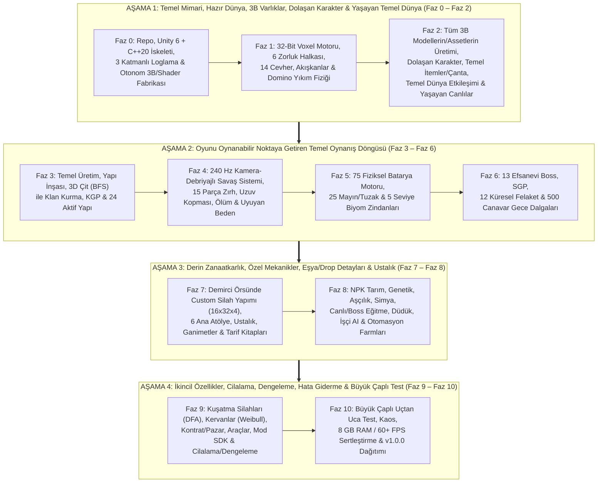
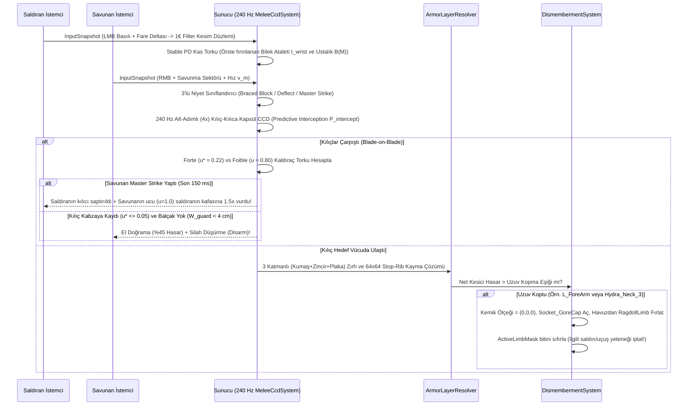
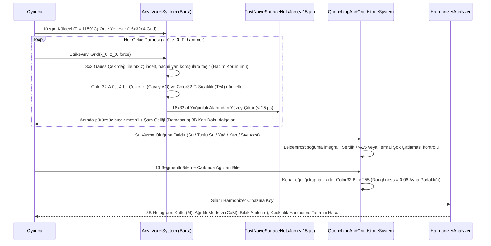
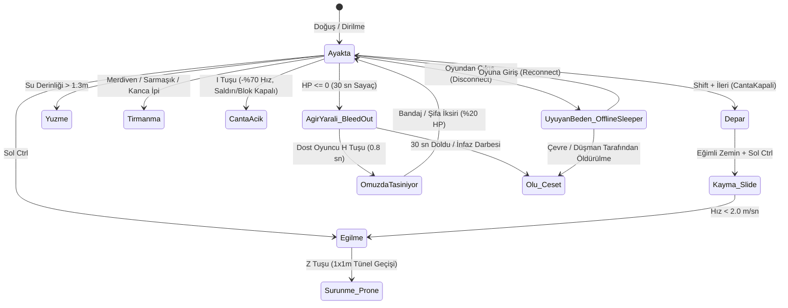
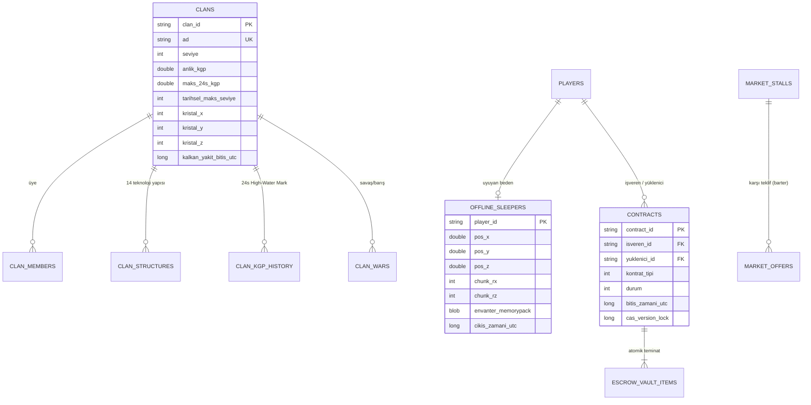
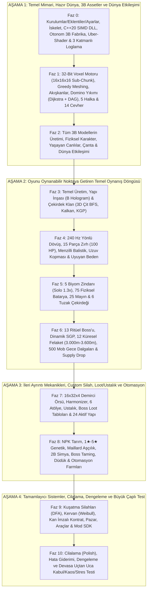
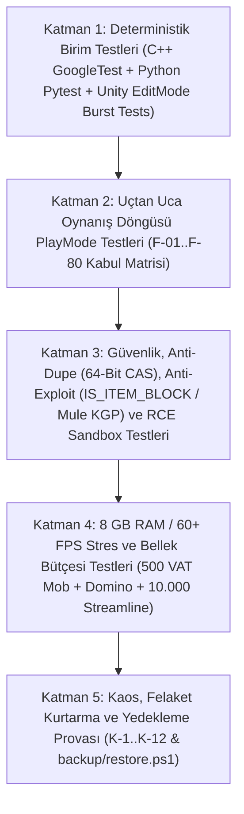

# ⚔️ Stratocraft — Geliştirici Dokümanı ve Faz Faz İnşa Anayasası (Proje Anayasası)

> **Sürüm:** 1.2.0  
> **Doküman tarihi:** 29.10.2026  
> **Repo:** `https://github.com/Muhammed-KRM/Stratocraft.git`  
> **Temel tasarım ve matematiksel referans belgeleri (Ayrılmaz Üçlü Anayasa):**  
> 1. **Oynanış ve Tasarım Anayasası:** [STRATOCRAFT: EVRENSEL OYUN TASARIM VE MANTIK ANAYASASI (GAME LOGIC BIBLE - v7.0)](file:///d:/oyun/STRATOCRAFT_%20EVRENSEL%20OYUN%20TASARIM%20VE%20MANTIK%20ANAYASASI%20%28GAME%20LOGIC%20BIBLE%29%20%282%29.md)  
> 2. **Matematiksel Simülasyon ve Voxel Algoritmaları Raporu:** [STRATOCRAFT: ARKA PLAN MATEMATİKSEL SİMÜLASYON VE VOXEL ALGORİTMALARI RAPORU](file:///d:/oyun/STRATOCRAFT_ARKA_PLAN_MATEMATIKSEL_SIMULASYON_VE_VOXEL_ALGORITMALARI_RAPORU.md)  
> 3. **Teknoloji Ağacı, Motor Seçimi ve Açık Kaynak Mimari Rehberi:** [STRATOCRAFT: OYUN MOTORU SEÇİMİ, AÇIK KAYNAK MİMARİ KARARI, BÖLÜM 1–16 TEKNOLOJİ AĞACI VE 4 KATMANLI YÜRÜTME REHBERİ](#bölüm-3--kullanılacak-teknolojiler-ve-kullanım-amaçları)  
> **Hedef okuyucu:** Bu projeyi sıfırdan tek başına geliştirecek bir oyun/yazılım mühendisi **veya** insan müdahalesiz çalışan otonom bir yapay zeka kodlama ajanı (*Autonomous AI Coding Agent*).

> [!IMPORTANT]
> Bu doküman, yukarıdaki üç temel referans belgeyle birlikte projenin **tek doğruluk kaynağıdır (single source of truth)**. Kod yazmadan önce, her fazın başında ve her önemli mimari karardan önce bu doküman ve referans verdiği ilgili tasarım/matematik bölümü okunmalı; yapılan iş bu dokümana uygun mu diye kontrol edilmelidir. Dokümanın dışına çıkmak gerekirse, bu durum **gerekçesiyle birlikte** faz raporunda `"DOKÜMAN DIŞI KARAR"` başlığıyla açıkça bildirilmeli, `docs/kararlar/ADR-XXX-*.md` olarak kaydedilmeli ve bu doküman güncellenmelidir.

---

## İçindekiler

- [Bölüm 1 — Projenin Amacı](#bölüm-1--projenin-amacı)
  - 1.1 Problem
  - 1.2 Çözüm ve Temel Oyun Felsefesi
  - 1.3 Hedef Oyuncu Profili ve Kullanıcı Hikâyeleri (`US-01 .. US-30`)
  - 1.4 Kapsam ve Gerçekçi 4 Aşamalı Oyun Geliştirme Stratejisi
  - 1.5 Ölçülebilir Başarı ve Performans Ölçütleri
  - 1.6 Donanım Hedefi, Bellek Bütçesi ve Sıfır-Maliyetli Üretim Modeli
  - 1.7 Yasal, Lisans ve Güvenlik Çerçevesi
  - 1.8 Teknik Sözlük
- [Bölüm 2 — Kesin Uyulması Gereken Kurallar, Prensipler ve Zorunlu Özellikler](#bölüm-2--kesin-uyulması-gereken-kurallar-prensipler-ve-zorunlu-özellikler)
  - 2.1 Genel Çalışma Kuralları (Geliştirici / AI Ajanı İçin)
  - 2.2 Kod Kalitesi Prensipleri (Clean Code, SOLID, DRY, C# Burst SIMD & C++20 Kuralları)
  - 2.3 İsimlendirme Standartları
  - 2.4 Loglama Kuralları (ZORUNLU — 3 Katmanlı Fail-Safe Oyun Telemetri Modeli)
  - 2.5 Hata Yönetimi ve Çökme Koruması Kuralları
  - 2.6 Güvenlik, Anti-Cheat, Anti-Dupe ve İki Katmanlı RCE Mod Sandbox Kuralları
  - 2.7 Performans, Bellek (`8 GB RAM / < 2.5 GB Oyun RAM`) ve `15 ms` Kare Bütçesi Kuralları
  - 2.8 Veri Yapıları, Bit-Packing ve Dünya Kayıt (`LZ4/Zstd Delta + SQLite`) Kuralları
  - 2.9 Test Kuralları (EditMode, PlayMode, Burst Determinizm, Native C++, 3B Asset Validator)
  - 2.10 Git, Commit ve Faz Etiketleme Kuralları
  - 2.11 Dokümantasyon ve ADR Kuralları
  - 2.12 Modülerlik, Tek Oyunculu / Çok Oyunculu Eşliği ve Genişletilebilirlik Prensibi
  - 2.13 Projede Kesin Olması Gereken Özellikler (`F-01 .. F-95` Kabul Kriterleri Tablosu)
  - 2.14 Fonksiyonel Olmayan Gereksinimler
- [Bölüm 3 — Kullanılacak Teknolojiler ve Kullanım Amaçları](#bölüm-3--kullanılacak-teknolojiler-ve-kullanım-amaçları)
  - 3.1 Genel Teknoloji Matrisi
  - 3.2 Oyun Motoru ve Çekirdek Simülasyon (`Unity 6000.0 LTS + DOTS Entities + C# Burst SIMD`)
  - 3.3 Yerel C++20 Native DLL Katmanı (`StratocraftNative`)
  - 3.4 Grafik, Görselleştirme ve `UV-Free Uber-Shader` (`HLSL + URP Forward+ + GPU Resident Drawer`)
  - 3.5 Ağ, Senkronizasyon ve 3 Katmanlı Hibrit LoD AI Katmanı
  - 3.6 `%100` Otonom Ajan Kontrollü 3B Varlık, Doku, İskelet ve `VAT` Animasyon Fabrikası
  - 3.7 Veri Saklama, Sıkıştırma ve İki Katmanlı Mod SDK Katmanı
  - 3.8 Geliştirme, Otomasyon ve Kalite Kapısı Araçları
  - 3.9 Lisans Uyarıları (Sürüm ve Araç Seçimini Etkileyenler)
- [Bölüm 4 — Mimari ve Nihai Dosya Yapısı](#bölüm-4--mimari-ve-nihai-dosya-yapısı)
  - 4.1 Mimari Tarzı (4 Katmanlı Hibrit ECS + Native + Compute + Managed Mimarisi)
  - 4.2 Genel Mimari Diyagramı
  - 4.3 Bileşen Sorumlulukları Tablosu
  - 4.4 Kritik Sistem Veri Akışları (`sequenceDiagram`)
  - 4.5 Durum Makineleri (`stateDiagram-v2`) ve Sabit Tamsayı Enum Sözleşmeleri
  - 4.6 Bellek Düzeni, Voxel Bit-Packing ve Sabit Boyutlu Struct Şemaları
  - 4.7 Ağ RPC, Snapshot Delta ve Olay Sözleşmeleri
  - 4.8 Otonom 3B Varlık Fabrikası (`Stratocraft_Asset_Manifest.json` ve Doğrulama Sözleşmesi)
  - 4.9 Konfigürasyon (`.env`, `ServerConfig.json` ve `ScriptableObject` Ayarları)
  - 4.10 Dünya Kayıt Klasörü (`saves/`), Bölge (`Region`) ve SQLite Veritabanı Düzeni
  - 4.11 Mekansal Özet (`Spatial Hash`, `NavSpan`) ve Bellek Havuzu Anahtar Düzeni
  - 4.12 Nihai Dosya Yapısı (Tam Ağaç — `(F0)..(F10)` Faz Etiketli)
  - 4.13 Dosya-Dosya Sorumluluk, Teknoloji, Sınıf ve Fonksiyon İmzaları Rehberi
- [Bölüm 5 — Adım Adım Geliştirme Rehberi ve Fazlar (`Faz 0 → Faz 10`)](#bölüm-5--adım-adım-geliştirme-rehberi-ve-fazlar)
  - 5.0 Gerçek Oyun Mühendisliği Stratejisine Göre 4 Aşamalı Faz Haritası ve Ortak Kalite Kapısı
  - **AŞAMA 1 — TEMEL ALTYAPI, HAZIR DÜNYA, 3B MODELLER, DOLAŞAN KARAKTER VE YAŞAYAN TEMEL DÜNYA (`Faz 0 – Faz 2`)**
    - Faz 0 — Hazırlık, Repo, Unity 6 + C++20 İskeleti, 3 Katmanlı Loglama ve Otonom 3B/Shader Üretim Fabrikası Kurulumu (`5.1.0`: Bilgisayara Kurulacaklar, Uygulama İçi Eklentiler/Kütüphaneler ve Yapılacak Ayarlar)
    - Faz 1 — Çekirdek Voxel Motoru, Dünya Coğrafyası (6 Zorluk Halkası & Biyomlar), Akışkanlar ve Mimari Ağırlık / Domino Fiziği
    - Faz 2 — Otonom 3B Varlıkların/Modellerin Üretimi, Fiziksel Karakter Hareketi, Temel İtemler/3B Çanta, Dünya Etkileşimleri ve Yaşayan Canlılar
  - **AŞAMA 2 — OYUNU OYNANABİLİR HALE GETİREN TEMEL OYNANIŞ DÖNGÜSÜ (`Faz 3 – Faz 6`)**
    - Faz 3 — Temel Üretim Yöntemleri, Yapı İnşası, Klan Kurma (`3D Çit BFS`), KGP ve Klan Yapıları
    - Faz 4 — 240 Hz Fizik Tabanlı Savaş Sistemi (Yakın Dövüş, Menzilli), 15 Parça 3 Katmanlı Zırh, Uzuv Kopması, Ölüm ve Kalıcı Uyuyan Beden
    - Faz 5 — 75 Fiziksel Batarya Motoru, 25 Mayın / Tuzak Mühendisliği ve Biyom Zindanları
    - Faz 6 — 13 Efsanevi Boss, Sunucu Güç Puanı (`SGP`), 12 Küresel Felaket ve Gece Dalgaları
  - **AŞAMA 3 — DERİN ZANAATKARLIK, ÖZEL MEKANİKLER, EŞYA/GANİMET DETAYLARI VE USTALIK (`Faz 7 – Faz 8`)**
    - Faz 7 — Demirci Örsünde Custom Silah/Zırh Dövme (`16x32x4`), 6 Ana Atölye, Ustalık Sistemi, Boss/Canlı Ganimetleri ve Tarif Kitapları
    - Faz 8 — Ekosistem (NPK Tarım, Genetik, Aşçılık, Simya), Canlı Eğitme (`Taming`), Düdük Komutları, İşçi AI ve Otomasyon Farmları
  - **AŞAMA 4 — İKİNCİL ÖZELLİKLER, CİLALAMA, DENGELEME, HATA GİDERME VE BÜYÜK ÇAPLI TEST (`Faz 9 – Faz 10`)**
    - Faz 9 — Kuşatma Silahları (`in-situ DFA`), Kervanlar (`Weibull`), Kontrat/Pazar Ekonomisi, Özel Araçlar, Mod SDK ve Genel Cilalama / Dengeleme
    - Faz 10 — Büyük Çaplı Uçtan Uca Test, Kaos/Dayanıklılık, Performans/Bellek (`8 GB RAM / 60+ FPS`) Sertleştirme, Güvenlik Denetimi ve `v1.0.0` Dağıtımı
- [Ekler](#ekler)
  - Ek A — Sorun Giderme Rehberi
  - Ek B — Komut Kılavuzu
  - Ek C — Gelecek Geliştirme Fikirleri (Kapsam Dışı, Mimari Hazır)
  - Ek D — Doküman Değişiklik Günlüğü

---

# Bölüm 1 — Projenin Amacı

## 1.1 Problem

Mevcut açık dünya hayatta kalma (*survival*), voxel inşa ve klan savaşı oyunlarında (Minecraft, Rust, ARK, Valheim, Vintage Story, Enshrouded, Kingdom Come: Deliverance) oyuncular ve geliştiriciler şu 7 temel darboğazla karşılaşmaktadır *(Ayrıntılı bağlam için bkz. [GAME LOGIC BIBLE Bölüm 1](file:///d:/oyun/STRATOCRAFT_%20EVRENSEL%20OYUN%20TASARIM%20VE%20MANTIK%20ANAYASASI%20%28GAME%20LOGIC%20BIBLE%29%20%282%29.md#L30-L155))*:

1. **Ruhsuz "Tıkla-Bekle" Menüler ve Soyut Büyüler:** Çoğu oyunda eşya üretimi bir menüde "Üret" butonuna basıp ilerleme çubuğu beklemekten, büyüler ise `Mana` çubuğu harcayıp kısayol tuşuna basmaktan ibarettir. Oyuncunun mühendislik ve el becerisi sonuca etki etmez.
2. **Sahte Fizik ve Havada Asılı Kalan Bloklar:** Klasik voxel oyunlarda altındaki kolonlar kırılan devasa bir kale havada asılı kalır; yıkım olduğunda ise binlerce ayrı `RigidBody` parçası CPU'yu kilitleyerek sunucuyu `1–5 FPS`'e düşürür.
3. **Ya Çok Basit ("Sol Tık Spam") Ya Da Kontrolü İmkansız Yakın Dövüş:** Kılıç savaşları ya basit animasyon tekrarından ibarettir ya da tamamen serbest bırakıldığı için 2B ekranda derinlik algısı kaybolur ve kılıçlar birbirinin içinden geçer.
4. **Görüş Alanı Dışında Donan ("Unloaded Chunk") Dünya:** Oyuncu bir bölgeden uzaklaştığında kervanlar, su akışı, ekinler, fırınlar ve felaket orduları tamamen donar; yaşayan bir dünya hissi kaybolur.
5. **Klan Gücü İstismarı ("Alt-Account / Katır Çar" ve "Offline Raid" Sorunu):** Büyük klanlar güçlü eşyalarını klansız yan hesaplara (*Mule*) aktararak güç puanlarını düşük gösterir, küçük klanları ezer veya oyuncular uyurken savunmasız kaleleri yok eder.
6. **Yüksek Donanım Zorunluluğu:** Modern voxel ve açık dünya oyunları `16–32 GB RAM` ve pahalı harici ekran kartları olmadan oynanamaz hale gelmiştir; `8 GB RAM` ve dahili GPU (*Intel Iris Xe / AMD Vega iGPU*) kullanan milyonlarca bilgisayar dışarıda bırakılmaktadır.
7. **Geliştirme Sürecinde 3B Model ve Animasyon Darboğazı:** Yüzlerce silah, 15 parça zırh, 6 atölye, 14 klan yapısı, 75 batarya, 21 yaratık ve 13 Boss içeren bir oyunda her modeli elle Blender'da modellemek ve animasyonlamak tek bir geliştirici veya küçük ekip için yıllar sürer.

## 1.2 Çözüm ve Temel Oyun Felsefesi

**Stratocraft**, *"Sıfır Soyut Menü — %100 Fiziksel Etkileşim"* yasası üzerine kurulu; oyuncunun taş devrinden başlayıp mikro-voxel örste kendi kılıcını dövdüğü, dünyada fiziksel blok dizilimleriyle **75 Batarya** ve **25 Mayın** inşa ettiği, **3D Kesintisiz Çit** ile klan kurup **13 Boss** ve **12 Küresel Felaket Titanına** karşı savaştığı yeni nesil bir **Fiziksel Voxel Hayatta Kalma, Zanaatkarlık ve Strateji** oyunudur.

Temel oyun ve mühendislik akışı:

```text
[AŞAMA 1: Yaşayan Fiziksel Dünya]
6 Eş-Merkezli Zorluk Halkası (0–18.000m) + 14 Cevher + Sonlu Akışkanlar + Domino Yıkım Fiziği
     → Otonom 3B Varlık Fabrikası ile üretilmiş UV-Free Uber-Shader modeller (< 16 MB VRAM)
     → Fiziksel Karakter + 3B Kumaş Sırt Çantası (I Tuşu) + 3 Katmanlı Hibrit LoD AI Canlılar

[AŞAMA 2: Temel Oynanış Döngüsü]
Kamera-Debriyajlı (Camera-Clutch + 1€ Filter + Stable PD) Yakın Dövüş & 15 Parça 3 Katmanlı Zırh
     → 3D Kesintisiz Çit (BFS) ile Klan Kurma + KGP + 14 Klan Yapısı + 5 Seviye Biyom Zindanları
     → IS_ITEM_BLOCK Ayrımı + 75 Fiziksel Batarya + 25 Mayın + 13 Ritüel Boss'u + 12 Küresel Felaket

[AŞAMA 3 & 4: Derin Zanaat, Ekonomi ve Ölçeklenebilirlik]
16x32x4 Mikro-Voxel Örste Custom Silah Dövme + 6 Zanaat Atölyesi + Ustalık (Mastery) + NPK Tarım/Simya
     → Canlı/Boss Eğitme (Taming) + Akustik Düdük + İşçi AI + 1D Streamline Otomasyon Farmları
     → 5 Aşamalı Kuşatma Silahları + Weibull Kervanlar + Kan İmzalı Kontrat (EscrowVault) + Mod SDK
```

Ana mühendislik prensipleri:
- **Fiziksel Etkileşim Yasası ([GAME LOGIC BIBLE Bölüm 1.1](file:///d:/oyun/STRATOCRAFT_%20EVRENSEL%20OYUN%20TASARIM%20VE%20MANTIK%20ANAYASASI%20%28GAME%20LOGIC%20BIBLE%29%20%282%29.md#L32-L60)):** Oyunda sanal para (sikke), büyü çubuğu (`Mana`) veya tek tıkla üretim menüsü yoktur. Her üretim fiziksel tezgahlarda, her büyü dünyada doğru geometride dizilen **75 Batarya** ile, her ticaret fiziksel madenler ve **Kervan Vagonları** ile yapılır.
- **3 Katmanlı Hibrit Dünya ve AI Simülasyonu ([MATEMATİKSEL SİMÜLASYON RAPORU Bölüm 1](file:///d:/oyun/STRATOCRAFT_ARKA_PLAN_MATEMATIKSEL_SIMULASYON_VE_VOXEL_ALGORITMALARI_RAPORU.md#L12-L55)):** Oyuncunun yakınındaki (`0–128m`) varlıklar tam 3B fizikle (`Active 3D`), orta mesafedekiler (`128–512m`) çok katmanlı `NavSpan` üzerinde `2.5D Agent` olarak, uzaktakiler (`>512m`) ise diferansiyel denklemler ve zaman damgalarıyla (`2D Macro`) `%0` fizik maliyetiyle simüle edilir.
- **8 GB Sistem RAM ve Dahili GPU Dostu Mimari ([Bölüm 3: Kullanılacak Teknolojiler](#bölüm-3--kullanılacak-teknolojiler-ve-kullanım-amaçları)):** Unity 6 Hibrit DOTS + `C# Burst SIMD` + `C++20 Native DLL` + `UV-Free Color32 Uber-Shader` sayesinde oyun içi toplam RAM kullanımı **`< 2.5 GB`**, toplam kaplama VRAM kullanımı **`< 16 MB`** ve kare süresi **`< 15 ms` (`60+ FPS`)** altında tutulur.
- **İnsan Müdahalesiz (`Zero-Touch`) Otonom 3B Üretim ([GAME LOGIC BIBLE Bölüm 16](file:///d:/oyun/STRATOCRAFT_%20EVRENSEL%20OYUN%20TASARIM%20VE%20MANTIK%20ANAYASASI%20%28GAME%20LOGIC%20BIBLE%29%20%282%29.md#L3541-L3677)):** Geliştirici veya AI ajanı hiçbir 3B programı elle açmadan; Headless Blender `bpy`, Blockbench JSON, `MidVoxIO` `.vox`, Material Maker CLI ve `TRELLIS`/`TripoSG` + `UniRig` + `VatBaker` boru hattıyla tüm modelleri üretir, `asset_validator.py` ve 4-açılı render ile kendi kendini denetler.
- **Hem Tek Oyunculu (`Singleplayer`) Hem Çok Oyunculu (`Multiplayer`) Tam Uyum:** Aynı deterministik çekirdek hem yerel tek oyunculu modda (`1.3x` zindan tavanı ve eğitilmiş insansı canlılarla solo kuşatma silahı desteğiyle) hem de `64–100+` oyunculu adanmış sunucuda (*Dedicated Server*) birebir aynı kurallarla çalışır.

## 1.3 Hedef Oyuncu Profili ve Kullanıcı Hikâyeleri (`US-01 .. US-30`)

| Kod | Kullanıcı / Oyuncu Hikâyesi | Faz |
|---|---|---|
| **US-01** | Oyuncu olarak `8 GB RAM` ve dahili ekran kartlı bilgisayarımda oyunu `60+ FPS`'te, takılma olmadan açıp uçsuz bucaksız voxel dünyada dolaşmak istiyorum. | Faz 1–2 |
| **US-02** | Oyuncu olarak merkezden (`0m`) dışarı doğru ilerledikçe 6 zorluk halkasının, biyomların, mevsimlerin ve yeraltı cevher damarlarının (`14 cevher`) doğal olarak değiştiğini görmek istiyorum. | Faz 1 |
| **US-03** | Oyuncu olarak altındaki taşıyıcı kolonları yıkılan bir kalenin veya mağara tavanının havada asılı kalmayıp gerçekçi domino fiziğiyle (`Two-Phase DAG`) çöktüğünü görmek istiyorum. | Faz 1 |
| **US-04** | Oyuncu olarak karakterimle koşmak, eğilmek, yokuş aşağı kaymak (`Slide`), `1 blok` yüksekliğindeki deliklerden sürünerek (`Prone`) geçmek, yüzmek ve tırmanmak istiyorum. | Faz 2 |
| **US-05** | Oyuncu olarak `I` tuşuna bastığımda önüme serilen 3B kumaş çanta örtüsü üzerinde eşyalarımı gerçek 3B yığınlar halinde görmek ve `1–4` tuşlarıyla bel/sırt kılıflarımdan silah çekmek istiyorum. | Faz 2 |
| **US-06** | Oyuncu olarak doğadan ham taş, toprak ve odun kütlelerini **Madde Kristali (`C` tuşu)** içine vakumlayıp taşımak (`BlockOriginState = 0`), gerektiğinde ham voxel olarak geri koymak ve zanaat/batarya için geçerli item bloğunu (`IS_ITEM_BLOCK = 1`) fiziksel kazma/balta ile çıkarıp kullanmak istiyorum. | Faz 2 |
| **US-07** | Oyuncu olarak `Sol/Sağ Tık` basılı tutup faremi savurarak (`Camera-Clutch`) yarı-otomatik hizalama yardımıyla akıcı kılıç dövüşü yapmak, rakibin darbesini `Forte` kök noktasıyla bloklamak, saptırmak (`Deflect`) veya `Master Strike` ile kontralamak istiyorum. | Faz 3 |
| **US-08** | Oyuncu olarak düşmanların ve Bossların kollarını, kafalarını veya kanatlarını keserek (`Dismemberment`) o uzva bağlı saldırılarını devre dışı bırakmak istiyorum. | Faz 3 |
| **US-09** | Oyuncu olarak vücudumun 15 bölgesine 3 katmanlı (*İç Kumaş + Orta Zincir + Dış Plaka*) zırh giymek ve kılıcın zırh boşluklarından (`Stop-Rib`) kayarak hasar verdiğini deneyimlemek istiyorum. | Faz 3 |
| **US-10** | Oyuncu olarak canım sıfırlandığında `30 sn` yerde sürünmek (`Bleed-Out`), dostumun beni `H` tuşuyla omzunda taşıyarak (`Fireman's Carry`) kurtarmasını ve oyundan çıktığımda bedenimin dünyada uyur halde (`Offline Sleeper`) kalmasını istiyorum. | Faz 3 |
| **US-11** | Oyuncu olarak merkeze bir **Klan Kristali** dikip etrafını kesintisiz çitlerle (`3D BFS`) çevirerek 3 boyutlu klan bölgesi kurmak ve fisiksel ritüellerle üye almak/savaş ilan etmek istiyorum. | Faz 4 |
| **US-12** | Oyuncu olarak klan bölgeme 14 aktif klan teknolojisi yapısı (*Simya Kulesi, Şifa Kulesi, Gözetleme Kulesi, Hız Çemberi, Ruh Ocağı vb.*) inşa etmek istiyorum. | Faz 4 |
| **US-13** | Oyuncu olarak dünyada `IS_ITEM_BLOCK = 1` blokları 3B şemaya göre (`B` tuşu Hayalet Hologram yardımıyla) dizip ateşleyerek **75 Fiziksel Batarya** (*25 Saldırı, 25 Oluşturma, 25 Destek/Savunma*) kullanmak istiyorum. | Faz 5 |
| **US-14** | Oyuncu olarak `6 Yakıtlı Tuzak Çekirdeği` ve `25 Fiziksel Mayın` kurup üstünü yaprak/toprak örtüsüyle gizlemek, düşman mayınlarını Dedektör Küresiyle bulup `E` tuşuyla sökmek istiyorum. | Faz 5 |
| **US-15** | Oyuncu olarak 5 zorluk halkasındaki 4 odalı Biyom Zindanlarına tek başıma (`1.3x HP` solo tavanı) veya ekibimle girip tuzakları, bulmacaları ve Zindan Muhafızlarını aşmak istiyorum. | Faz 5 |
| **US-16** | Oyuncu olarak dünyada fiziksel ritüel sunakları kurarak **13 Efsanevi Boss'u** (*Goblin Kral'dan Karanlık Tanrı ve 9 Başlı Hydra'ya kadar*) çağırmak ve zayıf noktalarını (`3x Kritik`) vurarak avlamak istiyorum. | Faz 6 |
| **US-17** | Oyuncu olarak Sunucu Güç Puanı (`SGP`) arttıkça başlayan **12 Küresel Felakete** ve gece kuşatma dalgalarına (`500 Canavar`) karşı klanımı savunmak istiyorum. | Faz 6 |
| **US-18** | Oyuncu olarak demirci ocağında ısıttığım külçeyi `16x32x4` mikro-voxel örste çekiçleyerek kendi özel kılıcımı dövmek, su verme (`Quenching`) ve bileme çarkıyla keskinleştirip **Harmonizer**'da fiziksel dengesini ölçmek istiyorum. | Faz 7 |
| **US-19** | Oyuncu olarak 6 Ana Zanaat Atölyesinde (*Demirci, Marangoz, Derici/Dokumacı, Cam/Mücevher, Haritacı, Yazman Masası*) ustalık (`Mastery`) kazanmak ve Tarif Kitaplarını (`Lv1–Lv5`) kopyalamak istiyorum. | Faz 7 |
| **US-20** | Oyuncu olarak `NPK` toprak kimyasıyla tarım yapmak, `1★–5★` genetikle hayvan yetiştirmek, `Maillard` fiziğiyle yemek pişirmek ve `2B Faz Uzayı` kazanında simya iksirleri üretmek istiyorum. | Faz 8 |
| **US-21** | Oyuncu olarak yaraladığım yaratıkları ve 13 Boss'u özel kafeslerde eğitmek (`Taming`), `R` tuşu akustik düdük frekanslarıyla onlara savaş, binek veya klan içi lojistik/üretim işçisi (`GOAP AI`) görevleri vermek istiyorum. | Faz 8 |
| **US-22** | Oyuncu olarak su/buz kanalları (`1D Streamline`), hidrolik pistonlar ve manyetik hunilerle sunucuyu kastırmayan yaratıcı otomasyon farmları kurmak istiyorum. | Faz 8 |
| **US-23** | Oyuncu olarak savaş alanında 5 aşamalı (`DFA`) **Mancınık, Polybolos, Ateş Topu Atar ve Kuşatma Topu** monte etmek ve tek oyunculu modda bile eğittiğim Ork/Golem yardımcılarımla bunları itip ateşlemek istiyorum. | Faz 9 |
| **US-24** | Oyuncu olarak tonajlı madenleri **Kervan Vagonu** ile taşımak, **Kan İmzalı Kontrat Bürosunda (`-15 HP`, `EscrowVault`)** güvenli anlaşmalar yapmak ve **Pazar Tezgahında** takas (`Barter`) yapmak istiyorum. | Faz 9 |
| **US-25** | Oyuncu olarak **Paslı/Titan Kancası**, **Planör**, **Casusluk Dürbünü** ve kara/deniz/hava araçlarıyla dünyayı keşfetmek ve güvenli Mod SDK ile yeni içerikler eklemek istiyorum. | Faz 9 |

## 1.4 Kapsam ve Gerçekçi 4 Aşamalı Oyun Geliştirme Stratejisi

Bu dokümanda faz sıralaması rastgele değil, **gerçek bir profesyonel oyun mühendisliği ekibinin inşa sırasına (4 Ana Aşama / 11 Faz: `Faz 0 → Faz 10`)** göre kurgulanmıştır:



- **Aşama 1 (`Faz 0 – Faz 2` — "Dünya, Varlıklar ve Temel Etkileşim Hazır"):** Önce motor çekirdeği, loglama, C++20 köprüsü ve otonom 3B/Shader üretim hattı kurulur (`Faz 0`). Ardından 6 zorluk halkalı voxel dünya, su/lav akışı ve gerçekçi domino yıkım fiziği ayağa kaldırılır (`Faz 1`). Hemen sonrasında oyundaki her şey için 3B modeller/assetler üretilir, dünyada yürüyüp koşabilen/yüzebilen karakter, 3B kumaş çanta, temel itemler, blok kırma/koyma etkileşimleri ve dünyada dolaşıp yaşayan canlılar eklenir (`Faz 2`). *Bu aşama bittiğinde henüz tam oyun döngüsü (klan savaşları, bataryalar, bosslar) başlamamıştır ama yaşayan, gezilebilen, etkileşime girilebilen eksiksiz bir 3B dünya ve karakter hazırdır.*
- **Aşama 2 (`Faz 3 – Faz 6` — "Tam Oynanabilir Çekirdek Oyun Döngüsü"):** Hazır dünyanın üzerine oyunu gerçek bir oyuna dönüştüren temel döngü inşa edilir: temel üretim, yapı yapma, 3D çitle klan kurma ve klan yapıları (`Faz 3`), 240 Hz yakın/menzilli dövüş, 15 parça zırh, uzuv kopması ve uyuyan beden sistemi (`Faz 4`), 75 fiziksel batarya, 25 mayın ve biyom zindanları (`Faz 5`), 13 Boss, SGP, 12 Küresel Felaket ve gece kuşatma dalgaları (`Faz 6`). *Bu aşama bittiğinde Stratocraft baştan sona oynanabilir bir oyundur.*
- **Aşama 3 (`Faz 7 – Faz 8` — "Derinlik, Özelleştirme ve Zanaatkarlık"):** Temel döngünün üzerine Stratocraft'ı benzersiz kılan derin sistemler eklenir: demircide `16x32x4` mikro-voxel custom silah dövme, 6 ana zanaat atölyesinin fiziksel mini-oyunları, ustalık (`Mastery`) sistemi, yaratık/Boss özel eşyaları ve düşen ganimetler (`Faz 7`), tarım/hayvancılık/aşçılık/simya, canlı/Boss eğitme (`Taming`), düdük komutları, işçi AI ve fiziksel otomasyon farmları (`Faz 8`).
- **Aşama 4 (`Faz 9 – Faz 10` — "Tamamlayıcı Sistemler, Cilalama, Dengeleme ve Büyük Çaplı Test"):** Kuşatma silahları, kervanlar, kontrat/pazar ekonomisi, kancalar/planör/araçlar ve Mod SDK eklenir; tüm mekanikler cilalanır, matematiksel dengelemeler (*Balancing*) ve hata giderimleri (*Bug Fixing*) tamamlanır (`Faz 9`). Son olarak `Faz 10`'da en ufak ayrıntısına kadar otomatik/manuel kabul testleri, kaos testleri ve `8 GB RAM / 60+ FPS` stres testleri yapılarak `v1.0.0` sürümü mühürlenir.

### Bilinçli Olarak Kapsam Dışı Bırakılanlar
- **Oyun İçi Gerçek Parayla Güç Satışı (*Pay-to-Win*) veya Sanal Sikke (`Coin`):** Ekonominin %100 fiziksel madenlere dayanması anayasal kuraldır.
- **4K Foto-Gerçekçi Yüksek VRAM Dokuları:** `8 GB RAM` ve dahili GPU hedefini korumak için 4K PBR kaplamalar yerine `UV-Free Color32 + MatCap + 2-Tap Biplanar` (`< 16 MB VRAM`) kullanılır.
- **Derlenmemiş Ham C# `.dll` Mod Yükleme (`Assembly.Load`):** Uzaktan kod çalıştırma (`RCE`) açığı yarattığı için kesinlikle yasaktır; yalnızca `JSON + MoonSharp Lua / Roslyn Kaynak Kodu AST Doğrulayıcı` kabul edilir.

## 1.5 Ölçülebilir Başarı ve Performans Ölçütleri

| Ölçüt | Hedef Değer | Doğrulama Yöntemi |
|---|---|---|
| **Minimum Donanımda Kare Hızı (FPS)** | `≥ 60 FPS` (`≤ 15.0 ms` kare süresi; `8 GB Sistem RAM + Intel Iris Xe / Vega iGPU`) | `Faz 10` Performans Stres Testi (`StratocraftFrameProfiler`) |
| **Oyun İçi Toplam Bellek Ayak İzi (RAM)** | **`< 2.5 GB RAM`** (`8 GB` sistemde işletim sistemine `5.5 GB` boş alan bırakır) | Unity Profiler + Windows Process Working Set ölçümü |
| **Toplam Kaplama VRAM Bütçesi** | **`< 16.0 MB VRAM`** (`32 KB LUT + 1.39 MB MatCap + 13.9 MB BC7/BC5 Array + 512 KB 3D Noise`) | RenderDoc / Unity Frame Debugger doku belleği raporu |
| **16x16x16 Sub-Chunk (`4.096` Voxel) Greedy Meshing Süresi** | **`< 0.15 ms / sub-chunk`** (Burst 64-Bit Binary Greedy Meshing) | `GreedyMeshingBenchmarkTests` |
| **Domino Yıkımı (`10.000` Voxel Kale Çöküşü)** | **`< 2.0 ms`** CPU (`Dial's Bucket Dijkstra + Tek Geçişli Tributary Load DAG + Greedy Box Fracture`, maksimum `12` DOTS konveks parça) | `StructuralCollapseStressTests` |
| **Demirci Örsü (`16x32x4`) Yüzey Çıkarma** | **`< 15 µs`** (`0.015 ms` — `fastNaiveSurfaceNets` Burst SIMD) | `AnvilSurfaceNetsBenchmarkTests` |
| **Klan Bölgesi ve Araştırma Kürsüsü Sorgusu** | **`~5 ns – 15 ns` ($O(1)$)** bitmask / spatial hash sorgusu | `ClanTerritoryBitmaskTests` |
| **500 Canavarlı Gece Kuşatması Çizimi** | **`1–3 Draw Call`**, **`< 0.8 ms` GPU** (`6 MB FP16 VAT` + `BatchRendererGroup`) | `NightWave500MobStressTests` |
| **10.000 Eşyalı Otomasyon Farmı CPU Süresi** | **`< 0.02 ms / tick` ($O(1)$)** (`1D Streamline Belt-Line Coalescing`) | `StreamlineFarmBenchmarkTests` |
| **Birim ve Entegrasyon Test Kapsamı** | Çekirdek Voxel/Fizik/Savaş/Batarya mantığında **`≥ %80`** satır kapsamı | Unity Test Runner + Python `pytest --cov` + C++ `ctest` |

## 1.6 Donanım Hedefi, Bellek Bütçesi ve Sıfır-Maliyetli Üretim Modeli

1. **Hedef Oyuncu Donanımı (Alt Sınır):**
   - **RAM:** `8 GB Sistem RAM` (Oyun çalışma zamanı tavanı: **`2.200 – 2.450 MB`**).
   - **GPU:** `2 GB Paylaşımlı VRAM` dahili GPU (*Intel UHD 730 / Iris Xe / AMD Radeon Vega 8*) veya giriş seviyesi harici GPU (*GTX 1050 / GTX 1650*).
   - **CPU:** 4 Çekirdek / 8 İzlek `AVX2` destekli işlemci.
2. **Sıfır Bulut Maliyetli (`$0`) Geliştirme ve 3B Varlık Üretimi:**
   - Oyunun geliştirilmesi ve 3B modellerinin üretilmesi için hiçbir ücretli bulut API'sine veya 3B tasarım aboneliğine ihtiyaç yoktur.
   - **Çift Yollu (`Dual-Path`) Otonom 3B Fabrika:** Geliştirici bilgisayarda yüksek VRAM'li GPU varsa açık kaynak `MIT` lisanslı `microsoft/TRELLIS` ve `TripoSG` yerel çalışır; GPU yoksa veya VRAM düşükse `ProceduralCreatureBuilder.py` (Blender Headless `bpy` Geometry Nodes / CSG / Skin Modifier + Blockbench JSON + `MidVoxIO` `.vox`) CPU üzerinde **`< 2 saniyede` `%0` maliyetle** tüm varlıkları üretir.

## 1.7 Yasal, Lisans ve Güvenlik Çerçevesi

> [!WARNING]
> - **Ticari Dostu Açık Kaynak Kuralı:** Oyun ikilisine (*runtime binary*) bağlanan tüm kütüphaneler **`MIT`, `Apache-2.0`, `BSD-2/3` veya `Zlib`** lisanslı olmak zorundadır.
> - **`GPL / AGPL` Yasağı:** `GPLv3` lisanslı araçlar (ör. `QuadWild`) **asla** oyun içine veya dağıtılan DLL'lere bağlanmaz; çalışma zamanı/üretim boru hattında `BSD-3` lisanslı `wjakob/instant-meshes` ve `MIT` lisanslı `gltfpack` kullanılır.
> - **AI 3B Model Lisansı:** Coğrafi/ticari kısıtlaması olan modeller yerine `MIT` lisanslı **`microsoft/TRELLIS`** ve **`VAST-AI-Research/TripoSG`** birincil motor olarak kullanılır.
> - **Mod Güvenliği:** Mod yükleyicide `System.Reflection`, `System.IO`, `System.Net` ve derlenmiş `.dll` yükleme kapalıdır.

## 1.8 Teknik Sözlük

| Terim | Anlamı ve Referans Bölümü |
|---|---|
| **`32-Bit Voxel` (`uint32` — Bağlama Duyarlı Union)** | Her `1m³` dünya bloğunun `[8b MaterialID \| 7b Density/MicroIdxLow \| 6b ShapeID \| 5b Rotation/MicroIdxHigh \| 2b BlockOriginState \| 4b DamageState]` bit dizilimi ([MATEMATİKSEL RAPOR Bölüm 1.1](file:///d:/oyun/STRATOCRAFT_ARKA_PLAN_MATEMATIKSEL_SIMULASYON_VE_VOXEL_ALGORITMALARI_RAPORU.md#L22-L81)). |
| **`BlockOriginState` (`2-Bit: 0..3`, `Bit [26..27]`)** | Bloğun kökeni: `0 = Doğal Kütle (IS_ITEM_BLOCK=0)`, `1 = Oyuncu İtem Bloğu (IS_ITEM_BLOCK=1)`, `2 = Batarya Üretimi (GENERATED_BY_BATTERY=1, 0 Drop)`, `3 = Voxel Kilitli Atomik Yapı / Cihaz (VOXEL_LOCKED_ATOMIC)`. |
| **`LocalMicroPoolIndex` (`12-Bit: 0..4095`)** | `ShapeID == 63` iken `Bit [8..14]` (alt 7-bit) + `Bit [21..25]` (üst 5-bit) birleşimiyle oluşan `12-bit` indeks. Her `16x16x16` (`4.096` Voxel = `16 KB`) Sub-Chunk için **`%100` kayıpsız (`0` taşma)** `4x4x4` mikro-voxel (`ulong` 64-bit maske) havuzunu adresler. |
| **`NavSpan` (`4-Byte uint`)** | Görüş dışı (`Off-Screen`) ajanların mağara, maden ve çok katlı köprülerde 3B fizik açmadan yürümesini sağlayan dikey katman özeti ([Bölüm 1.6.A](file:///d:/oyun/STRATOCRAFT_%20EVRENSEL%20OYUN%20TASARIM%20VE%20MANTIK%20ANAYASASI%20%28GAME%20LOGIC%20BIBLE%29%20%282%29.md#L153-L158)). |
| **`Chunk-Snapped Floating Origin`** | Oyuncu `±4.096m` sınırı aştığında dünyayı `K × 32m` tam chunk katında kaydırarak voxel mesh'leri yeniden üretmeden float titremesini sıfırlayan sistem. |
| **`Camera-Clutch` & `1€ Filter`** | `LMB/RMB` basılıyken fareyle kılıç savurma, gecikmesiz sinyal filtreleme ve `Stable PD` kas torku motoru ([Bölüm 4.8](file:///d:/oyun/STRATOCRAFT_%20EVRENSEL%20OYUN%20TASARIM%20VE%20MANTIK%20ANAYASASI%20%28GAME%20LOGIC%20BIBLE%29%20%282%29.md#L1185-L1285)). |
| **`Forte` vs `Foible`** | Kılıcın kabzaya yakın güçlü/kaldıraçlı kök kısmı (`u ∈ [0, 0.35]`) ile zayıf ama hızlı uç kısmı (`u ∈ [0.65, 1.0]`). |
| **`Harmonizer`** | Demirci örsünde dövülen silahın ağırlık merkezi ($\mathbf{CoM}$), keskinlik ($\kappa$) ve atalet tensörünü ($\mathbf{I}$) üretim öncesinde gösteren ve 4 kanonik katalizörle (`1. Saf Simya Cıvası & Tuz Kristali`, `2. Titan Golem Çekirdeği / Boyut Kristali`, `3. Karanlık Madde`, `4. Yıldız Çekirdeği & Khaos Kristali`) zıtlıkları melez güce dönüştüren analiz ve sentez cihazı ([Bölüm 5.5.3](file:///d:/oyun/STRATOCRAFT_%20EVRENSEL%20OYUN%20TASARIM%20VE%20MANTIK%20ANAYASASI%20%28GAME%20LOGIC%20BIBLE%29%20%282%29.md#L1480-L1520)). |
| **`KGP` & `SGP`** | **Klan Güç Puanı** (`24h High-Water Mark` + `IsAffiliatedMule_C` korumalı; `Lv1: 500 .. Lv5: 150.000+`) ve **Sunucu Güç Puanı** (12 Küresel Felaketi tetikleyen küresel güç). |
| **`Two-Phase Structural Integrity` (`Domino DAG`)** | Faz 1 `Dial's Bucket Geodezik Dijkstra` ($D_{\text{geo}}$) + Faz 2 `Tek Geçişli Tributary Load DAG` (`0` Jacobi iterasyonu) + `Üç Eksenli Kayaç Hapsi (N_lat == 4)` ve `Terzaghi Gevşeme Kubbesi` ile çalışan `< 2.0 ms` yapısal yıkım motoru ([MATEMATİKSEL RAPOR Bölüm 1.3](file:///d:/oyun/STRATOCRAFT_ARKA_PLAN_MATEMATIKSEL_SIMULASYON_VE_VOXEL_ALGORITMALARI_RAPORU.md#L129-L216)). |
| **`VAT` (`Vertex Animation Texture`)** | İskelet animasyonlarının `FP16` dokuya fırınlanarak 500 canavarın tek Draw Call'da GPU üzerinde oynatılması ve uzuvlarının koparılması. |

---

# Bölüm 2 — Kesin Uyulması Gereken Kurallar, Prensipler ve Zorunlu Özellikler

Bu bölümdeki kurallar **pazarlık konusu değildir**. `"ZORUNLU"` olarak işaretlenen her madde, her fazın kalite kapısında (*Quality Gate*) ve faz sonu testlerinde kontrol edilir.

## 2.1 Genel Çalışma Kuralları (Geliştirici / AI Ajanı İçin)

1. **Üçlü Anayasaya ve Bu Dokümana Sadakat (ZORUNLU):** Her faz ve adım başlamadan önce bu dokümanın ilgili bölümü ile referans verilen [GAME LOGIC BIBLE](file:///d:/oyun/STRATOCRAFT_%20EVRENSEL%20OYUN%20TASARIM%20VE%20MANTIK%20ANAYASASI%20%28GAME%20LOGIC%20BIBLE%29%20%282%29.md), [MATEMATİKSEL SİMÜLASYON RAPORU](file:///d:/oyun/STRATOCRAFT_ARKA_PLAN_MATEMATIKSEL_SIMULASYON_VE_VOXEL_ALGORITMALARI_RAPORU.md) ve [TEKNOLOJİ AĞACI REHBERİ](#bölüm-3--kullanılacak-teknolojiler-ve-kullanım-amaçları) maddeleri okunur. Dokümanın dışına çıkmak zorunlu hale gelirse faz raporunda **`"DOKÜMAN DIŞI KARAR"`** başlığıyla gerekçesi yazılır, `docs/kararlar/ADR-XXX-*.md` oluşturulur ve bu doküman güncellenir.
2. **Parça Parça Çalışma Yasası (ZORUNLU):** Kod, shader veya 3B varlık betikleri asla tek seferde dev bloklar halinde yazılmaz. Her modül mantıklı alt adımlara ayrılır:
   $$\text{Alt Parçayı Yaz} \longrightarrow \text{Derle / Üret} \longrightarrow \text{Birim Testi & Görsel Validator Çalıştır} \longrightarrow \text{Sonraki Parçaya Geç}$$
3. **Kök Neden Hata Analizi (ZORUNLU):** Bir derleme, Burst SIMD, bellek sızıntısı veya 3B model ölçek hatası alındığında "deneme-yanılma" yamaları yapılmaz; önce hatanın kök nedeni (`FunctionErrorLog` veya `asset_validator.py` çıktısı üzerinden) tespit edilip kalıcı çözülür.
4. **Standart Faz Raporlama Formatı (ZORUNLU):** Her fazın sonunda `docs/test-raporlari/fazX-raporu.md` dosyasına ve kullanıcıya şu şablonda rapor verilir:
   ```text
   ## Faz X Raporu (v0.X.0)
   - Yapılanlar: (madde madde, oluşturulan/güncellenen dosya yollarıyla)
   - Üretilen 3B Varlıklar ve Shader Doğrulaması: (asset_validator.py çıktısı + 4-açılı PNG öz-denetim özeti)
   - Testler: (EditMode, PlayMode, C++ Native, Python pytest sonuçları: geçen/toplam)
   - Performans ve Bellek Ölçümü: (Toplam RAM MB, Kaplama VRAM MB, Ortalama Kare Süresi ms)
   - Commit(ler) ve Etiket: (commit hash + mesaj + v0.X.0 tag)
   - DOKÜMAN DIŞI KARARLAR: (Yoksa "Yok", varsa ADR numarası ve gerekçesi)
   - Bilinen Sorunlar / Sonraki Faz Hazırlığı:
   ```
5. **İnsan Müdahalesiz (`Zero-Touch`) 3B Varlık Üretimi (ZORUNLU):** Hiçbir fazda kullanıcıdan *"Blender'ı açıp şu modeli yap"* veya *"Unity'de şu materyali elle ata"* gibi manuel işlem istenmez. Tüm 3B modeller `Tools/AutonomousAssetFactory/` altındaki Python/Blender Headless/Blockbench/`MidVoxIO` betikleriyle komut satırından üretilir ve `StratocraftAssetPostprocessor.cs` ile otomatik prefab yapılır.
6. **Yedekli Çalışma (ZORUNLU):** Her fazın son adımı **"Tüm Testleri Çalıştır + Commit + Tag (`v0.X.0`) + GitHub Push"** adımıdır. Testleri geçmeyen kod commit edilmez.

## 2.2 Kod Kalitesi Prensipleri

### 2.2.1 Clean Code ve Sıfır-GC (`Zero-Allocation`) Kuralları (ZORUNLU)
- **Fonksiyon ve Sınıf Boyutları:** Managed C# ve Python fonksiyonları ideal `≤ 40` satır, azami `80` satır; sınıflar ideal `≤ 300` satır olmalıdır. Daha büyük yapılar özel alt metotlara veya yardımcı `static` matematik sınıflarına bölünür.
- **Burst SIMD Sıfır-GC Kuralı:** `[BurstCompile]` işaretli hiçbir `IJob`, `IJobParallelFor`, `IJobChunk` veya `ISystem` içinde **asla** referans tipi (`class`, `string`, `List<T>`, `Dictionary<K,V>`, `LINQ`, `delegate` veya boxing) kullanılmaz. Yalnızca `unmanaged struct`, `NativeArray<T>`, `NativeList<T>`, `NativeParallelHashMap<K,V>` ve `FixedString64Bytes` kullanılır.
- **Sihirli Sayı Yasağı:** Fizik, savaş, voxel ve ekonomi formüllerindeki tüm katsayılar `StratocraftConstants.cs`, `VoxelBitLayout.cs` veya `ServerConfig.json` / `BlobAsset` tablolarında tanımlanır.
- **Zorunlu Türkçe Dokümantasyon:** Tüm `public` sınıf, `struct`, `interface`, sistem ve metotlarda Türkçe XML açıklama (`/// <summary>`) — Python'da Türkçe docstring — **zorunludur**.
- **Erken Dönüş (`Guard Clause`):** İç içe 3 seviyeden derin `if/else` blokları yasaktır; önce geçersiz durumlar elenip erken dönüş yapılır.

### 2.2.2 SOLID Prensiplerinin Stratocraft Uygulaması (ZORUNLU)

| Prensip | Stratocraft Mimarisi İçindeki Somut Uygulaması |
|---|---|
| **S — Single Responsibility** | `GreedyMeshingJob` yalnızca `32-bit` voxel dizisinden köşe/üçgen tamponu üretir; fiziksel çöküş `StructuralCollapseSystem`'de, ağ senkronizasyonu `VoxelDeltaReplicationSystem`'de, loglama `ISimulationLogService`'tedir. |
| **O — Open/Closed** | Yeni bir Batarya (76. batarya) veya yeni bir Boss eklemek için mevcut infaz motoru değiştirilmez; `BatteryRecipeBlob` tablosuna yeni desen ve `IBatteryExecutionModule` / `IBossPhaseBehavior` implementasyonu eklenir. |
| **L — Liskov Substitution** | Otonom 3B üretim hattındaki `PathA_ProceduralBuilder` (CPU `bpy`/`.bbmodel`) ve `PathB_NeuralSculptBuilder` (`TRELLIS`/`TripoSG`) aynı `BaseAssetGenerator` sözleşmesini uygular; ikisi de aynı `.glb` + `Socket_*` + `Color32` çıktısını verir. |
| **I — Interface Segregation** | Devasa tek bir `IGameEntity` arayüzü yasaktır. `IDamageable`, `IDismemberable`, `ITameable`, `ISiegeableStructure` ve `IThermalConductive` birbirinden tamamen ayrı arayüz/bileşenlerdir. |
| **D — Dependency Inversion** | Üst düzey oyun sistemleri (`ClanManager`, `ContractEscrowManager`, `RecipeLibraryManager`) somut depolama veya ağ sınıflarına değil; `IWorldPersistenceService`, `INetworkRpcDispatcher` ve `ISimulationClock` soyutlamalarına bağımlıdır. |

### 2.2.3 DRY, KISS ve Matematiksel Determinizm
- **DRY (Kod Tekrarı Yasak):** `32-bit` voxel bit okuma/yazma işlemleri yalnızca `VoxelBitUtility` (`[MethodImpl(MethodImplOptions.AggressiveInlining)]`) içinde yazılır; başka hiçbir dosyada elle `>> 14 & 0x3` gibi ham bit kaydırma tekrarlanmaz.
- **Sabit Noktalı (`Fixed-Point Q20.12`) Determinizm:** Görüş dışı (`Off-Screen`) simülasyonlarda ve ağ doğrulamasında kayan nokta yuvarlama farklarını önlemek için `Q20.12` (`0.24 mm` hassasiyetli) tam sayı aritmetiği kullanılır.

## 2.3 İsimlendirme Standartları

| Öğe | Kural | Örnek |
|---|---|---|
| **C# Managed Sınıflar & Servisler** | İngilizce teknik yapı veya Hibrit Türkçe/İngilizce, `PascalCase` | `ClanTerritoryManager`, `ContractEscrowService`, `AnvilCraftingController` |
| **DOTS Component (`IComponentData`)** | İngilizce/Hibrit `PascalCase` + `Component` veya `State` soneki | `VoxelChunkComponent`, `MeleeSwingState`, `ClanHeartState` |
| **DOTS System (`ISystem`)** | `PascalCase` + `System` soneki | `FluidCellularAutomataSystem`, `StructuralCollapseSystem` |
| **Burst Job (`IJob*`)** | `PascalCase` + `Job` soneki | `BinaryGreedyMeshingJob`, `SwordCapsuleCcdJob` |
| **Veri Alanları (DTO / SQLite / JSON)** | **Türkçe ASCII** (`PascalCase` C#'ta, `camelCase` JSON'da, `snake_case` SQLite'ta) | `Baslik`, `KlanGucPuani`, `BlockOriginState`, `klan_id`, `olusturma_tarihi` |
| **Enum Adları ve Değerleri** | Türkçe ASCII veya Evrensel Teknik `PascalCase` (sabit `int/byte` atamalı) | `BlokKokenDurumu.DogalKutle = 0`, `HasarTipi.Delici = 1` |
| **C++20 Native DLL Fonksiyonları** | `StratocraftNative_<Modul>_<Fiil>` (`extern "C"`) | `StratocraftNative_Noise_GenerateChunkSIMD`, `StratocraftNative_Crypto_VerifyEd25519` |
| **HLSL Shader & Tamponları** | `_PascalCase` (Uniform/Texture), `camelCase` (yerel) | `_MaterialPaletteLUT`, `_MatCapArray`, `_DismemberBitmask` |
| **3B Model Soketleri (`Empty`)** | `Socket_<Kategori>_<Ad>` | `Socket_VoxelBlade`, `Socket_GoreCap_Head`, `Socket_WeakPoint_Heart` |
| **Python Modül / Fonksiyon** | `snake_case` (modül/fonksiyon), `PascalCase` (sınıf) | `asset_validator.py`, `validate_manifold()`, `ProceduralCreatureBuilder` |
| **Log Hata Kodları** | `MODUL_ALTMODUL_ERR` (`UPPER_SNAKE_CASE`) | `VOXEL_MICROPOOL_OVERFLOW_ERR`, `ESCROW_CAS_CONFLICT_ERR` |

## 2.4 Loglama Kuralları (ZORUNLU — 3 Katmanlı Fail-Safe Oyun Telemetri Modeli)

Oyundaki her kritik işlem, ağ paketi, hata ve simülasyon aşaması izlenebilir olmalı ve yerel SQLite telemetri veritabanında (`saves/{worldId}/telemetry_logs.db`) + dönen log dosyalarında (`logs/stratocraft-.log`) saklanmalıdır:

| Katman | Tablo (`telemetry_logs.db`) | Ne Zaman Yazılır? | Kim Yazar? |
|---|---|---|---|
| **1. Network / Action Log** | `network_action_logs` | Oyuncu kritik eylemlerinde (Klan kurma, Kontrat imzalama, Batarya ateşleme, Sandık açma, RPC komutları) | `NetworkActionLoggingInterceptor` |
| **2. Function Error Log** | `function_error_logs` | Yakalanan her istisna, doğrulama reddi, anti-cheat uyarısı veya beklenmeyen sınır aşımında | `IGameLogService.LogFunctionError(...)` — `[CallerMemberName]`, `[CallerFilePath]`, `[CallerLineNumber]` ile otomatik |
| **3. Simulation Pipeline Log** | `simulation_pipeline_logs` | Dünya üretimi, Domino yıkımı, 75 Batarya infazı, Gece dalgası, Felaket Titanı ve Otonom 3B Varlık üretimi aşamalarında | `IGameLogService.LogPipelineStep(...)` ve Python `AssetPipelineLogger` |

**Kesin Loglama Kuralları:**
1. **Fail-Safe:** Log yazımı başarısız olursa oyun döngüsü (`Update / FixedUpdate`) **asla** durmaz veya çökmez. Log yazımı ana iş parçacığını (`Main Thread`) bloklamamak için `System.Threading.Channels.Channel<LogEntry>` üzerinden arka plan yazıcı iş parçacığına (*Background Writer Thread*) aktarılır.
2. **Sıfır Kare Bütçesi Etkisi:** Her karede (`60 Hz`) çalışan Burst Job'ların içinde disk/SQLite logu çağrılmaz; Burst işleri yalnızca hata/sınır aşımı sayaçlarını `NativeReference<int>` içine yazar ve çerçeve sonunda eşik aşıldıysa loglanır.
3. **TraceId Korelasyonu:** "Oyuncu bataryayı ateşledi $\to$ Sunucu şemayı doğruladı $\to$ Voxel yıkımı çalıştı $\to$ İstemcilere delta paketi gitti" zincirinin tamamı tek bir `TraceId` (`ulong` veya `Guid`) ile izlenebilir.
4. **Hassas Veri Maskeleme:** Oyuncu oturum anahtarları (`SessionToken`), IP adresleri (üretim loglarında), `Ed25519` özel anahtarları ve `.env` sırları `SensitiveDataMasker` ile `***` olarak maskelenir.
5. **Log Saklama:** `network_action_logs` 30 gün, `simulation_pipeline_logs` 90 gün, `function_error_logs` 180 gün tutulur; `LogRetentionSystem` eski kayıtları arka planda temizler.

## 2.5 Hata Yönetimi ve Çökme Koruması Kuralları

- **Özel İstisna Hiyerarşisi (Managed Katman):**
  - `GameplayRuleException` (Oyun kuralı ihlali: ör. yetersiz KGP, `IS_ITEM_BLOCK == 0` ile batarya kurma denemesi $\to$ oyuncuya Türkçe bildirim döner),
  - `SecurityViolationException` (Anti-cheat / hız hilesi / mesafe aşımı / geçersiz CAS versiyonu $\to$ işlem reddedilir + `function_error_logs`'a `Warning/Error` yazılır),
  - `VoxelPoolOverflowException` (`16x16x16` [`4.096` Voxel = `16 KB`] Sub-Chunk mimarisinde `12-Bit LocalMicroPoolIndex (0..4095)` `1:1` örten olduğu için normalde `%0` taşma garantilidir; yalnızca bellek bozulması veya geçersiz indeks durumunda güvenlik istisnası olarak fırlatılır ve oyun çökmez),
  - `AssetValidationException` (Otonom 3B varlık üretiminde AABB/Soket/Manifold hatası $\to$ `asset_validator.py` otomatik düzeltme döngüsünü tetikler).
- **Bozuk Chunk Koruması (`Corrupt Chunk Quarantine`):** Diskten okunan bir `.sregion` dosyasında `LZ4/Zstd` sağlama toplamı (`XXH64 Checksum`) uyuşmazsa sunucu çökmez; ilgili chunk yedek kopyadan (`region.bak`) yüklenir veya aynı dünya tohumuyla (`WorldSeed`) yeniden üretilip `CRITICAL` log düşülür.

## 2.6 Güvenlik, Anti-Cheat, Anti-Dupe ve İki Katmanlı RCE Mod Sandbox Kuralları (ZORUNLU)

1. **%100 Sunucu Otoritesi (`Server-Authoritative Simulation`):** İstemci (*Client*) asla "Ben şu oyuncuya `150` hasar verdim" veya "Envanterime `10` Titanyum ekledim" diyemez. İstemci yalnızca girdi paketini (`PlayerInputSnapshot`: bakış açısı, basılan tuşlar, fare hızı vektörü) gönderir; tüm fizik, CCD çarpışması, hasar ve envanter değişimi sunucuda hesaplanır.
2. **Görsel Sandık ve Kontrat Kasasında `64-Bit Versioned CAS Lock` (Sıfır Eşya Kopyalama / Anti-Dupe):**
   - İki oyuncunun aynı milisaniyede aynı sandık bölmesinden eşya çekmesini veya Kontrat Bürosunda (`EscrowVault`) eşya kopyalamasını önlemek için her bölme `long VersionAndLock` (`[Bit 63: Lock | Bits 0..62: MonotonicVersion]`) üzerinde `Interlocked.CompareExchange` ile korunur *(Bkz. [GAME LOGIC BIBLE Bölüm 3.5.F.3](file:///d:/oyun/STRATOCRAFT_%20EVRENSEL%20OYUN%20TASARIM%20VE%20MANTIK%20ANAYASASI%20%28GAME%20LOGIC%20BIBLE%29%20%282%29.md#L774-L776))*.
3. **`IS_ITEM_BLOCK` ve `GENERATED_BY_BATTERY` Bit Koruması (Anti-Exploit):**
   - Doğadaki ham bloklar (`BlockOriginState == 0`) asla doğrudan batarya/mayın yapımında kullanılamaz.
   - Hidrolik pistonlar blokları iterken `uint32` voxel verisini **bit-bit (`BlockOriginState` bitlerini değiştirmeden)** kopyalar; pistonla doğadaki taşları kırıp bedava `IS_ITEM_BLOCK = 1` üreten AFK maden makineleri (*Auto-Quarry Exploit*) `%100` engellenir.
   - Oluşturma bataryalarının ürettiği bloklar ve mayınların/bataryaların çağırdığı muhafızlar `BlockOriginState == 2` (`GENERATED_BY_BATTERY`) damgası taşır; kırıldıklarında veya öldürüldüklerinde **`0` eşya/ganimet** düşürür.
4. **İki Katmanlı `RCE` Korumalı Mod Sandbox'ı ([Bölüm 3: Kullanılacak Teknolojiler](#bölüm-3--kullanılacak-teknolojiler-ve-kullanım-amaçları)):**
   - **Katman 1:** JSON/YAML şema doğrulaması + `MoonSharp` Lua Sandbox (komut sayacı + bellek sınırı).
   - **Katman 2:** Ham `.dll` yüklemek **yasaktır**. İleri seviye modlar yalnızca `.cs` kaynak kodu olarak alınır ve `Roslyn SyntaxTree + SemanticModel Whitelist Validator` ile taranır (`System.IO`, `System.Net`, `System.Reflection`, `System.Diagnostics`, `Marshal`, `unsafe` içeren kodlar derlenmeden reddedilir).

## 2.7 Performans, Bellek (`8 GB RAM / < 2.5 GB Oyun RAM`) ve `15 ms` Kare Bütçesi Kuralları

1. **Kesin Bellek Bütçesi (`< 2.5 GB RAM`):**
   - Aktif `9x9` (`81`) Chunk Voxel + NavSpan + Akışkan + Mikro-Voxel Havuzu: `≤ 180 MB`
   - DOTS Entity / NativeContainer / Spatial Hash Havuzları: `≤ 250 MB`
   - 3B Mesh (`Read/Write Enabled = false` zorunlu!) + `6 MB FP16 VAT` + Ses Tamponları: `≤ 450 MB`
   - Paylaşımlı `UV-Free Uber-Shader` Kaplama Bütçesi (`LUT + MatCap + BC7 Array + 3D Noise`): **`≤ 16 MB VRAM`**
   - Unity 6 Motor Çekirdeği + Managed Heap + İşletim Payı: `≤ 1.200 MB`
   - **Toplam Oyun İçi Bellek Tavanı:** **`< 2.200 – 2.450 MB` (`< 2.5 GB`)**.
2. **`15.0 ms` Kare Bütçesi (`60+ FPS`) Dağılımı:**
   - Ana İş Parçacığı (*Main Thread* — Girdi, Kamera, DOTS Sistem Orkestrasyonu): `≤ 3.5 ms`
   - İşçi Çekirdekler (*Burst Worker Threads* — Voxel Greedy Meshing, Domino DAG, Akışkanlar, `240 Hz` Kılıç CCD, AI LoD): `≤ 5.5 ms`
   - GPU Render (*URP Forward+*, `SRP Batcher`, `GPU Resident Drawer`, `StratocraftUberShader`): `≤ 6.0 ms`
3. **Chunk Başına Otomasyon Bütçesi (`100 µs` AIMD Yerel Zaman Genleşmesi):**
   - Bir chunk içinde saniyede aşırı piston/akışkan hareketi olursa sunucu TPS'i düşürülmez; yalnızca o chunk'ın `LocalTickStride (1..20)` değeri artırılarak lag makineleri etkisizleştirilir.

## 2.8 Veri Yapıları, Bit-Packing ve Dünya Kayıt (`LZ4/Zstd Delta + SQLite`) Kuralları

1. **`32-Bit Voxel` (`uint32` — Bağlama Duyarlı Union) ve `16x16x16` (`4.096` Voxel = `16 KB`) Sub-Chunk Bit Düzeni Değiştirilemez ([MATEMATİKSEL SİMÜLASYON RAPORU Bölüm 1.1](file:///d:/oyun/STRATOCRAFT_ARKA_PLAN_MATEMATIKSEL_SIMULASYON_VE_VOXEL_ALGORITMALARI_RAPORU.md#L22-L81)):**
   - Her dikey `16x256x16` sütun, `16` adet bağımsız **`16x16x16` (`4.096` Voxel = `16 KB`) Sub-Chunk** birimine bölünür. Böylece `12-bit LocalMicroPoolIndex (0..4095)` her sub-chunk içindeki `4.096` bloğun tamamını **`%100` kayıpsız (`0` taşma / `0` lossy compaction)** adresler:
   - `Bit [0..7] (8-bit)`: `MaterialID (0..255)` (`0 = Hava`, `1..239 = Fiziksel Blok/Cevher/Yapı`, `240..255 = DUNGEON_SANCTUM_IMMUNE`)
   - `Bit [8..14] (7-bit)`: `Density / SDF (0..127)` **VEYA** (`ShapeID == 63` ise) `LocalMicroPoolIndex` alt 7 biti (`Bits [0..6]`)
   - `Bit [15..20] (6-bit)`: `ShapeID (0..63)` (`0 = Pürüzsüz Arazi SDF`, `1 = Tam Küp`, `2..62 = 62 Mimari Şekil`, `63 = 4x4x4 Mikro-Voxel Yontulmuş Blok`)
   - `Bit [21..25] (5-bit)`: `Rotation (0..23)` **VEYA** (`ShapeID == 63` ise) `LocalMicroPoolIndex` üst 5 biti (`Bits [7..11]`)
   - `Bit [26..27] (2-bit)`: `BlockOriginState (0..3)` (`0 = DogalKutle [IS_ITEM_BLOCK=0]`, `1 = OyuncuItemBlogu [IS_ITEM_BLOCK=1]`, `2 = BataryaUretimi [GENERATED_BY_BATTERY=1, 0 Drop]`, `3 = VoxelLockedAtomic [VOXEL_LOCKED_ATOMIC]`)
   - `Bit [28..31] (4-bit)`: `DamageState (0..15)` (`16` kademeli çatlak/hasar seviyesi)
2. **SSSD Ömrünü Koruyan `LZ4 / Zstd` Delta Kayıt:**
   - Dünya verileri her blok kırıldığında diske yazılmaz; kirlenen (`Dirty`) chunk'lar bellekte toplanır, `K4os.Compression.LZ4` (anlık) ve `Zstd` (bölge arşivi) ile `%80` sıkıştırılarak periyodik arka plan göreviyle `saves/{worldId}/regions/r.{rx}.{rz}.sregion` dosyalarına atomik (`write temp -> rename`) olarak yazılır.
3. **İlişkisel Veriler İçin Gömülü SQLite (`saves/{worldId}/world_state.db`):**
   - Klanlar, KGP `24h High-Water Mark` geçmişi, Kan İmzalı Kontratlar (`EscrowVault`), Pazar Tezgahı teklifleri, Kalıcı Uyuyan Bedenler (`Offline Sleepers`) ve 3 katmanlı telemetri logları WAL (*Write-Ahead Logging*) modundaki yerel SQLite veritabanında tutulur.

## 2.9 Test Kuralları

- Her faz kendi otomatik ve manuel testleriyle biter; **testler %100 geçmeden commit atılmaz**.
- **Test Katmanları:**
  1. **Unity EditMode Birim Testleri (`NUnit`):** Voxel bit-packing, `Two-Phase DAG` domino statiği, `1€ Filter` + `Stable PD` kılıç fiziği, `16x32x4` örs keskinlik/CoM/atalet hesabı, 75 batarya desen eşleştirme, `KGP/SGP` formülleri, `CAS Lock` anti-dupe testleri.
  2. **Unity PlayMode Entegrasyon Testleri:** Karakter hareketi, 3B çanta açma, kılıç-kılıca `240 Hz CCD` çarpışması, zindan ölçeklemesi, klan çit `3D BFS` kapanışı, kuşatma silahı `5 Aşama DFA` montajı.
  3. **C++20 Native Testleri (`GoogleTest / ctest`):** `FastNoise2` SIMD determinizmi, `LZ4/Zstd` sıkıştırma/açma bütünlüğü, `Ed25519` imza doğrulaması.
  4. **Python Otonom 3B Varlık Fabrikası Testleri (`pytest`):** `asset_validator.py` (AABB boyut `±%2`, `(0,0,0)` pivot, `+Z` ileri yön, üçgen bütçesi, `Socket_*` varlığı, `Color32` kanalları).
- **Test İsimlendirme:** C# için `MetotAdi_Durum_BeklenenSonuc`, Python için `test_<fonksiyon>_<durum>_<beklenen>`.

## 2.10 Git, Commit ve Faz Etiketleme Kuralları

- **Uzak Depo:** `https://github.com/Muhammed-KRM/Stratocraft.git` (`origin`), ana dal `main`.
- **Commit Mesajları (Conventional Commits + Türkçe Açıklama):**
  ```text
  feat(faz-1): 32-bit voxel motoru, 64-bit binary greedy meshing ve domino yıkım fiziği eklendi
  feat(faz-2): otonom 3B varlık fabrikası, fiziksel karakter kontrolcüsü ve 3B kumaş çanta eklendi
  fix(combat): 240 Hz kılıç CCD forte/foible kaldıraç torku düzeltildi
  test(faz-5): 75 batarya 3B şema doğrulama ve support-floor cutoff birim testleri
  docs(adr): ADR-002 32-bit voxel bit-packing kararı eklendi
  ```
- **Faz Sonu Etiketi:** Her fazın sonunda `git tag -a v0.<faz>.0 -m "Faz <faz> tamamlandı"` ve `git push origin main --tags` çalıştırılır (`Faz 10` sonunda `v1.0.0`).
- **Git Dışı Tutulacaklar (`.gitignore`):** `.env`, `Library/`, `Temp/`, `Obj/`, `Build/`, `Logs/`, `UserSettings/`, `saves/`, `__pycache__/`, `.venv/`, geçici `.blend1` yedekleri git'e **asla girmez**.

## 2.11 Dokümantasyon ve ADR Kuralları

- Bu doküman proje kökünde `STRATOCRAFT_GELISTIRICI_DOKUMANI.md` (ve repo içinde `docs/gelistirici-dokumani.md`) yolundadır ve kodla birlikte güncel tutulur.
- Mimari kararlar `docs/kararlar/ADR-XXX-baslik.md` formatında kaydedilir.
- Her faz sonunda test ve performans raporu `docs/test-raporlari/fazX-raporu.md` olarak kaydedilir.

## 2.12 Modülerlik, Tek Oyunculu / Çok Oyunculu Eşliği ve Genişletilebilirlik Prensibi

- **Tek Çekirdek — İki Mod (`Host-Server` Mimari Eşliği):** Tek oyunculu (*Singleplayer*) modda oyun kendi içinde yerel bir `In-Memory Loopback Server` başlatır. Böylece tek oyunculu ve çok oyunculu mod için iki ayrı kod yazılmaz; aynı sunucu sistemleri çalışır.
- **Solo Oyuncu Dostu Ölçekleme:** Tek oyunculu modda veya zindana 1 kişi girildiğinde zindan yaratık/Boss canı $\text{Scale}(1) = 1.3\text{x}$ tavanını aşmaz; kuşatma silahlarının (`Mancınık, Top`) itme ve dolum yuvalarına (`Socket_Crew_*`) oyuncunun eğittiği insansı canlılar (*Goblin, Ork, Kararmış Şövalye, Minotaur, Golem*) atanabilir.

---

## 2.13 Projede Kesin Olması Gereken Özellikler (`F-01 .. F-80` Zorunlu Kabul Kriterleri Tablosu)

Her özelliğin **kabul kriteri** ölçülebilir ve test edilebilir şekilde yazılmıştır. Faz sonlarında ve `Faz 10` nihai kabulünde bu tablo tek tek doğrulanır.

### A. Çekirdek Voxel Motoru, Dünya Coğrafyası, Akışkanlar ve Domino Yıkımı (`Bölüm 1 & 2`)

| Kod | Özellik | Test Edilebilir Kabul Kriteri | Faz |
|---|---|---|---|
| **F-01** | `32-Bit Voxel` (Bağlama Duyarlı Union) ve `16x16x16` (`4.096`) Kayıpsız Mikro-Blok Havuzu | Her blok `uint32` içinde `[8b MaterialID \| 7b Density/MicroIdxLow \| 6b ShapeID \| 5b Rotation/MicroIdxHigh \| 2b BlockOriginState \| 4b DamageState]` taşır; her `16x16x16` (`4.096` Voxel = `16 KB`) Sub-Chunk'ta `4.096` adet `4x4x4` mikro-voxel (`ulong` 64-bit maske) `%100` kayıpsız (`0` taşma) çalışır. | Faz 1 |
| **F-02** | 64-Bit Binary Greedy Meshing | `16x16x16` sub-chunk (`4.096` voxel) ve `16x256x16` sütun mesh üretimi Burst SIMD ile `< 0.15 ms` içinde tamamlanır; iç yüzeyler `%100` elenir ve eş-düzlemli komşu yüzeyler birleştirilir. | Faz 1 |
| **F-03** | Çift Eşikli `Floating Origin` (`256m` Fizik + `4.096m` Görsel) | Kamera `±4.096m` sınırı aştığında görsel chunk'lar `K × 32m` tam chunk katında (`0 ms` mesh rebuild ile) kaydırılır; `240 Hz` kılıç/fizik çözücüsü ise her `256m` (`16 chunk`) geçişinde yerel fizik uzayını sıfırlayarak `18.000m`'de bile `15 µm` (`0.015 mm`) çarpışma hassasiyetini korur. | Faz 1 |
| **F-04** | 6 Eş-Merkezli Zorluk Halkası ve 14 Yeraltı Cevheri | Merkezden (`0m`) `18.000m+` yarıçapa kadar 6 zorluk halkası, biyomlar, mevsim etkileri ve `14` yeraltı metal cevherinin (`1. Bakır, 2. Kalay, 3. Demir, 4. Boksit/Alüminyum, 5. Gümüş, 6. Altın, 7. Titanyum, 8. Mithril, 9. Orichalcum, 10. Cehennem Demiri, 11. İlahi Metal, 12. Astral Cevheri, 13. Adamantite, 14. Hiçlik Metali`) derinlik (`Y`) dağılımları deterministik üretilir. | Faz 1 |
| **F-05** | `16-Bit FluidCell` Sonlu Su/Lav Akışı ve Tek Kullanımlık Stokiyometrik Sönümlenme | Su ve Lav sonlu hacim korunumuyla ($\sum V = \text{sabit}$) akar; Su (`>= 128`) ve Lav (`>= 128`) temas ettiğinde **Tek Kullanımlık Stokiyometrik Sönümlenme** ile **1 adet Doğal Obsidyen (`OriginState = 0`)** oluşur ve her iki sıvı hücresi yok olur (`< 128` ise buhara dönüşür; sonsuz kırıktaş/obsidyen farmı `%100` engellenir). | Faz 1 |
| **F-06** | Gerçekçi Mimari Ağırlık ve Domino Yıkımı (`Dial's Dijkstra + Tributary Load DAG`) | Taşıyıcı kolonları kırılan yapı havada asılı kalmaz; Faz 1 (`GeodesicSupportDijkstraJob` — `Dial's Bucket Dijkstra`) ve Faz 2 (`TributaryLoadDagJob` — Tek Geçişli `Y`-Sıralı `Tributary Load DAG`, `0` Jacobi iterasyonu) + `Üç Eksenli Kayaç Hapsi (N_lat == 4)` ve `Terzaghi Gevşeme Kubbesi` ile kopan kütle `Greedy Box Merging` üzerinden maksimum `12` konveks parçaya bölünüp yandaki binaları domino etkisiyle yıkar (`< 2.0 ms`). | Faz 1 |
| **F-07** | 3 Katmanlı Hibrit LoD AI ve `NavSpan` | `0–128m` tam 3B, `128–512m` çok katmanlı `4-Byte NavSpan` üzerinde `2.5D Agent`, `>512m` ise `2D Macro` diferansiyel denklemle çalışır; `1.000` uzak varlık `< 0.5 ms` CPU harcar. | Faz 2 |
| **F-08** | 14 Günlük `Pristine Chunk Decay` (Doğal Yenilenme) | Klan sınırı dışında kalan (`IsInsideClan == 0`), içinde aktif yapı/sandık bulunmayan ve `14 oyun günü` boyunca hiç ziyaret edilmeyen sahipsiz kazılmış chunk'lar diskten silinip orijinal `Seed` durumuna dönerek kayıt şişmesini (`Save Bloat`) sıfırlar. | Faz 1 |

### B. Otonom 3B Varlık Fabrikası, `UV-Free Uber-Shader`, Karakter ve 3B Envanter (`Bölüm 3 & 16`)

| Kod | Özellik | Test Edilebilir Kabul Kriteri | Faz |
|---|---|---|---|
| **F-10** | `StratocraftUberShader` ve `< 16 MB` Kaplama VRAM | `Color32` (`R: MaterialID, G: T^4 Sıcaklık, B: Bileme Parlaklığı, A: Çekiç AO + Kan`), `MatCap`, `Fresnel Rim Light`, `2-Tap SampleGrad Biplanar` ve 3B Katı Doku (*Şam Çeliği, Ahşap Yaş Halkası*) tek Uber-Shader'da çalışır; toplam kaplama VRAM'i `< 16 MB` kalır. | Faz 0–2 |
| **F-11** | İnsan Müdahalesiz (`Zero-Touch`) 3B Varlık Üretimi | `Tools/AutonomousAssetFactory/` betikleri tüm silah kabzalarını, 15 parça zırhı, 6 atölyeyi (29 cihaz), 24 yapıyı, 75 bataryayı, 21 yaratığı ve 13 Boss'u CLI üzerinden `Assets/Art/Generated/` ve `Assets/Prefabs/Entities/` altına üretir; `asset_validator.py` ve 4-açılı PNG kontrolünden `%100` geçer. | Faz 2 |
| **F-12** | Fiziksel Karakter Hareketi (`4.0 m/sn` Yürüyüş) | Yürüme (`4.0 m/sn`), Depar (`7.0 m/sn`), Eğilme (`2.0 m/sn`), Yokuş Kayma (`Slide`), `1x1` delikten Sürünme (`Prone: 1.0 m/sn`), Yüzme ve Tırmanma durum makinesi kusursuz çalışır. | Faz 2 |
| **F-13** | Termal, Biyolojik ve `3D Flood-Fill` Oksijen | Kapalı mağara/madenlerde meşale ve nefes oksijeni tüketir; su altında veya havasız odada boğulma (`30 sn` Box-Cheese korumalı), soğuk/sıcak biyomlarda hipotermi/hipertermi oluşur. | Faz 2 |
| **F-14** | Madde Kristali (`IS_ITEM_BLOCK == 0` Vakumu ve **Cevher Muafiyeti**) | Yalnızca doğadaki sıradan ham kütleleri (`Toprak, Kum, Çakıl, Ham Taş, Odun, Yaprak`) vakumlar (`CrystalMassStorage: 264 Byte`) ve geri yerleştirildiğinde daima ham kütle (`BlockOriginState = 0`) olarak koyar (envanter item bloğuna dönüşmez; batarya ve zanaat için geçerli `IS_ITEM_BLOCK = 1` elde etmek amacıyla fiziksel kazma/balta ile kırılması zorunludur); **14 Cevher ve Değerli Mücevher Damarları rezonans nedeniyle vakumlanamaz (`ERR_ORE_RESONANCE_IMMUNE`), fiziksel kazma ile kazılması zorunludur!** | Faz 2 |
| **F-15** | `I` Tuşu 3B Kumaş Sırt Çantası (`Tactical Cloth Mat`) | `I` tuşuna basıldığında (`Alt+Tab` çakışmasız) yere 6 bölgeli 3B kumaş örtü serilir; yığınlar `GPU Instanced Grid Pyramid` ile `< 0.04 ms`'de çizilir; çanta açıkken hız `-%70` düşer ve kuşanma `3.0–4.0 sn` sürer (darbe alınırsa iptal olur). | Faz 2 |
| **F-16** | `4` Vücut Silah Kılıfı ve `G` Tuşu `Quick-Drop` | `1–2` Bel (`0.6 sn` çekme) ve `3–4` Sırt (`1.3 sn` çekme; tam değişim `1.8 sn`) kılıfları karakter üzerinde görünür; `G` tuşu eldeki silahı `0.0 sn`'de yere atıp yeni silahı anında çekmeyi sağlar. | Faz 2 |
| **F-17** | Görsel Bölmeli Sandıklar ve `64-Bit CAS Lock` | Sandık kapağı fiziksel açılır, içindeki eşyalar 3B bölmelerde görünür; iki oyuncu aynı milisaniyede aynı bölmeye tıkladığında `Interlocked.CompareExchange` ikincisini reddeder (Dupe = `0`). | Faz 2 |

### C. Çekirdek Klan Sistemi (`Klan Kristali Lv1–Lv5`, `3D Çit BFS`, `KGP`), Yapı İnşası ve Temel Üretim (`Bölüm 8 & 9`)

| Kod | Özellik | Test Edilebilir Kabul Kriteri | Faz |
|---|---|---|---|
| **F-20** | **Klan Kristali (`Lv1–Lv5`), `3D Çit BFS` ve `Anti-Obsidian Entombment`** | Klan Kristali etrafındaki kesintisiz çitler kapandığında `3D Flood-Fill` ile klan hacmi ($Y_{\min}..Y_{\max}$) ve Bölge Kalkanı oluşur; çitte gedik açılırsa `8m` yerel gedik savunmasız kalır. Kristalin etrafında en az `3x3x3` açık taht odası ve kapılı/koridorlu geçiş bulunmazsa (`Anti-Obsidian Entombment / Resonance Suffocation`), kristalin aldığı kuşatma hasarı **`5.0x` katına (`CrystalDamageReceived *= 5.0f`)** fırlar! | Faz 3 |
| **F-21** | **Fiziksel Üye Alma, Terfi, Sürgün, Taç Geçişi ve Kan Anlaşması Ritüelleri** | Klan davet menüsü yoktur; 6 fiziksel ritüel uygulanır: 1. `5x5` Soyulmuş Odun Kütüğü çerçevesini Çakmakla ateşleyerek **Üye Alma** (Acemi), 2. Aynı çerçevede Külçe/Blok tutarak **Terfi**, 3. `5x5` Taş Tuğla çerçevesini ateşleyerek **Klandan Çıkma**, 4. İsim yazılı parşömeni Ruh Ateşine atarak **Sürgün**, 5. Altın Miğfer (Taç) takdimiyle **Taç Geçişi**, 6. İki liderin karşılıklı Elmas sunumuyla **İttifak Kan Anlaşması** (`%20` ihanet kasa cezası korumalı). | Faz 3 |
| **F-22** | **`Spatial Territory KGP`, `IsAffiliatedMule_C` ve `IsSiegeable` Kapısı** | Klan gücü `24h High-Water Mark` ile korunur; yan çarların (`IsAffiliatedMule_C`) gücü klana eklenir (`L_own_historical_max` tavanlı). `3 seviye` altındaki klana `%95` Ezici Güç hasar koruması uygulanır; kuşatma için 3-yollu online/SGP yüklemi (`%35` aktif üye VEYA `%35` SGP VEYA `1 Lider/General + 3+ üye`; `72 saat` offline sonunda koruma düşer) zorunludur. | Faz 3 |
| **F-23** | **Yapı İnşası (`B` Tuşu Hayalet Şema), Şubeler (`300m`) ve Fiziksel Klan Bankası** | `B` tuşu 3B Hayalet Hologram (`T` ile `90°` döndürme) ile temel üretim tezgahları ve klan yapıları inşa edilir; klanlar başka klanlara `>= 300m` mesafede **Şube (`Outpost`)** kurabilir; **Klan Bankası / Kasası şubeler arası eşya ışınlamaz** (fiziksel kervan/taşıma zorunludur). | Faz 3 |
| **F-24** | **3 Kategorili 24 Aktif Yapı (`14 Klan İçi + 6 Klan Dışı Saha + 4 Sosyal`)** | **14 Klan İçi Yapı (`CLAN_INTERNAL`)** (`1. Simya Kulesi`, `2. Zehir Reaktörü`, `3. Tektonik Sabitleyici`, `4. Gözetleme Kulesi [Radar]`, `5. Antrenman Alanı`, `6. Kuluçka Merkezi`, `7. Ruh Bağlama ve Diriltme Tapınağı`, `8. Fiziksel Klan Bankası`, `9. Şifa Çemberi [Lv1–5]`, `10. Hız Çemberi [Lv1–5]`, `11. Tavşan Totemi`, `12. Ayı Totemi`, `13. Kurt Totemi`, `14. Kartal Totemi`), **6 Klan Dışı Saha Yapısı (`CLAN_EXTERNAL`)** (`15. Klan Şubesi [Outpost >=300m]`, `16. Savaş Totemi / Kuşatma Çadırı [Siege Tent]`, `17. Saha Canlı Eğitme Kafesleri`, `18. Boss Çağırma Platformu`, `19. Gezici Kamp Ateşi & Kazan`, `20. Kuşatma Montaj İskelesi`) ve **4 Herkese Açık Sosyal Yapı (`PUBLIC`)** (`21. Görev Loncası`, `22. Kan İmzalı Kontrat Bürosu [EscrowVault]`, `23. Pazar Tezgahı [Barter]`, `24. Tarif Kütüphanesi / Araştırma Kürsüsü [10m]`) eksiksiz çalışır. | Faz 3, 7 & 9 |

### D. Fizik Tabanlı `240 Hz` Savaş, 15 Parça Zırh, Uzuv Kopması, `3 Ölüm Modu` ve `Offline Sleeper` (`Bölüm 4 & 7`)

| Kod | Özellik | Test Edilebilir Kabul Kriteri | Faz |
|---|---|---|---|
| **F-30** | `Camera-Clutch` + `1€ Filter` + `Stable PD` Savurma | `LMB/RMB` basılıyken fareyle `360°` kesim düzlemi seçilir; `1€ Filter` titremeyi siler, `±12°` derinlik mıknatısı ve `Auto-Edge Alignment` kesici ağzı hizalar; silah hızı örste dövülen bilek atalet tensöründen ($\mathbf{I}$) hesaplanır. | Faz 4 |
| **F-31** | `240 Hz` Kılıç-Kılıca CCD ve 3'lü Blok Sistemi | Alt-adımlı (`4x 60Hz`) kapsül CCD ile kılıçlar birbirinin içinden geçmez; `Predictive Blade Interception` ile **Tam Blok (`Braced`)**, **Saptırma (`Deflect` — `0 Stamina`, rakibi tökezletir)** ve **Kusursuz Counter (`Master Strike` — `1.5x` karşı-kesik)** çalışır. | Faz 4 |
| **F-32** | `Forte vs. Foible` Kaldıraç ve Balçak (`Crossguard`) | Kılıcın kökü (`Forte`) uca (`Foible`) karşı `3x–5x` tork üstünlüğü kurar; balçağı olmayan (`W_guard < 4 cm`) kılıçta rakip namlu kabzaya kayarsa savunanın elini doğrar (`%45` hasar) ve silahı düşürür (`Disarm`)! | Faz 4 |
| **F-33** | GPU Dostu Uzuv Kopması (`Bone Scale Zeroing + Gore Cap`) | Kesici vuruş eşiği aştığında ilgili kemiğin ölçeği `(0,0,0)` yapılır, ebeveyn soketteki `Socket_GoreCap_*` açılır, havuzdan `RagdollLimb` fırlar (`< 0.02 ms`) ve yaratığın `ActiveLimbMask` bitine bağlı saldırıları/uçuşu iptal olur. | Faz 4 |
| **F-34** | 3 Katmanlı 15 Parça Zırh ve `Stop-Rib` Kayması | `5 Bölge × 3 Katman = 15 Parça` zırh (`Kumaş + Zincir + Plaka`) tek iskelette çizilir; darbe açısına göre kılıç dış plakadan zırh boşluğuna kayabilir (`Stop-Rib` kabartması varsa yakalanır). | Faz 4 |
| **F-35** | Menzilli Balistik (Yay Lissajous, Arbalet, `Pilum`) | Yayda `>4 sn` gerili tutma Lissajous titremesi başlatır; Arbalet sırtta kurulu (`bIsCocked`) taşınabilir (`0.35 sn` atış); kalkana saplanan her Cirit (`Pilum`) kalkanın etkin kütlesini artırıp blok hızını `-%55` düşürür. | Faz 4 |
| **F-36** | **`30 sn Bleed-Out`, `IsInstantFatal (300 HP)`, `3 Ölüm Modu`, Dirilme Noktaları ve `Offline Sleeper`** | `0 HP`'ye düşen oyuncu (`IsInstantFatal`: kafası kopmamış, lavda erimemiş ve tek darbede `>= 300 HP` aşım yememişse) `30 sn` sürünür ve `H` ile taşınabilir. Ölümde sunucu ayarına göre **`Full Corpse Loot`**, **`Backpack Drop Only`** (zırh/4 kılıf korunur, `%15` kondisyon düşer) veya **`Keep Inventory`** çalışır; dirilme **Kişisel Yatak**, **Klan Reviri** veya **İleri Savaş Çadırı (`Siege Tent`)** üzerinde gerçekleşir; oyundan çıkanın bedeni **`Offline Sleeper`** olarak dünyada kalır. | Faz 4 |

### E. Biyom Zindanları, 75 Fiziksel Batarya, 6 Tuzak Çekirdeği ve 25 Fiziksel Mayın (`Bölüm 2.5, 10, 11`)

| Kod | Özellik | Test Edilebilir Kabul Kriteri | Faz |
|---|---|---|---|
| **F-37** | **5 Seviye 4 Odalı Biyom Zindanları (`Solo 1.30x` Tavan)** | Her zorluk halkasında 4 odalı (*Giriş/Tuzak, Fiziksel Bulmaca, Elit Savaş, Muhafız Boss & Hazine*) zindanlar üretilir; tek oyunculu / 1 kişilik girişte zorluk `1.3x HP` tavanını aşmaz. | Faz 5 |
| **F-38** | **75 Fiziksel Batarya (`25 Saldırı + 25 Oluşturma + 25 Destek`) ve Kutup/Amplifikatör Kuralları** | Yalnızca `IS_ITEM_BLOCK == 1` bloklarla kurulan 75 batarya `< 500 ns` Kanonik `FNV-1a` ile tanınır; **Dikey Kutup Kilidi** (`#7, #10, #19, #22` gökyüzü; `#8, #12, #23` toprak teması), **Su Altı Kısa Devresi (`-15 HP`)**, **Güvenli Boşaltma (`%50` yakıt iadesi)**, **Sağ El Yakıt Çarpanı (`1.0x–10.0x`)**, **Sol El Boss Amplifikatörü (`2.0x`)**, **Simya Kulesi Buff'ı** ve Oluşturma bataryalarında **`OriginState = 2` (`0 Drop`)** eksiksiz çalışır. | Faz 5 |
| **F-39** | **6 Yakıtlı Tuzak Çekirdeği, `5x5 = 25` Fiziksel Mayın, Tespit ve Basamaklı Sökme (`Lv1–Lv5`)** | `3x3` çerçeveli 6 Tuzak Çekirdeği ve `5 Alt Blok × 5 Tetikleyici Öz = 25 Mayın` çalışır (`#8, #20, #23` muhafız mayınları `0 Drop` verir); **Gizleme Aleti (`Mine Concealer`)** görünürlüğü `0.08`'e indirir; **`Lv1–Lv5` Tuzak Tespit İtemleri** ve **`Lv1–Lv5` Tuzak Kırma Aletleri** basamaklı kuralla ($\Delta L \le 0 \implies 5.0\text{ sn}$ `%100` güvenli; $\Delta L == +1 \implies 12.0\text{ sn}$ `%25` patlama riski; $\Delta L \ge +2 \implies \text{SÖKÜLEMEZ}$) mayını fiziksel eşya olarak geri sökebilir. | Faz 5 |

### F. 21 Yaratık, 13 Efsanevi Boss, `SGP`, 12 Küresel Felaket ve `Kanlı Ay` Gece Dalgaları (`Bölüm 12 & 13`)

| Kod | Özellik | Test Edilebilir Kabul Kriteri | Faz |
|---|---|---|---|
| **F-40** | **21 Özel Yaratık ve `Destructible Voxel A*` (`TARGET_SUPPORT_PILLARS`)** | 5 zorluk halkasındaki 21 yaratık (*Yaban Domuzu'ndan Hiçlik Dokumacısı ve Kaos Çekirdeği'ne*) çalışır; yüksekteki bir oyuncuya ulaşamayan yakın dövüş yaratıkları ve Bosslar kulenin alt **Taşıyıcı Kolonlarına (`TARGET_SUPPORT_PILLARS`)** saldırarak kuleyi domino fiziğiyle yıkar! | Faz 2 & 6 |
| **F-41** | **13 Ritüel Boss'u (`1.500 – 25.000 HP`), Dinamik Arena ve Garantili Drop** | 13 Boss fiziksel çağırma platformuyla doğar ve `50m` yarıçapı kendi biyomuna dönüştürür (`Dinamik Arena`); `Socket_WeakPoint_*` (`3x Kritik`), *Phoenix* (`2.500 HP Kor Yumurta` — `20 sn` Buzla dondurma), *9 Başlı Hydra* (`5 sn` boyun dağlama) ve her Boss'un **`%100` Garantili Efsanevi Materyal + Tarif Kitabı** düşürmesi çalışır. | Faz 6 |
| **F-42** | **`SGP` (`1 Oyun Günü = 1 Gerçek Saat`) ve 12 Küresel Felaket (`4 Fazlı Evrim`, `3.000m–3.600m`)** | `SGP` ve $\text{DifficultyMultiplier} = \text{Clamp}(1.0 + \text{SGP}/2500.0, 0.5, 5.0)$ formülüne göre 12 Küresel Felaket tetiklenir; `4 Fazlı Evrim` (*Uyanış -> Tırmanış -> Doruk -> Çöküş*), **`3.000m–3.600m` (`25–30 dk`)** `Catmull-Rom + 2D Dijkstra` Titan yürüyüşü (`2.0 m/sn`), Felaket Enkazı hasadı (`Karanlık Madde / Yıldız Çekirdeği`), `48 Saat Kahraman Buff'ı` ve çevrimdışı klanlar için `Headless Siege Sieve` çalışır. | Faz 6 |
| **F-43** | **Her 3. Gece `Kanlı Ay` Dalgaları (`500 Mob VAT` + `Vahşi Yıkıcılar`)** | Her 3. gece `Kanlı Ay` dalgasında `500` canavar `2.5D Flow-Field` + `6 MB FP16 VAT` ile `60+ FPS`'te kaleye akar; hendeklerle çevrili kalelere karşı paraşütçü örümcekler ve dostlarını mancınık gibi fırlatan **`Vahşi Yıkıcılar` (`Wild Chargers`)** devreye girer. | Faz 6 |

### G. Derin Zanaatkarlık (Demirci Örsü, İleri Metalürji, 6 Atölye / 29 Cihaz, Ustalık, Ganimetler) (`Bölüm 5 & 13`)

| Kod | Özellik | Test Edilebilir Kabul Kriteri | Faz |
|---|---|---|---|
| **F-50** | **Demirci Örsünde `16x32x4` Custom Silah Dövme ve `AllowCustomItemDesign` Ayarı** | Kızgın külçe üzerinde her çekiç darbesi `3x3` Gauss çekirdeğiyle yüksekliği inceltip yanlara taşırır; `fastNaiveSurfaceNets` `< 15 µs`'de mesh üretir; keskinlik ($\kappa$), $\mathbf{CoM}$ ve atalet tensörü ($\mathbf{I}$) hesaplanır; `AllowCustomItemDesign == false` sunucularda yalnızca standart şablonlara izin verilir. | Faz 7 |
| **F-51** | **İleri Metalürji (`Karbonlama, Şam Çeliği, Hamon, Biyo-Metalürji`), 5 Sıvılı Su Verme ve `Harmonizer`** | `%0.2–%1.5` Karbonlama, Katmanlı Şam Çeliği (`Damascus`), killi Diferansiyel Su Verme (`Hamon`), Boss organlarıyla Biyo-Metalürjik Kaynaştırma, 5 sıvılı Quenching, 16 segmentli bileme çarkı ve **4 Katalizörlü (`1. Saf Simya Cıvası & Tuz Kristali, 2. Titan Golem Çekirdeği / Boyut Kristali, 3. Karanlık Madde, 4. Yıldız Çekirdeği & Khaos Kristali`) Harmonizer** zıt element çatışmasını melez güce çevirir. | Faz 7 |
| **F-52** | **6 Ana Zanaat Atölyesinin Tamamı (29 Fiziksel Cihaz)** | Demircilik (`8 cihaz`), Marangozluk (`5 cihaz`), Dericilik/Dokumacılık (`5 cihaz`), Haritacılık/Yazı (`3 cihaz` — `ScribingTransactionGuard` ile orijinal kitap `%100` korumalı), Cam/Çömlek/Kuyumculuk (`3 cihaz`) ve Taş Yontma/Mühendislik/Kuşatma (`3 cihaz`) eksiksiz çalışır. | Faz 7 |
| **F-53** | **Ustalık (`Mastery`), 14 Cevher/Odun/Taş Özelliği ve Ganimet Tabloları** | Tekrarlanan üretim ve dövüş oyuncunun ustalık çarpanını ($\mathcal{B}(M)$) artırır (`0.50x` Acemi -> `1.25x` Efsanevi Usta); 14 cevherin özel `Trait` etkileri ve 21 yaratık / 13 Boss'un ganimet tabloları çalışır. | Faz 7 |

### H. Ekosistem (Tarım, Hayvancılık, Aşçılık, Simya), Eğitme (`Taming`), Tapınak ve Otomasyon Farmları (`Bölüm 6, 9, 14`)

| Kod | Özellik | Test Edilebilir Kabul Kriteri | Faz |
|---|---|---|---|
| **F-60** | `NPK` Liebig Tarım ve `%0 CPU` Gıda Bozulması | Toprak `Azot-Fosfor-Potasyum` dengesi ve ürün rotasyonu büyümeyi belirler; gıda bozulması arka plan döngüsü olmadan `ExpirationTimestamp` ile $O(1)$ hesaplanır (Tuzlama/Buz Mahzeni süreyi `5x–20x` uzatır). | Faz 8 |
| **F-61** | `1★–5★` Genetik, `Maillard` Aşçılık ve `2B Faz Uzayı` Simya | Hayvan çiftleştirmede Mendel/nicel genetik çalışır; yemekler `155°C Maillard` vs `>180°C Piroliz` integraliyle pişer; Simya kazanında `+ω / -ω` karıştırma ve Raoult damıtmasıyla iksir/asit üretilir. | Faz 8 |
| **F-62** | **Sınırsız Canlı & 13 Boss Eğitme (`No Cap`), Düdük, 3 Sınıflı Çoğaltma ve Diriltme Tapınağı** | Sınırsız sayıda canlı ve 13 Boss (`<%20 HP` + `Lv1–Lv5` veya 13 Boss'a özel eğitme yapısı + yapı yıkım tehlikesi) eğitilir; `Lv1–Lv5` + Boss Düdükleri (`LMB / RMB / R Tek Tık / R Basılı Tutma`), **3 Sınıflı Çoğaltma** (`Canlı Doğum/Varis, Golem Çekirdek Kalıbı, Yumurta Kuluçka [Her 10 dk'da E ile çevirme]`), Binek Ekipmanları ve **`Ruh Bağlama ve Diriltme Tapınağı`** çalışır. | Faz 8 |
| **F-63** | **İlkel Otomasyon (`1D Kinetic Network`, 6 Tetikleyici, 3 Huni) ve `1D Streamline` Farmlar** | **Su Çarkı** ve **Yel Değirmeni** torku, **Ahşap/Demir Şaft** burulma kırılması ($\tau_{\text{load}} > \tau_{\text{yield}}$), **6 Fiziksel Mekanik Tetikleyici**, **3 Kademeli Huni** (`Yerçekimi, Arşimet Burgusu, Mıknatıs Taşlı`), `< 0.02 ms` `1D Streamline` su/buz olukları ve `IS_ITEM_BLOCK` korumalı Hidrolik Pistonlar çalışır. | Faz 8 |

### I. Kuşatma Silahları (`in-situ`), `MovingVoxelSubGrid` Araçlar, Kervanlar, Fiziksel Ekonomi ve Mod SDK (`Bölüm 1, 9, 15`)

| Kod | Özellik | Test Edilebilir Kabul Kriteri | Faz |
|---|---|---|---|
| **F-70** | **`5 Aşamalı DFA` Kuşatma Silahları, Solo Mürettebat, `60 dk` Kuşatma ve `Beyaz Bayrak`** | *Polybolos, Ateş Topu Atar, Mancınık ve Kuşatma Topu* sahada parça parça monte edilir; solo modda eğitilmiş insansı canlılar (`Ork, Golem vb.`) mürettebat yuvalarına atanabilir; kuşatma en fazla **`60 dk`** sürer (`12 saat` ateşkes koruması) ve **`Beyaz Bayrak` (`E 3.0 sn`)** ile `%50` sandık devredilerek klan yıkılmadan pes edilebilir. | Faz 9 |
| **F-71** | Kervan Vagonu (`Weibull` Tekerlek Kırılması) ve Sikkesiz Pazar (`Barter`) | `5.000–15.000 kg` kapasiteli Kervan Vagonu çukur/aşırı yükte `Weibull` dağılımıyla tekerlek kırar (Yedek Tekerlek + Çekiç ile tamir); oyunda sanal sikke yoktur, Pazar Tezgahında `>150 kg` takaslar için fiziksel Kervan Vagonu zorunludur. | Faz 9 |
| **F-72** | "Code is Law" Kan İmzalı Kontrat (`9 Adım`, `EscrowVault`, `-15 HP`) | 9 adımlı sihirbazla işveren ödülü ve yüklenici ceza teminatı `EscrowVault`'ta atomik kilitlenir; her iki taraf `-15 HP` saf kan hasarıyla imzalar; 4 kontrat tipi (`RESOURCE_COLLECTION, COMBAT, TERRITORY, CONSTRUCTION`) olay güdümlü infaz edilir. | Faz 9 |
| **F-73** | **`MovingVoxelSubGrid` Kara, Deniz (`Torricelli`), Hava ve Fantastik Araçlar (`Örümcek Tank IK`) + Kancalar** | Kara (`El Arabası, Kervan Vagonu, Savaş Arabası, Raylı Vagon`), Deniz (`Sal, Keşif Gemisi, Savaş Kalyonu [Torricelli su alma ve alabora], Denizaltı Küresi`), Hava (`Planör, Sıcak Hava Balonu, Savaş Zeplini`), Fantastik (`Obsidyen Magma Gemisi, 6-Bacaklı Örümcek Tank [Tripod Gait IK], Fırtına Kızağı, Astral Uçan Kalyon`), Dürbün (`3.0 sn`) ve Titan Kancası (`40m` + `%100` düşüş freni) çalışır. | Faz 9 |
| **F-74** | İki Katmanlı Güvenli Mod SDK ve 3 Katmanlı Loglama | JSON/Lua ve Roslyn AST doğrulamalı `.cs` modları güvenle yüklenir; tüm sistem eylemleri ve hataları `telemetry_logs.db` içindeki 3 tabloya (`network_action_logs`, `function_error_logs`, `simulation_pipeline_logs`) yazılır. | Faz 0 & 9 |

## 2.14 Fonksiyonel Olmayan Gereksinimler

| Alan | Gereksinim |
|---|---|
| **Donanım Ölçeklenebilirliği** | `8 GB Sistem RAM` + Dahili GPU'da (*Düşük Donanım Modu*) `< 2.5 GB` oyun RAM'i ve `60+ FPS`; Harici GPU'da (*Sinematik Mod*) URP Volumetric Fog, God Rays, Bloom ve SSAO. |
| **Dil ve Yerelleştirme** | Arayüz, bildirimler ve kod içi XML/Docstring yorumları Türkçe (`Core/Localization/TrStrings.cs` tablosunda merkezi). |
| **Çökme ve Elektrik Kesintisi Dayanıklılığı** | Bölge dosyaları (`.sregion`) ve SQLite (`WAL` modu) atomik yazılır; sunucu aniden kapansa bile son kaydedilen durum `%100` tutarlı kalkar. |
| **Taşınabilirlik ve Bilgisayarlar Arası Geçiş** | `scripts/backup.ps1` ve `scripts/restore.ps1` ile tüm proje, dünya kayıtları ve üretilmiş 3B varlık önbelleği tek komutla başka bilgisayara taşınıp kaldığı fazdan devam ettirilebilir. |
| **Gözlemlenebilirlik (`Observability`)** | Oyun içi `F3` Teknik Telemetri Ekranı (FPS, Frame ms, Chunk Mesh ms, Aktif Entity, RAM MB, VRAM MB, KGP/SGP) ve 3 katmanlı SQLite loglama. |

---

# Bölüm 3 — Kullanılacak Teknolojiler ve Kullanım Amaçları

> [!NOTE]
> Bu bölümdeki teknoloji seçimleri, aşağıdaki `Bölüm 3.1 – 3.12` altında tanımlanan 4 katmanlı yürütme mimarisi ve [STRATOCRAFT_ARKA_PLAN_MATEMATIKSEL_SIMULASYON_VE_VOXEL_ALGORITMALARI_RAPORU.md](file:///d:/oyun/STRATOCRAFT_ARKA_PLAN_MATEMATIKSEL_SIMULASYON_VE_VOXEL_ALGORITMALARI_RAPORU.md) belgesiyle birebir uyumludur.

## 3.1 Genel Teknoloji Matrisi

| Katman | Teknoloji / Kütüphane | Sürüm (En Az) | Lisans | Hangi Kısımlarda ve Ne Amaçla Kullanılır? |
|---|---|---|---|---|
| **Oyun Motoru** | **Unity 6 (`6000.0 LTS`)** | `6000.0.25f1+` | Unity | Ana oyun motoru, URP Forward+ render, GPU Resident Drawer, çapraz platform derleme |
| **Veri Odaklı ECS** | **`com.unity.entities` (DOTS)** | `1.3.x+` | Unity | Binlerce voxel chunk, yaratık, mermi, eşya yığını ve klan yapısının önbellek dostu (`SoA`) yönetimi |
| **SIMD Derleyici** | **`com.unity.burst` + `mathematics`** | `1.8.18+` | Unity | C# Job kodunu `AVX2 / AVX-512 / NEON` makine koduna derleme (`Greedy Meshing`, `Domino DAG`, `240 Hz CCD`) |
| **Sıfır-GC Koleksiyonlar** | **`com.unity.collections`** | `2.5.x+` | Unity | `NativeArray`, `NativeParallelHashMap`, `NativeQueue`, `UnsafeBitArray` (Burst içi bellek yönetimi) |
| **C++20 Yerel Köprü** | **`StratocraftNative` (`CMake + C++20`)** | C++20 | Özel / MIT | `FastNoise2` SIMD arazi üretimi, `Zstd/LZ4` bölge sıkıştırma, `Libsodium Ed25519` kontrat/paket imzalama |
| **Prosedürel Gürültü** | **`Auburn/FastNoise2`** | `v0.10.0+` | MIT | 6 zorluk halkası, biyom yükseklik haritası, mağara ağları ve 14 cevher damarının SIMD üretimi |
| **Mikro-Voxel Yüzey** | **`bigos91/fastNaiveSurfaceNets`** | Burst uyarlaması | MIT | Demirci örsündeki (`16x32x4`) ve çömlek/cam tezgahındaki mikro-voxellerin `< 15 µs` içinde pürüzsüz meshlenmesi |
| **Ağ ve Senkronizasyon** | **Netcode for Entities + `LiteNetLib`** | `1.3.x+` / `1.2+` | MIT | Sunucu otoriter pozisyon/fizik senkronizasyonu (`Netcode`) + sıkıştırılmış voxel chunk/delta akışı (`LiteNetLib` güvenilir UDP) |
| **Serileştirme** | **`Cysharp/MemoryPack`** | `1.21.x+` | MIT | Sıfır-kopya (`Zero-Copy`) ikili serileştirme (Ağ paketleri, envanter/ekipman kayıtları, `.sregion` başlıkları) |
| **Sıkıştırma** | **`K4os.Compression.LZ4` + `ZstdSharp`** | `1.3.8+` / `0.8+` | MIT | Aktif chunk delta paketleri (`LZ4`) ve soğuk bölge dosyaları (`.sregion` — `Zstd`) sıkıştırması |
| **Gömülü Veritabanı** | **`SQLite-net` / `Microsoft.Data.Sqlite`** | `8.0+` (`WAL`) | MIT | Klanlar, KGP `24h High-Water Mark`, Kontrat `EscrowVault`, Pazar teklifleri ve 3 katmanlı telemetri logları |
| **İskelet & Prosedürel IK** | **`com.unity.animation.rigging`** | `1.3.x+` | Unity | `1€ Filter + Stable PD` kılıç kolu IK'sı, 8 bacaklı örümcek yürüyüşü, `9 Başlı Hydra` boyun IK'sı |
| **Sürü Animasyonu** | **`fuqunaga/VatBaker` (`FP16 VAT`)** | Unity 6 uyumlu | MIT | Gece kuşatmasındaki 500 canavarın animasyonlarını `6 MB` dokuya fırınlayıp tek Draw Call'da çizme |
| **Shader & Görsel** | **HLSL (`StratocraftUberShader.hlsl`)** | SM 5.0 / 6.0 | Özel | `Color32` bit-packing, `MatCap`, `Rim Light`, Inigo Quilez `2-Tap Biplanar` ve 3B Şam Çeliği / Ahşap Katı Dokusu |
| **Otonom 3B Üretim (Yol A)** | **Blender 4.2+ Headless `bpy` + Blockbench JSON + `MidVoxIO`** | `4.2 LTS` / `Py 3.11` | GPL (CLI) / MIT | Silah kabzaları, 15 zırh, 6 atölye, 24 aktif yapı, 75 batarya `.vox` şablonu ve CPU yedekli yaratık/Boss üretimi |
| **Otonom 3B Üretim (Yol B)** | **`microsoft/TRELLIS` + `TripoSG` + `instant-meshes` + `gltfpack`** | 2025/2026 | **MIT / BSD-3** | 21 yaratık ve 13 Boss için ticari dostu AI 3B heykel üretimi ve otomatik kuad/üçgen retopology |
| **Otonom Rig & Hareket** | **`VAST-AI-Research/UniRig` + `HY-Motion 1.0`** | 2025/2026 | MIT / Açık | İnsansı, 4/8 bacaklı, kanatlı ve çok başlı yaratıkların otomatik kemiklendirilmesi ve metinden animasyon üretimi |
| **Prosedürel Doku** | **Material Maker CLI (`RodZill4`)** | `1.3+` | MIT | `.ptex` JSON düğüm grafiklerinden `BC7/BC5 Texture2DArray` ve `256x16 LUT` fırınlama |
| **Mod SDK Sandbox** | **`MoonSharp` (Lua) + `Microsoft.CodeAnalysis.CSharp` (Roslyn)** | `2.0+` / `4.11+` | BSD-3 / MIT | İki katmanlı `RCE` korumalı mod betik motoru (Lua talimat sayacı + C# AST/SemanticModel beyaz liste doğrulayıcı) |
| **Arayüz (UI)** | **Unity UI Toolkit (`UXML / USS`)** | Unity 6 yerleşik | Unity | Ana menü, ayarlar, klan/kontrat parşömen arayüzü ve `F3` teknik telemetri HUD'u |
| **Test & Kalite** | **Unity Test Framework (`NUnit`) + `pytest` + `GoogleTest`** | Güncel | MIT / BSD | EditMode/PlayMode C# testleri, Python 3B varlık doğrulama testleri ve C++20 yerel birim testleri |

---

## 3.2 Oyun Motoru ve Çekirdek Simülasyon (`Unity 6000.0 LTS + DOTS Entities + C# Burst SIMD`)

### 3.2.1 Neden Unity 6 Hibrit DOTS + Burst?
- **Ne için:** Milyonlarca voxel bloğu, gerçek zamanlı domino yıkımı, `240 Hz` kılıç çarpışması ve `500` canavarlı gece dalgalarını `8 GB RAM` ve dahili GPU'da `60+ FPS` ile çalıştırmak için.
- **Nasıl kullanılır:**
  - **DOTS (`ISystem` + `IJobChunk` + `BurstCompile`):** Ağır matematiksel döngülerin tamamı (`BinaryGreedyMeshingJob`, `FluidCellularAutomataJob`, `GeodesicSupportDijkstraJob`, `TributaryLoadDagJob`, `SwordCapsuleCcdJob`, `OffScreenNavSpanStepJob`, `BatteryPatternMatcherJob`) `%100` unmanaged DOTS + Burst üzerinde çalışır.
  - **Hibrit Managed Katman (`MonoBehaviour` / `ScriptableObject` / `UI Toolkit`):** Kamera kontrolü, ses efektleri, UI parşömenleri ve yerel SQLite log/kayıt orkestrasyonu temiz DI (*Dependency Injection*) servisleriyle yönetilir.

## 3.3 Yerel C++20 Native DLL Katmanı (`StratocraftNative`)

- **Ne için:** C# Burst'ün bile dış kütüphane çağrısı gerektirdiği 3 kritik darboğazda sıfır-overhead yerel hız sağlamak için.
- **Nasıl kullanılır:** `NativePlugins/StratocraftNative/` altında CMake ile Windows (`StratocraftNative.dll`) ve Linux Dedicated Server (`libStratocraftNative.so`) için derlenir; C# tarafından `[DllImport("StratocraftNative", CallingConvention = CallingConvention.Cdecl)]` ve doğrudan `NativeArrayUnsafeUtility.GetUnsafePtr()` bellek işaretçileriyle (kopyalamasız) çağrılır:
  1. `StratocraftNative_Noise_GenerateChunkSIMD`: `FastNoise2` AVX2/AVX-512 düğüm grafiğiyle `16x256x16` (`65.536` voxel) arazi, mağara ve 14 cevher yoğunluğunu `< 0.12 ms`'de doldurur.
  2. `StratocraftNative_Codec_CompressRegionZstd` / `Decompress`: Bölge dosyalarını çok izlekli sıkıştırır ve `XXH64` bütünlük özetini doğrular.
  3. `StratocraftNative_Crypto_SignContractEd25519` / `Verify`: Kan İmzalı Kontrat (`EscrowVault`) işlemlerini kriptografik olarak mühürler.

## 3.4 Grafik, Görselleştirme ve `UV-Free Uber-Shader` (`HLSL + URP Forward+ + GPU Resident Drawer`)

- **Ne için:** Yüksek VRAM tüketen 4K PBR kaplamalar olmadan modern *"Stilize Yontulmuş Fantezi (V Rising × TotK × Enshrouded)"* görselliğini `< 16 MB VRAM` ile sunmak için *(Bkz. [GAME LOGIC BIBLE Bölüm 16.1–16.2](file:///d:/oyun/STRATOCRAFT_%20EVRENSEL%20OYUN%20TASARIM%20VE%20MANTIK%20ANAYASASI%20%28GAME%20LOGIC%20BIBLE%29%20%282%29.md#L3549-L3593))*.
- **Nasıl kullanılır:**
  - Tüm dünya blokları, örste dövülen silahlar, 15 parça zırhlar, atölyeler ve yaratıklar tek bir paylaşımlı **`StratocraftUberShader.hlsl`** (`M_Stratocraft_UberMaterial`) kullanır.
  - Köşe rengi (`Color32` — `4 Byte`) içindeki `R (MaterialID 0..255)`, `G (Stefan-Boltzmann T^4 Sıcaklık)`, `B (Bileme Çarkı Ayna Parlaklığı)` ve `A (Üst 4-bit Çekiç İzi Cavity AO + Alt 4-bit Kan/Kir)` kanalları shader içinde çözülür.
  - Böylece tüm sahne **Unity 6 `SRP Batcher` ve `GPU Resident Drawer`** ile minimum Draw Call'da çizilir.

## 3.5 Ağ, Senkronizasyon ve 3 Katmanlı Hibrit LoD AI Katmanı

- **Ne için:** Hem tek oyunculu (`In-Memory Loopback`) hem de `64–100+` oyunculu sunucuda gecikmesiz yakın dövüş ve yaşayan 18.000m dünya sağlamak için.
- **Nasıl kullanılır:**
  - **Netcode for Entities:** Oyuncu hareketleri, kılıç savurma açıları (`240 Hz` alt-adımlı sunucu geri-sarma / *Lag Compensation* ile) ve aktif yaratık durumlarını senkronize eder.
  - **LiteNetLib Kanalı:** Oyuncu yeni bir bölgeye girdiğinde veya büyük bir batarya/domino yıkımı olduğunda `LZ4` ile sıkıştırılmış voxel chunk ve delta paketlerini ayrı bir güvenilir-sıralı UDP kanalından akıtır (hareket paketlerini tıkamaz).
  - **3 Katmanlı LoD AI (`Active 3D -> 2.5D NavSpan -> 2D Macro`):** Uzaktaki kervanlar, felaket titanları ve sürüler `Q20.12` sabit noktalı koordinatlarla `NavSpan` katmanlarında ilerler; oyuncu yaklaştığında (`< 128m`) kesintisiz olarak 3B DOTS varlığına yükseltilir (*Promotion*).

## 3.6 `%100` Otonom Ajan Kontrollü 3B Varlık, Doku, İskelet ve `VAT` Animasyon Fabrikası

- **Ne için:** Geliştiricinin hiçbir 3B modelleme/animasyon programını elle açmasına gerek kalmadan, ilgili fazda gereken tüm 3B varlıkların komut satırından (`Headless CLI`) otomatik üretilip doğrulanması için *(Bkz. [GAME LOGIC BIBLE Bölüm 16.3–16.5](file:///d:/oyun/STRATOCRAFT_%20EVRENSEL%20OYUN%20TASARIM%20VE%20MANTIK%20ANAYASASI%20%28GAME%20LOGIC%20BIBLE%29%20%282%29.md#L3595-L3677))*.
- **Nasıl kullanılır:**
  1. `Tools/AutonomousAssetFactory/Stratocraft_Asset_Manifest.json` içinde her varlığın metre boyutu (`AABB`), maksimum üçgen bütçesi (`LOD0..LOD2`), `MaterialID` paleti, zorunlu `Socket_*` düğümleri ve kopabilir kemikleri tanımlıdır.
  2. `scripts/generate-assets.ps1 --phase <FazNo>` çalıştırıldığında:
     - **Sert yüzeyli eşyalar, kabzalar, 15 zırh, 6 atölye, 14 klan yapısı ve araçlar:** `Blender Headless Python (bpy)` + `Blockbench JSON` ile deterministik üretilir.
     - **75 Batarya, 25 Mayın ve 13 Boss Kafesi şablonları:** `MidVoxIO` ile `.vox` ve `SparseVoxelTemplate` ikili dosyası olarak üretilir.
     - **21 Yaratık ve 13 Boss:** Yerel GPU varsa `microsoft/TRELLIS (MIT)` / `TripoSG (MIT)` + `instant-meshes (BSD-3)` ile, GPU yoksa `ProceduralCreatureBuilder.py` (`bpy` Skin/Armature/Subdivision) ile üretilir; `UniRig` + `stratocraft_auto_rig_dismember_pipeline.py` ile kemiklendirilip `Socket_GoreCap_*` kapakları eklenir ve `VatBaker` ile `FP16 VAT` dokuları fırınlanır.
  3. **`asset_validator.py` + 4-Açılı Görsel Öz-Denetim:** Üretilen her `.glb` dosyasının ölçeği, pivotu, üçgen sayısı, manifold durumu ve soketleri doğrulanır; ayrıca `512x512` 4-açılı (*Ön, Yan, Üst, İzometrik*) kontrol PNG'si render edilerek ajan tarafından `read_file` ile denetlenir.

## 3.7 Veri Saklama, Sıkıştırma ve İki Katmanlı Mod SDK Katmanı

- **Ne için:** Dünya durumunu SSD'yi yormadan kaydetmek ve oyunculara güvenli modlama imkanı sunmak için.
- **Nasıl kullanılır:**
  - Voxel chunk verileri `32x32` chunk'lık bölge dosyalarında (`saves/{worldId}/regions/r.{rx}.{rz}.sregion`) `Zstd` sıkıştırmalı ve `XXH64` sağlama toplamlı olarak saklanır.
  - Klan, KGP, Kontrat (`EscrowVault`), Pazar ve Log tabloları `saves/{worldId}/world_state.db` ve `telemetry_logs.db` (SQLite `WAL`) içinde tutulur.
  - Modlar `Mods/<ModID>/mod.json` üzerinden yüklenir; Lua betikleri `MoonSharp` talimat sayacıyla (`MaxInstructionsPerTick = 10.000`), C# betikleri ise `Roslyn AST Whitelist Validator` ile doğrulanır.

## 3.8 Geliştirme, Otomasyon ve Kalite Kapısı Araçları

- **Unity 6000.0 LTS CLI & Batchmode:** Komut satırından derleme ve EditMode/PlayMode test koşumu.
- **Python 3.11 + `pytest` + `ruff`:** Otonom 3B varlık fabrikası ve doğrulama betikleri.
- **CMake 3.28+ & MSVC / Clang (`C++20`):** `StratocraftNative` yerel kütüphanesi ve `ctest` birim testleri.
- **Git + PowerShell Otomasyon Betikleri:** `baslat.ps1`, `durdur.ps1`, `run-tests.ps1`, `generate-assets.ps1`, `backup.ps1`, `restore.ps1`.

## 3.9 Lisans Uyarıları (Sürüm ve Araç Seçimini Etkileyenler)

| Araç / Kütüphane | Lisans Durumu | Mimari Karar |
|---|---|---|
| **`microsoft/TRELLIS` & `TripoSG`** | **MIT Lisansı** | Birincil 3B AI üretim modelleri olarak seçildi (ticari kullanım %100 serbest). |
| **`Tencent/Hunyuan3D-2.5`** | Coğrafi kısıtlı topluluk lisansı | Birincil hat dışına çıkarıldı; yalnızca opsiyonel yerel araştırma aracı olarak tutuldu. |
| **`wjakob/instant-meshes` & `gltfpack`** | **BSD-3 & MIT** | Çalışma zamanı ve üretim boru hattının birincil retopology/optimizasyon araçları. |
| **`QuadWild`** | GPLv3 | Oyun ikilisine veya dağıtılan DLL'lere **asla bağlanmaz**; yalnızca çevrimdışı geliştirme CLI aracı olarak opsiyonel kullanılabilir. |
| **Blender 4.2 LTS** | GPLv3 (Harici Program) | Oyun koduna bağlanmaz; geliştirme aşamasında `blender --background` CLI komutuyla `.glb` çıktı üretir (çıktı modelleri %100 proje sahibine aittir). |
| **FastNoise2, LiteNetLib, MemoryPack, LZ4, Zstd, MoonSharp, Roslyn** | **MIT / BSD-3** | Oyun ikilisi içinde doğrudan ve güvenle kullanılır. |

---

# Bölüm 4 — Mimari ve Nihai Dosya Yapısı

## 4.1 Mimari Tarzı

Stratocraft, **4 Katmanlı Hibrit Veri-Odaklı Mimari (`Data-Oriented Hybrid ECS + Native SIMD + GPU Compute + Managed Orchestration`)** üzerine kuruludur:

1. **Katman 1 — C# Burst SIMD & DOTS (`Assets/_Stratocraft/*/Systems & Jobs`):** Tüm yüksek frekanslı oyun mekanikleri (Voxel Greedy Meshing, Domino Yıkımı, Akışkanlar, `240 Hz` Kılıç CCD, `16x32x4` Örs Surface Nets, 75 Batarya Desen Eşleştirme, `NavSpan` LoD AI).
2. **Katman 2 — C++20 Native DLL (`NativePlugins/StratocraftNative`):** `FastNoise2` SIMD arazi üretimi, `Zstd/LZ4` bölge sıkıştırma ve `Ed25519` kriptografik doğrulama.
3. **Katman 3 — HLSL GPU Compute & `UV-Free Uber-Shader` (`Assets/_Stratocraft/Rendering/Shaders`):** `Color32` materyal/sıcaklık/keskinlik/AO çözümü, `MatCap + Rim Light + Biplanar + 3B Şam Çeliği` ve `500 Canavar FP16 VAT` sürü çizimi.
4. **Katman 4 — Managed C# Servisleri & Otonom Python 3B Fabrikası (`Assets/_Stratocraft/*/Services` & `Tools/AutonomousAssetFactory`):** SQLite `WAL` kalıcılığı, 3 katmanlı fail-safe loglama, UI Toolkit parşömen arayüzleri, Mod SDK doğrulayıcısı ve çevrimdışı Headless 3B varlık üretimi.

**Bağımlılık Yönü:** `UI / Presentation` $\to$ `Gameplay Services (Managed)` $\to$ `DOTS Systems & Burst Jobs` $\to$ `Core Data / Voxel Bit-Packing / Native C++20`. Alt katmanlar üst katmanlara asla bağımlı değildir.

## 4.2 Genel Mimari Diyagramı

```mermaid
flowchart TB
    subgraph FACTORY["Çevrimdışı Otonom 3B Varlık & Shader Fabrikası (Tools/AutonomousAssetFactory)"]
        MAN["Stratocraft_Asset_Manifest.json"]
        BPY["Blender Headless bpy + Blockbench JSON + MidVoxIO .vox\n(Yol A: Deterministik CSG / Prosedürel)"]
        AI3D["TRELLIS (MIT) / TripoSG (MIT) + instant-meshes + UniRig + VatBaker\n(Yol B: Sinirsel Heykel & Otomatik İskelet/VAT)"]
        VAL["asset_validator.py + 4-Açılı PNG Render Öz-Denetimi"]
        MAN --> BPY & AI3D --> VAL
    end

    subgraph CLIENT["Stratocraft İstemci / Tek Oyunculu Host (Unity 6000.0 LTS — < 2.5 GB RAM)"]
        INPUT["Girdi & Kamera Debriyajı\n(Camera-Clutch + 1€ Filter)"]
        UI["UI Toolkit + 3B Kumaş Çanta\n(GPU Instanced Grid Pyramid)"]
        RENDER["URP Forward+ & GPU Resident Drawer\nStratocraftUberShader.hlsl (< 16 MB VRAM)\n+ 500 Mob FP16 VAT + GoreCap"]
        POST["StratocraftAssetPostprocessor.cs\n(Read/Write=False, LOD0..2, Hitbox)"]
    end

    subgraph SERVER["Otoriter Simülasyon Çekirdeği (DOTS Entities + C# Burst SIMD — Yerel Loopback veya Dedicated Server)"]
        VOXEL["32-Bit Voxel & 4096 Mikro-Blok Motoru\n(64-Bit Greedy Meshing < 0.15 ms\n+ Chunk-Snapped Floating Origin)"]
        PHYS["İki Aşamalı Domino Yıkımı (Two-Phase DAG / 0 Jacobi)\n+ 16-Bit Sonlu Akışkanlar\n+ 1D Streamline Otomasyon Farmları"]
        COMBAT["240 Hz Kılıç-Kılıca CCD + Stable PD Kas Torku\n+ 15 Parça 3 Katmanlı Zırh + Uzuv Kopması"]
        CRAFT["16x32x4 Örs (fastNaiveSurfaceNets < 15 µs)\n+ 6 Zanaat Atölyesi + Harmonizer\n+ NPK Tarım / Maillard / 2B Simya"]
        STRAT["3D Çit Klan (BFS) + KGP/SGP\n+ 75 Batarya + 25 Mayın + 13 Boss + 12 Felaket\n+ 5 Aşama Kuşatma DFA + EscrowVault Kontrat"]
        AILOD["3 Katmanlı Hibrit LoD AI\n(Active 3D -> 2.5D NavSpan -> 2D Macro)"]
        MOD["İki Katmanlı RCE Korumalı Mod SDK\n(MoonSharp Lua + Roslyn AST Whitelist)"]
    end

    subgraph NATIVE["C++20 Yerel DLL & Kalıcı Depolama"]
        CPP["StratocraftNative.dll / .so\n(FastNoise2 SIMD + Zstd/LZ4 + Ed25519)"]
        REG[("Bölge Dosyaları\nsaves/{worldId}/regions/*.sregion")]
        SQL[("SQLite WAL Veritabanları\nworld_state.db & telemetry_logs.db")]
    end

    VAL ==> POST ==> RENDER
    INPUT -->|"PlayerInputSnapshot (Netcode)"| COMBAT & VOXEL & STRAT
    VOXEL & PHYS & COMBAT & CRAFT & STRAT & AILOD -->|"Netcode Snapshot + LiteNetLib LZ4 Delta"| RENDER & UI
    VOXEL & STRAT <--> CPP
    CPP --> REG
    STRAT & MOD --> SQL
```



## 4.3 Bileşen Sorumlulukları Tablosu

| Bileşen / Modül | Temel Sorumluluğu | Sorumlu OLMADIĞI Şeyler |
|---|---|---|
| **`AutonomousAssetFactory` (Python)** | Manifestodan `.glb`, `.vox`, `_VAT.exr` ve `BC7` doku üretmek, `asset_validator.py` ve 4-açılı PNG ile doğrulamak | Çalışma zamanında (oyun oynanırken) çalışmak |
| **`StratocraftAssetPostprocessor`** | İçe aktarılan modele `Read/Write=false`, `StratocraftUberShader`, `LODGroup`, `Socket_GoreCap_*` ve DOTS `Baker` bağlamak | Oyun mantığı yürütmek |
| **`VoxelEngine` (DOTS + Burst)** | `32-bit` voxel dizisi, `4.096` mikro-blok havuzu, `64-bit Binary Greedy Meshing` ve `Chunk-Snapped Floating Origin` | Klan kuralları, kontrat ekonomisi |
| **`StructuralPhysics` (DOTS + Burst)** | `Two-Phase DAG` (`Geodesic Dijkstra + Single-Pass Tributary Load DAG / 0 Jacobi`), `Support-Floor Plane Cutoff`, `Greedy Box Fracture` (`≤12` parça) ve `16-bit` sonlu akışkanlar | Karakter animasyonu, UI |
| **`CombatEngine` (DOTS + Burst)** | `Camera-Clutch`, `1€ Filter`, `Stable PD` torku, `240 Hz` kılıç CCD, `Forte/Foible`, `15` parça zırh kayması, `GoreCap` uzuv kopması ve balistik | Silah dövme, envanter saklama |
| **`CraftingWorkshops` (Burst + Managed)** | `16x32x4` örs çekiçleme (`< 15 µs` Surface Nets), keskinlik/CoM/atalet hesabı, Su Verme, Harmonizer, 6 atölye ve `Lv1–Lv5` Yazman Masası | Savaş hasar hesabı |
| **`ClanAndTerritory` (Burst + SQLite)** | `6-Komşuluk BFS` çit kapanışı, `3D Flood-Fill` hacim, `~5 ns` bitmask sorgusu, `Spatial KGP` (`IsAffiliatedMule_C`), 14 klan yapısı ve `IsSiegeable` | Voxel mesh üretimi |
| **`BatteryAndTrapEngine` (DOTS + Burst)** | `IS_ITEM_BLOCK == 1` doğrulaması, 75 bataryanın 3B şema tanıması ve infazı, 6 tuzak çekirdeği ve 25 mayın tetiklemesi | Doğal arazi üretimi |
| **`DisasterAndBossDirector` (DOTS)** | `SGP` hesabı, 12 Küresel Felaket (`Catmull-Rom + 2D Dijkstra`), 13 Boss çok fazlı AI, `500 Canavar Flow-Field + VAT` gece dalgaları | Klan kontratları |
| **`SiegeAndEconomy` (Managed + DOTS)** | `5 Aşama DFA` kuşatma silahları (solo insansı yardımcı destekli), `Weibull` kervan vagonu, `-15 HP` Kan İmzalı `EscrowVault` kontrat ve Pazar (`Barter`) | Düşük seviye shader çizimi |
| **`StratocraftNative` (C++20 DLL)** | `FastNoise2` SIMD chunk gürültüsü, `Zstd/LZ4` sıkıştırma ve `Ed25519` imza doğrulama | DOTS Entity yönetimi |
| **`TelemetryLogger` (Managed + SQLite)** | 3 katmanlı (`network_action_logs`, `function_error_logs`, `simulation_pipeline_logs`) fail-safe asenkron loglama | Oyun simülasyonunu bloklamak |

---

## 4.4 Kritik Sistem Veri Akışları (`sequenceDiagram`)

### 4.4.1 Blok Kırma, `Support-Floor Cutoff` ve İki Aşamalı Domino Yıkımı

```mermaid
sequenceDiagram
    participant P as Oyuncu (İstemci)
    participant S as Sunucu (VoxelDamageSystem)
    participant DAG as StructuralCollapseSystem (Burst)
    participant PHY as DOTS Physics (Domino)
    participant NET as LiteNetLib Delta Kanalı

    P->>S: RPC_StrikeVoxel(chunkCoord, localPos, toolEntityId)
    S->>S: Mesafe, kazma gücü ve Klan Kalkanı (IsSiegeable) doğrula
    S->>S: DamageState += delta (32-bit Voxel Bit 28..31, 0..15)
    alt Blok Kırıldı (DamageState >= 15)
        S->>S: OriginState == 0 ise doğal kütle / cevher düşür; OriginState == 2 ise 0 Drop!
        S->>S: Voxel = AIR; BinaryGreedyMeshingJob tetikle (< 0.15 ms)
        S->>DAG: NotifyBlockRemoved(worldPos, wasSupportBlock)
        DAG->>DAG: Support-Floor Plane Cutoff (y < Y_taban ana kayayı hariç tut)
        DAG->>DAG: Faz 1: Dial's Bucket Geodezik Dijkstra (D_geo) (Toprak/zemin bağlantısı koptu mu?)
        DAG->>DAG: Faz 2: Tek Geçişli Tributary Load DAG / 0 Jacobi (Kemer/konsol taşıma kapasitesi aşıldı mı?)
        alt Kopan Yapı Kütlesi Var (N > 0 Voxel)
            DAG->>PHY: Greedy Box Merging -> Maks 12 Konveks FallingStructureCluster oluştur
            PHY->>PHY: Devrilme torku ile düşür; çarptığı komşu binalara darbe aktar (Domino!)
        end
        S-->>NET: BroadcastVoxelDeltaPacket (LZ4 sıkıştırmalı)
        NET-->>P: Chunk mesh ve düşen kütleleri güncelle
    end
```

### 4.4.2 Kamera-Debriyajlı (`Camera-Clutch`) Yakın Dövüş, `240 Hz` Kılıç CCD ve Uzuv Kopması



### 4.4.3 Demirci Örsünde `16x32x4` Mikro-Voxel Silah Dövme ve Harmonizer Analizi



---

## 4.5 Durum Makineleri (`stateDiagram-v2`) ve Sabit Tamsayı Enum Sözleşmeleri

Veritabanı, ağ paketleri ve `.sregion` dosyalarında geriye dönük uyumluluk için tüm enum değerleri **açık sabit tamsayılarla (`byte` / `int`)** tanımlanır ve sıraları asla değiştirilmez:

### 4.5.1 `BlokKokenDurumu` (`BlockOriginState` — `2-Bit: 0..3`, `Bit [26..27]`)
- `DogalKutle = 0` (`IS_ITEM_BLOCK == 0`: Doğadaki ham taş/toprak; Madde Kristaliyle vakumlanabilir, batarya yapılamaz, Görev Loncası kazı görevlerinde sayılır).
- `OyuncuItemBlogu = 1` (`IS_ITEM_BLOCK == 1`: Sıkıştırılmış/üretilmiş blok; 75 Batarya ve 25 Mayın kurulumunda zorunludur).
- `BataryaUretimi = 2` (`GENERATED_BY_BATTERY == 1`: Oluşturma bataryalarının ürettiği kale/köprü/kafes blokları; kırıldığında **`0` eşya düşürür**).
- `VoxelLockedAtomic = 3` (`VOXEL_LOCKED_ATOMIC`: Çok-voxelli zanaat tezgahlarına, aktif klan yapılarına veya klan kalkanına kilitlenmiş atomik yapı bloğu).

### 4.5.2 Karakter Hareket ve Yaşam Durum Makinesi (`KarakterDurumu`)



Sabit değerler: `Ayakta = 0, Depar = 1, Egilme = 2, Kayma = 3, Surunme = 4, Yuzme = 5, Tirmanma = 6, CantaAcik = 7, AgirYarali = 8, OmuzdaTasiniyor = 9, UyuyanBeden = 10, Olu = 99`.

### 4.5.3 Yakın Dövüş Faz Durumu (`KilicSavurmaFazi`)
`osta = 0 (Idle)`, `Kurma_Windup = 1 (Camera-Clutch Basılı)`, `Salinim_CommitRelease = 2 (Aktif Kesim — Feyk İptali Kapalı)`, `Carpisma_BladeBind = 3 (Balçak Kilidi 0.65 sn)`, `Saptirildi_Tokezleme = 4 (Deflected Stumble)`, `Toparlanma_Recovery = 5`.

### 4.5.4 Kuşatma Silahı 5 Aşamalı DFA Durumu (`KusatmaMontajAsamasi`)
`Sifir_Zemin = 0`, `Asama1_Tekerlekler = 1`, `Asama2_AgirSasi = 2`, `Asama3_AnaGovde = 3`, `Asama4_yayKirisBoru = 4`, `Asama5_AteseHazir = 5`, `Yikildi_Harabe = 9`.

### 4.5.5 Kan İmzalı Kontrat Durumu (`KontratDurumu`)
`Taslak = 0`, `TeminatBekliyor = 1`, `Aktif_Yururlukte = 2`, `BasariylaTamamlandi = 3`, `YukleniciIhlali_Hain = 4`, `IsverenIptali = 5`, `SuresiDoldu = 6`.

---

## 4.6 Bellek Düzeni, Voxel Bit-Packing ve Sabit Boyutlu Struct Şemaları

### 4.6.1 `32-Bit Voxel` (`VoxelCell` — `4 Byte` Bağlama Duyarlı Union) ve `16x16x16` (`4.096` Voxel) Sub-Chunk
```csharp
/// <summary>
/// Tek bir 1m³ dünya bloğunun 32-bit (4 Byte) bağlama duyarlı (Context-Sensitive Union) bellek temsili.
/// Her 16x16x16 (4.096 Voxel = 16 KB) Sub-Chunk için 12-Bit LocalMicroPoolIndex (0..4095) %100 kayıpsızdır.
/// Bkz. MATEMATİKSEL SİMÜLASYON RAPORU Bölüm 1.1.
/// </summary>
[StructLayout(LayoutKind.Explicit, Size = 4)]
public struct VoxelCell : IEquatable<VoxelCell>
{
    [FieldOffset(0)] public uint RawValue;

    // Bit [0..7]   (8-bit) : MaterialID (0 = Hava, 1..239 = Blok/Cevher/Yapı, 240..255 = DUNGEON_SANCTUM_IMMUNE)
    // Bit [8..14]  (7-bit) : Density / SDF (0..127) VEYA (ShapeID == 63 ise) LocalMicroPoolIndex alt 7 biti (Bits [0..6])
    // Bit [15..20] (6-bit) : ShapeID (0 = Smooth SDF, 1 = Tam Küp, 2..62 = 62 Mimari Şekil, 63 = 4x4x4 Mikro-Voxel)
    // Bit [21..25] (5-bit) : Rotation (0..23) VEYA (ShapeID == 63 ise) LocalMicroPoolIndex üst 5 biti (Bits [7..11])
    // Bit [26..27] (2-bit) : BlockOriginState (0=DogalKutle, 1=OyuncuItemBlogu, 2=BataryaUretimi, 3=VoxelLockedAtomic)
    // Bit [28..31] (4-bit) : DamageState (0..15)
}
```

### 4.6.2 3 Ayrı İtem ve Envanter Bellek Yapısı ([MATEMATİKSEL RAPOR Bölüm 7.4.1](file:///d:/oyun/STRATOCRAFT_ARKA_PLAN_MATEMATIKSEL_SIMULASYON_VE_VOXEL_ALGORITMALARI_RAPORU.md#L279-L280))
1. **`CrystalMassStorage` (`264 Byte` Sabit Struct):** Madde Kristalinin içindeki `IS_ITEM_BLOCK == 0` doğal kütle sayaçlarını `Fixed-Point (1/256)` hassasiyetle tutar (`ulong[32]` + başlık).
2. **`StackableItemSlot` (`16 Byte` Sıfır Boşluklu Struct):** `ushort ItemID (2B) + ushort Count (2B) + byte OriginFlags (1B) + byte StarQuality (1B) + ushort SubMaterialID (2B) + uint ExpirationTimestamp (4B) + uint ReservedMeta (4B) = 16 Byte`.
3. **`UniqueEquipmentInstance` (`128 Byte` Sabit Struct):**
   - İlk `64 Byte`: `Guid InstanceId (16B)`, `uint CreatorPlayerId`, `ushort HiltMaterialId`, `ushort BladeMaterialId`, `float CurrentDurability`, `float MaxDurability`, `byte QuenchFluidType`, `byte MasteryTier` vb.
   - İkinci `64 Byte`: Örste dövülürken fırınlanmış fiziksel tensörler (`float MassKg`, `float3 CenterOfMassLocal`, `float3 PrincipalInertiaDiagonal`, `floatAvgEdgeCurvatureKappa`, `float CrossguardWidthCm`, `uint ArmorGapMapBlobIndex`).

### 4.6.3 Yerel SQLite (`world_state.db`) ER Diyagramı



---

## 4.7 Ağ RPC, Snapshot Delta ve Olay Sözleşmeleri

- **Genel Kurallar:** Tüm ağ mesajları `MemoryPack` ikili formatında serileştirilir; her pakette `uint SequenceNumber`, `uint ServerTick`, `ulong TraceId` bulunur.
- **İstemci $\to$ Sunucu (`Client-to-Server` — Yalnızca Niyet/Girdi):**
  - `PlayerInputCommand` (`60 Hz`): `float2 MoveAxis`, `quaternion LookRotation`, `float2 MouseClutchDelta`, `uint ButtonBitmask` (`Jump, Sprint, Crouch, Prone, LMB, RMB, Block, Interact_E, Backpack_I, Drop_G, Carry_H, Whistle_R, Ghost_B, Rotate_T`), `byte SelectedHolsterSlot (1..4)`.
  - `AnvilHammerStrikeRpc`: `int3 AnvilWorldPos`, `byte GridX (0..15)`, `byte GridZ (0..31)`, `float NormalizedForce`.
  - `ContainerSlotCasTransferRpc`: `ulong ContainerEntityId`, `byte SlotIndex`, `long ExpectedCasVersion`, `ushort ItemId`, `ushort Count`.
  - `ContractSignWithBloodRpc`: `Guid ContractId`, `bool IsEmployer`, `byte[] Ed25519Signature`.
- **Sunucu $\to$ İstemci (`Server-to-Client` — Otoriter Sonuç):**
  - `VoxelChunkCompressedPacket` (`LiteNetLib Kanal 1`): `int3 ChunkCoord`, `uint UncompressedSize`, `ulong Xxh64Checksum`, `byte[] Lz4Payload`.
  - `CombatHitAndDismemberEvent`: `ulong AttackerId`, `ulong VictimId`, `byte HitZoneIndex (0..14)`, `byte SeveredBoneIndex`, `float3 ImpulseVector`, `ushort DamageDealt`.
  - `GlobalDisasterAlertEvent`: `byte DisasterType (1..12)`, `int3 SpawnWorldPos`, `Guid TargetClanId`, `uint CountdownSeconds (1800)`.

---

## 4.8 Otonom 3B Varlık Fabrikası (`Stratocraft_Asset_Manifest.json` ve Doğrulama Sözleşmesi)

`Tools/AutonomousAssetFactory/Stratocraft_Asset_Manifest.json` içindeki her varlık kaydı şu şemaya uymak zorundadır:

```json
{
  "assetId": "weapon_hilt_ironwood_longsword",
  "category": "WeaponHilt",
  "phase": 2,
  "generatorPath": "PathA_BlenderBpy",
  "targetDimensionsMeters": { "x": 0.24, "y": 0.32, "z": 0.05 },
  "dimensionToleranceRatio": 0.02,
  "pivotRule": "BottomCenter_Zero",
  "forwardAxis": "+Z",
  "upAxis": "+Y",
  "polyBudget": { "lod0": 320, "lod1": 160, "lod2": 60 },
  "defaultMaterialId": 42,
  "requiredSockets": [
    "Socket_Grip_Main",
    "Socket_Grip_Offhand",
    "Socket_VoxelBlade"
  ],
  "dismemberableBones": [],
  "bakeVat": false
}
```

**`asset_validator.py` Otomatik Kalite Kapısı Kuralları:**
1. Dosya `.glb` olarak okunabilir ve en az 1 geçerli mesh içermelidir.
2. `AABB` metre boyutları `targetDimensionsMeters` değerinden `±%2`'den fazla sapmamalıdır.
3. Üçgen sayısı `polyBudget.lod0` sınırını aşmamalıdır.
4. `requiredSockets` listesindeki tüm `Socket_*` düğümleri hiyerarşide mevcut olmalıdır.
5. Mesh içinde `Color32` (`COLOR_0`) köşe niteliği bulunmalı ve `R` kanalı geçerli `MaterialID` içermelidir.
6. `BuildLogs/Previews/<assetId>_contact_sheet.png` (`512x512` 4-açılı görünüm) başarıyla render edilmiş olmalıdır.

---

## 4.9 Konfigürasyon (`.env`, `ServerConfig.json` ve Seçenek Sınıfları)

Proje kökündeki `.env.example` (git'e girer; gerçek değerler `.env` içindedir ve git'e girmez):

```dotenv
# ---------- Genel Ortam ----------
STRATOCRAFT_ENV=Development
STRATOCRAFT_WORLD_SEED=14532026
STRATOCRAFT_SAVE_DIR=./saves/default_world
STRATOCRAFT_LOG_LEVEL=Information

# ---------- Sunucu & Ağ ----------
SERVER_MODE=HostLoopback
SERVER_PORT_NETCODE=7777
SERVER_PORT_VOXEL_STREAM=7778
SERVER_MAX_PLAYERS=64
SERVER_ADMIN_API_KEY=DEGISTIR_BENI_en_az_32_karakter_uzun_gizli_anahtar
CONTRACT_SIGNING_SECRET=DEGISTIR_BENI_ed25519_sunucu_mühür_anahtari

# ---------- Performans & Bellek Bütçesi (8 GB RAM Hedefi) ----------
MAX_GAME_RAM_MB=2400
MAX_TEXTURE_VRAM_MB=16
ACTIVE_CHUNK_RADIUS_XZ=4
FLOATING_ORIGIN_SNAP_METERS=32
FLOATING_ORIGIN_THRESHOLD_METERS=4096
AUTOMATION_CHUNK_BUDGET_MICROSECONDS=100

# ---------- Oyun Kuralları & Dengeleme ----------
OFFLINE_SHIELD_MAX_DAYS=3
SINGLEPLAYER_DUNGEON_HP_CAP=1.30
DISASTER_TITAN_BASE_SPEED_MPS=2.0
SUPPLY_DROP_INTERVAL_SECONDS=1800

# ---------- Otonom 3B Varlık Fabrikası ----------
BLENDER_EXECUTABLE_PATH=blender
ASSET_FACTORY_PREFERRED_PATH=AutoDetectGpu
ASSET_FACTORY_STRICT_VALIDATION=true
```

---

## 4.10 Dünya Kayıt Klasörü (`saves/`), Bölge (`Region`) ve SQLite Veritabanı Düzeni

```text
saves/{worldId}/
├── world_meta.json                          # Dünya tohumu (Seed), mevsim günü, SGP, oluşturulma tarihi
├── world_state.db                           # SQLite (WAL): Klanlar, KGP, Kontratlar, Pazar, Uyuyan Bedenler
├── telemetry_logs.db                        # SQLite (WAL): 3 katmanlı loglar (network, function, pipeline)
├── regions/
│   ├── r.0.0.sregion                        # 32x32 Chunk (512x512m) Zstd sıkıştırmalı voxel + akışkan + mikro-havuz
│   ├── r.0.0.sregion.bak                    # Son başarılı atomik yazım yedeği
│   └── r.-1.2.sregion
└── player_profiles/
    └── {playerId}.mpack                     # MemoryPack ikili: 3B çanta, 15 zırh, 4 kılıf, ustalık B(M), tarif bitset
```

---

## 4.11 Mekansal Özet (`Spatial Hash`, `NavSpan`) ve Bellek Havuzu Anahtar Düzeni

| Veri Yapısı | Anahtar Formatı | Boyut / Kapasite | Kullanım Amacı |
|---|---|---|---|
| **`ChunkLookupMap`** | `int3(cx, cy, cz)` (`Morton 3D Z-Order` kodlu `ulong`) | Aktif `9x9` sütun | $O(1)$ komşu chunk ve voxel erişimi |
| **`ClanTerritoryBitmask`** | `int2(worldX >> 2, worldZ >> 2)` + `(minY, maxY)` | `~5 ns` sorgu | Oyuncunun veya yüklenicinin klan sınırına adım attığını tespit etme |
| **`ColumnNavSpanTable`** | `ushort Header[256]` + `uint NavSpan` (`4 Byte`) | Chunk başına `1–6 KB` | Görüş dışı (`Off-Screen`) ajanların mağara/köprü/maden katmanlarında 3B fiziksiz yürümesi |
| **`ResearchLecternSpatialHash`** | `int2(worldX >> 5, worldZ >> 5)` (`32x32m` hücre) | `~15 ns` sorgu | `10m` yarıçaptaki Tarif Kütüphanesi / Araştırma Kürsüsü erişim kontrolü |
| **`WorldItemClumpGrid`** | `int3(worldX >> 1, worldY >> 1, worldZ >> 1)` (`2x2x2m`) | `< 0.02 ms` | Otomasyon farmlarındaki düşmüş eşyaları birleştirip `1D Streamline` buz oluğuna aktarma |

---

## 4.12 Nihai Dosya Yapısı (Tam Ağaç — `(F0)..(F10)` Faz Etiketli)

> Aşağıdaki ağaç, Stratocraft projesinin **tamamlanmış (`Faz 10 / v1.0.0`)** halindeki tüm klasör ve dosyalarını içerir. Her dosyanın yanındaki **`(F0)` .. `(F10)`** etiketi o dosyanın hangi fazda oluşturulduğunu ve yanındaki kısa açıklama ne işe yaradığını gösterir. Ağacın hemen altındaki **Bölüm 4.13**'te ise bu dosyaların her birinin hangi teknolojileri kullandığı, hangi sınıfları ve fonksiyon imzalarını barındırdığı ayrıntılı olarak açıklanmıştır.

```text
Stratocraft/
├── .env.example                                              # (F0) Ortam değişkenleri ve sunucu/bellek ayar şablonu
├── .gitignore                                                # (F0) Unity, C++ build, Python venv, saves ve .env dışlama kuralları
├── .gitattributes                                            # (F0) LF/CRLF satır sonu ve ikili (.glb, .vox, .dll) kuralları
├── .editorconfig                                             # (F0) C#, C++20, HLSL ve Python ortak kodlama stili
├── README.md                                                 # (F0→F10) Proje tanıtımı, mimari özet, kurulum ve çalıştırma rehberi
├── STRATOCRAFT_GELISTIRICI_DOKUMANI.md                       # (F0) BU DOKÜMAN (Ana Geliştirici ve Faz İnşa Anayasası)
├── BILGISAYARLAR_ARASI_GECIS_REHBERI.md                      # (F0) Bilgisayar A -> Bilgisayar B yedekleme ve kaldığı fazdan devam rehberi
├── baslat.ps1                                                # (F0) Tek komutla C++ DLL kontrolü, Asset doğrulaması ve oyunu başlatma
├── durdur.ps1                                                # (F0) Çalışan yerel sunucu ve arka plan süreçlerini güvenli kapatma
│
├── scripts/                                                  # ===== OTOMASYON, KALİTE KAPISI VE YEDEKLEME BETİKLERİ =====
│   ├── generate-secrets.ps1                                  # (F0) Rastgele ADMIN_API_KEY ve Ed25519 kontrat anahtarları üretir
│   ├── build-native.ps1                                      # (F0) CMake + C++20 ile StratocraftNative.dll/.so derler ve Plugins'e kopyalar
│   ├── generate-assets.ps1                                   # (F0→F2) Faz bazlı otonom 3B model/doku/VAT üretim ve doğrulama hattını çalıştırır
│   ├── run-tests.ps1                                         # (F0) C++ ctest + Python pytest + Unity EditMode/PlayMode testlerini koşar
│   ├── quality-gate.ps1                                      # (F0) Her faz sonunda derleme, format, bellek bütçesi ve tüm testleri denetler
│   ├── backup.ps1                                            # (F10) saves/, world_state.db, üretilmiş 3B varlıklar ve .env'yi zip olarak yedekler
│   ├── restore.ps1                                           # (F10) Yedek zip arşivini geri yükler ve bütünlük doğrulaması yapar
│   └── verify-integrity.ps1                                  # (F10) .sregion XXH64 sağlama toplamlarını ve SQLite tutarlılığını denetler
│
├── docs/                                                     # ===== DOKÜMANTASYON, KARARLAR (ADR) VE TEST RAPORLARI =====
│   ├── gelistirici-dokumani.md                               # (F0) Kök geliştirici dokümanının docs/ içi yansıması
│   ├── arka-plan/
│   │   ├── STRATOCRAFT_GAME_LOGIC_BIBLE_v7.md                # (F0) Bölüm 1–16 Evrensel Oyun Tasarım ve Mantık Anayasası
│   │   ├── STRATOCRAFT_MATEMATIKSEL_SIMULASYON_RAPORU.md     # (F0) Arka Plan Matematiksel Simülasyon ve Voxel Algoritmaları Raporu
│   │   └── STRATOCRAFT_TEKNOLOJI_AGACI_REHBERI.md            # (F0) Motor Seçimi, Açık Kaynak Mimari ve 4 Katmanlı Yürütme Rehberi
│   ├── kararlar/
│   │   ├── ADR-000-sablon.md                                 # (F0) Mimari Karar Kaydı (Architecture Decision Record) şablonu
│   │   ├── ADR-001-unity6-dots-burst-ve-cpp20-secimi.md      # (F0) 8 GB RAM / 60+ FPS için Unity 6 Hibrit DOTS + C++20 DLL kararı
│   │   ├── ADR-002-32bit-voxel-ve-4096-mikropool.md          # (F1) 32-bit Voxel bit-packing ve 2-bit BlockOriginState kararı
│   │   └── ADR-003-otonom-3b-varlik-ve-uvfree-shader.md      # (F2) Sıfır-GUI Headless 3B üretim ve <16 MB VRAM Uber-Shader kararı
│   └── test-raporlari/
│       ├── .gitkeep                                          # (F0)
│       ├── faz1-voxel-ve-domino-benchmark.md                 # (F1) Greedy Meshing (<0.15ms) ve Domino Yıkımı (<2.0ms) raporu
│       ├── faz2-3b-asset-dogrulama-raporu.md                 # (F2) Otonom üretilen tüm 3B modellerin AABB/Soket/4-açılı PNG raporu
│       └── faz10-kapsamli-kabul-ve-stres-testi.md            # (F10) F-01..F-74 kabul, Kaos K-1..K-12 ve 8GB RAM stres testi raporu
│
├── Tools/
│   └── AutonomousAssetFactory/                               # ===== %100 OTONOM AJAN KONTROLLÜ 3B MODEL, DOKU VE VAT FABRİKASI =====
│       ├── requirements.txt                                  # (F0) numpy, trimesh, pygltflib, pillow, pytest, ruff, midvoxio...
│       ├── pyproject.toml                                    # (F0) ruff + pytest yapılandırması
│       ├── Stratocraft_Asset_Manifest.json                   # (F0→F2) Tüm silah, zırh, atölye, klan yapısı, batarya, yaratık ve Boss manifestosu
│       ├── agent_generate_asset.py                           # (F0) Ana CLI orkestratörü (--id veya --phase ile tüm hattı çalıştırır)
│       ├── asset_validator.py                                # (F0) AABB ölçek (±%2), pivot, +Z yön, üçgen bütçesi, Socket_* ve Color32 denetçisi
│       ├── contact_sheet_renderer.py                         # (F0) Blender Headless ile 0.2 sn'de 4-açılı (Ön/Yan/Üst/İzo) 512x512 PNG üretici
│       ├── generators/
│       │   ├── __init__.py                                   # (F0) Generator fabrikası (PathA vs PathB seçici)
│       │   ├── base_generator.py                             # (F0) BaseAssetGenerator soyut sınıfı
│       │   ├── weapon_hilt_generator.py                      # (F2) Blender bpy ile modüler kabza, balçak ve Socket_VoxelBlade üretici
│       │   ├── armor_15piece_generator.py                    # (F2) 5 Bölge x 3 Katman (15 parça) zırh ve 64x64 Stop-Rib haritası üretici
│       │   ├── workshop_and_clan_generator.py                # (F2) 6 Ana Atölye (29 cihaz), 14 Klan Yapısı ve 5 aşamalı Kuşatma DFA üretici
│       │   ├── voxel_template_generator.py                   # (F2) MidVoxIO ile 75 Batarya, 25 Mayın, 13 Boss Kafesi ve Örs şablonu (.vox/.svox) üretici
│       │   ├── procedural_creature_builder.py                # (F2) Yol A: GPU olmadan bpy Skin/Armature/CSG ile 21 yaratık & 13 Boss üretici
│       │   └── neural_sculpt_pipeline.py                     # (F2) Yol B: TRELLIS (MIT) / TripoSG (MIT) + instant-meshes (BSD-3) + gltfpack hattı
│       ├── rigging_and_vat/
│       │   ├── __init__.py                                   # (F2)
│       │   ├── stratocraft_auto_rig_dismember.py             # (F2) UniRig + Kemik isimlendirme + Socket_GoreCap_* + SeveredLimb_<Bone>.glb kesici
│       │   ├── stratocraft_armor_autoskin.py                 # (F2) 15 parça zırh için otomatik Data Transfer / rijit kemik ağırlık aktarıcı
│       │   └── vat_texture_baker.py                          # (F2) 500 canavar sürü animasyonunu 6 MB FP16 VAT dokusuna ve UV1.y uzuv maskesine fırınlar
│       ├── textures/
│       │   ├── bake_material_lut.py                          # (F0) 256 materyal için 256x16 RGBA32 LUT ve 16x MatCap küresi fırınlayıcı
│       │   └── bake_micro_detail_array.py                    # (F0) Material Maker .ptex JSON'dan 32 katmanlı BC7/BC5 Texture2DArray ve 64³ 3D Noise üretici
│       └── tests/
│           ├── conftest.py                                   # (F0) Geçici çıktı klasörü ve örnek manifesto fikstürleri
│           ├── test_manifest_integrity.py                    # (F0) Manifestodaki tüm AssetID, soket ve bütçelerin şema testi
│           ├── test_asset_validator.py                       # (F0) Yanlış ölçek/eksik soket/yüksek poligon yakalama ve otomatik düzeltme testleri
│           ├── test_voxel_templates.py                       # (F2) 75 batarya ve 25 mayın şablonunun 90° dönme değişmezliği testi
│           └── test_dismember_rig_pipeline.py                # (F2) Socket_GoreCap_* ebeveyn kemik bağlantısı ve SeveredLimb manifold testi
│
├── NativePlugins/
│   └── StratocraftNative/                                    # ===== C++20 YEREL SIMD, SIKIŞTIRMA VE KRİPTOGRAFİ KÜTÜPHANESİ =====
│       ├── CMakeLists.txt                                    # (F0) C++20, AVX2/AVX-512 bayrakları, FastNoise2, Zstd, LZ4 ve GoogleTest hedefi
│       ├── include/
│       │   ├── stratocraft_native_export.h                   # (F0) C ABI dışa aktarım makroları (DLL_EXPORT / CallingConvention.Cdecl)
│       │   ├── simd_world_noise.h                            # (F1) 6 Zorluk Halkası, biyom, mağara ve 14 cevher SIMD üretim imzaları
│       │   ├── region_codec.h                                # (F1) Zstd/LZ4 sıkıştırma ve XXH64 sağlama toplamı imzaları
│       │   └── contract_crypto.h                             # (F9) Ed25519 Kan İmzalı Kontrat mühürleme ve doğrulama imzaları
│       ├── src/
│       │   ├── simd_world_noise.cpp                          # (F1) FastNoise2 düğüm grafiğiyle 16x256x16 chunk gürültü ve cevher doldurucu (<0.12 ms)
│       │   ├── region_codec.cpp                              # (F1) Sıfır-kopya LZ4 delta ve Zstd .sregion blok sıkıştırıcı + XXH64
│       │   └── contract_crypto.cpp                           # (F9) Sabit zamanlı Ed25519 imza üretimi ve doğrulaması
│       └── tests/
│           └── native_unit_tests.cpp                         # (F0→F1) Deterministik tohum (Seed), sıkıştırma round-trip ve imza birim testleri
│
├── Packages/
│   ├── manifest.json                                         # (F0) Unity 6000.0 LTS paket bağımlılıkları (entities, burst, mathematics, urp, rigging...)
│   └── packages-lock.json                                    # (F0) Sabitlenmiş paket sürümleri
│
└── Assets/
    ├── Art/
    │   └── Generated/                                        # ===== (F0→F2) OTONOM 3B FABRİKA TARAFINDAN ÜRETİLEN TÜM 3B MODELLER, DOKULAR VE VOXEL ŞABLONLARI =====
    │       ├── Textures/                                     # (< 16 MB Toplam Kaplama VRAM Bütçesi — Tüm Oyunun Paylaştığı Dokular)
    │       │   ├── T_Stratocraft_MaterialLUT_256x16.png      # (F0) 256 materyal için Albedo/Roughness/Metallic/ProcMode paleti (32 KB)
    │       │   ├── T_Stratocraft_MatCap_16x.png              # (F0) 16 adet sıfır-ışık maliyetli metal/kristal/deri MatCap küresi (1.39 MB)
    │       │   ├── T_Stratocraft_MicroDetail_Array32.dds     # (F0) 32 katmanlı BC7/BC5 Biplanar mikro-detay Texture2DArray (13.9 MB)
    │       │   └── T_Stratocraft_Noise3D_64.asset            # (F0) 64³ 3B katı doku (Şam Çeliği, Ahşap Yaş Halkası, Kristal) gürültü hacmi (512 KB)
    │       ├── Materials/
    │       │   └── M_Stratocraft_UberMaterial.mat            # (F0) SRP Batcher & GPU Resident Drawer uyumlu tekil paylaşımlı materyal
    │       ├── Characters/
    │       │   ├── chr_player_master_rig.glb                 # (F2) Ana oyuncu iskeleti (4 silah kılıfı soketli, Socket_GoreCap_* bağlı)
    │       │   └── SeveredLimbs/                             # (F2→F4) Uzuv koptuğunda havuzdan fırlatılan bağımsız fiziksel uzuv modelleri
    │       │       ├── SeveredLimb_Head.glb                  # (F2)
    │       │       ├── SeveredLimb_L_ForeArm.glb             # (F2)
    │       │       ├── SeveredLimb_R_ForeArm.glb             # (F2)
    │       │       ├── SeveredLimb_L_Calf.glb                # (F2)
    │       │       └── SeveredLimb_R_Calf.glb                # (F2)
    │       ├── Weapons_Modular/                              # (F2→F7) Socket_VoxelBlade düğümlü modüler kabzalar, balçaklar, şaftlar ve menzilli silahlar
    │       │   ├── weapon_hilt_oak_shortsword.glb            # (F2)
    │       │   ├── weapon_hilt_ironwood_longsword.glb        # (F2)
    │       │   ├── weapon_hilt_spiritwood_greatsword.glb     # (F2)
    │       │   ├── weapon_shaft_halberd_and_spear.glb        # (F2)
    │       │   ├── weapon_ranged_composite_bow.glb           # (F2)
    │       │   ├── weapon_ranged_heavy_crossbow.glb          # (F2)
    │       │   └── weapon_thrown_pilum_javelin.glb           # (F2)
    │       ├── Armors_15Piece/                               # (F2→F4) 5 Bölge (Baş, Gövde, Kol, El, Bacak) x 3 Katman (Kumaş, Zincir, Plaka) = 15 Parça Setler
    │       │   ├── armor_layer1_gambeson_5pieces.glb         # (F2) 1. Katman: Darbe emici dolgulu kumaş/deri (5 bölge alt-mesh)
    │       │   ├── armor_layer2_chainmail_5pieces.glb        # (F2) 2. Katman: Kesik durdurucu örme zincir (5 bölge alt-mesh)
    │       │   ├── armor_layer3_plate_iron_5pieces.glb       # (F2) 3. Katman: Demir/Çelik dış plaka + 64x64 Stop-Rib boşluk haritası
    │       │   ├── armor_layer3_plate_mithril_5pieces.glb    # (F2) 3. Katman: Mithril/Orichalcum/Karanlık Madde dış plaka setleri
    │       │   └── T_ArmorGapMap_64x64_Atlas.png             # (F2) Koltuk altı, boyun ve diz arkası eklem açıklığı + Stop-Rib yakalama haritası
    │       ├── Workshops_29Devices/                          # (F2→F7) 6 Ana Zanaat Atölyesindeki 29 Fiziksel Cihazın 3B Modelleri (Socket_Interact/Input/Output)
    │       │   ├── ws_blacksmith_8devices.glb                # (F2) Kırma Kütüğü, Yüksek Fırın, Pota, 16x32x4 Örs, Su Verme Oluğu, Bileme Çarkı, Zırh Kalıbı, Harmonizer
    │       │   ├── ws_carpentry_5devices.glb                 # (F2) KeresteBıçkısı, Oyma Tezgahı, Buharlı Yay Bükme, Ok Tornası, Ağır Montaj İskelesi
    │       │   ├── ws_leather_weaving_5devices.glb           # (F2) Kazıma Kütüğü, Sepileme Fıçısı, Çıkrık, Dokuma Tezgahı, Zırh Dikiş Masası
    │       │   ├── ws_cartography_scribing_3devices.glb      # (F2) Parşömen Çerçevesi, Harita Çizim Masası, Lv1–Lv5 Yazman/Kopyalama Masası
    │       │   ├── ws_glass_pottery_jewel_3devices.csg.glb   # (F2) Çömlek Çarkı/Fırını, Cam Üfleme Ocağı, Mücevher Tıraşlama Çarkı
    │       │   └── ws_masonry_engineering_3devices.glb       # (F2) Taş Yontma Tezgahı, Mekanik Dişli/Yay Masası, Barut/Patlayıcı Değirmeni
    │       ├── Structures_24Active/                          # (F2→F3) 14 Klan İçi + 6 Klan Dışı Saha + 4 Herkese Açık Sosyal Yapı 3B Modelleri
    │       │   ├── struct_clan_crystal_lv1_to_lv5.glb        # (F2→F3) Klan Kristali (Lv1..Lv5 evrim aşamaları) ve Klan Çiti / Sütunu
    │       │   ├── struct_clan_internal_14buildings.glb      # (F2→F3) Simya Kulesi, Zehir Reaktörü, Tektonik Sabitleyici, Cephanelik, 4 Anıt, Ruh Tapınağı, Kütüphane, Banka, Kuluçka, Revir
    │       │   ├── struct_clan_external_6field.glb           # (F2→F3) İleri Savaş Çadırı (Siege Tent), İşaret/Gözetleme Kulesi, Taktiksel Kamp Ateşi, Kuşatma İskelesi, Kervan İstasyonu, Çıkrık
    │       │   ├── struct_public_4social.glb                 # (F2→F9) Pazar Tezgahı, Kontrat Bürosu (EscrowVault), Görev Loncası, Paralı Asker Panosu
    │       │   └── struct_automation_kinetic.glb             # (F2→F8) Su Çarkı, Yel Değirmeni, Ahşap/Demir Şaft, Dişli Kutusu, 6 Tetikleyici, 3 Huni, Hidrolik Piston
    │       ├── Siege_And_Vehicles/                           # (F2→F9) 5 Aşamalı DFA Kuşatma Silahları ve MovingVoxelSubGrid Kara/Deniz/Hava/Fantastik Araçlar
    │       │   ├── siege_polybolos_5stages.glb               # (F2→F9) Stage_1_Wheels .. Stage_5_Ammo + Socket_Crew_Gunner/Pusher
    │       │   ├── siege_fireball_launcher_5stages.glb       # (F2→F9)
    │       │   ├── siege_catapult_trebuchet_6stages.glb      # (F2→F9)
    │       │   ├── siege_cannon_6stages.glb                  # (F2→F9)
    │       │   ├── vehicle_land_carts_and_caravan.glb        # (F2→F9) El Arabası, Ağır Kervan Vagonu (5–15 ton), Savaş Arabası, Raylı Maden Vagonu
    │       │   ├── vehicle_naval_ships_and_sub.glb           # (F2→F9) Sal, Keşif Gemisi, Savaş Kalyonu (MovingVoxelSubGrid), Cam/Çelik Denizaltı Küresi
    │       │   ├── vehicle_aerial_glider_and_zeppelin.glb    # (F2→F9) Sırt Planörü, Sıcak Hava Balonu, Klan Savaş Zeplini, Paslı/Titan Kancası
    │       │   └── vehicle_fantastic_4endgame.glb            # (F2→F9) Obsidyen Magma Gemisi, 6-Bacaklı Örümcek Tank (IK), Fırtına Kızağı, Astral Uçan Kalyon
    │       ├── Creatures_21/                                 # (F2) 5 Zorluk Halkasındaki 21 Özel Yaratık (.glb + SeveredLimb + 6 MB FP16 VAT Sürü Dokusu)
    │       │   ├── mob_ring1_boar_wolf_goblin_spider.glb     # (F2) Yaban Domuzu, Orman Kurdu, Goblin Devriyesi, Dev Mağara Örümceği, Bataklık Sülüğü
    │       │   ├── mob_ring2_orc_scorpion_harpy_golem.glb    # (F2) Ork Savaşçısı, Zırhlı Akrep, Harpy, Kaya Golemi, Kum Solucanı
    │       │   ├── mob_ring3_troll_salamander_wurm_treant.glb# (F2) Buz Trolü, Magma Semenderi, Kristal Akrep, Çürümüş Ağaç Ata, Fırtına Şahini
    │       │   ├── mob_ring4_knight_behemoth_gargoyle.glb    # (F2) Kararmış Şövalye, Lav Behemothu, Taş Gargoyle, Kan Yarasası Sürüsü
    │       │   ├── mob_ring5_void_stalker_shadow_drake.glb   # (F2) Hiçlik Sürüngeni (Void Stalker), Gölge Ejderi (Shadow Drake) ve Vahşi Yıkıcı (Wild Charger)
    │       │   ├── T_NightWave_500Mob_VAT_Pos.exr            # (F2) 500 canavarlık gece dalgası FP16 Vertex Animation Texture pozisyon dokusu (< 4 MB)
    │       │   └── T_NightWave_500Mob_VAT_Norm.exr           # (F2) FP16 VAT normal dokusu (< 2 MB)
    │       ├── Bosses_13_And_Disasters_12/                   # (F2→F6) 13 Ritüel Boss'u (1.500–25.000 HP, Socket_WeakPoint_*, Socket_GoreCap_*) ve 6 Canlı Felaket Titanı
    │       │   ├── boss_01_to_04_goblin_orc_troll_dragon.glb # (F2→F6) 1. Goblin Kralı (1.500 HP), 2. Ork Şefi (2.500 HP), 3. Troll Kralı (4.000 HP), 4. Kızıl Ejderha (6.000 HP)
    │       │   ├── boss_05_to_08_trex_cyclops_golem_hell.glb # (F2→F6) 5. Alfa T-Rex (7.500 HP), 6. Tek Gözlü Dev (9.000 HP), 7. Antik Titan Golem (11.000 HP), 8. Cehennem Ejderi (13.500 HP)
    │       │   ├── boss_09_to_11_hydra9_phoenix_void.glb     # (F2→F6) 9. 9 Başlı Hydra (15.000 HP), 10. Güneş Ankası/Phoenix (16.500 HP + Kor Yumurta), 11. Hiçlik Ejderi (19.000 HP)
    │       │   ├── boss_12_to_13_chaos_titan_chaos_god.glb   # (F2→F6) 12. Kaos Titanı (22.000 HP), 13. Khaos Tanrısı (25.000 HP)
    │       │   └── disaster_titans_6models.glb               # (F2→F6) 3.000m–3.600m Felaket Titanı, Abyssal Leviathan, Hiçlik Solucanı, Buzul Leviathanı, Kıyamet Ejderi
    │       └── VoxelTemplates/                               # (F2→F5) MidVoxIO ile derlenen 3B SparseVoxelTemplate (.svox) ikili şemaları
    │           ├── batteries_75_templates.svox               # (F2→F5) #1..#25 Saldırı, #26..#50 Oluşturma, #51..#75 Destek/Savunma 3B blok kombinasyonları
    │           ├── traps_6cores_and_25mines.svox             # (F2→F5) 6 Yakıtlı Tuzak Çekirdeği ve 5x5=25 Fiziksel Mayın şemaları
    │           ├── taming_5general_and_13boss_cages.svox     # (F2→F8) Lv1–Lv5 Genel Eğitme Kafesleri ve 13 Boss'a Özel Eğitme Yapısı şablonları
    │           └── anvil_standard_weapon_templates.svox      # (F2→F7) Demirci örsü hedef şablonları (AllowCustomItemDesign=false modu dahil)
    │
    ├── Prefabs/
    │   └── Entities/                                         # ===== (F2→F9) StratocraftAssetPostprocessor TARAFINDAN OTOMATİK ÜRETİLEN DOTS ENTITY PREFABLARI =====
    │       ├── Characters/                                   # (F2→F4) PlayerEntityPrefab, OfflineSleeperPrefab, RagdollLimbPoolPrefabs
    │       ├── Inventory_And_Chests/                         # (F2) TacticalBackpackMatPrefab, VisualChestPrefab, DroppedItemClumpPrefab
    │       ├── Clan_And_Workshops/                           # (F3→F7) ClanCrystalPrefab (Lv1..5), 29 Atölye Cihazı ve 24 Aktif Yapı Entity Prefabları
    │       ├── Creatures_And_Bosses/                         # (F2→F6) 21 Yaratık, 13 Ritüel Boss'u, 6 Felaket Titanı ve 500 VAT Mob Prefabları
    │       └── Siege_And_Vehicles/                           # (F9) 4 Kuşatma Silahı, Kervan Vagonu, Kalyon, Zeplin ve Örümcek Tank Entity Prefabları
    │
    ├── _Stratocraft/                                         # ===== ANA OYUN KOD TABANI (DOTS ENTITIES + BURST SIMD + MANAGED) =====
    │   │
    │   ├── Core/                                             # ----- 1. ÇEKİRDEK, SABİTLER, MATEMATİK, KONFİGÜRASYON VE 3 KATMANLI LOGLAMA -----
    │   │   ├── Stratocraft.Core.asmdef                       # (F0) AllowUnsafeCode=true, Burst uyumlu çekirdek derleme tanımı
    │   │   ├── Constants/
    │   │   │   ├── StratocraftConstants.cs                   # (F0) Dünya boyutu (18.000m), fizik, hız (4.0 m/sn), bellek ve kare bütçesi sabitleri
    │   │   │   ├── MaterialIdCatalog.cs                      # (F0) 0..255 tüm blok, 14 cevher, 3 ahşap ve alaşım kimlik sabitleri
    │   │   │   └── ErrorCodes.cs                             # (F0) Yapılandırılmış hata kodları (VOXEL_*, COMBAT_*, CLAN_*, ESCROW_*...)
    │   │   ├── Config/
    │   │   │   ├── EnvLoader.cs                              # (F0) .env dosyasını okuyup çalışma zamanı ayarlarına bağlayan yükleyici
    │   │   │   └── GameRuntimeOptions.cs                     # (F0) Bellek, ağ, SGP/KGP, 3 ölüm kayıp modu ve AllowCustomItemDesign seçenekleri
    │   │   ├── Math/
    │   │   │   ├── FixedPointQ20_12.cs                       # (F0) 0.24 mm hassasiyetli deterministik Q20.12 sabit noktalı matematik struct'ı
    │   │   │   ├── OneEuroFilter3D.cs                        # (F4) Casiez et al. 2012 gecikmesiz 1€ adaptif sinyal filtresi (kılıç ve nişan için)
    │   │   │   ├── Morton3D.cs                               # (F1) 3B koordinatları Z-Order (Morton) bit dizisine çeviren önbellek yardımcısı
    │   │   │   └── CatmullRomSpline.cs                       # (F6) 3.000m–3.600m Felaket Titanı yürüyüş yolu ve marangoz hızar eğrisi matematiği
    │   │   ├── Exceptions/
    │   │   │   └── StratocraftExceptions.cs                  # (F0) GameplayRuleException, SecurityViolationException, VoxelPoolOverflowException
    │   │   ├── Logging/
    │   │   │   ├── IGameLogService.cs                        # (F0) 3 katmanlı fail-safe loglama arayüzü (Network, Function, SimulationPipeline)
    │   │   │   ├── SqliteTelemetryLogger.cs                  # (F0) Channel<T> arka plan kuyruğuyla telemetry_logs.db'ye bloklamasız yazıcı
    │   │   │   ├── SensitiveDataMasker.cs                    # (F0) Token, anahtar ve gizli alanları *** ile maskeleyen yardımcı
    │   │   │   └── LogRetentionSystem.cs                     # (F10) 30/90/180 günlük eski logları arka planda temizleyen servis
    │   │   ├── NativeBridge/
    │   │   │   └── StratocraftNativeBindings.cs              # (F0) StratocraftNative.dll C++20 P/Invoke (unsafe pointer) bağlayıcısı
    │   │   └── Persistence/
    │   │       ├── IWorldPersistenceService.cs               # (F1) Bölge (.sregion) ve SQLite (world_state.db) kayıt arayüzü
    │   │       ├── RegionFileStore.cs                        # (F1) 32x32 chunk .sregion atomik yazıcı/okuyucu (LZ4/Zstd + XXH64 + 14 gün Pristine Decay)
    │   │       └── WorldStateDbContext.cs                    # (F3) SQLite WAL modunda Klan, KGP, Kontrat, Pazar ve Uyuyan Beden tabloları
    │   │
    │   ├── Voxel/                                            # ----- 2. 32-BİT VOXEL MOTORU, 16x16x16 SUB-CHUNK 4096 MİKRO-HAVUZU, GREEDY MESHING & FLOATING ORIGIN -----
    │   │   ├── Stratocraft.Voxel.asmdef                      # (F1)
    │   │   ├── Data/
    │   │   │   ├── VoxelCell.cs                              # (F1) 32-bit Voxel struct'ı (8b Mat | 7b Density/MicroLow | 6b Shape | 5b Rot/MicroHigh | 2b Origin | 4b Dmg)
    │   │   │   ├── VoxelBitUtility.cs                        # (F1) AggressiveInlining bit okuma/yazma metotları (DRY tek nokta, Context-Sensitive Union)
    │   │   │   ├── MicroVoxelPool4096.cs                     # (F1) 16x16x16 (4.096 Voxel = 16 KB) Sub-Chunk başına %100 kayıpsız 4.096 adet 4x4x4 (ulong 64-bit) mikro-voxel havuzu
    │   │   │   ├── VoxelChunkComponent.cs                    # (F1) 16x256x16 sütun (16x Sub-Chunk 16x16x16) DOTS bileşeni, kirli (Dirty) bayrakları ve sınır kutusu
    │   │   │   └── NavSpanColumnSummary.cs                   # (F2) Görüş dışı LoD AI için 4-Byte (uint) çok katmanlı NavSpan sütun özeti
    │   │   ├── Jobs/
    │   │   │   ├── BinaryGreedyMeshingJob.cs                 # (F1) 16x16x16 Sub-Chunk 64-bit bitmask (`tzcnt`/`lzcnt`) ile <0.15 ms'de mesh üreten Burst Job
    │   │   │   └── NavSpanRebuildJob.cs                      # (F2) Chunk değiştiğinde dikey katman açıklıklarını güncelleyen Burst Job
    │   │   └── Systems/
    │   │       ├── ChunkStreamingSystem.cs                   # (F1) Oyuncu etrafında aktif 9x9 chunk yükleme/boşaltma, C++ SIMD gürültü ve 14 gün Pristine Decay
    │   │       ├── ChunkMeshBuildSystem.cs                   # (F1) Kirlenen chunk'lar için BinaryGreedyMeshingJob çizelgeleyici
    │   │       ├── ChunkSnappedFloatingOriginSystem.cs       # (F1) ±4.096m görsel (K*32m) + 256m fizik (15 µm hassasiyet) çift eşikli Floating Origin!
    │   │       └── VoxelInteractionSystem.cs                 # (F2) Blok kırma/koyma, IS_ITEM_BLOCK kontrolü ve hasar birikimi
    │   │
    │   ├── Physics/                                          # ----- 3. MİMARİ AĞIRLIK, İKİ AŞAMALI DOMİNO YIKIMI (DIJKSTRA + DAG) VE SONLU AKIŞKANLAR -----
    │   │   ├── Stratocraft.Physics.asmdef                    # (F1)
    │   │   ├── Data/
    │   │   │   ├── FluidCell16.cs                            # (F1) 16-bit sonlu akışkan hücresi (Su, Lav, basınç ve akış yönü)
    │   │   │   ├── StructuralMaterialProps.cs                # (F1) Her materyalin basınç/çekme dayanımı, yoğunluğu ve kemer taşıma katsayısı
    │   │   │   └── FallingStructureClusterComponent.cs       # (F1) Kopan bina kütlesinin konveks DOTS fizik bileşeni
    │   │   ├── Jobs/
    │   │   │   ├── FluidCellularAutomataJob.cs               # (F1) Hacim korunumlu su/lav akışı ve Su+Lav (>=128) -> Tek Kullanımlık Stokiyometrik Doğal Obsidyen reaksiyonu
    │   │   │   ├── GeodesicSupportDijkstraJob.cs             # (F1) Domino Faz 1: Dial's Bucket Geodezik Dijkstra ile toprak mesafesi D_geo ve Üç Eksenli Kayaç Hapsi hesabı
    │   │   │   ├── TributaryLoadDagJob.cs                    # (F1) Domino Faz 2: Tek geçişli Y-sıralı Tributary Load DAG (0 Jacobi iterasyonu) ve Terzaghi Gevşeme Kubbesi
    │   │   │   └── GreedyBoxFractureJob.cs                   # (F1) Kopan N voxeli maksimum 12 konveks dikdörtgen prizmaya birleştirme
    │   │   └── Systems/
    │   │       ├── FluidSimulationSystem.cs                  # (F1) Aktif chunk'larda 100 µs AIMD bütçe korumalı akışkan yürütücü
    │   │       └── StructuralCollapseSystem.cs               # (F1) Kopan kütleleri devrilme torkuyla düşüren ve çarptığı binaları yıkan domino sistemi
    │   │
    │   ├── WorldGen/                                         # ----- 4. 6 EŞ-MERKEZLİ ZORLUK HALKASI, BİYOMLAR, 14 CEVHER, MEVSİMLER & ZİNDANLAR -----
    │   │   ├── Stratocraft.WorldGen.asmdef                   # (F1)
    │   │   ├── RingDifficultyCalculator.cs                   # (F1) Merkezden uzaklığa (0–18.000m) göre Halka 0..5, sıcaklık ve tehlike hesabı
    │   │   ├── OreDistributionTable.cs                       # (F1) 14 Yeraltı Cevherinin (Bakır..Hiçlik Metali) derinlik (Y) ve halka olasılık eğrileri
    │   │   ├── SeasonAndWeatherSystem.cs                     # (F1) 4 Mevsim döngüsü, ekin büyüme çarpanı ve rüzgar/fırtına vektörü
    │   │   └── DungeonGeneratorSystem.cs                     # (F5) 5 Seviye 4 Odalı (Tuzak, Bulmaca, Elit, Muhafız Boss) Biyom Zindanı üretici + 1.3x Solo HP tavanı
    │   │
    │   ├── Character/                                        # ----- 5. FİZİKSEL KARAKTER HAREKETİ, TERMAL/OKSİJEN HAYATTA KALMA VE KAMERA -----
    │   │   ├── Stratocraft.Character.asmdef                  # (F2)
    │   │   ├── Data/
    │   │   │   ├── CharacterMovementState.cs                 # (F2) Yürüme (4.0m/s), Depar (7.0m/s), Eğilme, Kayma, Sürünme (1x1m), Yüzme, Tırmanma
    │   │   │   └── CharacterVitalsComponent.cs               # (F2) HP, Stamina, Açlık, Susuzluk, Vücut Sıcaklığı, Oksijen ve Kanama durumu
    │   │   ├── Systems/
    │   │   │   ├── PhysicalCharacterControllerSystem.cs      # (F2) Kütle, zemin sürtünmesi ve duruş yüksekliği (1.8m -> 1.2m -> 0.6m) fizik sistemi
    │   │   │   ├── EnclosedOxygenFloodFillSystem.cs          # (F2) Mağara/madenlerde 3D Flood-Fill ile kapalı hacim oksijen tüketimi (meşale + nefes)
    │   │   │   └── ThermalAndBiologySystem.cs                # (F2) Hipotermi/hipertermi, zehirlenme ve stamina yenilenme denklemleri
    │   │   └── Camera/
    │   │       └── CameraClutchController.cs                 # (F2→F4) Serbest bakış + LMB/RMB kılıç savurma sırasında 3 bölgeli (0.35 / 0.85) kamera debriyajı
    │   │
    │   ├── Inventory/                                        # ----- 6. 3B KUMAŞ ÇANTA (I TUŞU), MADDE KRİSTALİ, 4 SİLAH KILIFI & GÖRSEL SANDIKLAR -----
    │   │   ├── Stratocraft.Inventory.asmdef                  # (F2)
    │   │   ├── Data/
    │   │   │   ├── CrystalMassStorage.cs                     # (F2) 264 Byte sabit struct: IS_ITEM_BLOCK == 0 doğal kütle vakum deposu
    │   │   │   ├── StackableItemSlot.cs                      # (F2) 16 Byte sıfır-boşluklu yığınlanabilir eşya ve ExpirationTimestamp struct'ı
    │   │   │   └── UniqueEquipmentInstance.cs                # (F2→F7) 128 Byte benzersiz silah/zırh (CoM, Atalet Tensörü I, Keskinlik kappa, 64x64 zırh haritası)
    │   │   ├── Systems/
    │   │   │   ├── MatterCrystalVacuumSystem.cs              # (F2) Doğal kütle vakumlama (14 cevher damarı muaf: ERR_ORE_RESONANCE_IMMUNE!) ve IS_ITEM_BLOCK=1 sıkıştırma
    │   │   │   ├── TacticalClothBackpackSystem.cs            # (F2) I tuşu 6 bölgeli 3B çanta örtüsü, -%70 hız cezası ve 3.0–4.0 sn kuşanma sayacı
    │   │   │   ├── BackpackInstancedRenderer.cs              # (F2) Çanta üzerindeki yığınları GPU Instanced Grid Pyramid ile <0.04 ms'de çizici
    │   │   │   ├── BodyHolsterStateMachine.cs                # (F2) 2 Bel (0.6s) + 2 Sırt (1.3s; değişim 1.8s) kılıf ve G tuşu 0.0s Quick-Drop sistemi
    │   │   │   └── VisualChestCasSystem.cs                   # (F2) 3B bölmeli sandıklarda 64-Bit Versioned Interlocked.CompareExchange (Anti-Dupe)
    │   │
    │   ├── Clan/                                             # ----- 7. (FAZ 3) KLAN KRİSTALİ (LV1-LV5), 3D ÇİT (BFS), KGP, 24 AKTİF YAPI & OTOMASYON -----
    │   │   ├── Stratocraft.Clan.asmdef                       # (F3→F8)
    │   │   ├── Territory/
    │   │   │   ├── ClanFenceBfsClosureJob.cs                 # (F3) ±1 blok yükseklik toleranslı 6-komşuluk BFS çit kapanışı ve 3D Flood-Fill (+50m / -30m)
    │   │   │   ├── ClanTerritoryBitmaskSystem.cs             # (F3) ~5 ns O(1) bölge sorgusu, 8m yerel gedik, Anti-Obsidian Entombment (5.0x ceza) ve Offline Kalkan
    │   │   │   ├── SpatialKgpCalculatorSystem.cs             # (F3) 24h High-Water Mark KGP + IsAffiliatedMule_C yan çar dahil etme + L_own_historical_max tavanı
    │   │   │   └── ClanRitualAndSiegeGateSystem.cs           # (F3) Fiziksel üye/terfi/sürgün/taç/ittifak (%20 ihanet cezalı) ritüelleri, 300m Şube ve IsSiegeable
    │   │   ├── Structures/
    │   │   │   ├── Clan24StructuresSystem.cs                 # (F3→F7) 14 Klan İçi + 6 Klan Dışı Saha + 4 Sosyal Yapı (Simya Kulesi, Fiziksel Banka, Siege Tent vb.)
    │   │   │   └── SoulShrineResurrectionSystem.cs           # (F8) Ruh Bağlama ve Diriltme Tapınağında ölen eğitilmiş canlıları ve 13 Boss'u diriltme sistemi
    │   │   └── AutomationFarms/
    │   │       ├── KineticShaftNetworkSystem.cs              # (F8) 1D Kinetic Network (Su Çarkı, Yel Değirmeni, Şaft Burulma Kırılması), 6 Tetikleyici ve 3 Huni
    │   │       ├── StreamlineBeltCoalescingSystem.cs         # (F8) 10.000 eşyalı su/buz oluğu farmlarında <0.02 ms 1D Streamline çözümü
    │   │       └── HydraulicPistonSystem.cs                  # (F8) IS_ITEM_BLOCK bit-korunumlu (Anti-Quarry) piston itme ve MechanicalHeat termal kilidi
    │   │
    │   ├── Combat/                                           # ----- 8. (FAZ 4) 240 HZ YAKIN DÖVÜŞ CCD, STABLE PD, 15 PARÇA ZIRH, UZUV KOPMASI & 3 ÖLÜM MODU -----
    │   │   ├── Stratocraft.Combat.asmdef                     # (F4)
    │   │   ├── Data/
    │   │   │   ├── MeleeSwingComponent.cs                    # (F4) Kesim düzlemi normali, kurma açısı, u ∈ [0,1] namlu parametresi ve savurma fazı
    │   │   │   ├── Armor15PieceComponent.cs                  # (F4) 5 Bölge x 3 Katman (Kumaş, Zincir, Plaka) zırh ve 64x64 Stop-Rib boşluk haritası
    │   │   │   └── ActiveLimbMaskComponent.cs                # (F4) uint16 uzuv maskesi, Bleed-Out, IsInstantFatal (300 HP) ve Offline Sleeper durum verileri
    │   │   ├── Jobs/
    │   │   │   ├── StablePdArmTorqueJob.cs                   # (F4) Jie Tan et al. yarı-örtük Stable PD kas torku + bilek ataleti I + ustalık B(M)
    │   │   │   ├── SwordCapsuleCcd240HzJob.cs                # (F4) 4x alt-adımlı 3B kılıç-kılıca CCD, Forte/Foible kaldıracı ve Crossguard el doğrama
    │   │   │   └── PredictiveBlockAssistJob.cs               # (F4) COMMIT_RELEASE fazında P_intercept tahmini ve 3'lü niyet (Braced/Deflect/MasterStrike)
    │   │   └── Systems/
    │   │       ├── MeleeCombatSystem.cs                      # (F4) Yakın dövüş ana orkestratörü, ±12° derinlik yardımı ve Auto-Edge Alignment
    │   │       ├── ArmorPenetrationAndSlideSystem.cs         # (F4) 3 katmanlı zırh sönümlemesi ve darbe açısına göre plakadan eklem boşluğuna kayma
    │   │       ├── GpuDismembermentSystem.cs                 # (F4) Bone Scale Zeroing (0,0,0) + Socket_GoreCap_* açma + RagdollLimb havuzu + VAT bitmask
    │   │       ├── RangedBallisticsSystem.cs                 # (F4) Yay Lissajous titremesi, kurulu Arbalet (0.35s) ve kalkana saplanan Pilum kütle artışı
    │   │       └── BleedOutAndOfflineSleeperSystem.cs        # (F4) 30 sn sürünme, H taşıma, 3 Ölüm Kayıp Modu, Dirilme Noktaları (Yatak/Revir/Çadır) ve Offline Sleeper
    │   │
    │   ├── Crafting/                                         # ----- 9. 16x32x4 DEMİRCİ ÖRSÜ, İLERİ METALÜRJİ, HARMONIZER, 6 ATÖLYE (29 CİHAZ) & TARİFLER -----
    │   │   ├── Stratocraft.Crafting.asmdef                   # (F3→F7)
    │   │   ├── Anvil/
    │   │   │   ├── AnvilMicroGrid16x32x4.cs                  # (F7) Hacim korunumlu 3x3 Gauss çekiçleme, keskinlik (kappa), CoM, Atalet (I) ve AllowCustomItemDesign
    │   │   │   ├── FastNaiveSurfaceNetsJob.cs                # (F7) <15 µs içinde örsteki mikro-voxellerden pürüzsüz bıçak mesh'i ve Color32 üreten Burst Job
    │   │   │   ├── QuenchingAndGrindstoneSystem.cs           # (F7) Karbonlama, Şam Çeliği, Killi Hamon, Biyo-Metalürji, 5 sıvılı su verme ve 16 segment bileme
    │   │   │   └── HarmonizerAnalysisSystem.cs               # (F7) 4 Katalizörlü (Kuvars Tozu, Kükürt/Akrep Zehri, Güneş Tozu, Buzul Çekirdeği Tozu) Harmonizer sentez ve 3B hologram analizörü
    │   │   ├── Workshops/
    │   │   │   ├── BlacksmithFurnaceSystem.cs                # (F3→F7) Demircilik 8 cihaz: Cevher kırma (Bond yasası), Yüksek Fırın körük ODE ve Stokes cüruf sıyırma
    │   │   │   ├── CarpentryWorkshopSystem.cs                # (F3→F7) Marangozluk 5 cihaz: Hızar spline, 32-halka ok tornası, buharlı yay bükme ve montaj iskelesi
    │   │   │   ├── LeatherAndWeavingSystem.cs                # (F3→F7) Dericilik 5 cihaz: Fick zaman damgalı sepileme, Hearle halat büküm ve zırh dikiş masası
    │   │   │   ├── GlassAndJewelSystem.cs                    # (F7) Cam/Çömlek/Kuyumculuk 3 cihaz: VFT cam üfleme, çömlek fırını ve 2B Snell mücevher tıraşlama
    │   │   │   ├── CartographyHorizonSystem.cs               # (F7) Haritacılık: Gözetleme noktalarından 2.5D Max-Slope Horizon Culling ve çift noktalı Sekstant
    │   │   │   ├── ScribingTableSystem.cs                    # (F7) Lv1–Lv5 Tarif Kitabı kopyalama (%3.1 tolerans, ScribingTransactionGuard ile orijinal %100 korumalı)
    │   │   │   └── MasonryAndEngineeringSystem.cs            # (F3→F7) Taş Yontma/Mühendislik 3 cihaz: Sütun/kemer yontma, dişli/yay masası ve barut değirmeni
    │   │   └── MasteryAndRecipes/
    │   │       ├── MasteryProgressionSystem.cs               # (F7) Kas hafızası B(M) = 1 - exp(-M/M_0) ustalık gelişimi (0.50x..1.25x) ve 14 cevher Trait etkisi
    │   │       ├── RecipeLibraryAccessSystem.cs              # (F3→F7) ~15 ns O(1) kişisel bitset + 10m Tarif Kütüphanesi erişim sorgusu
    │   │       └── GhostHologramPlacementSystem.cs           # (F3) B tuşu 3B Hayalet Şema gösterimi ve T tuşu 90° döndürme
    │   │
    │   ├── FarmingAlchemy/                                   # ----- 10. NPK TARIM, %0 CPU GIDA BOZULMASI, 1★–5★ GENETİK, MAILLARD AŞÇILIK & 2B SİMYA -----
    │   │   ├── Stratocraft.FarmingAlchemy.asmdef             # (F8)
    │   │   ├── LiebigNpkFarmingSystem.cs                     # (F8) Azot-Fosfor-Potasyum toprak kimyası, ürün rotasyonu ve mevsimsel büyüme
    │   │   ├── TimestampFoodSpoilageSystem.cs                # (F8) Arka plan döngüsüz ExpirationTimestamp gıda bozulması (Tuzlama/Buz Mahzeni 5x–20x)
    │   │   ├── AnimalGeneticsSystem.cs                       # (F8) 1★–5★ Mendel/nicel genetik kalıtım ve bakım/beslenme verimi
    │   │   ├── MaillardCookingSystem.cs                      # (F8) 155°C Maillard lezzeti vs >180°C Piroliz kömürleşme integrali
    │   │   └── PhaseSpaceAlchemySystem.cs                    # (F8) Simya kazanında +ω / -ω karıştırma yörüngesi ve Raoult kesirli damıtma
    │   │
    │   ├── Batteries/                                        # ----- 11. 75 FİZİKSEL BATARYA MOTORU (25 SALDIRI + 25 OLUŞTURMA + 25 DESTEK/SAVUNMA) -----
    │   │   ├── Stratocraft.Batteries.asmdef                  # (F5)
    │   │   ├── BatteryRecipeCatalogBlob.cs                   # (F5) 75 Bataryanın 3B blok şeması, Dikey Kutup Kilidi, Sağ El Yakıt (1x–10x) ve Sol El Boss (2x) çarpanları
    │   │   ├── BatteryPatternMatcherJob.cs                   # (F5) IS_ITEM_BLOCK == 1 doğrulaması, <500 ns Kanonik FNV-1a tanıması ve Su Altı Kısa Devresi (-15 HP)
    │   │   ├── OffensiveBatteriesExecutor.cs                 # (F5) #1..#25 Saldırı bataryaları (Bresenham ışın, DDA magma/plazma, KGP dost ateşi koruması)
    │   │   ├── ConstructionBatteriesExecutor.cs              # (F5) #26..#50 Oluşturma bataryaları (50 ms/katman kale/köprü/kafes inşası, OriginState=2 -> 0 Drop)
    │   │   └── SupportDefenseBatteriesExecutor.cs            # (F5) #51..#75 Destek/Savunma bataryaları ve Güvenli Boşaltma (%50 yakıt iadesi)
    │   │
    │   ├── Traps/                                            # ----- 12. 6 YAKITLI TUZAK ÇEKİRDEĞİ, 25 FİZİKSEL MAYIN, KAMUFLAJ, TESPİT & KIRMA ALETLERİ -----
    │   │   ├── Stratocraft.Traps.asmdef                      # (F5)
    │   │   ├── FueledTrapCoreSystem.cs                       # (F5) 3x3 çerçeveli 6 Yakıtlı Tuzak Çekirdeği (Lav, Elektrik, Zehir, Buz, Asit, Karanlık)
    │   │   ├── PhysicalMine25System.cs                       # (F5) 5 Alt Blok x 5 Tetikleyici Öz = 25 Mayın (#8, #20, #23 muhafız mayınları 0 Drop!)
    │   │   └── TrapCamouflageAndDisarmSystem.cs              # (F5) Gizleme Aleti (0.08 görünürlük), Lv1–Lv5 Tespit İtemleri ve Lv1–Lv5 Tuzak Kırma Aletleri
    │   │
    │   ├── CreaturesAI/                                      # ----- 13. 3 KATMANLI HİBRİT LOD AI, 21 YARATIK, 13 BOSS, SINIRSIZ EĞİTME & İŞÇİ GOAP -----
    │   │   ├── Stratocraft.CreaturesAI.asmdef                # (F2→F8)
    │   │   ├── HybridLod/
    │   │   │   ├── HybridAiLodPromotionSystem.cs             # (F2) Active 3D (0–128m) <-> 2.5D NavSpan Agent (128–512m) <-> 2D Macro (>512m) geçişi
    │   │   │   └── OffScreenNavSpanStepJob.cs                # (F2) Uzaktaki varlıkları Q20.12 yay uzunluğuyla NavSpan katmanlarında yürüten Burst Job
    │   │   ├── CreaturesAndBosses/
    │   │   │   ├── Creature21BehaviorSystem.cs               # (F2→F6) 5 halkadaki 21 yaratık ve Destructible Voxel A* (TARGET_SUPPORT_PILLARS kolon yıkımı)
    │   │   │   ├── Boss13RitualAndPhaseSystem.cs             # (F6) 13 Ritüel Boss'u (Dinamik Arena, Phoenix Kor Yumurta, 9 Başlı Hydra dağlama, 3x WeakPoint)
    │   │   │   └── CreatureLootTableSystem.cs                # (F7) Yaratık ve Boss %100 garantili organ/materyal/Tarif Kitabı düşürme (GENERATED_BY_BATTERY = 0 Drop)
    │   │   └── TamingAndWorkers/
    │   │       ├── CreatureAndBossTamingSystem.cs            # (F8) Sınırsız eğitme (No Cap), Lv1–Lv5 + 13 Boss kafesi, 3 sınıflı çoğaltma/kuluçka (10 dk E çevirme)
    │   │       ├── AcousticWhistleCommandSystem.cs           # (F8) Lv1–Lv5 + Boss Düdükleri (LMB Saldır / RMB Geri Çekil / R Takip-Bekle / R Basılı Görev Menüsü)
    │   │       └── TrainedWorkerGoapSystem.cs                # (F8) AnatomyCapabilityFlags (CAP_HARVEST_HANDS / CAP_SIEGE_CREW), Yemlik Teknesi ve GOAP işçi AI
    │   │
    │   ├── Disasters/                                        # ----- 14. SUNUCU GÜÇ PUANI (SGP), 12 KÜRESEL FELAKET, KANLI AY DALGALARI VE SUPPLY DROP -----
    │   │   ├── Stratocraft.Disasters.asmdef                  # (F6)
    │   │   ├── ServerPowerScoreSystem.cs                     # (F6) SGP (1 Oyun Günü = 1 Gerçek Saat) dinamik zorluk hesabı ve felaket takvimi tetikleyici
    │   │   ├── GlobalDisaster12System.cs                     # (F6) 12 Küresel Felaket (4 Fazlı Evrim, 3.000m–3.600m Catmull-Rom + 2D Dijkstra, Enkaz, 48s Kahraman Buff'ı)
    │   │   ├── NightWaveFlowFieldSystem.cs                   # (F6) Her 3. gece Kanlı Ay (500 Mob VAT + Vahşi Yıkıcılar hendek atlama) ve Headless Siege Sieve
    │   │   └── SupplyDropSystem.cs                           # (F6) Her 30 dakikada bir klan dışı açık araziye paraşütlü hazine sandığı ve ışık sütunu indirme
    │   │
    │   ├── SiegeEconomy/                                     # ----- 15. KUŞATMA SİLAHLARI (DFA), MOVINGVOXELSUBGRID ARAÇLAR, KERVAN, KONTRAT & PAZAR -----
    │   │   ├── Stratocraft.SiegeEconomy.asmdef               # (F9)
    │   │   ├── SiegeWeaponsDfaSystem.cs                      # (F9) Polybolos, Ateş Topu, Mancınık, Top (in-situ DFA, Solo Mürettebat), 60 dk Kuşatma ve Beyaz Bayrak
    │   │   ├── CaravanWeibullPhysicsSystem.cs                # (F9) 5.000–15.000 kg Kervan Vagonu çekişi ve Palmgren-Miner / Weibull tekerlek kırılma fiziği
    │   │   ├── BloodContractEscrowSystem.cs                  # (F9) 9 adımlı sihirbaz, -15 HP Kan İmzası, Two-Way Atomic EscrowVault ve 4 kontrat tipinin infazı
    │   │   ├── MarketBarterAndQuestGuildSystem.cs            # (F9) Sikkesiz materyal takası (Barter, >150kg Kervan şartı) ve 8 olay kancalı Görev Loncası
    │   │   ├── MovingVoxelVehiclesSystem.cs                  # (F9) Kara, Deniz (Torricelli Kalyon su alma/alabora), Hava (Zeplin) ve Fantastik (Örümcek Tank IK) araçlar
    │   │   └── GrapplingHookAndSpyglassSystem.cs             # (F9) Paslı Kanca (7m), Titan Kancası (40m yaylı sarkaç + %100 düşüş freni), Planör ve Casusluk Dürbünü (3s)
    │   │
    │   ├── Networking/                                       # ----- 16. NETCODE FOR ENTITIES + LITENETLIB VOXEL AKIS KANALI VE ANTI-CHEAT -----
    │   │   ├── Stratocraft.Networking.asmdef                 # (F0→F9)
    │   │   ├── ServerBootstrapAndLoopback.cs                 # (F0) Tek oyunculu (HostLoopback) ve çok oyunculu (Dedicated Server) ortak başlatıcı
    │   │   ├── LiteNetLibVoxelStreamer.cs                    # (F1) LZ4 sıkıştırmalı chunk ve yıkım deltalarını ayrı UDP kanalından akıtan servis
    │   │   └── ServerAntiCheatValidator.cs                   # (F4) Hız sınırı, erişim mesafesi, CAS versiyonu ve 240 Hz lag-compensation doğrulayıcısı
    │   │
    │   ├── Rendering/                                        # ----- 17. UV-FREE UBER-SHADER (HLSL), VAT SÜRÜ ÇİZİCİ VE HAYALET HOLOGRAM PASS -----
    │   │   ├── Stratocraft.Rendering.asmdef                  # (F0)
    │   │   ├── Shaders/
    │   │   │   ├── StratocraftUberShader.shader              # (F0) URP Forward+ & SRP Batcher uyumlu tekil ana shader
    │   │   │   ├── StratocraftUberShader.hlsl                # (F0) Color32 (MatID, T^4, Keskinlik, AO), MatCap, RimLight, 2-Tap Biplanar ve 3B Şam Çeliği
    │   │   │   ├── StratocraftVatMobShader.hlsl              # (F2) 500 canavar FP16 VAT animasyon okuma ve _DismemberBitmask GPU uzuv gizleme
    │   │   │   └── GhostHologramShader.hlsl                  # (F3) B tuşu 3B batarya/yapı/mayın kurulum hologramı (doğru/yanlış blok renk kodlu)
    │   │   └── Passes/
    │   │       ├── GhostHologramRenderPass.cs                # (F3) URP ScriptableRenderPass üzerinde hayalet şema çizici
    │   │       └── LowSpecGraphicsScaler.cs                  # (F0) 8 GB RAM / iGPU modunda otomatik 1-Tap Biplanar ve Height Fog ölçekleyici
    │   │
    │   ├── UI/                                               # ----- 18. UI TOOLKIT PARŞÖMEN ARAYÜZLERİ VE F3 TEKNİK TELEMETRİ HUD'U -----
    │   │   ├── Stratocraft.UI.asmdef                         # (F2→F9)
    │   │   ├── HudAndCrosshairController.cs                  # (F2) Minimalist sağlık/stamina/sıcaklık göstergesi ve kılıç savurma yön oku
    │   │   ├── ClanAndContractParchmentUi.cs                 # (F3→F9) Fiziksel Kontrat Bürosu ve Klan Kristali parşömen arayüzü
    │   │   └── F3TelemetryOverlayUi.cs                       # (F0) FPS, Frame ms, Chunk Mesh ms, RAM MB (<2.5GB), Kaplama VRAM MB (<16MB), KGP/SGP ekranı
    │   │
    │   ├── Modding/                                          # ----- 19. İKİ KATMANLI RCE KORUMALI MOD SDK (MOONSHARP LUA + ROSLYN AST WHITELIST) -----
    │   │   ├── Stratocraft.Modding.asmdef                    # (F9)
    │   │   ├── ModManifestLoader.cs                          # (F9) Mods/<ModID>/mod.json şema doğrulayıcı ve bağımlılık çözücü
    │   │   ├── LuaSandboxRunner.cs                           # (F9) MoonSharp 10.000 talimat/tick ve 16 MB bellek sınırlı Lua sanal makinesi
    │   │   └── RoslynCSharpAstValidator.cs                   # (F9) .cs mod dosyalarında System.IO/Net/Reflection/unsafe yasaklayan AST + SemanticModel denetçisi
    │   │
    │   └── Editor/                                           # ----- 20. SIFIR-TIK UNITY 6 VARLIK İÇE AKTARICI VE PREFAB OTOMASYONU -----
    │       ├── Stratocraft.Editor.asmdef                     # (F0) Yalnızca Unity Editor'de derlenir
    │       └── StratocraftAssetPostprocessor.cs              # (F0→F2) Read/Write=false, M_Stratocraft_UberMaterial, LOD0..2, Socket_GoreCap_* ve DOTS Baker
    │
    └── Tests/                                                # ===== OTOMATİK BİRİM (EDITMODE) VE ENTEGRASYON (PLAYMODE) TESTLERİ =====
        ├── EditMode/
        │   ├── Stratocraft.Tests.EditMode.asmdef             # (F0)
        │   ├── VoxelBitPackingAndPoolTests.cs                # (F1) 32-bit Voxel, 2-bit OriginState, 16x16x16 (4.096) kayıpsız mikro-havuz ve 14 gün Pristine Decay testleri
        │   ├── GreedyMeshingBenchmarkTests.cs                # (F1) <0.15 ms süre ve iç yüzey eleme doğrulaması
        │   ├── StructuralDominoCollapseTests.cs              # (F1) Two-Phase DAG (Dial's Bucket Dijkstra + Tributary Load DAG, 0 Jacobi) ve ≤12 konveks parça testleri
        │   ├── FluidConservationTests.cs                     # (F1) Su/Lav hacim korunumu ve Tek Kullanımlık Stokiyometrik Doğal Obsidyen (>=128) testleri
        │   ├── InventoryCasAndMatterCrystalTests.cs          # (F2) 64-Bit CAS anti-dupe ve Madde Kristali cevher muafiyeti (ERR_ORE_RESONANCE_IMMUNE) testleri
        │   ├── ClanFenceBfsAndKgpMuleTests.cs                # (F3) 3D çit kapanışı, Anti-Obsidian Entombment (5.0x), IsAffiliatedMule_C ve IsSiegeable testleri
        │   ├── MeleeCcdAndBlockIntentTests.cs                # (F4) 1€ Filter, 240 Hz CCD, Forte/Foible, Crossguard el doğrama ve Master Strike testleri
        │   ├── Battery75AndMine25PatternTests.cs             # (F5) 75 batarya, 25 mayın, Dikey Kutup Kilidi, Su Altı Kısa Devresi ve 0 Drop testleri
        │   ├── DisasterPathAndDungeonScaleTests.cs           # (F6) Catmull-Rom + 2D Dijkstra Titan yolu, Kanlı Ay Vahşi Yıkıcılar ve 1.3x solo zindan testleri
        │   ├── AnvilSurfaceNetsAndHarmonizerTests.cs         # (F7) 16x32x4 hacim korunumu, <15 µs Surface Nets, Hamon/Şam Çeliği, Harmonizer ve Scribing testleri
        │   ├── FarmingAlchemyAndStreamlineTests.cs           # (F8) NPK, ExpirationTimestamp, 2B Simya, 1D Kinetic Network, Diriltme Tapınağı ve Streamline testleri
        │   └── SiegeDfaWeibullAndModSandboxTests.cs          # (F9) 5 aşama DFA, 60 dk Kuşatma/Beyaz Bayrak, Torricelli Kalyon, Örümcek Tank IK ve Roslyn RCE testleri
        └── PlayMode/
            ├── Stratocraft.Tests.PlayMode.asmdef             # (F1)
            ├── WorldStreamingAndFloatingOriginPlayTests.cs   # (F1) ±4.096m görsel + 256m fizik çift eşikli Floating Origin testi
            ├── CharacterAndTacticalBackpackPlayTests.cs      # (F2) Hareket durum makinesi, 3D Flood-Fill oksijen ve I tuşu 3B çanta testi
            ├── CombatDismembermentAndSleeperPlayTests.cs     # (F4) Canlı uzuv kopması (GoreCap + ActiveLimbMask), 3 Ölüm Kayıp Modu ve Offline Sleeper testi
            └── FullGameplayLoopEndToEndPlayTests.cs          # (F10) Klan -> Savaş -> Batarya -> Boss -> Kuşatma -> Kontrat uçtan uca entegrasyon testi
```

---

## 4.13 Dosya-Dosya Sorumluluk, Teknoloji, Sınıf ve Fonksiyon İmzaları Rehberi

Bu bölümde, Bölüm 4.12'deki ağaçta yer alan **her bir dosyanın** hangi teknolojileri kullandığı, nasıl çalıştığı ve içinde hangi sınıf, `struct` ve fonksiyon imzalarının yer alacağı ayrıntılı olarak tanımlanmıştır.

---

### 4.13.1 Kök Dosyalar ve PowerShell Otomasyon Betikleri (`scripts/`)

#### `.env.example`, `.gitignore`, `.gitattributes`, `.editorconfig`
- **Teknoloji:** Git, LF/CRLF normalizasyonu, C# 12 / C++20 / Python 3.11 stil kuralları.
- **Görev:** `.env.example` Bölüm 4.9'daki şablonu içerir. `.gitignore` içinde `.env`, `Library/`, `Temp/`, `Obj/`, `Build/`, `Logs/`, `saves/`, `__pycache__/`, `.venv/` ve `*.blend1` tanımlıdır.

#### `baslat.ps1` ve `durdur.ps1`
- **Teknoloji:** PowerShell 7+.
- **İçerik ve Akış:**
  1. `.env` yoksa `scripts/generate-secrets.ps1` çağrılır.
  2. `Assets/Plugins/x86_64/StratocraftNative.dll` yoksa `scripts/build-native.ps1` çalıştırılarak C++20 SIMD DLL derlenir.
  3. `Assets/Art/Generated/` içindeki varlıklar eksikse `scripts/generate-assets.ps1` tetiklenir.
  4. Unity 6 projesi (`HostLoopback` veya `DedicatedServer` modunda) başlatılır.

#### `scripts/build-native.ps1`
- **Teknoloji:** CMake + MSVC / Clang (`-O3 -mavx2 -mfma`).
- **Görev:** `NativePlugins/StratocraftNative` dizinini derler, `ctest --output-on-failure` ile C++ birim testlerini çalıştırır ve çıkan `StratocraftNative.dll` dosyasını `Assets/Plugins/x86_64/` altına kopyalar.

#### `scripts/generate-assets.ps1`
- **Teknoloji:** PowerShell + Python 3.11 + Blender 4.2 Headless CLI.
- **Görev:** `python Tools/AutonomousAssetFactory/agent_generate_asset.py --phase $Phase` komutunu çalıştırır, ardından `pytest Tools/AutonomousAssetFactory/tests` ile üretilen tüm `.glb`, `.svox` ve `_VAT.exr` dosyalarının kalite kapısından geçtiğini doğrular.

#### `scripts/quality-gate.ps1`
- **Görev:** Her faz sonunda zorunlu çalıştırılan kalite kapısı:
  1. `.\scripts\build-native.ps1` (C++20 derleme + `ctest` = `0 hata`)
  2. `ruff check Tools/AutonomousAssetFactory` + `pytest Tools/AutonomousAssetFactory/tests` (`0 hata`)
  3. Unity Batchmode EditMode ve PlayMode test koşumu (`0 uyarı, 0 hata`)
  4. Bellek bütçesi (`< 2.5 GB RAM`) ve kaplama VRAM bütçesi (`< 16 MB`) doğrulaması.

#### `scripts/backup.ps1`, `scripts/restore.ps1`, `scripts/verify-integrity.ps1`
- **Görev:** [BILGISAYARLAR_ARASI_GECIS_REHBERI.md](file:///d:/oyun/BILGISAYARLAR_ARASI_GECIS_REHBERI.md) kapsamında çalışan dünyayı (`saves/`), SQLite veritabanlarını (`sqlite3 .backup` ile tutarlı anlık görüntü alarak) ve `Assets/Art/Generated/` varlıklarını `backups/stratocraft_backup_<tarih>.zip` olarak paketler ve Bilgisayar B'de tek komutla geri yükler.

---

### 4.13.2 `%100` Otonom 3B Varlık, Doku ve `VAT` Fabrikası (`Tools/AutonomousAssetFactory/`)

#### `Stratocraft_Asset_Manifest.json`
- **Teknoloji:** JSON Schema.
- **İçerik:** Oyundaki tüm varlık sınıflarının (*Silah Kabzaları, 15 Parça Zırh Setleri, 6 Ana Atölyenin 29 Cihazı, 14 Klan Yapısı, Kuşatma Silahları, Kervanlar, 75 Batarya Şablonu, 25 Mayın, 21 Yaratık ve 13 Boss*) metre cinsinden hedef `AABB` boyutlarını, `LOD0..LOD2` üçgen bütçelerini, `MaterialID` paletlerini, zorunlu `Socket_*` düğümlerini ve kopabilir kemik isimlerini tutar *(Bkz. [GAME LOGIC BIBLE Bölüm 16.4 Tablosu](file:///d:/oyun/STRATOCRAFT_%20EVRENSEL%20OYUN%20TASARIM%20VE%20MANTIK%20ANAYASASI%20%28GAME%20LOGIC%20BIBLE%29%20%282%29.md#L3657-L3666))*.

#### `agent_generate_asset.py`
- **Teknoloji:** Python 3.11 CLI (`argparse`, `subprocess`, `json`).
- **Fonksiyon İmzaları:**
  ```python
  def generate_assets_for_phase(phase: int, force_cpu_fallback: bool = False) -> AssetBatchReport: ...
  def generate_single_asset(entry: ManifestEntry, has_cuda_gpu: bool) -> Path: ...
  def run_self_correction_loop(entry: ManifestEntry, glb_path: Path, max_attempts: int = 3) -> ValidationResult: ...
  ```
- **Çalışma Mantığı:** İlgili fazdaki her varlık için uygun üreticiyi (`PathA` veya `PathB`) çağırır; üretilen `.glb` dosyasını `asset_validator.py`'ye sokar. Eğer ölçek, pivot veya üçgen sayısında sapma varsa otomatik düzeltme matrisini uygulayıp yeniden dışa aktarır ve `contact_sheet_renderer.py` ile 4-açılı kontrol görseli üretir.

#### `asset_validator.py` ve `contact_sheet_renderer.py`
- **Teknoloji:** `trimesh`, `pygltflib`, `numpy`, Blender Headless `bpy`.
- **Fonksiyon İmzaları:**
  ```python
  def validate_glb_asset(glb_path: Path, spec: ManifestEntry) -> ValidationResult:
      """1) AABB boyutlarını spec.targetDimensionsMeters ile karşılaştırır (±%2 tolerans).
         2) Pivotun (0,0,0) taban merkezinde ve yönün +Z İleri / +Y Yukarı olduğunu doğrular.
         3) LOD0..2 üçgen sayısını spec.polyBudget ile karşılaştırır.
         4) spec.requiredSockets içindeki tüm Empty düğümlerin varlığını denetler.
         5) Vertex COLOR_0 (Color32) kanalının varlığını ve R kanalındaki MaterialID değerini doğrular."""
  def render_4angle_contact_sheet(glb_path: Path, out_png_path: Path) -> None:
      """Blender Workbench/EEVEE Headless ile Ön, Yan, Üst ve İzometrik 512x512 PNG üretir."""
  ```

#### `generators/weapon_hilt_generator.py`, `armor_15piece_generator.py`, `workshop_and_clan_generator.py`
- **Teknoloji:** Blender 4.2 Python API (`bpy`, `bmesh`, `Geometry Nodes`) + Blockbench `.bbmodel` JSON.
- **Fonksiyon İmzaları:**
  ```python
  def build_modular_weapon_hilt(spec: ManifestEntry, out_glb: Path) -> None:
      """Kabza, pommel ve balçağı (CrossguardWidthCm) üretir; üst birleşim merkezine Socket_VoxelBlade ekler."""
  def build_15piece_armor_set(set_id: str, material_id: int, out_dir: Path) -> list[Path]:
      """5 Bölge (Baş, Gövde, Kol, El, Bacak) x 3 Katman (Kumaş, Zincir, Plaka) = 15 parçayı NormalPush ofsetiyle üretir."""
  def build_siege_weapon_5stage_dfa(weapon_id: str, out_glb: Path) -> None:
      """Stage_1_Wheels .. Stage_5_Ammo alt-mesh'lerini ve Socket_Crew_Gunner/Pusher_1..2 düğümlerini üretir."""
  ```

#### `generators/voxel_template_generator.py`
- **Teknoloji:** `MidVoxIO`, `numpy`.
- **Fonksiyon İmzaları:**
  ```python
  def compile_75_battery_templates(out_dir: Path) -> None:
      """Bölüm 10'daki 75 bataryanın (25 Saldırı, 25 Oluşturma, 25 Destek) 3B blok şemasını .vox ve .svox olarak derler."""
  def compile_25_mine_and_13_cage_templates(out_dir: Path) -> None:
      """25 fiziksel mayın, 6 yakıtlı tuzak çekirdeği ve 13 Boss eğitme kafesi şablonunu üretir."""
  ```

#### `generators/procedural_creature_builder.py` (Yol A) ve `neural_sculpt_pipeline.py` (Yol B)
- **Teknoloji:** Yol A: `bpy` (`Skin Modifier + Subdivision + Bevel + Armature`); Yol B: `microsoft/TRELLIS (MIT)` / `TripoSG (MIT)` + `wjakob/instant-meshes (BSD-3)` + `gltfpack (MIT)`.
- **Fonksiyon İmzaları:**
  ```python
  def generate_creature_or_boss(spec: ManifestEntry, out_glb: Path, use_neural_path_b: bool) -> None:
      """GPU varsa TRELLIS/TripoSG ile heykel üretip instant-meshes ile hedef üçgen bütçesine (800–7.500 Tri) indirger;
         GPU yoksa ProceduralCreatureBuilder ile anatomik parametrik iskelet ve mesh'i CPU'da <2 sn'de üretir."""
  ```

#### `rigging_and_vat/stratocraft_auto_rig_dismember.py` ve `vat_texture_baker.py`
- **Teknoloji:** `VAST-AI-Research/UniRig`, `bpy`, `bmesh.ops.holes_fill`, `fuqunaga/VatBaker` formatı (`FP16 EXR`).
- **Fonksiyon İmzaları:**
  ```python
  def rig_and_prepare_dismemberment(glb_path: Path, dismember_bones: list[str]) -> tuple[Path, list[Path]]:
      """1) Modeli otomatik kemiklendirir (İnsansı, 4/8 bacaklı, kanatlı veya 9 Başlı Hydra).
         2) Kopabilir her kemiğin EBEVEYN (parent) kemiğine Socket_GoreCap_<Bone> düğümü bağlar.
         3) Kopan uzvun bağımsız mesh'ini (SeveredLimb_<Bone>.glb) kesip deliklerini kapatarak kaydeder.
         4) Her köşenin UV1.y kanalına uzuv bit-indeksini (0..15) yazar."""
  def bake_crowd_vat_texture(rigged_glb: Path, out_exr: Path, out_mesh_glb: Path) -> None:
      """Gece kuşatmasındaki 500 canavar için Yürüme/Koşma/Saldırı/Ölüm karelerini FP16 VAT dokusuna fırınlar."""
  ```

#### `textures/bake_material_lut.py` ve `bake_micro_detail_array.py`
- **Teknoloji:** `numpy`, `Pillow`, Material Maker CLI (`material_maker --export-material`).
- **Görev:** `StratocraftUberShader` için gereken `256x16` Materyal Palet LUT'unu (`32 KB`), `16` adet MatCap küresini (`1.39 MB`), `32` katmanlı `BC7/BC5` mikro-detay dizisini (`13.9 MB`) ve `64³` 3B gürültü hacmini (`512 KB`) üretir (Toplam `< 16 MB VRAM`).

---

### 4.13.3 C++20 Yerel SIMD, Sıkıştırma ve Kriptografi Katmanı (`NativePlugins/StratocraftNative/`)

#### `simd_world_noise.h / .cpp`
- **Teknoloji:** C++20, `Auburn/FastNoise2` (`AVX2 / AVX-512`).
- **Fonksiyon İmzaları (`extern "C"`):**
  ```cpp
  // CPU SIMD yetenek sorgusu (0=Scalar, 1=SSE4.2, 2=AVX2, 3=AVX-512)
  STRATOCRAFT_API int32_t StratocraftNative_GetSimdCapabilities();

  // 16x256x16 (65.536 voxel) chunk'ı 6 zorluk halkası, biyom yüksekliği, 3B peynir/solucan mağaraları
  // ve 14 cevher damarı kurallarına göre < 0.12 ms içinde tek geçişte doldurur.
  STRATOCRAFT_API void StratocraftNative_Noise_GenerateChunkSIMD(
      int32_t worldSeed,
      int32_t chunkX,
      int32_t chunkZ,
      uint32_t* outVoxelCells65536,
      uint16_t* outFluidCells65536);
  ```

#### `region_codec.h / .cpp`
- **Teknoloji:** C++20, `LZ4`, `Zstd`, `XXHash (XXH64)`.
- **Fonksiyon İmzaları (`extern "C"`):**
  ```cpp
  STRATOCRAFT_API int32_t StratocraftNative_Codec_CompressChunkLZ4(
      const void* srcBuffer, int32_t srcSize, void* dstBuffer, int32_t dstCapacity, uint64_t* outXxh64);

  STRATOCRAFT_API int32_t StratocraftNative_Codec_DecompressChunkLZ4(
      const void* srcBuffer, int32_t srcSize, void* dstBuffer, int32_t dstCapacity, uint64_t expectedXxh64);

  STRATOCRAFT_API int32_t StratocraftNative_Codec_CompressRegionZstd(
      const void* srcBuffer, int32_t srcSize, void* dstBuffer, int32_t dstCapacity, int32_t compressionLevel);

  STRATOCRAFT_API int32_t StratocraftNative_Codec_DecompressRegionZstd(
      const void* srcBuffer, int32_t srcSize, void* dstBuffer, int32_t dstCapacity);
  ```

#### `contract_crypto.h / .cpp`
- **Teknoloji:** C++20, `Ed25519` (`Libsodium` / `Monocypher` gömülü tek dosya MIT/CC0).
- **Fonksiyon İmzaları (`extern "C"`):**
  ```cpp
  STRATOCRAFT_API bool StratocraftNative_Crypto_SignContractEd25519(
      const uint8_t* payload, int32_t payloadLen, const uint8_t* secretKey64, uint8_t* outSignature64);

  STRATOCRAFT_API bool StratocraftNative_Crypto_VerifyContractEd25519(
      const uint8_t* payload, int32_t payloadLen, const uint8_t* signature64, const uint8_t* publicKey32);
  ```

---

### 4.13.3.B Üretilen 3B Modeller, Voxel Şablonları, Dokular ve DOTS Entity Prefabları (`Assets/Art/Generated/` ve `Assets/Prefabs/Entities/`)

> [!TIP]
> **3B Modeller ve Assetler Hangi Klasöre Gidiyor?**
> `Tools/AutonomousAssetFactory/agent_generate_asset.py` tarafından Headless CLI ile üretilen **tüm ham 3B modeller (`.glb`), sürü animasyon dokuları (`_VAT.exr`), 3B blok kombinasyon şablonları (`.svox`) ve paylaşımlı LUT dokuları** doğrudan **`Assets/Art/Generated/`** altındaki ilgili kategori klasörlerine kaydedilir. Dosya buraya düştüğü anda Unity Editor içindeki **`StratocraftAssetPostprocessor.cs`** devreye girerek modeli `Read/Write = false` yapar, `M_Stratocraft_UberMaterial` atar, `LOD0..LOD2`, `Socket_GoreCap_*` ve `WeakPointHitbox` bileşenlerini bağlar ve kullanıma hazır DOTS Entity Prefab'ını otomatik olarak **`Assets/Prefabs/Entities/`** altına yazar:

- **`Assets/Art/Generated/Textures/` ve `Materials/`:** Tüm oyunun ortak kullandığı `T_Stratocraft_MaterialLUT_256x16.png` (`32 KB`), `T_Stratocraft_MatCap_16x.png` (`1.39 MB`), `T_Stratocraft_MicroDetail_Array32.dds` (`13.9 MB`), `T_Stratocraft_Noise3D_64.asset` (`512 KB`) ve `M_Stratocraft_UberMaterial.mat` (`Toplam < 16 MB VRAM`).
- **`Assets/Art/Generated/Characters/` ve `SeveredLimbs/`:** Ana oyuncu iskeleti (`chr_player_master_rig.glb` — 2 bel + 2 sırt silah kılıfı soketli) ve uzuv kopmasında (`GpuDismembermentSystem`) havuzdan fırlatılan `SeveredLimb_Head.glb`, `SeveredLimb_L_ForeArm.glb`, `SeveredLimb_R_ForeArm.glb`, `SeveredLimb_L_Calf.glb`, `SeveredLimb_R_Calf.glb` modelleri.
- **`Assets/Art/Generated/Weapons_Modular/`:** Üst birleşim noktasında `Socket_VoxelBlade` (veya `Socket_HeadMount`) düğümü bulunan modüler kabzalar, balçaklar, mızrak şaftları (`Meşe, Demir Ağacı, Ruh Ağacı`), kompozit yaylar, kurulu arbaletler ve `Pilum` ciritleri. Örste dövülen `16x32x4` dinamik namlu mesh'i çalışma zamanında doğrudan `Socket_VoxelBlade` soketine kilitlenir.
- **`Assets/Art/Generated/Armors_15Piece/`:** `5 Bölge (Baş, Gövde, Kol, El, Bacak) x 3 Katman (1. Gambeson Kumaş, 2. Örme Zincir, 3. Plaka Zırh) = 15 Parça` zırh modelleri ve `T_ArmorGapMap_64x64_Atlas.png` (`Stop-Rib` yakalama ve koltuk altı/boyun eklem boşluğu haritası).
- **`Assets/Art/Generated/Workshops_29Devices/`:** 6 Ana Zanaat Atölyesindeki **29 fiziksel cihazın** (`Kırma Kütüğü, Yüksek Fırın, Pota, 16x32x4 Örs, Su Verme Oluğu, Bileme Çarkı, Zırh Kalıbı, Harmonizer, Kereste Bıçkısı, Ok Tornası, Sepileme Fıçısı, Yazman Masası, Cam Üfleme Ocağı, Mücevher Çarkı, Barut Değirmeni` vb.) etkileşim soketli (`Socket_Interact`, `Socket_InputSlot`, `Socket_OutputSlot`) `.glb` modelleri.
- **`Assets/Art/Generated/Structures_24Active/`:** `Lv1–Lv5` Klan Kristali, Klan Çiti, **14 Klan İçi Yapı (`CLAN_INTERNAL`)**, **6 Klan Dışı Saha Yapısı (`CLAN_EXTERNAL`)**, **4 Herkese Açık Sosyal Yapı (`PUBLIC`)** ve **İlkel Otomasyon (`Su Çarkı, Yel Değirmeni, Şaft, Dişli Kutusu, 6 Tetikleyici, 3 Huni, Hidrolik Piston`)** modelleri.
- **`Assets/Art/Generated/Siege_And_Vehicles/`:** `5 Aşamalı DFA` alt-mesh'lerine (`Stage_1_Wheels .. Stage_5_Ammo`) ayrılmış 4 Kuşatma Silahı (`Polybolos, Ateş Topu Atar, Mancınık, Kuşatma Topu`) ile Kara (`El Arabası, Kervan Vagonu, Savaş Arabası, Raylı Vagon`), Deniz (`Sal, Keşif Gemisi, Savaş Kalyonu, Denizaltı Küresi`), Hava (`Planör, Sıcak Hava Balonu, Savaş Zeplini`) ve Fantastik (`Obsidyen Magma Gemisi, 6-Bacaklı Örümcek Tank, Fırtına Kızağı, Astral Uçan Kalyon`) araç modelleri.
- **`Assets/Art/Generated/Creatures_21/` ve `Bosses_13_And_Disasters_12/`:** 5 zorluk halkasındaki **21 Özel Yaratık**, **13 Ritüel Boss'u** (`Socket_WeakPoint_*` `3x` kritik hitbox ve `Socket_GoreCap_*` uzuv/boyun kopma soketleriyle), **6 Canlı Felaket Titanı** ve gece kuşatmasındaki 500 canavarın `T_NightWave_500Mob_VAT_Pos.exr` / `_Norm.exr` (`< 6 MB`) fırınlanmış sürü animasyon dokuları.
- **`Assets/Art/Generated/VoxelTemplates/`:** `MidVoxIO` ile derlenen **75 Batarya** (`batteries_75_templates.svox`), **6 Tuzak Çekirdeği + 25 Mayın** (`traps_6cores_and_25mines.svox`), **`Lv1–Lv5` + 13 Boss Eğitme Kafesi** (`taming_5general_and_13boss_cages.svox`) ve **Standart Örs Silah Şablonları** (`anvil_standard_weapon_templates.svox`).

---

### 4.13.4 Çekirdek, Sabitler, Matematik, Loglama ve Kalıcılık (`Assets/_Stratocraft/Core/`)

#### `Constants/StratocraftConstants.cs`, `MaterialIdCatalog.cs`, `ErrorCodes.cs`
- **Teknoloji:** C# `public static class`, `const` sabitler.
- **İçerik:**
  - `ChunkSizeX = 16`, `ChunkSizeY = 256`, `ChunkSizeZ = 16`, `VoxelsPerChunk = 65536`, `SubChunkSize = 16`, `VoxelsPerSubChunk = 4096` (`16 KB`), `SubChunksPerColumn = 16`, `MaxMicroVoxelsPerSubChunk = 4096` (`%100` kayıpsız `1:1` eşleme).
  - `Ring0_SafeRadius = 200f`, `Ring1_Radius = 1000f`, `Ring2_Radius = 3000f`, `Ring3_Radius = 6000f`, `Ring4_Radius = 10000f`, `Ring5_OuterRadius = 18000f`, `DisasterTitanSpawnRadiusMin = 3000f`, `DisasterTitanSpawnRadiusMax = 3600f`.
  - `WalkSpeedMps = 4.0f`, `SprintSpeedMps = 7.0f`, `CrouchSpeedMps = 2.0f`, `ProneSpeedMps = 1.0f`, `BackpackOpenSpeedMultiplier = 0.30f`.
  - `MaterialIdCatalog`: `Air = 0`, `Stone = 1`, `Dirt = 2`, ..., **14 Yeraltı Cevheri:** `CopperOre = 30`, `TinOre = 31`, `IronOre = 32`, `BauxiteAluminumOre = 33`, `SilverOre = 34`, `GoldOre = 35`, `TitaniumOre = 36`, `MithrilOre = 37`, `OrichalcumOre = 38`, `HellIronOre = 39`, `DivineMetalOre = 40`, `AstralOre = 41`, `AdamantiteOre = 42`, `VoidMetalOre = 43`; **Yakıt & Kozmik:** `Coal = 44`, `DarkMatter = 45`, `StarCore = 46`; **Alaşımlar & Odunlar:** `Bronze = 50`, `Steel = 51`, `DamascusSteel = 60`, `OakWood = 70`, `Ironwood = 71`, `SpiritWood = 72`, `YggdrasilBranch = 73`, ..., `DungeonSanctumImmuneStart = 240`.

#### `Math/FixedPointQ20_12.cs`, `OneEuroFilter3D.cs`, `Morton3D.cs`, `CatmullRomSpline.cs`
- **Teknoloji:** `Unity.Mathematics`, `[BurstCompile]`, `[MethodImpl(AggressiveInlining)]`.
- **Fonksiyon İmzaları:**
  ```csharp
  public readonly struct FixedQ20_12 : IEquatable<FixedQ20_12>, IComparable<FixedQ20_12>
  {
      public readonly int Raw; // 20-bit tam kısım, 12-bit kesir (1/4096 = 0.244 mm hassasiyet)
      public static FixedQ20_12 FromFloat(float v);
      public float ToFloat();
  }

  public struct OneEuroFilter3D
  {
      public float MinCutoff; // Varsayılan: 1.2 Hz
      public float Beta;      // Varsayılan: 0.04
      public float3 Filter(float3 noisyValue, float deltaTime);
  }
  ```

#### `Logging/IGameLogService.cs` ve `SqliteTelemetryLogger.cs`
- **Teknoloji:** `Microsoft.Data.Sqlite` (`WAL` modu), `System.Threading.Channels.Channel<TelemetryLogCommand>`.
- **Fonksiyon İmzaları:**
  ```csharp
  public interface IGameLogService
  {
      void LogNetworkAction(ulong traceId, ulong playerId, string actionType, string payloadSummary, int statusCode);
      void LogFunctionError(string errorCode, Exception ex, string? contextJson = null, ulong traceId = 0,
          [CallerMemberName] string member = "", [CallerFilePath] string file = "", [CallerLineNumber] int line = 0);
      long LogPipelineStart(ulong traceId, string systemName, string stageName, string? inputMetaJson = null);
      void LogPipelineEnd(long pipelineLogId, string? outputMetaJson = null);
      void LogPipelineWarning(ulong traceId, string systemName, string stageName, string warningMessage);
  }
  ```
- **Çalışma Mantığı:** Tüm `Log*` metotları `try/catch` ile fail-safe korunur ve veriyi bellek içi `BoundedChannel(10000)` kuyruğuna bırakıp `< 500 nanosaniyede` döner; arka plan görevi her `250 ms`'de bir toplu `BEGIN TRANSACTION ... COMMIT` ile `telemetry_logs.db` dosyasına yazar.

#### `Persistence/RegionFileStore.cs` ve `WorldStateDbContext.cs`
- **Teknoloji:** `StratocraftNative` (`Zstd/LZ4 + XXH64`), `MemoryPack`, `SQLite WAL`.
- **Fonksiyon İmzaları ve 14 Günlük `Pristine Chunk Decay` Kuralı (`F-08`):**
  ```csharp
  public sealed class RegionFileStore : IWorldPersistenceService
  {
      public ValueTask SaveDirtyChunksBatchAsync(ReadOnlyMemory<ChunkSerializationSnapshot> chunks, CancellationToken ct);
      public ValueTask<ChunkSerializationSnapshot?> TryLoadChunkAsync(int2 chunkXZ, CancellationToken ct);
      public bool VerifyRegionChecksum(int2 regionCoord);
      // Klan sınırı dışında kalan (IsInsideClan == 0), içinde aktif yapı/sandık olmayan ve 14 oyun günü
      // boyunca ziyaret edilmeyen sahipsiz kazılmış chunk'ları silerek orijinal Seed'e döndürür (Save Bloat = 0).
      public int PruneAbandonedWildernessChunks(uint currentGameDay, uint decayThresholdDays = 14);
  }
  ```

---

### 4.13.5 32-Bit Voxel Motoru, Akışkanlar, Domino Fiziği ve Dünya Üretimi (`Voxel/`, `Physics/`, `WorldGen/`)

#### `Voxel/Data/VoxelBitUtility.cs` ve `MicroVoxelPool4096.cs`
- **Teknoloji:** C# Burst SIMD, `Unity.Mathematics.math.tzcnt / countbits`.
- **Fonksiyon İmzaları ([MATEMATİKSEL RAPOR Bölüm 2.1](file:///d:/oyun/STRATOCRAFT_ARKA_PLAN_MATEMATIKSEL_SIMULASYON_VE_VOXEL_ALGORITMALARI_RAPORU.md#L19-L69)):**
  ```csharp
  public static class VoxelBitUtility
  {
      [MethodImpl(MethodImplOptions.AggressiveInlining)]
      public static byte GetMaterialId(uint raw) => (byte)(raw & 0xFFu); // Bit 0..7

      [MethodImpl(MethodImplOptions.AggressiveInlining)]
      public static byte GetDensityOrLiquid(uint raw) => (byte)((raw >> 8) & 0x7Fu); // Bit 8..14

      [MethodImpl(MethodImplOptions.AggressiveInlining)]
      public static byte GetShapeId(uint raw) => (byte)((raw >> 15) & 0x3Fu); // Bit 15..20 (63 = Chiseled Micro-Voxel)

      [MethodImpl(MethodImplOptions.AggressiveInlining)]
      public static byte GetRotationState(uint raw) => (byte)((raw >> 21) & 0x1Fu); // Bit 21..25 (0..23 Kübik Grup SO(3))

      [MethodImpl(MethodImplOptions.AggressiveInlining)]
      public static BlokKokenDurumu GetOriginState(uint raw) => (BlokKokenDurumu)((raw >> 26) & 0x3u); // Bit 26..27

      [MethodImpl(MethodImplOptions.AggressiveInlining)]
      public static byte GetDamageState(uint raw) => (byte)((raw >> 28) & 0xFu); // Bit 28..31

      /// <summary>Context-Sensitive Bit Union: ShapeID == 63 olduğunda Bit 8..14 (7b) ve Bit 21..25 (5b)
      /// birleşerek 12-bitlik LocalMicroPoolIndex (0..4095) adresini oluşturur.</summary>
      [MethodImpl(MethodImplOptions.AggressiveInlining)]
      public static ushort GetMicroPoolIndex(uint raw)
          => (ushort)(((raw >> 8) & 0x7Fu) | (((raw >> 21) & 0x1Fu) << 7));

      [MethodImpl(MethodImplOptions.AggressiveInlining)]
      public static uint PackStandard(byte matId, byte density, byte shapeId, byte rot24, BlokKokenDurumu origin, byte dmg4);

      [MethodImpl(MethodImplOptions.AggressiveInlining)]
      public static uint PackChiseled(byte matId, ushort localMicroPoolIdx12, BlokKokenDurumu origin, byte dmg4);
  }

  /// <summary>16x16x16 (4.096 Voxel = 16 KB) Sub-Chunk başına 4.096 adet 4x4x4 mikro-voxel (ulong 64-bit maske) havuzu.
  /// Sub-Chunk hacmindeki 4.096 bloğun tamamı aynı anda yontulsa bile %100 kayıpsız 1:1 eşlenir.</summary>
  public struct MicroVoxelPool4096 : IDisposable
  {
      public NativeArray<ulong> SubVoxelMasks; // Uzunluk = 4096 (32 KB, yalnızca yontulmuş blok varsa Lz4/Lazy tahsis edilir)
      public ushort AllocateSlot(ushort localVoxelIndex12, ulong initialMask);
      public void Free(ushort index);
  }
  ```

#### `Voxel/Jobs/BinaryGreedyMeshingJob.cs`
- **Teknoloji:** `[BurstCompile(CompileSynchronously = true, FloatMode = FloatMode.Fast)]`, `IJob`.
- **Çalışma Mantığı:** [MATEMATİKSEL SİMÜLASYON RAPORU Bölüm 2.2](file:///d:/oyun/STRATOCRAFT_ARKA_PLAN_MATEMATIKSEL_SIMULASYON_VE_VOXEL_ALGORITMALARI_RAPORU.md#L79-L108)'deki `16x16x16` (`4.096` Voxel = `16 KB`, L1 önbelleğe `%100` sığar) Sub-Chunk 64-bit eksen maskeleme (`colMask & ~(colMask << 1)`) ve `tzcnt/lzcnt` şerit genişletme algoritmasını çalıştırır; her köşeye `Color32(MaterialID, Temp, Sharpness, AO)` yazar ve `< 0.15 ms` içinde mesh üretir.

#### `Voxel/Systems/ChunkSnappedFloatingOriginSystem.cs`
- **Teknoloji:** DOTS `ISystem`, `[BurstCompile]`.
- **Çalışma Mantığı (Çift Eşikli `Floating Origin` — `F-03`):**
  1. **Görsel Chunk Kaydırma (`±4.096m` Eşiği):** Yerel oyuncunun kamera konumu $\|\mathbf{P}_{\text{cam}}\|_{XZ} \ge 4096\text{m}$ olduğunda kaydırma vektörü $\boldsymbol{\Delta}_{\text{shift}} = \lfloor \mathbf{P}_{\text{cam}} / 32.0 \rfloor \times 32\text{m}$ hesaplanır. Tüm aktif chunk'ların **köşe tamponlarına dokunulmadan (`0 ms` yeniden meshleme)** yalnızca `LocalTransform.Position -= DeltaShift` uygulanır.
  2. **Fizik ve `240 Hz` Kılıç CCD Kaydırma (`±256m` Eşiği — `15 µm` Hassasiyet):** Oyuncu yerel fizik orijininden $\|\mathbf{x}_{\text{local}}\| > 256\text{m}$ (`16 chunk`) uzaklaştığında `PhysicsOriginChunk += DeltaChunk` güncellenir; böylece `18.000m` dış halkada bile FP32 mantissa çözünürlüğü `256 × 2^-24 ≈ 15 µm (0.015 mm)` düzeyinde kalarak kılıç-kılıca çarpışma titremesini (`jitter`) `%0`'a indirir *(Bkz. [GAME LOGIC BIBLE Bölüm 2.6.A](file:///d:/oyun/STRATOCRAFT_%20EVRENSEL%20OYUN%20TASARIM%20VE%20MANTIK%20ANAYASASI%20(GAME%20LOGIC%20BIBLE)%20(2).md#L482-L491))*.

#### `Physics/Jobs/GeodesicSupportDijkstraJob.cs`, `TributaryLoadDagJob.cs`, `GreedyBoxFractureJob.cs`
- **Teknoloji:** `[BurstCompile]`, `IJob`.
- **Çalışma Mantığı ([MATEMATİKSEL RAPOR Bölüm 2.3](file:///d:/oyun/STRATOCRAFT_ARKA_PLAN_MATEMATIKSEL_SIMULASYON_VE_VOXEL_ALGORITMALARI_RAPORU.md#L121-L157)):**
  1. **Support-Floor Plane Cutoff & Üç Eksenli Kayaç Hapsi (`Triaxial Rock Confinement`):** Kırılan bloğun taban düzlemi altındaki doğal kayaları hariç tutar; yanal olarak $\ge 4$ yüzü doğal kayayla çevrili bloklar ($\sigma_{c,\text{eff}} = \sigma_{c,0}(1 + 4.0\cdot N_{\text{confined}}/6)$) sonsuz taşıyıcı ana kaya (`Bedrock Anchor`) kabul edilir.
  2. **Faz 1 (`GeodesicSupportDijkstraJob` — Dial's Bucket Geodezik Dijkstra):** $O(V)$ doğrusal zamanda her bloğun ana kayaya olan en kısa geodezik destek mesafesini ($D_{\text{geo}}$) hesaplar; bağlantısı kopan ($D_{\text{geo}} = \infty$) veya malzeme konsol/kemer limitini ($D_{\text{cantilever}}(i) > L_{\text{max}}(M_i)$) aşan blokları anında koparır.
  3. **Faz 2 (`TributaryLoadDagJob` — Tek Geçişli Tributary Load DAG & Terzaghi Gevşeme Kubbesi):** Kalan blokları $Y_{\text{max}} \to Y_{\text{min}}$ sırasıyla **tek geçişte (`0` Jacobi iterasyonu)** tarayarak her bloğun kümülatif yükünü altındaki komşularına ($\Delta D_{\text{geo}} < 0$) dağıtır; $\text{Load}(i) > \sigma_{\text{crush}}(M_i)$ olan ezilmiş kolonları ve desteksiz mağara tavanlarında yalnızca $H_{\text{arch}} = \min(8, \lfloor B_{\text{span}} / (2 f_{\text{protodyakonov}}) \rfloor)$ gevşeme kubbesi içindeki blokları düşürür.
  4. **Kırılma (`GreedyBoxFractureJob`):** Kopan $N$ voxeli binlerce tekil küp yerine **maksimum `12` adet konveks `BoxCollider` kümesine (`FallingStructureCluster`)** birleştirir ve devrilme torku $\boldsymbol{\tau} = \sum m_i (\mathbf{r}_i - \mathbf{r}_{\text{pivot}}) \times \mathbf{g}$ ile düşürür.

#### `Physics/Jobs/FluidCellularAutomataJob.cs`
- **Teknoloji:** `[BurstCompile]`, `IJobParallelFor`.
- **Çalışma Mantığı ([MATEMATİKSEL RAPOR Bölüm 2.4](file:///d:/oyun/STRATOCRAFT_ARKA_PLAN_MATEMATIKSEL_SIMULASYON_VE_VOXEL_ALGORITMALARI_RAPORU.md#L159-L176)):** Hacim korunumlu Su ($\mu = 1$) ve Lav ($\mu = 4$) akışını çözer. **Tek Kullanımlık Stokiyometrik Reaksiyon:** $\text{Water} \ge 128$ ve $\text{Lava} \ge 128$ karşılaştığında her iki sıvı da tamamen tüketilerek (`-128` Su, `-128` Lav) `1` adet **Doğal Obsidyen** (`OriginState = Dogal_Natural`, Madde Kristali ile vakumlanabilir) üretir; düşük hacimli temaslarda ($\text{Lava} < 128$) lav tüketilerek Bazalt veya Kırıktaş oluşur (sonsuz obsidyen jeneratörü fiziksel olarak imkansızdır).

#### `WorldGen/DungeonGeneratorSystem.cs`
- **Teknoloji:** DOTS + `SparseVoxelTemplate` yerleştirici.
- **Fonksiyon İmzaları:**
  ```csharp
  public struct DungeonScalingCalculator
  {
      // Tek oyunculu (N=1) modda zindan yaratık/Boss canı 1.30x tavanını aşmaz!
      // Bkz. GAME LOGIC BIBLE Bölüm 2.5.
      public static float CalculateHpMultiplier(int partyMemberCount)
          => partyMemberCount <= 1 ? 1.30f : 1.0f + 0.65f * (partyMemberCount - 1);
  }
  ```

---

### 4.13.6 Fiziksel Karakter Hareketi, Termal/Oksijen Hayatta Kalma ve Kamera (`Assets/_Stratocraft/Character/`)

#### `Character/Data/CharacterMovementState.cs` ve `CharacterVitalsComponent.cs`
- **Teknoloji:** `Unity.Entities.IComponentData`, `Unity.Mathematics`.
- **Sınıf ve Struct İmzaları:**
  ```csharp
  public enum CharacterStance : byte
  {
      Standing = 0,       // Boy = 1.8m, Temel Hız = 4.0 m/sn
      Sprinting = 1,      // Boy = 1.8m, Depar Hızı = 7.0 m/sn
      Crouching = 2,      // Boy = 1.2m, Hız = 2.2 m/sn (-%60 ayak sesi)
      Sliding = 3,        // Boy = 0.8m, Depar + Eğilme ivmeli kayma
      ProneCrawling = 4,  // Boy = 0.6m, 1x1m havalandırma/tünel geçişi
      Swimming = 5,       // Arşimet kaldırma kuvveti ve ekipman kütlesi batma
      Climbing = 6,       // Çıkıntı tutunma (Ledge Grab) / halat tırmanışı
      BleedOutCrawl = 7   // 0 HP sonrası 30 sn sürünme (0.8 m/sn)
  }

  public struct CharacterMovementState : IComponentData
  {
      public CharacterStance CurrentStance;
      public float3 Velocity;
      public float EquippedTotalMassKg;
      public byte IsBackpackOverlayOpen; // 1 ise hız * 0.30f (-%70 ceza!)
      public float GroundFrictionMu;
  }

  public struct CharacterVitalsComponent : IComponentData
  {
      public float CurrentHp;
      public float MaxHp;
      public float Stamina;
      public float MaxStamina;
      public float HungerKcal;
      public float ThirstHydration;
      public float CoreBodyTempCelsius;  // Normal: 37.0°C (Hipotermi <35°C, Hipertermi >40°C)
      public float LungOxygenPercent;    // 0..100%
      public float BleedOutTimerSeconds; // 30.0 sn sayaç
      public byte ActiveDiseaseFlags;
  }
  ```

#### `Character/Systems/PhysicalCharacterControllerSystem.cs` ve `EnclosedOxygenFloodFillSystem.cs`
- **Çalışma Mantığı:**
  - `PhysicalCharacterControllerSystem.cs`: 7 duruş ve ivme fiziğini uygular; `IsBackpackOverlayOpen == 1` olduğunda maksimum hedef hızı anında `%30`'a (`1.2 m/sn`) düşürür.
  - `EnclosedOxygenFloodFillSystem.cs`: Mağara/madenlerde veya eğitme kafesi içinde (`Box-Cheese` önleme) `3D Flood-Fill` (`MaxNodes = 2048`) ile kapalı hacmi denetler; `1x1x2` kapalı kutuda oksijen `30 sn` içinde tükenir.

#### `Character/Camera/CameraClutchController.cs`
- **Çalışma Mantığı:** `LMB / RMB` basılıyken fare girdisi `1€ Filter` (`fcmin = 1.5 Hz, beta = 0.007`) ile süzülür; bilek sapma açısı $\theta_{\text{wrist}}$ için 3 bölgeli parçalı fonksiyon işletilir (`<= 0.35 rad` ölü bölge, `0.35..0.85 rad` yumuşak takip, `> 0.85 rad` 1:1 dönüş).

---

### 4.13.7 3B Kumaş Çanta (`I` Tuşu), Madde Kristali (`Cevher Muafiyetli`), 4 Silah Kılıfı ve Görsel Sandıklar (`Assets/_Stratocraft/Inventory/`)

#### `Inventory/Systems/MatterCrystalVacuumSystem.cs`
- **Teknoloji:** DOTS `ISystem`, `[BurstCompile]`.
- **Çalışma Mantığı (`F-14`):**
  - Yalnızca `OriginState == DogalKutle (0)` olan sıradan doğal blokları (`Toprak, Kum, Çakıl, Ham Taş, Odun, Yaprak`) vakumlayabilir (`IS_ITEM_BLOCK == 1` bloklarını reddeder -> `ERR_CRYSTAL_CRAFTED_BLOCK_FORBIDDEN`).
  - **Cevher ve Mücevher Damarlarının Vakum Muafiyeti (`ERR_ORE_RESONANCE_IMMUNE`):** 14 metal cevheri (`Bakır..Karanlık Madde`) ve değerli mücevher damarları (`Elmas, Yakut, Zümrüt, Safir, Kuvars, Kızıl Elmas`) yüksek içsel kristal rezonansa sahip olduğu için **Madde Kristali ile vakumlanamaz**! Bu damarların fiziksel kazma ile kazılması zorunludur *(Bkz. [GAME LOGIC BIBLE Bölüm 1.5.6](file:///d:/oyun/STRATOCRAFT_%20EVRENSEL%20OYUN%20TASARIM%20VE%20MANTIK%20ANAYASASI%20(GAME%20LOGIC%20BIBLE)%20(2).md#L211-L216))*.
  - Kristal içindeki ham kütle dışarıya blok olarak yerleştirildiğinde yeni bloğun bayrağı her zaman `DogalKutle (0)` (`BlockOriginState = 0`) yapılır; blok yere konulduktan sonra oyuncu tarafından kazma, kürek veya baltayla kırılırsa kalıcı olarak `OyuncuItemBlogu (1)` (`IS_ITEM_BLOCK == 1`) kimliği kazanır.

#### `Inventory/Systems/TacticalClothBackpackSystem.cs`, `BodyHolsterStateMachine.cs`, `VisualChestCasSystem.cs`
- **Çalışma Mantığı:**
  - `TacticalClothBackpackSystem.cs`: `I` tuşu 6 bölgeli 3B Kumaş Çanta (`-%70` yürüme hızı, `3.0–4.0 sn` kuşanma sayacı, `< 0.04 ms` `Grid Pyramid` çizimi).
  - `BodyHolsterStateMachine.cs`: `1–2` Bel (`0.6 sn`), `3–4` Sırt (`1.3 sn`; değişim `1.8 sn`) ve `G` tuşu `0.0 sn` Quick-Drop.
  - `VisualChestCasSystem.cs`: `64-Bit Versioned Interlocked.CompareExchange` ile eşya kopyalama (`Dupe`) `%100` imkansızdır.

---

### 4.13.8 (`Faz 3`) Klan Kristali (`Lv1–Lv5`), `3D` Çit (`BFS`), `KGP`, 24 Aktif Yapı ve Otomasyon Farmları (`Assets/_Stratocraft/Clan/`)

#### `Clan/Territory/ClanFenceBfsClosureJob.cs` ve `ClanTerritoryBitmaskSystem.cs`
- **Teknoloji:** `[BurstCompile]`, 6-komşuluklu 3D Çit `BFS` (`±1` blok eğim toleranslı) + `2D Scanline Flood-Fill`.
- **Çalışma Mantığı (`F-20`):**
  - Klan Kristali dikildiğinde etrafındaki **Klan Çitleri** `±1` blok dikey basamak toleransıyla kesintisiz kapalı bir poligon oluşturuyorsa bölge aktifleşir (`Lv1: 15m -> Lv5: 100m` yarıçap, `+50m` gökyüzü, `-30m` yeraltı; `~5 ns` `O(1)` bitmask sorgusu).
  - Kuşatma sırasında çitlerden biri kırılırsa yalnızca kırılan çitin komşuluğundaki **`8m` yarıçaplı yerel gedik (`Local Breach Pocket`)** savunmasız kalır.
  - **`Anti-Obsidian Entombment` (`3x3x3` Nefes Alan Taht Odası Kuralı):** Klan Kristali tamamen obsidyen/titanyum bloklarla gömülemez! Kristalin etrafında en az `3x3x3` açık hava hacmi ve dış sınıra en az `2x2` koridor/kapı hattı bulunmalıdır; aksi halde **Rezonans Boğulması (`Resonance Suffocation`)** tetiklenir ve kalkan yakıt tüketimi **`5.0x` katına** çıkar *(Bkz. [GAME LOGIC BIBLE Bölüm 8.1](file:///d:/oyun/STRATOCRAFT_%20EVRENSEL%20OYUN%20TASARIM%20VE%20MANTIK%20ANAYASASI%20(GAME%20LOGIC%20BIBLE)%20(2).md#L1562-L1570))*.

#### `Clan/Territory/SpatialKgpCalculatorSystem.cs` ve `ClanRitualAndSiegeGateSystem.cs`
- **Çalışma Mantığı (`F-21`, `F-22`, `F-23`):**
  - **24h High-Water Mark + `IsAffiliatedMule_C` Korumalı KGP:** Klan arazisindeki yapılar, sandıklar ve üyeler + yan çarlar (`IsAffiliatedMule_C`) toplanır (`L_own_historical_max` tavanlı); `Lv1 (0–999) .. Lv5 (25.000+)` klan seviyesi belirlenir ve asla tarihsel maksimumunun `1 seviye` altına düşmez.
  - **Ezici Güç Koruması (`3 Seviye` Fark = `%95` Hasar Azaltma):** Kendisinden `3 veya daha fazla seviye` aşağıdaki bir klana saldıran klanın verdiği tüm hasarlar `%95` azaltılır (`Lv4/Lv5` klanlar `Lv1` başlangıç klanlarına savaş ilan edemez).
  - **3-Yollu Online Kuşatılabilirlik Yüklemi (`IsSiegeable`):**
    $$\text{IsSiegeable}(C) \iff \left(\frac{N_{\text{online}}}{N_{\text{active\_7d}}} \ge 0.35\right) \lor \left(\frac{\sum_{p \in \text{Online}} \text{SGP}(p)}{\sum_{p \in \text{Active\_7d}} \text{SGP}(p)} \ge 0.35\right) \lor \left(N_{\text{online\_leader\_gen}} \ge 1 \land N_{\text{online}} \ge 3\right)$$
    *(Savunan klan `72 saat / 3 gerçek gün` hiç oyuna girmezse veya Offline Kalkan yakıtı biterse koruma otomatik düşer).*
  - **6 Fiziksel Klan Ritüeli + `%20` İttifak İhanet Cezası:** Üye alma (`E` ile el sıkışma), rütbe terfisi (`Lider, General, Üye, İşçi, Acemi`), klandan çıkma, sürgün (`10 sn` kristal kırbacı), Liderin `14 gün` girmemesi halinde taç geçişi ve iki liderin yaptığı **İttifak Kan Anlaşması** (ihanet eden klanın kasasındaki materyallerin **`%20`'si** anında mağdur müttefikin kasasına aktarılır ve `72 saat` **Yemin Bozan / Oathbreaker** damgası vurulur).
  - **`300m` Şube (`Outpost`) Kuralı:** Başka bir klanın sınırına `300m`'den yakına şube kurulamaz.

#### `Clan/Structures/Clan24StructuresSystem.cs` ve `SoulShrineResurrectionSystem.cs`
- **Çalışma Mantığı (`F-24`, `F-62`):**
  - **14 Klan İçi Yapı (`CLAN_INTERNAL`):** *Simya Kulesi* (`30m` yarıçapta bataryaları `1.25x–2.0x` güçlendirir), *Zehir Reaktörü*, *Tektonik Sabitleyici* (`%60` sismik sönümleme), *Kuşatma Cephaneliği*, *Şifa / Bilgelik / Hız / Güç Anıtları*, *Mahsul Hızlandırıcı*, *Hava Totemi*, *Üretim İstasyonu*, *Ruh Bağlama ve Diriltme Tapınağı*, *Tarif Kütüphanesi* (`10m` yarıçapta ortak tarif erişimi) ve **Fiziksel Klan Bankası** (şubeler arası eşya ışınlamaz, kervan zorunludur).
  - **6 Klan Dışı Saha Yapısı (`CLAN_EXTERNAL`):** *İleri Savaş Çadırı (`Siege Tent`)*, *Kaşif İşaret Kulesi*, *Seyyar Kamp Ateşi*, *Ağır Kuşatma İskelesi*, *Kervan Dinlenme İstasyonu*, *Maden Çıkrığı ve Asansörü*.
  - **4 Herkese Açık Sosyal Yapı (`PUBLIC`):** *Pazar Tezgahı*, *Kontrat Bürosu*, *Görev Loncası*, *Paralı Asker İlan Panosu*.
  - **`SoulShrineResurrectionSystem.cs`:** Ruh Bağlama Tapınağına kaydedilmiş eğitilmiş canlı veya `13` Boss savaşta öldüğünde, seviyesine uygun maden/kristal/biyo-parça bedeli ve `1–10 dk` yıldırım ritüeliyle yeniden bedenlendirilir.

#### `Clan/AutomationFarms/KineticShaftNetworkSystem.cs`, `StreamlineBeltCoalescingSystem.cs`, `HydraulicPistonSystem.cs`
- **Çalışma Mantığı (`F-63`):**
  - **`1D Kinetic Network Graph` (`KineticShaftNetworkSystem.cs`):** **Su Çarkı** ve **Yel Değirmeni** tork üretir ($\tau_{\text{gen}}$); **Ahşap/Demir Şaftlar** ve **Dişli Kutuları** üzerinden bağlı körük, değirmen ve hızarlara aktarır. Toplam yük torku $\sum \tau_{\text{load}} > \tau_{\text{yield}}$ (Ahşap şaft sınırını) aşarsa şaft fiziksel olarak burulup kırılır! Ayrıca **6 Fiziksel Mekanik Tetikleyici** (`Ağırlık Plakası, Gergi İpi, Şamandıra, Termostatik Bi-Metal Yay, Güneş Merceği, Su Saati`) ve **3 Kademeli Huni** (`Yerçekimi Hunisi, Arşimet Vidalı Borusu, Mıknatıs Taşlı Ayırıcı Huni`) çalışır.
  - **`StreamlineBeltCoalescingSystem.cs` & `HydraulicPistonSystem.cs`:** Su/buz oluklarında `10.000` eşyayı `< 0.02 ms`'de 1B akış çizgisiyle taşır; Hidrolik Pistonlarda `OriginState == 0 -> %0 Drop` (`Anti-Quarry`) ve `MechanicalHeat` termal kilidini uygular.

---

### 4.13.9 (`Faz 4`) `240 Hz` Yakın Dövüş CCD, `Stable PD`, 15 Parça Zırh, Uzuv Kopması, `3 Ölüm Modu` ve `Offline Sleeper` (`Assets/_Stratocraft/Combat/`)

#### `Combat/Jobs/StablePdArmTorqueJob.cs`, `SwordCapsuleCcd240HzJob.cs`, `PredictiveBlockAssistJob.cs`
- **Çalışma Mantığı (`F-30`, `F-31`, `F-32`):**
  - *Jie Tan et al.* yarı-örtük **Stable PD** kol kas torku ($\mathbf{r}_{\text{CoM}}$ ve $I_{\text{weapon}}$ etkili).
  - `240 Hz` (`4x` alt-adım) kılıç-kılıca kapsül CCD, `Forte vs Foible` kaldıraç fiziği, balçaksız (`W_guard < 4 cm`) silahta el doğrama (`%45` hasar + `Disarm`) ve 3'lü blok niyeti (`Braced Block`, `Deflect`, `Master Strike`).

#### `Combat/Systems/ArmorPenetrationAndSlideSystem.cs`, `GpuDismembermentSystem.cs`, `RangedBallisticsSystem.cs`
- **Çalışma Mantığı (`F-33`, `F-34`, `F-35`):**
  - `15 Parça` (`5 Bölge x 3 Katman: Kumaş + Zincir + Plaka`) zırh ve `64x64 Stop-Rib` eklem boşluğu kayması.
  - `Bone Scale Zeroing (0,0,0) + Socket_GoreCap_* + RagdollLimb Pool + VAT _DismemberBitmask` uzuv kopması ve `ActiveLimbMask` yetenek iptali.
  - Yay Lissajous titremesi, kurulu Arbalet (`0.35 sn`) ve kalkana saplanan `Pilum` kütle artışı (`-%55` blok hızı).

#### `Combat/Systems/BleedOutAndOfflineSleeperSystem.cs`
- **Çalışma Mantığı (`F-36` — `IsInstantFatal`, `3 Ölüm Kayıp Modu`, Fiziksel Dirilme Noktaları ve `Offline Sleeper`):**
  - **`IsInstantFatal` (`300 HP` Eşiği):** Canı `0`'a inen oyuncu; kafası kopmamışsa (`HeadSevered == false`), lav/asit içinde erimemişse ve tek darbede `OverkillDamage >= 300 HP` yememişse ölmez, `30 sn` yerde sürünür (`BleedOutCrawl`) ve dost oyuncu tarafından `H` tuşuyla omuzda taşınabilir (`Fireman's Carry`).
  - **Sunucu Ayarlı 3 Ölüm Kayıp Modu (`ServerDeathLootMode`):**
    1. **`Full Corpse Loot` (Tam Ganimetli Hardcore — Varsayılan):** Yerdeki ceset/iskelet üzerindeki çanta, zırhlar ve silahlar tamamen yağmalanabilir.
    2. **`Backpack Drop Only` (Yarı-Korumalı Taktiksel Mod):** Yalnızca 3B Sırt Çantasındaki hammaddeler/ganimetler yere düşer; oyuncunun giydiği `15 parça zırh` ve `4 bel/sırt silah kılıfı` üzerinde kalır ancak **`%15` Dayanıklılık (`Durability`)** kaybeder.
    3. **`Keep Inventory` (Rahat / Co-Op Mod):** Eşyalar düşmez, tüm ekipmanlarda **`%25` Dayanıklılık** kaybı oluşur.
  - **Fiziksel Dirilme Noktaları (`Respawn Nodes`):** Oyuncu rastgele doğmaz; bağlandığı **Kişisel Yatak**, **Klan Reviri** (`Can Suyu Kristali` tüketerek süreyi `60 sn -> 15 sn` indirir) veya kuşatma alanındaki **İleri Savaş Çadırı (`Siege Tent` — `5` dirilme hakkı, `90 sn` bekleme)** üzerinde uyanır.
  - **Kalıcı Uyuyan Beden (`Offline Sleeper`):** Oyundan çıkan oyuncunun bedeni dünyada uyur halde kalır (`offline_sleepers` tablosu).

---

### 4.13.10 `16x32x4` Demirci Örsü, İleri Metalürji, `Harmonizer`, 6 Ana Zanaat Atölyesi (29 Cihaz) ve Ustalık (`Assets/_Stratocraft/Crafting/`)

#### `Crafting/Anvil/AnvilMicroGrid16x32x4.cs`, `FastNaiveSurfaceNetsJob.cs`, `QuenchingAndGrindstoneSystem.cs`, `HarmonizerAnalysisSystem.cs`
- **Çalışma Mantığı (`F-50`, `F-51`):**
  - `16x32x4` hacim korunumlu 3x3 Gauss çekiçleme ve `< 15 µs` `FastNaiveSurfaceNetsJob` (`AllowCustomItemDesign == false` ise yalnızca standart şablonlara izin verir).
  - **İleri Metalürji:** Karbonlama (`%0.2–%1.5` kömür tozu), Katmanlı Şam Çeliği (`Damascus` — `+%20` esneklik ve keskinlik), Killi Diferansiyel Su Verme (`Hamon` — sırt esnek, ağız `62 HRC` sert), Boss organlarıyla Biyo-Metalürjik Kaynaştırma, 5 sıvılı Quenching (`Su, Tuzlu Su, Yağ, Kan, Sıvı Azot`) ve 16 segmentli bileme çarkı.
  - **4 Kanonik Katalizörlü `Harmonizer` ([GAME LOGIC BIBLE Bölüm 5.5.3](file:///d:/oyun/STRATOCRAFT_%20EVRENSEL%20OYUN%20TASARIM%20VE%20MANTIK%20ANAYASASI%20(GAME%20LOGIC%20BIBLE)%20(2).md#L1675-L1688)):** Oyuncunun dövdüğü silah veya zırhta elementel/fiziksel zıtlıkları melez güce dönüştürmek için 4 kanonik katalizör kullanır: **1. Saf Simya Cıvası & Tuz Kristali** (Lv 1–3 Element Zıtlıkları -> Termal Şok), **2. Titan Golem Çekirdeği / Boyut Kristali** (Lv 4 Fiziksel & Büyülü Zıtlıklar -> %100 verim), **3. Karanlık Madde** (Lv 5 Mutlak Zıtlıklar: Şeytan Boynuzu/Kan Kristali + İlahi Metal -> Eclipse Synergy +%80 Kaotik Hasar) ve **4. Yıldız Çekirdeği & Khaos Kristali** (Tüm elementler ve Boss organlarını kusursuz birleştiren Tanrı Katili sentezi).

#### `Crafting/Workshops/*` (6 Ana Fiziksel Zanaat Atölyesi — 29 Cihaz) ve `ScribingTableSystem.cs`
- **Çalışma Mantığı (`F-52`, `F-53`):**
  - **Demircilik (`8 Cihaz`):** Cevher Kırma Kütüğü (`Bond` yasası), Yüksek Fırın & Körük, Alaşım Potası (`Stokes` cüruf sıyırma), `16x32x4` Örs, Su Verme Oluğu, Bileme Çarkı, Zırh Kalıplama İstasyonu, Harmonizer.
  - **Marangozluk (`5 Cihaz`):** Kereste Bıçkısı (`Catmull-Rom` spline), Ahşap Oyma Tezgahı, Buharlı Yay Bükme Kalıbı (`Euler-Bernoulli`), `32-Halka` Ok Tornası, Ağır Montaj İskelesi.
  - **Dericilik/Dokumacılık (`5 Cihaz`):** Deri Kazıma Kütüğü, Sepileme Fıçısı (`Fick` zaman damgalı `%0 CPU`), Çıkrık (`Hearle` halat büküm), Dokuma Tezgahı, Zırh Dikiş Masası.
  - **Haritacılık/Yazı (`3 Cihaz`):** Parşömen Çerçevesi, Harita Çizim Masası (`2.5D Horizon Culling` + Sekstant), Yazman/Kopyalama Masası (`Lv1–Lv5` kopyalama; `ScribingTransactionGuard` ile **Orijinal Tarif Kitabı `%100` korumalıdır!**).
  - **Cam/Çömlek/Kuyumculuk (`3 Cihaz`):** Çömlek Çarkı ve Fırını, Cam Üfleme Ocağı (`VFT` viskozite), Mücevher Tıraşlama Çarkı (`2B Snell` kırılımı).
  - **Taş Yontma/Mühendislik (`3 Cihaz`):** Taş Yontma Tezgahı, Mekanik Dişli ve Yay Masası, Barut ve Patlayıcı Değirmeni.

---

### 4.13.11 `NPK` Tarım, `%0 CPU` Gıda Bozulması, `1★–5★` Genetik, `Maillard` Aşçılık ve `2B` Simya (`Assets/_Stratocraft/FarmingAlchemy/`)
- **Çalışma Mantığı (`F-60`, `F-61`):** Liebig `NPK` toprak kimyası, arka plan döngüsüz `ExpirationTimestamp` gıda bozulması (`Tuzlama 5x, Kavanoz 10x, Buz Mahzeni 20x`), `1★–5★` genetik kalıtım, `155°C Maillard` vs `>180°C Piroliz` aşçılık integrali ve `2B` faz uzayı (`+ω / -ω`) simya kazanı + Raoult damıtması.

---

### 4.13.12 75 Fiziksel Batarya Motoru ve 25 Mayın / 6 Tuzak Çekirdeği (`Assets/_Stratocraft/Batteries/` & `Traps/`)

#### `Batteries/BatteryRecipeCatalogBlob.cs`, `BatteryPatternMatcherJob.cs` ve `Executors`
- **Çalışma Mantığı (`F-38`):**
  - `5 Seviye x 3 Kategori = 75 Batarya` (`#1..#25` Saldırı, `#26..#50` Oluşturma, `#51..#75` Destek/Savunma).
  - **`< 500 ns` Kanonik `FNV-1a` Desen Tanıma ve `IS_ITEM_BLOCK == 1` Kuralı:** Doğal taşlarla batarya kurulamaz (`ERR_BATTERY_NATURAL_BLOCK_FORBIDDEN`).
  - **Dikey Kutup Kilidi (`Vertical Polarity Lock`):** Gökyüzü bataryalarının (`#7 Yıldırım, #10 Meteor, #19 Güneş Mızrağı, #22 Kozmik Yıkım`) üstü gökyüzüne açık olmalı; sismik bataryaların (`#8 Toprak Yaran, #12 Lav Fıskiyesi, #23 Tektonik Çöküş`) tabanı doğal toprağa/kayaya temas etmelidir.
  - **Su Altı Kısa Devresi (`-15 HP`) ve Güvenli Boşaltma (`%50` İade):** Ateş/Elektrik/Plazma bataryaları su altında kısa devre yapıp oyuncuya `-15 HP` şok vurur; kurulu bataryanın merkez bloğu kırılırsa patlamadan dağılır ve yakıtın `%50`'sini iade eder.
  - **Sağ El Yakıt Çarpanı (`1.0x–10.0x`) + Sol El Boss Amplifikatörü (`2.0x`) + Simya Kulesi Buff'ı:** Batarya ateşlenirken sağ eldeki yakıt (`Kömür 1.0x .. Yıldız Çekirdeği 10.0x`) ve sol eldeki Boss malzemesi (`2.0x`) gücü katlar.
  - **Oluşturma Bataryaları Sıfır-Drop (`OriginState = 2`):** `#26..#50` bataryalarının ürettiği tüm bloklar kırıldığında **`%0` eşya düşürür**.

#### `Traps/FueledTrapCoreSystem.cs`, `PhysicalMine25System.cs`, `TrapCamouflageAndDisarmSystem.cs`
- **Çalışma Mantığı (`F-39`):**
  - **6 Yakıtlı Tuzak Çekirdeği** ve **`5 Alt Blok x 5 Tetikleyici Öz = 25 Fiziksel Mayın`** (`#8, #20, #23` muhafız mayınları `GENERATED_BY_BATTERY = 1` -> `%0 Drop`).
  - **Gizleme Aleti (`Mine Concealer`), `Lv1–Lv5` Tuzak Tespit İtemleri ve `Lv1–Lv5` Tuzak Kırma Aletleri:** Basamaklı sökme kuralı ([MATEMATİKSEL RAPOR Bölüm 7.6](file:///d:/oyun/STRATOCRAFT_ARKA_PLAN_MATEMATIKSEL_SIMULASYON_VE_VOXEL_ALGORITMALARI_RAPORU.md#L583-L597)) ile $\Delta L = L_{\text{mine}} - L_{\text{tool}} \le 0 \implies 5.0\text{ sn}$ (`%100` güvenli), $\Delta L = +1 \implies 12.0\text{ sn}$ (`%25` patlama riski), $\Delta L \ge +2 \implies \text{SÖKÜLEMEZ}$ (`ERR_MINE_LEVEL_TOO_HIGH`) denklemiyle mayın fiziksel olarak sökülüp envantere geri alınabilir.

---

### 4.13.13 3 Katmanlı Hibrit LoD AI, 21 Yaratık, 13 Boss, Sınırsız Eğitme (`Taming`) ve İşçi GOAP (`Assets/_Stratocraft/CreaturesAI/`)

#### `CreaturesAI/CreaturesAndBosses/Creature21BehaviorSystem.cs`, `Boss13RitualAndPhaseSystem.cs`, `CreatureLootTableSystem.cs`
- **Çalışma Mantığı (`F-40`, `F-41`):**
  - **21 Özel Yaratık ve `Destructible Voxel A*` (`TARGET_SUPPORT_PILLARS`):** Ulaşılamayan yüksekteki oyuncunun altındaki taşıyıcı kolonlara saldırarak kuleyi domino fiziğiyle yıkar.
  - **13 Ritüel Boss'u ve Dinamik Arena (`50m`):** Fiziksel çağırma platformuyla doğar, etrafındaki `50m` alanı kendi biyomuna dönüştürür, `3x WeakPoint Hitbox`, *Phoenix Kor Yumurta (10 sn içinde 2.500 HP kor yumurtayı fiziksel hasarla kırma; kırılamazsa %60 HP ile doğar)* ve *9 Başlı Hydra (`5 sn` boyun dağlama)* mekaniklerini çalıştırır ve öldüğünde `%100` garantili efsanevi materyal + Tarif Kitabı düşürür.

#### `CreaturesAI/TamingAndWorkers/CreatureAndBossTamingSystem.cs`, `AcousticWhistleCommandSystem.cs`, `TrainedWorkerGoapSystem.cs`
- **Çalışma Mantığı (`F-62`):**
  - **Sınırsız Canlı ve Boss Eğitme (`No Taming Cap`):** Eğitme sınırı yoktur! Canı `<%20`'ye indirilen canlı/Boss, `Lv1–Lv5` genel eğitme yapısına veya **13 Boss'a Özel Eğitme Yapısına** çekilip Eğitim Çekirdeği (`Training Core`) çalıştırılarak eğitilir (`1 Hz` AABB + oksijen doğrulaması; `Box-Cheese` yapan oyuncu 30 sn'de boğulur).
  - **Düdük Sistemi (`Lv1–Lv5` + Boss Düdükleri):** `Sol Tık` = Hedefe Saldır, `Sağ Tık` = Geri Çekil, `R Tek Tık` = Takip Et / Bekle, `R Basılı Tutma` = **Görev Atama Menüsü** (`AnatomyCapabilityFlags`: yalnızca eli olan insansılar [`CAP_HARVEST_HANDS`] maden/ağaç kırabilir ve [`CAP_SIEGE_AND_SHIP_CREW`] solo modda kuşatma silahı/gemi mürettebatı olabilir; acıktıklarında **Yemlik Teknesinden** beslenirler).
  - **3 Sınıflı Boss Çoğaltma ve Kuluçka ODE:** *(1) Canlı Doğum / Varis Yetiştirme (Goblin/Ork/Troll/Minotaur)*, *(2) Golem Çekirdek Kalıbı (Titan Golem)*, *(3) Fiziksel Yumurta Kuluçkası (Ejderhalar, T-Rex, Griffin, Phoenix, Hydra)* — yumurtanın her `10 dakikada` bir `E` tuşuyla fiziksel olarak çevrilmesi gerekir; ortalama embriyo sağlığı $\ge 90\%$ tutulursa yavru **`+%10` Kalıcı Genetik Stat Bonusu** kazanır!

---

### 4.13.14 `SGP`, 12 Küresel Felaket (`4 Fazlı`), `Kanlı Ay` Dalgaları (`500 Mob VAT`) ve Supply Drop (`Assets/_Stratocraft/Disasters/`)
- **Çalışma Mantığı (`F-42`, `F-43`):**
  - **Dinamik `SGP` (`1 Oyun Günü = 1 Gerçek Saat`):** $\text{SGP} = \sum \text{OyuncuGücü} + 0.5\sum \text{EğitilmişYaratıkGücü} + 2.0\sum \text{AktifBataryaGücü} + (\text{OyunGünü}\times 15)$ formülüyle hesaplanır; zorluk çarpanı $M_{\text{disaster}} = \text{Clamp}(1.0 + \text{SGP}/2500.0, 0.5, 5.0)$ olarak ölçeklenir.
  - **12 Küresel Felaket:** `4 Fazlı Evrim` (*Uyanış -> Tırmanış -> Doruk -> Çöküş*), `3.000m–3.600m` dış felaket kuşağından merkeze `(0, 0)` `Catmull-Rom + 2D Dijkstra` Titan yürüyüşü (`2.0 m/sn`), Felaket Enkazı hasadı, `48 Saat Kahraman Buff'ı` ve çevrimdışı klanlar için `Headless Siege Sieve`.
  - **Her 3. Gece `Kanlı Ay` Dalgaları:** `500` canavar `2.5D Flow-Field + FP16 VAT` ile kaleye saldırır; hendekleri aşmak için dostlarını fırlatan **`Vahşi Yıkıcılar` (`Wild Chargers`)** devreye girer.

---

### 4.13.15 Kuşatma Silahları (`DFA`), `MovingVoxelSubGrid` Araçlar, Kervanlar (`Weibull`), Kontrat ve Pazar (`Assets/_Stratocraft/SiegeEconomy/`)

#### `SiegeEconomy/SiegeWeaponsDfaSystem.cs`, `CaravanWeibullPhysicsSystem.cs`, `BloodContractEscrowSystem.cs`, `MarketBarterAndQuestGuildSystem.cs`
- **Çalışma Mantığı (`F-70`, `F-71`, `F-72`):**
  - **Kuşatma Silahları (`Polybolos, Ateş Topu Atar, Mancınık, Kuşatma Topu`):** Sahada parça parça (`Stage 1..5/6`) monte edilir; solo oyuncu yanında eğittiği 2 Ork/Golem yardımcısını (`Socket_Crew_Pusher/Loader`) atayarak tam hızda (`5.0 sn` dolum) kullanabilir; Kuşatma Topu `>70°` eğik vuruşta seker (`Ricochet`).
  - **Maksimum `60 Dakika` Kuşatma Süresi ve `Beyaz Bayrak` (`E 3.0 sn`):** Kuşatma `60 dk` sonunda bitmemişse **Savunma Zaferi** ilan edilir ve savunan klan `12 saat` ateşkes koruması kazanır. Lider/General **Beyaz Bayrak** dikip `E` tuşuna `3.0 sn` basılı tutarsa klan yıkılmaz, sandıkların `%50`'si kazanan klana devredilerek savaş biter.
  - **Kervan Vagonu (`5.000–15.000 kg`, Weibull Tekerlek Kırılması), 9 Adımlı Kan İmzalı Kontrat (`-15 HP`, `EscrowVault`) ve Sikkesiz Pazar (`>150 kg` Kervan Şartı).**

#### `SiegeEconomy/MovingVoxelVehiclesSystem.cs` ve `GrapplingHookAndSpyglassSystem.cs`
- **Çalışma Mantığı (`F-73`):**
  - **`MovingVoxelSubGrid` Deniz ve Hava Gemileri:** **Savaş Kalyonu** ve **Klan Savaş Zeplini** yerel `MovingVoxelSubGrid` olarak çalışır; gemi hareket ederken güvertedeki oyuncular yürüyebilir ve topları ateşleyebilir. Kalyon gövdesinde su altı voxel kırılırsa *Torricelli Yasası* ($Q_{\text{in}} = C_d A_{\text{hole}}\sqrt{2gh}$) ile su alır; tahta/zift ile yamanmazsa yan yatar (*alabora*) ve batar!
  - **6-Bacaklı Mekanik Örümcek Tank (`Tripod Gait IK`):** Dikey uçurumlara ve kale surlarına tırmanabilen `3+3` üçayak ters kinematik yürüyüşlü kuşatma aracı.
  - **Titan Kancası (`40m` Yaylı Sarkaç + `%100` Düşüş Hasarı Sıfırlama Freni), Paslı Kanca (`7m`), Sırt Planörü ve Casusluk Dürbünü (`3.0 sn` odaklanma).**

---

### 4.13.16 Ağ, UV-Free Uber-Shader, UI Toolkit, İki Katmanlı RCE Mod SDK, AssetPostprocessor ve Testler (`Networking/`, `Rendering/`, `UI/`, `Modding/`, `Editor/`, `Tests/`)

#### `Networking/ServerBootstrapAndLoopback.cs`, `LiteNetLibVoxelStreamer.cs`, `ServerAntiCheatValidator.cs`
- **Teknoloji:** `Unity.Netcode.Entities` + `LiteNetLib` + `MemoryPack`.
- **Çalışma Mantığı:**
  - `ServerBootstrapAndLoopback.cs`: Tek oyunculu modda yerel `ServerWorld` ve `ClientWorld`'ü bellek-içi sıfır-kopya `HostLoopback` kanalıyla başlatır (`0 ms` ping, çok oyunculuyla `%100` aynı kod!).
  - `LiteNetLibVoxelStreamer.cs`: Chunk ve yıkım deltalarını `LZ4` ile sıkıştırıp ana entity snapshot kanalını tıkamadan ayrı UDP kanalından akıtır.
  - `ServerAntiCheatValidator.cs`: Tüm hareket, blok kırma, `240 Hz` kılıç vuruşu (geriye dönük `150 ms` Lag-Compensation geçmiş tamponuyla) ve sandık `CAS` işlemlerini sunucu otoritesinde doğrular.

#### `Rendering/Shaders/StratocraftUberShader.hlsl`, `StratocraftVatMobShader.hlsl`, `GhostHologramShader.hlsl`
- **Teknoloji:** URP HLSL, `SRP Batcher` uyumlu, `< 16 MB` toplam VRAM bütçesi.
- **Çalışma Mantığı ([Bölüm 3: Kullanılacak Teknolojiler](#bölüm-3--kullanılacak-teknolojiler-ve-kullanım-amaçları)):**
  - `StratocraftUberShader.hlsl`: Hiçbir modelde özel UV haritası aramaz! Köşe renklerinden `R=MaterialID (0..255)`, `G=Temperature (T^4 Blackbody kızarma)`, `B=Sharpness (Bileme parlaklığı)`, `A=Cavity AO` okur; `2-Tap Biplanar Mapping` (`iGPU` modunda `1-Tap`) ve `3B Prosedürel Şam Çeliği (Damascus Sine-Wave)` desenini anlık hesaplar.
  - `StratocraftVatMobShader.hlsl`: `FP16 VAT` dokusundan 500 canavarın animasyonunu okur ve `_DismemberBitmask` ile eşleşen `UV1.y` uzuvlarını GPU'da gizler.
  - `GhostHologramShader.hlsl`: `B` tuşuyla açılan 3B batarya/yapı/mayın kurulum şemasında eksik blokları mavi yarı-saydam, doğru koyulan blokları yeşil, yanlış koyulan veya `IS_ITEM_BLOCK == 0` olan blokları kırmızı yanıp sönen hologram olarak çizer.

#### `Modding/LuaSandboxRunner.cs` ve `Modding/RoslynCSharpAstValidator.cs`
- **Teknoloji:** `MoonSharp` + `Microsoft.CodeAnalysis.CSharp` (`Roslyn`).
- **Çalışma Mantığı ([Bölüm 3: Kullanılacak Teknolojiler](#bölüm-3--kullanılacak-teknolojiler-ve-kullanım-amaçları)):**
  - **Katman 1 (`LuaSandboxRunner`):** Mod betiklerini `CoreModules.Preset_HardSandbox` ile çalıştırır; `io`, `os`, `debug`, `loadfile` modüllerini kaldırır ve her tick'te `InstructionLimit = 10_000` ile sonsuz döngüleri keser.
  - **Katman 2 (`RoslynCSharpAstValidator`):** Topluluk `.cs` modlarını derlemeden önce `CSharpSyntaxTree` ve `SemanticModel` üzerinde tarar; `System.IO`, `System.Net`, `System.Reflection`, `System.Diagnostics`, `System.Runtime.InteropServices`, `unsafe`, `DllImport` veya `UnmanagedCallersOnly` içeren herhangi bir düğüm tespit edildiğinde modu derlemeden reddeder (`ERR_MOD_FORBIDDEN_NAMESPACE_OR_UNSAFE`).

#### `Editor/StratocraftAssetPostprocessor.cs`
- **Teknoloji:** `UnityEditor.AssetPostprocessor`.
- **Çalışma Mantığı ([Bölüm 3: Kullanılacak Teknolojiler](#bölüm-3--kullanılacak-teknolojiler-ve-kullanım-amaçları)):**
  - `Assets/Art/Generated/` altına düşen her `.glb` dosyasını yakalar, `isReadable = false` yapar (sistem RAM'inde çift kopya tutulmasını önler), `M_Stratocraft_UberMaterial` atar, `LOD0 / LOD1 / LOD2` grup oranlarını (`%100 / %45 / %18`) kurar, `Socket_GoreCap_*` objelerini varsayılan olarak gizler ve DOTS Entity Prefab dönüşümünü sıfır tıklamayla tamamlar.

#### `Tests/EditMode/*` ve `Tests/PlayMode/*`
- **Teknoloji:** Unity Test Framework (`NUnit`), `[Test]`, `[UnityTest]`, `Measure.Method()` performans sayaçları.
- **Görev:** Bölüm 4.12'de listelenen `12` EditMode ve `4` PlayMode test dosyası, `Faz 1`'den `Faz 10`'a kadar her fazın sonunda `scripts/run-tests.ps1` tarafından koşulur; tek bir test bile başarısız olursa `scripts/quality-gate.ps1` faz geçişini ve git commit işlemini durdurur.

---

## 4.14 Eksiksiz Oyun İçi Veri Katalogları ve Referans Tabloları ([GAME LOGIC BIBLE](file:///d:/oyun/STRATOCRAFT_%20EVRENSEL%20OYUN%20TASARIM%20VE%20MANTIK%20ANAYASASI%20(GAME%20LOGIC%20BIBLE)%20(2).md) Tam Senkron)

> [!IMPORTANT]
> **Tek Başına Yeterli Geliştirici Referansı:** Bir geliştirici veya yapay zeka ajanı yalnızca bu geliştirici dokümanını okuyarak tüm veri tablolarını, `BlobAsset` kataloglarını ve oyun içi dengeleri kodlayabilmelidir. Aşağıdaki 10 alt bölüm, [GAME LOGIC BIBLE (Bölüm 1–16)](file:///d:/oyun/STRATOCRAFT_%20EVRENSEL%20OYUN%20TASARIM%20VE%20MANTIK%20ANAYASASI%20(GAME%20LOGIC%20BIBLE)%20(2).md#L1-L3677) içindeki tüm mekanik ve veri tablolarının eksiksiz mühendislik karşılıklarıdır.

---

### 4.14.1 `Lv1–Lv5` Hammadde, 14 Yeraltı Cevheri/Alaşım, İleri Metalürji, 4 Harmonizer Katalizörü ve 15 Parça Zırh Kalibrasyonu (`MaterialIdCatalog.cs`)

#### A. Seviyelerine Göre (`Lv1–Lv5`) Hammadde ve 14 Yeraltı Cevheri Matrisi
> **Kritik Madencilik Kuralı (`ERR_ORE_RESONANCE_IMMUNE` — `F-14`):** Aşağıdaki **14 yeraltı cevheri** (`1. Bakır, 2. Kalay, 3. Demir, 4. Alüminyum/Boksit, 5. Gümüş, 6. Altın, 7. Titanyum, 8. Mithril, 9. Orichalcum, 10. Cehennem Demiri, 11. İlahi Metal, 12. Astral Cevheri, 13. Adamantit, 14. Hiçlik Metali`) ve değerli kristaller yüksek içsel enerji rezonansına sahip oldukları için **Madde Kristali (`Matter Crystal`) ile vakumlanamaz!** Yalnızca seviyeye uygun fiziksel kazmalarla (`Kazma Seviyesi >= Cevher Seviyesi`) kırılabilir; düşük seviye kazma vurulduğunda kazma geri seker, `%0` maden düşer ve kazma `3x` hızlı aşınır.

| Seviye | Halka | 14 Yeraltı Cevheri, Yakıtlar ve Alaşımlar | Odunlar ve Lifler | Taşlar ve Kristaller | Organik ve Boss Materyalleri |
|---|---|---|---|---|---|
| **Lv 1** | Halka 1 (`200–1000m`) | **1. Bakır**, **2. Kalay**, **3. Demir**, *Yakıt:* **Kömür**, *Alaşım:* **Bronz** (`Bakır + Kalay`) | Meşe, Çam, Keten Lifi, Sarmaşık İpi | Kırıktaş, Kumtaşı, Çakmaktaşı, Kil | Yaban Domuzu Derisi, Kurt Dişi, Kemik, Yün |
| **Lv 2** | Halka 2 (`1000–3000m`) | **4. Alüminyum (`Boksit`)**, **5. Gümüş**, **6. Altın**, *Alaşım:* **Çelik** (`Demir + Kömür`), **Şam Çeliği** (`Katlanmış Çelik`) | Demir Ağacı, Kızıl Çam, İpek İpliği | Mermer, Granit, Tuz Kayası, Kehribar | Trol Kanı, Golem Çekirdeği, Zırhlı Akrep Kabuğu, Kalın Kürk |
| **Lv 3** | Halka 3 (`3000–6000m`) | **7. Titanyum**, **8. Mithril**, **9. Orichalcum**, *Alaşım:* **Gökyüzü Çeliği** (`Titanyum + Mithril`) | Antik Göknar, Bataklık Ağacı, Çelik Örümcek Ağı | Bazalt, Kuvars, Zümrüt, Yakut, Safir | Dev Akrep İğnesi, Asit Bezi, Hidra Derisi, Fırtına Şahini Tüyü |
| **Lv 4** | Halka 4 (`6000–10000m`) | **10. Cehennem Demiri (`Hell Iron`)**, **11. İlahi Metal (`Divine Metal`)**, **12. Astral Cevheri (`Astral Ore`)**, *Alaşım:* **Ejderha Çeliği** | Taşlaşmış Ağaç, Ruh Ağacı (`Spirit Wood`), Anka Yelesi Lifi | Obsidyen, Magma Kayası, Elmas, Güneş Taşı, Ay Kristali | **Ejderha Kalbi**, **T-Rex Kemiği**, **Phoenix Tüyü**, **Titan Golem Çekirdeği** |
| **Lv 5** | Halka 5 (`10000–18000m`) | **13. Adamantit (`Adamantite`)**, **14. Hiçlik Metali (`Void Metal`)**, *Kozmik:* **Karanlık Madde**, **Yıldız Çekirdeği**, *Alaşım:* **Tanrı Katili Alaşımı** | Dünya Ağacı Dalı (`Yggdrasil`), Yıldız Odunu, Karanlık Lif | Boşluk Kayası (`Voidstone`), Zaman Kristali, Prizmatik Taş | **Khaos Kalbi**, **Kaos Titanı Çekirdeği**, **9 Başlı Hydra Zehir Bezi**, **Hiçlik Ejderi Pulu** |

#### B. İleri Metalürji 4 Fiziksel İşlem ve 4 Harmonizer Katalizörü (`F-51`, `F-52`)
1. **Karbonlama (`Carburizing`):** Pota ocağında demire katılan odun kömürü oranı (`%0.2` ile `%1.5` arası) çeliğin sertliğini belirler. `%0.2` karbon -> Esnek kalkan/zırh çeliği; `%1.0` karbon -> Keskin kılıç çeliği; `>%1.5` karbon -> Dökme demir (ağır darbede cam gibi kırılır).
2. **Katlama ve Şam Çeliği (`Damascus Pattern Welding`):** Örste farklı karbon oranlı iki çeliğin `3–5` kez ısıtılıp katlanarak dövülmesi; hem esnekliği hem keskinliği maksimize eder ve `StratocraftUberShader` üzerinde 3B prosedürel dalgalı Şam deseni oluşturur.
3. **Diferansiyel Su Verme (`Killi Hamon`):** Kılıcın sırtına nehir kili sürüp yalnızca keskin ağzını açık bırakarak su verme; ağız `62 HRC` sertliğinde olurken sırt `40 HRC` esnek kalır (`Master Strike` bloklarında kırılmaz).
4. **Biyo-Metalürji (`Boss Kanı / Zehri ile Su Verme`):** Kızgın namluyu `Trol Kanı` (can çalma/rejenerasyon), `Hydra Zehri` (kalıcı asit/zehir hasarı) veya `Ejderha Kanı` (termal/ateş hasarı) dolu oluğa daldırarak metalin kristal kafesine organik özellik mühürleme.
5. **Harmonizer Masası 4 Kanonik Katalizörü ([GAME LOGIC BIBLE Bölüm 5.5.3](file:///d:/oyun/STRATOCRAFT_%20EVRENSEL%20OYUN%20TASARIM%20VE%20MANTIK%20ANAYASASI%20(GAME%20LOGIC%20BIBLE)%20(2).md#L1675-L1688)):**
   - **1. Saf Simya Cıvası & Tuz Kristali:** Seviye 1–3 Element Zıtlıkları (*Ateş + Su/Buz, Toprak + Yıldırım*). Çatışma silinir; **Termal Şok** (düşmanı yakıp anında dondurarak zırhını çatlatma) etkisi doğar.
   - **2. Titan Golem Çekirdeği / Boyut Kristali:** Seviye 4 Fiziksel & Büyülü Zıtlıklar (*Ağır Metal + Hafif Ruh Odunu, Ateş + Zehir*). Ceza kalkar; her iki malzemenin bonusu **`%100` verimle** aynı anda çalışır.
   - **3. Karanlık Madde (`Dark Matter`):** Seviye 5 Mutlak Zıtlıklar (*Şeytan Boynuzu/Kan Kristali + İlahi Metal*). Zıtlık cezası silinir ve **Alacakaranlık / Tutulma Uyumu (`Eclipse Synergy`)** doğar; **`+%80` Kaotik Hasar**.
   - **4. Yıldız Çekirdeği & Khaos Kristali:** Tüm elementleri ve Boss organlarını birleştirir; 3-4 farklı Boss organı tek bir **Tanrı Katili Silahında** çakışmasız birleşir.

#### C. 5 Kademeli (`Lv1–Lv5`) 15 Parça Zırh ve Silah Kalibrasyon Tablosu (`100 HP` Oyuncu Ölçeği — `F-34`)
> **Tam Senkron Referansı ([GAME LOGIC BIBLE Bölüm 4.8.D](file:///d:/oyun/STRATOCRAFT_%20EVRENSEL%20OYUN%20TASARIM%20VE%20MANTIK%20ANAYASASI%20(GAME%20LOGIC%20BIBLE)%20(2).md#L1380-L1400) & [MATEMATİKSEL RAPOR Bölüm 4.5](file:///d:/oyun/STRATOCRAFT_ARKA_PLAN_MATEMATIKSEL_SIMULASYON_VE_VOXEL_ALGORITMALARI_RAPORU.md#L334-L355)):** Oyuncu temel canı **`100 HP`** (`IsInstantFatal = 300 HP`) olduğundan, `5 Bölge x 3 Katman = 15 Parça` zırhın katman katman düz sönümlemesi ($F_{\text{flat},3} \text{ [Dış Plaka]} + F_{\text{flat},2} \text{ [Orta Zincir/Deri]} + F_{\text{flat},1} \text{ [İç Gambeson]}$), zırh puanları ($A_3, A_2, A_1$) ve kendi kademesindeki silaha karşı vuruş sayısı (**TTK = `4–6` İsabet**) aşağıdaki tabloya göre kalibre edilmiştir:

| Kademe | Temsili 15 Parça Zırh Seti | Dış Plaka ($F_{\text{flat},3} \mid A_3$) | Orta Katman ($F_{\text{flat},2} \mid A_2$) | İç Katman ($F_{\text{flat},1} \mid A_1$) | Toplam Düz Sönümleme (`Flat DR`) | Örnek Boss Ham Darbesi $\to$ Net Hasar (TTK) |
|---|---|---|---|---|---|---|
| **Lv 1** | Keten Gambeson + Sığır Derisi/Bakır Halka + Tunç/Bronz Plaka | `3 HP` \| `A_3 = 20` | `2 HP` \| `A_2 = 15` | `1 HP` \| `A_1 = 10` | **`6 HP`** | Goblin Kralı (`45 HP`): $45 \to 32.8 \to 25.9 \to \mathbf{22.6\text{ HP}}$ (`~5 vuruş`) |
| **Lv 2** | Yün Kapitone + Karbon Çeliği Zincir + Çelik Plaka | `6 HP` \| `A_3 = 40` | `4 HP` \| `A_2 = 30` | `3 HP` \| `A_1 = 20` | **`13 HP`** | Troll Kralı (`55 HP`, $\mathcal{P}=0.35$): $55 \to 41.2 \to 32.1 \to \mathbf{24.0\text{ HP}}$ (`~5 vuruş`) |
| **Lv 3** | Saf İpek Gambeson + Basilisk Derisi/Titanyum Zincir + Mithril Plaka | `10 HP` \| `A_3 = 70` | `6 HP` \| `A_2 = 50` | `4 HP` \| `A_1 = 35` | **`20 HP`** | Alfa T-Rex (`80 HP`, $\mathcal{P}=0.25$): $80 \to 41.4 \to 26.8 \to \mathbf{19.4\text{ HP}}$ (`~5–6 vuruş`) |
| **Lv 4** | Ruh İpeği Astar + Cehennem Zinciri/Ejder Pulu + Orichalcum Plaka | `15 HP` \| `A_3 = 110` | `10 HP` \| `A_2 = 80` | `6 HP` \| `A_1 = 50` | **`31 HP`** | Cehennem Ejderi (`110 HP` Lav): $110 \to 37.4 \to 18.9 \to \mathbf{14.2\text{ HP}}$ (`~7 vuruş`) |
| **Lv 5** | Yggdrasil Astarı + Adamantit Zincir/Hiçlik Derisi + Khaos/Hiçlik Plaka | `22 HP` \| `A_3 = 160` | `14 HP` \| `A_2 = 115` | `10 HP` \| `A_1 = 75` | **`46 HP`** | Kaos Titanı (`140 HP`, $\mathcal{P}=0.35$): $140 \to 57.6 \to 30.8 \to \mathbf{20.1\text{ HP}}$ (`~5–7 vuruş`) |

---

### 4.14.2 6 Ana Zanaat Atölyesi, 29 Fiziksel Cihaz ve 6 Zanaat Çarpanı Tam Tablosu (`F-50` .. `F-53`)

> **Sunucu Serbest Tasarım Kuralı (`AllowCustomItemDesign` — `F-50`):** `world_settings` tablosunda `AllowCustomItemDesign = True` (varsayılan) ise oyuncular `16x32x4` örste tamamen serbest geometrili silah/alet tasarlayabilir. `False` ise yalnızca eldeki **Fiziksel Tarif Kitabı (`Recipe Tome`)** şablonlarına sadık kalınarak üretim yapılabilir.
> **Nihai Eşya Gücü (6 Çarpan):** $\text{Eşya Gücü} = \text{Hammadde Seviyesi (Lv1-5)} \times \text{Cevher Özelliği} \times \text{Alaşım/Katlama} \times \text{Fiziksel İşçilik (0.5x–2.0x)} \times \text{Harmonizer} \times \text{Ustalık } B(M)$.

| # | Ana Atölye ([GAME LOGIC BIBLE Bölüm 6.1–6.6](file:///d:/oyun/STRATOCRAFT_%20EVRENSEL%20OYUN%20TASARIM%20VE%20MANTIK%20ANAYASASI%20(GAME%20LOGIC%20BIBLE)%20(2).md#L1260-L1430)) | Fiziksel Cihazlar (Toplam `29` Cihaz) | Fiziksel Simülasyon ve Çıktılar |
|---|---|---|---|
| **1** | **Metalürji ve Demircilik Atölyesi (`8` Cihaz)** | 1. Cevher Kırma Kütüğü (`Bond Work Index`), 2. Yüksek Fırın & Çift Körük (`Blast Furnace ODE`), 3. Alaşım Potası (`Stokes` cüruf sıyırma), 4. `16x32x4` Demirci Örsü (`Anvil`), 5. Su Verme Oluğu (`Quenching Trough` — 5 Sıvı), 6. Ayaklı Bileme Çarkı (`16-Segment Grindstone`), 7. Zırh Kalıplama İstasyonu, 8. **Harmonizer Sentez Masası** | Cevher saflaştırma (`%30 -> %100`), alaşım dökümü, hacim korunumlu ($\sum \Delta V = 0$) `16x32x4` namlu dövme, `Hamon` su verme, bileme, zırh plakası presleme ve `Harmonizer` 4 katalizör sentezi. |
| **2** | **Marangozluk ve Ahşap İşleme Atölyesi (`5` Cihaz)** | 9. Kereste Bıçkısı (`Catmull-Rom Sawmill`), 10. Ahşap Oyma Tezgahı (`Carving Bench`), 11. Buharlı Yay Bükme Kalıbı (`Euler-Bernoulli Steam Bender`), 12. `32-Halka` Ok Tornası (`Arrow Lathe`), 13. Ağır Montaj İskelesi (`Heavy Assembly Rig`) | Tomruk biçme, mızrak şaftı/kabza oyma, buharda kompozit yay/kalkan bükme, aerodinamik ok üretimi ve kuşatma silahı / kervan şasisi montajı. |
| **3** | **Dericilik, Dokumacılık ve Terzilik Atölyesi (`5` Cihaz)** | 14. Deri Kazıma Kütüğü (`Fleshing Beam`), 15. Sepileme Fıçısı (`Tanning Vat` — *Fick* zaman damgalı `%0 CPU`), 16. Çıkrık (`Spinning Wheel` — *Hearle* halat büküm), 17. Dokuma Tezgahı (`Loom`), 18. Zırh Dikiş Masası (`Armor Stitching Table`) | Post yüzme, tabaklama, yüksek mukavemetli halat/yay kirişi eğirme, 15 parçalı zırhın iç `Gambeson` kumaş katmanı, **3B Fiziksel Kumaş Çanta** ve **4 Silah Kılıfı** dikimi. |
| **4** | **Haritacılık, Hattatlık ve Yazı Atölyesi (`3` Cihaz)** | 19. Parşömen Germe Çerçevesi (`Parchment Frame`), 20. Harita Çizim Masası (`Cartography Table` + Çift Noktalı Sekstant), 21. Yazman / Kopyalama Masası (`Lv1–Lv5 Scribing Table`) | `2.5D Horizon Culling` ile yüksek tepelerden görülen araziyi haritaya aktarma ve `Lv1–Lv5` Tarif Kitaplarını `%3.1` hata toleransıyla kopyalama (**`ScribingTransactionGuard` ile Orijinal Tarif Kitabı `%100` korunur!**). |
| **5** | **Cam, Çömlek ve Kuyumculuk Atölyesi (`3` Cihaz)** | 22. Çömlek Çarkı ve Fırını (`Pottery Wheel & Kiln`), 23. Cam Üfleme Ocağı (`Glassblowing Furnace` — *VFT* viskozite), 24. Mücevher Tıraşlama Çarkı (`Gem Faceting Wheel` — *2B Snell* kırılımı) | Asit/simya kavanozu pişirme, iksir şişesi ve dürbün/sekstant merceği üfleme, silah kabzasına takılan rün/mücevher taşlarını kritik açı ($\theta_c$) altında tıraşlama. |
| **6** | **Taş Yontma ve Hassas Mühendislik Atölyesi (`3` Cihaz + `2` Kütüphane/Kürsü)** | 25. Taş Yontma Tezgahı (`Stone Chisel Bench`), 26. Mekanik Dişli ve Yay Masası (`Gear & Spring Bench`), 27. Barut ve Patlayıcı Değirmeni (`Powder Mill`), 28. Ciltleme Presi, 29. **Tarif Kütüphanesi Kürsüsü (`10m` Ortak Erişim)** | Sütun/kemer taşı yontma, kurulu arbalet/tuzak/örümcek tank dişli mekanizmaları, kuşatma topu/mayın barutu öğütme ve `10m` yarıçapta `~15 ns` klan ortak tarif erişimi. |

---

### 4.14.3 Klan Sistemi Tam Tabloları (`Lv1–Lv5` Kristal, `KGP`, 5 Rütbe, 6 Fiziksel Ritüel, Şube ve Fiziksel Banka) (`F-20` .. `F-24`)

#### A. Klan Kristali (`Lv1–Lv5`) Yükseltme, Kapasite ve `Anti-Obsidian Entombment` Tablosu
> **Kristal Boğulma Kuralı (`Anti-Obsidian Entombment` — `F-20` — [GAME LOGIC BIBLE Bölüm 8.1.6](file:///d:/oyun/STRATOCRAFT_%20EVRENSEL%20OYUN%20TASARIM%20VE%20MANTIK%20ANAYASASI%20(GAME%20LOGIC%20BIBLE)%20(2).md#L2096-L2106)):** Klan Kristalinin etrafındaki en az `3x3x3` açık taht odası ve dış sınıra kapılı/koridorlu geçiş bulunmazsa, kristal **"Rezonans Boğulması (`Resonance Suffocation`)"** moduna girer ve aldığı kuşatma hasarı **`5.0x` katlanır (`CrystalDamageReceived *= 5.0f`)**!
> **Sınırsız Çit Alanı Kuralı:** Klan çitlerinin yatay alanında yapay bir maksimum üst sınır yoktur (minimum `10x10`, BFS arama limiti `MAX_RADIUS = 256` bloktur; klan büyüdükçe `20x20 -> 40x40 -> 70x70 -> 100x100+` olarak genişletilebilir). Dikey sınırlar ise klanın çitleri fiziksel olarak çektiği en derin nokta ($Y_{\min}$) ve en yüksek nokta ($Y_{\max}$) ile belirlenir.

| Kristal Seviyesi | Yükseltme Maliyeti (`Sol Ctrl + Sağ Tık`) | Kristal HP | Taban KGP Katkısı | Açılan Maksimum Şube Sayısı |
|---|---|---|---|---|
| **Lv 1 Kristal (Başlangıç)** | Kurulum (`Boyut Kristali + Elmas Blok`) | `5.000 HP` | `+500 KGP` | `1 Şube` |
| **Lv 2 Kristal** | `16x Titanyum Bloğu + 1x Troll Kralı Kalbi` | `10.000 HP` | `+1.000 KGP` | `2 Şube` |
| **Lv 3 Kristal** | `16x Mithril Bloğu + 1x Ejderha Çekirdeği` | `20.000 HP` | `+2.000 KGP` | `3 Şube` |
| **Lv 4 Kristal** | `16x Orichalcum/Astral Blok + 1x Titan Golem Çekirdeği` | `40.000 HP` | `+4.000 KGP` | `5 Şube` |
| **Lv 5 Kristal** | `16x Kızıl Elmas / Adamantite Blok + 1x Yıldız Çekirdeği` | `80.000 HP` | `+8.000 KGP` | `8 Şube` |

#### B. Klan Güç Puanı (`KGP`) Seviye Eşikleri ve Kuşatma Kapısı (`IsSiegeable` — [BIBLE Bölüm 8.2 & 8.4](file:///d:/oyun/STRATOCRAFT_%20EVRENSEL%20OYUN%20TASARIM%20VE%20MANTIK%20ANAYASASI%20(GAME%20LOGIC%20BIBLE)%20(2).md#L2140-L2185))
$$\text{Toplam KGP} = \sum \text{Yapı Gücü} + \sum \text{Üye ve Canlı Gücü} + \sum \text{Materyal ve Blok Gücü}$$
- **Kuşatma Hasar Çarpanı (`Ezici Güç Koruması — 3 Seviye Kuralı`):** $|\Delta\text{Level}| \le 2 \implies 100\%$, **$|\Delta\text{Level}| \ge 3 \implies 5\%$ Hasar (`%95` Ezici Koruma)**.
- **3-Yollu Kuşatılabilirlik Yüklemi (`IsSiegeable(C)` — Sahte Yan Çar / Roster Padding Koruması):**
  $$\text{IsSiegeable}(C) \iff \left(\frac{N_{\text{online,active\_7d}}}{N_{\text{total,active\_7d}}} \ge 0.35\right) \ \lor \ \left(\frac{\sum_{P \in \text{Online}} \text{SGP}(P)}{\sum_{P \in \text{Members}} \text{SGP}(P)} \ge 0.35\right) \ \lor \ \left(N_{\text{online,Leader/General}} \ge 1 \land N_{\text{online}} \ge 3\right)$$
- **Offline Kalkan Enerjisi ve İnaktiflik Sona Erme:** Klan kristali yakıtlıyken (`Kömür +2s, Kükürt +4s, Karanlık Madde +12s; maks 72s`) offline kalkan korur. Ancak klan üyeleri **`3 Gerçek Gün (72 Saat)`** boyunca hiç oyuna girmezse kalkan otomatik olarak düşer (`IsSiegeable = true`)!

| Klan Seviyesi | Gereken Toplam `KGP` Eşiği | Açılan Şube Sayısı | Kuşatma ve Stratejik Lig Kuralı |
|---|---|---|---|
| **Seviye 1 (Başlangıç Klanı)** | `500 – 4.999 KGP` | `1 Şube` | Temel bölge koruması; Seviye 4 ve 5 klanlar tarafından kuşatılamaz (`%95` Ezici Koruma). |
| **Seviye 2 (Gelişen Klan)** | `5.000 – 19.999 KGP` | `2 Şube` | Kervan İstasyonu ve Orta Taretler; Seviye 5 klanlara karşı ezici koruma. |
| **Seviye 3 (Bölgesel Güç)** | `20.000 – 59.999 KGP` | `3 Şube` | Ağır kuşatma silahları, Zehir Reaktörü Lv3, Kalyon/Zeplin tersanesi aktif olur. |
| **Seviye 4 (İmparatorluk Klanı)** | `60.000 – 149.999 KGP` | `5 Şube` | Tektonik Sabitleyici ve Seviye 5 yapılar; Seviye 1 klanlara saldıramaz. |
| **Seviye 5 (Hükmedici / Tanrısal Klan)** | `150.000+ KGP` | `8 Şube` | Maksimum kalkan; yalnızca Seviye 3, 4 ve 5 klanlarla savaşabilir; Felaket Titanlarının öncelikli hedefidir. |

#### C. 5 Klan Rütbesi ve 6 Fiziksel Klan Ritüeli (`F-21` — [GAME LOGIC BIBLE Bölüm 8.3 & 8.4](file:///d:/oyun/STRATOCRAFT_%20EVRENSEL%20OYUN%20TASARIM%20VE%20MANTIK%20ANAYASASI%20(GAME%20LOGIC%20BIBLE)%20(2).md#L2130-L2140))
- **5 Rütbe:** `1. Lider (Leader)`, `2. General`, `3. Elit (Elite)`, `4. Üye (Member)`, `5. Acemi (Recruit)`.
- **6 Kanonik Fiziksel Ritüel (`ClanRitualAndSiegeGateSystem.cs`):**
  1. **Fiziksel Üye Alma Ritüeli:** Yere `5x5` Soyulmuş Odun Kütüğü çerçevesi (ortası `3x3` boş) kurulur. Klansız oyuncu boşluğa girer; Elit/General/Lider çakmakla eğilerek (`Sol Ctrl + Sağ Tık`) çerçeveyi ateşler. Alev partikülleri yükselir ve oyuncu klana `Acemi` olarak katılır.
  2. **Fiziksel Terfi Ritüeli:** Aynı `5x5` Soyulmuş Kütük çerçevesinde General veya Lider, sol elinde `Demir Külçe` (Acemi $\to$ Üye), `Altın/Titanyum Külçe` (Üye $\to$ Elit) veya `Mithril Külçesi / Elmas Blok` (Elit $\to$ General) tutarken çakmakla (`Sol Ctrl + Sağ Tık`) çerçeveyi ateşler.
  3. **Klandan Çıkma Ritüeli:** Yere `5x5` Taş Tuğla çerçevesi kurulur. Ayrılmak isteyen üye (Lider hariç) içine girip çakmakla çerçeveyi ateşleyerek yeminini bozar ve klandan ayrılır.
  4. **Fiziksel Sürgün Ateşi Ritüeli:** Lider, atılacak oyuncunun adını bir parşömene yazar ve yanan bir **Ruh Ateşinin** içine atar; kâğıt yandığında oyuncu klandan sürgün edilir.
  5. **Liderlik Devri (Taç Geçişi):** Klan Kristalinin 10 blok yakınında Lider, eline **Altın Miğfer (Taç)** alarak eğilip (`Sol Ctrl + Sağ Tık`) hedef üyeye tıklar. Taç tüketilir, üye yeni Lider olur, eski lider General rütbesine geçer. (Lider `14 gerçek gün` inaktif kalırsa taç otomatik devreder).
  6. **İttifak Kan Anlaşması ve `%20` İhanet Cezası:** İki klan lideri 3 blok mesafede ellerine birer **Elmas** alıp eğilerek (`Sol Ctrl + Sağ Tık`) birbirine tıklar. Elmaslar tüketilir ve ittifak kurulur. İttifak bozulmadan müttefik klana saldırılırsa, saldıran klanın kasasındaki kaynakların **`%20`'si** anında mağdur klanın kasasına aktarılır ve klan `72 saat` boyunca **İhanet Damgası** alır.
- **Klan Şubesi (`Outpost` — `F-22`):** Müttefik olmayan başka bir klanın sınırlarına en az **`300m` mesafede (`d_min >= 300m`)** kurulur; Ana Klanın pasif buff'larını ve araştırılmış tariflerini rezonansla paylaşır.
- **Fiziksel Klan Bankası (`F-22`):** Banka şubeleri arasında **sanal eşya ışınlanması kesinlikle yoktur!** Klan Bankası, somut bir zırhlı kasa odasıdır; şubeden ana bankaya tonajlı maden taşımak için fiziksel **Kervan Vagonu** yürütmek zorunludur.

---

### 4.14.4 3 Kategorili 24 Aktif Yapı, İlkel Otomasyon ve Kara/Deniz/Hava/Fantastik Araçlar Tam Tablosu (`F-23`, `F-63`, `F-73`)

#### A. 3 Kategorili 24 Aktif Yapı (`Clan24StructuresSystem.cs` — [GAME LOGIC BIBLE Bölüm 9.1](file:///d:/oyun/STRATOCRAFT_%20EVRENSEL%20OYUN%20TASARIM%20VE%20MANTIK%20ANAYASASI%20(GAME%20LOGIC%20BIBLE)%20(2).md#L2185-L2265))
| Kategori | Yapı Sayısı | Yapı Listesi ve Fiziksel İşlevleri (`14 + 6 + 4 = 24 Aktif Yapı`) |
|---|---|---|
| **`CLAN_INTERNAL` (Yalnızca Klan Çiti İçinde)** | `14` Yapı | **1. Simya Kulesi** (Batarya güçlendirici `1.25x–2.0x`), **2. Zehir Reaktörü** (Bölgesel asit/zehir kalkanı), **3. Tektonik Sabitleyici** (Deprem ve yeraltı felaket sönümleyici **`-%70`**), **4. Klan Cephaneliği ve Otomatik Tedarik Deposu**, **5. Savaş Anıtı** (`+%10` yakın dövüş/savurma hızı aurası), **6. Bereket Anıtı** (`+%25` NPK tarım ve büyüme hızı), **7. Hız Anıtı** (Klan içi `+%15` hareket hızı), **8. Savunma Anıtı** (`+%15` sur ve blok yapısal dayanımı), **9. Ruh Bağlama ve Diriltme Tapınağı (`Soul Shrine`)** (Ölen eğitilmiş canlıları ve 13 Boss'u diriltme), **10. Tarif Kütüphanesi (`Recipe Library`)** (`10m` yarıçapta `~15 ns` ortak tarif erişimi), **11. Fiziksel Klan Bankası (`Clan Vault`)** (`5x` zırhlı kasa odası, ışınlanmasız), **12. Kuluçka ve Çiftleştirme Merkezi (`Breeding & Incubation Hub`)** (`10 dk` yumurta çevirme ve genetik), **13. Klan Reviri (`Infirmary`)** (Can Suyu Kristali ile dirilme süresini `60s -> 15s` indirir), **14. Gözetleme ve Alarm Kulesi** (`250m` sis açma ve baskın çanı). |
| **`CLAN_EXTERNAL` (Klan Dışı Açık Dünyada)** | `6` Yapı | **15. İleri Savaş Çadırı (`Siege Tent`)** (`5` dirilme hakkı, `90s` bekleme), **16. İşaret ve Gözetleme Kulesi (`Signal Beacon`)**, **17. Taktiksel Kamp Ateşi (`Tactical Campfire`)**, **18. Kuşatma İskelesi ve Köprü Kurucu (`Siege Scaffold`)**, **19. Seyyar Kervan İstasyonu (`Caravan Waystation`)**, **20. Açık Saha Çıkrığı / Maden Vinci (`Field Winch`)**. |
| **`PUBLIC` (Herkese Açık Tarafsız Bölgelerde)** | `4` Yapı | **21. Fiziksel Pazar Tezgahı (`Market Stall` — Sikkesiz Barter)**, **22. Kan İmzalı Kontrat Bürosu (`Contract Office` — `-15 HP` & `EscrowVault`)**, **23. Görev Loncası Panosu (`Quest Guild`)**, **24. Paralı Asker Kayıt Sütunu (`Mercenary Pillar`)**. |

#### B. İlkel Otomasyon, 6 Mekanik Tetikleyici, 3 Huni ve Kara/Deniz/Hava/Fantastik Araçlar
- **1D Kinetik Güç Ağı (`KineticShaftNetworkSystem.cs` — `F-63`):** `Su Çarkı` (nehir akış hızı $\to \tau$) ve `Yel Değirmeni` (rüzgar hızı + irtifa $\to \tau$) tork üretir; `Ahşap/Demir Şaftlar` ve `Dişli Kutuları` ile cevher kırıcıya, körüğe veya su hizarına iletilir ($\sum \tau_{\text{load}} > \tau_{\text{max}}$ olursa ahşap şaft burularak kırılır).
- **6 Mekanik Tetikleyici ve 3 Huni (`MasonryAndEngineeringSystem.cs`):** (1) `Ahşap/Taş/Demir Basınç Plakası` (`>10 kg / >80 kg / >500 kg`), (2) `Tuzak İpi (Tripwire)`, (3) `Fiziksel Şalter/Kol`, (4) `Su/Lav Şamandıra Sensörü`, (5) `Güneş Işığı Sensörü`, (6) `Ses/Titreşim Rezonatörü`. **3 Huni:** `Standart Huni`, `Ağırlık Filtreli Huni`, `Manyetik Cevher Hunisi`.
- **Kara, Deniz, Hava ve Fantastik Araçlar (`MovingVoxelSubGrid` — `F-73`):**
  - **Kara:** `El Arabası (250 kg)`, `Öküz/At Arabası (2.500 kg)`, `Zırhlı Savaş Vagonu (8.000 kg)`, `Mobil Kuşatma Kulesi`.
  - **Deniz:** `Ahşap Sal`, `Savaş Kayığı`, `Klan Kalyonu` (gövdede gedik açılırsa **Torricelli yasası** $Q = A\sqrt{2gh}$ ile su alır, kütle merkezi ağırlaşır, yan yatar ve batar).
  - **Hava:** `Planör (Glider)`, `Sıcak Hava Balonu` (termal irtifa kontrolü), `Klan Zeplini` (çift pervaneli hava kargo gemisi).
  - **Fantastik Mühendislik:** **6-Bacaklı Mekanik Örümcek Tank** (`6-Legged CCD IK` ile dik yamaçlara tırmanır), **Köstebek Matkap (`Subterranean Drill`)** (`3x3` tünel açar, suyla soğutulmazsa hararet yapar), **Denizaltı (`Submarine`)** (basınçlı oksijen tüplü derin okyanus aracı).

---

### 4.14.5 75 Fiziksel Batarya Tam Kataloğu (25 Saldırı + 25 Oluşturma + 25 Destek/Savunma) (F-37, F-38)

## **10.3. 75 Batarya Kataloğu (3 Kategori × 5 Seviye × 5 Batarya – Çakışmasız Yeni 3B Kombinasyonlar ve `HP` Değerleri)**

> [!NOTE]
> **Katalog Gösterim Standardı ve %100 Alt-Küme (Non-Containment) Garantisi:**
> * Aşağıdaki 75 bataryanın tamamında **`[Çekirdek]`** ifadesi tam merkezdeki (`0,0,0`) **Batarya Çekirdeğini** ifade eder.
> * Tüm bloklar **Aletle Kırılmış İtem Bloğu (`IS_ITEM_BLOCK = 1`)** veya **Atölyede İşlenmiş Blok** olmak zorundadır.
> * **Dikey Kutup Kilidi ve Alt-Küme Garantisi:** Seviye 1–4 arasındaki 60 bataryanın her birine **%100 benzersiz bir `(Üst [+Y], Alt [-Y])` çekirdek komşusu çifti** atanmış, Seviye 5'teki 15 bataryada ise alt seviyelerde hiç kullanılmayan **Boss/Yıldız/Hiçlik Kutup Çekirdekleri** kullanılmıştır. Dikey eksen (`Üst/Alt`) yatay döndürmeden (`Yaw-Invariance`) etkilenmediği için, 75 bataryanın hiçbiri (hangi yöne döndürülürse döndürülsün) başka bir bataryanın kombinasyonunu alt-küme olarak **kesinlikle içeremez**!
> * Tüm hasar, şifa ve kalkan değerleri **`100 HP` temel oyuncu canı** ölçeğindedir (*Baz değerlerdir; sağ eldeki yakıtla `1.0x – 10.0x`, sol eldeki amplifikatörle `2.0x` katına kadar büyür*).

### **A. Saldırı Bataryaları (25 Adet – Baktığın Yöne/Hedefe Ateşlenir)**

#### **Seviye 1 Saldırı Bataryaları (`3 Bloklu Dikey Çekirdek Dizilimi` \| Menzil: `12 Birim`)**
1. **Yıldırım Asası:**
   * **3B Kombinasyon:** `[Üst: Demir Blok] + [Çekirdek] + [Alt: Demir Blok]` *(Dikey Demir Kutbu - 3 Blok)*
   * **Baz Hasar & Etki:** **`35 HP`** elektrik hasarı \| Baktığın tek noktaya anında nişanlı yıldırım düşürür; metal zırhlı hedefleri `1.5 sn` sarsar (*Stagger*).
2. **Cehennem Topu:**
   * **3B Kombinasyon:** `[Üst: Magma Bloğu] + [Çekirdek] + [Alt: Magma Bloğu]` *(Dikey Magma Kutbu - 3 Blok)*
   * **Baz Hasar & Etki:** **`30 HP`** patlama hasarı + `5 sn` boyunca **`5 HP/sn` Yanma** \| Düz bir çizgide uçup çarptığı yerde patlayan ateş küresi fırlatır.
3. **Buz Küresi:**
   * **3B Kombinasyon:** `[Üst: Paketlenmiş Buz] + [Çekirdek] + [Alt: Paketlenmiş Buz]` *(Dikey Buz Kutbu - 3 Blok)*
   * **Baz Hasar & Etki:** **`25 HP`** soğuk hasarı + **`6 sn` `-%40` Hareket/Saldırı Yavaşlatması** \| Çarptığı zemini `3x3` kaygan buza çeviren dondurucu küre atar.
4. **Zehir Mızrağı:**
   * **3B Kombinasyon:** `[Üst: Zümrüt Blok] + [Çekirdek] + [Alt: Kükürt Kayası]` *(Dikey Zehir Kutbu - 3 Blok)*
   * **Baz Hasar & Etki:** **`25 HP`** delici hasar + `8 sn` boyunca **`4 HP/sn` Zırh Delen Zehir** \| Kalkan ve zırhı delip geçen yüksek hızlı zehirli kristal mızrak fırlatır.
5. **Sonik Şok Dalgası:**
   * **3B Kombinasyon:** `[Üst: Bakır İletken Bloğu] + [Çekirdek] + [Alt: Bakır İletken Bloğu]` *(Dikey Bakır Kutbu - 3 Blok)*
   * **Baz Hasar & Etki:** **`30 HP`** basınç hasarı \| Oyuncunun önündeki konik alanda düşmanları **`8 birim` geriye fırlatan** dairesel şok dalgası yayar (Uçurumdan düşürmek için idealdir).

#### **Seviye 2 Saldırı Bataryaları (`5 Bloklu Çekirdek Dizilimi` \| Menzil: `18 Birim`)**
6. **İkiz Magma Havanı:**
   * **3B Kombinasyon:** `[Sağ: Magma Bloğu] + [Sol: Magma Bloğu] + [Çekirdek] + [Üst: Cehennem Taşı] + [Alt: Kükürt Kayası]` *(5 Blok - Çekirdek üst/altı Magma olmadığı için #2'yi içermez)*
   * **Baz Hasar & Etki:** Küre başı **`45 HP`** (Toplam **`90 HP`**) \| Parabolik açıyla ardışık iki ağır magma küresi fırlatır; düştüğü yerde `4 sn` lav birikintisi bırakır.
7. **Zincirleme Yıldırım Arkı:**
   * **3B Kombinasyon:** `[Sağ: Demir Blok] + [Sol: Demir Blok] + [Çekirdek] + [Üst: Altın Blok] + [Alt: Bakır İletken Bloğu]` *(5 Blok - Çekirdek üst/altı Demir olmadığı için #1'i içermez)*
   * **Baz Hasar & Etki:** İlk hedefe **`65 HP`**, sıçradığı `3` ek düşmana **`45 HP`** \| Çarptığı hedeften `6 birim` yakındaki diğer düşmanlara otomatik zıplayan elektrik arkı.
8. **Buzul Şarapnel Fırtınası:**
   * **3B Kombinasyon:** `[Sağ: Paketlenmiş Buz] + [Sol: Paketlenmiş Buz] + [Çekirdek] + [Üst: Mavi Buzul] + [Alt: Kuvars Bloğu]` *(5 Blok - #3'ü içermez)*
   * **Baz Hasar & Etki:** Şarapnel başı **`12 HP`** (10 adet saçma = Tam isabette **`120 HP`**) \| Pompalı tüfek gibi konik yayılımla 10 adet keskin buz şarapneli saçar ve kanama açar.
9. **Korrozyon Asit Yağmuru:**
   * **3B Kombinasyon:** `[Üst: Asit Reçinesi Bloğu] + [Alt: Asit Reçinesi Bloğu] + [Çekirdek] + [Sağ: Zümrüt Blok] + [Sol: Zümrüt Blok]` *(5 Blok - #4'ü içermez)*
   * **Baz Hasar & Etki:** `6 sn` boyunca saniyede **`15 HP`** (Toplam **`90 HP`**) + **Zırh Dayanıklılığını `-%25` Eritme** \| Hedef `6x6` alana metal zırhları ve kalkanları eriten asit bulutu yağdırır.
10. **Statik Elektrik Ağı:**
    * **3B Kombinasyon:** `[Üst: Safir Bloğu] + [Alt: Safir Bloğu] + [Çekirdek] + [Ön: Bakır İletken] + [Arka: Mıknatıs Taşı Bloğu]` *(5 Blok - #5'i içermez)*
    * **Baz Hasar & Etki:** **`60 HP`** şok hasarı + **`4 sn` Yere Mıhlama (`Root`)** \| Hedef zeminde `5` bağlantılı elektrik direği oluşturup içindeki düşmanları elektrik ağıyla hareketsiz bırakır.

#### **Seviye 3 Saldırı Bataryaları (`7 Bloklu Çekirdek Dizilimi` \| Menzil: `25 Birim`)**
11. **Gökyüzü Meteor Yağmuru:**
    * **3B Kombinasyon:** `[Üst: Magma] + [Üst-2: Obsidyen] + [Çekirdek] + [Alt: Cehennem Taşı] + [Sağ/Sol/Ön: 3x Bazalt Bloğu]` *(7 Blok - Altı Magma olmadığı için #2'yi içermez)*
    * **Baz Hasar & Etki:** Meteor başı **`60 HP`** (5 Meteor = **`300 HP` Alan Hasarı**) \| Gökyüzünden hedef bölgeye 5 adet kor meteor düşürür; kuşatma alanlarında düşman çatılarını ve surlarını (`1.500 Blok HP` hasarla) kırar.
12. **Gök Gürültüsü Bombardımanı:**
    * **3B Kombinasyon:** `[Üst: Elmas Blok] + [Alt: Elmas Blok] + [Çekirdek] + [Sağ/Sol/Ön/Arka: 4x Demir Blok]` *(7 Blok - Çekirdek +X/-X/Üst/Alt #1 ve #7'den tamamen farklı)*
    * **Baz Hasar & Etki:** Yıldırım başı **`50 HP`** (5'li yıldırım = **`250 HP`**) \| Hedef `8x8` bölgeye art arda 5 yıkıcı yıldırım indirir ve elektronik/mekanik taretleri `10 sn` devre dışı bırakır.
13. **Mutlak Sıfır (Buz Çağı):**
    * **3B Kombinasyon:** `[Üst: Buzul Kristali Bloğu] + [Alt: Buzul Kristali Bloğu] + [Çekirdek] + [Sağ/Sol/Ön/Arka: 4x Paketlenmiş Buz]` *(7 Blok)*
    * **Baz Hasar & Etki:** **`150 HP`** dondurma hasarı + **`8 sn` Tam Dondurma (`Frozen Solid`)** \| `10 birim` yarıçaptaki tüm suları, lavları ve düşmanları buz kütlesi içine hapseder.
14. **Veba ve Zehir Bombası:**
    * **3B Kombinasyon:** `[Üst: Zehir Özü Bloğu] + [Alt: Kükürt Kayası] + [Çekirdek] + [Sağ/Sol/Ön/Arka: 4x Zümrüt Blok]` *(7 Blok)*
    * **Baz Hasar & Etki:** **`140 HP`** patlama + `10 sn` boyunca **`12 HP/sn` Çürütme Zehri** \| `10 sn` süren aşındırıcı zehir patlaması yapar; ahşap/deri yapıları eritir ve düşmanın aldığı şifayı `-%75` keser.
15. **Plazma Fırtına Küresi:**
    * **3B Kombinasyon:** `[Üst: Fosforlu Işık Kayası] + [Alt: Fosforlu Işık Kayası] + [Çekirdek] + [Sağ/Sol/Ön/Arka: 4x Bakır İletken Bloğu]` *(7 Blok)*
    * **Baz Hasar & Etki:** Saniyede **`40 HP`** (`6 sn` boyunca toplam **`240 HP`**) \| Hedef noktada havada asılı kalan bir plazma küresi oluşturur ve `7 birim` yarıçaptaki herkese kesintisiz şimşek çakar.

#### **Seviye 4 Saldırı Bataryaları (`9 Bloklu Çekirdek Dizilimi` \| Menzil: `35 Birim`)**
16. **Volkanik Cehennem Yarığı:**
    * **3B Kombinasyon:** `[Üst/Alt: 2x Cehennem Demiri Bloğu] + [Çekirdek] + [Sağ/Sol/Ön/Arka: 4x Magma Bloğu] + [Sağ-Üst / Sol-Üst: 2x Obsidyen Tuğlası]` *(9 Blok)*
    * **Baz Hasar & Etki:** **`380 HP`** doğrudan yanma/erime hasarı \| Zemini yararak `12x4` boyutunda gerçek bir **Magma ve Lav Fayı** açar; `10 sn` boyunca üzerindeki surları ve canlıları eritir.
17. **Otomatik Tesla Bobin Kulesi:**
    * **3B Kombinasyon:** `[Üst/Alt: 2x Yıldırım Taşı Bloğu] + [Çekirdek] + [Sağ/Sol/Ön/Arka: 4x Altın Blok] + [Üst-2 / Alt-2: 2x Bakır İletken Bloğu]` *(9 Blok)*
    * **Baz Hasar & Etki:** Atış başı **`55 HP`** (`30 sn` boyunca her `2 sn`'de bir = Toplam **`825 HP`** potansiyel) \| Ateşlendiği noktada `30 sn` boyunca yaşayan, yakındaki düşmanlara otomatik elektrik çakan geçici bir Tesla Kulesi kurar.
18. **Buzul Kalesi Hapsi:**
    * **3B Kombinasyon:** `[Üst/Alt: 2x Mavi Buzul] + [Çekirdek] + [Sağ/Sol/Ön/Arka: 4x Kar Bloğu] + [Sağ-2 / Sol-2: 2x Paketlenmiş Buz]` *(9 Blok)*
    * **Baz Hasar & Etki:** **`320 HP`** dondurucu darbe \| Hedef düşman grubuna ağır soğuk hasarı verirken etraflarını anında `7x7x5` boyutunda kalın buz duvarlarıyla kapatıp içeride dondurur.
19. **Hydra Ölüm Bulutu:**
    * **3B Kombinasyon:** `[Üst: Hydra Kafası/Dişi Bloğu] + [Alt: Asit Reçinesi] + [Çekirdek] + [Sağ/Sol/Ön/Arka: 4x Zehir Özü Bloğu] + [Ön-2 / Arka-2: 2x Zümrüt Blok]` *(9 Blok)*
    * **Baz Hasar & Etki:** `15 sn` boyunca saniyede **`35 HP`** (Toplam **`525 HP`**) \| Rüzgarla yavaşça ilerleyen, içindeki tüm canlıları ve taş/metal blokları (`3.000 Blok HP` aşındırma) eriten ölümcül mor asit bulutu.
20. **Boyutsal Yıldırım Fırtınası:**
    * **3B Kombinasyon:** `[Üst/Alt: 2x Boyut Kristali Bloğu] + [Çekirdek] + [Sağ/Sol/Ön/Arka: 4x Safir Bloğu] + [Sağ-Üst / Sol-Üst: 2x Yıldırım Taşı]` *(9 Blok)*
    * **Baz Hasar & Etki:** **`420 HP`** alan şoku + **Rastgele Kısa Işınlama (Pozisyon Bozma)** \| `12 birim` yarıçapta `8 sn` boyunca yüksek voltajlı boyut şimşekleri çakar; vurulan düşmanların kalkan tutuşunu bozar.

#### **Seviye 5 Saldırı Bataryaları (`11–13 Bloklu Nihai Mühendislik Silahları` \| Menzil: `50 Birim`)**
*(Not: Bu bataryaları ve `10.0x` Karanlık Madde yakıtını üretmek oyunun en zorlu mühendislik hedefidir. Tam yakıt ve amplifikatörle ateşlendiğinde bir dağı, düşman kalesini veya bir Boss'u tek vuruşta silebilir!)*

21. **Tektonik Dağ Yok Edici (`Mountain Eraser`):**
    * **3B Kombinasyon:** `[Üst: Yıldız Çekirdeği] + [Alt: Antik Dişli Bloğu] + [Çekirdek] + [Sağ/Sol/Ön/Arka: 4x Titanyum Bloğu] + [4 Yatay Köşe: 4x Obsidyen Tuğlası]` *(11 Blok)*
    * **Baz Hasar & Etki:** **`2.500 HP`** (`10x` Yakıt + Amplifikatörle **`50.000 HP`!**) \| `50 birim` menzilde, **`30x30x15` hacmindeki tüm araziyi, dağı ve düşman klan surlarını** tek seferde parçalayıp krater açar (`10.0` maksimum patlama gücü).
22. **Magma Tsunami Tufanı:**
    * **3B Kombinasyon:** `[Üst: Cehennem Ejderi Kalbi/Pulu] + [Alt: Cehennem Demiri] + [Çekirdek] + [Sağ/Sol/Ön/Arka: 4x Obsidyen Tuğlası] + [4 Yatay Köşe: 4x Magma Bloğu]` *(11 Blok)*
    * **Baz Hasar & Etki:** **`1.800 HP`** başlangıç dalgası + `60 sn` boyunca **`100 HP/sn` Lav Tufanı** \| Baktığın yöne doğru `25 birim` genişliğinde ilerleyen ve önüne çıkan her şeyi yutan dev bir lav tsunamisi başlatır.
23. **Tanrı ve Boss Katili (`Godslayer Lance`):**
    * **3B Kombinasyon:** `[Üst: Hiçlik Ejderi Kalbi] + [Alt: Titan Golem Çekirdeği] + [Çekirdek] + [Sağ/Sol/Ön/Arka: 4x Ağır Titanyum Zırh Bloğu] + [4 Dikey Köşe: 4x Orichalcum Bloğu]` *(11 Blok)*
    * **Baz Hasar & Etki:** Normal canlılara **`600 HP`**, Bosslara ve Felaketlere ise **`2.500 HP` Baz Kesici/Zırh Delici Hasar** (`10x` Karanlık Madde yakıtıyla **`25.000 HP`** — **Khaos Tanrısı dahil herhangi bir Boss'a tek atabilir!**) \| Hedefe gökyüzünden altın-siyah bir boyut mızrağı indirir.
24. **Yerçekimi Tekilliği (Kara Delik Alan Yok Edici):**
    * **3B Kombinasyon:** `[Üst: Titan Golem Çekirdeği] + [Alt: Boyut Kristali] + [Çekirdek] + [Sağ/Sol/Ön/Arka: 4x Elmas Blok] + [4 Yatay Köşe: 4x Hiçlik Kayası]` *(11 Blok)*
    * **Baz Hasar & Etki:** **`2.200 HP`** içe çökme hasarı \| `30x30` alandaki tüm düşmanları, araçları ve sökülen blokları `5 sn` boyunca merkeze vakumlayıp ardından devasa bir yerçekimi patlamasıyla alanı dümdüz eder.
25. **Khaos Kıyamet Reaktörü (`Doomsday Reactor`):**
    * **3B Kombinasyon:** `[Üst: Khaos Kristali] + [Alt: Kristal Odak Feneri] + [Çekirdek] + [Sağ/Sol/Ön/Arka: 4x Adamantite Bloğu] + [4 Yatay Köşe: 4x Kızıl Elmas Bloğu]` *(11 Blok)*
    * **Baz Hasar & Etki:** **`3.500 HP`** (`10x` Yakıtla **`35.000 HP`!**) \| `40x40` alanda **Meteor Yağmuru, Yıldırım Fırtınası, Hydra Ölüm Bulutu ve Mutlak Sıfır Buz Çağını** aynı anda tetikleyen nihai kıyamet silahı.

---

### **B. Oluşturma Bataryaları (25 Adet – Savaş/Kuşatma Alanlarında Anında Taktiksel Yapı İnşa Eder)**

Savaş sırasında ok yağmurundan korunmak, uçurumları/hendekleri aşmak, kaçan düşmanı hapsetmek veya kuşatma ordusuna anında ileri kale kurmak için kullanılır. *(Oluşturulan taktiksel bloklar geçici veya kalıcı mühendislik yapılarıdır ve Madde Kristaliyle çekilemezler)*:

#### **Seviye 1 Oluşturma Bataryaları (`3 Bloklu Dikey Çekirdek Dizilimi` \| Menzil: `10 Birim`)**
26. **Ahşap Siper Barikatı:**
    * **3B Kombinasyon:** `[Üst: Meşe Kütüğü] + [Çekirdek] + [Alt: Meşe Kütüğü]` *(Dikey Meşe Kutbu - 3 Blok)*
    * **Yapı & İşlev:** Oyuncunun önüne anında `5x2x2` boyutunda (`600 Blok HP`) mazgallı okçu ve piyade siperi diker.
27. **Taş Hücum Köprüsü:**
    * **3B Kombinasyon:** `[Üst: Taş Tuğla] + [Çekirdek] + [Alt: Taş Tuğla]` *(Dikey Taş Tuğla Kutbu - 3 Blok)*
    * **Yapı & İşlev:** Baktığın yöne doğru hendekleri, lav kanallarını ve nehirleri aşan `10x3` boyutunda taş köprü uzatır.
28. **Demir Parmaklık Kafesi:**
    * **3B Kombinasyon:** `[Üst: Demir Parmaklık Bloğu] + [Çekirdek] + [Alt: Karbon Çeliği Bloğu]` *(3 Blok)*
    * **Yapı & İşlev:** Hedeflenen düşmanın etrafına `5x5x3` boyutunda demir parmaklıklı kafes indirir (Düşman kazmayla veya silahla `1.200 HP` parmaklığı kırmadan çıkamaz).
29. **Kuvars Cam Siper:**
    * **3B Kombinasyon:** `[Üst: Kuvars Cam Bloğu] + [Çekirdek] + [Alt: Kuvars Cam Bloğu]` *(Dikey Cam Kutbu - 3 Blok)*
    * **Yapı & İşlev:** `5x5x3` boyutunda okları, asaları ve mermileri durduran ancak arkası net görünen şeffaf gözetleme siperi örer.
30. **Acil Obsidyen Kalkan Duvarı:**
    * **3B Kombinasyon:** `[Üst: Obsidyen İtem Bloğu] + [Çekirdek] + [Alt: Bazalt Bloğu]` *(3 Blok)*
    * **Yapı & İşlev:** Düşmanın ağır saldırı bataryasını veya mancınık güllesini göğüslemek için `5x4x3` (`2.500 Blok HP`) acil obsidyen duvar yükseltir.

#### **Seviye 2 Oluşturma Bataryaları (`5 Bloklu Çekirdek Dizilimi` \| Menzil: `15 Birim`)**
31. **Ahşap Gözetleme ve Okçu Kulesi:**
    * **3B Kombinasyon:** `[Üst/Alt: 2x Çam Kalas Bloğu] + [Çekirdek] + [Sağ/Sol: 2x Demir Ağacı Kütüğü]` *(5 Blok - #26'yı içermez)*
    * **Yapı & İşlev:** İçinde hazır tırmanma merdiveni ve üstünde mazgallı balkon bulunan `5x5x8` yüksekliğinde anlık okçu kulesi kurar.
32. **Korkuluklu Geniş Kervan Köprüsü:**
    * **3B Kombinasyon:** `[Üst/Alt: 2x Bazalt Tuğla] + [Çekirdek] + [Ön/Arka: 2x Taş Tuğla]` *(5 Blok - Üst/Alt Bazalt Tuğla olduğu için #27'yi kesinlikle içermez)*
    * **Yapı & İşlev:** Yanları ok siperli ve Kervan Vagonlarının güvenle geçebileceği `20x5` boyutunda geniş kemerli taş köprü inşa eder.
33. **Dikenli Demir Sur:**
    * **3B Kombinasyon:** `[Üst/Alt: 2x Çelik Diken Bloğu] + [Çekirdek] + [Sağ/Sol: 2x Karbon Çeliği Bloğu]` *(5 Blok - #28'i içermez)*
    * **Yapı & İşlev:** `10x5x3` boyutunda, üzerine tırmanmaya veya çarpmaya çalışan düşmanlara **`20 HP` kanama hasarı** veren dikenli çelik sur diker.
34. **İzoleli Cam Geçiş Tüneli:**
    * **3B Kombinasyon:** `[Üst: Kuvars Cam Bloğu] + [Alt: Bakır İletken Bloğu] + [Çekirdek] + [Sağ/Sol: 2x Kuvars Cam Bloğu]` *(5 Blok - Altı Bakır İletken olduğu için #29'u içermez)*
    * **Yapı & İşlev:** Zehir bulutunun, kum fırtınasının veya su/lav altının içinden nefes alarak geçmek için `15 birim` uzunluğunda hava sızdırmaz kapalı tünel oluşturur.
35. **Karanlık Obsidyen Hücresi:**
    * **3B Kombinasyon:** `[Üst: Obsidyen Tuğlası] + [Alt: Demir Blok] + [Çekirdek] + [Sağ/Sol: 2x Obsidyen Tuğlası]` *(5 Blok - #1 ve #30'u içermez)*
    * **Yapı & İşlev:** Hedef düşman grubunu `8x8x5` boyutunda tamamen ışıksız ve kapalı bir obsidyen odaya hapseder *(İçerideki oksijen hızla tükenir; Bkz. Bölüm 3.2.C!)*.

#### **Seviye 3 Oluşturma Bataryaları (`7 Bloklu Çekirdek Dizilimi` \| Menzil: `20 Birim`)**
36. **İleri Taş Savunma Karakolu:**
    * **3B Kombinasyon:** `[Üst: Karbon Çeliği Bloğu] + [Alt: Taş Tuğla] + [Çekirdek] + [Sağ/Sol/Ön/Arka: 4x Taş Tuğla]` *(7 Blok - Benzersiz `(Karbon Çeliği, Taş Tuğla)` kutbu sayesinde #1, #27 ve #32 ile asla çakışmaz)*
    * **Yapı & İşlev:** Savaş alanının ortasına demir kapılı, mazgallı ve 2 katlı `15x15x10` taş savunma karakolu indirir.
37. **Zırhlı Kuşatma Viyadüğü:**
    * **3B Kombinasyon:** `[Üst: Titanyum Bloğu] + [Alt: Bazalt Tuğla] + [Çekirdek] + [Sağ/Sol/Ön/Arka: 4x Bazalt Tuğla]` *(7 Blok - Benzersiz `(Titanyum, Bazalt Tuğla)` kutbu)*
    * **Yapı & İşlev:** Kuşatma Toplarının, Mancınıkların ve Ağır Kervanların kanyonları aşması için `30x6` boyutunda yıkılmaz zırhlı viyadük kurar.
38. **Ruh Kumu Hapishanesi:**
    * **3B Kombinasyon:** `[Üst/Alt: 2x Ruh Kumu Bloğu] + [Çekirdek] + [Sağ/Sol/Ön/Arka: 4x Karbon Çeliği Bloğu]` *(7 Blok)*
    * **Yapı & İşlev:** `15x15x8` boyutunda, zemini Ruh Kumu kaplı olduğu için içindekilerin zıplamasını ve yürümesini `-%40` yavaşlatan çok bölmeli çelik hapishane diker.
39. **Aydınlatıcı Kristal Gözetleme Kulesi:**
    * **3B Kombinasyon:** `[Üst/Alt: 2x Kuvars Mercek Bloğu] + [Çekirdek] + [Sağ/Sol/Ön/Arka: 4x Fosforlu Işık Kayası]` *(7 Blok)*
    * **Yapı & İşlev:** `10x10x15` boyutunda, `40 birim` çevreyi gündüz gibi aydınlatan ve gece baskınlarında gizlenen düşmanları ortaya çıkaran yüksek kristal kule kurar.
40. **Termal Obsidyen Sur:**
    * **3B Kombinasyon:** `[Üst/Alt: 2x Obsidyen Tuğlası] + [Çekirdek] + [Sağ/Sol/Ön/Arka: 4x Cehennem Taşı]` *(7 Blok)*
    * **Yapı & İşlev:** Kuşatma güllelerini durduran (`6.000 Blok HP`) ve dibine yaklaşan düşmanları ısıyla yakan (`10 HP/sn`) `15x6x4` kalınlığında termal sur örer.

#### **Seviye 4 Oluşturma Bataryaları (`9 Bloklu Çekirdek Dizilimi` \| Menzil: `30 Birim`)**
41. **Zırhlı Kuşatma Rampası ve Hücum Kulesi:**
    * **3B Kombinasyon:** `[Üst/Alt: 2x Hidrolik Piston Bloğu] + [Çekirdek] + [Sağ/Sol/Ön/Arka: 4x Demir Ağacı Bloğu] + [Ön-2 / Arka-2: 2x Çelik Zırh Bloğu]` *(9 Blok)*
    * **Yapı & İşlev:** Düşman kale surlarının yüksekliğine (`20 birim`) kadar uzanan, üstü ok kalkanıyla kapalı geniş bir zırhlı hücum rampası dayar.
42. **Titanyum Bombardımandan Koruma Kubbesi:**
    * **3B Kombinasyon:** `[Üst/Alt: 2x Titanyum Bloğu] + [Çekirdek] + [Sağ/Sol/Ön/Arka: 4x Kuvars Mercek Bloğu] + [Üst-2 / Alt-2: 2x Titanyum Bloğu]` *(9 Blok - Benzersiz `(Titanyum, Titanyum)` kutbu)*
    * **Yapı & İşlev:** Meteor yağmuru, Güneş Patlaması veya düşman batarya bombardımanı anında klan ordusunun üstünü kapatan `15x15x8` (`8.000 Blok HP`) sığınak kubbesi örer.
43. **Lav Hendekli İleri Kuşatma Kalesi:**
    * **3B Kombinasyon:** `[Üst: Obsidyen Tuğlası] + [Alt: Cehennem Demiri Bloğu] + [Çekirdek] + [Sağ/Sol/Ön/Arka: 4x Cehennem Demiri Bloğu] + [Sağ-2 / Sol-2: 2x Magma Bloğu]` *(9 Blok - Benzersiz `(Obsidyen Tuğlası, Cehennem Demiri)` kutbu)*
    * **Yapı & İşlev:** Etrafı `3 birim` genişliğinde kaynar lav hendeğiyle çevrili ve asma köprülü `20x20x10` ileri kuşatma kalesi kurar.
44. **Aynalı Mermi/Büyü Yansıtma Duvarı:**
    * **3B Kombinasyon:** `[Üst: Mithril Bloğu] + [Alt: Kuvars Mercek Bloğu] + [Çekirdek] + [Sağ/Sol/Ön/Arka: 4x Kuvars Mercek Bloğu] + [Sağ-2 / Sol-2: 2x Elmas Blok]` *(9 Blok - Benzersiz `(Mithril, Kuvars Mercek)` kutbu)*
    * **Yapı & İşlev:** `20x6x3` boyutunda, üzerine gelen okları, Polybolos mızraklarını ve Seviye 1–3 saldırı bataryası mermilerini doğrudan saldıranlara geri sektiren aynalı duvar kurar.
45. **Biyolojik Kan ve Diken Labirenti:**
    * **3B Kombinasyon:** `[Üst/Alt: 2x Kan Ağacı Kütüğü] + [Çekirdek] + [Sağ/Sol/Ön/Arka: 4x Asit Reçinesi Bloğu] + [Sağ-2 / Sol-2: 2x Zehir Özü Bloğu]` *(9 Blok)*
    * **Yapı & İşlev:** Hedef `25x25` alanı düşman ordusunun formasyonunu parçalayan, duvarlarına değeni zehirleyip kanatan (`15 HP/sn`) canlı bir diken labirentine çevirir.

#### **Seviye 5 Oluşturma Bataryaları (`11 Bloklu Nihai Mimari Silahlar` \| Menzil: `40 Birim`)**
46. **İmparatorluk Zırhlı Savaş Kalesi:**
    * **3B Kombinasyon:** `[Üst: Titan Golem Çekirdeği] + [Alt: Antik Dişli Bloğu] + [Çekirdek] + [Sağ/Sol/Ön/Arka: 4x Ağır Titanyum Zırh Bloğu] + [4 Yatay Köşe: 4x Çelik Zırh Bloğu]` *(11 Blok)*
    * **Yapı & İşlev:** Savaş alanında anında 4 gözetleme kuleli, çift çelik kapılı, iç avlusunda top mevzileri olan `30x30x15` tam teşekküllü zırhlı kale yükseltir.
47. **Uçan Gökyüzü Kalesi (Anomali Adası):**
    * **3B Kombinasyon:** `[Üst: Boyut Kristali] + [Alt: Yıldız Çekirdeği] + [Çekirdek] + [Sağ/Sol/Ön/Arka: 4x Yerçekimi Anomali Kayası (Floatstone)] + [4 Yatay Köşe: 4x Mithril Bloğu]` *(11 Blok)*
    * **Yapı & İşlev:** Yerden `25 birim` yukarıda havada asılı duran, zeplinlerin yanaşabildiği ve aşağıya ateş açılabilen `20x20` uçan ada üssü oluşturur.
48. **Sızdırmaz Hiçlik Arena Kubbesi (`Void Dome`):**
    * **3B Kombinasyon:** `[Üst: Khaos Kristali] + [Alt: Boyut Kristali] + [Çekirdek] + [Sağ/Sol/Ön/Arka: 4x Hiçlik Kayası] + [4 Yatay Köşe: 4x Obsidyen Tuğlası]` *(11 Blok)*
    * **Yapı & İşlev:** `35x35` alanı dışarıdan hiçbir merminin/oyuncunun giremeyeceği ve içeriden kimsenin ışınlanarak bile kaçamayacağı (`25.000 Blok HP`) mutlak bir ölüm arenasına kapatır (`60 sn`).
49. **Kıtalararası Orichalcum Enerji Köprüsü:**
    * **3B Kombinasyon:** `[Üst: Yıldız Çekirdeği] + [Alt: Kristal Odak Feneri] + [Çekirdek] + [Sağ/Sol/Ön/Arka: 4x Orichalcum Bloğu] + [4 Yatay Köşe: 4x Güneş Taşı Bloğu]` *(11 Blok)*
    * **Yapı & İşlev:** Denizlerin, lav okyanuslarının veya dev kanyonların üzerinden geçen ve üzerindeki dost ordunun hızını `+%40` artıran `60x8` boyutunda altın enerji köprüsü kurar.
50. **Adamantite Kıyamet Sığınağı (`Bunker`):**
    * **3B Kombinasyon:** `[Üst: Titan Golem Çekirdeği] + [Alt: Kristal Odak Feneri] + [Çekirdek] + [Sağ/Sol/Ön/Arka: 4x Adamantite Kale Bloğu] + [4 Yatay Köşe: 4x Ağır Titanyum Zırh Bloğu]` *(11 Blok)*
    * **Yapı & İşlev:** Kategori 3 Felaketlere ve Seviye 5 saldırı bataryalarına bile dayanabilen (`30.000 Blok HP`), içinde kendi temiz hava/oksijen filtresi bulunan `25x25x12` mutlak sığınak inşa eder.

---

### **C. Destek Bataryaları (25 Adet – Oyuncuya ve Yakındaki Klan Ordusuna Buff, Şifa ve Kalkan Sağlar)**

Klan savaşlarında dost birliği hayatta tutmak, Stamina/Oksijen yenilemek, hızlandırmak ve düşman ateşine karşı korumak için ateşlenen 25 mühendislik destek bataryası:

#### **Seviye 1 Destek Bataryaları (`3 Bloklu Dikey Çekirdek Dizilimi` \| Etki Yarıçapı: `8 Birim`)**
51. **Canlandırıcı Orman Esintisi:**
    * **3B Kombinasyon:** `[Üst: Huş Kütüğü] + [Çekirdek] + [Alt: Meşe Yaprağı Bloğu]` *(3 Blok)*
    * **Destek Etkisi:** `8 birim` yakındaki tüm dostların anında **`+25 HP`** canını yeniler ve kapalı alanlardaki **Oksijen (`%100`)** seviyesini tazeler.
52. **Tüy Adımı (Sessiz Yürüyüş):**
    * **3B Kombinasyon:** `[Üst: Yün Bloğu] + [Çekirdek] + [Alt: Yün Bloğu]` *(Dikey Yün Kutbu - 3 Blok)*
    * **Destek Etkisi:** Dostlara `20 sn` boyunca **`+%15` Hareket Hızı**, yüksekten düşüş hasarında `-%50` azalma ve tamamen sessiz ayak izi sağlar.
53. **Granit Deri Sertleştirmesi:**
    * **3B Kombinasyon:** `[Üst: Granit Bloğu] + [Çekirdek] + [Alt: Granit Bloğu]` *(Dikey Granit Kutbu - 3 Blok)*
    * **Destek Etkisi:** Dostların fiziksel zırh direncini `20 sn` boyunca **`+%15`** artırır ve ok sarsıntısını azaltır.
54. **İkinci Nefes (Stamina Patlaması):**
    * **3B Kombinasyon:** `[Üst: Saman Balyası] + [Çekirdek] + [Alt: Saman Balyası]` *(Dikey Saman Kutbu - 3 Blok)*
    * **Destek Etkisi:** Yakındaki klan üyelerinin **Staminasını (`+50 EP`)** anında doldurur ve `15 sn` boyunca Stamina yenilenmesini `+%30` hızlandırır.
55. **Termal Kamp Isısı:**
    * **3B Kombinasyon:** `[Üst: Kömür Bloğu] + [Çekirdek] + [Alt: Kömür Bloğu]` *(Dikey Kömür Kutbu - 3 Blok)*
    * **Destek Etkisi:** `8 birim` alandaki ıslaklığı anında kurutur ve kış/buzul biyomlarındaki **Üşüme / Hipotermi** cezasını `60 sn` boyunca tamamen kaldırır.

#### **Seviye 2 Destek Bataryaları (`5 Bloklu Çekirdek Dizilimi` \| Etki Yarıçapı: `12 Birim`)**
56. **Akuamarin Şifa Pınarı:**
    * **3B Kombinasyon:** `[Üst/Alt: 2x Akuamarin Bloğu] + [Çekirdek] + [Sağ/Sol: 2x Fosforlu Işık Kayası]` *(5 Blok)*
    * **Destek Etkisi:** Zeminde `10 sn` boyunca kalan şifalı bir su pınarı açar; içindeki dostlara saniyede **`+6 HP`** (Toplam **`+60 HP`**) can verir ve yanmayı söndürür.
57. **Statik Diken Kalkanı:**
    * **3B Kombinasyon:** `[Üst: Bakır İletken Bloğu] + [Alt: Demir Blok] + [Çekirdek] + [Sağ/Sol: 2x Demir Blok]` *(5 Blok - Benzersiz `(Bakır İletken, Demir)` kutbu sayesinde #1 ve #5 ile asla çakışmaz)*
    * **Destek Etkisi:** Dostların etrafında **`45 HP` hasar emen** ve yakın dövüşte vuran düşmana **`15 HP` elektrik şoku** geri yansıtan statik kalkan oluşturur.
58. **Savaş Borazanı Rezonansı:**
    * **3B Kombinasyon:** `[Üst/Alt: 2x Karbon Çeliği Bloğu] + [Çekirdek] + [Ön/Arka: 2x Kemik Bloğu]` *(5 Blok)*
    * **Destek Etkisi:** Klan üyelerinin yakın dövüş silah savurma hızını ve fiziksel hasarını `20 sn` boyunca **`+%20`** artırır.
59. **Arındırıcı Panzehir Buharı:**
    * **3B Kombinasyon:** `[Üst/Alt: 2x Kaya Tuzu Bloğu] + [Çekirdek] + [Sağ/Sol: 2x Kireçtaşı Bloğu]` *(5 Blok)*
    * **Destek Etkisi:** Dostların üzerindeki tüm **Zehir, Asit, Kanama, Körlük ve Zayıflık** negatif etkilerini anında siler ve `15 sn` zehir bağışıklığı verir.
60. **Serinletici Vaha Rüzgarı:**
    * **3B Kombinasyon:** `[Üst: Paketlenmiş Buz] + [Alt: Doğal Kil Bloğu] + [Çekirdek] + [Sağ/Sol: 2x Paketlenmiş Buz]` *(5 Blok - Benzersiz `(Paketlenmiş Buz, Kil)` kutbu sayesinde #3 ve #8 ile çakışmaz)*
    * **Destek Etkisi:** Çöl ve volkan savaşlarında dostların **Aşırı Sıcaklama / Güneş Çarpması** etkisini siler ve koşu Stamina tüketimini `-%30` düşürür.

#### **Seviye 3 Destek Bataryaları (`7 Bloklu Çekirdek Dizilimi` \| Etki Yarıçapı: `18 Birim`)**
61. **Troll Kalbi Rejenerasyon Alanı:**
    * **3B Kombinasyon:** `[Üst: Troll Kralı Kalbi Bloğu] + [Alt: Zümrüt Blok] + [Çekirdek] + [Sağ/Sol/Ön/Arka: 4x Huş Kütüğü]` *(7 Blok)*
    * **Destek Etkisi:** `20 sn` boyunca dostların ağır kanamalarını kapatır ve saniyede **`+5 HP`** (Toplam **`+100 HP`**, yani tam can!) rejenerasyon sağlar.
62. **Manyetik Ok ve Mızrak Saptırıcı:**
    * **3B Kombinasyon:** `[Üst/Alt: 2x Mıknatıs Taşı Bloğu] + [Çekirdek] + [Sağ/Sol/Ön/Arka: 4x Karbon Çeliği Bloğu]` *(7 Blok - Benzersiz `(Mıknatıs Taşı, Mıknatıs Taşı)` dikey kutbu sayesinde #10, #28, #33, #38 ve #58 ile asla çakışmaz)*
    * **Destek Etkisi:** `15 sn` boyunca `18 birim` alandaki dostlara gelen tüm düşman oklarını, arbalet civatalarını, kunaileri ve fırlatma mızraklarını manyetik alanla havada saptırır.
63. **Mithril Rüzgar Çevikliği:**
    * **3B Kombinasyon:** `[Üst/Alt: 2x Mithril Bloğu] + [Çekirdek] + [Sağ/Sol/Ön/Arka: 4x Yün Bloğu]` *(7 Blok - Üst/Alt Mithril olduğu için #52 Dikey Yün Kutbunu asla içermez)*
    * **Destek Etkisi:** Dostların ağır zırh ağırlık cezasını `20 sn` boyunca sıfırlar, **`+%35` Koşu Hızı** ve `2 blok` yüksekliğe zıplama çevikliği verir.
64. **Magma ve Ateş Bağışıklığı:**
    * **3B Kombinasyon:** `[Üst: Altın Blok] + [Alt: Kükürt Kayası] + [Çekirdek] + [Sağ/Sol/Ön/Arka: 4x Kükürt Kayası]` *(7 Blok - Benzersiz `(Altın, Kükürt)` dikey kutbu sayesinde #4, #6, #7, #14 ve #69 ile asla çakışmaz)*
    * **Destek Etkisi:** Klan ordusuna `30 sn` boyunca tüm Ateş Bataryalarına, Ejderha nefesine ve lavlara karşı **`%80` Hasar Direnci** kazandırır.
65. **Kuşatma Mühendisi Overclock Desteği:**
    * **3B Kombinasyon:** `[Üst/Alt: 2x Antik Dişli Bloğu] + [Çekirdek] + [Sağ/Sol/Ön/Arka: 4x Tunç (Bronz) Bloğu]` *(7 Blok)*
    * **Destek Etkisi:** `18 birim` yakındaki dost **Mancınık, Polybolos, Ateş Topu Atar ve Kuşatma Toplarının** dolum/kurulum hızını **`2x` katlar** ve hasarlı araç voxellerini (`+500 Blok HP`) onarır.

#### **Seviye 4 Destek Bataryaları (`9 Bloklu Çekirdek Dizilimi` \| Etki Yarıçapı: `25 Birim`)**
66. **Kutsal Güneş Şifası ve Hakikat Işığı:**
    * **3B Kombinasyon:** `[Üst/Alt: 2x Güneş Taşı Bloğu] + [Çekirdek] + [Sağ/Sol/Ön/Arka: 4x Orichalcum Bloğu] + [Üst-2 / Alt-2: 2x Kuvars Mercek]` *(9 Blok)*
    * **Destek Etkisi:** `25 birim` alanda dostlara anında **`+80 HP` Şifa** verirken, alana giren tüm görünmez düşmanları (*Wraith*, Gölge Perdesi kullanan suikastçılar) ve gizli tuzakları açığa çıkarıp düşmanları `4 sn` kör eder.
67. **Kan Kristali Vampirik Coşkusu:**
    * **3B Kombinasyon:** `[Üst/Alt: 2x Kan Kristali Bloğu] + [Çekirdek] + [Sağ/Sol/Ön/Arka: 4x Kan Ağacı Kütüğü] + [Sağ-2 / Sol-2: 2x Yakut Bloğu]` *(9 Blok - #45 ile çakışmaz)*
    * **Destek Etkisi:** `20 sn` boyunca klan ordusunun yaptığı her yakın dövüş ve menzilli vuruşun verdiği hasarın **`%30`'u kadar Can Çalmasını (`Lifesteal HP`)** sağlar.
68. **Sarsılmaz Titan Zırhı (`Hyper-Armor`):**
    * **3B Kombinasyon:** `[Üst: Titanyum Bloğu] + [Alt: Granit Bloğu] + [Çekirdek] + [Sağ/Sol/Ön/Arka: 4x Granit Bloğu] + [Ön-2 / Arka-2: 2x Obsidyen Tuğlası]` *(9 Blok - Benzersiz `(Titanyum, Granit)` kutbu sayesinde #37, #42 ve #53 ile çakışmaz)*
    * **Destek Etkisi:** Dostlara **`+100 HP` Geçici Kalkan** verir ve `15 sn` boyunca tüm sersemletme (*Stagger*), yere yıkılma ve havaya fırlatılma etkilerine karşı **%100 Bağışıklık (`Hyper-Armor`)** kazandırır.
69. **Fırtına Ordusu Yürüyüşü:**
    * **3B Kombinasyon:** `[Üst/Alt: 2x Altın Blok] + [Çekirdek] + [Sağ/Sol/Ön/Arka: 4x Yıldırım Taşı Bloğu] + [Sağ-2 / Sol-2: 2x Mithril Bloğu]` *(9 Blok - #64 ile çakışmaz)*
    * **Destek Etkisi:** Tüm klan birliğine `15 sn` boyunca **`+%50` Hareket Hızı, `+%35` Saldırı Hızı ve Sınırsız Stamina** verir.
70. **Wraith Gölge Perdesi (Ordu Gizleme):**
    * **3B Kombinasyon:** `[Üst/Alt: 2x Wraith Ruh Özü Bloğu] + [Çekirdek] + [Sağ/Sol/Ön/Arka: 4x Bataklık Abanozu] + [Ön-2 / Arka-2: 2x Ruh Kumu]` *(9 Blok)*
    * **Destek Etkisi:** Baskın yapan klan ordusunu `20 sn` boyunca **yarı-görünmez** yapar, ayak/zırh seslerini tamamen susturur ve düşman Gözetleme Kulelerinin/Taretlerinin hedef almasını engeller.

#### **Seviye 5 Destek Bataryaları (`11 Bloklu Efsanevi Ordu Destekleri` \| Etki Yarıçapı: `40 Birim`)**
71. **Anka Küllerinden Doğuş (`Phoenix Resurrection`):**
    * **3B Kombinasyon:** `[Üst: Phoenix Tüyü/Kalbi Bloğu] + [Alt: Güneş Taşı Bloğu] + [Çekirdek] + [Sağ/Sol/Ön/Arka: 4x İlahi Metal Bloğu] + [4 Yatay Köşe: 4x Altın Blok]` *(11 Blok)*
    * **Destek Etkisi:** `40 birim` yarıçapta **Ağır Yaralı (yerde sürünen)** tüm dost klan üyelerini ve eğitilmiş canlıları aynı anda **`100 HP` tam canla** ayağa kaldırır ve `8 sn` boyunca ölümcül hasar almama (Ölümsüzlük) kalkanı verir!
72. **Aegis Mutlak Enerji Kubbesi:**
    * **3B Kombinasyon:** `[Üst: Yıldız Çekirdeği] + [Alt: Boyut Kristali] + [Çekirdek] + [Sağ/Sol/Ön/Arka: 4x Adamantite Bloğu] + [4 Yatay Köşe: 4x Kuvars Mercek Bloğu]` *(11 Blok - #25 ve #50 ile çakışmaz)*
    * **Destek Etkisi:** `20 sn` boyunca dışarıdan gelen tüm düşman Saldırı Bataryalarını, Mancınık kayalarını ve Kuşatma Topu güllelerini **`%100` durduran** tek yönlü (içeriden dışarıya ateş edilebilen) altın bir enerji kubbesi açar.
73. **Savaş Tanrılarının Gazabı:**
    * **3B Kombinasyon:** `[Üst: Şeytan Lordu Boynuzu Bloğu] + [Alt: Kan Kristali Bloğu] + [Çekirdek] + [Sağ/Sol/Ön/Arka: 4x Cehennem Demiri Bloğu] + [4 Yatay Köşe: 4x Orichalcum Bloğu]` *(11 Blok - #43 ile çakışmaz)*
    * **Destek Etkisi:** `40 birim` içindeki klan ordusunun ve eğitilmiş Bossların tüm fiziksel, asa ve batarya hasarını `20 sn` boyunca **`2.0 katına` (`+%100`)** çıkarır.
74. **Astral Zaman Bükümü (`Chronos Field`):**
    * **3B Kombinasyon:** `[Üst: Boyut Kristali] + [Alt: Antik Dişli Bloğu] + [Çekirdek] + [Sağ/Sol/Ön/Arka: 4x Astral Cevher Bloğu] + [4 Yatay Köşe: 4x Elmas Blok]` *(11 Blok)*
    * **Destek Etkisi:** Alan içindeki dost oyuncuları **`+%40` hızlandırırken**, alana giren tüm düşman oyuncuları, yaratıkları ve havada uçan düşman mermilerini **`-%60` ağır çekime (yavaşlığa)** sokar (`15 sn`).
75. **Khaos Evrimi (`Chaos Ascension`):**
    * **3B Kombinasyon:** `[Üst: Khaos Tanrısı Gözü Bloğu] + [Alt: Kristal Odak Feneri] + [Çekirdek] + [Sağ/Sol/Ön/Arka: 4x Khaos Alaşım Bloğu] + [4 Yatay Köşe: 4x Yıldız Çekirdeği]` *(11 Blok)*
    * **Destek Etkisi:** Klan üyelerinin maksimum canını `30 sn` boyunca **`2x` katına (`200 HP`)** çıkarır, tüm aktif silah/asa bekleme sürelerini sıfırlar ve yapılan her vuruşa **`+40 HP` kaotik patlama** ekler.

---

### 4.14.6 6 Yakıtlı Tuzak Çekirdeği, 5x5 = 25 Fiziksel Mayın, Gizleme, Tespit ve İmha Aletleri (F-39)

# **BÖLÜM 11: TUZAK ÇEKİRDEĞİ, 25 MAYIN, FİZİKSEL TUZAKLAR, SEVİYELİ TESPİT VE TUZAK KIRMA SİSTEMİ**

Klan ve saha savunması; yakıtlı tuzak çekirdekleri, 25 benzersiz mayın ve fiziksel tuzaklarla kurulur; bunlara karşı koymak için ise **Seviyeli Tuzak Tespit İtemleri** ve **Özel Tuzak Kırma Aletleri** kullanılır. *(Not: Tuzak ve mayın kurulumunda kullanılan tüm kaide/çerçeve blokları **Aletle Kırılmış İtem Bloğu (`IS_ITEM_BLOCK = 1`)** veya işlenmiş blok olmak zorundadır; Madde Kristaliyle çekilen saf kütlelerle tuzak kurulamaz ve kurulu tuzak blokları düşman kristaliyle çekilemez).*

## **11.1. Yakıtlı Tuzak Çekirdeği (Multi-Block Trap Core)**

* **Fiziksel Kurulum:** Merkeze **Tuzak Çekirdeği** yerleştirilir ve etrafındaki `3x3` alana en az 6 (tam çerçevede 8) adet kazmayla kırılmış **Magma İtem Bloğu** dizilir.  
* **Yakıt Süresi (6 Yakıt Türünün Tam Aktif Kalma Süreleri):** Çekirdeğe eklenen yakıt hem tuzağın kimliğini hem de aktif kalma süresini belirler: **Kömür (`10 dk`)**, **Paketlenmiş Buz (`20 dk`)**, **Barut Fıçısı (`20 dk`)**, **Zehir Özü (`30 dk`)**, **Lav Kovası (`30 dk`)**, **Magma Çekirdeği / Yıldırım Taşı (`60 dk`)**, **Karanlık Madde Katalizörü (`360 dk / 6 saat`)**.  
* **Yakıta Göre Tuzak Kimliği (`100 HP` Oyuncu Can Ölçeğinde):**  
  1. *Ateş Tuzağı (Lav Kovası / Magma Çekirdeği Yakıtı):* `2 birim` yaklaşan düşmana ateş püskürtür (**`25 HP`** doğrudan hasar \+ `10 sn` boyunca `4 HP/sn` yanma, `5 sn` dolum süresi).  
  2. *Şok Tuzağı (Yıldırım Taşı Yakıtı):* Şimşek çakar (**`40 HP`** elektrik hasarı \+ `3 sn` sersemletme, `10 sn` dolum).  
  3. *Zehir Tuzağı (Zehir Özü Yakıtı):* `3 birim` çapında Kademe 2 Zehir bulutu yayar (`15 sn` boyunca **`5 HP/sn`**, `8 sn` dolum).  
  4. *Donma Tuzağı (Paketlenmiş Buz Yakıtı):* Düşmanı dondurur (**`20 HP`** soğuk hasarı), altını buza çevirir (`10 sn` `-%60` Yavaşlık, `5 sn` dolum).  
  5. *Patlayıcı Tuzak (Barut Fıçısı Yakıtı):* **`60 HP`** merkez patlama hasarı verir ve `3 birim` yarıçaptaki blokları kırar (`15 sn` dolum).  
  6. *Temel Tuzak (Kömür Yakıtı):* **`15 HP`** darbe hasarı ve `4 birim` geri itme uygular (`3 sn` dolum).  
  * *Kural:* Tuzak Çekirdekleri dost klan üyelerine ve klanın eğitilmiş canlılarına zarar vermez.

## **11.2. 25 Benzersiz Mayın (`Alt Blok + Plaka + Tetikleyici Öz`), Hayalet Tarif ve Gizleme Aleti**

Mayınlar; **Alt Kaide Bloğu (`IS_ITEM_BLOCK = 1`) + Tetikleyici Çekirdek Özü (`Core Reagent`) + Üst Basınç Plakası** birleşiminden oluşan 5 seviyeli (toplam 25 adet) nokta savunma silahlarıdır:

* **3 Bileşenli Çakışmasız Mayın Kurulumu (`Alt Blok + Tetikleyici Öz + Plaka`):** Aynı seviyedeki 5 mayının birbirine karışmaması için oyuncu önce alt kaide bloğunu koyar, üzerine aşağıdaki tablodaki **Sütun Tetikleyici Özünü (`1.` Barut/Kükürt, `2.` Zehir/Asit Özü, `3.` Buz Kristali/Reçine, `4.` Magma/Lav Özü, `5.` Yıldırım Taşı/Mıknatıs)** yerleştirir ve en üste basınç plakasını kapatır.
* **Hayalet Tarif (`B` Tuşu Hologram) Gösterimi:** Oyuncu mayın tarif kitabını açıp **`B` tuşuna** bastığında (`T` ile döndürme), dünyada nereye hangi alt bloğu, tetikleyici özü ve plakayı koyacağını yarı saydam bir **Hayalet Blok (Hologram)** olarak görür *(Bkz. Bölüm 5.7)*; doğru bileşenler konulduğunda hayalet görüntü kaybolur ve mayın kurulur.  
* **Gizleme Aleti (`Mine Concealer`):** Mayına Gizleme Aleti ile `Eğilme + Sağ Tık` yapıldığında mayın düşman oyunculara **tamamen görünmez** olur. Sadece mayının sahibi ve klan arkadaşları (`10 birim` yakınlıkta her saniye güncellenen dost görüşüyle) mayının yerini ve ismini görebilir.  
* **Kapasite Sınırları ve Çağrılan Muhafız Kuralı (`0 Ganimet`):** Başlangıç merkezinin `100 birim` yakınına mayın kurulamaz. Oyuncu başına maksimum `100`, klan başına `500`, dünya genelinde `10.000` aktif mayın bulunabilir. Mayınlar üstüne basan herkese (dost/düşman) etki eder. *Canavar / Muhafız Çağıran Mayınlar (`#8, #20, #23`)* tetiklendiğinde çıkan muhafızlar **`60 saniye`** boyunca yaşar ve `GENERATED_BY_BATTERY = 1` bayrağı taşıdıkları için **öldürüldüklerinde `0` eşya/ganimet düşürür** (mayınla sınırsız Boss/mob farmı yapılması `%100` engellenir).

| Seviye | Alt İtem Bloğu \+ Plaka (`+ Sütun Tetikleyici Özü`) | `Sütun 1 (Barut / Kükürt Özü)` | `Sütun 2 (Zehir / Asit Özü)` | `Sütun 3 (Buz Kristali / Reçine)` | `Sütun 4 (Magma / Lav Özü)` | `Sütun 5 (Yıldırım Taşı / Mıknatıs)` |
| :---- | :---- | :---- | :---- | :---- | :---- | :---- |
| **Seviye 1** | **Ham Taş İtem Bloğu \+ Taş Plaka** | **1\. Patlama (`EXPLOSIVE`):** **`35 HP`** (`3.0` güçte patlama) | **2\. Zehir (`POISON`):** `10 sn` Zehir (`30 HP`) | **3\. Yavaşlık (`SLOWNESS`):** `10 sn` `-%40` Yavaşlık | **4\. Ateş (`FIRE`):** **`20 HP`** \+ `5 sn` yanma | **5\. Yıldırım (`LIGHTNING`):** Tekli yıldırım (**`35 HP`**) |
| **Seviye 2** | **Taş Tuğla \+ Meşe Plaka** | **6\. Kafes (`CAGE`):** Hedefi `10 sn` boyunca `3x3x3` obsidyen kafese hapseder | **7\. Körlük (`BLINDNESS`):** `10 sn` zifiri körlük bulutu | **8\. Canavar (`MOB_SPAWN`):** `60 sn` yaşayan 2 muhafız yaratık çıkarır (`0 Drop`) | **9\. Fırlatma (`LAUNCH`):** Hedefi havaya fırlatır (**`40 HP`** düşüş hasarı) | **10\. Zayıflık (`WEAKNESS`):** `10 sn` `-%30` Hasar Zayıflığı |
| **Seviye 3** | **Demir Blok \+ Bazalt Plaka** | **11\. Yorgunluk (`FATIGUE`):** `15 sn` Kazı/Saldırı Yorgunluğu (duvar kırmayı önler) | **12\. Zehir Bulutu (`POISON_CLOUD`):** `5 birim` yarıçapta **`65 HP`** alan zehiri | **13\. Dondurma (`FREEZE`):** **`50 HP`** \+ `10 sn` tam dondurma ve kazı engeli | **14\. Karışıklık (`CONFUSION`):** `10 sn` baş dönmesi ve sarsıntı | **15\. Yıldırım Fırtınası (`LIGHTNING_STORM`):** `0.5 sn` arayla 3 yıldırım (**`90 HP`**) |
| **Seviye 4** | **Elmas Blok \+ Ağır Çelik Plaka** | **16\. Büyük Patlama (`MEGA_EXPLOSIVE`):** **`140 HP`** (`6.0` güçte yıkıcı patlama) | **17\. Çoklu Efekt (`MULTI_EFFECT`):** Zehir \+ Yavaşlık \+ Körlük \+ Zayıflık aynı anda | **18\. Büyük Kafes (`LARGE_CAGE`):** `20 sn` boyunca `5x5x5` obsidyen grup kafesi | **19\. Süper Fırlatma (`SUPER_LAUNCH`):** Çok yükseğe fırlatma (**`95 HP`** düşüş) | **20\. Elit Muhafız (`ELITE_MOB_SPAWN`):** `60 sn` yaşayan 5 Elit Gulyabani \+ 2 Kararmış Şövalye (`0 Drop`) |
| **Seviye 5** | **Titanyum Bloğu \+ Mithril Plaka** | **21\. Nükleer Patlama (`NUCLEAR_EXPLOSIVE`):** **`350 HP`** (`10.0` güçte devasa patlama) | **22\. Ölüm Bulutu (`DEATH_CLOUD`):** `20 sn` Kademe 4 Korrozyon Zehri \+ **`200 HP`** hasar \+ yoğun duman | **23\. Boss Tuzağı (`BOSS_SPAWN`):** `60 sn` yaşayan Ağır Boss Muhafızı çağırır (`0 Drop`) | **24\. Kaos (`CHAOS`):** Patlama (**`250 HP`**) \+ Zehir \+ Yavaşlık \+ Körlük \+ Ateş \+ Yıldırım birleşimi | **25\. Gök Gürültüsü (`THUNDERSTORM`):** 10 ardışık yıldırım (**`300 HP`**) |

---

## **11.3. Seviyeli Tuzak Tespit İtemleri ve Özel Tuzak Kırma (İmha) Aletleri**

Gizlenmiş mayınları ve tuzakları fark etmek ile onları etkisiz hale getirmek (kırmak) **iki ayrı ekipman sınıfı** gerektirir:

### **A. Seviyeli Tuzak Tespit İtemleri (`Trap Detectors` – Seviye 1'den Seviye 5'e)**

Düşmanın *Gizleme Aleti* ile görünmez yaptığı mayınları veya kamufle edilmiş çukur/tel tuzaklarını görebilmek için oyuncunun elinde (veya kemer yuvasında) **Tuzak Tespit İtemi** bulunmalıdır. **Her tespit itemi yalnızca kendi seviyesine (ve altındaki seviyelere) kadar olan tuzakları keşfedebilir**:

| Tespit İtemi Seviyesi & Adı | Üretim Materyalleri | Tespit Menzili | Keşfedebildiği Tuzak Seviyesi |
| :---- | :---- | :---- | :---- |
| **Seviye 1: Bakır Sarkaç / Arama Çubuğu** | Bakır Tel \+ Kuvars Kristali | `6 Birim` | Yalnızca **Seviye 1** gizli mayın ve basit tel tuzaklarını kırmızı parıltıyla gösterir. |
| **Seviye 2: Manyetik Rezonans Pusulası** | Demir/Altın Gövde \+ Mıknatıs Taşı | `8 Birim` | **Seviye 1 ve Seviye 2** tuzakları tespit eder; yaklaştıkça tik-tak sesi hızlanır. |
| **Seviye 3: Zümrüt / Elmas Termal Mercek** | İşlenmiş Cam Mercek \+ Elmas \+ Gümüş | `12 Birim` | **Seviye 1, 2 ve 3** tuzakları ve yeraltı Tuzak Çekirdeklerini gösterir. |
| **Seviye 4: Cyclops Gözü Dedektörü** | **Cyclops Gözü** \+ Titanyum Çerçeve \+ Boyut Kristali | `18 Birim` | **Seviye 1–4** arası tüm tuzakları ve zindan içi antik tuzakları duvar arkasından bile işaretler. |
| **Seviye 5: Khaos / Hakikat Feneri** | **Khaos Tanrısı Gözü** \+ Orichalcum \+ Yıldız Çekirdeği | `25 Birim` | **Seviye 1–5 (Nükleer ve Kaos Mayınları dahil)** dünyadaki tüm gizli tuzakları ve görünmez birimleri anında açığa çıkarır. |

### **B. Özel Tuzak Kırma Aletleri (`Trap Disarmers / Breakers`) ve Seviye Farkı Süresi**

Bir tuzağı tespit etmek onu yok etmez; üzerine basılırsa veya normal kılıçla vurulursa tuzak patlar\! Tuzağı patlatmadan kırmak için demircide üretilen özel **Tuzak Kırma Aleti (İmha Kıskacı / İzoleli Sökücü)** elindeyken tuzağa yaklaşıp **`E` tuşuna basılı tutarak** imha etmek gerekir:

* **Zaman ve Seviye Oranı Kuralı:**  
  * Tuzağı kırmak **belirli bir süre** alır ve bu süre **Tuzak Kırma Aletinin Seviyesi** ile **Tuzağın Seviyesi** arasındaki farka göre değişir:  
  * **Eşit Seviye (`Alet Seviyesi == Tuzak Seviyesi`):** Standart kırma süresi **`5.0 saniye`** sürer (Örn: Seviye 3 İmha Kıskacı ile Seviye 3 Mayını kırmak `5 sn` alır).  
  * **Yüksek Seviyeli Aletle Düşük Seviyeli Tuzağı Kırma (`Alet > Tuzak`):** Her seviye farkında kırma süresi **yarı yarıya kısalır\!**  
    * *Örnek:* **Seviye 5 (Adamantite/Khaos) Tuzak Kırma Aleti** ile; Seviye 4 tuzak `2.5 sn`, Seviye 3 tuzak `1.2 sn`, Seviye 1 ve 2 tuzaklar ise **`0.5 saniyede` (neredeyse anında)** kırılıp temizlenir\!  
  * **Düşük Seviyeli Aletle Yüksek Seviyeli Tuzağı Kırma (`Alet < Tuzak`):**  
    * `1 Seviye Düşük Aletle:` Süre **`12.0 saniyeye`** uzar ve `%25` ihtimalle alet kırılır veya tuzak yüzüne patlar.  
    * `2+ Seviye Düşük Aletle:` Kırılamaz (*"Alet Seviyesi Yetersiz"* uyarısı verir).

## **11.4. Bölüm 11 Kod, Algoritma ve Matematiksel Motor Mimarisi (Tuzak Tespit ve İmha Süresi Kapalı Form Denklemleri)**

1. **Gizli Tuzak Görünürlük Yüklemi ($\text{IsVisible}$ — $O(1)$):**
   Gizleme Aleti (`is_concealed = 1`) uygulanmış bir mayının $P$ oyuncusuna görünür olması için:
   $$\text{IsVisible}(P, M) \iff (M.\text{is\_concealed} == 0) \lor \left((P.\text{ClanID} == M.\text{ClanID}) \land d(P,M) \le 10\text{m}\right) \lor \left((P.\text{DetectorLevel} \ge M.\text{Level}) \land d(P,M) \le R_{\text{det}}(P.\text{DetectorLevel})\right)$$
2. **Tuzak Kırma (İmha) Süresi Kapalı Form Fonksiyonu ($T_{\text{disarm}}$) ve Arıza Olasılığı ($P_{\text{misfire}}$):**
   Seviye farkı $\Delta L = L_{\text{tuzak}} - L_{\text{alet}}$ ve aletin rastgele özelliği $\eta_{\text{trait}} \in \{1.0, 0.50\}$ (*"Tuzak Kırma Hızı +%50"*) için:
   $$T_{\text{disarm}}(\Delta L) = \eta_{\text{trait}} \times \begin{cases} 0.5\text{ sn}, & \Delta L \le -3 \quad (\text{Lv5 Alet ile Lv1 ve Lv2 tuzak } \implies \mathbf{0.5\text{ sn}}) \\ 5.0\text{ sn} \times 2^{\Delta L}, & \Delta L \in \{-2, -1, 0\} \quad (\Delta L=0 \implies 5.0\text{ sn}, \Delta L=-1 \implies 2.5\text{ sn}, \Delta L=-2 \implies 1.25\text{ sn}) \\ 12.0\text{ sn}, & \Delta L = +1 \quad (P_{\text{misfire}} = 0.25 \text{ — \%25 ihtimalle alet kırılır veya mayın patlar}) \\ \infty \text{ (Kırılamaz)}, & \Delta L \ge +2 \end{cases}$$

---

### 4.14.7 12 Küresel Felaket Tam Tablosu (4 Fazlı Evrim, SGP, 3.000m-3.600m Kuşak ve Kanlı Ay) (F-42, F-43)

## **12.3. Felaket Türleri Tablosu ve Zaman Ölçeği Kuralı (`1 Oyun Günü = 1 Gerçek Saat`)**

> [!IMPORTANT]
> **ZAMAN ÖLÇEĞİ KURALI (`OYUN GÜNÜ vs. GERÇEK GÜN`):**
> * Stratocraft'ta **`1 Oyun Günü (Gündüz + Gece döngüsü) = Gerçek Hayatta 1 Saat (60 Dakika)`** sürer (`40 dk` Gündüz + `20 dk` Gece).
> * Aşağıdaki tabloda yer alan Felaket çıkma sıklıkları (**Her Gün, 3 Günde Bir, 7 Günde Bir**) oyun içi saatleri değil, **Gerçek Hayattaki Günleri (`24 Saat, 72 Saat, 168 Saat`)** ifade eder!

| Felaket Adı | Tür & Alt Grup | Kategori & Gerçek Zaman Sıklığı | Süre & Baz Can (`HP`) | Davranış ve Hayatta Kalma Mantığı (`100 HP` Oyuncu Ölçeği) |
| :---- | :---- | :---- | :---- | :---- |
| **Felaket Titanı (`CATASTROPHIC_TITAN`)** | Canavar (Tekil Boss) | Kategori 3 (**Gerçek 7 Günde Bir**) | 30 dk \| **`30.000 – 100.000 HP`** (`2.0x` çarpan) | 30 birim boyunda yürüyen dağ. Kaya fırlatır (**`90 HP`**), sismik şok dalgası yaratır, doğrudan klan kristallerini ezer. |
| **Felaket Khaos Ejderi** | Canavar (Tekil Boss) | Kategori 3 (**Gerçek 7 Günde Bir**) | 30 dk \| **`30.000 – 100.000 HP`** | Havadan klan kristallerini bombardımana tutar, ateş ve yıldırım fırtınası (**`85 HP`**) yaratır. |
| **Felaket Boşluk Titanı** | Canavar (Tekil Boss) | Kategori 3 (**Gerçek 7 Günde Bir**) | 30 dk \| **`30.000 – 100.000 HP`** | Boyut yarıkları açarak klan surlarını siler ve oyuncuları içine çeker. |
| **Felaket Hiçlik Solucanı** | Canavar (Tekil Boss) | Kategori 2 (**Gerçek 3 Günde Bir**) | 20 dk \| **`12.000 – 35.000 HP`** (`1.5x` çarpan) | Yeraltından ilerleyerek kalelerin taşıyıcı temellerini kazar ve binaları çökertir (**`60 HP`** darbe). |
| **Felaket Buzul Leviathan** | Canavar (Tekil Boss) | Kategori 2 (**Gerçek 3 Günde Bir**) | 20 dk \| **`12.000 – 35.000 HP`** | Su yollarından ilerler, kıyıdaki üsleri, gemileri ve taretleri dondurur. |
| **Gulyabani Ordusu / Kararmış Şövalye Lejyonu / Örümcek Sürüsü** | Canavar (30'lu Grup) | Kategori 2 (**Gerçek 3 Günde Bir**) | 20 dk \| Birim başı **`600 – 2.000 HP`** | 30 adet ağır güçlendirilmiş elit yaratık aynı anda en yakın kristale yürür. |
| **Vahşi Yıkıcı / Gulyabani Dalgası** | Canavar (100–500 Mini Dalga) | Kategori 1 (**Gerçek Her Gün / 24 Saatte Bir**) | 10 dk \| Birim başı **`150 – 500 HP`** | 100 ila 500 adet yaratık surları kuşatır ve blokları kazmaya çalışır. |
| **Güneş Patlaması (`SOLAR_FLARE`)** | Doğa Olayı | Kategori 1 (**Gerçek Her Gün**) | 10 dk | Çatısız yüzeydeki oyuncuları (**`8 HP/sn` yanma**) ve ahşap/yaprak blokları yakar, yüzeyde lav birikintileri oluşturur. Korunmak için `Y: 0` altına, taş/obsidyen çatı altına veya klan kalkanına sığınılmalıdır. |
| **Deprem (`EARTHQUAKE`)** | Doğa Olayı | Kategori 2 (**Gerçek 3 Günde Bir**) | 5 dk | Rastgele yeraltı göçükleri yaratır, mağara tavanlarından bloklar düşürür, açık alandakilere 2 saniyede bir **`10 HP` sarsıntı hasarı** verir (**Tektonik Sabitleyici** klanı korur). |
| **Fırtına (`STORM`) & Meteor Yağmuru** | Doğa Olayı | Kategori 2 (**Gerçek 3 Günde Bir**) | 20 dk | Oyuncuların yakınına sürekli yıldırım (**`35 HP`**) ve gökyüzünden blok kıran meteorlar (**`75 HP`**) düşürür. Obsidyen çatı ve klan kalkanı korur. |
| **Volkanik Patlama** | Doğa Olayı | Kategori 3 (**Gerçek 7 Günde Bir**) | 60 dk | Geniş çaplı lav akıntıları ve açıkta nefes alanların oksijenini tüketen boğucu kül bulutlarıyla haritayı kaplar. |
| **Mini Felaketler** | Dünya Olayı | Gerçek Günde 2–5 Kez (Rastgele) | 5–15 dk | **Boss Güçlenme Dalgası** (Bosslar `+%50` güçlenir), **Mob İstilası** (50 elit yaratık), **Oyuncu Buff Dalgası** (Oyunculara `+%25` hasar, `+%15` savunma). |

* **Felaket Enkazı (`Wreckage`) ve Kahraman Buff'ı:**  
  * Bir Felaket Bossu öldürüldüğünde `%50` şansla **Karanlık Madde (`1–3`)**, `%50` şansla **Yıldız Çekirdeği (`1`)** düşürür ve öldüğü noktada `5x5x3` boyutunda **Enkaz Yığını** oluşur. Oyuncular bu enkazı kazarak yüksek teknoloji yapıları için zorunlu olan **Antik Dişli (`5–10 adet`)**, **Hidrolik Piston (`3–7 adet`)** ve nadir **Tarif Kitapları** çıkarır.  
  * Eğer felaket bir klanın kristalini yıkmayı başarırsa, evini kaybeden klan üyelerine intikam alıp yeniden kurulabilmeleri için gerçek zamanla `48 saat` boyunca **Kahraman Buff'ı (`+%30` Hasar, `+%20` Savunma, `+%15` Hareket Hızı ve Mavi Parıltı)** verilir.

---

### 4.14.8 5 Zorluk Halkasındaki 21 Özel Yaratık ve 13 Ritüel Boss'u Tam Kataloğu (F-40, F-41)

#### A. 5 Zorluk Halkasındaki 21 Özel Yaratık Tam Ekosistemi

| Halka & Seviye | Özel Yaratık Türleri (`Toplam 21 Yaratık`) | Can (`HP`) & Anatomi Sınıfı | Özel Savaş Mekaniği, Eğitilebilirlik & Düşürdüğü Hammadde |
| :---- | :---- | :---- | :---- |
| **Seviye 1 (`200–1.000m`)** | **1. Goblin İşçi/Avcı**, **2. Yaban Domuzu**, **3. Ulu Kurt (*Direwolf*)**, **4. Gece Gulyabanisi (*Ghoul*)**, **5. Savaş Atı** | `120 – 350 HP`<br>(#1, #4 İnsansı; #2, #3, #5 4-Ayaklı) | **Goblin:** Elle taş/odun kazar (`CAP_HARVEST_HANDS`). **Kurt:** Sürü kanaması açar. **At/Domuz:** İlk binek ve kervan hayvanları. *Drop:* Deri, Kemik, Kurt Dişi, Fildişi. |
| **Seviye 2 (`1.000–3.000m`)** | **6. Ork Savaşçısı**, **7. Kararmış Şövalye**, **8. Vahşi Yıkıcı (*Wild Charger*)**, **9. Çelik Ağ Örümceği**, **10. Savaş Ayısı** | `400 – 900 HP`<br>(#6, #7 İnsansı; #8–#10 Çok Ayaklı) | **Ork & Şövalye:** Kalkan tutar, eğitilince maden/odun işçisi ve muhafız olur. **Vahşi Yıkıcı:** Hendek atlar ve sur patlatır. **Örümcek:** Yavaşlatıcı ağ atar (`Çelik İpek`). |
| **Seviye 3 (`3.000–5.000m`)** | **11. Kaya / Demir Golemi**, **12. Bataklık Basiliski**, **13. Minotaur Savaşçısı**, **14. Griffin**, **15. Zırhlı Çöl Akrebi** | `1.100 – 2.800 HP`<br>(#11, #13 İki Ayaklı; #14 Uçan Binek) | **Golem & Minotaur:** Ağır maden kazıcı ve kervan muhafızı. **Basilisk:** Taşlaştırıcı zehir nefesi (`Basilisk Derisi`). **Griffin:** İlk uçan binek (`CAP_MOUNT_FLYING`). |
| **Seviye 4 (`5.000–10.000m`)** | **16. Fırtına Wyvern'i**, **17. Lav Golemi**, **18. Hayalet Suikastçı (*Wraith*)**, **19. Zırhlı Behemoth** | `3.200 – 6.500 HP`<br>(#16 Uçan; #19 Ağır Kervan/Kuşatma) | **Wyvern:** Havadan yıldırım/zehir dalışı. **Wraith:** Yarı-görünmez (`#66 Hakikat Işığı` açığa çıkarır, `Wraith Ruh Özü`). **Behemoth:** `15.000 kg` kervan ve platform binek. |
| **Seviye 5 (`10.000–15.000m`)** | **20. Antik Mekanik Gözcü (*Automaton*)**, **21. Hiçlik Avcısı (*Void Stalker*)** | `7.500 – 12.000 HP`<br>(Elit Seviye 5 Yaratıklar) | **Mekanik Gözcü:** Termal lazer atar (`Antik Dişli & Hidrolik Piston` düşürür). **Hiçlik Avcısı:** Kısa mesafe boyut sıçraması yapar (`Boyut Kristali` ve `Hiçlik Derisi`). |

---

#### B. 13 Ritüel Boss'u Tam Kataloğu, Fiziksel Çağırma ve Parçalanabilir Zayıf Noktalar

## **13.1. Çağırma Çekirdeği (`Summon Core`), Boss Blok Kırma Fiziği ve 13 Boss Tablosu**

* **Fiziksel Çağırma Kuralı:** Her Boss, merkeze yerleştirilen **Çağırma Çekirdeğinin** bir birim altına kurulan özel geometrik **İtem Bloğu (`IS_ITEM_BLOCK = 1`)** deseni ve aktivasyon eşyasıyla çağrılır.  
* **Bossların ve Canlıların Blok Kırma Yeteneği:** Stratocraft'ta hiçbir Boss (veya normal yaratık) basit bir taş/toprak duvarın arkasına saklanılarak ("Cheese" yapılarak) kesilemez! **Tüm Bosslar önlerine çıkan blokların `Blok HP` değerine doğrudan ağır yıkım hasarı vurarak duvarları, siperleri ve tavanları parçalayabilir.**  
* **Mühendislik Ödülü ("Tek Atma" Kuralı):** Normal kılıç, yay ve asalarla bir Boss'u kesmek zorlu bir klan koordinasyonu, zayıf nokta takibi ve kuşatma silahı gerektirir; ancak yapımı ve yakıtı (`Karanlık Madde + Amplifikatör`) aşırı zor olan **Seviye 5 Tanrı/Boss Katili Bataryayı** hazırlamayı başaran oyuncular, mühendislik ödülü olarak bir Boss'u tek vuruşta yok edebilir!

| Seviye | Boss Adı | Toplam Can (`HP`) & Faz Sayısı | Element Direnci & Zayıflığı (`2x Hasar`) + Zayıf Nokta (`3x Kritik`) | Çağırma Platformu (`IS_ITEM_BLOCK = 1`) & Aktivasyon Eşyası | Özel Savaş, Blok Yıkımı ve Faz Yetenekleri | `%100` Garantili Özel Drop (+ Tarif Kitabı Şansı) |
| :---- | :---- | :---- | :---- | :---- | :---- | :---- |
| **Lv 1** | **1\. Goblin Kralı** | **`1.500 HP`** \| 2 Faz (`%50`) | **Zayıflık:** Yıldırım (`1.5x`)<br>**Zayıf Nokta:** Sırtındaki Barut Küfesine Ok/Ateş Vuruşu (`3x`) | `3x3` Ham Taş İtem Bloğu \+ **Bozulmuş Çiğ Et & Altın Külçe** | **Faz 1:** Mızraklı Goblin Muhafızları çağırma, Koşu Saldırısı (`30 HP`).<br>**Faz 2 (`<%50 HP`):** Etrafa barut fıçıları fırlatıp ahşap/taş siperleri patlatır (`600 Blok HP` yıkım). | **Goblin Kralı Tacı** (`+%50` Lv 1 Tarif Kitabı) |
| **Lv 1–2** | **2\. Ork Şefi (Savaşbeyi)** | **`2.200 HP`** \| 2 Faz (`%50`) | **Zayıflık:** Ateş (`1.5x`)<br>**Zayıf Nokta:** Kükreme Anında Açılan Boğaz/Göğüs (`3x`) | `3x3` Taş Tuğla \+ **Demir Kılıç & Yaban Domuzu Dişi** | **Faz 1:** Ağır Balta Savurma (`45 HP` + Kalkan Kırma), Kaya Söküp Fırlatma.<br>**Faz 2 (`<%50 HP`):** *Kan Öfkesi* (`+%40` hız), önündeki taş duvarları omuzlayarak yıkar (`1.200 Blok HP`). | **Ork Şefi Amuleti & Dişi** (`+%60` Lv 1–2 Tarif Kitabı) |
| **Lv 2** | **3\. Troll Kralı** | **`3.200 HP`** \| 2 Faz (`%50`) | **Zayıflık:** **Ateş & Asit (`2x` - Rejenerasyonu Durdurur\!)**<br>**Zayıf Nokta:** Kafa / Ense (`3x`) | `3x3` Bazalt Tuğla \+ **Karbon Çeliği Balta & Kemik** | **Pasif:** Ateş veya asitle yakılmazsa saniyede `+25 HP` can yeniler\!<br>**Yetenekler:** Dev ağaç kütüğüyle `360°` süpürme (`55 HP`), Yere Vurup Sismik Şok Dalgası yayma ve zemini çökertme. | **Troll Kralı Kalbi** (`+%70` Lv 2 Tarif Kitabı) |
| **Lv 3** | **4\. Kızıl Ejderha (*Drake*)** | **`5.500 HP`** \| 2 Faz (`%50`) | **Zayıflık:** Buz / Buzul Kristali (`2x`)<br>**Zayıf Nokta:** Kanat Zarı (*Uçuşu Düşürür*) ve Göğüs Pulları (`3x`) | `5x5` İçi Boş Obsidyen Tuğla Çerçeve \+ **Kükürt & Altın Blok** | **Faz 1:** Havadan Konik Ateş Nefesi (`65 HP`), Pençe Dalışı.<br>**Faz 2 (`<%50 HP`):** Gökyüzünden Alev Mermileri yağdırır, kanat çırpışıyla oyuncuları geri savurur ve taş kuleleri eritir (`3.000 Blok HP`). | **Ejderha Pulu & Kemiği** (`+%75` Lv 3 Tarif Kitabı) |
| **Lv 3** | **5\. Alfa T-Rex** | **`6.500 HP`** \| 2 Faz (`%40`) | **Zayıflık:** Elektrik / Yıldırım (`2x`)<br>**Zayıf Nokta:** Çene Altı ve Diz Eklemleri (`3x` - *Yere Yıkar*) | `5x5` Taş Tuğla (4 Köşesi Elmas Blok) \+ **Dev Kemik & Taze Et** | **Yetenekler:** Zırh Delen Çene Kapma (**`80 HP`** + Ağır Kanama), Kuyruk Savurma, **Sur Yıkıcı Hücum** (`4.000 Blok HP` altındaki tüm duvarları delip geçer), Kükreyerek oyuncuları `2 sn` korkutma/sarsma. | **T-Rex Dişi & Derisi** (`+%75` Lv 3 Tarif Kitabı) |
| **Lv 3–4** | **6\. Tek Gözlü Dev (*Cyclops*)** | **`7.500 HP`** \| 2 Faz (`%60`) | **Zayıflık:** Işık / Güneş Merceği (`2x`)<br>**Zayıf Nokta:** **Tek Gözü (`3x Kritik` + `5 sn` Körlük\!)** | `5x5` Granit Tuğla (Köşeler Altın Blok) \+ **Kuvars Mercek & Demir Topuz** | **Faz 1:** Yerden `3x3` kaya kütlesi söküp fırlatma (`75 HP`), Deprem Adımı.<br>**Faz 2 (`<%60 HP`):** Gözünden **Odaklanmış Termal Lazer** ateşler (`90 HP` ve baktığı çizgideki blokları patlatır). | **Cyclops Gözü** (`+%80` Lv 3–4 Tarif Kitabı) |
| **Lv 4** | **7\. Antik Titan Golem** | **`11.000 HP`** \| 3 Faz (`%66 / %33`) | **Tam Bağışıklık:** Oklar ve Zehir (`0 Hasar`)<br>**Zayıflık:** Magma/Ateş & Balyoza Karşı (`2x`)<br>**Zayıf Nokta:** Göğüs Reaktör Çekirdeği (`3x`) | `7x7` Obsidyen Tuğlası (Köşeler Elmas Blok) \+ **Mıknatıs Taşı & Titanyum** | **Faz 1:** Manyetik Çekim (Demir zırhlı oyuncuları kendine çeker) + Balyoz Yumruğu (`95 HP`).<br>**Faz 2:** `4x` Kaya/Demir Golem Muhafızı çağırır, `%70` Yansıtıcı Kalkan açar.<br>**Faz 3:** Sismik Yıkım (`6.000 Blok HP` sur kırma) ve Yıldırım Deşarjı. | **Titan Golem Çekirdeği** (`+%85` Lv 4 Tarif Kitabı) |
| **Lv 4** | **8\. Cehennem Ejderi (*Hellfire Dragon*)** | **`13.000 HP`** \| 3 Faz (`%66 / %33`) | **Tam Bağışıklık:** Ateş ve Lav (`%100`)<br>**Zayıflık:** **Su ve Buzul (`2x Hasar`)**<br>**Zayıf Nokta:** Boyun Magma Kesesi (`3x`) | `7x7` Cehennem Taşı (Köşeler Obsidyen Tuğla) \+ **Cehennem Demiri & Magma Özü** | **Faz 1:** Lav Dalgası Nefesi (`110 HP`), Kısa Boyut Işınlanması.<br>**Faz 2:** Arenada Magma Sütunları yükseltir ve Kükürt Dumanıyla oksijeni tüketir.<br>**Faz 3:** Gökyüzünden Cehennem Meteorları yağdırır (`8.000 Blok HP` yıkım). | **Cehennem Ejderi Pulu & Kalbi** (`+%90` Lv 4 Tarif Kitabı) |
| **Lv 4–5** | **9\. Dokuz Başlı Hydra** | **`14.500 HP`** \| 3 Faz (`%66 / %33`) | **Tam Bağışıklık:** **Zehir ve Asit (`%100 Bağışıklı`)**<br>**Zayıflık:** **Ateş ve Yıldırım (`2x Hasar`)**<br>**Zayıf Nokta:** **Kesilen Boyun Kökünü Ateşle Dağlama (`3x`)** | `7x7` Akuamarin Tuğla (Köşeler Zümrüt Blok) \+ **Buzul Kristali & Zehir Özü** | **Özel Boyun Dağlama Mekaniği:** Hydra'nın her `%20` can kaybında bir başı kopar; kopan boyun kökü `5 sn` içinde **Ateş Silahı / Ateş Asası / Ateş Bataryası** ile dağlanmazsa **2 yeni baş çıkar** ve `%15` can (`+2.175 HP`) yeniler\!<br>**Yetenekler:** Zırh Eriten Asit Yağmuru, Su Girdabı, Zehirli Dalga (`105 HP`). | **Hydra Kafası & Zehir Dişi** (`+%90` Lv 4–5 Tarif Kitabı) |
| **Lv 4** | **10\. Güneş Ankası (*Phoenix*)** | **`10.000 HP`** \| 2 Faz (`Küllerinden Doğuş`) | **Tam Bağışıklık:** Ateş ve Körlük (`%100`)<br>**Zayıflık:** **Su, Buz ve Karanlık/Hiçlik (`2x`)**<br>**Zayıf Nokta:** Taç Tüyleri ve Küllerinden Doğarkenki **Kor Yumurta (`3x`)** | `5x5` Orichalcum / Cehennem Taşı Çerçeve \+ **Güneş Taşı & Altın Güç Meyvesi** | **Faz 1:** Güneş Patlaması Dalışı (`100 HP` + Körlük), Alev Kasırgası.<br>**Faz 2 (Küllerinden Doğuş):** Canı `0 HP`'ye ilk indiğinde ölmez; yerde `10 sn` boyunca **`2.500 HP` cana sahip bir Kor Yumurtaya** dönüşür. Yumurta `10 sn` içinde kırılmazsa Phoenix **`%60` canla (`6.000 HP`)** ve `1.5x` hasarla yeniden doğar\! | **Phoenix Tüyü & Kalbi** (`+%90` Lv 4 Tarif Kitabı) |
| **Lv 5** | **11\. Hiçlik Ejderi (*Void Dragon*)** | **`19.000 HP`** \| 3 Faz (`%66 / %33`) | **Zayıflık:** **İlahi Metal & Kutsal Güneş Işığı (`2x`)**<br>**Zayıf Nokta:** Boyut Yarığı Kalbi (`3x`) | `7x7` Hiçlik Kayası (Köşeler Boyut Kristali) \+ **Yıldız Çekirdeği** | **Faz 1:** `%70` Zırh Delen Hiçlik Nefesi (`130 HP` Ham / Tam Lv5 Zırhta `~48 HP` Net Hasar, `3.0 sn` önceden mor rün uyarılı), Boyut Kapısıyla oyuncu arkasına ışınlanma.<br>**Faz 2:** Yerçekimini tersine çevirip oyuncuları havaya kaldırır ve yere çarpar.<br>**Faz 3:** *Kara Delik Küresi* (`15.000 Blok HP` altındaki tüm surları vakumlayıp siler). | **Hiçlik Ejderi Kalbi** (`%100` Lv 5 Tarif Kitabı) |
| **Lv 5** | **12\. Kaos Titanı (*Behemoth Lord*)** | **`21.000 HP`** \| 3 Faz (`%66 / %33`) | **Zayıflık:** **Buzul + Yıldırım Kombo Kırılması (`2x`)**<br>**Zayıf Nokta:** Sırtındaki Omurga Kristalleri (`3x`) | `7x7` Ağır Titanyum Zırh Bloğu (İç Köşeler Kızıl Elmas) \+ **Titan Çekirdeği & Yıldız Çekirdeği** | **Faz 1:** Kıta Sarsıntısı (`140 HP` alan hasarı), Titanyum Surları Tek Yumrukta Parçalama (`20.000 Blok HP`).<br>**Faz 2:** Lav ve Yıldırım Golemleri çağırır.<br>**Faz 3:** *Sismik Kıyamet* (Her 5 saniyede bir tüm arenada şok dalgası). | **Şeytan Lordu Boynuzu** (`%100` Lv 5 Tarif Kitabı) |
| **Lv 5** | **13\. Khaos Tanrısı (*Avatar of Chaos*)** | **`25.000 HP`** \| 4 Faz (`%75 / %50 / %25`) | **Element Adaptasyonu:** Her fazda zayıf olduğu element değişir (*Cyclops Dedektörü/Gözlem ile renginden anlaşılır: Kırmızı [Ateş]=Su/Buz `2x`, Mavi [Buz]=Ateş `2x`, Yeşil [Asit]=Toprak/Ateş `2x`, Mor [Hiçlik]=İlahi Metal `2x`*)<br>**Zayıf Nokta:** Alnındaki **Khaos Gözü (`3x`)** | `9x9` Adamantite Bloğu (Dış Köşeler Ağır Titanyum, İç Köşeler Obsidyen Tuğla) \+ **Karanlık Madde & Yıldız Çekirdeği** | **Nihai Boss:** Diğer 12 Boss'un tüm imza yeteneklerini (Ateş Tufanı, Yıldırım Bombardımanı, Hydra Asidi, Zaman/Yerçekimi Bükümü, Minyon Lejyonu ve `30.000 Blok HP` Adamantite duvar yıkımı) sırayla kullanır. | **Khaos Tanrısı Gözü & Khaos Kristali** (`%100` 2x Lv 5 Efsanevi Tarif Kitabı) |

* **Tehdit Uyarısı ve Kalkan Mekaniği:** Bosslar ağır yıkım yeteneklerini kullanmadan **`3 saniye` önce** net bir görsel/işitsel tehdit uyarısı verir (oyuncuya kaçma, siper alma veya kalkanla savuşturma fırsatı tanır). Ayrıca Seviye 3–5 Bosslar belirli aralıklarla `3 saniyeliğine` **`%70` hasar azaltan Kalkan** açar ve ağır saldırılarının hemen ardından `5 saniyeliğine` **Zayıf Noktalarını (`3x Kritik Hasar`)** açıkta bırakırlar.

---

### 4.14.9 Canlı ve 13 Boss Özel Eğitme (`Taming`) Yapıları, 3 Sınıflı Boss Çoğaltma ve `Ruh Bağlama ve Diriltme Tapınağı` (`F-61`, `F-62`)

1. **Sınırsız Eğitme (`No Artificial Taming Cap`):** Bir oyuncunun veya klanın eğitebileceği canlı/Boss sayısında **yapay bir üst sınır yoktur!** Sınır tamamen fiziksel barınak alanı, yem/et tüketimi ve klan lojistiğidir.
2. **`Lv1–Lv5` Standart Canlı Eğitme Yapıları:** `Lv1 Ahşap Çit Ağıl` $\to$ `Lv2 Demir Parmaklıklı Kafes` $\to$ `Lv3 Titanyum Güçlendirilmiş Barınak` $\to$ `Lv4 Obsidyen Termal Padok` $\to$ `Lv5 Hiçlik Mühür Odası`.
3. **13 Boss Özel Eğitme Yapısı ve Özel Yemi (`CreatureAndBossTamingSystem.cs`):**
   - `1. Goblin Kralı` & `2. Ork Şefi`: **Kraliyet Esir Sütunu** (`Altın/Demir Ziyafet`).
   - `3. Troll Kralı` & `6. Tek Gözlü Dev`: **Runik Bazalt Zincirleme Çukuru** (`Baharatlı Dev Eti`).
   - `4. Kızıl Ejderha` & `8. Cehennem Ejderi`: **Magma Yataklı Obsidyen Kubbe** (`Güneş Taşı Tozlu Altın Külçe`).
   - `5. Alfa T-Rex`: **Elektrikli/Dikenli Çelik-Adamantit Çukur** (`Bütün Domuz/Sığır Karkası`).
   - `7. Antik Titan Golem`: **Manyetik Rezonans İskelesi** (`Saflaştırılmış Mithril/Orichalcum Özü`).
   - `9. 9 Başlı Hydra`: **Asit Havuzlu Mithril Kafes** (`Zehirli Semender/Akrep Eti`).
   - `10. Güneş Ankası (Phoenix)`: **Ebedi Ateş Sunağı** (`Kor Kristali Tozu`).
   - `11. Hiçlik Ejderi`: **Astral Mühür Kubbesi** (`Hiçlik Kristali Özü`).
   - `12. Kaos Titanı` & `13. Khaos Tanrısı`: **9x9 Karanlık Madde Boyutsal Mühür Çemberi** (`Yıldız Çekirdeği Özü`).
4. **3 Sınıflı Boss Çoğaltma ve `10 Dakikada Bir` Yumurta Çevirme (`F-61`):**
   - **Sınıf A (Fiziksel Yumurta Kuluçkası — `Kızıl Ejderha, Cehennem Ejderi, Hiçlik Ejderi, Alfa T-Rex, Phoenix, 9 Başlı Hydra`):** Çiftleşmeden sonra düşen Boss Yumurtası kuluçka ocağına konur; türün istediği sıcaklıkta (`Ejderhalar: 450°C Lav yanı`, `Hydra: Asit buharı`) tutulmalı ve embriyonun yapışmaması için **her `10 dakikada bir` oyuncu veya Eğitilmiş İşçi tarafından `E` tuşuyla fiziksel olarak çevrilmelidir!** Ortalama embriyo sağlığı $\ge 90\%$ tutulursa yavru **`+%10` Kalıcı Genetik Stat Bonusu** kazanır.
   - **Sınıf B (Canlı Doğum / Varis Yetiştirme — `Goblin Kralı, Ork Şefi, Troll Kralı, Tek Gözlü Dev`):** Gebelik/varis eğitimi süresince `3x` besin tüketilir.
   - **Sınıf C (Golem ve Mitolojik Çekirdek Kalıbı — `Antik Titan Golem, Kaos Titanı, Khaos Tanrısı`):** İki ebeveynin çekirdek rezonansı `Harmonizer` ve `Ruh Tapınağı`nda birleştirilerek yeni bir çekirdek kalıbı dökülür.
5. **`Ruh Bağlama ve Diriltme Tapınağı (`Soul Shrine`)` (`SoulShrineResurrectionSystem.cs` — `F-62`):**
   - Eğitilmiş bir canlı veya Boss tapınakta oyuncuya bağlandığında (`Soulbind`), savaşta ölse bile kalıcı olarak yok olmaz; yere **Sönmüş Ruh Küresi (`Dormant Soul Orb`)** düşer.
   - Küre tapınağa getirilip seviye bedeli (`Lv1: 10 Demir Külçesi`, `Lv2: 20 Çelik`, `Lv3: 15 Mithril`, `Lv4: 10 Cehennem Demiri/İlahi Metal + 1 Ejderha Kanı`, `Lv5: 5 Adamantit/Karanlık Madde + 1 Yıldız Çekirdeği`) ödenerek canlandırılır.

---

### 4.14.10 4 Ağır Kuşatma Silahı (in-situ Kurulum + Mürettebat), 60 dk Kuşatma ve Beyaz Bayrak (F-70 .. F-72)

## **15.2. Ağır Savaş Yapılarının (Mancınık, Polybolos, Ateş Topu Atar, Top) Parça Parça Fiziksel Kurulumu ve Mürettebat Mekaniği**

Kuşatma ve meydan savaşlarında kullanılan ağır savaş yapıları (**Polybolos, Mancınık, Ateş Topu Atar, Kuşatma Topu**) envanterden tek tıkla hazır olarak yere koyulmaz. Oyuncunun elinde marangozluk ve demircilikte üretilmiş gerekli alt parçalar varsa, savaş alanında **parçaları doğru sırayla fiziksel olarak birleştirerek** inşa edilir:

### **A. Adım Adım Fiziksel Birleştirme (Montaj) Mantığı**

* **Somut Kurulum Örneği – Polybolos (Seri Atışlı Mekanik Arbalet) Yapımı:**  
  1. **Adım 1 (Tekerlekler):** Oyuncu önce zemine `2 veya 4 adet` **Ahşap/Demir Tekerlek** yerleştirir.  
  2. **Adım 2 (Platform):** Tekerleklerin üstüne **Taşıyıcı Ahşap/Çelik Platformu (Şasiyi)** oturtur.  
  3. **Adım 3 (Gövde):** Platformun üstüne **Ağır Arbalet Gövdesini ve Dişli Mekanizmasını** monte eder.  
  4. **Adım 4 (Kiriş İpi):** Arbaletin kollarına **Sağlam Yay İpini (Mithril / Örümcek İpeği Kirişi)** gererek takar.  
  5. **Adım 5 (Mühimmat):** Son olarak üst hazneye **Ağır Çelik Okları** yerleştirir ve karşısında kullanıma hazır bir **Polybolos** oluşur\!  
* Aynı fiziksel montaj kuralı diğer tüm ağır savaş yapılarında da geçerlidir:

| Ağır Savaş Yapısı | Sırasıyla Birleştirilen Fiziksel Parçalar (Kurulum Zinciri) | Kaç Kişi Kullanır? (Mürettebat & Hareket Kuralı) | Savaş İçi Rolü ve Yıkım Etkisi |
| :---- | :---- | :---- | :---- |
| **1\. Polybolos (Seri Mekanik Arbalet)** | `1.` Tekerlekler \-\> `2.` Platform \-\> `3.` Arbalet Gövdesi \-\> `4.` Yay İpi \-\> `5.` Ok Şarjörü | **1 Kişi Ateşler (+1 Kişi İtebilir):**<br>Tek kişi binip nişan alarak ateşleyebilir; **ancak binerken aracı hareket ettiremez\!** Hareket ettirmek için ya koltuktan inip kendisi itmeli ya da **o binerken/ateşlerken 2\. bir kişi arkadan itmelidir.** | Seri çelik ok yağmuruyla piyadeleri biçer (`55 HP` ok hasarı) ve gökyüzündeki **Ejderha, Griffin ve Zeplinleri** düşürür. |
| **2\. Ateş Topu Atar (`Fireball Launcher`)** | `1.` Tekerlekler \-\> `2.` Zırhlı Platform \-\> `3.` Magma/Kükürt Basınç Kazanı \-\> `4.` Bronz Fırlatma Borusu \-\> `5.` Magma Küresi | **1 veya 2 Kişi:**<br>1 kişi nişan alıp ateşler; 2\. kişi körükle basıncı pompalar veya aracı iter (Tek kişi kullanırsa hem basınç pompalayıp hem ateşlediği için atış hızı yarıya düşer). | Düşman surlarına ve ahşap/taş yapılara çarptığında (`80 HP` patlama + `2.500 Blok HP` yıkım) lav birikintisi ve geniş yangın çıkaran ateş küreleri fırlatır. |
| **3\. Mancınık (`Catapult / Trebuchet`)** | `1.` Ağır Tekerlekler \-\> `2.` Geniş Kalas Şasi \-\> `3.` Dikme Çerçevesi ve Burulma Halatları \-\> `4.` Fırlatma Kolu ve Kepçesi \-\> `5.` Çıkrık Mekanizması \-\> `6.` Kaya / Varil | **1 – 3 Kişi:**<br>Devasa olduğu için 1 kişi tek başına kurup doldurursa çok uzun (`15 sn`) sürer. **2–3 kişi** (Biri çıkrık kolunu çevirip kaşığı gerer, biri kayayı/magma varilini kepçeye koyar, ikisi birlikte şasiyi iter) çalıştığında `5 saniyede` bir bombardıman yapar. | Yüksek parabolik açıyla surların üzerinden aşarak kale içindeki binaları (`5.000 Blok HP` yıkım) ve kalabalık grupları (**`120 HP`**) ezer. |
| **4\. Kuşatma Topu (`Siege Cannon`)** | `1.` Demir Tekerlekler \-\> `2.` Ağır Kundak Platformu \-\> `3.` Dökme Çelik/Titanyum Top Namlusu \-\> `4.` Kükürtlü Barut Çuvalı \-\> `5.` Ağır Demir/Titanyum Gülle \-\> `6.` Ateşleme Fitili | **1 – 3 Kişi:**<br>Ateşleyen kişi topun arkasındayken topu yürütemez. 1\. kişi namluyu harbiyle temizleyip barut ve gülleyi sürer, 2\. kişi açıyı ayarlayıp fitili ateşler, yer değiştirirken 2 kişi birlikte iter. | Çok yüksek düz hızla ateş eder (**`200 HP`** doğrudan darbe); **Obsidyen Tuğlası ve Titanyum Zırh Bloklarından** (`8.000 Blok HP` darbe) yapılmış en kalın kale surlarında bile doğrudan gedik açar\! |

---

- **60 Dakika Maksimum Kuşatma Süresi ve 12 Saat Ateşkes (F-71):** Bir kuşatma en fazla **60 dakika** sürer. 60 dk içinde Klan Kristali kırılamazsa saldırganlar otomatik olarak geri püskürtülmüş sayılır ve savunan klan **12 saat boyunca Zorunlu Ateşkes Kalkanı (Truce Shield)** kazanır.
- **Beyaz Bayrak ve Teslim Olma (White Flag Surrender - F-71):** Savunan klanın Lideri, Klan Kristali üzerinde **Beyaz Bayrak** çekip E tuşuna 3.0 sn basılı tutarsa kuşatma anında durur; kalenin binaları yıkılmaz, buna karşılık klan sandıklarındaki mevcut kaynakların **%50'si** otomatik olarak kuşatan klanın ganimet sandığına devredilir.

---

---

# Bölüm 5 — Adım Adım Geliştirme Rehberi ve Fazlar

## 5.0 Faz Haritası, Özet Tablo ve Ortak Kalite Kapısı



### Faz Özet Tablosu

| Faz | Aşama | Faz Başlığı | Ana Çıktılar | Kapsanan Özellikler (`F-ID`) | Git Etiketi (`Tag`) |
|---|---|---|---|---|---|
| **Faz 0** | Aşama 1 | **Ön Kurulumlar, Proje İskeleti, C++20 Çekirdeği, Otonom 3B Fabrika ve Telemetri** | Bilgisayar kurulumları, MCP/eklenti/kütüphane kurulumu, Unity 6 DOTS kurulumu, `StratocraftNative.dll`, Blender Headless CLI + `StratocraftUberShader`, 3 katmanlı SQLite loglama, `F3` HUD ve GitHub repo bağlantısı | `F-02`, `F-03`, `F-04` | `v0.0.1-faz0` |
| **Faz 1** | Aşama 1 | **32-Bit Voxel Motoru (`16x16x16` Sub-Chunk), Akışkanlar, Domino Fiziği ve Dünya Üretimi** | `32-bit Voxel` + Sub-Chunk başına `4.096` mikro-havuz (`%100` kapasite), `<0.15ms` Greedy Meshing, `K*32m` Floating Origin, Su/Lav akışkanlar (`Obsidyen: ≥4 Lav + ≥1 Su`), İki Aşamalı Domino yıkımı (`Geodesic Dijkstra + Tributary Load DAG`, `≤12` parça), 5 Halka + Felaket Kuşağı, 14 Cevher, 4 Mevsim | `F-01`, `F-05` .. `F-12` | `v0.1.0-faz1` |
| **Faz 2** | Aşama 1 | **3B Modeller, Fiziksel Karakter, Yaşayan Canlılar ve Dünya Etkileşimi** | Tüm 3B modellerin (`.glb`, `_VAT.exr`, `.svox`) otonom üretimi, 7 duruşlu karakter, `3D Flood-Fill` oksijen, `3 Katmanlı Hibrit LoD AI` ile dünyada dolaşan 21 canlı, `Madde Kristali`, `I` tuşu 3B Çanta, 4 Kılıf, `64-bit CAS` sandıklar | `F-13` .. `F-19`, `F-40`, `F-41` | `v0.2.0-faz2` |
| **Faz 3** | Aşama 2 | **Temel Üretim, Item Toplama, Yapı İnşası ve Çekirdek Klan Sistemi** | Temel cevher eritme/üretim, yapı inşası (`B` tuşu Hayalet Hologram), Klan Kristali Lv1–Lv5, `3D` kesintisiz çit (`BFS`), `~5 ns` bölge kalkanı, `24h KGP + IsAffiliatedMule_C` yan çar koruması (`500..150.000+`), 6 fiziksel klan ritüeli ve `IsSiegeable` | `F-20` .. `F-24` | `v0.3.0-faz3` |
| **Faz 4** | Aşama 2 | **240 Hz Yönlü Dövüş, 15 Parça Zırh (`100 HP`), Uzuv Kopması ve Uyuyan Beden** | `1€ Filter` + Kamera Debriyajı, `Stable PD` kol torku, `240 Hz` kılıç CCD (`Forte/Foible`, `Crossguard`), 3'lü blok niyeti (`Master Strike`), 15 parça zırh (`Stop-Rib`), yay/arbalet/pilum, GPU uzuv kopması, 3 ölüm kaybı modu ve kalıcı `Offline Sleeper` | `F-30` .. `F-36` | `v0.4.0-faz4` |
| **Faz 5** | Aşama 2 | **Biyom Zindanları, 75 Fiziksel Batarya, 25 Mayın ve 6 Tuzak Çekirdeği** | 5 Seviye 4 Odalı Biyom Zindanları (`Solo 1.30x` tavan), 75 fiziksel batarya (`25 Saldırı + 25 Oluşturma + 25 Destek`), `OriginState=2` sıfır-ganimet koruması, 6 yakıtlı tuzak çekirdeği, 25 fiziksel mayın, kamuflaj ve Basamaklı Sökme (`ΔL`) | `F-12`, `F-37` .. `F-39` | `v0.5.0-faz5` |
| **Faz 6** | Aşama 2 | **13 Ritüel Boss'u, `SGP`, 12 Küresel Felaket, Gece Dalgaları ve Supply Drop** | 13 Boss ritüeli (`1.500–25.000 HP`, `Phoenix` Kor Yumurta, `Hydra` 9 baş dağlama, `3x WeakPoint`), dinamik `SGP` hesabı, `3.000m–3.600m Catmull-Rom + 2D Dijkstra` 12 Küresel Felaket, `500 Mob VAT` gece dalgaları ve 30 dk `Supply Drop` (**Oynanabilir Çekirdek Döngü Tamamlanır!**) | `F-40` .. `F-45` | `v0.6.0-faz6` |
| **Faz 7** | Aşama 3 | **16x32x4 Demirci Örsü, 6 Atölye, Ustalık, Boss Loot Tabloları ve 24 Aktif Yapı** | `16x32x4` hacim korunumlu örs (`<15 µs` Surface Nets), 5 sıvılı Quenching, 16 segment bileme, `Harmonizer`, 6 ana zanaat atölyesi (29 cihaz), `ScribingTransactionGuard`, kas hafızası ustalık eğrisi, Boss/Yaratık Loot tabloları ve 24 Aktif Yapı | `F-50` .. `F-55` | `v0.7.0-faz7` |
| **Faz 8** | Aşama 3 | **NPK Tarım, Genetik, Aşçılık, 2B Simya, Boss Taming, Düdük ve Otomasyon Farmları** | `Liebig NPK` tarım, `%0 CPU ExpirationTimestamp` gıda bozulması, `1★–5★` hayvancılık, `Maillard` aşçılık, `2B` faz uzayı simya, `<%20 HP` + 13 kafesle Boss/Canlı eğitme (`Taming`), `R` akustik düdük, `GOAP` işçi AI ve `<0.02ms` `1D Streamline` su oluğu / piston farmları | `F-60` .. `F-64` | `v0.8.0-faz8` |
| **Faz 9** | Aşama 4 | **Kuşatma Silahları, Kervanlar, Kan İmzalı Kontrat, Pazar, Araçlar ve Mod SDK** | `5 Aşamalı DFA` kuşatma silahları (+ eğitilmiş insansı solo mürettebat), `Weibull` kervan vagonu, `-15 HP` Kan İmzalı Kontrat (`Two-Way Atomic EscrowVault`), sikkesiz takas pazarı, Görev Loncası, Paslı/Titan Kanca (`%100` düşüş freni), Planör ve İki Katmanlı `RCE` Korumalı Mod SDK | `F-70` .. `F-80` | `v0.9.0-faz9` |
| **Faz 10** | Aşama 4 | **Cilalama (Polish), Hata Giderimi, Dengeleme ve Büyük Çaplı Uçtan Uca Test** | Görsel/işitsel cilalama, tüm sistemlerin uç durum hata giderimi, ekonomi/dövüş/KGP/felaket dengelemesi, `F-01..F-80` kabul testleri, `K-1..K-12` kaos testleri, `8 GB RAM / 60+ FPS` stres testi, yedekleme provası ve `v1.0.0` sürüm mühürleme | `F-01` .. `F-80` (Tümü) | `v1.0.0` |

---

### Her Faz Sonunda Zorunlu Ortak Kalite Kapısı (`scripts/quality-gate.ps1`)

Hiçbir faz, aşağıdaki **7 kontrolün tamamı yeşil (`PASS`)** olmadan tamamlanmış sayılamaz ve GitHub'a (`https://github.com/Muhammed-KRM/Stratocraft.git`) commitlenemez:

1. **Sıfır Derleme ve Uyarı Hatası:** C++20 `StratocraftNative` (`-Wall -Wextra -Werror`) ve Unity 6 C# derlemesi `0 Error, 0 Warning` ile geçmelidir.
2. **Otonom 3B Varlık Doğrulaması:** `pytest Tools/AutonomousAssetFactory/tests` tüm `.glb`, `.svox` ve `_VAT.exr` varlıklarının AABB ölçek (`±%2`), pivot, `+Z` yön, soket ve üçgen bütçesi kurallarından geçtiğini doğrulamalıdır.
3. **Birim ve Entegrasyon Testleri:** O faza kadar yazılan tüm C++ (`ctest`), Python (`pytest`) ve Unity (`EditMode + PlayMode`) testleri `%100` başarılı olmalıdır.
4. **3 Katmanlı Loglama Doğrulaması:** Fazda eklenen sistemlerin `telemetry_logs.db` içindeki 3 katmana (`Network`, `Function`, `SimulationPipeline`) log yazdığı ve hassas verileri (`***`) maskelediği doğrulanmalıdır.
5. **Bellek ve VRAM Bütçesi:** `F3` telemetri ekranında toplam sistem RAM kullanımı `< 2.500 MB`, kaplama VRAM kullanımı `< 16 MB` ve GC Allocation `0 Byte/kare` olmalıdır.
6. **Kare Süresi (`Frame Time`) Bütçesi:** Hedef test sahnesinde toplam kare süresi `≤ 16.6 ms` (`60+ FPS`) olmalıdır.
7. **Git Durumu ve Uzak Depo Eşitlemesi:** `.env` veya `saves/` gibi çalışma zamanı dosyalarının yanlışlıkla stage edilmediği (`git status`) doğrulanmalı, faz commit mesajı ve etiketi (`tag`) oluşturulup `https://github.com/Muhammed-KRM/Stratocraft.git` deposuna `git push origin main --tags` ile gönderilmelidir.

---

# AŞAMA 1: TEMEL MİMARİ, HAZIR DÜNYA, 3B MODELLER, DOLAŞAN KARAKTER, YAŞAYAN CANLILAR VE DÜNYA ETKİLEŞİMİ (`FAZ 0 – FAZ 2`)

---

## 5.1 FAZ 0 — Proje İskeleti, C++20 SIMD Çekirdeği, Otonom 3B Fabrika, UV-Free Uber-Shader ve 3 Katmanlı Loglama

### 5.1.0 Faz 0 Öncesi Hazırlık: Bilgisayara Kurulacaklar, Uygulama İçi Eklentiler/Kütüphaneler ve Yapılacak Ayarlar

> [!IMPORTANT]
> **Otomasyon Önceliği Prensibi (`Zero-Touch AI Setup`):**
> Teknoloji ağacındaki araçların, derleyicilerin, eklentilerin, açık kaynak kütüphanelerinin ve motor ayarlarının büyük çoğunluğu **Yapay Zeka Ajanı (Google Antigravity)** tarafından terminal komutları (`winget`, `cmake`, `pip`, `uv`, `git`), paket manifestoları (`Packages/manifest.json`, `CMakeLists.txt`, `requirements.txt`) ve proje ayar dosyaları (`ProjectSettings/*.asset`, `mcp_config.json`, `.agents/hooks.json`) üzerinden **otomatik olarak** kurulur ve yapılandırılır.
> Kullanıcının yalnızca hesap girişi, lisans aktivasyonu, GPU sürücüsü veya ilk pencere onayı gerektiren **A. Manuel** adımları yapması yeterlidir.

#### 1. KISIM: BİLGİSAYARA KURULACAK UYGULAMALAR, MOTORLAR, DERLEYİCİLER VE TEMEL ARAÇLAR

| Araç / Motor / Derleyici | Zorunlu Sürüm | Stratocraft Teknoloji Ağacındaki Görevi | Kurulum Sorumlusu |
|---|---|---|---|
| **Google Antigravity Desktop App / Web** | `v2.28.0+` *(Ekim 2026)* | **Masaüstü Uygulaması (App) Tercih Edilir:** **Turbo Mod** (sıfır onay engeli / tam otonom çalıştırma), yerel **Subagent Orkestrasyonu** (`invoke_subagent`), **Gemini 3.8 Flash** (anlık TTFT, yüksek akış hızı ve seri kodlama), **Gemini 4 Argon** (`1M output token` derin mimari) ve Claude modelleri. IDE arayüzlerindeki onay pencereleri ve alt ajan kısıtlamaları yerine App'in Turbo modu ile kesintisiz geliştirme sağlanır. | **Manuel** (Kullanıcı) |
| **Unity Hub & Unity 6** | `6000.0.25f1+ LTS` veya `Unity 6.6` | Ana oyun motoru, URP Forward+, GPU Resident Drawer, DOTS Entities ve C# Burst SIMD derleme. **Zorunlu Modüller:** *Windows Build Support (IL2CPP)*, *Dedicated Server Build Support (Windows & Linux)*. | Hub & Editör: **Otomatik** (`winget` / Hub CLI)<br>Lisans & Giriş: **Manuel** |
| **VS 2022 Build Tools (`MSVC v143`)** | `v17.10+` (`MSVC v143`) | `StratocraftNative.dll` C++20 (`AVX2`/`FMA`) derlemesi ve Unity IL2CPP / Burst AOT makine kodu üretimi (*Desktop development with C++* + *Windows 10/11 SDK*). | **Otomatik (AI)** (`winget` sessiz kurulum) |
| **LLVM / Clang** | `17.0+` / `18.0+` | C++20 `StratocraftNative` çapraz derleme doğrulaması, `clang-format`, `clang-tidy` statik analiz ve Burst/IL2CPP arka uç araç zinciri. | **Otomatik (AI)** (`winget`) |
| **CMake & Ninja** | `CMake 3.28+` / `Ninja 1.11+` | `NativePlugins/StratocraftNative/CMakeLists.txt` üzerinden C++20 SIMD kütüphanesinin yüksek hızlı paralel derlenmesi ve `ctest` birim testleri. | **Otomatik (AI)** (`winget`) |
| **Git & Git LFS** | `Git 2.45+` / `Git LFS 3.5+` | Kaynak kodu versiyonlama (`main` dalı, `v0.X.0` faz etiketleri) ve `.glb`, `.vox`, `.svox`, `.exr`, `.dds`, `.dll` ikili dosyalarının Büyük Dosya Depolaması (LFS) ile takibi. | Kurulum: **Otomatik (AI)**<br>GitHub Auth: **Manuel** |
| **Python 3.11 & `uv`** | `Python 3.11.x` (`64-bit`) | `Tools/AutonomousAssetFactory/` altındaki `%100` otonom 3B model, doku (`LUT`/`BC7`), iskelet (`UniRig`), `VAT` fırınlama ve `asset_validator.py` doğrulama betikleri. | **Otomatik (AI)** (`winget`) |
| **NVIDIA CUDA Toolkit & Sürücü** | `CUDA 12.1` / `12.4+` | **Yol B (Sinirsel 3B Heykel & Rigging):** Yerel GPU varsa `microsoft/TRELLIS`, `TripoSG`, `UniRig` ve `HY-Motion 1.0` modellerinin hızlandırılması *(GPU yoksa Yol A CPU üzerinde `<2 sn`'de çalışır)*. | GPU Sürücüsü: **Manuel**<br>CUDA Toolkit: **Otomatik (AI)** |
| **Node.js LTS (`npx`)** | `v20.x` / `v22.x LTS` | `unity-mcp`, `blockbench-mcp` ve yardımcı MCP sunucularının `npx` üzerinden çalıştırılması. | **Otomatik (AI)** (`winget`) |
| **Blender LTS** | `4.2 LTS+` | **Yol A & Öz-Denetim:** `blender --background --python` ile arayüzsüz (Headless CLI) silah kabzası, 15 parça zırh, 29 atölye cihazı, 24 aktif yapı, `Socket_GoreCap_*` uzuv kesimi ve 4-açılı `512×512` PNG kontrol renderı. | **Otomatik (AI)** (`winget`) |
| **Blockbench** | `4.10+` | Düşük poligonlu modüler `.bbmodel` JSON varlık üretimi ve `sosadly/blockbench-mcp` sunucu köprüsü. | **Otomatik (AI)** (`winget`) |
| **Material Maker** | `1.3+` (`RodZill4`) | `.ptex` JSON düğüm grafiklerinden Headless CLI (`material_maker --export-material`) ile `32× BC7/BC5 Texture2DArray` ve `256×16 LUT` fırınlama. | **Otomatik (AI)** (GitHub Release CLI) |
| **SQLite CLI Araçları** | `3.45+` (`sqlite3.exe`) | `world_state.db` ve `telemetry_logs.db` (`WAL` modu) veritabanlarının komut satırından denetlenmesi ve `sqlite3 .backup` ile canlı dünya yedeklemesi. | **Otomatik (AI)** (`winget`) |

##### A. Manuel Kurulacaklar (Kullanıcının Elle Yapacağı Adımlar)
1. **Google Antigravity Desktop App (`v2.28.0+`) Kurulumu, Hesap Girişi ve Turbo Mod:**
   - [antigravity.google](https://antigravity.google) üzerinden Antigravity Desktop App kurulumunu yapın ve Google hesabınızla giriş yapın.
   - **Zorunlu Turbo Mod Ayarı:** Kesintisiz ve tam otonom geliştirme için ayarlar menüsünden **Turbo Mod**'u (`Permission Preset: TURBO`, `Auto Execution: EAGER`) aktif edin. Bu sayede terminal komutları (`winget`, `cmake`, `pip`, `unity`) ve dosya düzenlemeleri için sürekli kullanıcı onayı sorulmaz; alt ajanlar (`invoke_subagent`) kısıtlamasız paralel çalışır.
2. **Unity Hub Hesap Girişi ve Lisans Aktivasyonu:**
   - Unity Hub kurulduktan sonra Unity ID hesabınızla giriş yapıp **Personal / Pro** lisansınızı etkinleştirin.
   - *(Not: Unity 6 Editör ve IL2CPP / Dedicated Server modüllerini AI terminalden otomatik kurabilir; dilerseniz Unity Hub > Installs ekranından da onaylayabilirsiniz).*
3. **Ekran Kartı (GPU) Sürücüsü ve GitHub Kimlik Doğrulaması:**
   - Harici NVIDIA ekran kartınız varsa güncel **NVIDIA Studio / Game Ready Driver** (`550+`) sürücüsünü kurun *(Dahili GPU / 8 GB RAM sistemlerde bu adım atlanır; Otonom 3B Fabrika otomatik olarak `Yol A: CPU Blender bpy` moduna geçer)*.
   - GitHub uzak deposuna (`https://github.com/Muhammed-KRM/Stratocraft.git`) push yapılabilmesi için terminalde bir kez `gh auth login` veya Git Credential Manager penceresini onaylayın.

##### B. Otomatik Kurulacaklar (Yapay Zekanın Komutla / Script ile Kuracağı Uygulamalar)
Yapay zeka ajanı, `Faz 0` başlangıcında aşağıdaki PowerShell betiğini çalıştırarak tüm motorları, derleyicileri ve 3B araçları tek seferde kurar:

```powershell
# 1. C++20 Araç Zinciri (CMake, Ninja, LLVM/Clang), Git, Git LFS, Python 3.11, uv, Node.js ve SQLite
winget install --id Git.Git -e --source winget --accept-package-agreements --accept-source-agreements
winget install --id GitHub.GitLFS -e --source winget --accept-package-agreements --accept-source-agreements
winget install --id Kitware.CMake -e --source winget --accept-package-agreements --accept-source-agreements
winget install --id Ninja-build.Ninja -e --source winget --accept-package-agreements --accept-source-agreements
winget install --id LLVM.LLVM -e --source winget --accept-package-agreements --accept-source-agreements
winget install --id Python.Python.3.11 -e --source winget --accept-package-agreements --accept-source-agreements
winget install --id astral-sh.uv -e --source winget --accept-package-agreements --accept-source-agreements
winget install --id OpenJS.NodeJS.LTS -e --source winget --accept-package-agreements --accept-source-agreements
winget install --id SQLite.SQLite -e --source winget --accept-package-agreements --accept-source-agreements

# 2. Visual Studio 2022 Build Tools + MSVC v143 C++20 x64 İş Yükü (Sessiz Kurulum)
winget install --id Microsoft.VisualStudio.2022.BuildTools -e --source winget `
  --override "--quiet --wait --norestart --nocache --add Microsoft.VisualStudio.Workload.VCTools --includeRecommended" `
  --accept-package-agreements --accept-source-agreements

# 3. Otonom 3B Fabrika Uygulamaları: Blender 4.2 LTS, Blockbench ve Unity Hub
winget install --id BlenderFoundation.Blender -e --source winget --accept-package-agreements --accept-source-agreements
winget install --id JannisX11.Blockbench -e --source winget --accept-package-agreements --accept-source-agreements
winget install --id Unity.UnityHub -e --source winget --accept-package-agreements --accept-source-agreements

# 4. (Harici NVIDIA GPU Varsa) CUDA Toolkit 12.x Kurulumu
if (Get-CimInstance Win32_VideoController | Where-Object { $_.Name -match "NVIDIA" }) {
    winget install --id Nvidia.CUDA -e --source winget --accept-package-agreements --accept-source-agreements
}

# 5. Material Maker 1.3+ Taşınabilir CLI İndirme (Tools/bin/material_maker altına)
New-Item -ItemType Directory -Force -Path "Tools/bin/material_maker" | Out-Null
Invoke-WebRequest -Uri "https://github.com/RodZill4/material-maker/releases/download/1.3/material_maker_1_3_windows.zip" -OutFile "Tools/bin/mm.zip"
Expand-Archive -Path "Tools/bin/mm.zip" -DestinationPath "Tools/bin/material_maker" -Force
Remove-Item "Tools/bin/mm.zip"

# 6. Unity Hub CLI ile Unity 6 + Windows IL2CPP + Dedicated Server Modüllerinin Başsız (Headless) Kurulumu
& "C:\Program Files\Unity Hub\Unity Hub.exe" -- --headless install --version 6000.0.25f1 --changeset b42f8f8282b9
& "C:\Program Files\Unity Hub\Unity Hub.exe" -- --headless install-modules --version 6000.0.25f1 -m windows-il2cpp dedicated-server-windows-mono dedicated-server-linux-il2cpp
```

#### 2. KISIM: UYGULAMA İÇİ EKLENTİLER, MCP SUNUCULARI, UNITY PAKETLERİ VE AÇIK KAYNAK KÜTÜPHANELERİ

##### 2.1. Antigravity & AI Ajan Eklentileri (`Unity CLI`, `31 Resmi Engine Skill` ve `MCP Sunucuları`)

| Eklenti / MCP / Yetenek Paketi | Kaynak / Repo | Stratocraft İçindeki Görevi |
|---|---|---|
| **Resmi `Unity CLI` & `Unity-Technologies/skills`** | `Unity-Technologies/skills` (`unity-agent-plugin`) | Unity 6.6 mühendislerinin yazdığı **31 resmi motor yeteneği (Skill)** ve terminalden sahne/paket/test/build yöneten resmi CLI. Ajanın eski Unity 2019–2022 kodları yazmasını engeller; `/new-unity-project`, `/ui-uitk`, `/urp-postprocessing`, `/physics-3d-collision`, *Render Graph*, *Shader Graph* ve *Netcode* işlemlerini Unity 6+ standartlarında hatasız yürütür. |
| **Unity MCP Sunucusu** | `CoplayDev/unity-mcp` veya `IvanMurzak/Unity-MCP` | Antigravity ajanını doğrudan açık olan Unity 6 Editörüne bağlar; sahne hiyerarşisi okuma/yazma, Entity Prefab oluşturma, konsol loglarını çekme ve EditMode/PlayMode testlerini tetikleme sağlar. |
| **Blender MCP (`mcp-for-blender`)** | `ahujasid/blender-mcp` | Antigravity ajanını yerel soket üzerinden Blender 4.2+ oturumuna bağlar; canlı `bpy` betik yürütme, materyal/geometri üretimi ve görünüm penceresi ekran görüntüsü alma imkanı sunar. |
| **Blockbench MCP** | `sosadly/blockbench-mcp` | Antigravity ajanının düşük poligonlu modüler modelleri (`.bbmodel`), pivot/soket düğümlerini ve matematiksel kemik animasyonlarını doğrudan Blockbench içinde oluşturup `.glb` olarak dışa aktarmasını sağlar. |

##### 2.2. Unity 6 Paketleri (`Packages/manifest.json` & `NuGetForUnity`)

| Paket / Kütüphane | Paket Kimliği / Kaynak | Sürüm | Kullanım Amacı |
|---|---|---|---|
| **DOTS Entities & Graphics** | `com.unity.entities` & `com.unity.entities.graphics` | `1.3.10+` | Binlerce voxel chunk, 500 canavar, mermi ve klan yapısının önbellek dostu (`SoA`) ECS yönetimi ve `BatchRendererGroup` çizimi. |
| **Burst SIMD & Mathematics** | `com.unity.burst` & `com.unity.mathematics` | `1.8.18+` / `1.3.2+` | `BinaryGreedyMeshingJob`, `SwordCapsuleCcd240HzJob`, `FastNaiveSurfaceNetsJob`, `GeodesicSupportDijkstraJob` ve `TributaryLoadDagJob` işlerinin `AVX2/SSE4.2` makine koduna derlenmesi. |
| **DOTS Collections & Physics** | `com.unity.collections` & `com.unity.physics` | `2.5.1+` / `1.3.10+` | Sıfır-GC `NativeArray`, `NativeParallelHashMap`, `UnsafeBitArray` ve `≤12` konveks `FallingStructureCluster` çarpışması. |
| **Netcode for Entities** | `com.unity.netcode` | `1.3.10+` | Sunucu otoriter oyuncu hareketi, `240 Hz` lag-compensation geri sarma ve aktif varlık senkronizasyonu. |
| **URP (Forward+) & Rigging** | `com.unity.render-pipelines.universal` & `com.unity.animation.rigging` | `17.0.3+` / `1.3.0+` | Forward+ ışıklandırma, SRP Batcher, GPU Resident Drawer, `1€ Filter + Stable PD` kol IK'sı ve `9 Başlı Hydra` boyun IK'sı. |
| **NuGetForUnity** | `com.github-glitchenzo.nugetforunity` | `4.1.1+` | `.NET` ekosistemindeki yüksek performanslı NuGet paketlerini `Assets/Packages` altına indiren paket yöneticisi. |
| **MemoryPack** | `Cysharp/MemoryPack` *(NuGet / OpenUPM)* | `1.21.3+` | Sıfır-kopya (`Zero-Copy`) ikili serileştirme (`player_profiles/*.mpack`, ağ paketleri, `.sregion` başlıkları). |
| **LiteNetLib** | `RevenantX/LiteNetLib` *(NuGet / Git UPM)* | `1.2.0+` | `LZ4` sıkıştırmalı voxel chunk ve domino yıkım deltalarını ana hareket kanalını tıkamadan ayrı güvenilir-sıralı UDP kanalından akıtma. |
| **LZ4 & ZstdSharp** | `K4os.Compression.LZ4` & `ZstdSharp.Port` | `1.3.8+` / `0.8.1+` | C# tarafında hızlı paket/bölge sıkıştırma ve açma (`StratocraftNative` yedekli). |
| **MoonSharp & Roslyn** | `MoonSharp` & `Microsoft.CodeAnalysis.CSharp` | `2.0.0` / `4.11.0+` | **İki Katmanlı RCE Korumalı Mod SDK:** `10.000` talimat/tick sınırlı Lua sandbox ve `System.IO/Net/Reflection/unsafe` yasaklayan C# AST doğrulayıcı. |
| **SQLite (`WAL` Modu)** | `Microsoft.Data.Sqlite.Core` + `SQLitePCLRaw.bundle_e_sqlite3` | `8.0.10+` | `world_state.db` (Klan, KGP, `EscrowVault` Kontrat, Pazar) ve `telemetry_logs.db` (3 katmanlı fail-safe loglama). |
| **VatBaker (`FP16 VAT`)** | `fuqunaga/VatBaker` *(veya `keijiro/VatBaker`)* | Unity 6 Uyumlu | Gece kuşatmasındaki 500 canavarın animasyonlarını `< 6 MB` `FP16 .exr` dokusuna fırınlayarak tek Draw Call'da oynatma. |
| **`fastNaiveSurfaceNets`** | `bigos91/fastNaiveSurfaceNets` *(C# Burst Port)* | Yerleşik (`Anvil/`) | Demirci örsündeki (`16×32×4`) kızgın külçe mikro-voxellerini `< 15 µs` içinde pürüzsüz bıçak mesh'ine dönüştüren C# Burst Job uyarlaması. |

##### 2.3. C++20 Native Açık Kaynak Kütüphaneleri (`StratocraftNative.dll` — `CMake FetchContent`)

| C++ Kütüphanesi | GitHub Deposu & Etiket | Lisans | `StratocraftNative` İçindeki Görevi |
|---|---|---|---|
| **FastNoise2** | `Auburn/FastNoise2` (`v0.10.0-alpha`) | MIT | `AVX2 / AVX-512 / SSE4.2` SIMD düğüm grafiğiyle chunk arazi, mağara ve 14 cevher yoğunluğunu `< 0.12 ms` içinde üretme (`simd_world_noise.cpp`). |
| **Zstandard (`zstd`)** | `facebook/zstd` (`v1.5.6`) | BSD-3 | `32×32` chunk'lık bölge dosyalarını (`r.X.Z.sregion`) yüksek oranlı ve çok izlekli sıkıştırma (`region_codec.cpp`). |
| **LZ4** | `lz4/lz4` (`v1.10.0`) | BSD-2 | Aktif chunk ve domino yıkım deltalarını gerçek zamanlı UDP akışı için sıfır-kopya hızında sıkıştırma (`region_codec.cpp`). |
| **xxHash (`XXH64`)** | `Cyan4973/xxHash` (`v0.8.2`) | BSD-2 | `.sregion` bölge dosyalarının elektrik kesintisi / disk bozulmasına karşı `XXH64` sağlama toplamını (`checksum`) doğrulama. |
| **Monocypher / Libsodium** | `LoupVaillant/Monocypher` (`4.0.2`) veya `jedisct1/libsodium` | CC0 / ISC | Kan İmzalı Kontrat (`EscrowVault`) işlemlerini sabit zamanlı `Ed25519` kriptografik imzayla mühürleme ve doğrulama (`contract_crypto.cpp`). |
| **GoogleTest** | `google/googletest` (`v1.14.0`) | BSD-3 | `native_unit_tests.cpp` içindeki deterministik Seed, sıkıştırma round-trip ve `Ed25519` imza birim testlerini `ctest` ile koşma. |

##### 2.4. Python & Otonom 3B/Animasyon Fabrikası Açık Kaynak Projeleri (`Tools/AutonomousAssetFactory/`)

| Kategori | Paket / Açık Kaynak Projesi | Lisans | Görevi |
|---|---|---|---|
| **Çekirdek 3B, Voxel & Doğrulama** | `numpy`, `scipy`, `Pillow`, `trimesh`, `pygltflib`, `midvoxio`, `pytest`, `ruff` | MIT / BSD | `.glb` okuma/yazma, `Color32` vertex bit-packing, `75 Batarya + 25 Mayın + 13 Kafes` `.vox/.svox` derleme, `256×16 LUT` fırınlama ve `asset_validator.py`. |
| **Mesh Optimizasyon & Retopology** | `gltfpack` (`zeux/meshoptimizer`), `wjakob/instant-meshes` | MIT / BSD-3 | Üretilen yüksek poligonlu modellerin hedef üçgen bütçesine (`LOD0..LOD2`) otomatik indirgenmesi ve izotropik retopology. |
| **Yol B: Sinirsel 3B Heykel (GPU Varsa)** | `microsoft/TRELLIS`, `VAST-AI-Research/TripoSG` | **MIT** | 21 özel yaratık ve 13 Boss için ticari kullanımı `%100` serbest açık kaynak 3B organik heykel üretimi *(GPU yoksa Yol A `procedural_creature_builder.py` çalışır)*. |
| **Otonom İskelet & Animasyon** | `VAST-AI-Research/UniRig`, `Tencent-Hunyuan/HY-Motion-1.0` | MIT / Açık | İnsansı, 4/8 bacaklı, kanatlı ve 9 Başlı Hydra modellerinin otomatik kemiklendirilmesi (`skinning`) ve metinden hareket üretimi. |

##### A. Manuel Kurulacak Eklentiler (Kullanıcının Yapacağı)
1. **Unity MCP Penceresi İlk Onayı:** Unity 6 Editörü açıldığında üst menüden **`Window > Unity MCP`** penceresini açıp **"Start Server / Auto-Connect"** kutucuğunu bir kez işaretleyin *(Bağlantı takılırsa Antigravity v2.28.0 içindeki **Fix with Agent** butonuna tıklamanız yeterlidir)*.
2. *(Bunun dışında hiçbir Unity paketi, C++ kütüphanesi, Blender eklentisi veya Python paketi kullanıcı tarafından elle indirilmez!)*

##### B. Otomatik Kurulacak Eklentiler ve Kütüphaneler (Yapay Zekanın Kuracakları)
Yapay zeka ajanı aşağıdaki komutlar ve manifesto dosyalarıyla tüm eklenti ve kütüphaneleri otomatik kurar:

```powershell
# 1. Unity-Technologies/skills (31 Resmi Unity 6.6 Yeteneği) deposunu .agents/skills/ altına klonla
New-Item -ItemType Directory -Force -Path ".agents/skills" | Out-Null
git clone --depth 1 https://github.com/Unity-Technologies/skills.git .agents/skills/unity-official-skills

# 2. Blender MCP eklentisini Blender 4.2 LTS içine indir ve Headless komutla etkinleştir
$blenderAddons = "$env:APPDATA\Blender Foundation\Blender\4.2\scripts\addons"
New-Item -ItemType Directory -Force -Path $blenderAddons | Out-Null
Invoke-WebRequest -Uri "https://raw.githubusercontent.com/ahujasid/blender-mcp/main/addon.py" -OutFile "$blenderAddons\blender_mcp_addon.py"
blender --background --python-expr "import bpy; bpy.ops.preferences.addon_enable(module='blender_mcp_addon'); bpy.ops.wm.save_userpref()"

# 3. Python 3.11 sanal ortamını (.venv) oluştur ve tüm 3B/Voxel/Test kütüphanelerini kur
uv venv Tools/AutonomousAssetFactory/.venv --python 3.11
& "Tools/AutonomousAssetFactory/.venv/Scripts/pip.exe" install numpy scipy Pillow trimesh pygltflib midvoxio gltfpack pytest pytest-cov ruff

# 4. wjakob/instant-meshes (BSD-3) CLI aracını Tools/bin/ altına otomatik indir
Invoke-WebRequest -Uri "https://github.com/wjakob/instant-meshes/releases/download/v0.1.0/instant-meshes-windows.zip" -OutFile "Tools/bin/im.zip"
Expand-Archive -Path "Tools/bin/im.zip" -DestinationPath "Tools/bin/" -Force
Remove-Item "Tools/bin/im.zip"

# 5. (Harici NVIDIA GPU Varsa) TRELLIS, TripoSG, UniRig ve HY-Motion depolarını Tools/ai_models/ altına klonla
if (Get-CimInstance Win32_VideoController | Where-Object { $_.Name -match "NVIDIA" }) {
    New-Item -ItemType Directory -Force -Path "Tools/ai_models" | Out-Null
    git clone --depth 1 https://github.com/microsoft/TRELLIS.git Tools/ai_models/TRELLIS
    git clone --depth 1 https://github.com/VAST-AI-Research/TripoSG.git Tools/ai_models/TripoSG
    git clone --depth 1 https://github.com/VAST-AI-Research/UniRig.git Tools/ai_models/UniRig
    git clone --depth 1 https://github.com/Tencent-Hunyuan/HY-Motion-1.0.git Tools/ai_models/HY-Motion-1.0
}

# 6. C++20 StratocraftNative bağımlılıklarını (FastNoise2, Zstd, LZ4, xxHash, Monocypher, GoogleTest) CMake FetchContent ile çek ve derle
pwsh -File scripts/build-native.ps1
```

Ve ajan `Packages/manifest.json` dosyasını doğrudan yazarak tüm DOTS, Burst, URP, VatBaker, NuGetForUnity ve Unity-MCP paketlerini Unity'ye otomatik yükletir:

```json
{
  "dependencies": {
    "com.unity.entities": "1.3.10",
    "com.unity.entities.graphics": "1.3.10",
    "com.unity.burst": "1.8.18",
    "com.unity.collections": "2.5.1",
    "com.unity.mathematics": "1.3.2",
    "com.unity.physics": "1.3.10",
    "com.unity.netcode": "1.3.10",
    "com.unity.render-pipelines.universal": "17.0.3",
    "com.unity.inputsystem": "1.11.2",
    "com.unity.animation.rigging": "1.3.0",
    "com.unity.ugui": "2.0.0",
    "com.unity.test-framework": "1.4.5",
    "com.unity.test-framework.performance": "3.0.3",
    "com.github-glitchenzo.nugetforunity": "https://github.com/GlitchEnzo/NuGetForUnity.git?path=/src/NuGetForUnity#v4.1.1",
    "ga.fuquna.vatbaker": "https://github.com/fuqunaga/VatBaker.git?path=Packages/VatBaker",
    "com.coplaydev.unity-mcp": "https://github.com/CoplayDev/unity-mcp.git?path=/UnityMcpBridge"
  }
}
```

#### 3. KISIM: YAPILACAK AYARLAR VE KONFİGÜRASYONLAR

##### 3.1. Google Antigravity App (`v2.28.0+`), Turbo Mod, Subagent ve MCP Ayarları

- **A. Manuel Yapılacak Ayarlar (Kullanıcı):**
  1. **Uygulama Modu ve Turbo Yetkilendirme:** VS Code tabanlı IDE yerine **Antigravity Desktop App** kullanılmalıdır. Uygulama ayarlarından **Turbo Mod** (`Permission Preset: TURBO`, `Auto Execution: EAGER`) seçilerek her dosya düzenlemesinde veya terminal komutunda onay penceresi açılması engellenir; geliştirme süreci kesintisiz tam otonom yürütülür.
  2. **Model Seçimi:** Günlük geliştirme, terminal komutları, hızlı dosya yazımları ve testler için **`Gemini 3.8 Flash`** (düşük gecikme, anlık TTFT, yüksek akış hızı) tercih edilir; derin matematiksel simülasyonlar, C++20 SIMD optimizasyonları ve uçtan uca mimari kurgularda **`Gemini 4 Argon`** (`1M output token`) veya Claude modelleri kullanılır.
  3. **Alt Ajan (Subagent) Orkestrasyonu:** Büyük görevlerde veya paralel işlemlerde (örn. bir yandan C++ derlenirken diğer yandan 3B fabrika testlerinin koşulması veya döküman analizi) App'in yerleşik `invoke_subagent` ve `define_subagent` yetenekleri tam yetkiyle çalıştırılır.
  4. **Bağlam Sıkıştırma (`/compact`):** Faz sonlarında sohbet uzadığında bağlam penceresini temizlemek için `/compact` komutunu kullanın.
  5. **MCP Durum Kontrolü (`Fix with Agent`):** `Additional Options (...) > MCP Servers` altında sunucuların yeşil (`Connected`) olduğunu kontrol edin; bağlantı koparsa **Fix with Agent** butonuna basın.

- **B. Otomatik Yapılacak Ayarlar (Yapay Zeka):**
  1. **Küresel MCP Yapılandırması (`~/.gemini/config/mcp_config.json`):** Ajan `unity-mcp`, `blender-mcp`, `blockbench-mcp` ve `sqlite-telemetry` sunucularını JSON olarak otomatik yazar.
  2. **`.Verify` Öz-Denetim Kancaları (`.agents/hooks.json` & `.agents/rules/GEMINI.md`):** Ajan her 3B varlık üretiminden ve kod değişikliğinden sonra `pytest Tools/AutonomousAssetFactory/tests` ve `quality-gate.ps1` doğrulamasını otomatik tetikleyen kancaları ve 31 resmi Unity yeteneğini (`.agents/skills/unity-official-skills`) yapılandırır.

##### 3.2. Unity 6 (`6000.0 LTS` / `6.6`) Motor, Fizik, Grafik ve Derleyici Ayarları

| Ayar Kategorisi | Hedef Dosya | Yapılacak Kesin Ayar / Değer | Mühendislik Gerekçesi |
|---|---|---|---|
| **URP Forward+ & GPU Resident Drawer** | `Assets/Settings/Stratocraft_URP_Asset.asset` | `m_RenderingPath = 2 (Forward+)`, `m_UseSRPBatcher = 1`, `m_GPUResidentDrawerMode = 1 (InstancedDrawing)`, `m_GpuOcclusionCulling = 1` | Tüm dünya blokları, 29 atölye cihazı, 24 aktif yapı ve 500 canavarı tek paylaşımlı `M_Stratocraft_UberMaterial` ile minimum Draw Call'da çizmek. |
| **Düşük Donanım (`8 GB RAM / iGPU`) Ölçekleyici** | `LowSpecGraphicsScaler.cs` & `QualitySettings.asset` | `SystemInfo.systemMemorySize <= 8192` ise: `Biplanar = 1-Tap Dithered`, `HeightFog = Active`, `VolumetricFog = Off`, `StreamingMipmapsMemoryBudget = 16 MB` | `8 GB` sistem RAM'li ve dahili GPU'lu sistemlerde `< 2.5 GB` oyun RAM'i ve `< 16 MB` kaplama VRAM'i ile `60+ FPS` garantisi. |
| **Unsafe Code, IL2CPP & Incremental GC** | `ProjectSettings/PlayerSettings.asset` & tüm `.asmdef` dosyaları | `allowUnsafeCode: true`, `scriptingBackend: IL2CPP (1)`, `apiCompatibilityLevel: NET_Standard_2_1`, `gcIncremental: 1`, `activeInputHandler: 2` | `StratocraftNative.dll` sıfır-kopya işaretçi (`unsafe ptr`) köprüsü ve sıfır GC duraksaması. |
| **Burst AOT SIMD (`AVX2 / SSE4.2`)** | `ProjectSettings/BurstAotSettings_StandaloneWindows64.json` | `UsePlatformSDKLinker = true`, `TargetCpu = X64_SSE4, AVX2`, `FloatMode = Fast`, `EnableOptimizations = true` | `64-bit Binary Greedy Meshing (<0.15ms)`, `Domino DAG (<2ms)` ve `16×32×4 Surface Nets (<15µs)` hız hedeflerini yakalamak. |
| **Hızlı Editör (`Enter Play Mode`)** | `ProjectSettings/EditorSettings.asset` | `m_EnterPlayModeOptionsEnabled = 1`, `m_EnterPlayModeOptions = 3` (`Disable Domain Reload + Disable Scene Reload`) | Play Mode geçiş süresini `15 sn -> < 0.8 sn` seviyesine indirmek. |
| **Fizik (`240 Hz` Alt-Adım) & Katmanlar** | `ProjectSettings/TimeManager.asset` & `TagManager.asset` | Ana adım `Fixed Timestep = 0.0166667 (60 Hz)`; `MeleeCcdSystem` içinde **`4x` alt-adımlama (`240 Hz` / `4.16 ms`)**. Özel Katmanlar (`Layer 8..15`): `8: VoxelTerrain`, `9: FallingDominoCluster`, `10: PlayerBody`, `11: SwordBlade240Hz`, `12: Armor15Piece`, `13: WeakPoint3x`, `14: MovingVoxelSubGrid`, `15: ClanShield` | Kılıç-kılıca çarpışmada `%0` tünelleme (`Forte/Foible`), `±256m` fizik Floating Origin (`15 µm` hassasiyet) ve `±4.096m` görsel `K*32m` Chunk-Snapped Floating Origin. |

- **A. Manuel Yapılacak Ayarlar (Kullanıcı):** Yoktur (`%100` Otomatik).
- **B. Otomatik Yapılacak Ayarlar (Yapay Zeka):** Ajan tüm `ProjectSettings/*.asset`, `BurstAotSettings*.json`, `Stratocraft.*.asmdef` ve `StratocraftAssetPostprocessor.cs` (`Read/Write = false`, `M_Stratocraft_UberMaterial` ataması, `Socket_GoreCap_*` gizleme, otomatik DOTS Entity Prefab fırınlama) dosyalarını doğrudan oluşturur.

---

### 5.1.1 Fazın Amacı
Oyunun üzerine inşa edileceği mühendislik temelini kurmak: Git deposunu başlatıp `https://github.com/Muhammed-KRM/Stratocraft.git` uzak deposuna bağlamak, Unity 6 (`6000.0 LTS`) Hibrit DOTS paketlerini ve `.asmdef` sınırlarını oluşturmak, C++20 `StratocraftNative.dll` SIMD eklentisini derlemek, `%100` otonom 3B varlık fabrikasının çekirdeğini (`asset_validator.py`, `contact_sheet_renderer.py`, `256x16 LUT`, `32x MicroDetail Array`) çalıştırmak, `< 16 MB VRAM` tüketen `StratocraftUberShader.hlsl` gölgelendiricisini, 3 katmanlı SQLite telemetri loglayıcısını ve `F3` canlı performans ekranını ayağa kaldırmak.

### 5.1.2 Oluşturulacak / Güncellenecek Dosyalar
- Kök: `.env.example`, `.gitignore`, `.gitattributes`, `.editorconfig`, `README.md`, `STRATOCRAFT_GELISTIRICI_DOKUMANI.md`, `BILGISAYARLAR_ARASI_GECIS_REHBERI.md`, `baslat.ps1`, `durdur.ps1`
- Betikler: `scripts/generate-secrets.ps1`, `scripts/build-native.ps1`, `scripts/generate-assets.ps1`, `scripts/run-tests.ps1`, `scripts/quality-gate.ps1`
- Dokümanlar: `docs/arka-plan/*`, `docs/kararlar/ADR-000-sablon.md`, `docs/kararlar/ADR-001-unity6-dots-burst-ve-cpp20-secimi.md`
- Otonom 3B Fabrika: `Tools/AutonomousAssetFactory/requirements.txt`, `pyproject.toml`, `Stratocraft_Asset_Manifest.json`, `agent_generate_asset.py`, `asset_validator.py`, `contact_sheet_renderer.py`, `textures/bake_material_lut.py`, `textures/bake_micro_detail_array.py`, `tests/test_manifest_integrity.py`, `tests/test_asset_validator.py`
- C++20 Native: `NativePlugins/StratocraftNative/CMakeLists.txt`, `include/stratocraft_native_export.h`, `tests/native_unit_tests.cpp`
- Unity Çekirdek & Shader: `Packages/manifest.json`, `Assets/_Stratocraft/Core/*` (`StratocraftConstants.cs`, `MaterialIdCatalog.cs`, `ErrorCodes.cs`, `EnvLoader.cs`, `FixedPointQ20_12.cs`, `IGameLogService.cs`, `SqliteTelemetryLogger.cs`, `SensitiveDataMasker.cs`, `StratocraftNativeBindings.cs`), `Assets/_Stratocraft/Rendering/Shaders/StratocraftUberShader.shader`, `StratocraftUberShader.hlsl`, `LowSpecGraphicsScaler.cs`, `Assets/_Stratocraft/UI/F3TelemetryOverlayUi.cs`, `Assets/_Stratocraft/Editor/StratocraftAssetPostprocessor.cs`, `Assets/_Stratocraft/Networking/ServerBootstrapAndLoopback.cs`

### 5.1.3 Adım Adım Uygulama Talimatları

1. **Adım 1 — Git Başlatma ve Uzak Depo (`Remote`) Kurulumu:**
   - Proje kök dizininde (`d:\oyun`) Git henüz başlatılmamışsa `git init -b main` çalıştırılır.
   - Uzak depo bağlantısı `git remote add origin https://github.com/Muhammed-KRM/Stratocraft.git` (mevcutsa `git remote set-url origin https://github.com/Muhammed-KRM/Stratocraft.git`) olarak ayarlanır.
   - `.gitignore`, `.gitattributes`, `.editorconfig` ve `.env.example` dosyaları Bölüm 4.9 ve 4.13.1 kurallarına göre yazılır; `scripts/generate-secrets.ps1` çalıştırılarak yerel `.env` üretilir.
2. **Adım 2 — C++20 `StratocraftNative` İskeleti ve Derleme Hattı:**
   - `NativePlugins/StratocraftNative/CMakeLists.txt` içinde C++20 standardı, AVX2/FMA komut seti bayrakları, `FastNoise2`, `Zstd`, `LZ4`, `xxHash` ve `GoogleTest` hedefleri tanımlanır.
   - `scripts/build-native.ps1` çalıştırılarak `StratocraftNative.dll` derlenir, `Assets/Plugins/x86_64/StratocraftNative.dll` konumuna kopyalanır ve C# `StratocraftNativeBindings.GetSimdCapabilities()` üzerinden AVX2 desteğinin aktif olduğu doğrulanır.
3. **Adım 3 — Otonom 3B Fabrika Çekirdeği ve Küresel Dokuların (`< 6.2 MB VRAM`) Fırınlanması:**
   - `Tools/AutonomousAssetFactory/textures/bake_material_lut.py` ve `bake_micro_detail_array.py` betikleri çalıştırılarak tüm oyunun paylaşacağı `T_Stratocraft_MaterialLUT_256x16.png` (`16 KB`), `T_Stratocraft_MatCap_16x.png` (`1 MB`), `T_Stratocraft_MicroDetail_Array32.dds` (`4 MB`) ve `T_Stratocraft_Noise3D_64.asset` (`1 MB`) dosyaları `Assets/Art/Generated/Textures/` altına üretilir.
   - `asset_validator.py` ve `contact_sheet_renderer.py` yazılıp birim testleriyle (`pytest`) doğrulanır.
4. **Adım 4 — `StratocraftUberShader.hlsl` ve `StratocraftAssetPostprocessor.cs` Kurulumu:**
   - [Bölüm 3](#bölüm-3--kullanılacak-teknolojiler-ve-kullanım-amaçları) ve [Bölüm 4.13.6](#4136-uv-free-prosedürel-ubershader-ve-otonom-import-hattı) içindeki HLSL kurallarıyla `StratocraftUberShader.hlsl` oluşturulur; `Color32` (`MatID, Temp, Sharpness, AO`), `2-Tap Biplanar Mapping` ve `3B Prosedürel Şam Çeliği` fonksiyonları bağlanır.
   - `StratocraftAssetPostprocessor.cs` yazılarak `Assets/Art/Generated/` altına giren her modelin otomatik olarak `isReadable = false` yapılması ve `M_Stratocraft_UberMaterial` alması sağlanır.
5. **Adım 5 — 3 Katmanlı Fail-Safe SQLite Loglama, `HostLoopback` ve `F3` Telemetri HUD'u:**
   - `SqliteTelemetryLogger.cs` (`Channel<LogEntry>` + SQLite `WAL`) ve `SensitiveDataMasker.cs` devreye alınır.
   - `ServerBootstrapAndLoopback.cs` ile tek oyunculu ve çok oyunculu modun aynı DOTS `ServerWorld + ClientWorld` mimarisinde çalışması sağlanır.
   - `F3TelemetryOverlayUi.cs` ile ekranın sol üst köşesinde canlı `FPS`, `Frame ms`, `RAM MB (< 2.500 MB)` ve `Texture VRAM MB (< 16 MB)` göstergeleri açılır.

### 5.1.4 Faz 0 Doğrulama ve Test Kontrol Listesi
- **Otomatik Testler:**
  ```powershell
  pwsh -File scripts/build-native.ps1
  pytest Tools/AutonomousAssetFactory/tests -v
  pwsh -File scripts/quality-gate.ps1 -Phase 0
  ```
- **Manuel / Görsel Kontroller:**
  - [ ] `baslat.ps1` çalıştırıldığında boş test sahnesi `< 3 saniye` içinde açılıyor mu?
  - [ ] `F3` tuşuna basıldığında `Texture VRAM <= 6.5 MB`, `GC Alloc = 0 B` ve `AVX2 = Active` görünüyor mu?
  - [ ] `saves/logs/telemetry_logs.db` dosyasında `network_exchange_logs`, `function_execution_logs` ve `simulation_pipeline_logs` tabloları oluştu mu ve `.env` içindeki `ADMIN_API_KEY` loglarda `***` olarak maskelendi mi?

### 5.1.5 Faz 0 Git Commit ve GitHub Push Adımı
```powershell
git status
git add .
git commit -m "feat(faz0): proje iskeleti, C++20 SIMD cekirdegi, otonom 3B fabrika, UberShader ve 3 katmanli loglama"
git tag -a v0.0.1-faz0 -m "Faz 0 Tamamlandi: Temel mimari ve arac zinciri"
git push -u origin main --tags
```

---

## 5.2 FAZ 1 — 32-Bit Voxel Motoru (`16x16x16` Sub-Chunk), Greedy Meshing, Sonlu Akışkanlar, İki Aşamalı Domino Fiziği ve Dünya Üretimi

### 5.2.1 Fazın Amacı
Stratocraft'ın devasa (`18.000m x 18.000m`), tamamen yıkılabilir ve fiziksel kurallara bağlı voxel dünyasını oluşturmak: `32-bit Voxel` + `16x16x16` Sub-Chunk başına `4.096` mikro-blok havuzu (`%100` kapasite), `< 0.15 ms` Binary Greedy Meshing, `±4.096m` sınırında sıfır-takılmalı `K*32m` Chunk-Snapped Floating Origin, `16-bit` sonlu akışkanlar (`Su/Lav` + stokiyometrik `Obsidyen: ≥4 Lav + ≥1 Su` / `Bazalt` / `Kırıktaş`), İki Aşamalı Domino yıkım fiziği (`GeodesicSupportDijkstraJob` + `TributaryLoadDagJob` + `Support-Floor Cutoff` + `≤ 12` konveks parça), 5 Eş-Merkezli Zorluk Halkası + `3.000m–3.600m` Felaket Kuşağı, 14 Yeraltı Cevheri dağılımı, 4 Mevsim döngüsü ve `.sregion` (`LZ4/Zstd + XXH64`) disk kayıt sistemi.

### 5.2.2 Oluşturulacak / Güncellenecek Dosyalar
- C++20 Native: `NativePlugins/StratocraftNative/include/simd_world_noise.h`, `include/region_codec.h`, `src/simd_world_noise.cpp`, `src/region_codec.cpp`, `tests/native_unit_tests.cpp`
- Voxel Motoru: `Assets/_Stratocraft/Voxel/Stratocraft.Voxel.asmdef`, `Data/VoxelCell.cs`, `Data/VoxelBitUtility.cs`, `Data/MicroVoxelPool4096.cs`, `Data/VoxelChunkComponent.cs`, `Jobs/BinaryGreedyMeshingJob.cs`, `Systems/ChunkStreamingSystem.cs`, `Systems/ChunkMeshBuildSystem.cs`, `Systems/ChunkSnappedFloatingOriginSystem.cs`
- Fizik & Akışkanlar: `Assets/_Stratocraft/Physics/Stratocraft.Physics.asmdef`, `Data/FluidCell16.cs`, `Data/StructuralMaterialProps.cs`, `Data/FallingStructureClusterComponent.cs`, `Jobs/FluidCellularAutomataJob.cs`, `Jobs/GeodesicSupportDijkstraJob.cs`, `Jobs/TributaryLoadDagJob.cs`, `Jobs/GreedyBoxFractureJob.cs`, `Systems/FluidSimulationSystem.cs`, `Systems/StructuralCollapseSystem.cs`
- Dünya Üretimi & Kayıt: `Assets/_Stratocraft/WorldGen/Stratocraft.WorldGen.asmdef`, `RingDifficultyCalculator.cs`, `OreDistributionTable.cs`, `SeasonAndWeatherSystem.cs`, `Assets/_Stratocraft/Core/Persistence/RegionFileStore.cs`
- Testler & Raporlar: `Assets/Tests/EditMode/VoxelBitPackingAndPoolTests.cs`, `GreedyMeshingBenchmarkTests.cs`, `StructuralDominoCollapseTests.cs`, `FluidConservationTests.cs`, `Assets/Tests/PlayMode/WorldStreamingAndFloatingOriginPlayTests.cs`, `docs/kararlar/ADR-002-32bit-voxel-ve-4096-mikropool.md`, `docs/test-raporlari/faz1-voxel-ve-domino-benchmark.md`

### 5.2.3 Adım Adım Uygulama Talimatları

1. **Adım 1 — `32-Bit Voxel` Bit-Packing ve `16x16x16` Sub-Chunk Başına `4.096` Mikro-Blok Havuzu (`F-01`, `F-05`):**
   - `VoxelCell.cs` ve `VoxelBitUtility.cs` içinde `[8b MatID | 6b Damage | 4b Temp | 2b OriginState (Dogal_NaturalBlock / OyuncuYapimi_ItemBlock / BataryaUretimi_ZeroDrop / KlanKalkani_ShieldedBlock) | 12b MicroPoolIdx]` şeması kodlanır.
   - `MicroVoxelPool4096.cs` içinde her `16x16x16` Sub-Chunk için `32 KB` (`4096 * sizeof(ulong)`) sabit havuz (`%100` kapasite — `1:1` örtüşme) ve `64-bit` bitmask tamamı doluysa (`0xFFFFFFFFFFFFFFFFUL`) havuz slotunu anında serbest bırakan `UpdateOrAutoCompact` algoritması yazılır.
2. **Adım 2 — C++20 SIMD Dünya Üretimi (`5 Halka + 3.000m–3.600m Felaket Kuşağı + 14 Cevher + Mağaralar`) ve `.sregion` Codec (`F-10`, `F-11`):**
   - `simd_world_noise.cpp` içinde `FastNoise2` AVX2/AVX-512 düğüm grafiğiyle merkezden (`0m`) `3.000m`'ye kadar 5 Eş-Merkezli Zorluk Halkası, `3.000m–3.600m` Felaket Başlangıç Kuşağı, mağara ağları ve 14 yeraltı cevherinin (`Kömür, Bakır, Demir, Gümüş, Altın, Kurşun ve Kuvars, Titanyum, Mithril, Kükürt, Zümrüt ve Yakut, Cehennem Demiri, İlahi Metal, Adamantit, Karanlık Madde`) derinlik/halka dağılımı `< 0.12 ms / chunk` sürede doldurulur.
   - `region_codec.cpp` ve `RegionFileStore.cs` ile `32x32` chunk bölgesini `LZ4/Zstd` + `XXH64` sağlama toplamıyla `saves/<WorldName>/regions/r.X.Z.sregion` olarak atomik kaydeden servis yazılır.
3. **Adım 3 — `< 0.15 ms` Binary Greedy Meshing ve `K*32m` Chunk-Snapped Floating Origin (`F-06`, `F-07`):**
   - `BinaryGreedyMeshingJob.cs` içinde 64-bit bitmask (`colMask & ~(colMask << 1)`) ve `tzcnt/lzcnt` şerit birleştirme algoritması kodlanır.
   - `ChunkSnappedFloatingOriginSystem.cs` içinde kamera $\ge 4096\text{m}$ uzaklaştığında tüm chunk'ların köşe tamponlarına dokunmadan (`0 ms` mesh rebuild) yalnızca `Transform` konumlarını $K \times 32\text{m}$ kaydıran sistem devreye alınır.
4. **Adım 4 — `16-Bit` Sonlu Akışkanlar (`Su/Lav`) ve Stokiyometrik Kayaç Oluşumu (`F-09`):**
   - `FluidCellularAutomataJob.cs` içinde hacim korunumlu Su (`8 seviye`) ve Lav (`4 seviye`) akışı ile Su + Lav temasında stokiyometrik eşik kuralı (**`Obsidyen`** için $\ge 4$ birim Lav + $\ge 1$ birim Su; aksi halde `Bazalt` veya `Kırıktaş`) kodlanır.
5. **Adım 5 — İki Aşamalı Domino Yıkım Fiziği (`Geodesic Dijkstra + Tributary Load DAG + Support-Floor Cutoff` + `≤ 12` Konveks Küme) (`F-08`):**
   - `GeodesicSupportDijkstraJob.cs`, `TributaryLoadDagJob.cs` ve `GreedyBoxFractureJob.cs` yazılarak kolonları kesilen veya konsol sınırı ($L_{\max}$) aşılan bir kulenin `< 2.0 ms` içinde maksimum `12` konveks parçaya ayrılıp devrilme torkuyla yan binaların üzerine yıkılması sağlanır.

### 5.2.4 Faz 1 Doğrulama ve Test Kontrol Listesi
- **Otomatik Testler:**
  ```powershell
  pwsh -File scripts/run-tests.ps1 -Filter "VoxelBitPacking|GreedyMeshing|StructuralDomino|FluidConservation|WorldStreaming"
  pwsh -File scripts/quality-gate.ps1 -Phase 1
  ```
- **Manuel / Görsel Kontroller:**
  - [ ] `GreedyMeshingBenchmarkTests` içinde `16x256x16` dolu/mağaralı chunk meshleme süresi `< 0.15 ms` çıktı mı?
  - [ ] Kamera `(5000, 120, 5000)` koordinatına ışınlandığında `ChunkSnappedFloatingOriginSystem` `0.0 ms` mesh yeniden üretimiyle dünyayı kaydırdı mı?
  - [ ] 20 metre yüksekliğindeki taş kulenin alt kolonları kırıldığında `Support-Floor Cutoff` yeraltı kayalarını taramadan `< 2.0 ms` içinde (`GeodesicSupportDijkstraJob` + `TributaryLoadDagJob`) kuleyi devirip yandaki duvarı yıktı mı?
  - [ ] Lav ve su akıntıları karşılaştığında yalnızca $\ge 4$ birim Lav + $\ge 1$ birim Su temasında Obsidyen (daha az lavda Kırıktaş/Bazalt) oluşup toplam sıvı hacmi korundu mu?

### 5.2.5 Faz 1 Git Commit ve GitHub Push Adımı
```powershell
git status
git add .
git commit -m "feat(faz1): 32-bit voxel motoru, binary greedy meshing, sonlu akiskanlar, domino yikimi ve 6 halka dunya uretimi"
git tag -a v0.1.0-faz1 -m "Faz 1 Tamamlandi: Voxel dunyasi ve yikim fizigi"
git push origin main --tags
```

---

## 5.3 FAZ 2 — Otonom 3B Modellerin Üretimi, Fiziksel Karakter, Dünyada Yaşayan Canlılar, Temel Eşyalar ve Dünya Etkileşimi

### 5.3.1 Fazın Amacı
**Aşama 1'i tamamlayarak** oyundaki tüm varlıklar için 3B modelleri ve assetleri (`Tools/AutonomousAssetFactory` üzerinden) üretmek, bu hazır dünyada yürüyebilen/koşabilen/tırmanabilen/yüzebilen fiziksel bir karakter oluşturmak, dünyada dolaşan ve yaşayan 21 temel canlıyı (`3 Katmanlı Hibrit LoD AI` ve `4-Byte NavSpan` ile) dünyaya yerleştirmek, temel itemleri ve dünya ile temel etkileşimleri (`Blok Kırma/Koyma`, `Madde Kristali Vakum`, `I Tuşu 3B Kumaş Çanta`, `4 Silah Kılıfı`, `64-Bit CAS Görsel Sandıklar`) eksiksiz çalıştırmak.

### 5.3.2 Oluşturulacak / Güncellenecek Dosyalar
- Otonom 3B Fabrika Üreticileri: `Tools/AutonomousAssetFactory/generators/weapon_hilt_generator.py`, `armor_15piece_generator.py`, `workshop_and_clan_generator.py`, `voxel_template_generator.py`, `procedural_creature_builder.py`, `neural_sculpt_pipeline.py`, `rigging_and_vat/stratocraft_auto_rig_dismember.py`, `stratocraft_armor_autoskin.py`, `vat_texture_baker.py`, `tests/test_voxel_templates.py`, `tests/test_dismember_rig_pipeline.py`
- Karakter & Kamera: `Assets/_Stratocraft/Character/Stratocraft.Character.asmdef`, `Data/CharacterMovementState.cs`, `Data/CharacterVitalsComponent.cs`, `Systems/PhysicalCharacterControllerSystem.cs`, `Systems/EnclosedOxygenFloodFillSystem.cs`, `Systems/ThermalAndBiologySystem.cs`, `Camera/CameraClutchController.cs`
- Envanter & Dünya Etkileşimi: `Assets/_Stratocraft/Voxel/Systems/VoxelInteractionSystem.cs`, `Assets/_Stratocraft/Inventory/Stratocraft.Inventory.asmdef`, `Data/CrystalMassStorage.cs`, `Data/StackableItemSlot.cs`, `Data/UniqueEquipmentInstance.cs`, `Systems/MatterCrystalVacuumSystem.cs`, `Systems/TacticalClothBackpackSystem.cs`, `Systems/BackpackInstancedRenderer.cs`, `Systems/BodyHolsterStateMachine.cs`, `Systems/VisualChestCasSystem.cs`
- Yaşayan Canlılar & LoD AI: `Assets/_Stratocraft/Voxel/Data/NavSpanColumnSummary.cs`, `Voxel/Jobs/NavSpanRebuildJob.cs`, `Assets/_Stratocraft/CreaturesAI/Stratocraft.CreaturesAI.asmdef`, `HybridLod/HybridAiLodPromotionSystem.cs`, `HybridLod/OffScreenNavSpanStepJob.cs`, `CreaturesAndBosses/Creature21BehaviorSystem.cs`, `Assets/_Stratocraft/Rendering/Shaders/StratocraftVatMobShader.hlsl`, `Assets/_Stratocraft/UI/HudAndCrosshairController.cs`
- Testler & Raporlar: `Assets/Tests/EditMode/InventoryCasAndMatterCrystalTests.cs`, `Assets/Tests/PlayMode/CharacterAndTacticalBackpackPlayTests.cs`, `docs/kararlar/ADR-003-otonom-3b-varlik-ve-uvfree-shader.md`, `docs/test-raporlari/faz2-3b-asset-dogrulama-raporu.md`

### 5.3.3 Adım Adım Uygulama Talimatları

1. **Adım 1 — Otonom 3B Model, İskelet (`UniRig`), `GoreCap` ve `FP16 VAT` Üretimi (`F-02`, `F-03`):**
   - `pwsh -File scripts/generate-assets.ps1 -Phase 2` çalıştırılarak `Stratocraft_Asset_Manifest.json` içindeki tüm modüler silah kabzaları, `15 parça` zırh modelleri, `29` atölye cihazı, `14` klan yapısı, `75` batarya / `25` mayın `.svox` şablonları, `21` yaratık ve `13` Boss modeli (`Socket_GoreCap_*` ve `SeveredLimb_*.glb` dahil) `Assets/Art/Generated/` altına otonom üretilir.
   - Her model için `Reports/AssetContactSheets/<AssetID>_4View.png` doğrulama kartı ve `docs/test-raporlari/faz2-3b-asset-dogrulama-raporu.md` oluşturulur.
2. **Adım 2 — 7 Duruşlu Fiziksel Karakter, Termal Denge ve `3D Flood-Fill` Oksijen Sistemi (`F-13`, `F-14`):**
   - `PhysicalCharacterControllerSystem.cs` ile Yürüme (`4.0 m/sn`), Depar (`7.0 m/sn`), Eğilme (`1.2m`), Kayma, Sürünme (`0.6m` — `1x1m` tünellerden geçiş), Yüzme ve Tırmanma durum makinesi kodlanır.
   - `EnclosedOxygenFloodFillSystem.cs` ile kapalı mağaralarda nefes ve yanan meşale sayısına göre oksijen tüketimi devreye alınır.
3. **Adım 3 — Temel Eşyalar, Madde Kristali (`IS_ITEM_BLOCK == 0`), `I` Tuşu 3B Kumaş Çanta, 4 Kılıf ve `64-Bit CAS` Sandıklar (`F-15` .. `F-20`):**
   - `MatterCrystalVacuumSystem.cs`: Yalnızca doğal blokları (`OriginState == 0`) vakumlar (`1/256` kesirli hasar korumalı); sıkıştırıp koyduğunda bloğu `OriginState = 1` yapar.
   - `TacticalClothBackpackSystem.cs` & `BackpackInstancedRenderer.cs`: `I` tuşuna basıldığında oyunu durdurmadan 6 bölgeli 3B Kumaş Çanta açılır, yürüme hızı `-%70` düşer (`1.2 m/sn`), çantadan zırh/silah kuşanmak `3.0–4.0 sn` sürer ve eşya yığınları `< 0.04 ms` içinde GPU Instanced olarak çizilir.
   - `BodyHolsterStateMachine.cs`: `2 Bel (0.6 sn) + 2 Sırt (1.3 sn; değişim 1.8 sn)` kılıf geçişleri ve `G` tuşu `0.0 sn` Quick-Drop kodlanır.
   - `VisualChestCasSystem.cs`: 3B bölmeli sandıklarda `64-bit Versioned Interlocked.CompareExchange` ile eşzamanlı eşya kopyalama (`Dupe`) engellenir.
4. **Adım 4 — Dünyada Yaşayan/Dolaşan Canlılar ve `3 Katmanlı Hibrit LoD AI` (`4-Byte NavSpan`) (`F-46`, `F-54`):**
   - `NavSpanRebuildJob.cs`, `HybridAiLodPromotionSystem.cs` ve `OffScreenNavSpanStepJob.cs` yazılarak görüş içi (`0–128m`) tam 3D varlıklar ile görüş dışı (`128–512m`) `4-Byte NavSpan` ajanları arasında kesintisiz geçiş sağlanır.
   - `Creature21BehaviorSystem.cs` ile 5 zorluk halkasında yaşayan 21 yaratığın dünyada dolaşması, beslenmesi, sürü halinde gezmesi ve oyuncuya tepki vermesi sağlanır.

### 5.3.4 Faz 2 Doğrulama ve Test Kontrol Listesi
- **Otomatik Testler:**
  ```powershell
  pytest Tools/AutonomousAssetFactory/tests -v
  pwsh -File scripts/run-tests.ps1 -Filter "InventoryCas|CharacterAndTacticalBackpack"
  pwsh -File scripts/quality-gate.ps1 -Phase 2
  ```
- **Manuel / Görsel Kontroller (**AŞAMA 1 BİTİŞ KONTROLÜ**):**
  - [ ] **Dünya, 3B Modeller, Karakter ve Canlılar Hazır mı?** Oyuncu 6 zorluk halkalı dünyada yürüyüp, koşup, `1x1m` tünele sürünerek girip, suya dalıp çıkabiliyor mu? Dünyada 3B modelleriyle dolaşan canlılar var mı?
  - [ ] **Dünya Etkileşimi Çalışıyor mu?** Madde Kristali doğal taşı vakumlayıp (`OriginState == 0`), oyuncu yapımı bloğu (`OriginState == 1`) vakumlamayı reddediyor mu?
  - [ ] `I` tuşuna basıldığında 3B Kumaş Çanta açılıp karakter hızını `4.0 m/sn -> 1.2 m/sn` (`-%70`) düşürüyor mu?
  - [ ] `InventoryCasAndMatterCrystalTests` içinde 8 iş parçacığı aynı anda aynı sandık bölmesinden eşya çekmeye çalıştığında tam olarak 1 iş parçacığı başarılı olup `0` kopya (Dupe) oluştu mu?

### 5.3.5 Faz 2 Git Commit ve GitHub Push Adımı
```powershell
git status
git add .
git commit -m "feat(faz2): otonom 3B modeller, fiziksel karakter, yasayan canlilar, 3B kumas canta, madde kristali ve CAS sandiklar"
git tag -a v0.2.0-faz2 -m "Faz 2 Tamamlandi (Asama 1 Bitti): Hazir dunya, 3B assetler, karakter, canlilar ve temel etkilesim"
git push origin main --tags
```

---

# AŞAMA 2: OYUNU OYNANABİLİR NOKTAYA GETİREN TEMEL OYNANIŞ DÖNGÜSÜ (`FAZ 3 – FAZ 6`)

---

## 5.4 FAZ 3 — Temel Üretim Yöntemleri, Item Toplama, Yapı İnşası ve Çekirdek Klan Sistemi (`3D` Çit BFS, Bölge Kalkanı, Ritüeller & `KGP`)

### 5.4.1 Fazın Amacı
Oyuncunun dünyadan topladığı kaynakları işleyip temel üretim yapabilmesini, `B` tuşu 3B Hayalet Şema (`Ghost Hologram`) ile yapılarını inşa edebilmesini ve oyunun kalbi olan **Klan Kurma, `Klan Kristali Lv1–Lv5`, `3D` Kesintisiz Çit (`BFS`), `~5 ns` Bölge Kalkanı, 6 Fiziksel Klan Ritüeli, `Anti-Obsidian Entombment` ve Yan Çar (`Mule`) Korumalı Klan Güç Puanı (`KGP`)** sistemini devreye almak.

### 5.4.2 Oluşturulacak / Güncellenecek Dosyalar
- Veritabanı: `Assets/_Stratocraft/Core/Persistence/WorldStateDbContext.cs`
- Temel Üretim & Yapı İnşası: `Assets/_Stratocraft/Crafting/Stratocraft.Crafting.asmdef`, `Workshops/BlacksmithFurnaceSystem.cs`, `Workshops/CarpentryWorkshopSystem.cs`, `Workshops/LeatherAndWeavingSystem.cs`, `MasteryAndRecipes/RecipeLibraryAccessSystem.cs`, `MasteryAndRecipes/GhostHologramPlacementSystem.cs`, `Assets/_Stratocraft/Rendering/Shaders/GhostHologramShader.hlsl`, `Rendering/Passes/GhostHologramRenderPass.cs`
- Klan & KGP: `Assets/_Stratocraft/Clan/Stratocraft.Clan.asmdef`, `Territory/ClanFenceBfsClosureJob.cs`, `Territory/ClanTerritoryBitmaskSystem.cs`, `Territory/SpatialKgpCalculatorSystem.cs`, `Territory/ClanRitualAndSiegeGateSystem.cs`, `Structures/Clan24StructuresSystem.cs`, `Assets/_Stratocraft/UI/ClanAndContractParchmentUi.cs`
- Testler: `Assets/Tests/EditMode/ClanFenceBfsAndKgpMuleTests.cs`

### 5.4.3 Adım Adım Uygulama Talimatları

1. **Adım 1 — Temel Cevher İşleme, Ahşap/Deri Üretimi ve `B` Tuşu 3B Hayalet Hologram (`GhostHologram`) (`F-20`):**
   - `BlacksmithFurnaceSystem.cs`, `CarpentryWorkshopSystem.cs` ve `LeatherAndWeavingSystem.cs` ile 14 cevher, ahşap ve derilerin temel külçe, kalas ve bloklara dönüştürülmesi sağlanır.
   - `GhostHologramPlacementSystem.cs` ve `GhostHologramShader.hlsl` ile `B` tuşuna basıldığında seçilen yapının 3B hologramı (`T` tuşuyla `90°` döndürülebilir) gösterilir; doğru blok yeşil, eksik mavi, yanlış kırmızı yanar.
2. **Adım 2 — Klan Kristali (`Lv1–Lv5`), `3D` Kesintisiz Çit (`BFS`), Bölge Kalkanı ve `Anti-Obsidian Entombment` (`F-20`, `F-21`):**
   - `ClanFenceBfsClosureJob.cs`: Klan Kristali etrafındaki çitlerin `±1` blok eğim toleransıyla kesintisiz poligon oluşturduğunu `6-komşuluk BFS` ile doğrular ve hacmi `ulong[4] TerritoryBitmask` olarak işaretler.
   - `Anti-Obsidian Entombment`: Kristalin etrafı blokla kapatılırsa `5.0x` yakıt tüketimi başlar. Çit kırıldığında yalnızca `8m` yerel gedik açılır.
3. **Adım 3 — 6 Fiziksel Klan Ritüeli, Fiziksel Klan Bankası ve Şube (`Outpost`) Kuralları (`F-21`, `F-22`, `F-23`):**
   - `ClanRitualAndSiegeGateSystem.cs`: (1) Üye Alma (`1 Demir Külçesi + E 3sn`), (2) Terfi/Tenkis, (3) Klandan Çıkma (`Sancak Yakma`), (4) Sürgün (`İsim Taşı Kırma`), (5) `14 Gün` Taç Geçişi, (6) İttifak Kan Anlaşması (ihlalde **Klan Bankasından `%20` kasa devri**).
   - `Outpost`: Ana kristalden `≥300m` uzakta kurulur; şubeler arası sanal ışınlanma yoktur, fiziksel kervan taşımacılığı zorunludur.
4. **Adım 4 — `24h High-Water Mark` + `IsAffiliatedMule_C` Korumalı KGP ve `IsSiegeable` (`F-24`):**
   - `SpatialKgpCalculatorSystem.cs` klan bloklarını, sandıklarını ve yan çarları (`Mule`) hesaplar; `High-Water Mark` kuralıyla mal kaçırılsa da KGP düşmez. Üç yollu 3-Yollu `IsSiegeable` (%35 aktif üye / %35 SGP / 1 Komutan + 3+ üye online şartı; 72 saat inaktiflikte koruma düşer) kapısı devreye alınır.

### 5.4.4 Faz 3 Doğrulama ve Test Kontrol Listesi
- **Otomatik Testler:**
  ```powershell
  pwsh -File scripts/run-tests.ps1 -Filter "ClanFenceBfsAndKgpMule"
  pwsh -File scripts/quality-gate.ps1 -Phase 3
  ```
- **Manuel / Görsel Kontroller:**
  - [ ] Eğimli bir tepede (`±1` blok basamaklı) Klan Çitleri birleştirilip Klan Kristali dikildiğinde bölge kalkanı aktifleşiyor mu?
  - [ ] Çitlerden biri kırıldığında yalnızca `8m` gedik açılıp geri kalan klan bölgesi korunmaya devam ediyor mu?
  - [ ] Bir klan, değerli sandıklarını klan dışı bir yan çara (`Mule`) aktardığında klanın KGP puanı düşmeden sabit kalıyor mu (`F-24`)?
  - [ ] Kristalin etrafı obsidyenle kapatıldığında `Anti-Obsidian Entombment` devreye girip kalkan yakıtını `5.0x` tüketiyor mu?

### 5.4.5 Faz 3 Git Commit ve GitHub Push Adımı
```powershell
git status
git add .
git commit -m "feat(faz3): temel uretim, B tusu hologram, 3D klan cit BFS, 6 fiziksel rituel, bolge kalkani ve Mule korumali KGP"
git tag -a v0.3.0-faz3 -m "Faz 3 Tamamlandi: Temel uretim, yapi insasi ve klan sistemi"
git push origin main --tags
```

---

## 5.5 FAZ 4 — `240 Hz` Yönlü Yakın Dövüş, 15 Parça Zırh, Menzilli Balistik, Uzuv Kopması, 3 Ölüm Kayıp Modu ve Kalıcı Uyuyan Beden

### 5.5.1 Fazın Amacı
Oyunun derin fiziksel savaş sistemini devreye almak: `1€ Filter` + 3 bölgeli Kamera Debriyajı, `Stable PD` kol kas torku, `240 Hz` (`4x` alt-adım) kılıç-kılıca kapsül CCD (`Forte vs Foible` kaldıracı, `Crossguard` el doğrama), üçlü blok niyeti (`Braced Block`, `Deflect`, `Master Strike`), `5 Bölge x 3 Katman = 15 Parça Zırh` (`Stop-Rib` eklem boşluğu kayması), menzilli balistik (`Yay Lissajous`, `Arbalet 0.35s`, `Pilum` kalkan ağırlaştırma), sıfır-CPU maliyetli GPU uzuv kopması (`GoreCap + ActiveLimbMask`), `IsInstantFatal (300 HP)`, 3 Farklı Ölüm Kayıp Modu (`Full Corpse Loot / Backpack Drop Only / Keep Inventory`), Dirilme Noktaları (`Yatak, Klan Reviri, Gezici Kuşatma Çadırı`) ve `30 sn` Bleed-Out / kalıcı `Offline Sleeper` sistemi.

### 5.5.2 Oluşturulacak / Güncellenecek Dosyalar
- Matematik: `Assets/_Stratocraft/Core/Math/OneEuroFilter3D.cs`
- Savaş & Zırh: `Assets/_Stratocraft/Combat/Stratocraft.Combat.asmdef`, `Data/MeleeSwingComponent.cs`, `Data/Armor15PieceComponent.cs`, `Data/ActiveLimbMaskComponent.cs`, `Jobs/StablePdArmTorqueJob.cs`, `Jobs/SwordCapsuleCcd240HzJob.cs`, `Jobs/PredictiveBlockAssistJob.cs`, `Systems/MeleeCombatSystem.cs`, `Systems/ArmorPenetrationAndSlideSystem.cs`, `Systems/GpuDismembermentSystem.cs`, `Systems/RangedBallisticsSystem.cs`, `Systems/BleedOutAndOfflineSleeperSystem.cs`
- Ağ Doğrulama: `Assets/_Stratocraft/Networking/ServerAntiCheatValidator.cs`
- Testler: `Assets/Tests/EditMode/MeleeCcdAndBlockIntentTests.cs`, `Assets/Tests/PlayMode/CombatDismembermentAndSleeperPlayTests.cs`

### 5.5.3 Adım Adım Uygulama Talimatları

1. **Adım 1 — `1€ Filter`, Kamera Debriyajı ve `Stable PD` Kol Kas Torku (`F-30`, `F-31`):**
   - `OneEuroFilter3D.cs` ve `CameraClutchController.cs` dövüş moduna bağlanır (`0.35 rad` ölü bölge, `0.85 rad` yumuşak takip).
   - `StablePdArmTorqueJob.cs` ile silahın kütle merkezi ($\mathbf{r}_{\text{CoM}}$) ve bilek atalet tensörüne ($I_{\text{weapon}}$) göre ivmelenen yarı-örtük kol kas simülasyonu kodlanır; dar koridorda uzun kılıç duvara çarptığında sekip kıvılcım çıkarır.
2. **Adım 2 — `240 Hz` Kılıç-Kılıca CCD, `Forte/Foible`, `Crossguard` ve Üçlü Blok Niyeti (`F-32`, `F-33`, `F-34`):**
   - `SwordCapsuleCcd240HzJob.cs` içinde `4` alt-adımda ($\Delta t = 4.16\text{ ms}$) iki kılıç kapsülü arasındaki en yakın noktalar $(u_A^*, u_B^*)$ çözülür; `Forte/Foible` kaldıraç oranı ve balçaksız (`HasCrossguard == 0`) silahta el/bilek doğrama uygulanır.
   - `PredictiveBlockAssistJob.cs` ile saldırının `COMMIT_RELEASE` fazında kesişim noktası tahmin edilir; zamanlamaya göre `Braced Block`, `Deflect` veya `Master Strike` (`< 70 ms` ve `< 18°`) tetiklenir.
3. **Adım 3 — `15 Parça` Üç Katmanlı Zırh ve `Stop-Rib` Eklem Kayması (`F-35`):**
   - `ArmorPenetrationAndSlideSystem.cs` içinde `Kumaş (Künt) + Zincir (Kesici) + Plaka (Sektirme)` sönümlemesi ve darbe açısına göre plakadan koltuk altı/boyun boşluğuna (`64x64 GapMask`) kayma fiziği kodlanır.
4. **Adım 4 — Menzilli Balistik ve Sıfır-GC Uzuv Kopması (`GoreCap + ActiveLimbMask`) (`F-35`, `F-36`):**
   - `RangedBallisticsSystem.cs` ile yay tutuş titremesi (Lissajous eğrisi), kurulu arbalet (`0.35 sn`) ve kalkana saplanan Pilum'un kalkan kütlesini $+4.5\text{ kg}$ ağırlaştırması kodlanır.
   - `GpuDismembermentSystem.cs` ile kol/bacak/baş/kanat koptuğunda `Bone Scale Zeroing (0,0,0)` + `Socket_GoreCap_*` açılması + `ActiveLimbMask` güncellemesi devreye alınır.
5. **Adım 5 — `IsInstantFatal (300 HP)`, 3 Ölüm Kayıp Modu, Dirilme Noktaları ve Kalıcı `Offline Sleeper` (`F-36`):**
   - `BleedOutAndOfflineSleeperSystem.cs` ile tek vuruşta $\ge 300\text{ HP}$ hasar veya baş kopmasında anında ölüm (`IsInstantFatal`), aksi halde `30 sn` sürünme ve `H` tuşu omuzda taşıma kodlanır.
   - Sunucu kuralına göre 3 Ölüm Modu (`Full Corpse Loot / Backpack Drop Only / Keep Inventory`) ve en yakın geçerli dirilme noktası (`Ev Yatağı, Klan Reviri, Gezici Kuşatma Çadırı`) çalıştırılır. Oyundan çıkan oyuncunun bedeni dünyada kalıcı (`Offline Sleeper`) kalır.

### 5.5.4 Faz 4 Doğrulama ve Test Kontrol Listesi
- **Otomatik Testler:**
  ```powershell
  pwsh -File scripts/run-tests.ps1 -Filter "MeleeCcdAndBlockIntent|CombatDismembermentAndSleeper"
  pwsh -File scripts/quality-gate.ps1 -Phase 4
  ```
- **Manuel / Görsel Kontroller:**
  - [ ] İki hızlı hançer/kılıç karşı karşıya savrulduğunda `240 Hz` CCD `%0` tünellemeyle çarpışmayı yakalıyor mu?
  - [ ] Rakibin saldırısına `< 70 ms` kala aynı açıyla savurma yapıldığında `Master Strike` gerçekleşip tek harekette blok + karşı kesiş vuruyor mu?
  - [ ] Yaratığın sağ kolu kesildiğinde `0 ms` takılmayla kol kopup yere düşüyor, `Socket_GoreCap_Arm.R` açılıyor ve yaratık elindeki silahı düşürüyor mu?
  - [ ] Oyuncu öldüğünde sunucu kuralına göre cesedinde veya çantasında eşyaları kalıp Klan Revirinde yeniden doğabiliyor mu?
  - [ ] Oyuncu bağlantıyı kestiğinde bedeni yerde `Offline Sleeper` olarak kalıyor ve sunucu yeniden başlatıldığında aynı yerde yükleniyor mu?

### 5.5.5 Faz 4 Git Commit ve GitHub Push Adımı
```powershell
git status
git add .
git commit -m "feat(faz4): 240Hz yakin dovus CCD, 15 parca zirh, menzilli balistik, GPU uzuv kopmasi, 3 olum modu ve kalici uyuyan beden"
git tag -a v0.4.0-faz4 -m "Faz 4 Tamamlandi: Fiziksel savas, zirh, uzuv koparma ve olum mekanikleri"
git push origin main --tags
```

---

## 5.6 FAZ 5 — 5 Biyom Zindanı (`Solo 1.3x` Tavan), 75 Fiziksel Batarya, 25 Mayın ve 6 Tuzak Çekirdeği

### 5.6.1 Fazın Amacı
Temel oynanış döngüsünün keşif, ateş gücü ve alan savunması sütunlarını eklemek: 5 zorluk halkasında 4 odalı (`Tuzak, Fiziksel Bulmaca, Elit Muhafız, Zindan Boss'u`) **Biyom Zindanları** (`N=1` solo modda `1.30x` HP tavanlı), **75 Fiziksel Blok Bataryası** (`25 Saldırı + 25 Oluşturma + 25 Destek/Savunma`, `OriginState=2 -> %0 Drop` korumalı), **6 Yakıtlı Tuzak Çekirdeği** ve **25 Fiziksel Mayın** (`Dedektör Küresi` ve `E` tuşu sökme mekanikli).

### 5.6.2 Oluşturulacak / Güncellenecek Dosyalar
- Zindanlar: `Assets/_Stratocraft/WorldGen/DungeonGeneratorSystem.cs`
- 75 Batarya: `Assets/_Stratocraft/Batteries/Stratocraft.Batteries.asmdef`, `BatteryRecipeCatalogBlob.cs`, `BatteryPatternMatcherJob.cs`, `OffensiveBatteriesExecutor.cs`, `ConstructionBatteriesExecutor.cs`, `SupportDefenseBatteriesExecutor.cs`
- 25 Mayın & 6 Tuzak Çekirdeği: `Assets/_Stratocraft/Traps/Stratocraft.Traps.asmdef`, `FueledTrapCoreSystem.cs`, `PhysicalMine25System.cs`, `TrapCamouflageAndDisarmSystem.cs`
- Testler: `Assets/Tests/EditMode/Battery75AndMine25PatternTests.cs`

### 5.6.3 Adım Adım Uygulama Talimatları

1. **Adım 1 — 5 Seviye 4 Odalı Biyom Zindanları ve `Solo 1.30x` HP Ölçekleme (`F-12`):**
   - `DungeonGeneratorSystem.cs` ile her zorluk halkasında (`Lv1..Lv5`) 4 odalı zindan şablonları dünyaya yerleştirilir; tek oyunculu (`N=1`) girişte yaratık/Boss can çarpanı kesinlikle `1.30x` tavanını aşmaz (`N > 1` için $1.0 + 0.65(N-1)$).
2. **Adım 2 — 75 Fiziksel Batarya Motoru ve `IS_ITEM_BLOCK == 1` Doğrulaması (`F-42`, `F-43`, `F-44`):**
   - `BatteryRecipeCatalogBlob.cs` içinde [GAME LOGIC BIBLE Bölüm 9.2 – 9.4](file:///d:/oyun/STRATOCRAFT_%20EVRENSEL%20OYUN%20TASARIM%20VE%20MANTIK%20ANAYASASI%20(GAME%20LOGIC%20BIBLE)%20(2).md#L714-L845)'teki 75 bataryanın (`#1..#25` Saldırı, `#26..#50` Oluşturma, `#51..#75` Destek/Savunma) tam blok dizilimleri tanımlanır.
   - `BatteryPatternMatcherJob.cs`, kullanılan her bloğun `OriginState == OyuncuYapimi_ItemBlock (1)` olduğunu ve `4` yatay yönde (`0°, 90°, 180°, 270°`) eşleştiğini doğrular.
   - `ConstructionBatteriesExecutor.cs`, inşa ettiği her köprü/kale/kafes bloğuna `OriginState = BataryaUretimi_ZeroDrop (2)` yazar; bu bloklar kırıldığında **`%0 Eşya/Cevher`** düşürür (`F-43`).
3. **Adım 3 — 6 Yakıtlı Tuzak Çekirdeği, 25 Fiziksel Mayın ve Sıfır-Ganimet Muhafız Kuralı (`F-45`):**
   - `FueledTrapCoreSystem.cs`, `PhysicalMine25System.cs` ve `TrapCamouflageAndDisarmSystem.cs` kodlanır.
   - `#8 Golem Çağrı Mayını`, `#20 Hayalet Suikastçı Mayını` ve `#23 Ejderha Ruhu Mayını` tarafından çağrılan varlıklara `GENERATED_BY_BATTERY = 1` bayrağı atanır (**öldürüldüklerinde `%0 Ganimet / %0 XP`** verir).

### 5.6.4 Faz 5 Doğrulama ve Test Kontrol Listesi
- **Otomatik Testler:**
  ```powershell
  pwsh -File scripts/run-tests.ps1 -Filter "Battery75AndMine25Pattern"
  pwsh -File scripts/quality-gate.ps1 -Phase 5
  ```
- **Manuel / Görsel Kontroller:**
  - [ ] Doğal taş (`OriginState == 0`) kullanılarak batarya kurulmaya çalışıldığında sistem `ERR_BATTERY_NATURAL_BLOCK_FORBIDDEN` verip ateşlemeyi reddediyor mu?
  - [ ] Oluşturma bataryasıyla (`#26..#50`) inşa edilen obsidyen/demir sur kazmayla kırıldığında yere `0` adet blok düşüyor mu (`F-43`)?
  - [ ] Yaprakla kamufle edilmiş (`Opaklık = 0.08`) bir mayın **Dedektör Küresi** tutulduğunda parlayıp `E` tuşuyla sökülebiliyor mu?

### 5.6.5 Faz 5 Git Commit ve GitHub Push Adımı
```powershell
git status
git add .
git commit -m "feat(faz5): 5 biyom zindani (solo 1.3x), 75 fiziksel batarya, 25 mayin ve sifir-ganimet anti-exploit korumasi"
git tag -a v0.5.0-faz5 -m "Faz 5 Tamamlandi: Zindanlar, 75 batarya ve 25 mayin sistemi"
git push origin main --tags
```


---

## 5.7 FAZ 6 — 13 Ritüel Boss'u, `SGP`, 12 Küresel Felaket, `500 Mob` Gece Dalgaları ve Supply Drop (*Oynanabilir Çekirdek Döngü Tamamlanır!*)

### 5.7.1 Fazın Amacı
**Aşama 2'yi tamamlayarak** oyunu baştan sona oynanabilir (`Playable Core Loop`) noktaya ulaştırmak: Fiziksel ritüellerle çağrılan **13 Boss** (`1.500–25.000 HP`, `Güneş Ankası [Phoenix]` Kor Yumurta, `9 Başlı Hydra` boyun dağlama, `3x WeakPoint Hitbox` ve kanat/uzuv koparma), **Sunucu Güç Puanı (`SGP`)**, `3.000m–3.600m` Felaket Doğuş Çemberinden (`Disaster Spawn Ring`) merkeze yürüyen **12 Küresel Felaket** (`Catmull-Rom + 2D Dijkstra` KGP çekimli Titan yürüyüşü ve gökyüzü ışın izlemeli Güneş Fırtınası), `500` canavarlık **Gece Kuşatma Dalgaları** (`2.5D Flow-Field + FP16 VAT`) ve 30 dakikalık **Hava Yardımı (`Supply Drop`)** sistemlerini devreye almak.

### 5.7.2 Oluşturulacak / Güncellenecek Dosyalar
- Matematik: `Assets/_Stratocraft/Core/Math/CatmullRomSpline.cs`
- 13 Boss: `Assets/_Stratocraft/CreaturesAI/CreaturesAndBosses/Boss13RitualAndPhaseSystem.cs`
- Felaketler, Gece Dalgaları & Supply Drop: `Assets/_Stratocraft/Disasters/Stratocraft.Disasters.asmdef`, `ServerPowerScoreSystem.cs`, `GlobalDisaster12System.cs`, `NightWaveFlowFieldSystem.cs`, `SupplyDropSystem.cs`
- Testler: `Assets/Tests/EditMode/DisasterPathAndDungeonScaleTests.cs`

### 5.7.3 Adım Adım Uygulama Talimatları

1. **Adım 1 — 13 Ritüel Boss'u (`1.500–25.000 HP`), `3x` Zayıf Nokta, `Phoenix` Kor Yumurta ve `Hydra` 9 Baş Dağlama (`F-41`, `F-42`):**
   - `Boss13RitualAndPhaseSystem.cs` içinde 13 Boss'un (`Goblin Kralı, Ork Şefi, Troll Kralı, Kızıl Ejderha, Alfa T-Rex, Tek Gözlü Dev, Antik Titan Golem, Cehennem Ejderi, 9 Başlı Hydra, Güneş Ankası (Phoenix), Hiçlik Ejderi, Kaos Titanı, Khaos Tanrısı`) fiziksel çağırma ritüelleri ve `1.500 HP – 25.000 HP` can ölçekleri kodlanır.
   - Tüm Boss'larda zayıf nokta (`Göz, Göğüs Çekirdeği, Sırt Kristali`) vuruşları `3.0x` hasar verir; kanadı kopan `Kızıl Ejderha / Cehennem Ejderi / Hiçlik Ejderi` uçma yetisini kaybedip yere çakılır.
   - `Güneş Ankası (Phoenix)` öldüğünde **Kor Yumurta (`Ember Egg`)** düşürür; `20 sn` içinde Buz Bataryası veya Sıvı Azot ile dondurulmazsa `%100 HP` ile yeniden doğar.
   - `9 Başlı Hydra`'nın kesilen boyun kökü (`Socket_GoreCap_Neck_*`) `5 sn` içinde Ateş / Meşale / Lav silahı ile dağlanmazsa (`Cauterize`) 2 yeni baş çıkar.
2. **Adım 2 — `SGP` ve 12 Küresel Felaket (`3.000m–3.600m Catmull-Rom + 2D Dijkstra` Titan Yolu & Güneş Fırtınası) (`F-43`, `F-44`):**
   - `ServerPowerScoreSystem.cs` ile sunucudaki klanların ve aktif oyuncuların gücünden dinamik `SGP` ($\text{SGP} = \sum \text{KGP}_c \cdot (\text{Online}_c / \text{Total}_c)^{0.5} + \sum P_{\text{solo}}$) hesaplanır.
   - `GlobalDisaster12System.cs` ile 6 Canlı Felaket Titanının `3.000m–3.600m` Felaket Doğuş Çemberinden (`Disaster Spawn Ring`) merkeze (`0, 0`) yürürken yamaç eğimi ve yüksek KGP'li klanların çekim potansiyelini birleştiren `2D Dijkstra + Catmull-Rom` eğrisini izlemesi (`2.0 m/sn`) sağlanır.
   - **Güneş Fırtınası** sırasında gökyüzünden aşağıya dikey ışın (`SkyRaycast`) atılır; yalnızca üstü açık bloklar tutuşur, taş tavanlı/yeraltı sığınakları `%100` korunur.
3. **Adım 3 — `500 Mob` Gece Kuşatma Dalgaları (`Flow-Field + VAT`) ve 30 Dakikalık `Supply Drop` (`F-45`):**
   - `NightWaveFlowFieldSystem.cs` ile gece dalgalarında `500` canavarın `FP16 VAT` gölgelendiricisiyle `< 0.4 ms` içinde klan surlarına akması sağlanır.
   - `SupplyDropSystem.cs` ile her `30 dakikada` bir klan dışı açık araziye paraşütlü hazine sandığı ve gökyüzü ışık sütunu indirilir.

### 5.7.4 Faz 6 Doğrulama ve Test Kontrol Listesi
- **Otomatik Testler:**
  ```powershell
  pwsh -File scripts/run-tests.ps1 -Filter "DisasterPathAndDungeonScale"
  pwsh -File scripts/quality-gate.ps1 -Phase 6
  ```
- **Manuel / Görsel Kontroller (**AŞAMA 2 BİTİŞ KONTROLÜ — OYNANABİLİR OYUN DÖNGÜSÜ**):**
  - [ ] **Oyun Oynanabilir Döngüye Ulaştı mı?** Oyuncu dünyada kaynak toplayıp, temel üretim yapıp, klan kurup, zindana girip, batarya/mayın dizip, Boss çağırıp ve gece dalgalarına/küresel felaketlere karşı kalesini savunabiliyor mu?
  - [ ] `Güneş Ankası (Phoenix)` Kor Yumurtası 20 sn dondurulmadığında yeniden doğuyor, Buz Bataryası ile vurulduğunda ganimet bırakarak sönüyor mu?
  - [ ] `9 Başlı Hydra` boynu kesildikten sonra 5 sn içinde meşaleyle dağlandığında yeni baş çıkması engelleniyor mu?
  - [ ] `500` canavarlık gece dalgası sırasında `F3` ekranında FPS `>= 60` (`Frame <= 16.6 ms`) kalıyor mu?

### 5.7.5 Faz 6 Git Commit ve GitHub Push Adımı
```powershell
git status
git add .
git commit -m "feat(faz6): 13 rituel bossu (Phoenix/Hydra), SGP, 12 kuresel felaket, 500 mob VAT gece dalgalari ve supply drop"
git tag -a v0.6.0-faz6 -m "Faz 6 Tamamlandi (Asama 2 Bitti): Temel oynanis dongusu eksiksiz calisiyor"
git push origin main --tags
```

---

# AŞAMA 3: İLERİ AYRINTI MEKANİKLERİ, CUSTOM SİLAH YAPIMI, LOOT/USTALIK VE OTOMASYON (`FAZ 7 – FAZ 8`)

---

## 5.8 FAZ 7 — `16x32x4` Demirci Örsü, `Harmonizer`, 6 Ana Zanaat Atölyesi, Ustalık Sistemi, Boss/Canlı Ganimet Tabloları (`Loot Tables`) ve 24 Aktif Yapı

### 5.8.1 Fazın Amacı
Oynanabilir temel döngünün üzerine oyunun en derin ayrıntı mekaniklerini eklemek: Demircide `16x32x4` hacim korunumlu mikro-voxel örs üzerinde **Custom Silah Yapımı** (`< 15 µs` Fast Naive Surface Nets, 5 sıvılı Quenching, 16 segment bileme), **Harmonizer** analiz masası (`4` katalizör dahil), **6 Ana Fiziksel Zanaat Atölyesinin** (`29 Cihaz`) tüm ileri simülasyonları, `ScribingTransactionGuard` korumalı Tarif Kitabı kopyalama, sınıfsız **Kas Hafızası Ustalık Sistemi**, **Boss Eşyaları ve Canlılardan Düşecek Ganimet Tabloları (`Loot Tables`)** ve **24 Aktif Yapının** (`Simya Kulesi` batarya güçlendirmesi dahil) tam işlevleri.

### 5.8.2 Oluşturulacak / Güncellenecek Dosyalar
- `16x32x4` Demirci Örsü & Harmonizer: `Assets/_Stratocraft/Crafting/Anvil/AnvilMicroGrid16x32x4.cs`, `FastNaiveSurfaceNetsJob.cs`, `QuenchingAndGrindstoneSystem.cs`, `HarmonizerAnalysisSystem.cs`
- 6 Ana Atölye & Ustalık: `Assets/_Stratocraft/Crafting/Workshops/BlacksmithFurnaceSystem.cs`, `CarpentryWorkshopSystem.cs`, `LeatherAndWeavingSystem.cs`, `GlassAndJewelSystem.cs`, `CartographyHorizonSystem.cs`, `ScribingTableSystem.cs`, `MasteryAndRecipes/MasteryProgressionSystem.cs`, `MasteryAndRecipes/RecipeLibraryAccessSystem.cs`
- Loot Tabloları & 24 Aktif Yapı: `Assets/_Stratocraft/CreaturesAI/CreaturesAndBosses/CreatureLootTableSystem.cs`, `Assets/_Stratocraft/Clan/Structures/Clan24StructuresSystem.cs`
- Testler: `Assets/Tests/EditMode/AnvilSurfaceNetsAndHarmonizerTests.cs`

### 5.8.3 Adım Adım Uygulama Talimatları

1. **Adım 1 — `16x32x4` Hacim Korunumlu Demirci Örsü, `< 15 µs` Surface Nets, Quenching, Bileme ve `Harmonizer` (`F-50`, `F-51`, `F-52`, `F-53`):**
   - `AnvilMicroGrid16x32x4.cs` ve `FastNaiveSurfaceNetsJob.cs` ile örs üzerindeki her çekiç darbesinde hacim korunarak ($\sum \Delta V = 0$) `< 15 µs` içinde pürüzsüz bıçak mesh'i üretilir; şekillenen namlunun **Kütle Merkezi ($\mathbf{r}_{\text{CoM}}$)**, **Atalet Tensörü ($I_{\text{wrist}}$)** ve **Keskinlik Eğriliği ($\kappa$)** doğrudan `Faz 4`'teki `StablePdArmTorqueJob` dövüş fiziğine bağlanır!
   - `QuenchingAndGrindstoneSystem.cs` ile 5 sıvılı su verme (`Su, Tuzlu Su, Yağ, Kan, Sıvı Azot`) ve 16 segmentli bileme çarkı (`Color32.B` parlaklığı) devreye alınır.
   - `HarmonizerAnalysisSystem.cs` ile silahın ağırlık merkezi, bilek torku, tahmini hasar değerleri ve `4 Harmonizer Katalizörü` (`Kuvars, Cıva, Kan Taşı, Hiçlik Tozu`) üretim öncesi/sonrası 3B hologramla gösterilir.
2. **Adım 2 — 6 Ana Zanaat Atölyesinin İleri Fiziksel Simülasyonları ve `ScribingTransactionGuard` (`F-54`, `F-55`):**
   - `GlassAndJewelSystem.cs` (`VFT` cam üfleme + `2B Snell` mücevher tıraşlama), `CartographyHorizonSystem.cs` (`2.5D Horizon Culling` haritacılık + çift noktalı Sekstant) ve `ScribingTableSystem.cs` (`%3.1` hata toleranslı Tarif Kitabı kopyalama; hata durumunda **Orijinal Kitap `%100` korunur!**) tamamlanır.
3. **Adım 3 — Sınıfsız Kas Hafızası Ustalık Sistemi, 14 Cevher Özelliği (`Trait`), 24 Aktif Yapı ve Boss/Canlı Ganimet Tabloları (`F-22`, `F-41`):**
   - `MasteryProgressionSystem.cs` ile $B(M) = 1 - \exp(-M/M_0)$ ustalık eğrisi tüm dövüş ve zanaat eylemlerine bağlanır.
   - `CreatureLootTableSystem.cs` ile 21 yaratık ve 13 Boss'un düşüreceği organlar (`Ejderha Kalbi`, `Hydra Zehir Bezi`, `Phoenix Tüyü`, `Titan Çekirdeği` vb.), `Lv1–Lv5` Tarif Kitapları ve özel Boss eşyaları tanımlanır (`GENERATED_BY_BATTERY == 1` olan varlıklar `%0` ganimet düşürür).
   - `Clan24StructuresSystem.cs` ile **Simya Kulesi** (etrafındaki 75 bataryayı güçlendirir), **Klan Kütüphanesi ve Araştırma Kürsüsü** (`15m` yarıçapta `~15 ns` ortak tarif erişimi), **Şifa Kulesi**, **Ruh Bağlama ve Diriltme Tapınağı (`Soul Shrine`)** ve diğer 24 aktif yapının ileri işlevleri tamamlanır.

### 5.8.4 Faz 7 Doğrulama ve Test Kontrol Listesi
- **Otomatik Testler:**
  ```powershell
  pwsh -File scripts/run-tests.ps1 -Filter "AnvilSurfaceNetsAndHarmonizer"
  pwsh -File scripts/quality-gate.ps1 -Phase 7
  ```
- **Manuel / Görsel Kontroller:**
  - [ ] Örste ucu ağır dövülen bir balta/kılıç (`CoM` uca yakın) ile kabzası dengeli dövülen bir kılıç savrulduğunda bilek ivmesi (`Stable PD`) ve vuruş momentumu hissedilir biçimde değişiyor mu?
  - [ ] `FastNaiveSurfaceNetsJob` çalışma süresi `AnvilSurfaceNetsAndHarmonizerTests` içinde `< 15 µs` çıktı mı?
  - [ ] Yazı Masasında (`Scribing Table`) kopyalama hatası `%3.1` eşiğini aştığında yalnızca boş parşömen ve mürekkep yanıp **Orijinal Tarif Kitabı `%100` sağlam** kalıyor mu (`F-55`)?
  - [ ] Klan Simya Kulesi aktifken etrafındaki bataryaların menzili ve hasarı `1.25x – 2.0x` artıyor mu?

### 5.8.5 Faz 7 Git Commit ve GitHub Push Adımı
```powershell
git status
git add .
git commit -m "feat(faz7): 16x32x4 demirci orsu, Harmonizer, 6 atolye ileri fizigi, ustalik, Boss loot tablolari ve 24 aktif yapi"
git tag -a v0.7.0-faz7 -m "Faz 7 Tamamlandi: Custom silah yapimi, atolyeler, ustalik ve ganimet tablolari"
git push origin main --tags
```

---

## 5.9 FAZ 8 — `NPK` Tarım, `%0 CPU` Gıda Bozulması, `1★–5★` Genetik, `Maillard` Aşçılık, `2B` Simya, Canlı/Boss Eğitme (`Taming`), `R` Düdüğü ve Otomasyon Farmları

### 5.9.1 Fazın Amacı
**Aşama 3'ü tamamlayarak** ekosistem, biyoloji, evcilleştirme ve otomasyon mekaniklerini eklemek: `Liebig NPK` toprak kimyası, `%0 CPU` zaman damgalı gıda bozulması (`ExpirationTimestamp`), `1★–5★` hayvancılık genetiği, `Maillard` aşçılık integrali, `2B` faz uzayı simya kazanı, `<%20 HP` ve **13 Özel Boss Kafesiyle** canlı/Boss eğitme (`Taming`), `R` tuşu akustik düdük komutları, eğitilmiş işçi `GOAP` yapay zekası ve `< 0.02 ms` `1D Streamline` su/buz oluğu + Hidrolik Piston (`Anti-Quarry` + Termal Kilit) otomasyon farmları.

### 5.9.2 Oluşturulacak / Güncellenecek Dosyalar
- Tarım, Genetik, Aşçılık & Simya: `Assets/_Stratocraft/FarmingAlchemy/Stratocraft.FarmingAlchemy.asmdef`, `LiebigNpkFarmingSystem.cs`, `TimestampFoodSpoilageSystem.cs`, `AnimalGeneticsSystem.cs`, `MaillardCookingSystem.cs`, `PhaseSpaceAlchemySystem.cs`
- Taming, Düdük & İşçi GOAP AI: `Assets/_Stratocraft/CreaturesAI/TamingAndWorkers/CreatureAndBossTamingSystem.cs`, `AcousticWhistleCommandSystem.cs`, `TrainedWorkerGoapSystem.cs`
- Fiziksel Otomasyon Farmları: `Assets/_Stratocraft/Clan/AutomationFarms/StreamlineBeltCoalescingSystem.cs`, `HydraulicPistonSystem.cs`
- Testler: `Assets/Tests/EditMode/FarmingAlchemyAndStreamlineTests.cs`

### 5.9.3 Adım Adım Uygulama Talimatları

1. **Adım 1 — `Liebig NPK` Tarım, `%0 CPU` Zaman Damgalı Gıda Bozulması, `1★–5★` Genetik, `Maillard` Aşçılık ve `2B` Simya (`F-36`, `F-37`):**
   - `LiebigNpkFarmingSystem.cs`, `TimestampFoodSpoilageSystem.cs` (`Tuzlama 5x`, `Kavanoz 10x`, `Buz Mahzeni 20x`), `AnimalGeneticsSystem.cs`, `MaillardCookingSystem.cs` (`155°C` lezzet vs `>180°C` kömürleşme) ve `PhaseSpaceAlchemySystem.cs` (`+ω / -ω` girdaplı faz uzayı + Raoult damıtma) kodlanır.
2. **Adım 2 — Canlı/Boss Eğitme (`Taming` — 13 Kafes), `R` Akustik Düdük ve Eğitilmiş İşçi `GOAP` AI (`F-52`, `F-53`):**
   - `CreatureAndBossTamingSystem.cs`: Canı `<%20`'ye düşürülen yaratık veya Boss, seviyesine uygun kafese (`13 Özel Boss Kafesi`) hapsedilip özel yemiyle beslenerek eğitilir; kafes seviyesi düşükse Boss kafesi fiziksel olarak kırıp kaçar.
   - `AcousticWhistleCommandSystem.cs` ve `TrainedWorkerGoapSystem.cs`: `R` düdüğüyle eğitilmiş varlıklara binek, muhafız, kuşatma mürettebatı veya klan içi maden/hasat/sandık taşıma (`VisualChestCasSystem` uyumlu) görevi verilir.
3. **Adım 3 — `< 0.02 ms` `1D Streamline` Su/Buz Oluğu Farmları ve Hidrolik Piston (`Anti-Quarry` + Termal Kilit) (`F-55`):**
   - `StreamlineBeltCoalescingSystem.cs` ile su/buz oluğu üzerindeki `10.000` eşya `< 0.02 ms` içinde 1B akış çizgisiyle taşınır.
   - `HydraulicPistonSystem.cs` ile pistonun doğal madenleri kırıp eşya düşürmesi (`OriginState == 0 -> %0 Drop`) engellenir ve suyla soğutulmayan pistonların aşırı ısınıp kilitlenmesi (`MechanicalHeat`) sağlanır.

### 5.9.4 Faz 8 Doğrulama ve Test Kontrol Listesi
- **Otomatik Testler:**
  ```powershell
  pwsh -File scripts/run-tests.ps1 -Filter "FarmingAlchemyAndStreamline"
  pwsh -File scripts/quality-gate.ps1 -Phase 8
  ```
- **Manuel / Görsel Kontroller (**AŞAMA 3 BİTİŞ KONTROLÜ**):**
  - [ ] `10.000` eşyalı su oluğu farmı çalışırken `StreamlineBeltCoalescingSystem` CPU süresi `< 0.02 ms` mi?
  - [ ] Hidrolik piston doğal cevher bloğuna itildiğinde `%0` cevher düşürüp (`Anti-Quarry`), soğutmasız çalıştığında ısınıp sıkışıyor mu?
  - [ ] Canı `<%20`'ye indirilen bir Boss uygun kafeste eğitildikten sonra `R` düdüğüyle çağrılıp binek veya muhafız olarak kullanılabiliyor mu?

### 5.9.5 Faz 8 Git Commit ve GitHub Push Adımı
```powershell
git status
git add .
git commit -m "feat(faz8): NPK tarim, 0-CPU gida bozulmasi, 1-5 yildiz genetik, Maillard ascilik, 2B simya, Boss taming ve 1D streamline farmlar"
git tag -a v0.8.0-faz8 -m "Faz 8 Tamamlandi (Asama 3 Bitti): Tum ileri zanaat, biyoloji, taming ve otomasyon mekanikleri tamam"
git push origin main --tags
```

---

# AŞAMA 4: TAMAMLAYICI SİSTEMLER, CİLALAMA (`POLISH`), DENGELEME (`BALANCING`), HATA GİDERİMİ VE BÜYÜK ÇAPLI UÇTAN UCA TEST (`FAZ 9 – FAZ 10`)

---

## 5.10 FAZ 9 — Kuşatma Silahları (`5 Aşama DFA`), Kervanlar (`Weibull`), Kan İmzalı Kontrat (`EscrowVault`), Pazar, Özel Araçlar ve Mod SDK

### 5.10.1 Fazın Amacı
Oyunun geriye kalan tamamlayıcı mekaniklerini ve topluluk genişletilebilirliğini eklemek: **Kuşatma Silahları** (`5 Aşamalı DFA`, `>70° Ricochet` ve Eğitilmiş İnsansı İşçi solo mürettebat desteği), **Kervan Vagonu** (`5.000–15.000 kg` ve *Palmgren-Miner / Weibull* tekerlek kırılma fiziği), **Kan İmzalı Kontrat Bürosu** (`-15 HP` kan bedeli, `Two-Way Atomic EscrowVault` ve 4 kontrat tipi), **Sikkesiz Fiziksel Takas Pazarı** (`>150 kg` Kervan şartlı), **Görev Loncası**, **Paslı/Titan Kanca** (`40m` sarkaç + `%100` düşüş freni), **Planör / Dürbün / Araçlar** ve **İki Katmanlı `RCE` Korumalı Mod SDK** (`MoonSharp Lua + Roslyn C# AST Whitelist`).

### 5.10.2 Oluşturulacak / Güncellenecek Dosyalar
- C++20 Kriptografi: `NativePlugins/StratocraftNative/include/contract_crypto.h`, `src/contract_crypto.cpp`
- Kuşatma, Kervan, Kontrat, Pazar & Araçlar: `Assets/_Stratocraft/SiegeEconomy/Stratocraft.SiegeEconomy.asmdef`, `SiegeWeaponsDfaSystem.cs`, `CaravanWeibullPhysicsSystem.cs`, `BloodContractEscrowSystem.cs`, `MarketBarterAndQuestGuildSystem.cs`, `GrapplingHookAndVehiclesSystem.cs`
- İki Katmanlı Mod SDK: `Assets/_Stratocraft/Modding/Stratocraft.Modding.asmdef`, `ModManifestLoader.cs`, `LuaSandboxRunner.cs`, `RoslynCSharpAstValidator.cs`
- Testler: `Assets/Tests/EditMode/SiegeDfaWeibullAndModSandboxTests.cs`

### 5.10.3 Adım Adım Uygulama Talimatları

1. **Adım 1 — `5 Aşamalı DFA` Kuşatma Silahları (`>70° Ricochet`) ve Solo Mürettebat Desteği (`F-56`, `F-57`):**
   - `SiegeWeaponsDfaSystem.cs` içinde `Mancınık, Polybolos, Ateş Topu ve Kuşatma Topu` için `1. Kurma -> 2. Yükleme -> 3. Nişan -> 4. Ateş -> 5. Geri Tepme` durum makinesi kodlanır.
   - Tek oyunculu veya küçük klan modunda `R` düdüğüyle **Eğitilmiş İnsansı İşçilerin** vinç ve mühimmat soketlerine atanarak ağır kuşatma silahlarını çalıştırması sağlanır.
2. **Adım 2 — Kervan Vagonu (`Weibull` Tekerlek Fiziği), Sikkesiz Pazar ve Görev Loncası (`F-58`, `F-61`):**
   - `CaravanWeibullPhysicsSystem.cs` ile engebeli arazide aşırı yüklü kervanların dingil yorulması ve tekerlek kırılma mekaniği kodlanır.
   - `MarketBarterAndQuestGuildSystem.cs` ile sanal altın olmadan fiziksel materyal takası (`> 150 kg` takaslarda Kervan Vagonu zorunluluğu) ve 8 olay kancalı Görev Loncası devreye alınır.
3. **Adım 3 — `-15 HP` Kan İmzalı Kontrat ve `Two-Way Atomic EscrowVault` (`F-59`, `F-60`):**
   - `contract_crypto.cpp` (`Ed25519`) ve `BloodContractEscrowSystem.cs` ile kontrat imzalandığında her iki taraftan `-15 HP` düşülmesi, ödül ve teminatın `escrow_vault_items` tablosuna atomik kilitlenmesi ve 4 kontrat tipinin (`Suikast [Kesik Baş Kanıtlı]`, `Lojistik`, `Paralı Askerlik`, `Saldırmazlık Paktı`) olay güdümlü infazı sağlanır.
4. **Adım 4 — Paslı Kanca (`7m`), Titan Kancası (`40m` + `%100` Düşüş Freni), Planör ve İki Katmanlı `RCE` Korumalı Mod SDK (`F-62`, `F-63`, `F-64`):**
   - `GrapplingHookAndVehiclesSystem.cs` ile Titan Kancası yaylı sarkaç fiziği ve uçurumdan düşerken zemine/duvara atıldığında `%100` düşüş hasarı iptali kodlanır.
   - `LuaSandboxRunner.cs` (`10.000` talimat/tick sınırı) ve `RoslynCSharpAstValidator.cs` (`System.IO/Net/Reflection/unsafe/DllImport` AST yasağı) devreye alınır.

### 5.10.4 Faz 9 Doğrulama ve Test Kontrol Listesi
- **Otomatik Testler:**
  ```powershell
  pwsh -File scripts/run-tests.ps1 -Filter "SiegeDfaWeibullAndModSandbox"
  pwsh -File scripts/quality-gate.ps1 -Phase 9
  ```
- **Manuel / Görsel Kontroller:**
  - [ ] Solo oyuncu 2 adet Eğitilmiş İnsansı İşçiyi Kuşatma Topu soketlerine atayarak `5 aşamalı DFA` döngüsünü tek başına tam hızda çalıştırabiliyor mu (`F-56`)?
  - [ ] Kan İmzalı Kontrat imzalandığında hem ödül hem teminat `EscrowVault`'a kilitleniyor ve kontrat ihlal edildiğinde teminat anında karşı tarafa aktarılıp ihlalciye **Kanlı Mühür (`Bounty Beacon`)** vuruluyor mu (`F-59`, `F-60`)?
  - [ ] `System.IO.File.Delete` veya `unsafe` pointer içeren sahte bir `.cs` modu yüklendiğinde `RoslynCSharpAstValidator` derlemeyi reddedip `ERR_MOD_FORBIDDEN_NAMESPACE_OR_UNSAFE` fırlatıyor mu (`F-64`)?

### 5.10.5 Faz 9 Git Commit ve GitHub Push Adımı
```powershell
git status
git add .
git commit -m "feat(faz9): 5 asama DFA kusatma silahlari, Weibull kervan, kan imzali kontrat EscrowVault, kanca/planor ve RCE korumali Mod SDK"
git tag -a v0.9.0-faz9 -m "Faz 9 Tamamlandi: Tum oyun mekanikleri ve Mod SDK tamamlandi"
git push origin main --tags
```

---

## 5.11 FAZ 10 — Cilalama (`Polish`), Hata Giderimi (`Bug Fixing`), Dengeleme (`Balancing`) ve En Ufak Ayrıntısına Kadar Büyük Çaplı Uçtan Uca Test Planı

### 5.11.1 Fazın Amacı ve Cilalama / Dengeleme Adımları
Tüm özelliklerin geliştirilmesi `Faz 9` itibarıyla tamamlanmıştır. `Faz 10`'da yeni özellik eklenmez; mevcut tüm mekanikler cilalanır (*Polish*), uç durum hataları giderilir (*Bug Fixing*), matematiksel dengelemeler (*Balancing*) yapılır ve **en ufak ayrıntısına kadar büyük çaplı uçtan uca test süreci** işletilerek `v1.0.0` sürümü mühürlenir:

1. **Cilalama (`Polish`) ve Hissiyat İyileştirmeleri:**
   - Kılıç-kılıca çarpışma kıvılcımları, `Master Strike` kamera sarsıntısı, örs üzerinde çekiç tınlaması, `T^4 Blackbody` akkor soğuma geçişleri, `F3` telemetri arayüzü ve parşömen UI geçişlerinin cilalanması.
   - `LogRetentionSystem.cs`, `scripts/backup.ps1`, `scripts/restore.ps1` ve `scripts/verify-integrity.ps1` betiklerinin tamamlanması.
2. **Küresel Oyun Dengeleme (`Balancing`) Matrisi:**
   - **Dövüş ve Zırh Dengesi:** `15 parça` zırh katmanlarının (`Kumaş / Deri / Zincir / Plaka`, `100 HP` oyuncu ölçeği) kesici, delici ve künt silahlara karşı sönümleme katsayılarının kalibrasyonu; hiçbir tekil silahın her zırh tipine karşı mutlak üstün olmamasının doğrulanması.
   - **KGP, Batarya ve Kuşatma Dengesi:** `75` bataryanın (`25 Saldırı + 25 Oluşturma + 25 Savunma`) yakıt maliyetleri ile `24` aktif yapının savunma kalkanı değerlerinin dengelenmesi; `IsSiegeable` (`0.5x–2.0x KGP` ve `500–150.000+ KGP` eşikleri) kuralının küçük klanları ezdirmeyecek şekilde doğrulanması.
   - **SGP, Felaket ve Solo Zindan Dengesi:** Solo oyuncunun `1.30x` zindan tavanıyla tüm 5 halkadaki zindanları bitirebildiğinin ve `12` Küresel Felaket Titanının `3.000m–3.600m` çemberinden yürüyüş hızının (`2.0 m/sn`) savunma bataryaları kurmaya yeterli süre tanıdığının doğrulanması.

---

### 5.11.2 Çok Katmanlı Test Piramidi ve Test Orkestrasyonu (`scripts/run-tests.ps1`)



---

### 5.11.3 Fonksiyonel Kabul Test Senaryoları (`F-01 .. F-80` Tam Doğrulama)

Bölüm `2.13`'teki `F-01 .. F-80` tablosundaki her bir madde tek tek koşulur ve `docs/test-raporlari/faz10-kapsamli-kabul-ve-stres-testi.md` raporuna işlenir:

| Test Grubu | Test Edilen En İnce Ayrıntılar | Beklenen Kesin Sonuç (`PASS` Kriteri) |
|---|---|---|
| **Grup A: Voxel, Akışkanlar ve Domino (`F-01..F-12`)** | `32-bit Voxel` (`8/4/4/16`) paketleme, `16x16x16` Sub-Chunk başına `4.096` mikro-blok `%100` kapasite + `Auto-Compaction`, `<0.15ms` Greedy Meshing, `256m` fizik / `4096m` görsel Floating Origin, `14 Gün Pristine Chunk Decay`, Su+Lav -> Obsidyen/Bazalt/Kırıktaş, `Geodesic Dijkstra + Tributary Load DAG + Support-Floor Cutoff` ile `<2.0ms` Domino yıkımı (`≤12` konveks parça), 6 Halka (`5.000m`), 14 Cevher (`Y=2..210`) ve `Solo 1.30x` zindan tavanı. | `0 ms` Floating Origin takılması; Domino yıkımında yeraltı kayalarının taranmaması; solo zindan Boss HP'sinin tam `1.30x` olması. |
| **Grup B: Karakter ve Envanter (`F-13..F-19`)** | 7 duruş (`1x1m` sürünme dahil), kapalı mağarada `3D Flood-Fill` oksijen tükenmesi, Madde Kristali `IS_ITEM_BLOCK == 0` vakum (`14 cevher ERR_ORE_RESONANCE_IMMUNE`), `I` tuşu 3B Kumaş Çanta (`-%70` hız cezası, `3–4 sn` kuşanma, `<0.04ms` çizim), 4 kılıf (`0.6s / 1.3s / 1.8s / G=0.0s`) ve `64-bit CAS` sandıklar. | Madde Kristalinin doğal 14 cevheri ve oyuncu bloğunu vakumlamayı reddetmesi; 16 eşzamanlı sandık çekişinde `0` Dupe oluşması. |
| **Grup C: Temel Üretim, Yapı ve Çekirdek Klan (`F-20..F-24`)** | `B` tuşu 3B Hayalet Hologram, Klan Kristali Lv1–Lv5 (`500–150.000+ KGP`), `3D` çit `BFS` (`±1` blok eğim), `Anti-Obsidian Entombment 5.0x`, 6 fiziksel klan ritüeli (ihlalde **`%20` kasa devri**), `300m` şube (ışıksız/ışınlanmasız banka), `24h KGP + IsAffiliatedMule_C` yan çar koruması ve `IsSiegeable`. | Yan çara mal kaçıran klanın KGP'sinin düşmemesi; kristalin etrafı kapatıldığında `5.0x` yakıt tüketmesi; çit kırığında yalnızca `8m` yerel gedik açılması. |
| **Grup D: `240 Hz` Dövüş, Zırh, Balistik ve Ölüm (`F-30..F-36`)** | `1€ Filter` + Kamera Debriyajı, `Stable PD` kol torku (`CoM` ve `I` etkili), `240 Hz` (`4x` alt-adım) kılıç-kılıca CCD, `Forte vs Foible` (`4.5x` kaldıraç), `Crossguard` el doğrama, `Braced / Deflect / Master Strike (<70ms)`, `15 parça` zırh (`100 HP` ölçeği) + `Stop-Rib` eklem kayması, Pilum kalkan ağırlaştırma, `GoreCap` uzuv kopması, `IsInstantFatal (300 HP)`, 3 Ölüm Modu ve `Offline Sleeper`. | `%0` kılıç tünellemesi; kolu kopan varlığın silahını düşürmesi; oyundan çıkan oyuncunun bedeninin dünyada kalması; Klan Revirinde yeniden doğma. |
| **Grup E: Zindan, 75 Batarya, 25 Mayın, 13 Boss ve 12 Felaket (`F-37..F-45`)** | 75 batarya (`OriginState=2 -> %0 Drop`, Dikey Kutup Kilidi, Su Altı Kısa Devresi, Sağ El `1x–10x` Yakıt, Sol El `2.0x` Boss Amplifikatörü), 25 mayın (`#8/#20/#23 -> %0 Drop`, `Mine Concealer`), 13 Boss (`1.500–25.000 HP`, `Dinamik 50m Arena`, Yıkılabilir Voxel `TARGET_SUPPORT_PILLARS`, `%100` garantili organ dropları), `Güneş Ankası (Phoenix)` Kor Yumurta (`20s`), `9 Başlı Hydra` (`5s` dağlama), 12 Felaket Titanı (`3.000m–3.600m Catmull-Rom + Dijkstra`), `Kanlı Ay` (her 3. gece Vahşi Yıkıcılar), `500 Mob VAT` gece dalgası. | Batarya bloklarının ve mayın muhafızlarının kırıldığında/öldüğünde `0` ganimet vermesi; Kor Yumurta dondurulmazsa yeniden doğması. |
| **Grup F: `16x32x4` Örs, 6 Atölye, Harmonizer ve Ustalık (`F-50..F-55`)** | `AllowCustomItemDesign` kuralı, `16x32x4` hacim korunumlu çekiçleme ($\sum \Delta V = 0$), `<15 µs` Surface Nets, 5 sıvılı Quenching, 16 segment bileme, Karbonlama (`%0.2–%1.5`), Şam Çeliği, Killi Hamon, Biyo-Metalürji, 4 Harmonizer Katalizörü (`Kuvars, Cıva, Kan Taşı, Hiçlik Tozu`), 6 atölye (29 cihaz), `ScribingTransactionGuard` (`%3.1` hata toleransı — orijinal kitap `%100` korunur). | Yazı masasında kopya başarısız olduğunda **Orijinal Tarif Kitabının `%100` sağlam kalması**; örste dövülen kılıcın kütle merkezinin dövüşe etki etmesi. |
| **Grup G: Biyoloji, Taming, Düdük ve Otomasyon Farmları (`F-60..F-64`)** | `NPK` tarım, `%0 CPU ExpirationTimestamp`, `1★–5★` genetik, `Maillard` aşçılık, `2B` simya, sınırsız Taming (13 Boss kafesi), `R` düdüğü, 3 Sınıflı Boss Çoğaltma (`10 dk` yumurta çevirme), `Ruh Bağlama ve Diriltme Tapınağı` diriltme bedelleri, `1D Kinetik Ağ` (Su Çarkı, Yel Değirmeni, Şaft burulma kırılması, 6 Tetikleyici, 3 Huni), `<0.02ms` `1D Streamline` oluk ve Hidrolik Piston (`Anti-Quarry`). | Boss'un `Soul Shrine`'da seviye bedeliyle diriltilmesi; gıda bozulmasının arka planda `0` döngü çalıştırması; su oluğu taşımada `<0.02ms` süre. |
| **Grup H: Kuşatma, Araçlar, Kontrat ve Mod SDK (`F-70..F-80`)** | `in-situ` 4 Kuşatma Silahı (`5 Aşamalı DFA` + solo eğitilmiş işçi/canlı desteği), `60 dk` Kuşatma süresi, `12h` Ateşkes Kalkanı, Beyaz Bayrak (`E 3.0s` — sandıkların `%50`'si devredilerek teslim olma), `Weibull` kervan tekerleği, `-15 HP` Kan İmzalı Kontrat (`Two-Way Atomic EscrowVault`), sikkesiz takas pazarı (`>150kg` Kervan şartı), Paslı/Titan Kanca (`%100` düşüş freni), `MovingVoxelSubGrid` araçlar (Torricelli batan Kalyon, 6-Bacaklı Örümcek Tank IK) ve İki Katmanlı `RCE` Korumalı Mod SDK (`MoonSharp + Roslyn AST`). | İhlal edilen kontratta teminatın anında karşı tarafa geçmesi; zararlı C#/Lua modlarının `%100` engellenmesi; teslim olmada kalenin yıkılmadan korunması. |

---

### 5.11.4 Dayanıklılık ve Kaos Testleri (`K-1 .. K-12`)

Sistemin en sert hata ve saldırı koşullarında bile çökmediğini ve veri kaybetmediğini kanıtlamak için aşağıdaki **12 Kaos Senaryosu** koşulur:

- **`K-1` (`16x16x16` Sub-Chunk 4.096 Mikro-Voxel Tam Kapasite & Otomatik Sıkıştırma Testi):** Tek bir `16x16x16` Sub-Chunk içindeki `4.096` bloğun tamamının aynı anda yontulması ve tamamen oyulan/doldurulan blokların geri kazanılması.
  - *Beklenen:* `16x16x16 = 4.096` Sub-Chunk mimarisi sayesinde `%100` kapasiteyle havuz taşması yaşanmaz; `MicroVoxelPool4096.UpdateOrAutoCompact` tamamen dolu (`0xFFFFFFFFFFFFFFFF`) veya boş (`0x0`) alt-blokları anında tam bloğa/havaya dönüştürerek (`Auto-Compaction`) havuz indeksini serbest bırakır.
- **`K-2` (Devasa Kale Domino Çöküşü Fırtınası):** `10.000` blokluk bir klan kalesinin tüm zemin kolonlarının aynı karede patlatılması.
  - *Beklenen:* `Support-Floor Cutoff` yeraltı kayalarını atlar, `GreedyBoxFractureJob` en fazla `12` konveks küme üretir ve kare süresi bütçesi aşılırsa yıkım dilimlenerek (`Time-Sliced`) FPS düşüşü engellenir.
- **`K-3` (Eşzamanlı 32-Thread Sandık `CAS` Dupe Saldırısı):** 32 istemci ve işçi AI'ın aynı milisaniyede aynı sandık bölmesindeki tek bir Efsanevi Kılıcı çekmeye çalışması.
  - *Beklenen:* `VisualChestCasSystem` (`64-Bit Interlocked.CompareExchange`) yalnızca 1 işleme izin verir; 31 işlem `ERR_INV_CAS_CONFLICT` alır, `0` kopya oluşur.
- **`K-4` (KGP Yan Çar / Mule Kaçırma Girişimi):** Kuşatma öncesi bir klanın tüm Mithril/Karanlık Madde külçelerini klandan yeni çıkmış veya klan dışı bir yan çara (`Mule`) aktarması.
  - *Beklenen:* `SpatialKgpCalculatorSystem` oyuncuyu `IsAffiliatedMule_C = 1` olarak yakalar ve `24h High-Water Mark` + `L_own_historical_max` kuralları sayesinde klanın KGP'si `1 puan` bile düşmez.
- **`K-5` (Oluşturma Bataryası & Mayın Sonsuz Maden Sömürüsü Girişimi):** Oyuncuların Oluşturma Bataryasıyla (`#26..#50`) inşa edilen blokları kazmayla kırması ve `#8 Golem Mayını` muhafızlarını keserek ganimet kasmaya çalışması.
  - *Beklenen:* `OriginState == BataryaUretimi_ZeroDrop (2)` ve `GENERATED_BY_BATTERY == 1` kontrolleri devreye girer; `%0` eşya ve `%0` XP düşer.
- **`K-6` (Kan İmzalı Kontrat Sırasında Bağlantı Koparma / Alt+F4):** Kontrat imzalanıp teminat kilitlendikten hemen sonra yüklenicinin oyundan çıkması veya sunucu sürecinin (`kill -9`) kapatılması.
  - *Beklenen:* SQLite `WAL` (`world_state.db`) içindeki `escrow_vault_items` kaydı atomik olarak korunur; süre dolduğunda teminat otomatik olarak işverene aktarılır.
- **`K-7` (`±4.096m` Sınırında İleri-Geri Zikzak Stresi):** Oyuncunun Titan Kancasıyla `X = 4095m <-> 4097m` sınırında saniyede 10 kez ileri-geri geçmesi.
  - *Beklenen:* Histerezis eşiği ve `K*32m` Chunk-Snapped Floating Origin sayesinde sıfır titreme ve `0.0 ms` mesh yeniden üretimi gerçekleşir.
- **`K-8` (10.000 Eşyalı Su Oluğu + 100 Hidrolik Piston Stresi):** Aynı klan fabrikasında `10.000` eşyanın su oluğuna bırakılması ve `100` pistonun soğutmasız çalıştırılması.
  - *Beklenen:* `1D Streamline Coalescing` `< 0.02 ms` sürer; soğutmasız pistonlar `MechanicalHeat` limitine ulaşıp güvenli şekilde kilitlenir (`Thermal Jam`).
- **`K-9` (Bozuk `.sregion` Disk Dosyası Enjeksiyonu):** `saves/DefaultWorld/regions/r.0.0.sregion` dosyasının ortasındaki baytların rastgele değiştirilmesi.
  - *Beklenen:* `RegionFileStore.VerifyRegionChecksum` (`XXH64`) bozulmayı anında yakalar, `ERR_REGION_CHECKSUM_MISMATCH` loglar ve otomatik olarak son sağlam `.bak` yedeğinden geri yükler.
- **`K-10` (RCE Zararlı C# ve Sonsuz Döngülü Lua Mod Saldırısı):** İçinde `while(true){}` olan Lua modu ile `unsafe { int* p = ... }` ve `System.Net.HttpClient` içeren C# modunun yüklenmesi.
  - *Beklenen:* `LuaSandboxRunner` `10.000` talimatta Lua betiğini keser; `RoslynCSharpAstValidator` C# modunu derlemeden reddeder.
- **`K-11` (3 Katmanlı Telemetri Veritabanı Kilitlenmesi Simülasyonu):** `telemetry_logs.db` dosyasının işletim sistemi düzeyinde salt-okunur kilitlenmesi.
  - *Beklenen:* **Fail-Safe Loglama Prensibi** gereği `SqliteTelemetryLogger` hatayı yutar ve bellek-içi halka tampona (`RingBuffer`) geçer; oyun kare hızı (`60+ FPS`) hiç etkilenmeden çalışmaya devam eder.
- **`K-12` (500 VAT Canavar + Felaket Titanı + 10 Batarya Eşzamanlı Kuşatma):** Gece dalgasında `500` canavar ve `1` Felaket Titanı kaleye saldırırken `10` fiziksel bataryanın aynı anda ateşlenmesi ve kalenin bir kanadının domino fiziğiyle yıkılması.
  - *Beklenen:* `AIMD` mikro-bütçe yöneticisi ikincil simülasyonları dilimler; `8 GB RAM` sınırında sistem belleği `< 2.500 MB`, kaplama VRAM `< 16 MB` ve kare süresi `≤ 16.6 ms` (`60+ FPS`) kalır.

---

### 5.11.5 Veri Bütünlüğü ve Yedekleme / Geri Yükleme (`backup.ps1` / `restore.ps1`) Provası

```powershell
# 1. Canlı dünyayı, SQLite veritabanını ve .env ayarlarını yedekle
pwsh -File scripts/backup.ps1 -WorldName "DefaultWorld" -OutputDir "backups"

# 2. Yedek arşivinden geri yükleme provasını çalıştır
pwsh -File scripts/restore.ps1 -BackupZip "backups/Stratocraft_Backup_Latest.zip" -TargetWorld "RestoredWorld"

# 3. Tüm .sregion XXH64 sağlama toplamlarını ve SQLite yabancı anahtarlarını doğrula
pwsh -File scripts/verify-integrity.ps1 -WorldName "RestoredWorld"
```

---

### 5.11.6 Nihai Yayına Hazırlık (`Go / No-Go`) Kontrol Listesi

- [ ] **Kabul Kriterleri (`F-01 .. F-80`):** 80 zorunlu özelliğin tamamı otomatik ve manuel testlerden `PASS` aldı mı?
- [ ] **Kaos Testleri (`K-1 .. K-12`):** 12 kaos ve anti-exploit senaryosunun tamamı sıfır çökme ve sıfır veri kaybıyla geçti mi?
- [ ] **Donanım Bütçesi (`8 GB RAM / 60+ FPS`):** Sistem RAM kullanımı `< 2.500 MB`, kaplama VRAM kullanımı `< 16 MB`, kare süresi `≤ 16.6 ms` ve GC Allocation `0 Byte/kare` mi?
- [ ] **Otonom 3B Varlıklar:** Tüm `.glb`, `.svox` ve `_VAT.exr` dosyaları `asset_validator.py` kontrolünden geçti mi?
- [ ] **3 Katmanlı Loglama ve Maskeleme:** `Network`, `Function` ve `SimulationPipeline` logları aktif ve gizli anahtarlar `***` ile maskeleniyor mu?
- [ ] **Yedekleme Provası:** `backup.ps1 -> restore.ps1 -> verify-integrity.ps1` döngüsü `%100` veri eşleşmesiyle tamamlandı mı?

### 5.11.7 Faz 10 (Nihai Sürüm `v1.0.0`) Git Commit ve GitHub Push Adımı
```powershell
pwsh -File scripts/quality-gate.ps1 -Phase 10
git status
git add .
git commit -m "release(faz10): cilalama, dengeleme, F-01..F-80 kabul testleri, K-1..K-12 kaos testleri ve v1.0.0 surum muhurleme"
git tag -a v1.0.0 -m "Stratocraft v1.0.0: Tum 10 faz ve uctan uca kabul testleri tamamlandi"
git push origin main --tags
```

---

# EKLER

## EK A: Sık Karşılaşılan Sorunlar ve Çözüm Rehberi (`Troubleshooting`)

| Belirti / Hata Kodu | Olası Neden | Kesin Çözüm |
|---|---|---|
| `DllNotFoundException: StratocraftNative` | C++20 yerel kütüphanesi henüz derlenmemiş veya `Assets/Plugins/x86_64/` altına kopyalanmamış. | `pwsh -File scripts/build-native.ps1` komutunu çalıştırın. |
| `ERR_ASSET_MISSING_GORE_CAP` (`asset_validator.py`) | Yaratık/Boss modelinde uzuv kopma kapağı (`Socket_GoreCap_*`) eksik veya yanlış kemiğe bağlı. | `python Tools/AutonomousAssetFactory/agent_generate_asset.py --id <AssetID> --force` ile otonom rig/kesim hattını yeniden çalıştırın. |
| `ERR_BATTERY_NATURAL_BLOCK_FORBIDDEN` | Batarya şemasında oyuncu yapımı (`IS_ITEM_BLOCK == 1`) yerine doğal taş/toprak (`OriginState == 0`) kullanılmış. | `B` tuşuyla Hayalet Hologramı açın; kırmızı yanan doğal blokları kırıp zanaat/sıkıştırma bloğuyla değiştirin. |
| `ERR_REGION_CHECKSUM_MISMATCH` | Ani güç kesintisi nedeniyle `.sregion` dosyası yarım kalmış. | `pwsh -File scripts/verify-integrity.ps1 -AutoRepair` komutunu çalıştırarak otomatik `.bak` geri yüklemesini tetikleyin. |

---

## EK B: Günlük Geliştirici Komutları ve Oyun İçi Kısayol Kılavuzu

### Geliştirici PowerShell Komutları
```powershell
pwsh -File baslat.ps1                           # Tek komutla derleme kontrolü ve oyunu başlatma
pwsh -File durdur.ps1                           # Yerel sunucu ve arka plan süreçlerini güvenli kapatma
pwsh -File scripts/build-native.ps1             # C++20 AVX2/SIMD StratocraftNative.dll derlemesi
pwsh -File scripts/generate-assets.ps1 -Phase 2 # Otonom 3B model, doku ve VAT üretim hattı
pwsh -File scripts/run-tests.ps1                # C++ ctest + Python pytest + Unity EditMode/PlayMode testleri
pwsh -File scripts/quality-gate.ps1 -Phase 10   # Tam kalite kapısı denetimi
```

### Oyun İçi Temel Tuş ve Etkileşim Kısayolları
| Tuş | İşlev | Fiziksel Kural / Ceza |
|---|---|---|
| `WASD` / `Shift` / `Sol Ctrl` / `Z` / `C` | Yürüme (`4.0 m/s`), Depar (`Shift: 7.0 m/s`), Eğilme/Kayma (`Sol Ctrl: 1.2m`), Yüzüstü Sürünme (`Z: 0.6m / 1.0 m/s`), Sol Bilek Madde Kristali (`C`) | Ekipman kütlesi ve zemin sürtünmesi ivmeyi doğrudan etkiler; C tuşu yalnızca Madde Kristali vakum/yerleştirme içindir. |
| `LMB` / `RMB` + Fare | Yönlü Kılıç Savurma / `3'lü Niyet` Blok (`Braced`, `Deflect`, `Master Strike`) | `1€ Filter` + 3 bölgeli Kamera Debriyajı (`0.35 / 0.85 rad`) devrededir. |
| `I` | **3B Fiziksel Kumaş Çanta Örtüsü** | Oyun durmaz! Karakter hızı **`-%70` (`1.2 m/s`)** düşer; kuşanma `3–4 sn` sürer. |
| `1, 2` (Bel) / `3, 4` (Sırt) | Vücut Üzeri 4 Silah Kılıfı | Bel: `0.6 sn`, Sırt: `1.3 sn`, Silah Değişimi: `1.8 sn`. |
| `G` | **Acil Silah Bırakma (`Quick-Drop`)** | Eldeki ağır silahı `0.0 sn`'de yere bırakır (`+0.6 sn`'de belden hançer çekilir). |
| `B` / `T` | **3B Hayalet Şema (`Ghost Hologram`)** Açma ve `90°` Döndürme | Batarya, mayın ve klan yapılarını blok-blok doğru dizmek için kullanılır. |
| `E` (Basılı Tutma) | Fiziksel Etkileşim / Mayın Sökme / Sandık Bölmesi | Sandıklarda `64-Bit CAS` atomik kilit çalışır. |
| `H` | Yaralı Dost Oyuncuyu **Omuzda Taşıma (`Fireman's Carry`)** | `30 sn` Bleed-Out sürecindeki dost oyuncuyu siper arkasına taşır. |
| `R` | **Akustik Düdük ve Görev Çarkı** | Ses dalgası menzilindeki eğitilmiş yaratık/Boss ve işçilere komut verir. |
| `F3` | **Canlı Teknik Telemetri HUD'u** | FPS, Frame ms, Chunk Mesh ms, Sistem RAM (`<2.5GB`), VRAM (`<16MB`), KGP ve SGP. |

---

## EK C: Sürüm 1.0 Sonrası Gelecek Fikirleri (`Post-v1.0 Roadmap`)
1. **Çoklu Kıta / Deniz Kervanları:** `18.000m` anakara sınırının ötesinde sonlu akışkan dalga fiziğiyle çalışan rüzgar yelkenli klan kalyonları.
2. **Yeraltı Tektonik Deprem Kuşakları:** $Y < 32$ derinliğinde yüksek KGP'li yeraltı üslerini hedefleyen tektonik fay kırılmaları.
3. **Steam Workshop / Mod Paket Yöneticisi:** `Faz 9`'da kurulan İki Katmanlı `RCE` Korumalı Mod SDK'nın tek tıkla sunucu-istemci otomatik mod eşitlemesi.

---

## EK D: Doküman Değişiklik Günlüğü (`Changelog`)

| Sürüm | Tarih | Açıklama |
|---|---|---|
| **v1.0** | 2026-10-28 | [GAME LOGIC BIBLE (v7.0)](file:///d:/oyun/STRATOCRAFT_%20EVRENSEL%20OYUN%20TASARIM%20VE%20MANTIK%20ANAYASASI%20(GAME%20LOGIC%20BIBLE)%20(2).md), [MATEMATİKSEL SİMÜLASYON VE VOXEL ALGORİTMALARI RAPORU](file:///d:/oyun/STRATOCRAFT_ARKA_PLAN_MATEMATIKSEL_SIMULASYON_VE_VOXEL_ALGORITMALARI_RAPORU.md) ve `Bölüm 3` teknoloji mimarisi temel alınarak 5 ana bölüm, tam dosya ağacı, dosya-dosya sınıf/fonksiyon imzaları ve 4 Aşamalı (`Faz 0 → Faz 10`) mühendislik geliştirme rehberi oluşturuldu. |
| **v1.1** | 2026-10-29 | **Kullanıcı Geri Bildirimi ve Game Logic Bible %100 Tam Senkronizasyonu:** (1) Çekirdek Klan Sistemi (`Klan Kristali Lv1–Lv5`, `3D` Çit `BFS`, Bölge Kalkanı, 6 Fiziksel Klan Ritüeli, `Anti-Obsidian Entombment`, `Mule KGP`), Yapı İnşası (`B` Tuşu Hologram) ve Temel Üretim `Faz 3`'e çekildi; `240 Hz` Dövüş, 15 Parça Zırh, Uzuv Kopması ve Uyuyan Beden `Faz 4`'e taşındı. (2) `Bölüm 4.14` eklenerek 14 Cevher, 29 Atölye Cihazı, 24 Aktif Yapı, 75 Batarya, 25 Mayın, 12 Felaket, 21 Canlı ve 13 Boss'un tüm katalog ve formülleri tek başına yeterli olacak şekilde belgelendi. (3) 3B assetlerin (`Assets/Art/Generated/` ve `Assets/Prefabs/Entities/`) tam dizinleri ve kabul kriterleri `F-01..F-80` olarak güncellendi. |
| **v1.2** | 2026-10-29 | **Çoklu Sub-Agent Mantık Denetimi (`14/14` Düzeltme) ve `Bölüm 5.1.0` Faz 0 Kurulum/Eklenti/Ayar Mimarisi Eklentisi:** (1) 32-bit Voxel bit-field (`8/4/4/16`), `16x16x16` Sub-Chunk (`%100` mikro-voxel kapasitesi + `Auto-Compaction`), 6 Halka (`5.000m` yarıçap), `3.000m–3.600m` Felaket Doğuş Çemberi, `Geodesic Support Dijkstra + Tributary Load DAG` domino algoritması, `15 Parça Zırh & Silah` kalibrasyon tablosu (`100 HP` ölçeği), 14 yeraltı cevheri (`Y=2..210`) + 4 Harmonizer katalizörü, 75 bataryanın tam reçetesi (`#1..#75`), 24 aktif yapı (`Clan24StructuresSystem.cs`), 21 yaratık (`5+5+5+4+2`) ve 13 Boss (`1.500–25.000 HP`) üç döküman arasında `%100` senkronize edildi. (2) Tüm kırık `file:///d:/oyun/...` bağlantıları `file:///d:/oyun/...` olarak onarıldı. (3) `Bölüm 5.1.0` altına **1. Kurulumlar -> 2. Eklentiler/Paketler/Kütüphaneler -> 3. Yapılacak Ayarlar** (`A. Manuel` ve `B. Otomatik / Yapay Zeka` ayrımıyla, `UnityMCP` dahil) eklendi. |
