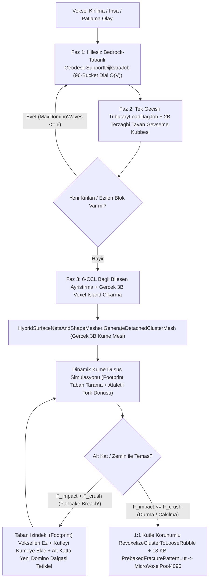

# Domino Yapısal Yıkım, Kopan Voksel Kümesi Meşi ve Pancake Katmanlı Çöküş Fiziği — Mimari Araştırma ve Kök Neden Raporu

**Tarih:** 2026-11-03  
**Kapsam:** Faz 1 & Faz 2 Voksel Yapısal Bütünlük (Domino DAG), Kopan Voksel Adası (Connected Component) Gerçek 3B Meşleme, Kinetik Enerji Transferli Katmanlı Çöküş (Progressive / Pancake Collapse) ve 1:1 Kütle Korunumlu Moloz/Mikro-Voksel Dağılımı.

---

## 1. Endüstri Referansları, GDC Konuşmaları ve Açık Kaynak Literatür Analizi

Gerçek zamanlı voksel ve yıkılabilir çevre oyunlarında tam Sonlu Elemanlar Yöntemi (FEM - Finite Element Method) çözücüleri kare başına milisaniye bütçesini ($< 2.0\text{ ms}$) aştığından, endüstride **Graf Tabanlı Jeodezik Destek + Tek Geçişli Yük Yayılımı + Dinamik Voksel Adası (Cluster) Fiziği** hibrit mimarileri kullanılır.

### 1.1. Oyun Motoru Mimarileri ve GDC / Devlog İncelemeleri

| Oyun / Motor | Geliştirici / Kaynak | Temel Yapısal Yıkım ve Küme (Island) Algoritması | Güçlü Yönler ve Stratocraft İçin Çıkarımlar |
| :--- | :--- | :--- | :--- |
| **Teardown** | Dennis Gustafsson (Tuxedo Labs) — *Voxagon Devlogları & Teknik Yayınlar* | **Multi-Volume Voxel Islands & 6-CCL:** Dünya tek bir statik ızgara değil, hiyerarşik voksel hacimleridir. Yıkım anında kirli bölgede **3B Flood-Fill / Connected Component Labeling (CCL)** çalışır. Zemine (anchor) bağlantısı kesilen voksel adası statik hacimden silinir ve **kendi gerçek 3B voksel dizisini koruyan** bağımsız bir dinamik `RigidBody` hacmine (`Voxel Volume`) dönüşür. Çarpışma hem voksel-voksel hem de basitleştirilmiş kabuk küre/kutu hiyerarşisiyle çözülür; yüksek enerjili çarpışmalar ikincil kırılmaları tetikler. | Kopan bir yapı **asla** tek bir sündürülmüş küp (`PrimitiveType.Cube`) olarak temsil edilmez; kopan voksellerin yerel 3B alt-ızgarası çıkartılarak kendi gerçek yüzey meşiyle (`SurfaceNets / Greedy Mesh`) düşer ve döner. |
| **Red Faction: Guerrilla (Geo-Mod 2.0)** | Volition (Eric Arnold, Luke Hodorowicz) — *GDC 2009: "Living in a Stressful World: Real-time Stress Calculation for Destroyable Environments"* | **Yapısal Stres Grafiği (Structural Stress Graph) & Progressive Collapse:** Binalar kiriş, kolon ve duvar düğümlerinden oluşan bir çizge (graph) olarak modellenir. Земin düğümleri (Ground Anchors) sonsuz mesnettir. Yükler yerçekimi yönünde ve yanal makaslama (shear) / eğilme (bending moment) olarak komşu bağlantılara aktarılır. Bir kolon kırıldığında yük komşu kolonlara biner; komşu kolonun kapasitesi aşılırsa **zincirleme aşırı-stres yıkımı (Over-Stress Cascade)** oluşur ve üst katlar alt katların üzerine **Pancake Collapse** şeklinde çöker. | Tek geçişli yük aktarımının (Faz 2 `TributaryLoadDagJob`) ardışık dalgalar (`MaxDominoWaves`) halinde çalışması ve düşen üst katın alt kata çarptığında alt katın kolonlarını dinamik şok yüküyle ezip **yeni bir Domino dalgası tetiklemesi** şarttır. |
| **7 Days to Die** | The Fun Pimps — *Structural Integrity (SI) / Mass & Horizontal Support ("Glue Strength")* | **Kütle / Yatay Tutunma Oranı:** Dikey kolonlar temel kayaya (`Bedrock`) kesintisiz indiği sürece yüksek dikey yük taşır ($w_{\text{vert}} = 0$). Ancak yatay konsol uzantılarında her bloğun bir `Mass` ($m_i$) ve `Horizontal Support` ($S_{\text{shear}}$) değeri vardır: $\text{Max Span} = \lfloor S_{\text{shear}} / \sum m_{\text{cantilever}} \rfloor$. Limit aşıldığında konsol kolu kopar ve altındaki blokların üzerine düşerek onları da kırabilir. | Stratocraft'taki `GeodesicSupportDijkstraJob` ($w_{\text{vert}} = 0$, konsol adımı $+1$) ve `TributaryLoadDagJob` kesme dayanımı ($S_{\text{shear}}$) bu modeli kemer kilit taşı ($H_L + H_R = 0$) ile birleştirerek daha ileri taşır. |
| **Medieval Engineers** | Keen Software House — *Gerçekçi Stres Tensörü ve Kırılma Desenleri* | **Yönlü Yük Vektörleri & Ön-Hesaplı Kırılma (Pre-Baked Fracture):** Bloklar basma (compression), çekme (tension) ve kesme (shear) sınırlarına sahiptir. Kırılan ve yere çarpan bloklar çalışma zamanında pahalı 3B Voronoi hesaplamak yerine **önceden fırınlanmış kırılma şablonlarıyla (Pre-Baked Fracture Patterns)** alt-parçalara ayrılır. | Stratocraft'taki `18 KB PrebakedFracturePatternLut` (32 adet $8\times 8\times 8$ Voronoi + 256 adet $4\times 4\times 4$ `ulong` mikro-voksel shard maskesi) tam olarak bu sıfır-GC felsefesini uygular; ancak çarpma anında gerçek `MicroVoxelPool4096` havuzuna bağlanmalıdır. |
| **Valheim** | Iron Gate Studio — *Mesafe Tabanlı Stabilite Yayılımı & Görsel Renk Spektrumu* | **Zemin Ankrajından Azalan Stabilite:** Toprak/kaya ile temas eden her yapı parçası $\%100$ (Mavi) stabilite alır. Her adımda malzeme katsayısına göre stabilite düşer (Mavi $\rightarrow$ Yeşil $\rightarrow$ Sarı $\rightarrow$ Turuncu $\rightarrow$ Kırmızı). Destek sıfırlanırsa parça kırılır. | Stratocraft'taki `< 20 ns` 4-Renk İnşaat Hayalet Önizleme (`EvaluateGhostPlacementPreview`: Yeşil, Sarı, Turuncu, Kırmızı) bu mekaniğin fizik tabanlı karşılığıdır. |

### 1.2. GitHub Açık Kaynak Projeleri ve Akademik / Teknik Makaleler

1. **3B Bağlı Bileşen Etiketleme (3D Connected Component Labeling - 6-CCL / 26-CCL) ve Flood-Fill:**
   - **Hoshen-Kopelman & Sıfır-Tahsisli BFS Kuyrukları (`godot-voxel` / Zylann, `VoxelPlay`, `bevy_voxel_world`):** Gerçek zamanlı voksel motorlarında `Queue<Vector3Int>` gibi GC tahsisi yapan yapılar yerine, önceden tahsis edilmiş düz 1B diziler (`int[] bfsQueue`, `int[] componentIds`) üzerinde çalışan 6-komşulu (`6-CCL`) genişlik öncelikli arama (BFS) standarttır.
   - **Dial's Bucket Dijkstra ($O(V)$ Tamsayı Ağırlıklı Kısa Yol):** Kenar ağırlıklarının küçük tamsayılar ($w \in [0, 8]$) olduğu voksel ızgaralarında standart ikili yığın (Binary Heap $O(V \log V)$) yerine dairesel kova dizisi (`MaxDialBuckets = 96`) kullanmak önbellek (L1/L2 Cache) dostudur ve $O(V)$ doğrusal zamanda çalışır.
2. **Katmanlı Yıkım (Progressive / Pancake Collapse) Mekanik Modeli (Bažant & Verdure, 2007 — *"Mechanics of Progressive Collapse"*):**
   - Bir üst kat kütlesi ($M_{\text{upper}}$), $h$ yüksekliğinden serbest düşerek alt kata $v_{\text{hit}} = \sqrt{2gh}$ hızıyla çarptığında, alt katın taşıyıcı kolon/tabanlarına yalnızca statik ağırlığını ($M_{\text{upper}} g$) değil, **dinamik şok yükünü (Impact Shock Force)** uygular:
     $$F_{\text{impact}} = M_{\text{upper}} g + \frac{\frac{1}{2} M_{\text{upper}} v_{\text{hit}}^2}{\delta_{\text{crush}}}$$
   - Eğer $F_{\text{impact}} > F_{\text{crush,floor}}$ ise alt katın vurulan vokselleri anında ezilir; ezilen voksellerin kütlesi ($\Delta M_{\text{floor}}$) düşen kümeye katılır (**inelastic momentum conservation**: $v_{\text{new}} = \frac{M_{\text{upper}}}{M_{\text{upper}} + \Delta M_{\text{floor}}} v_{\text{hit}} \cdot \eta_{\text{loss}}$) ve alt katta kesilen destekler **yeni bir Domino dalgasını** tetikler.

---

## 2. Mevcut Kod Tabanımızdaki 4 Kritik Kök Neden (Acımasız Teknik Teşhis)

Mevcut kod tabanındaki `Assets/_Stratocraft/Character/Stage1StructuralCollapseBridge.cs`, `Assets/_Stratocraft/Physics/Systems/StructuralCollapseSystem.cs`, `Assets/_Stratocraft/Physics/Jobs/GeodesicSupportDijkstraJob.cs` ve `Assets/_Stratocraft/Physics/Jobs/GreedyBoxFractureJob.cs` dosyaları satır satır incelendiğinde aşağıdaki **4 ölümcül mimari kusur ve hile** tespit edilmiştir:

### Kök Neden 1: `PrepareLocalSolveScratch` İçindeki "Sahte Kalıcı Yapı (`KaliciYapi`)" Hilesi
`Assets/_Stratocraft/Character/Stage1StructuralCollapseBridge.cs` (Satır 100–126) içindeki `PrepareLocalSolveScratch` metodu şu kodu çalıştırmaktadır:

```csharp
float dx = (baseWx + lx + 0.5f) - pivotWorld.x;
float dz = (baseWz + lz + 0.5f) - pivotWorld.z;
bool outsideLocalEdit = (dx * dx + dz * dz) > 12.25f || y < minY;
bool hasSolidBelow = y > 1 && VoxelBitUtility.IsPhysicallySolid(src[((y - 1) << 8) | (lz << 4) | lx]);
if (outsideLocalEdit || hasSolidBelow)
{
    dst[idx] = VoxelBitUtility.WithOriginState(raw, BlokKokenDurumu.KaliciYapi);
}
```

**Neden Hiledir ve Neyi Bozuyor?**
1. **`hasSolidBelow => KaliciYapi` İflası:** Doğal bir tepenin, falezin veya 2 katmanlı doğal kaya tavanının altını tamamen oysanız bile, üstteki ikinci katman (`y = 12`) hemen altındaki birinci katmanı (`y = 11`, `hasSolidBelow == true`) gördüğü anda **`BlokKokenDurumu.KaliciYapi` (Gökyüzü Ankrajı, $D_{\text{geo}} = 0$) olarak işaretlenmektedir!** Sonuçta `y = 12` havada asılı bir ölümsüz ankraja dönüşmekte ve üstelik altındaki `y = 11` katmanını da yukarıdan/yandan tutarak **hiçbir doğal kütlenin veya altı oyulan tepenin çökmemesine** yol açmaktadır!
2. **`outsideLocalEdit` ($r > 3.5\text{ m}$) Hilesi:** Kırılan bloğun merkezinden (`pivotWorld`) yatayda $3.5\text{ m}$ ($\sqrt{12.25}$) uzaklıktaki tüm doğal bloklar zorla `KaliciYapi` yapılmaktadır. Oyuncu $5\text{ m}$ genişliğinde bir kaya kemerinin veya dağ sütununun tabanını kestiğinde, $3.5\text{ m}$ dışındaki bloklar sahte gökyüzü ankrajı olup tüm kütleyi havada tutmaktadır.

### Kök Neden 2: Kopan Koca Bir Binanın Gerçek Meşi Yerine Tek Bir Sündürülmüş Küp (`ShapeID = 1`) Olarak Düşmesi
`Assets/_Stratocraft/Character/Stage1StructuralCollapseBridge.cs` (Satır 159–175) içindeki `SpawnFallingClusterIntoRingBuffer` metodu:

```csharp
_proxyTris.Clear();
byte domMat = cluster.DominantMaterialId == 0 ? MaterialIdCatalog.Stone : cluster.DominantMaterialId;
HybridSurfaceNetsAndShapeMesher.EmitArchitecturalShape(
    new System.Numerics.Vector3(-0.5f, -0.5f, -0.5f), domMat, 1, 0, 6, _proxyTris);
Mesh coloredMesh = HybridSurfaceNetsAndShapeMesher.BuildUnityMeshZeroGc(_proxyTris, $"Mesh_FallingCluster_{slotIdx}");
...
float sx = Mathf.Clamp(cluster.MaxBounds.X - cluster.MinBounds.X + 1, 0.75f, 3.2f);
float sy = Mathf.Clamp(cluster.MaxBounds.Y - cluster.MinBounds.Y + 1, 0.75f, 3.2f);
float sz = Mathf.Clamp(cluster.MaxBounds.Z - cluster.MinBounds.Z + 1, 0.75f, 3.2f);
proxy.transform.localScale = new Vector3(sx, sy, sz);
```

**Neden Yanlıştır?**
1. `GreedyBoxFractureJob.Execute` (`Assets/_Stratocraft/Physics/Jobs/GreedyBoxFractureJob.cs`, Satır 132–180) kopan 6-CCL bileşenini (`compId`) açgözlü (greedy) dikdörtgen kutulara bölerken `voxels[bIdx] = 0u` ile vokselleri silmekte, ancak **kopan adanın içindeki gerçek `uint32` voksel dizisini (farklı malzemeler, kemerler, eğimli çatılar, yontulmuş mikro-vokseller, doğal SDF yüzeyleri) hiçbir yere kaydetmemektedir.**
2. Görsel vekil (`VisualProxy`) oluşturulurken kopan yapının gerçek geometrisi yerine `EmitArchitecturalShape(..., shapeId: 1)` ile **tek bir $1\times 1\times 1$ küp** üretilmekte ve `localScale` ile $[0.75, 3.2]\text{ m}$ aralığında sündürülmektedir! Bu yüzden L şeklinde bir kemer, çok malzemeli bir kule veya doğal bir kaya kütlesi koptuğunda anında tek renkli plastik bir dikdörtgen prizmaya dönüşmektedir.

### Kök Neden 3: Tek Noktalı Çarpışma Probu ve Zincirleme Pancake Çöküşünün Çalışmaması
`Assets/_Stratocraft/Character/Stage1StructuralCollapseBridge.cs` (Satır 204–235) içindeki `StepSingleFallingSlot` metodu:

```csharp
int centerLx = Mathf.Clamp((slot.Cluster.MinBounds.X + slot.Cluster.MaxBounds.X) / 2, 0, 15);
int centerLz = Mathf.Clamp((slot.Cluster.MinBounds.Z + slot.Cluster.MaxBounds.Z) / 2, 0, 15);
uint belowRaw = chunkVoxels[(probeY << 8) | (centerLz << 4) | centerLx];
...
if (StructuralCollapseSystem.DoesImpactBreachFloorBlock(in slot.Cluster, vHit, belowMat) &&
    VoxelBitUtility.GetOriginState(belowRaw) == BlokKokenDurumu.OyuncuItemBlogu)
{
    chunkVoxels[(probeY << 8) | (centerLz << 4) | centerLx] = 0u;
    dirtyChunks.Add((slot.ChunkX, slot.ChunkZ));
    slot.VerticalVelocity *= 0.65f;
    return;
}
```

**Neden Pancake Çöküşü Gerçekleşmiyor?**
1. **Tek Voksel Probu Hatası (`centerLx, centerLz`):** $6\times 4\times 6$ boyutundaki bir tavan veya ortası boş bir kemer düşerken yalnızca tam orta noktasındaki **tek bir `(centerLx, centerLz)` sütununa** bakılmaktadır. Ortası boş bir kemer veya kenarı alt kattaki kolona çarpan bir çatı, orta noktası havaya denk geldiği için **alt kattaki duvarların içinden hayalet gibi geçip** `CurrentCenterY <= 3.5f` sınırına kadar düşmektedir!
2. **Yalnızca 1 Vokseli Silme ve Domino Tetiklememe:** `DoesImpactBreachFloorBlock` doğru (`true`) dönse bile, düşen kümenin taban izindeki (`Footprint`) tüm blokları ezmek yerine **yalnızca tek bir vokseli (`centerLx, probeY, centerLz`)** silmektedir. Üstelik alt katta kırılan bu bloktan sonra **`EvaluateChunkStability` yeniden çağrılmadığı için** alt katın geri kalanı Domino etkisiyle kopmamakta ve ezilen katın kütlesi düşen kümeye eklenmemektedir!
3. **`OyuncuItemBlogu` Kısıtlaması:** Satır 224'teki `GetOriginState(belowRaw) == BlokKokenDurumu.OyuncuItemBlogu` şartı yüzünden, $50\text{ tonluk}$ bir kule doğal bir mağara tavanının (`DogalKutle`) üzerine düştüğünde doğal tavanı asla kıramamaktadır.

### Kök Neden 4: Çarpma Sonrası %35 Kütle Kaybı ve `MicroVoxelPool4096` Kopukluğu
`Assets/_Stratocraft/Physics/Systems/StructuralCollapseSystem.cs` (Satır 282 ve 325–336) içindeki `RevoxelizeClusterToLooseRubble` metodu:
1. `int rubbleTarget = Math.Clamp((int)MathF.Ceiling(sourceVoxelCount * 0.65f), 1, 1024);` satırı nedeniyle yere çarpan her yapının **voksel sayısının $\%35$'i buharlaşıp yok olmaktadır** (1:1 kütle korunumu ihlali).
2. `shapeId = 63` (`MicroVoxelShapeId`) atandığında `PackStandard` çağrılmakta; bu çağrı 32-bit voksel şemasındaki `Low7` (Bit 8..14) ve `High5` (Bit 21..25) alanlarına `LocalMicroPoolIndex` yerine `density` ve `rot` yazmakta ve chunk'ın `MicroVoxelPool4096` havuzuna 64-bit `ulong` kırık parça maskesini (`SelectShardMask64`) kaydetmemektedir.

---

## 3. Hedeflenen Gerçek Mimari ve Algoritmik Çözüm Tasarımı

Yukarıdaki 4 kök nedeni tamamen ortadan kaldıran, **sıfır hileli (Zero-Cheat)**, **$< 2.0\text{ ms}$** bütçeli ve **0 Byte/kare GC** garantili yeni mimari 4 ana bileşenden oluşur:



### 3.1. Hilesiz Bedrock-Tabanlı Jeodezik Destek (`PrepareLocalSolveScratch` Hilesinin Kaldırılması)
1. **`PrepareLocalSolveScratch` Tamamen Kaldırılacak:** Doğal blokların (`DogalKutle`) çalışma zamanında sahte `KaliciYapi` (`OriginState = 3`) olarak işaretlenmesi **kesin olarak yasaklanacaktır**.
2. **Gerçek Omurga / Bedrock Ankrajı (`supportFloorY` ve `IsFloatingIslandNaturalSpineFoundation`):**
   - Yüzen adanın yalnızca en alt bazalt omurga tabanı (`y <= supportFloorY` veya altında hiçbir kazılmış mağara/boşluk bulunmayan `lowestShellY <= 9` doğal bazalt omurga) $D_{\text{geo}} = 0$ ankrajı alır.
   - Bir doğal tepe, kaya sütunu veya mağara tavanının altı kazıldığında (`Air` boşluğu açıldığında), üstteki doğal bloklar artık `hasSolidBelow => KaliciYapi` hilesiyle havada asılı kalamaz; yatay konsol mesafesi (`MaxCantileverSpanBlocks`) ve Faz 2 kesme dayanımı (`ShearLimitKg`) ile değerlendirilir. Yeterli yanal kaya mesnedi yoksa **doğal tepe/kaya kütlesi de gerçekçi şekilde kopup çöker!**
3. **Çoklu-Chunk Sınır (Apron / Halo) Destek Yayılımı:**
   - Yıkımchunk sınırına ($lx \le 1$ veya $lx \ge 14$) yaklaştığında, komşu chunk'ların sınır düzlemi (`1-voksel Halo Apron`) okunarak chunk sınırında yapay kopma veya yapay tutunma oluşması engellenir.

### 3.2. Kopan Voksel Adasının `HybridSurfaceNetsAndShapeMesher` ile Gerçek 3B Küme Meşi Olarak Düşmesi
Kopan bir yapı veya doğal kaya adası, **ne şekil ve malzemede inşa edilmişse birebir o 3B meş olarak** düşmelidir:
1. **Bağlı Bileşen Баzlı 3B Voksel Alt-Izgarası (`DetachedVoxelIslandBuffer`):**
   - 6-CCL (`GreedyBoxFractureJob`) her bağımsız kopan adayı (`compId`) tespit ettiğinde, o adanın sınırlayıcı kutusu (`MinBounds .. MaxBounds`, boyut $W \times H \times D$) içindeki orijinal `uint32` vokseller silinmeden önce sabit boyutlu (`[ThreadStatic]` veya RingBuffer slotuna bağlı) yerel bir 3B voksel tamponuna (`uint[] ClusterVoxels`) kopyalanır.
2. **Gerçek Çift Kanallı Hibrit Küme Meşleyici (`GenerateDetachedClusterMesh`):**
   - `SpawnFallingClusterIntoRingBuffer` içinde `EmitArchitecturalShape(..., shapeId: 1)` ve `localScale` sündürmesi **tamamen kaldırılır**.
   - Bunun yerine `HybridSurfaceNetsAndShapeMesher` üzerinde yeni `GenerateDetachedClusterMesh(ReadOnlySpan<uint> clusterVoxels, int sizeX, int sizeY, int sizeZ, Vector3 localCenterOfMass, List<FacetedVoxelTriangle> outTriangles)` metodu çağrılır:
     - **Kanal 1 (Doğal SDF Bloklar):** Kopan kaya/toprak adasının pürüzsüz/fasetli `SurfaceNets` kabuğunu üretir.
     - **Kanal 2A (`ShapeID == 63`) & Kanal 2B (`ShapeID == 1..62`):** Kopan binanın içindeki tüm kemerleri, eğimli çatılarını, sütunlarını, altın/mithril/taş/ahşap malzeme renklerini (`Color32`) ve iç yüzey gizlemesini (`FullFaceMask`) **1:1 ölçekte (`localScale = Vector3.one`)** kütle merkezi (`CenterOfMass`) etrafında ortalanmış gerçek bir `Mesh` olarak üretir!
   - Böylece devrilen bir kemer veya kule, havada dönerken (`OverturningTorqueNm` ve Steiner atalet tensörü $\mathbf{I}$ ile) tüm mimari detaylarını korur.

### 3.3. Çarpma Anında Kinetik Enerji Transferi ile Alt Katları Ezen Zincirleme Pancake Çöküşü
Düşen bir küme (`ActiveFallingClusterSlot`) her fizik adımında (`StepSingleFallingSlot`) tek bir merkez noktası yerine **gerçek taban izi (Footprint Sweep)** ile çarpışma ve Pancake ezilmesi uygular:

1. **Tam Taban İzi (2B Footprint) Tarama:**
   - Kümenin $(x, z) \in [\text{MinBounds.X} .. \text{MaxBounds.X}] \times [\text{MinBounds.Z} .. \text{MaxBounds.Z}]$ izdüşümündeki tüm dolu alt vokselleri, mevcut düşüş yüksekliği `probeY` katmanındaki dünya vokselleriyle karşılaştırılır.
2. **Dinamik Şok Yükü ve Katman Kırma (`Pancake Breach`):**
   - Temas edilen katmandaki toplam taşıma/ezilme direnci ($\sum F_{\text{crush,floor}}$), düşen kümenin dinamik darbe kuvvetiyle karşılaştırılır:
     $$F_{\text{impact}} = M_{\text{cluster}} g + \frac{\frac{1}{2} M_{\text{cluster}} v_{\text{hit}}^2}{\delta_{\text{crush}}}, \quad \delta_{\text{crush}} = 0.25\text{ m}$$
   - Temas edilen blokların `OyuncuItemBlogu` veya `DogalKutle` olmasına bakılmaksızın (yalnızca `IsUnbreakableAnchor` ve 4-yönlü tam hapsedilmiş ana kaya hariç), eğer $F_{\text{impact}} > \sum_{\text{contact}} F_{\text{crush,floor}}$ ise **Pancake Delme (Breach)** gerçekleşir!
3. **Kütle Katılımı, Momentum Sönümlenmesi ve İkincil Domino Dalgası:**
   - **Ezilen Voksellerin Kütlesinin Kümeye Eklenmesi:** Kırılan alt kat voksellerinin kütlesi ($\Delta M_{\text{crushed}}$) ve voksel sayısı ($\Delta N_{\text{crushed}}$) düşen kümeye eklenir:
     $$M_{\text{cluster}}^{\text{yeni}} = M_{\text{cluster}} + \Delta M_{\text{crushed}}, \quad N_{\text{voxels}}^{\text{yeni}} = N_{\text{voxels}} + \Delta N_{\text{crushed}}$$
   - **Esnek Olmayan (Inelastic) Hız Güncellemesi:** Enerjinin bir kısmı alt katı kırmaya harcandığından hız fiziksel olarak azalır:
     $$v_{\text{yeni}} = v_{\text{hit}} \cdot \frac{M_{\text{cluster}}}{M_{\text{cluster}} + \Delta M_{\text{crushed}}} \cdot \sqrt{\max\left(0.15, 1 - \frac{E_{\text{crush}}}{E_{\text{kinetic}}}\right)}$$
   - **Anında İkincil Domino Tetiklemesi:** Alt katta açılan delik nedeniyle desteksiz kalan komşu kiriş ve duvarların da kopması için o chunk üzerinde **`EvaluateChunkStability` yeniden tetiklenir**; böylece üst kat alt katı ezerken alt katın geri kalanı da koparak gerçek bir **Progressive Pancake Collapse** şelalesi oluşturur!

### 3.4. 1:1 Kütle Korunumlu Moloz (`LooseRubble`) ve `MicroVoxelPool4096` Dağılımı
Düşen küme nihayet kıramayacağı sağlam bir ana kaya tabanına çarptığında (`FinalizeClusterImpact` $\rightarrow$ `RevoxelizeClusterToLooseRubble`):
1. **%100 (1:1) Kütle ve Hacim Korunumu:**
   - Eski `%65` (`sourceVoxelCount * 0.65f`) kesintisi kaldırılır. `sourceVoxelCount` (Pancake sırasında eklenen alt kat vokselleri dahil toplam voksel sayısı) kadar malzeme **sıfır kayıpla** zemine dağıtılır.
2. **Çoklu Malzeme Korunumu ve Gerçek `MicroVoxelPool4096` Kaydı:**
   - Çarpma enerjisi oranı $\Phi_{\text{frac}} \in [0, 3.5]$ (`PrebakedFracturePatternLut.ComputeImpactFractureRatio`) değerine göre:
     - Düşük enerjili düşüşlerde ($\Phi_{\text{frac}} < 0.70$): Blokların bir kısmı hasarlı (`DamageState = 6..12`) orijinal malzemesiyle veya iri `ShapeID = 63` kırık kaya parçaları (`band = 0`, $36..51$ dolu mikro-voksel) olarak kalır.
     - Yüksek enerjili düşüşlerde ($\Phi_{\text{frac}} \ge 0.70$): `PrebakedFracturePatternLut.SelectShardMask64` ile seçilen 64-bit `ulong` kırık parça maskesi chunk'ın ilgili `16x16x16` alt-chunk `MicroVoxelPool4096` havuzuna (`AllocateSlot(mask64)`) kaydedilir ve `VoxelBitUtility.PackMicroVoxel(matId, poolSlot12, origin: DogalKutle, dmg4)` ile **gerçek 12-bit havuz indeksli** mikro-voksel moloz olarak yerleştirilir.

---

## 4. Uygulama ve Doğrulama Kriterleri (Faz Kalite Kapısı)

1. **Hilesiz Doğal Göçük Testi:** Yüzen adadaki bir tepenin veya kaya sütununun tabanı tamamen oyulduğunda, üstteki doğal blokların `KaliciYapi` hilesine takılmadan çöktüğü birim testiyle doğrulanacak.
2. **Gerçek 3B Küme Meşi Testi:** Çok malzemeli ve kemerli bir yapı koptuğunda, düşen `VisualProxy` meşinin tek bir küp (12 üçgen) değil, kopan voksellerin gerçek `HybridSurfaceNetsAndShapeMesher` geometrisi olduğu doğrulanacak.
3. **Çok Katlı Pancake Çöküş Testi:** 3 katlı bir binanın en üst katı kopup alt kata düştüğünde, alt katın tavanını ezip kütle kazanarak zemin kata kadar zincirleme indiği doğrulanacak.
4. **Performans ve Bellek Bütçesi:** `10.000` voksellik Domino + Pancake değerlendirmesi `< 2.0 ms`, `0 Byte/kare GC Alloc` ve `0 Error / 0 Warning` sınırları içinde kalacak.
