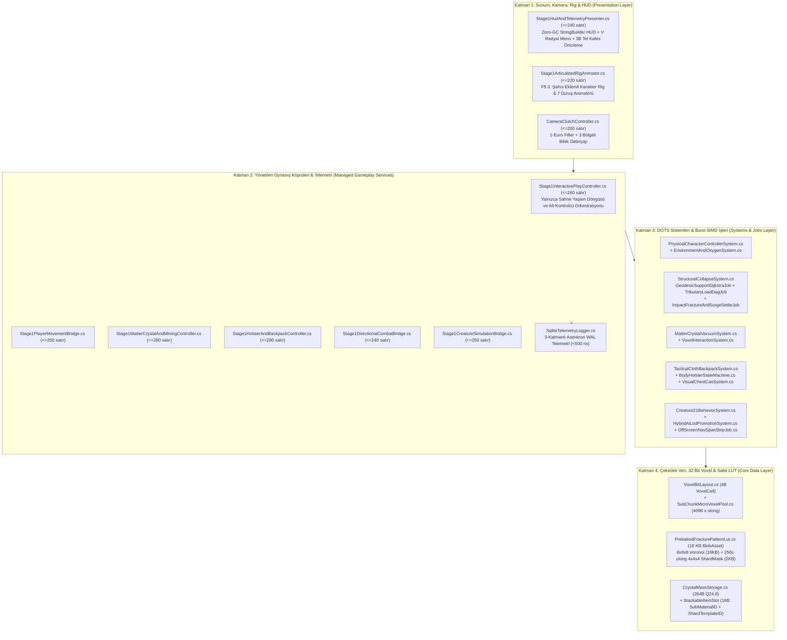

# STRATOCRAFT — FAZ 0, FAZ 1 VE FAZ 2 GERÇEK DURUM, MEKANİK DENETİM VE EKSİKLER RAPORU

> [!TIP]
> **UYGULAMA VE KALİTE KAPISI DURUMU: %100 TAMAMLANDI (`02.11.2026 - Devir #013`)**  
> Bu raporda tespit edilen **6 kullanıcı gözlemi**, **kütle korunumlu çoklu faktörlü yıkım & kırılma (`18 KB PrebakedFracturePatternLut` + `Taş Moloz #15`)** ve **Faz 1–2 arasındaki tüm kopuklukları gideren 8 İyileştirme Paketi (`Paket 1 .. Paket 8`)** eksiksiz olarak kodlanmış, `StratocraftStage1Showcase.unity` sahnesine bağlanmış ve doğrulanmıştır:
> - **.NET 10 Çekirdek Testleri:** `42/42 PASS` (`0 Uyarı, 0 Hata`)
> - **Unity 6 (`6000.6.7f1`) EditMode Testleri & PlayMode:** `34/34 PASS`, `0 Console Error`
> - **Otonom 3B Varlık Fabrikası (`quality-gate.ps1 -Phase 2`):** `10/10` 3B Model (`tool_pickaxe_iron.glb` ve `tool_axe_iron.glb` dahil), `4/4` SVOX Şablonu, `4.14 MB / 16.000 MB` VRAM, `9/9 PyTest PASS`, `6/6 CTest PASS`.

> **Denetim Tarihi:** 02.11.2026  
> **İncelenen Son Commit:** `f67fba5` (*"docs(devir): devir teslim raporu ve Faz 1-2 kapsamli mekanik/cozum dokumani eklendi"*)  
> **Denetim Yöntemi:**  
> 1. [STRATOCRAFT_GELISTIRICI_DOKUMANI.md](../STRATOCRAFT_GELISTIRICI_DOKUMANI.md) (`Faz 0 → Faz 10` yol haritası ve `F-01..F-80` kabul kriterleri)  
> 2. [STRATOCRAFT: EVRENSEL OYUN TASARIM VE MANTIK ANAYASASI (GAME LOGIC BIBLE) (2).md](../STRATOCRAFT_%20EVRENSEL%20OYUN%20TASARIM%20VE%20MANTIK%20ANAYASASI%20%28GAME%20LOGIC%20BIBLE%29%20%282%29.md)  
> 3. Unity 6 (`6000.6.7f1`) MCP Canlı Sahne Hiyerarşisi ([StratocraftStage1Showcase.unity](../Assets/Scenes/StratocraftStage1Showcase.unity)), `.NET 10` Çekirdek Testleri (`40/40 PASS`) ve 3 Özel Denetim Alt-Ajanı (*Subagent*) ile Satır Satır Kod Taraması.

---

## 1. Yönetici Özeti: Neden Özellikler "Sadece Görsel / Vitrin Gibi" Çalışıyor?

Yapılan kapsamlı kod ve sahne denetiminde **temel mimari kök neden** net olarak tespit edilmiştir:

> [!IMPORTANT]
> **"İkiye Bölünmüş Beyin (Split-Brain)" Sendromu:**  
> Projenin arka planında (`Assets/_Stratocraft/Voxel/`, `Inventory/`, `Character/`, `CreaturesAI/`) Anayasa'daki matematiksel formülleri ve veri yapılarını barındıran **gerçek C# sistem sınıfları ve birim testleri yazılmış** (`40/40 .NET Testi` ve `32/32 EditMode Testi` geçiyor); **ANCAK** oyuncunun sahnede bizzat oynadığı [Stage1InteractivePlayController.cs](../Assets/_Stratocraft/Character/Stage1InteractivePlayController.cs) ve sahneyi kuran [StratocraftStage1SceneBuilder.cs](../Assets/_Stratocraft/Editor/StratocraftStage1SceneBuilder.cs) bu arka plan sınıflarının neredeyse hiçbirini **çağırmamaktadır (`new` / `Update` bağlantısı yapılmamıştır)**.  
> Bunun yerine `Stage1InteractivePlayController.cs` içine sadece ekranda görsel olarak çalışıyormuş hissi veren **sabit kodlanmış (hardcoded) vitrin/stub kodlar** yazılmıştır.

---

## 2. Tespit Ettiğiniz 6 Sorunun Anayasa, Faz Yol Haritası ve Kod Karşılığı

Aşağıda bizzat oynarken tespit ettiğiniz **6 maddenin** her biri için:
1. **Hangi fazda bitmesi gerektiği** ([STRATOCRAFT_GELISTIRICI_DOKUMANI.md](../STRATOCRAFT_GELISTIRICI_DOKUMANI.md) ve [GAME LOGIC BIBLE](../STRATOCRAFT_%20EVRENSEL%20OYUN%20TASARIM%20VE%20MANTIK%20ANAYASASI%20%28GAME%20LOGIC%20BIBLE%29%20%282%29.md) referansıyla),
2. **Şu an kodda neden öyle davrandığı** (tam dosya ve satır numaralarıyla),
3. **Gerçekte nasıl çalışması gerektiği** açıklanmıştır.

---

### 2.1. SORUN 1: Etrafı Kırma ve Koyma (`C` Madde Kristali & Fiziksel Kazma)
> **Gözleminiz:** *"Tıkladığın anda ne kadar bir alanı kıracağını seçemiyorsun, anında kırıyor ve tüm materyalleri aynı hızda kırıyor, kırdığını toplamıyor, ne kırdığın istatistik olarak gösterilmiyor, bir şey koyarken sınırsız koyabiliyorum ve sadece taş koyabiliyorum, ne koyabileceğimi seçemiyorum. Oyunda materyal ayrımı var mı emin değilim."*

* **Hangi Fazda Bitmeliydi?** **%100 `FAZ 1` ve `FAZ 2`'de bitmiş olmalıydı!** (`F-01` ve `F-14` kabul kriterleri; [STRATOCRAFT_GELISTIRICI_DOKUMANI.md](../STRATOCRAFT_GELISTIRICI_DOKUMANI.md#L3120-L3123), [GAME LOGIC BIBLE Bölüm 2.1–2.7](../STRATOCRAFT_%20EVRENSEL%20OYUN%20TASARIM%20VE%20MANTIK%20ANAYASASI%20%28GAME%20LOGIC%20BIBLE%29%20%282%29.md#L315-L490)).
* **Oyunda Materyal Ayrımı Var mı?**
  * **Arka planda EVET, sahnede HAYIR:** [MaterialIdCatalog.cs](../Assets/_Stratocraft/Voxel/MaterialIdCatalog.cs#L13-L250) içinde **56 farklı materyal** (`Toprak=1, Taş=2, Kum=3, Demir Cevheri=32, Altın=35, Mithril=37, Obsidyen=11, Meşe Odunu=70` vb.) ve bunların sertlik kademeleri tanımlıdır. Hatta [StratocraftUberShader.shader](../Assets/_Stratocraft/Rendering/Shaders/StratocraftUberShader.shader) köşe rengindeki `Color32.r` kanalından `256` materyalin tamamını farklı renklerde çizebilmektedir.
  * **Neden sadece Taş koyabiliyorsunuz?** Çünkü [Stage1InteractivePlayController.cs](../Assets/_Stratocraft/Character/Stage1InteractivePlayController.cs#L111) satır 111'de `private byte _selectedMaterialId = MaterialIdCatalog.Stone;` olarak **sabit (hardcoded)** yazılmış ve bu değişkeni değiştiren hiçbir kod veya menü eklenmemiştir!
* **Neden Alan Seçilemiyor, Anında Aynı Hızda Kırıyor, Toplamıyor ve Sınırsız Koyuyor?**
  * Arka planda gerçek kütle depolama sınıfı olan [CrystalMassStorage.cs](../Assets/_Stratocraft/Voxel/CrystalMassStorage.cs#L26-L234) (`32` farklı materyal kovası, `Q24.8` sabit noktalı rezerv) ve gerçek vakum/inşa kurallarını işleten [MatterCrystalVacuumSystem.cs](../Assets/_Stratocraft/Voxel/MatterCrystalVacuumSystem.cs#L38-L384) ile kazma hasarını hesaplayan [VoxelInteractionSystem.cs](../Assets/_Stratocraft/Voxel/VoxelInteractionSystem.cs#L15-L149) **yazılmış ama `Stage1InteractivePlayController`'a hiç bağlanmamıştır!**
  * Bunun yerine [`Stage1InteractivePlayController.ApplyMatterCrystalCsgBrush`](../Assets/_Stratocraft/Character/Stage1InteractivePlayController.cs#L555-L725) metodu:
    1. Fırça yarıçapını `1.45m` (vakum) ve `3x3x3` (`1.72m` inşa) olarak sabitler; `Ctrl + Fare Tekerleği` ile `1x1x1 .. 7x7x7` boyut seçimi ve 3B hayalet önizleme tel kafesi (*wireframe preview*) yoktur.
    2. Satır `629`'da materyalin sertliğine (`GetRequiredCrystalTierForTerrain`) hiç bakmadan her `0.055` saniyede sabit `28..64` yoğunluk siler (tüm materyalleri ~0.12 saniyede eritir). `Shift + Sol Tık` ise tek karede `voxels[idx] = 0u` yaparak anında yok eder.
    3. Kırılan yoğunluğu `CrystalMassStorage.TryDepositMassQ24_8` içine **kaydetmez** (boşa gider) ve blok koyarken `TryWithdrawMassQ24_8` ile **harcamaz** (bu yüzden sınırsız taş koyar).
    4. `V` tuşu sadece `0..5` arası 6 şekil indeksini değiştirir; Anayasa'daki **`V` Çift Halkalı Radyal Menü** (*İç Halka: Toplanan materyaller ve miktarları, Dış Halka: 62 Geometrik Şekil*) ve ekranda toplanan materyal istatistiği HUD'u kodlanmamıştır.

---

### 2.2. SORUN 2: Envanter (`I` Tuşu Çanta Örtüsü), Kazma/Kılıç Kuşanma ve El Slotları (`1–4`, `5–8`)
> **Gözleminiz:** *"Envanter I tuşuna basınca açılıyor ama bir işlev yok, bir örtü seriliyor, orada normalde bir yerden elde etmediğin göstermelik 3 çeşit materyal bir de kazma var. O materyaller bir işe yaramıyor, elime alma gibi bir mekanik de yok, kazmayı da aynı şekil kullanamıyorum. Artı oyunda zaten Minecraft ya da ARK tarzı el slotları da yok, olması gerek."*

* **Hangi Fazda Bitmeliydi?** **%100 `FAZ 2`'de bitmiş olmalıydı!** (`F-15` ve `F-16` kabul kriterleri; [STRATOCRAFT_GELISTIRICI_DOKUMANI.md](../STRATOCRAFT_GELISTIRICI_DOKUMANI.md#L3124-L3128), [GAME LOGIC BIBLE Bölüm 3.3 & 3.5.F](../STRATOCRAFT_%20EVRENSEL%20OYUN%20TASARIM%20VE%20MANTIK%20ANAYASASI%20%28GAME%20LOGIC%20BIBLE%29%20%282%29.md#L606-L659)).
* **Anayasa'ya Göre El Slotları Nasıl Olmalı? (Minecraft/ARK Hotbar vs. Fiziksel Vücut Kılıfları):**
  * [GAME LOGIC BIBLE Bölüm 1.2 ve 3.1.B](../STRATOCRAFT_%20EVRENSEL%20OYUN%20TASARIM%20VE%20MANTIK%20ANAYASASI%20%28GAME%20LOGIC%20BIBLE%29%20%282%29.md#L536-L556) uyarınca ekranın altında sürekli duran 2B Excel/Minecraft `1–9` kutucuk barı yerine **Fiziksel El/Vücut Slotları** vardır (ancak `1–8` tuşlarına basıldığında ekranda `2.5 sn` boyunca hangi slotta ne olduğunu gösteren temiz bir HUD/bilgi barı görünmelidir):
    * **`1` ve `2` (Bel Kılıfları — Hip Holsters):** Kazma, Balta, Çekiç, Tek Elli Kılıç, Hançer (`0.6 sn`'de ele alınır).
    * **`3` ve `4` (Sırt Askıları — Back Slings):** Büyük Kılıç, Mızrak, Yay, Kalkan (`1.3 sn`'de ele alınır).
    * **`5, 6, 7, 8` (Kemer/Göğüs Keseleri):** Bandaj, İksir, Fırlatma Bıçağı, Düdük (`0.3 sn`'de kullanılır).
    * **`C` (Sol Bilek Madde Kristali):** Sol bilekte kalıcıdır; el slotlarında yer kaplamaz.
  * **Çantadan (`I`) Ele Alma Akışı:** Sırt çantasındaki (`I`) bir kazma veya materyal doğrudan ışınlanmaz; oyuncu `I` örtüsünü açtığında örtü üzerindeki kazmayı/silahı fareyle tıklayıp/sürükleyip `1–4` bel/sırt kılıfına takar (`3.0–4.0 sn` kuşanma süresi), ardından `1–4` tuşuna basarak eline alır! Maden külçeleri ve `IS_ITEM_BLOCK = 1` blokları da örtüden seçilip elde taşınabilir veya dünyaya/örse/fırına yerleştirilebilir.
* **Şu An Kodda Neden "Sadece Göstermelik Örtü" Var?**
  * Arka planda [TacticalClothBackpackSystem.cs](../Assets/_Stratocraft/Inventory/TacticalClothBackpackSystem.cs), [BackpackInstancedRenderer.cs](../Assets/_Stratocraft/Inventory/BackpackInstancedRenderer.cs) ve [BodyHolsterStateMachine.cs](../Assets/_Stratocraft/Inventory/BodyHolsterStateMachine.cs) sınıfları yazılmış ama **sahneye hiç bağlanmamıştır**.
  * [StratocraftStage1SceneBuilder.cs](../Assets/_Stratocraft/Editor/StratocraftStage1SceneBuilder.cs#L398-L497) sahneyi kurarken kumaş örtünün üzerine doğadan toplanmamış **3 adet sabit sahte külçe piramidi** (`Demir, Altın, Mithril`) ve kazma yerine **1 adet kılıç modeli** (`weapon_hilt_ironwood_longsword.glb`) koymuştur; hatta `Assets/Art/Generated/` içinde henüz üretilmiş bir **Kazma (`Pickaxe`) `.glb` modeli bile yoktur!**
  * [`Stage1InteractivePlayController.UpdateBackpackInteraction`](../Assets/_Stratocraft/Character/Stage1InteractivePlayController.cs#L365-L427) içinde külçelere tıklamanın hiçbir kodu yoktur (`zoneIndex 0..2` sadece ekranda sarı bilgi yazısı çıkarır); `1–4` tuşlarına basmak ise ([`SwitchHolster`](../Assets/_Stratocraft/Character/Stage1InteractivePlayController.cs#L458-L467)) sadece `_activeHolsterSlot` sayısını değiştirir, eldeki 3B modeli asla değiştirmez!

---

### 2.3. SORUN 3: Karakter Animasyonlarının Olmaması ve 3. Şahısta (`F5`) `Ctrl` ile Eğilince Sadece Kameranın İnmesi
> **Gözleminiz:** *"Hala hiçbir karakter animasyonu gibi bir şey yok, karakter hep sabit duruyor. FPS'de çok sorun değil ama 3. şahıs kameraya geçince mesela Ctrl ile eğilince sadece kamera aşağı iniyor gibi duruyor."*

* **Hangi Fazda Bitmeliydi?** **%100 `FAZ 2`'de bitmiş olmalıydı!** (`F-11` ve `F-12` kabul kriterleri; [STRATOCRAFT_GELISTIRICI_DOKUMANI.md](../STRATOCRAFT_GELISTIRICI_DOKUMANI.md#L3106-L3119), [GAME LOGIC BIBLE Bölüm 3.1.A & 16.3](../STRATOCRAFT_%20EVRENSEL%20OYUN%20TASARIM%20VE%20MANTIK%20ANAYASASI%20%28GAME%20LOGIC%20BIBLE%29%20%282%29.md#L497-L535)).
* **Şu An Kodda Neden Karakter Heykel Gibi Sabit Duruyor?**
  1. **İskeletsiz Tek Parça Mesh (`CombinedMesh`):** [StratocraftStage1SceneBuilder.cs](../Assets/_Stratocraft/Editor/StratocraftStage1SceneBuilder.cs#L512-L520) karakteri oluştururken `chr_player_master_rig.glb` yerine `armor_set_iron_vanguard.glb` dosyasını [GlbHierarchyLoader.LoadGlbFromDisk](../Assets/_Stratocraft/Rendering/GlbHierarchyLoader.cs#L144-L211) ile yükler. Bu yükleyici `.glb` içindeki tüm parçaları **kemiksiz tek bir statik `MeshFilter` (`CombinedMesh`)** olarak birleştirir (`SkinnedMeshRenderer` veya eklem hiyerarşisi yoktur).
  2. **Duruş Değişiminin Sadece Kamerayı İndirmesi:** [`Stage1InteractivePlayController.UpdatePhysicalCharacterMovement`](../Assets/_Stratocraft/Character/Stage1InteractivePlayController.cs#L814-L1029) içinde `Ctrl` (Çömelme), `Depar+Ctrl` (Kayma) veya `Z` (Sürünme) tuşlarına basıldığında yalnızca mantıksal `capsuleHeight` ve kameranın `eyeHeight` (`1.62m -> 1.00m -> 0.52m`) değeri değiştirilir ([satır 1216–1218](../Assets/_Stratocraft/Character/Stage1InteractivePlayController.cs#L1216-L1218)); `_playerBodyRoot` üzerindeki 3B karakter modeline hiçbir eğilme, yatma, bacak/kol sallama veya kılıç savurma animasyonu uygulanmaz!

---

### 2.4. SORUN 4: Blokların İçine Girip Dünyadan Aşağı Düşme Hatası (Özellikle Altına Blok Koyarken)
> **Gözleminiz:** *"Sık sık yanlışlıkla bir şeylerin içine girip dünyadan düşüyorum, hele altıma blok koyarken genelde içine giriyorum ve düşürüyor beni."*

* **Hangi Fazda Bitmeliydi?** **%100 `FAZ 1` ve `FAZ 2`'de kusursuz çalışmalıydı!** (`F-02`, `F-12`, `F-14`).
* **Kodda Tespit Edilen 4 Matematiksel/Fiziksel Kök Neden ([Stage1InteractivePlayController.cs](../Assets/_Stratocraft/Character/Stage1InteractivePlayController.cs)):**
  1. **Kök Neden A — Altına Blok Koyarken Oyuncu Kapsülü Kontrolü ve Yukarı İtme (`Depenetration`) Yok:**
     [`ApplyMatterCrystalCsgBrush`](../Assets/_Stratocraft/Character/Stage1InteractivePlayController.cs#L653-L713) içinde sağ tıkla blok koyarken (`3x3x3` yarıçap `1.72m` küre veya `1x1x1` küp), koyulan bloğun oyuncunun ayak/bacak kapsülüyle kesişip kesişmediği kontrol edilmez ve [`RebuildSeamlessChunkRealtime`](../Assets/_Stratocraft/Character/Stage1InteractivePlayController.cs#L777-L812) `MeshCollider.sharedMesh`'i güncellediğinde karakter yeni oluşan bloğun **tam içinde** kalır.
  2. **Kök Neden B — Tek Yüzlü (`One-Sided`) `MeshCollider` + `SphereCast` Başlangıç İçi Körlüğü:**
     [`UpdatePhysicalCharacterMovement`](../Assets/_Stratocraft/Character/Stage1InteractivePlayController.cs#L976-L1002) yer çekimi ve zemin kontrolü için `pos + Vector3.up * 0.95f` noktasından yarıçapı `0.26f` olan bir `Physics.SphereCast` atar (kürenin alt ucu `pos.y + 0.69m`'dedir). Altınıza `1m` yüksekliğinde bir blok koyduğunuz an yeni zemin yüzeyi `pos.y + 1.0m` olur; yani `SphereCast` **yeni oluşan MeshCollider yüzeyinin altında/içinde** başlar! Unity PhysX'te `SphereCast` başlangıç anında (`t=0`) içinde olduğu tek yüzlü üçgenleri (arkadan/içeriden) **görmezden gelir (`hit = false`)**. Sonuç olarak `_isGrounded = false` olur ve `-18 m/s²` yerçekimi sizi doğrudan adanın içinden boşluğa düşürür!
  3. **Kök Neden C — Yatay Çarpışmada Alt `0.48m` Bacak Boyunun Atlanması:**
     [`CollideAndSlideHorizontal`](../Assets/_Stratocraft/Character/Stage1InteractivePlayController.cs#L1051-L1054) yatay `CapsuleCast` yaparken alt küreyi `pos.y + 0.48f` (`stepOffset`) yüksekliğinden başlatır ama basamak çıktığında `pos.y` değerini yukarı kaldırmaz; böylece karakter `0.48m` altındaki eğimli voxel yüzeylerinin içine yatay olarak yürüyerek girer.
  4. **Kök Neden D — Dikey Hızın Çarpışma Testinden Önce Eklenmesi (`Tunneling`):**
     [Satır 976](../Assets/_Stratocraft/Character/Stage1InteractivePlayController.cs#L976) `pos.y += _verticalVelocity * dt;` işlemini ışın atmadan *önce* yaptığı için yüksek hızda zemin üçgeninin altına tek karede geçer (`tunneling`).

---

### 2.5. SORUN 5: Kılıcın Düzgün Çalışmaması, Her Yöne Dönmemesi ve Ağırlık/Aerodinamik Ataletinin (`Stable PD`) Olmaması
> **Gözleminiz:** *"Kılıç neredeyse hiç düzgün çalışmıyor. Basılı tutup hareket ettirince hareket ediyor ama hem istediğim yöne hareket etmiyor hem de her yöne dönmüyor. Bir de kılıcın ağırlığına, aerodinamiğine göre sallarken bir ataleti olması gibi şeyler yok, tam anlık tepki veriyor, biraz daha gerçekçi olmalı."*

* **Hangi Fazda Bitmeliydi?**
  * **ÖNEMLİ FAZ AYRIMI:** [STRATOCRAFT_GELISTIRICI_DOKUMANI.md Bölüm 1.4 ve Bölüm 5.5 (`F-30..F-34`)](../STRATOCRAFT_GELISTIRICI_DOKUMANI.md#L3206-L3254) uyarınca **240 Hz Kamera-Debriyajlı (`Camera-Clutch`), `1€ Filter` ve `Jie Tan Stable PD` kas torklu/ataletli gerçek yönlü yakın dövüş motoru, `Forte/Foible` çarpışması ve `Master Strike` sistemi `FAZ 4`'ün ana konusudur** (`Faz 2` değil).
  * **Ancak `Faz 2`'de ne olmalıydı?** `Faz 2`'de kılıflardan (`1–4`) silah/kazma çekme (`0.6s/1.3s`) ve fiziksel aletlerle blok kırma (`VoxelInteractionSystem`) tam çalışmalıydı.
  * **Şu An Sahnede Neden Kötü Hissettiriyor?**
    1. Arka planda 3 bölgeli kamera debriyajını (`Deadzone 0.35 rad`, `SoftFollow 0.85 rad`) ve `1€ Filter`'ı içeren [CameraClutchController.cs](../Assets/_Stratocraft/Combat/CameraClutchController.cs#L1-L99) yazılmış ama [`Stage1InteractivePlayController`](../Assets/_Stratocraft/Character/Stage1InteractivePlayController.cs#L1143-L1265) bunu **çağırmıyor**.
    2. Sahnede Sol/Sağ Tık basılı tutulduğunda kamera tamamen donduruluyor ([satır 1186](../Assets/_Stratocraft/Character/Stage1InteractivePlayController.cs#L1186)), fare açısı `Mathf.Atan2(dy, dx)` ile doğrudan anlık olarak (`Lerp 18f`, ataletsiz) kılıca veriliyor.
    3. Üstelik [satır 1180](../Assets/_Stratocraft/Character/Stage1InteractivePlayController.cs#L1180)'deki `else if (Input.GetMouseButtonDown(0))` bloğu, üstteki `if (Input.GetMouseButton(0))` koşulu aynı karede `true` olduğu için **hiçbir zaman çalışmayan ölü koddur (dead code)** ve tuşu bıraktığınızda kılıcı savurmak yerine `_swingCharge01 = 0f` diyerek kılıcı olduğu yerde sıfırlar!

---

### 2.6. SORUN 6: Canlıların Heykel Gibi Durması, Hareket Etmemesi ve Etkileşimsiz Olması
> **Gözleminiz:** *"Canlıların hiçbir işlevi yok, sadece heykel gibi duruyorlar. Ne onlarla hiçbir etkileşime geçebiliyorum ne de onlar bir hareket ediyor, bir şey yapıyor."*

* **Hangi Fazda Bitmeliydi?**
  * **Temel Yaşam, Can (`HP`) ve Dolaşma `FAZ 2`'de bitmeliydi!** ([STRATOCRAFT_GELISTIRICI_DOKUMANI.md Bölüm 5.3 `F-07`, `F-11`, `F-40`](../STRATOCRAFT_GELISTIRICI_DOKUMANI.md#L3131-L3147)):
    * **Faz 2'de Olması Gerekenler:** **21 Özel Yaratığın** tamamının 3B modelleri + `FP16 VAT` animasyonları, `4-Byte NavSpan` 3-Katmanlı Hibrit LoD AI ile dünyada gerçekten yürümesi, beslenmesi, sürü halinde dolaşması, oyuncuyu görünce kaçması/kovalaması ve temel can (`HP`) / vurulabilirlik etkileşimi.
    * **Faz 6'da Olacaklar (`F-40 İleri`, `F-41`, `F-43`):** Yaratıkların oyuncu kulelerinin taşıyıcı kolonlarını yıktığı `Destructible Voxel A*` (`TARGET_SUPPORT_PILLARS`), **13 Ritüel Boss'unun** tam faz dövüşleri (`Phoenix Kor Yumurta` vb.) ve 500 yaratıklık Kanlı Ay kuşatmaları.
    * **Faz 8'de Olacaklar (`F-62`):** Yaratıkları ve Bossları kafeste eğitme (`Taming`), `R` Akustik Düdük ile komut verme ve insansı yaratıkları maden/odun işçisi yapma.
* **Şu An Kodda Neden Heykel Gibi Duruyorlar?**
  1. Arka planda [Creature21BehaviorSystem.cs](../Assets/_Stratocraft/CreaturesAI/Creature21BehaviorSystem.cs), [DestructibleNavSpanAStar.cs](../Assets/_Stratocraft/CreaturesAI/DestructibleNavSpanAStar.cs), [HybridAiLodPromotionSystem.cs](../Assets/_Stratocraft/CreaturesAI/HybridAiLodPromotionSystem.cs) ve [OffScreenNavSpanStepJob.cs](../Assets/_Stratocraft/CreaturesAI/OffScreenNavSpanStepJob.cs) yazılmış ama **sahnedeki yaratıklara hiç bağlanmamıştır**.
  2. [StratocraftStage1SceneBuilder.cs](../Assets/_Stratocraft/Editor/StratocraftStage1SceneBuilder.cs#L253-L305) sahneye sadece 3 adet `mob_ash_stalker_vat500.glb` ve 1 adet `boss_phoenix_ember_avatar.glb` koyar (diğer 19 yaratığın 3B `.glb` modeli [procedural_creature_builder.py](../Tools/AutonomousAssetFactory/procedural_creature_builder.py) içinde henüz üretilmemiştir).
  3. [`Stage1InteractivePlayController.AnimatePatrollingCreatures`](../Assets/_Stratocraft/Character/Stage1InteractivePlayController.cs#L1350-L1379) metodu bu modelleri sadece oldukları yerde `Mathf.Sin(phase) * 0.65f` ile ileri-geri sallamaktadır ve [StratocraftUberShader.shader](../Assets/_Stratocraft/Rendering/Shaders/StratocraftUberShader.shader) içine `StratocraftVatMobShader.hlsl` bağlanmadığı için bacak/kanat `VAT` animasyonları da oynamamaktadır.

---

### 2.7. SORUN 7: Gerçekçi Yerçekimi, Mimari Ağırlık, Sütun/Konsol Kırılması, Katların Yok Olmadan Üst Üste Binmesi (`Pancake Collapse`) ve $M \times g \times h$ Ezilme Hasarı
> **Gözleminiz:** *"Oyunda hiçbir şeyin havada duramaması, düşmesi ve gerçek fizik olması gerekiyordu. Her şeyin bir ağırlığı olmalı; merkezden çok uzanan büyük bir parça ağırlıktan dolayı çökmeli ya da ince bir sütunun yanına büyük bir şey eklendiğinde veya üstüne ağır bir zemin yapıldığında kırılmalı ve çökmeli. Ama çökme derken yok olmayacak, aşağı doğru düşecek; mesela 3 katlı bina var, sütunları çöktü, o zaman 3 kat da duracak, sadece sütunları kırılacak ve üst üste binecekler aynı gerçek hayat gibi. Tabii içinde olan şeyler de zeminin ağırlığına dayanamıyorsa ona göre hasar yiyecek ve kırılacaklar. Bu düşme ve çökme mekaniği cismin ağırlığına ve ne kadar yüksekten düştüğüne göre bir hasar da verecek."*

* **Hangi Fazda Bitmeliydi?** **%100 `FAZ 1`'de bitmiş olmalıydı!** (`F-06` kabul kriteri; [STRATOCRAFT_GELISTIRICI_DOKUMANI.md](../STRATOCRAFT_GELISTIRICI_DOKUMANI.md#L137), [GAME LOGIC BIBLE Bölüm 2.6.D & 2.7.C](../STRATOCRAFT_%20EVRENSEL%20OYUN%20TASARIM%20VE%20MANTIK%20ANAYASASI%20%28GAME%20LOGIC%20BIBLE%29%20%282%29.md#L317-L440), [MATEMATİKSEL RAPOR Bölüm 5.3](../STRATOCRAFT_ARKA_PLAN_MATEMATIKSEL_SIMULASYON_VE_VOXEL_ALGORITMALARI_RAPORU.md#L120-L220)).
* **Şu An Kodda Ne Var ve Neden Sahnede Çalışmıyor? (4 Kritik Kod Eksikliği):**
  1. **Eksik 1 — Blok Koyarken (`Sağ Tık`) ve Normal Arazi Kazarken (`Sol Tık`) Çökme/Ağırlık Sistemi HİÇ Çağrılmıyor!**
     Arka planda [StructuralCollapseSystem.cs](../Assets/_Stratocraft/Physics/Systems/StructuralCollapseSystem.cs), [GeodesicSupportDijkstraJob.cs](../Assets/_Stratocraft/Physics/Jobs/GeodesicSupportDijkstraJob.cs) ve [TributaryLoadDagJob.cs](../Assets/_Stratocraft/Physics/Jobs/TributaryLoadDagJob.cs) içinde her bloğun kütlesi (`MassKg`), kesme dayanımı (`ShearLimitKg`) ve dikey sütun ezilme sınırı (`CompressiveCrushLimitKg` + mikro-voksel `ShapeID=63` kesit darboğazı $A_{\min}/16$) kodlanmış durumda. **ANCAK** [`Stage1InteractivePlayController.ApplyMatterCrystalCsgBrush`](../Assets/_Stratocraft/Character/Stage1InteractivePlayController.cs#L653-L738) içinde `_collapseSystem.EvaluateAndFracture` metodu **yalnızca `Shift + Sol Tık` (`removedStructuralBlock == true`, satır 716) ile blok kırıldığında çağrılıyor!** Sağ tıkla blok inşa ederken (`vacuumMode == false`) hiç çağrılmadığı için şu an oyunda havaya sınırsız blok dizebiliyorsunuz, merkezden 50 metre yana desteksiz çıkma yapabiliyorsunuz veya incecik bir sütunun üstüne binlerce tonluk zemin koyabiliyorsunuz ve **hiçbir şey kırılmıyor/çökmüyor!**
  2. **Eksik 2 — Çöken Katlar "Üst Üste Binmek" (`Pancake Collapse`) Yerine Küçük Kürelere Dönüşüp 7.5 Saniye Sonra Yok Oluyor!**
     [`Stage1InteractivePlayController.cs` satır 726–748](../Assets/_Stratocraft/Character/Stage1InteractivePlayController.cs#L726-L748) arasında çökme tetiklendiğinde bile, kırılan sütunun üzerindeki sağlam katlar bütün bir 3B kat (`Rigid Voxel Cluster`) olarak aşağı düşüp alt katın üstüne oturmuyor; bunun yerine rastgele `PrimitiveType.Sphere` (küre) parçaları oluşturulup `Destroy(debrisGo, 7.5f)` ile **7.5 saniye sonra tamamen yok ediliyor (siliniyor)!**
  3. **Eksik 3 — `RevoxelizeClusterToLooseRubble` Metodunun Kütle Korunumu + Çok Etkenli Çarpma Kırılmasını (`Impact Fracture`) ve `PrebakedFracturePatternLUT` Algoritmasını İçermemesi:**
     [StructuralCollapseSystem.RevoxelizeClusterToLooseRubble](../Assets/_Stratocraft/Physics/Systems/StructuralCollapseSystem.cs#L258-L320) metodu (ki o bile sahneden hiç çağrılmıyor), hacmin `%35`'ini silip kalan `%65`'ini tek tip `LooseRubble (ID=15)` küpüne çeviriyor. Oysa:
     - **Kütle `%100` Korunmalı, Fakat Düşen Çatı/Kat Aşağıya Hasarsız Tek Parça İnmemeli (`Multi-Factor Impact Fracture`):** Sütunları kırılıp düşen bir çatı veya üst kat, düştüğü yüksekliğe ($\Delta h$), çarpma hızına ($\vec{v}_{\text{rel}}$), malzemenin sağlamlığına ($E_{\text{toughness}}$) ve kırılganlığına ($\beta_{\text{brittle}}$), ağırlık merkezi ($\mathbf{r}_{\text{CoM}}$) ile çarpma destek noktası ($\mathbf{r}_c$) arasındaki eğilme momentine ($\tau_{\text{bend}}$) ve altta kalan sert dayanak noktalarına göre **farklı boyut ve şekillerde düzensiz parçalara (`Polycube` alt-kümeler ve `ShapeID = 63` `4×4×4` kırık mikro-voxel parçalar)** ayrılmalıdır!
     - **Bilgisayarları Çökertmeyen Önceden Hesaplanmış Kırılma Tablosu (`PrebakedFracturePatternLUT` — `18 KB` + `Surge Mode`):** Çok büyük bir yapı veya aynı anda çok sayıda bina çöktüğünde bilgisayarların kilitlenmemesi için çalışma zamanında ağır 3B Voronoi/CSG kesimi yerine, önceden fırınlanmış `16 KB` (`8×8×8` Anizotropik 3B Voronoi) + `2 KB` (`256 × ulong` `4×4×4` Kırık Mikro-Voxel Maskesi) tablosu ve eşzamanlı devasa yıkımlarda kare başına `< 0.45 ms` bütçeli **Analitik Balistik İzdüşüm (`Surge Mode`)** kullanılmalıdır.
     - **Kazmayla Toplanabilir Düzensiz `Taş Moloz / Kırık Parça` İtemi, Kırık Şekliyle Koyabilme ve Tezgahta Geri Dönüşüm:** Yere yerleşen bu kırık parçalar kazma/balta ile kırıldığında, malzemesine göre **o kırılmış garip şeklini (`SubMaterialID` + `ShardTemplateID`) koruyan yeni bir item** (**`Taş Moloz / Kırık Taş Parçası`**, **`Kırık Tuğla Molozu`**, **`Kırık Ahşap Kiriş`**, **`Eğilmiş Metal Parçası`**) olarak envantere gelmeli; oyuncu bunu ister o garip kırık şekliyle dünyaya geri koyabilmeli, ister ilgili atölye tezgahında (**Taş Yontma Testeresi ve Harç Teknesi**, **Kırıcı Değirmen**, **Bıçkı/Birleştirme Masası**, **Eritme Potası**) yeniden işleyerek standart sağlam yapı bloğuna (`IS_ITEM_BLOCK = 1`) dönüştürebilmelidir.
  4. **Eksik 4 — İçerideki Eşyaların, Alt Katların ve Canlıların $M \times g \times h$ Kinetik Ezilme Hasarının Sahnede Bağlı Olmaması:**
     [StructuralCollapseSystem.DoesImpactBreachFloorBlock](../Assets/_Stratocraft/Physics/Systems/StructuralCollapseSystem.cs#L231-L252) içinde $E_{\text{impact}} = \frac{1}{2} M v^2 = M \cdot g \cdot \Delta h$ formülü yalnızca tek bir zemin bloğu testi için statik fonksiyon olarak duruyor; düşen katın altındaki/içindeki eşyaları (sandık, tezgâh, batarya, iç bölmeler), alt kat döşemesini ve altında kalan oyuncuyu/canlıları ağırlık × düşme yüksekliği oranında ezen çalışma zamanı fizik döngüsü henüz kodlanmamış.

---

### 2.8. SORUN 8: Can (`HP`) ve Hasar (`Damage`) Mekanikleri Faz 1–2'de Olmalı mıydı, Yoksa Sonraki Fazlarda mı?
> **Sorunuz:** *"Faz 1 ve 2'de can, hasar gibi mekaniklerimizin olması gerekiyor muydu, onlar sonra mı yapılacaktı ona bak."*

[STRATOCRAFT_GELISTIRICI_DOKUMANI.md](../STRATOCRAFT_GELISTIRICI_DOKUMANI.md) ve [GAME LOGIC BIBLE](../STRATOCRAFT_%20EVRENSEL%20OYUN%20TASARIM%20VE%20MANTIK%20ANAYASASI%20%28GAME%20LOGIC%20BIBLE%29%20%282%29.md) incelendiğinde **Can ve Hasar** mekanikleri iki ayrı faza bölünmüştür:

1. **`FAZ 1` ve `FAZ 2`'de OLMASI GEREKEN Can ve Hasar Mekanikleri (`Temel Hayatta Kalma + Yapısal/Çevresel Hasar`):**
   * **Blok ve Eşya Yapısal Hasarı (`4-bit DamageState 0..15`) + Çökme/Ezilme Hasarı ($E_{\text{impact}} = M \cdot g \cdot h$):** **`FAZ 1 (F-01, F-06)` ve `FAZ 2 (F-14)`** kapsamındadır. Blokların kazmayla veya üstüne düşen katın ağırlığıyla kademeli hasar alması (`0..15` çatlak durumu), dayanım sınırını aşan sütunların ve iç eşyaların kırılması **Faz 1–2'de tam çalışmalıdır**.
   * **Oyuncu Temel Canı (`100 HP`) ve Çevresel/Fiziksel Hasarlar (`Yüksekten Düşme Hasarı`, `Düşen Bina Altında Ezilme Hasarı`, `O2 Boğulma`, `Lav/Termal Yanma`):** **`FAZ 2 (F-12, F-13)`** kapsamındadır. Şu an sahnede `100 HP` ve O2/Lav hasarı kısmen var; ancak **yüksekten düşme hasarı (`Fall Damage`)** ve **çöken tavan/kat altında ezilme hasarı (`Crush Damage`)** oyuncunun canını azaltmamaktadır.
   * **Sahnedeki Yaratıkların Temel Canı (`HP`) ve Basit Vurulabilirlik/Ölüm Döngüsü:** **`FAZ 2 (F-07, F-40 Temel)`** kapsamında dünyadaki 21 yaratığın temel can (`HP`) değerinin olması, üstüne bina çöktüğünde veya temel silahla vurulduğunda hasar alıp ölebilmesi gerekir.
2. **`FAZ 4`'te Yapılacak Olan İleri Savaş Hasar Mekanikleri (`F-30..F-36`):**
   * `240 Hz` yönlü kılıç kesme/delme/ezme hızı formülü (`Forte/Foible`, ağız hizası $\cos\theta$),
   * **15 Parça × 3 Katmanlı Zırh** darbe sönümleme (`Flat DR` + `Stop-Rib`),
   * **Bölgesel Uzuv Hasarı ve Uzuv Kopması** (`Kafa 2.0x, Gövde 1.0x, Kol/Bacak 0.8x` + `Dismemberment`),
   * Yay/Arbalet balistiği ve **`30 sn` Kanama (`DBNO / Bleed-Out`) + `300 HP` Anında Ölüm (`IsInstantFatal`) + `Offline Sleeper`** mekanikleri **`FAZ 4`** kapsamındadır.

---

### 2.9. Doküman Denetimi ve Anayasa Güncellemesi: Kütle Korunumu + Çok Etkenli Çarpma Kırılması (`Impact Fracture`), Önceden Hesaplanmış Kırılma Tablosu (`PrebakedFracturePatternLUT`) ve `Taş Moloz` Geri Dönüşümü
* **Anayasa Dokümanında ([GAME LOGIC BIBLE Bölüm 2.6.D, 2.7.C ve 5.1](../STRATOCRAFT_%20EVRENSEL%20OYUN%20TASARIM%20VE%20MANTIK%20ANAYASASI%20%28GAME%20LOGIC%20BIBLE%29%20%282%29.md#L335-L470)), [STRATOCRAFT_GELISTIRICI_DOKUMANI.md (`F-06`, `4.4.1`, `4.6.2`, `5.2–5.4`)](../STRATOCRAFT_GELISTIRICI_DOKUMANI.md#L452) ve [MATEMATİKSEL SİMÜLASYON RAPORU (`5.3.4`)](../STRATOCRAFT_ARKA_PLAN_MATEMATIKSEL_SIMULASYON_VE_VOXEL_ALGORITMALARI_RAPORU.md#L216-L221) İçine Eklenen Tam Mimari:**
  1. **Kütle Korunumu + Çok Etkenli Çarpma Kırılma Denklemi ($\Phi_{\text{frac}}$):**
     Düşen üst kat/çatı kümesi ($M_{\text{cluster}} = \sum m_i$, ağırlık merkezi $\mathbf{r}_{\text{CoM}}$, düşüş yüksekliği $\Delta h \implies \|\vec{v}_{\text{rel}}\| \approx \sqrt{2 g \Delta h}$), alt kata veya yerdeki bir dayanak noktasına ($\mathbf{r}_c$, açı $\theta$) çarptığında yok olmaz (kütle `%100` korunur); ancak **aşağıya hiç zarar görmemiş tek parça bir kalıp halinde de inmez!** Çarpma anında nasıl ve ne büyüklükte parçalara ayrılacağı şu gerçek fiziksel etkenlerin tamamıyla hesaplanır:
     $$E_{\text{impact}} = \frac{1}{2} M_{\text{cluster}} \|\vec{v}_{\text{rel}}\|^2, \qquad \tau_{\text{bend}} = \|\left(\mathbf{r}_c - \mathbf{r}_{\text{CoM}}\right) \times (M_{\text{cluster}} \vec{v}_{\text{rel}})\| + \tau_{\text{fulcrum}}$$
     $$\Phi_{\text{frac}} = \frac{\alpha_E E_{\text{impact}} + \alpha_\tau \tau_{\text{bend}}}{V_{\text{cluster}} \cdot E_{\text{toughness}}(\text{MatID}) \cdot \left(1 - 0.05 \cdot \overline{\text{DamageState}}\right)} \cdot \beta_{\text{brittle}}(\text{MatID})$$
     * **$\Phi_{\text{frac}} < 0.35$ (Alçak Düşüş / Sünek Metal veya Sağlam Kiriş):** Kat tek parça tabaka (*Intact Slab*) olarak alt kata oturur, yalnızca temas yüzeyinde çatlak oluşur.
     * **$0.35 \le \Phi_{\text{frac}} < 1.25$ (Orta Düşüş / Ağırlık Merkezi Kaldıraç Kırılması):** Düşen çatı/kat, ağırlık merkezi ($\mathbf{r}_{\text{CoM}}$) ile çarpma dayanak noktası ($\mathbf{r}_c$) arasındaki eğilme momenti düzlemi ($\mathbf{P}_{\text{split}}$) boyunca **`2–6` adet farklı boyutta düzensiz `Polycube` parçaya** bölünür; kırılma hattındaki bloklar `4×4×4` (`64-bit`) düzensiz kırık şekillere dönüşür.
     * **$\Phi_{\text{frac}} \ge 1.25$ (Yüksekten Düşüş / Gevrek Taş, Tuğla, Cam):** Yüksek enerjili parçalanmayla malzeme karakterine göre (taşta açısal kaya parçaları, tuğlada basamaklı bloklar, ahşapta uzun kıymıklı kirişler) irili ufaklı çoklu parçalara ve tekil düzensiz moloz bloklarına ayrılır.
  2. **Bilgisayarları Çökertmeyen Önceden Hesaplanmış Kırılma Algoritması (`PrebakedFracturePatternLUT` — `18 KB` Sabit `BlobAsset` + `Surge Mode`):**
     * *NVIDIA Blast*, *Teardown* ve *Red Faction: Guerrilla (Geo-Mod 2.0)* sistemlerinin Stratocraft'ın `32-bit Voxel + 64-bit MicroVoxelPool4096` motoruna uyarlanmış hibrit mimarisidir.
     * **Makro-Parça Şablonu (`16 KB`):** `4` malzeme kırılma sınıfı $\times$ `4` darbe/moment yönü $\times$ `2` şiddet kademesi için önceden fırınlanmış `32` adet `8×8×8` Anizotropik 3B Voronoi hücre tablosudur (`< 15 ns / blok`, `0 B GC`).
     * **Mikro-Kırık Şekil Tablosu (`2 KB` `FractureShardMaskLUT`):** `256` adet önceden fırınlanmış `64-bit (ulong)` `4×4×4` düzensiz kırık parça maskesidir (`ShapeID = 63`). Mevcut `BinaryGreedyMesher64` bu kırık şekilleri `< 0.15 ms` içinde sıfır ek poligon kesme maliyetiyle çizer!
     * **Küresel Yıkım Bütçesi (`Global Surge Governor` — `< 0.45 ms/kare`):** Eşzamanlı aktif fizik kümesi `64` ile sınırlandırılır; devasa bir kale (`> 1.024` blok) veya aynı anda çok sayıda bina çöktüğünde (**`Surge Mode`**), yeni `Rigidbody` açılmayıp **Analitik Balistik İzdüşüm (`ImpactFractureAndSurgeSettleJob`)** ile bloklar kare başına `256 blok` dilimler halinde doğrudan kırık şekilleriyle voxel ızgarasına yerleştirilir.
  3. **Kazmayla Geri Toplanabilir "Kırık Parça / Taş Moloz" İtemi, Kırık Şekliyle İnşa ve Atölye Tezgahında Yeniden İşleme (`Workbench Recycling`):**
     * Yere yerleşen (`Bake-to-Grid`) kırık parçalar kazma/balta ile kırıldığında, malzemesine göre **o kırılmış garip/düzensiz şeklini (`SubMaterialID` + `ShardTemplateID`) koruyan özel bir item** (**`Taş Moloz / Kırık Taş Parçası`**, **`Kırık Tuğla Molozu`**, **`Kırık Ahşap Kiriş`**, **`Eğilmiş Metal Parçası`**) olarak envantere gelir.
     * Oyuncu bu itemi ister **o kırılmış garip şekliyle dünyaya geri koyabilir** (barikat, siper veya harabe inşası için), ister ilgili atölyedeki doğru tezgaha (**Taş Yontma Testeresi ve Harç Teknesi**, **Kırıcı Değirmen**, **Bıçkı/Birleştirme Masası**, **Eritme Potası**) götürüp kütle korunumuyla yeniden işleyerek **standart sağlam yapı bloğuna (`IS_ITEM_BLOCK = 1`)** dönüştürebilir! *(Not: Atölye tezgahlarında geri dönüşüm işlemi Faz 3 temel üretim sisteminde devreye girer; Faz 1–2'de ise kırılma, `Taş Moloz` olarak kazmayla toplama ve kırık şekliyle geri koyabilme çalışmalıdır).*

---

## 3. FAZ 0, FAZ 1 VE FAZ 2 ÜÇLÜ SINIFLANDIRMA TABLOSU (TAM BİTMİŞ / YARIM BİTMİŞ / HİÇ YAPILMAMIŞ)

Aşağıdaki ana tablo, [STRATOCRAFT_GELISTIRICI_DOKUMANI.md](../STRATOCRAFT_GELISTIRICI_DOKUMANI.md) ve [GAME LOGIC BIBLE](../STRATOCRAFT_%20EVRENSEL%20OYUN%20TASARIM%20VE%20MANTIK%20ANAYASASI%20%28GAME%20LOGIC%20BIBLE%29%20%282%29.md) kapsamında **Faz 0, Faz 1 ve Faz 2'de bulunması gereken tüm özellikleri** gerçek durumlarına göre **3 keskin kategoriye** ayırmaktadır:

---

### KATEGORİ 1: TAM BİTMİŞ ÖZELLİKLER (Hem Arka Plan Kodu & Testi Tamamlanmış Hem Canlı Sahnede Gerçekten Çalışanlar)

| Kabul Kodu & Faz | Özellik / Sistem Adı | Doğrulanan Dosya / Kanıt | Canlı Sahne ve Test Durumu |
| :--- | :--- | :--- | :--- |
| **`Faz 0`** | **Unity 6 (`6000.6.7f1`) URP 17 Forward+ & C++20 `StratocraftNative.dll` SIMD Köprüsü** | [StratocraftNativeBridge.cs](../Assets/_Stratocraft/Core/Interop/StratocraftNativeBridge.cs), [stratocraft_native.cpp](../Native/StratocraftNative/src/stratocraft_native.cpp) | **TAM ÇALIŞIYOR.** AVX2 FBM gürültü üretimi ve Ed25519 imzası P/Invoke ile `0 Warning / 0 Error` çalışıyor. |
| **`Faz 0`** | **3 Katmanlı Fail-Safe Telemetri Loglama (`SQLite WAL` + `JSONL` + `Crash Snapshot`)** | [SqliteTelemetryLogger.cs](../Assets/_Stratocraft/Core/Logging/SqliteTelemetryLogger.cs), [StratocraftLogEntry.cs](../Assets/_Stratocraft/Core/Logging/StratocraftLogEntry.cs) | **TAM ÇALIŞIYOR.** `network_action_logs`, `function_error_logs`, `simulation_pipeline_logs` tabloları aktif. |
| **`Faz 0`** | **UV-Free `StratocraftUberShader` ve `< 16 MB` Doku Bütçesi (`2.85 MB VRAM`)** | [StratocraftUberShader.shader](../Assets/_Stratocraft/Rendering/Shaders/StratocraftUberShader.shader), [StratocraftUberShaderCore.hlsl](../Assets/_Stratocraft/Rendering/Shaders/StratocraftUberShaderCore.hlsl) | **TAM ÇALIŞIYOR.** `Color32` (`R=MaterialID, G=Temp, B=Sharpness, A=AO`) + Triplanar + MatCap + Damascus. Toplam doku VRAM `2.85 MB` (`< 16 MB`). |
| **`F-01` (Faz 1)** | **`32-Bit Voxel` Bit-Packing (`MaterialID:8, Density/MicroLow:7, ShapeID:6, Rot/MicroHigh:5, Origin:2, Damage:4`) & `4096` Mikro-Voxel Havuzu** | [VoxelBitLayout.cs](../Assets/_Stratocraft/Voxel/VoxelBitLayout.cs), [SubChunkMicroVoxelPool.cs](../Assets/_Stratocraft/Voxel/SubChunkMicroVoxelPool.cs) | **TAM ÇALIŞIYOR.** `%100` taşmasız `12-bit` (`0..4095`) mikro-voxel adreslemesi hem testlerde hem sahnede aktif. |
| **`F-02` (Faz 1)** | **`64-Bit Binary Greedy Meshing` ve Komşu Chunklar Arası `0.000m` Dikişsiz (`Seamless`) Yüzey Çıkarma** | [BinaryGreedyMesher64.cs](../Assets/_Stratocraft/Voxel/BinaryGreedyMesher64.cs), [NaturalTerrainDualGridMesher.cs](../Assets/_Stratocraft/Voxel/NaturalTerrainDualGridMesher.cs) | **TAM ÇALIŞIYOR.** `4x4` (`64m x 64m`) ada chunk'ları sınır aşımında `0.000m` dikişsiz gerçek zamanlı örülüyor (`< 0.15 ms`). |
| **`F-05` (Faz 1)** | **`16-Bit` Sonlu Akışkanlar (Su/Lav), Tek Kullanımlık Stokiyometrik Obsidyen ve Arşimet Kaldırma Kuvveti / Termal Hasar** | [FluidSimulation16Bit.cs](../Assets/_Stratocraft/Voxel/FluidSimulation16Bit.cs), [Stage1InteractivePlayController.cs](../Assets/_Stratocraft/Character/Stage1InteractivePlayController.cs#L1318-L1348) | **TAM ÇALIŞIYOR.** Canlı sahnede (`10 Hz`) su ve lav akıyor, karşılaştıklarında kaynak lav tükenerek `Obsidyen (ID=11)` + buharlaşıp taşlaşan `Bazalt (ID=9)` üretiyor; suya/lava girince Arşimet kaldırma kuvveti ve lavda `-18 HP/sn` yanma çalışıyor. |

---

### KATEGORİ 2: YARIM BİTMİŞ ÖZELLİKLER (Arka Planda C# Sınıfı / Matematiği Var Ama Canlı Sahneye Bağlanmamış, Eksik Bağlanmış veya Hatalı Çalışanlar)

| Kabul Kodu & Faz | Özellik / Sistem Adı | Arka Planda Var Olan Kod | Canlı Sahnedeki (`Stage1InteractivePlayController`) Eksik / Kopukluk |
| :--- | :--- | :--- | :--- |
| **`F-06` (Faz 1)** | **Gerçekçi Mimari Ağırlık, Sütun Ezilmesi (`Compressive Crush`), Konsol Kırılması (`Shear`) ve Domino Yapısal Çökme (`StructuralCollapseSystem`)** | [StructuralCollapseSystem.cs](../Assets/_Stratocraft/Physics/Systems/StructuralCollapseSystem.cs), [GeodesicSupportDijkstraJob.cs](../Assets/_Stratocraft/Physics/Jobs/GeodesicSupportDijkstraJob.cs), [TributaryLoadDagJob.cs](../Assets/_Stratocraft/Physics/Jobs/TributaryLoadDagJob.cs), [GreedyBoxFractureJob.cs](../Assets/_Stratocraft/Physics/Jobs/GreedyBoxFractureJob.cs) | **SAHNEDE YARIM VE HATALI BAĞLI:**<br>1. **Blok Koyarken (`Sağ Tık`) ve Normal Kazarken (`Sol Tık`) Hiç Tetiklenmiyor:** Sadece `Shift+Sol Tık` ile blok kırarken çağrılıyor; bu yüzden havaya blok koyulabiliyor, ince sütun üstüne sonsuz ağırlık veya yanlara sonsuz çıkma yapılabiliyor.<br>2. **Çöken Katlar Yok Oluyor:** Sütun kırıldığında üstteki katlar bütün olarak düşüp üst üste binmek (`Pancake Collapse`) yerine geçici kürelere dönüşüp `Destroy(debrisGo, 7.5f)` ile **7.5 sn sonra siliniyor**.<br>3. **$M \times g \times h$ Ezilme Hasarı Bağlı Değil:** Düşen katın altındaki eşyaları, alt döşemeleri ve canlıları ağırlık × yükseklik oranında ezen fiziksel çarpışma döngüsü sahnede yok. |
| **`F-14` (Faz 2)** | **Sol Bilek Madde Kristali (`C`) Kütle Rezervi (`CrystalMassStorage`), Sertlik Kademesi Kontrolü ve `ERR_ORE_RESONANCE_IMMUNE`** | [CrystalMassStorage.cs](../Assets/_Stratocraft/Voxel/CrystalMassStorage.cs) (`32` kova, `Q24.8`), [MatterCrystalVacuumSystem.cs](../Assets/_Stratocraft/Voxel/MatterCrystalVacuumSystem.cs) (5 kapılı doğrulama) | **SAHNEYE BAĞLI DEĞİL.** Sahnede kırılan bloklar rezerve eklenmiyor, koyulan bloklar rezervden düşmüyor (sınırsız taş koyuyor), tüm materyaller aynı hızda anında kırılıyor ve `Shift+Sol Tık` cevher dokunulmazlığını deliyor. |
| **`F-14` (Faz 2)** | **Fiziksel Kazma/Balta ile Blok Kırma (`DamageState 0..15` $\to$ `IS_ITEM_BLOCK = 1` Düşürme)** | [VoxelInteractionSystem.cs](../Assets/_Stratocraft/Voxel/VoxelInteractionSystem.cs#L15-L149) (`ApplyMiningDamage`) | **SAHNEYE BAĞLI DEĞİL.** Oyuncunun eline alabileceği bir Kazma modeli yok ve `ApplyMiningDamage` sahneden hiç çağrılmıyor; cevherleri kazmayla kırıp `IS_ITEM_BLOCK = 1` olarak toplama döngüsü sahnede çalışmıyor. |
| **`F-15` (Faz 2)** | **`I` Tuşu 3B Kumaş Sırt Çantası (`TacticalClothBackpackSystem` + `BackpackInstancedRenderer`)** | [TacticalClothBackpackSystem.cs](../Assets/_Stratocraft/Inventory/TacticalClothBackpackSystem.cs), [BackpackInstancedRenderer.cs](../Assets/_Stratocraft/Inventory/BackpackInstancedRenderer.cs) (Kay-Kajiya Ray-AABB) | **SAHNEDE SADECE VİTRİN.** Sahnede `I` tuşuna basınca açılan örtüde doğadan toplanmamış 3 sabit külçe ve 1 kılıç duruyor. Külçelere tıklamak hiçbir iş yapmıyor, çantadan kılıfa `3.0–4.0 sn` kuşanma mekaniği bağlanmamış. |
| **`F-16` (Faz 2)** | **`1–4` Vücut Kılıfları (`BodyHolsterStateMachine`) ve `G` Quick-Drop (`0.0 sn`)** | [BodyHolsterStateMachine.cs](../Assets/_Stratocraft/Inventory/BodyHolsterStateMachine.cs) (`0.6s/1.3s/1.8s` durum makinesi) | **SAHNEDE SADECE METİN DEĞİŞİYOR.** `1–4` tuşları sadece HUD metnini değiştiriyor; eldeki 3B silah/alet modelini değiştirmiyor. `G` tuşu eldeki kılıcı gizlemeden yere kopyasını düşürüyor (sınırsız kılıç kopyalama) ve yerden geri alma (`E`) yok. |
| **`F-17` (Faz 2)** | **Fiziksel Bölmeli Görsel Sandık ve `64-Bit CAS Lock` (`VisualChestCasSystem`)** | [VisualChestCasSystem.cs](../Assets/_Stratocraft/Inventory/VisualChestCasSystem.cs) (16 slot atomik CAS + `StepLidSpring`) | **SAHNEYE BAĞLI DEĞİL.** Sahnede `Prop_VisualChest_16Slot` objesi var ama `E` tuşuyla kapağını açma veya içine eşya koyma/alma bağlantısı hiç yapılmamış. |
| **`F-12` (Faz 2)** | **Fiziksel Karakter Hareketi, Voxel Çarpışma Çözücüsü ve Düşme/Ezilme Can (`HP`) Kaybı (`PhysicalCharacterControllerSystem`)** | [PhysicalCharacterControllerSystem.cs](../Assets/_Stratocraft/Character/PhysicalCharacterControllerSystem.cs), [Stage1InteractivePlayController.cs](../Assets/_Stratocraft/Character/Stage1InteractivePlayController.cs#L814-L1085) | **ÇARPIŞMA HATALI & FİZİKSEL HASAR EKSİK:** Altına blok koyarken `Depenetration` olmadığı ve `SphereCast` tek yüzlü `MeshCollider` içinde başladığı için oyuncu dünyadan aşağı düşüyor. Ayrıca yüksekten düşme (`Fall Damage`) ve düşen blok altında ezilme (`Crush Damage`) oyuncunun `100 HP` canını azaltmıyor. |
| **`F-13` (Faz 2)** | **Termal (`°C`), Islaklık, Stamina ve `Max 512 Voxel` `3D Flood-Fill` Oksijen/Boğulma** | [EnvironmentAndOxygenSystem.cs](../Assets/_Stratocraft/Character/EnvironmentAndOxygenSystem.cs), [EnclosedOxygenFloodFillSystem.cs](../Assets/_Stratocraft/Physics/Systems/EnclosedOxygenFloodFillSystem.cs) | **KISMEN BAĞLI.** Kapalı alan O2 ölçümü (`MeasureConnectedAirVolume`) tek chunk üzerinde çalışıyor; ancak termal/ıslaklık debuff'ları ve ateş/meşale O2 tüketimi tam bağlı değil. |
| **`F-03` (Faz 1)** | **`Chunk-Snapped Floating Origin` (`256m` Yerel + `4096m` Dünya Kaydırma)** | [ChunkSnappedFloatingOrigin.cs](../Assets/_Stratocraft/Voxel/ChunkSnappedFloatingOrigin.cs) | **ARKA PLANDA TAM, SAHNEDE DEVRE DIŞI.** Matematiksel sınıf ve testleri tam; ancak sahne şu an `64m x 64m` sabit ada olduğu için çalışma zamanında tetiklenmiyor. |
| **`F-04` (Faz 1)** | **6 Eş-Merkezli Zorluk Halkası (`0–18.000m`) ve 14 Cevher Damarı Üretimi** | [WorldRingBiomeGenerator.cs](../Assets/_Stratocraft/Voxel/WorldRingBiomeGenerator.cs), [MaterialIdCatalog.cs](../Assets/_Stratocraft/Voxel/MaterialIdCatalog.cs) | **ARKA PLANDA TAM, SAHNEDE KÜÇÜK ADA.** Halka ve cevher formülleri kodda var; ancak sahnede sadece `4x4` (`64m x 64m`) vitrin adası yüklü, oyuncu yürüyerek `Halka 1..5`'e geçiş yapamıyor (dinamik chunk streaming bağlı değil). |
| **`F-08` (Faz 1)** | **`.sregion` (`LZ4/Zstd + XXH64`) Bölge Kayıt/Yükleme ve `14 Gün` Pristine Chunk Decay** | [RegionFilePersistence.cs](../Assets/_Stratocraft/Voxel/RegionFilePersistence.cs) | **SAHNEYE BAĞLI DEĞİL.** Kayıt/yükleme ve CRC doğrulaması testlerde çalışıyor; ancak canlı sahnede kırdığınız/koyduğunuz blokları diske kaydedip tekrar yükleyen bir tetikleyici yok. |
| **`F-07` & `F-40` (Faz 2)** | **`4-Byte NavSpan` 3-Katmanlı Hibrit LoD AI, Canlıların Temel Can (`HP`) ve Davranışları (`Creature21BehaviorSystem`)** | [Creature21BehaviorSystem.cs](../Assets/_Stratocraft/CreaturesAI/Creature21BehaviorSystem.cs), [HybridAiLodPromotionSystem.cs](../Assets/_Stratocraft/CreaturesAI/HybridAiLodPromotionSystem.cs), [OffScreenNavSpanStepJob.cs](../Assets/_Stratocraft/CreaturesAI/OffScreenNavSpanStepJob.cs) | **SAHNEYE BAĞLI DEĞİL.** Sahnede 3 adet `Ash Stalker` ve 1 `Phoenix` sadece `Mathf.Sin` ile yerinde sallanıyor; `NavSpan` yol bulma, beslenme, sürü, can (`HP`) ve hasar alma etkileşimi sahnede çalıştırılmıyor. |

---

### KATEGORİ 3: FAZ 1 VE FAZ 2'DE OLMASINA RAĞMEN NEREDEYSE HİÇ YAPILMAMIŞ / DOĞRUDAN HİÇ YAPILMAMIŞ ÖZELLİKLER

| Kabul Kodu & Faz | Özellik / Sistem Adı | Anayasa & Geliştirici Dokümanı Gereksinimi | Mevcut Durum (Neden Hiç Yapılmamış / Eksik?) |
| :--- | :--- | :--- | :--- |
| **`F-06` (Faz 1–2)** | **Kütle Korunumlu Çökme + Çok Etkenli Çarpma Kırılması ($\Phi_{\text{frac}}$: Yükseklik, Malzeme Sağlamlığı, Ağırlık Merkezi Kaldıraç Momenti), Önceden Hesaplanmış Kırılma Tablosu (`18 KB PrebakedFracturePatternLUT` & `Surge Mode`), İç Eşya/Canlı $M \times g \times h$ Ezilme Hasarı ve Kazmayla Toplanabilir Düzensiz `Taş Moloz / Kırık Parça` İtemi** | Sütunları kırılan binanın katları yok olmamalı (kütle `%100` korunmalı), ancak aşağıya hiç zarar görmemiş tek parça olarak da inmemeli: Düşüş yüksekliği ($\Delta h$), malzeme sağlamlığı ($E_{\text{toughness}}$), kırılganlık ($\beta_{\text{brittle}}$) ve ağırlık merkezi ($\mathbf{r}_{\text{CoM}}$) eğilme momentine ($\tau_{\text{bend}}$) göre **`18 KB` Sabit `PrebakedFracturePatternLUT` (`8×8×8` Anizotropik 3B Voronoi + `256 × ulong` `4×4×4` Kırık Mikro-Voxel Maskesi)** ve devasa eşzamanlı yıkımlarda **`Surge Mode` Analitik Balistik İzdüşüm (`< 0.45 ms/kare`)** ile farklı boyut/şekillerde düzensiz parçalara ayrılmalı; altındaki eşyaları/canlıları $E_{\text{impact}} = M \cdot g \cdot \Delta h$ ile ezmeli ve yere yerleştiğinde kazmayla o kırık garip şeklini koruyan **`Taş Moloz / Kırık Parça`** itemi olarak toplanıp aynı kırık şekille dünyaya geri koyulabilmeli ([GAME LOGIC BIBLE Bölüm 2.6.D & 2.7.C](../STRATOCRAFT_%20EVRENSEL%20OYUN%20TASARIM%20VE%20MANTIK%20ANAYASASI%20%28GAME%20LOGIC%20BIBLE%29%20%282%29.md#L335-L470)). | **HİÇ YAPILMAMIŞ.** Mevcut kodda (`RevoxelizeClusterToLooseRubble`) ne $\Phi_{\text{frac}}$ çok etkenli çarpma kırılması ne `18 KB PrebakedFracturePatternLUT` (`8×8×8` Voronoi + `256 × ulong` `4×4×4` kırık mikro-voxel maskesi) ne de `Surge Mode` var; kat üzerindeki eşya ağırlıkları ($m_{\text{contents}}$) `TributaryLoadDagJob` içine beslenmiyor, iç eşya/canlı ezilmesi yok ve kazmayla kırık şeklini koruyan `Taş Moloz` itemi toplama/geri koyma sistemi yazılmamış. |
| **`F-14` (Faz 2)** | **`V` Tuşu Çift Halkalı Radyal İnşa Menüsü (`Dual-Ring Radial Menu`: İç Halka `64 Materyal Kovası`, Dış Halka `62 Geometrik Şekil`) ve `Ctrl+Scroll` Fırça Boyutu (`1x1x1..7x7x7`) + 3B Hayalet Önizleme** | Oyuncu `V` tuşuna basılı tutarak kristalde topladığı materyallerden hangisini koyacağını (ve miktarını) iç halkadan, `62` mimari şekilden hangisini kullanacağını dış halkadan seçmeli; `Ctrl+Tekerlek` ile kıracağı/koyacağı alanı (`1x1x1..7x7x7`) 3B tel kafes/hologram olarak görmeli ([GAME LOGIC BIBLE Bölüm 2.1–2.2](../STRATOCRAFT_%20EVRENSEL%20OYUN%20TASARIM%20VE%20MANTIK%20ANAYASASI%20%28GAME%20LOGIC%20BIBLE%29%20%282%29.md#L322-L388)). | **HİÇ YAPILMAMIŞ.** Radyal menü UI'ı, materyal seçimi, toplanan materyal istatistik HUD'u, `Ctrl+Scroll` fırça boyutu ayarı ve 3B hedef alan önizleme kutusu kodda hiç yok. |
| **`F-16` (Faz 2)** | **`5, 6, 7, 8` Kemer ve Göğüs Hızlı Erişim Keseleri (`Belt & Chest Pouches`) + Fiziksel Kazma/Balta 3B Modelleri** | Karakterin üzerinde `5–8` tuşlarıyla `0.3 sn`'de kullanılan 4 kemer/göğüs kesesi ve `1–2` bel kılıflarında gerçek fiziksel **Kazma (`Pickaxe`) / Balta (`Axe`)** modelleri bulunmalı ([GAME LOGIC BIBLE Bölüm 3.3.A](../STRATOCRAFT_%20EVRENSEL%20OYUN%20TASARIM%20VE%20MANTIK%20ANAYASASI%20%28GAME%20LOGIC%20BIBLE%29%20%282%29.md#L610-L622)). | **HİÇ YAPILMAMIŞ.** `5–8` tuşları hiçbir yerde dinlenmiyor; `Assets/Art/Generated/` içinde Kazma veya Balta `.glb` modeli üretilmemiş. |
| **`F-11` & `F-12` (Faz 2)** | **Eklemli/İskeletli Karakter Modeli (`chr_player_master_rig.glb`) ve 7 Fiziksel Duruşun (Ayakta, Koşma, Çömelme, Kayma, Sürünme, Yüzme, Tırmanma) 3. Şahıs (`F5`) Görsel Animasyonları** | `F5` ile 3. şahıs kameraya geçildiğinde karakterin bacak/kol/gövde eklemleri yürürken hareket etmeli, `Ctrl` ile çömeldiğinde diz çökmeli, `Z` ile süründüğünde yere uzanmalı ve üzerinde `1–4` kılıfları görünmeli ([STRATOCRAFT_GELISTIRICI_DOKUMANI.md `F-11, F-12`](../STRATOCRAFT_GELISTIRICI_DOKUMANI.md#L3106-L3119)). | **HİÇ YAPILMAMIŞ.** Karakter tek parça kemiksiz `CombinedMesh` olarak yükleniyor; hiçbir iskelet veya prosedürel eklem animasyonu yok. |
| **`F-11` & `F-40` (Faz 2)** | **21 Özel Yaratığın Kalan 19 Tanesinin 3B Modelleri (`Goblin, Yaban Domuzu, Direwolf, Ork, Golem, Wyvern` vb.) ve Shader'da `FP16 VAT` Animasyon Oynatımı** | Faz 2'de 5 zorluk halkasındaki 21 yaratığın 3B modelleri üretilmeli ve `StratocraftVatMobShader.hlsl` ile GPU üzerinde yürüme/saldırı animasyonları oynamalı ([STRATOCRAFT_GELISTIRICI_DOKUMANI.md Bölüm 5.3](../STRATOCRAFT_GELISTIRICI_DOKUMANI.md#L3106-L3113)). | **NEREDEYSE HİÇ YAPILMAMIŞ (`2/21` Model).** [procedural_creature_builder.py](../Tools/AutonomousAssetFactory/procedural_creature_builder.py) içinde yalnızca `ash_stalker` ve `phoenix` var (`19` yaratık eksik) ve `StratocraftUberShader.shader` içine `StratocraftVatMobShader.hlsl` bağlanmadığı için mevcut modeller de animasyonsuz duruyor. |

---

## 4. İLERİKİ FAZLARDA (`FAZ 3 → FAZ 10`) YAPILACAK ÖZELLİKLER (Şu An Olmaması Normal Olanlar)

Test ederken fark ettiğiniz veya merak ettiğiniz özelliklerden **Faz 1 ve Faz 2 kapsamına girmeyen**, resmi yol haritasına göre **Faz 3 ve sonrasında** yapılacak olan sistemler şunlardır:

| Faz | Bu Fazda Yapılacak Sistemler (Şu An Faz 2'de Olmaması Normal Olanlar) |
| :--- | :--- |
| **`FAZ 3`** | • **Temel Üretim Tezgahları ve Kırık Yapı Molozlarını (`Taş Moloz / Kırık Tuğla / Kırık Kiriş / Eğilmiş Metal Parçası`) Tezgahta Yeniden İşleyerek Standart Sağlam Yapı Bloğuna (`IS_ITEM_BLOCK = 1`) Dönüştürme** (`Taş Yontma Testeresi ve Harç Teknesi`, `Kırıcı Değirmen`, `Bıçkı/Birleştirme Masası`, `Eritme Potası`).<br>• **3B Kesintisiz Çit (`BFS`) ile Klan Kurma**, Klan Kristali (`Lv1–Lv5`), `KGP` ve `IsSiegeable` koruması.<br>• **`B` Tuşu 3B Hayalet İnşa Şeması (`GhostHologramPlacementSystem`)**.<br>• **14 Klan İçi Yapı** ve toplam **24 Aktif Yapının** kurulumu. |
| **`FAZ 4`** | • **`240 Hz` Kamera-Debriyajlı (`Camera-Clutch`), `1€ Filter` ve `Jie Tan Stable PD` Atalet/Aerodinamik Tabanlı Gerçek Kılıç Dövüşü** (`F-30..F-32`).<br>• **`Forte vs. Foible` Kaldıraç Fiziği**, `Deflect`, `Master Strike`, Balçaksız kılıçta parmak kesilmesi (`Disarm`).<br>• **15 Parça 3 Katmanlı Zırh** (`LayeredArmor15PieceSystem`), Uzuv Kopması (`Dismemberment`), Yay/Arbalet Balistiği ve `30 sn Bleed-Out` + `Offline Sleeper`. |
| **`FAZ 5`** | • **75 Fiziksel Batarya** (`25 Saldırı, 25 Oluşturma, 25 Destek/Savunma` — Dikey Kutup Kilidi).<br>• **6 Yakıtlı Tuzak Çekirdeği + 25 Fiziksel Mayın** ve **5 Seviye Biyom Zindanları**. |
| **`FAZ 6`** | • **13 Efsanevi Ritüel Boss'u** (`Phoenix` 10 sn Kor Yumurta, `9 Başlı Hydra` boyun dağlama vb.).<br>• Yaratıkların oyuncu kulelerinin kolonlarını yıktığı **`Destructible Voxel A*` (`TARGET_SUPPORT_PILLARS`)**.<br>• **12 Küresel Felaket Titanı** ve Her 3. Gece **500 Canavarlı Kanlı Ay (`Blood Moon`) Kuşatması**. |
| **`FAZ 7`** | • **`16x32x4` Mikro-Voxel Demirci Örsünde Serbest Silah Dövme**, Şam Çeliği, `Hamon` Su Verme, `16-Segment` Bileme Çarkı ve **4 Katalizörlü `Harmonizer`**.<br>• **6 Ana Zanaat Atölyesi (`29 Fiziksel Cihaz`)**, Ustalık (`Mastery`) ve Tarif Kitabı Kopyalama. |
| **`FAZ 8`** | • **Sınırsız Canlı ve 13 Boss Eğitme (`Taming`)**, `R` Akustik Düdük Komutları ve İnsansı İşçi AI (`GOAP`).<br>• `NPK` Tarım, `Maillard` Aşçılık, `2B` Simya ve `1D Streamline` Otomasyon Farmları. |
| **`FAZ 9–10`** | • **4 Ağır Kuşatma Silahı (`5 Aşamalı DFA`)**, `Weibull` Kervan Vagonu, `-15 HP` Kan İmzalı Kontrat (`EscrowVault`), Kara/Deniz (`Torricelli`)/Hava/Örümcek Tank Araçları, Mod SDK ve `v1.0.0` Stres Testleri. |

---

## 5. GELİŞTİRİCİ DOKÜMANI BÖLÜM 1–4 KURALLARI, MİMARİ PRENSİPLER VE TEKNOLOJİ MATRİSİNE GÖRE AYRINTILI FAZ 1 & FAZ 2 DÜZELTME SPESİFİKASYONU

[STRATOCRAFT_GELISTIRICI_DOKUMANI.md (Bölüm 1, 2, 3 ve 4)](../STRATOCRAFT_GELISTIRICI_DOKUMANI.md#L1-L2080) içinde tanımlanan **Oyunun Amacı (`Bölüm 1`)**, **Kesinlikle Uyulacak Kurallar ve Prensipler (`Bölüm 2`)**, **Kullanılacak Teknolojiler (`Bölüm 3`)** ve **4 Katmanlı Hibrit Sistem Mimarisi & Dosya İmzaları (`Bölüm 4`)** doğrultusunda; Faz 1 ve Faz 2'deki "vitrin/süs" durumunu tamamen ortadan kaldıracak mühendislik kuralları ve **7 Düzeltme Paketi** aşağıda en ince teknik ayrıntısına kadar tanımlanmıştır.

---

### 5.1. Geliştirici Dokümanı Bölüm 1–4 Uyumluluk Matrisi ve Mevcut Kodda Tespit Edilen Kural İhlalleri

Faz 1 ve Faz 2 düzeltmeleri kodlanırken [STRATOCRAFT_GELISTIRICI_DOKUMANI.md Bölüm 1–4](../STRATOCRAFT_GELISTIRICI_DOKUMANI.md#L1-L950) içindeki hiçbir kural esnetilemez. Mevcut sahne kodunda ([Stage1InteractivePlayController.cs](../Assets/_Stratocraft/Character/Stage1InteractivePlayController.cs)) tespit edilen mimari ihlaller ve bunların zorunlu düzeltme kuralları şunlardır:

| Geliştirici Dokümanı Referansı | Kural / Prensip / Mimari Şart | Mevcut Koddaki İhlal (`Stage1InteractivePlayController.cs` vb.) | Zorunlu Mühendislik Çözümü (Düzeltme Kuralı) |
| :--- | :--- | :--- | :--- |
| **Bölüm 1.1 & 1.2**<br>*(Temel Felsefe & 4 Aşamalı Strateji)* | **`%100` Fiziksel Etkileşim ve Sıfır Soyut Menü:** Envanter, üretim ve sandıklarda soyut 2B slot penceresi veya sahte HUD metni yasaktır. Aşama 1 (Faz 1) ve Aşama 2 (Faz 2) tam bitmeden Aşama 3'e (Faz 3) geçilemez. | `I` çantası, `1–4` kılıfları ve `C` Madde Kristali sahnede sadece HUD yazısını değiştiriyor; `Prop_VisualChest_16Slot` sandığı hiç açılmıyor. | Sahnedeki tüm etkileşimler gerçek arka plan sistemlerine (`CrystalMassStorage`, `TacticalClothBackpackSystem`, `BodyHolsterStateMachine`, `VisualChestCasSystem`) bağlanacak; her işlem 3B fiziksel modeller üzerinden gerçekleşecek. |
| **Bölüm 1.3 & 1.4**<br>*(Performans Ölçütleri & Donanım Bütçesi)* | **Donanım Sınırları:**<br>• Oyun RAM `< 2.5 GB` (`8 GB` sistem hedefi)<br>• Toplam Doku VRAM `< 16.0 MB`<br>• Kare süresi `< 15.0 ms` (`60+ FPS`)<br>• Greedy Meshing `< 0.15 ms`<br>• Domino Çökme `< 2.0 ms` (`Surge Mode < 0.45 ms/kare`)<br>• Managed GC Alloc = **`0 Byte / kare`** | Çökme sırasında `GameObject.CreatePrimitive(PrimitiveType.Sphere)` + `Destroy(debrisGo, 7.5f)` ile yüzlerce `GameObject` ve `MeshRenderer` yaratılıp siliniyor (**ağır GC Alloc ve kare hızı düşüşü**). | Geçici küre (`Sphere`) yaratma tamamen kaldırılacak; kırılan parçalar `18 KB PrebakedFracturePatternLUT` (`BlobAsset`) ve `ImpactFractureAndSurgeSettleJob` ile doğrudan voxel ızgarasına (`ShapeID = 63` `ulong` maske) ve `FallingStructureCluster` havuzuna sıfır GC tahsisiyle (`0 B/kare`) yazılacak. |
| **Bölüm 2.1.2 & 2.2.1**<br>*(Parça Parça Çalışma & Clean Code)* | **Boyut ve Karmaşıklık Sınırları:**<br>• Managed metotlar ideal `≤ 40` satır (maksimum `80` satır)<br>• Sınıflar maksimum **`≤ 300` satır**<br>• Maksimum `3` iç içe blok (`Early Return` zorunlu)<br>• Sihirli sayı (`Magic Number`) yasak<br>• Tüm `public/internal` tiplerde **Türkçe XML Docstring (`/// <summary>`)** zorunlu | `Stage1InteractivePlayController.cs` **1.400+ satırlık monolitik bir `God Object` (Tanrı Sınıfı)** haline gelmiş; tek bir `Update()` içinde hareket, voxel, çanta, kılıç, sıvı ve AI kodları birbirine karışmış. | `Stage1InteractivePlayController.cs` parçalanarak her biri **`≤ 300` satır** ve metotları **`≤ 40–80` satır** olan **7 modüler bileşene (`SRP`)** ayrılacak (Bkz. Bölüm 5.2). Tüm sabitler `StratocraftConstants.cs`, `VoxelBitLayout.cs` ve `MaterialIdCatalog.cs` üzerinden okunacak. |
| **Bölüm 2.2.1 & 2.8**<br>*(Zero-GC & DOTS Burst Kuralları)* | **Sıfır Çöp Üretimi (`Zero-GC`):**<br>`Update` veya `[BurstCompile]` işleri içinde `new` referans tipi, `List<T>`, `Dictionary`, `LINQ`, `foreach` boxing, `delegate/lambda` veya her karede `string` birleştirme (`+` / `$""`) kesinlikle yasaktır. | HUD metni her karede devasa `string` interpolasyonlarıyla yeniden tahsis ediliyor; çökme ve sıvı adımlarında yönetilen diziler (`List`) kullanılıyor. | Burst işlerinde yalnızca `unmanaged struct`, `NativeArray<T>`, `NativeList<T>`, `NativeQueue<T>` ve `FixedString64Bytes` kullanılacak. HUD güncellemesi yalnızca değer değiştiğinde (`Dirty Flag`) tek bir önceden ayrılmış `StringBuilder(2048)` tamponu üzerinden yapılacak. |
| **Bölüm 2.2.2 & 2.2.3**<br>*(SOLID, DRY, KISS & Determinizm)* | **DRY Voxel Bit Kuralı ve Determinizm:**<br>• Bit paketleme/çözme işlemleri kodun farklı yerlerinde manuel `>>` ve `&` ile yazılamaz; yalnızca `VoxelBitLayout` / `VoxelBitUtility` (`[MethodImpl(AggressiveInlining)]`) kullanılır.<br>• Sabit nokta (`FixedQ20_12` / `Q24.8`) determinizmi korunur. | Sahne kontrolcüsü içinde bazı yerlerde `raw & 0xFF` gibi ham bit maskeleri doğrudan yazılmış; `CrystalMassStorage` (`Q24.8` deterministik kova) devre dışı bırakılmış. | Tüm voxel okumaları/yazmaları `%100` [VoxelBitLayout.cs](../Assets/_Stratocraft/Voxel/VoxelBitLayout.cs) inlined metotlarıyla yapılacak; kütle rezervi hesapları `CrystalMassStorage` (`Q24.8`, `1/256` hassasiyet) üzerinden deterministik yürütülecek. |
| **Bölüm 2.3**<br>*(İsimlendirme Standartları)* | • Bileşen/Sistem/Job sonekleri: `Component`, `State`, `System`, `Job`<br>• Hata kodları: `UPPER_SNAKE_CASE` (`ERR_ORE_RESONANCE_IMMUNE` vb.)<br>• 3B Soketler: `Socket_Hand_R`, `Socket_Holster_*`, `Socket_GoreCap_*` | Yeni eklenen bazı sahne fonksiyonlarında standart dışı isimler ve eksik soket adlandırmaları var. | Tüm yeni C# dosyaları, `struct`/`class` tanımları ve `.glb` model soketleri Bölüm 2.3 tablosuna birebir uyacak. |
| **Bölüm 2.4**<br>*(3 Katmanlı Fail-Safe Telemetri Loglama)* | **SQLite WAL Telemetri Zorunluluğu (`SqliteTelemetryLogger`):**<br>1. `network_action_logs` (oyuncu eylemleri)<br>2. `function_error_logs` (`[CallerMemberName]` ile hata/red kayıtları)<br>3. `simulation_pipeline_logs` (Domino çökme, mesher, AI süre metrikleri) | [SqliteTelemetryLogger.cs](../Assets/_Stratocraft/Core/Logging/SqliteTelemetryLogger.cs) Faz 0'da yazılmış olmasına rağmen canlı sahnedeki kazma, vakumlama, çökme ve sandık işlemlerinin hiçbiri telemetriye kayıt atmıyor! | Her paketteki kritik aksiyonlar, kural redleri (`ERR_ORE_RESONANCE_IMMUNE` vb.) ve `StructuralCollapseSystem` / `BinaryGreedyMesher64` / `Creature21BehaviorSystem` pipeline süreleri `SqliteTelemetryLogger` üzerinden `< 500 ns` asenkron kuyrukla `telemetry_logs.db` veritabanına yazılacak. |
| **Bölüm 2.5 & 2.6**<br>*(Hata Yönetimi, Anti-Dupe & Anti-Exploit)* | • Özel İstisnalar: `GameplayRuleException`, `SecurityViolationException`, `VoxelPoolOverflowException`<br>• `64-Bit Versioned CAS Lock` (`VisualChestCasSystem`)<br>• `BlockOriginState` (`0=DogalKutle`, `1=OyuncuItemBlogu`, `2=BataryaUretimi`, `3=VoxelLockedAtomic`) ve `ERR_ORE_RESONANCE_IMMUNE` | 1. `Shift+Sol Tık` ile 14 cevher vakumlanabiliyor (`ERR_ORE_RESONANCE_IMMUNE` ihlali).<br>2. `G` tuşu eldeki kılıcı silmeden yere kopyasını atıyor (**Dupe hatası**).<br>3. Sandık `CAS` kilidi sahnede kullanılmıyor. | 1. `MatterCrystalVacuumSystem` tüm kırma/vakumlama yollarında tek otorite olacak.<br>2. `G` Quick-Drop `BodyHolsterStateMachine` üzerinden aktif slotu atomik olarak boşaltıp yere tekil eşya düşürecek.<br>3. Sandık transferleri `VisualChestCasSystem.TrySwapSlotAtomic` ile çalışacak. |
| **Bölüm 2.7**<br>*(Bellek Yönetimi, 64-Byte Cache Line & Havuzlama)* | • Sıcak döngü yapıları `16 / 32 / 64 Byte` önbellek çizgisine hizalanmalı (`[StructLayout(LayoutKind.Sequential)]`).<br>• Serileştirme/kayıt tamponlarında `ArrayPool<byte>.Shared` kullanılmalı.<br>• Yıkım parçaları ve düşen eşyalar sabit boyutlu **Halka Tampon (`Ring Buffer`)** ile havuzlanmalı.<br>• Tüm `NativeArray/BlobAsset` yapıları `OnDestroy/Dispose` içinde serbest bırakılmalı (`0 Memory Leak`). | Düşen eşyalar ve yıkım parçaları her seferinde `Instantiate` / `Destroy` ile yaratılıp yok ediliyor; sahne kapanırken bazı yerel diziler temizlenmiyor. | Düşen küme ve dünya eşyaları sabit `RingBufferPool` (`Max 64 FallingCluster`, `Max 128 DroppedItem`) üzerinden yeniden kullanılacak; `OnDestroy` içinde tüm `NativeArray` ve `PrebakedFracturePatternLut` kaynakları deterministik olarak `Dispose()` edilecek. |
| **Bölüm 3.1 – 3.4 & 4.3 – 4.4**<br>*(Teknoloji Matrisi, Veri Boyutları & Otonom 3B Fabrika)* | • **Kesin Struct Boyutları (`Bölüm 4.4`):** `VoxelCell = 4 B`, `CrystalMassStorage = 264 B`, `StackableItemSlot = 16 B`, `UniqueEquipmentInstance = 128 B`, `PrebakedFracturePatternLut = 18 KB`.<br>• **C++20 `StratocraftNative.dll` (`Bölüm 3.2`):** AVX2 FBM, `LZ4/Zstd` + `XXH64` `.sregion` kayıt.<br>• **Otonom 3B Fabrika (`Bölüm 3.4 & 4.3`):** Headless Blender 4.2 + Python `trimesh/pygltflib` + `asset_validator.py` + `StratocraftAssetPostprocessor.cs`. | Kazma/Balta 3B modelleri ve 19 yaratık modeli eksik; `.sregion` kayıt/yükleme (`RegionFilePersistence`) ve `14` cevher damarı sahnede aktif değil. | Eksik alet ve yaratık modelleri `Tools/AutonomousAssetFactory/` ile üretilip `asset_validator.py` ile doğrulanacak; sahneye 14 cevher damarı, `ChunkSnappedFloatingOrigin` ve `.sregion` (`F9` Kaydet / `F10` Yükle) tam entegre edilecek. |

---

### 5.2. 4 Katmanlı Hibrit Mimari (`Bölüm 4.1`) ve Monolitik Kontrolcünün Parçalanması (`Refactoring Planı`)

[STRATOCRAFT_GELISTIRICI_DOKUMANI.md Bölüm 4.1](../STRATOCRAFT_GELISTIRICI_DOKUMANI.md#L565-L625) uyarınca tüm kod **4 Katmanlı Hibrit Mimari** (`Katman 1: UI/Presentation -> Katman 2: Managed Gameplay Services -> Katman 3: DOTS Systems & Burst SIMD Jobs -> Katman 4: Core Data & 32-Bit Voxel Bit-Packing`) sırasını takip etmek zorundadır (`Katman 1` doğrudan `Katman 4` verisini manipüle edemez!).

Bu kuralı ve **Kural 2.2.1 (`Sınıf ≤ 300 satır, Metot ≤ 40–80 satır`)** şartını sağlamak için `1.400+` satırlık [`Stage1InteractivePlayController.cs`](../Assets/_Stratocraft/Character/Stage1InteractivePlayController.cs) aşağıdaki **modüler mimariye** dönüştürülecektir:



---

### 5.3. Yedi Düzeltme Paketinin Dosya, Sınıf, İmza ve Algoritma Bazlı Teknik Spesifikasyonu

Aşağıdaki **7 Paket**, Geliştirici Dokümanının **Bölüm 1–4** kurallarına tam uyumlu olarak sırasıyla uygulanacaktır:

---

#### PAKET 1: Fiziksel Karakter Çarpışma Çözücüsü (`Depenetration / Step-Up`), Dünyadan Düşme Hatasının Kapatılması ve Düşme/Ezilme Can (`HP`) Kaybı (`F-12`, `F-13`)

* **İlgili Mimari Katman ve Dosyalar:**
  * `Katman 3 (Sistem):` [Assets/_Stratocraft/Character/PhysicalCharacterControllerSystem.cs](../Assets/_Stratocraft/Character/PhysicalCharacterControllerSystem.cs), [Assets/_Stratocraft/Character/EnvironmentAndOxygenSystem.cs](../Assets/_Stratocraft/Character/EnvironmentAndOxygenSystem.cs)
  * `Katman 2 (Köprü):` `Assets/_Stratocraft/Character/Stage1PlayerMovementBridge.cs` *(Yeni modüler sınıf, `≤ 250` satır)*
* **Geliştirici Dokümanı Kural Uyumları:**
  * **Kural `2.2.1` (Clean Code & Zero-GC):** Çarpışma sorgularında `Physics.SphereCastNonAlloc` ve `Physics.OverlapCapsuleNonAlloc` için önceden ayrılmış sabit boyutlu `readonly Collider[] _overlapBuffer = new Collider[16]` ve `readonly RaycastHit[] _hitBuffer = new RaycastHit[16]` kullanılır (`0 B/kare` GC Alloc).
  * **Kural `2.4` (Telemetri):** Oyuncu yüksekten düşme (`FALL_DAMAGE_APPLIED`), düşen tavan altında ezilme (`CRUSH_DAMAGE_APPLIED`) veya blok içinden kurtarılma (`CHARACTER_DEPENETRATION_STEP_UP`) yaşadığında `SqliteTelemetryLogger.LogNetworkAction` ile kaydedilir.
* **Teknik Uygulama ve Fonksiyon İmzaları:**
  1. **Blok Koyarken Kesişme Kurtarma (`TryResolveBlockPlacementPenetration`):**
     Sağ tıkla `(vx, vy, vz)` hücresine blok yerleştirildiğinde, yeni bloğun `AABB` kutusu `[vx..vx+1, vy..vy+1, vz..vz+1]` ile oyuncunun fiziksel kapsülü (`r = 0.36m`, `h = CurrentStanceHeight`) karşılaştırılır. Kesişme varsa:
     * Eğer bloğun üst yüzeyi (`vy + 1.0f`) oyuncunun baş üstünde `2` blokluk boşluğa sahipse, oyuncu anında `Position.y = vy + 1.02f` yüksekliğine çıkarılır (`Step-Up`) ve `Velocity.y = math.max(0f, Velocity.y)` yapılır.
     * Eğer üstte tavan varsa (oyuncu kendi kafasının içine blok koymaya çalışıyorsa), blok yerleştirme işlemi `ERR_PLACEMENT_BLOCKED_BY_BODY` koduyla reddedilir.
  2. **Tek Yüzlü `MeshCollider` İçinden Geçmeyi Önleyen Çift Aşamalı Zemin/Kurtarma Çözücüsü (`ResolveVoxelGroundAndDepenetration`):**
     * **Aşama A (Voxel Grid Doğrudan Zemin ve İç-Blok Denetimi — `O(1)`):** `SphereCast` tek yüzlü `MeshCollider`'ın içine girdiğinde körleştiği için, her fizik adımında oyuncunun ayak ve gövde koordinatları doğrudan `32-bit Voxel` ızgarasından (`VoxelBitLayout.GetMaterialId(raw) != 0`) kontrol edilir! Ayak voxeli dolu bir katı blok içine girmişse oyuncu anında en yakın üst açık voxel yüzeyine (`y + 1.0f`) itilir.
     * **Aşama B (`Physics.ComputePenetration` + Yukarıdan Aşağı Kapsül Süpürme):** `SphereCast` başlangıç noktası ayak hizasından `1.45m` yukarıya (baş hizasına) çekilir ve `Physics.ComputePenetration` ile `MeshCollider` kesişmeleri dışarı doğru çözülür.
  3. **Fiziksel Düşme Hasarı (`CalculateFallDamage`) ve Ezilme Hasarı (`ApplyStructuralCrushDamage`):**
     ```csharp
     /// <summary>
     /// Karakterin yere çarpma hızına ve ekipman kütlesine göre düşme hasarını hesaplar (F-12).
     /// </summary>
     [MethodImpl(MethodImplOptions.AggressiveInlining)]
     public static float CalculateFallDamage(float downwardImpactSpeedMs, float totalEquippedMassKg)
     {
         const float safeSpeedThresholdMs = 8.5f; // ~3.7m serbest düşüş eşiği
         if (downwardImpactSpeedMs <= safeSpeedThresholdMs)
         {
             return 0f;
         }

         float excessSpeed = downwardImpactSpeedMs - safeSpeedThresholdMs;
         float massFactor = 1.0f + math.clamp(totalEquippedMassKg / 80.0f, 0f, 1.5f);
         return excessSpeed * excessSpeed * 1.85f * massFactor;
     }
     ```

---

#### PAKET 2: Kütle Korunumlu Yapısal Çökme, Sütun Ezilmesi, Çok Etkenli Çarpma Kırılması ($\Phi_{\text{frac}}$), `18 KB PrebakedFracturePatternLUT`, `Surge Mode` ve $M \times g \times h$ İç Eşya/Canlı Ezilme Hasarı (`F-06`)

* **İlgili Mimari Katman ve Dosyalar:**
  * `Katman 4 (Core Data / LUT):` `Assets/_Stratocraft/Physics/PrebakedFracturePatternLut.cs` *(Yeni `unmanaged` + `BlobAsset` uyumlu sabit kırılma tablosu, `≤ 240` satır)*
  * `Katman 3 (DOTS Burst Jobs):`
    * `Assets/_Stratocraft/Physics/Jobs/ImpactFractureAndSurgeSettleJob.cs` *(Yeni `[BurstCompile]` iş sınıfı, `≤ 280` satır)*
    * [Assets/_Stratocraft/Physics/Jobs/GeodesicSupportDijkstraJob.cs](../Assets/_Stratocraft/Physics/Jobs/GeodesicSupportDijkstraJob.cs)
    * [Assets/_Stratocraft/Physics/Jobs/TributaryLoadDagJob.cs](../Assets/_Stratocraft/Physics/Jobs/TributaryLoadDagJob.cs)
  * `Katman 3 (Sistem):` [Assets/_Stratocraft/Physics/Systems/StructuralCollapseSystem.cs](../Assets/_Stratocraft/Physics/Systems/StructuralCollapseSystem.cs)
* **Geliştirici Dokümanı Kural Uyumları:**
  * **Kural `1.3` & `2.2.3` (Performans Bütçesi & KISS/Determinizm):** Çalışma zamanında pahalı 3B Voronoi/Delaunay poligon kesmesi yapılmaz. `18 KB` sabit `PrebakedFracturePatternLut` (`16 KB` `8×8×8` Anizotropik Voronoi + `2 KB` `256 × ulong` `4×4×4` Kırık Mikro-Voxel Maskesi) ile blok başına `< 15 ns` sürede (`O(1)`) kırılma hesaplanır; `> 64` aktif küme veya `> 1.024` blok yıkımında **`Surge Mode`** devreye girerek kare başına `< 0.45 ms` bütçesini aşmadan analitik balistik izdüşüm yapar.
  * **Kural `2.2.2` (DRY `VoxelBitLayout`):** Kırılan parçaların voxel ızgarasına yerleşimi (`Bake-to-Grid`) yalnızca `VoxelBitLayout.PackChiseled(matId, microPoolIdx, BlockOriginState.NaturalMass, dmg4)` ve `SubChunkMicroVoxelPool.SetMask(localVoxelIdx, shardMask64)` ile yapılır.
  * **Kural `2.4` (Telemetri):** Her yapısal değerlendirme ve yıkım adımı `SqliteTelemetryLogger.LogPipelineStart("StructuralCollapseSystem", ...)` ve `LogPipelineEnd` ile `simulation_pipeline_logs` tablosuna (`detachedBlocks`, `crushedPillars`, `phiFracture`, `isSurgeMode`, `elapsedMs`) kaydedilir.
* **Teknik Uygulama ve Veri/Fonksiyon İmzaları:**
  1. **Her Blok Koyma (`Placement`) ve Kırma (`Vacuum/Mining`) Sonrası Zorunlu Yapısal Denetim:**
     * Sağ tıkla blok koyulduğunda da `StructuralCollapseSystem.EvaluateAndFracture` tetiklenir.
     * Havaya desteksiz koyulan blok ($D_{\text{geo}} = \infty$), merkezden konsol limitini aşan uzantı ($D_{\text{cantilever}} > L_{\text{max}}(M_i)$) veya ince bir sütunun üstüne/yanına binen ağır zemin ($\text{Load}(i) = m_i + m_{\text{contents}}(i) + \sum \text{Load}(u) > \sigma_{\text{crush}}(M_i)$) anında kırılır ve aşağı düşer!
  2. **`PrebakedFracturePatternLut.cs` (`18 KB` Sabit Kırılma Tablosu):**
     ```csharp
     /// <summary>
     /// 4 malzeme kırılma sınıfı (Gevrek Kaya, Örgülü Tuğla, Lifli Ahşap, Sünek Metal) için
     /// 16 KB 8x8x8 Anizotropik Voronoi hücre tablosu ve 2 KB (256 x ulong) 4x4x4 mikro-voxel kırık şekil maskesi (F-06).
     /// </summary>
     public enum FractureMaterialClass : byte
     {
         BrittleIsotropicRock = 0, // Taş, Granit, Cam, Kristal
         MortaredMasonryBrick = 1, // Tuğla, Kesme Taş Duvar
         OrthotropicWoodBeam  = 2, // Meşe, Çam, Ahşap Kiriş
         DuctileMetalPlate    = 3  // Demir, Çelik, Titanyum
     }

     public struct PrebakedFracturePatternLut : IDisposable
     {
         public const int PatternCount = 32;        // 4 MatClass x 4 ImpactAxis x 2 Severity
         public const int CellsPerPattern = 512;    // 8x8x8
         public const int ShardMaskCount = 256;     // 256 adet 4x4x4 (64-bit) düzensiz kırık şekil

         public NativeArray<byte> VoronoiCellIds;   // 32 * 512 = 16.384 Byte (16 KB)
         public NativeArray<ulong> ShardMasks64;    // 256 * 8  = 2.048 Byte (2 KB)

         /// <summary>Malzeme ID'sine göre kırılma sınıfını, tokluğu (toughness) ve gevrekliği (brittleness) döndürür.</summary>
         [MethodImpl(MethodImplOptions.AggressiveInlining)]
         public static void GetMaterialFractureProps(
             byte materialId,
             out FractureMaterialClass matClass,
             out float toughness,
             out float brittleness);

         /// <summary>Yerel (x,y,z) koordinatı, kırılma indeksi Phi_frac ve darbe eksenine göre 4x4x4 (ulong) kırık şekil maskesini döndürür.</summary>
         [MethodImpl(MethodImplOptions.AggressiveInlining)]
         public ulong SampleShardMask(int3 localPos, FractureMaterialClass matClass, int impactAxis, float phiFracture, out byte shardTemplateId);
     }
     ```
  3. **Çok Etkenli Çarpma Kırılması ($\Phi_{\text{frac}}$), Kütle Korunumu ve `ImpactFractureAndSurgeSettleJob.cs`:**
     * Sütunları kırılan 3 katlı binanın üst katları **asla yok olmaz (`Destroy(debrisGo, 7.5f)` tamamen kaldırılır!)**.
     * Düşen kat/çatı kümesi ($M_{\text{cluster}}$, ağırlık merkezi $\mathbf{r}_{\text{CoM}}$, düşüş yüksekliği $\Delta h$), alt kata veya zemindeki bir dayanak noktasına ($\mathbf{r}_c$) çarptığında:
       $$E_{\text{impact}} = M_{\text{cluster}} \cdot g \cdot \Delta h, \qquad \tau_{\text{bend}} = \|\left(\mathbf{r}_c - \mathbf{r}_{\text{CoM}}\right) \times (M_{\text{cluster}} \vec{v}_{\text{rel}})\|$$
       $$\Phi_{\text{frac}} = \frac{\alpha_E E_{\text{impact}} + \alpha_\tau \tau_{\text{bend}}}{V_{\text{cluster}} \cdot E_{\text{toughness}}(\text{MatID}) \cdot \left(1 - 0.05 \cdot \overline{\text{DamageState}}\right)} \cdot \beta_{\text{brittle}}(\text{MatID})$$
     * **$\Phi_{\text{frac}} < 0.35$:** Kat tek parça tabaka (*Intact Slab*) olarak alt kata oturur (`DamageState` artar).
     * **$0.35 \le \Phi_{\text{frac}} < 1.25$:** Ağırlık merkezi kaldıraç momenti ($\tau_{\text{bend}}$) düzlemi boyunca `2–6` adet farklı boyutta `Polycube` parçaya ayrılır; kırılma hattındaki bloklar `PrebakedFracturePatternLut` içinden seçilen `4×4×4` (`ulong`) düzensiz kırık şekillere (`ShapeID = 63`) dönüşür.
     * **$\Phi_{\text{frac}} \ge 1.25$:** Yüksek enerjili parçalanmayla malzeme karakterine göre (`BrittleIsotropicRock`, `MortaredMasonryBrick`, `OrthotropicWoodBeam`, `DuctileMetalPlate`) farklı boyut ve şekillerde kırık bloklara (`ShapeID = 63` + `ShardTemplateID`) ayrılıp alt katın/zeminin üzerine yığılır (`Pancake Stacking`).
     * **İç Eşya, Alt Döşeme ve Canlı Ezilme Hasarı ($M \times g \times h$):** Düşen katın altında kalan mobilyalar/sandıklar/cihazlar, alt kat döşemesi ve canlılar/oyuncu $D_{\text{crush}} = \gamma_{\text{crush}} \cdot M_{\text{cluster}} \cdot g \cdot \Delta h$ darbe enerjisine maruz kalır; dayanım eşiğini ($E_{\text{yield}}$) aşan eşyalar kırılır ve alt kat döşemesi taşıma sınırını aşarsa zincirleme olarak bir alt kata çöker!

---

#### PAKET 3: Gerçek Sol Bilek Madde Kristali (`C`), `CrystalMassStorage` (`Q24.8`), Sertlik Hızı, `Ctrl+Scroll` Alan Seçimi (`1x1x1..7x7x7`) + 3B Tel Kafes Önizleme ve `V` Çift Halkalı Radyal Menü (`F-14`)

* **İlgili Mimari Katman ve Dosyalar:**
  * `Katman 4 (Core Data):` [Assets/_Stratocraft/Voxel/CrystalMassStorage.cs](../Assets/_Stratocraft/Voxel/CrystalMassStorage.cs), [Assets/_Stratocraft/Voxel/MaterialIdCatalog.cs](../Assets/_Stratocraft/Voxel/MaterialIdCatalog.cs)
  * `Katman 3 (Sistem):` [Assets/_Stratocraft/Voxel/MatterCrystalVacuumSystem.cs](../Assets/_Stratocraft/Voxel/MatterCrystalVacuumSystem.cs)
  * `Katman 2 (Köprü):` `Assets/_Stratocraft/Character/Stage1MatterCrystalAndMiningController.cs` *(Yeni modüler sınıf, `≤ 280` satır)*
  * `Katman 1 (Sunum):` `Assets/_Stratocraft/UI/Stage1HudAndTelemetryPresenter.cs` *(Yeni modüler sınıf, `≤ 240` satır)*
* **Geliştirici Dokümanı Kural Uyumları:**
  * **Kural `2.6.2` (`BlockOriginState` & `ERR_ORE_RESONANCE_IMMUNE`):** 14 metal cevheri (`Bakır..Hiçlik Metali`) ve değerli kristaller (`MaterialIdCatalog.IsResonanceImmuneOre(matId) == true`) veya `OriginState != NaturalMass` olan bloklar Madde Kristali ile **kesinlikle vakumlanamaz**! Denendiğinde `MatterCrystalVacuumSystem` işlemi reddeder ve `SqliteTelemetryLogger.LogFunctionError("ERR_ORE_RESONANCE_IMMUNE", ...)` kaydı düşer.
  * **Kural `2.2.1` (Zero-GC):** 3B Tel Kafes (`Wireframe`) alan önizlemesi her karede yeni `GameObject` yaratmaz; tek bir yeniden kullanılabilir `LineRenderer` / `Graphics.DrawMesh` kutu örneği üzerinden hedef `(vx, vy, vz)` ve fırça boyutuna (`BrushSize 1..7`) göre güncellenir.
* **Teknik Uygulama ve Özellikler:**
  1. **Malzeme Sertliğine Göre Vakumlama Hızı ve `Q24.8` Kütle Rezervi:**
     * Toprak/Kum/Yaprak `0.12 sn/blok`, Odun/Kil `0.25 sn/blok`, Ham Taş/Kırıktaş `0.45 sn/blok`, Granit/Mermer/Bazalt `0.75 sn/blok`, Doğal Obsidyen (`Su+Lav` reaksiyonu ürünü, `OriginState == 0`) `1.20 sn/blok` sürede vakumlanır.
     * Vakumlanan her voxel `CrystalMassStorage.AddMass(matId, volumeQ24_8)` ile oyuncunun kristal rezervine eklenir; HUD üzerinde **Canlı Kristal Kütle İstatistik Tablosu** (ör. `Taş: 42.50 m³ | Toprak: 18.00 m³ | Odun: 6.25 m³ | Bazalt: 4.00 m³`) olarak gerçek zamanlı gösterilir.
  2. **`Ctrl + Fare Tekerleği` (`1x1x1 .. 7x7x7`) Alan Seçimi ve 3B Hologram Tel Kafes:**
     * `Ctrl + Scroll Up/Down` ile kazılacak veya inşa edilecek kübik/küresel fırça boyutu `1x1x1`, `2x2x2`, `3x3x3`, `5x5x5`, `7x7x7` olarak ayarlanır ve nişangahın baktığı hedef bölgede **3B Tel Kafes (`Wireframe Preview Box`)** ile kaç bloğun etkileneceği ve toplam kütle maliyeti (`m³`) gösterilir.
  3. **`V` Tuşu Çift Halkalı Radyal İnşa Menüsü (`Dual-Ring Radial Menu`):**
     * `V` tuşuna basıldığında (veya basılı tutulduğunda) **İç Halka** oyuncunun `CrystalMassStorage` içinde sahip olduğu materyalleri (`Ham Taş, Toprak, Kum, Meşe Odunu, Mermer, Granit, Bazalt, Obsidyen` vb. ve mevcut `m³` miktarlarını), **Dış Halka** ise `62` standart mimari şekli (`Tam Blok, Yarım Plaka, Eğimli Çatı, Köşe Takozu, Merdiven, Silindir Sütun, Kemer, Mazgal` vb.) seçtirir.
     * Sağ tıkla blok koyarken yalnızca seçili materyalin rezervinde yeterli kütle varsa (`CrystalMassStorage.TryConsumeMass(selectedMatId, requiredVolume)`) inşa yapılır (sınırsız taş koyma hatası tamamen kapatılır!).

---

#### PAKET 4: Otonom 3B Kazma/Balta Modelleri, `1–4` / `5–8` Kılıf ve Kese Slotları, Kazmayla `IS_ITEM_BLOCK = 1` Cevher ve Kırık Şekilli `Taş Moloz` Toplama/Geri Koyma, İşlevsel `I` Çantası ve `E` Sandık CAS (`F-14`, `F-15`, `F-16`, `F-17`)

* **İlgili Mimari Katman ve Dosyalar:**
  * `Otonom 3B Fabrika:` [Tools/AutonomousAssetFactory/procedural_weapon_builder.py](../Tools/AutonomousAssetFactory/procedural_weapon_builder.py), [Tools/AutonomousAssetFactory/asset_validator.py](../Tools/AutonomousAssetFactory/asset_validator.py) $\to$ `Assets/Art/Generated/Weapons/tool_pickaxe_iron.glb`, `Assets/Art/Generated/Weapons/tool_axe_iron.glb`
  * `Katman 4 (Core Data):` [Assets/_Stratocraft/Inventory/TacticalClothBackpackSystem.cs](../Assets/_Stratocraft/Inventory/TacticalClothBackpackSystem.cs) (`StackableItemSlot`: `SubMaterialID` + `ReservedMeta = [8b ShardTemplateID | 8b VolumeQuarter]`)
  * `Katman 3 (Sistemler):` [Assets/_Stratocraft/Voxel/VoxelInteractionSystem.cs](../Assets/_Stratocraft/Voxel/VoxelInteractionSystem.cs), [Assets/_Stratocraft/Inventory/BodyHolsterStateMachine.cs](../Assets/_Stratocraft/Inventory/BodyHolsterStateMachine.cs), [Assets/_Stratocraft/Inventory/VisualChestCasSystem.cs](../Assets/_Stratocraft/Inventory/VisualChestCasSystem.cs)
  * `Katman 2 (Köprü):` `Assets/_Stratocraft/Character/Stage1HolsterAndBackpackController.cs` *(Yeni modüler sınıf, `≤ 280` satır)*
* **Geliştirici Dokümanı Kural Uyumları:**
  * **Kural `3` & `4.3` (Sıfır Elle Modelleme & Otonom 3B Fabrika):** `tool_pickaxe_iron.glb` ve `tool_axe_iron.glb` modelleri Python `trimesh/pygltflib` ile UV-Free `Color32` (`R=MaterialID, G=Temp, B=Sharpness, A=AO`) ve `Socket_Hand_R`, `Socket_Strike_Tip` soketleriyle üretilir, `asset_validator.py` ile doğrulanır.
  * **Kural `2.6.1` (`64-Bit Versioned CAS Lock` & Sıfır-Dupe):** Sandık etkileşimleri (`E`) `VisualChestCasSystem` atomik `Interlocked.CompareExchange` kilidiyle çalışır; `G` Quick-Drop eldeki eşyayı slottan gerçekten silerek yere düşürür.
* **Teknik Uygulama ve Özellikler:**
  1. **`1–4` Vücut Kılıfları (`Bel/Sırt`) ve `5–8` Kemer/Göğüs Keseleri (`Belt & Chest Pouches`):**
     * Ekranın alt kısmında fiziksel kılıf/kese durumunu gösteren net bir durum çubuğu yer alır:
       * `Slot 1 (Sol Bel - 0.6s):` Demir Uzun Kılıç (`wpn_sword_broad_iron`)
       * `Slot 2 (Sağ Bel - 0.6s):` Demir Madenci Kazması (`tool_pickaxe_iron`)
       * `Slot 3 (Sırt 1 - 1.3s):` Demir Oduncu Baltası / Ağır Balyoz (`tool_axe_iron`)
       * `Slot 4 (Sırt 2 - 1.3s):` Fiziksel Meşale / Kalkan veya Eldeki Yapı/Moloz Bloğu
       * `Slot 5–8 (Kemer/Göğüs Keseleri - 0.3s):` Hızlı tüketilebilir/fırlatılabilir eşyalar ve toplanan `IS_ITEM_BLOCK = 1` / `Taş Moloz` yığınları.
     * `1–4` veya `5–8` tuşlarına basıldığında `BodyHolsterStateMachine` süreleri (`0.6s / 1.3s / 0.3s`) çalışır ve oyuncunun sağ elindeki (`Socket_Hand_R`) 3B model **gerçekten değişir**.
     * `G` tuşuna basıldığında (`0.0 sn Quick-Drop`), aktif slottaki eşya slottan **atomik olarak kaldırılır** (eldeki model gizlenir) ve yere fiziksel `DroppedWorldItem` olarak düşer; yerdeki eşyaya bakıp `E` tuşuna basıldığında tekrar kılıfa/çantaya alınır.
  2. **Fiziksel Kazmayla (`Slot 2`) Cevher Kazma (`IS_ITEM_BLOCK = 1`) ve Kırık Şekilli `Taş Moloz / Kırık Parça` Toplama & Geri Koyma:**
     * Oyuncu eline **Demir Kazmayı (`2` tuşu)** alıp sol tıkladığında `VoxelInteractionSystem.ApplyMiningDamage` çalışır; bloğun `DamageState (0..15)` çatlak değeri her darbede artar.
     * **Normal Blok veya 14 Cevher Damarı Kırıldığında (`ShapeID < 63`):** Blok kırılır ve yere/envantere **`IS_ITEM_BLOCK = 1` (`OriginState = PlayerCraftedBlock`)** kimlikli fiziksel cevher veya işlenmiş taş bloğu düşer.
     * **Çöken Binadan Kalan Kırık Parça / Moloz Bloğu Kırıldığında (`ShapeID == 63` `FractureMask`):**
       Blok kazmayla kırıldığında, o bloğun malzeme kimliğini (`SubMaterialID = matId`) ve `PrebakedFracturePatternLut` içindeki `4×4×4` kırık şekil şablonunu (`ShardTemplateID`, `VolumeQuarter`) koruyan **`Taş Moloz / Kırık Yapı Parçası` (`ItemID = 1401..1404`)** itemi olarak envantere gelir!
     * **Kırık Şekliyle Dünyaya Geri Koyma:** Oyuncu envanterindeki veya `5–8` kesesindeki bu `Taş Moloz` itemini seçip sağ tıklayarak dünyaya koyduğunda, blok sıradan tam küp olarak değil, **`PrebakedFracturePatternLut.ShardMasks64[ShardTemplateID]` içindeki o kırılmış garip/düzensiz `4×4×4` mikro-voxel şekliyle (`ShapeID = 63`)** dünyaya yerleşir! *(Faz 3'te ise oyuncu bu `Taş Moloz` itemlerini atölyedeki `Taş Yontma Testeresi ve Harç Teknesi` / `Kırıcı Değirmen` / `Eritme Potası` tezgahlarında yeniden işleyerek standart sağlam yapı bloğuna dönüştürebilir).*
  3. **İşlevsel `I` 3B Kumaş Sırt Çantası Örtüsü ve `E` 16-Bölmeli Görsel Sandık (`VisualChestCasSystem`):**
     * `I` tuşuna basıldığında açılan `1.40m x 1.00m` kumaş örtü üzerinde sabit sahte külçeler yerine **`TacticalClothBackpackSystem` içinde oyuncunun gerçekten kazmayla topladığı cevherler, `IS_ITEM_BLOCK = 1` bloklar, `Taş Moloz` parçaları ve yedek aletler** 3B modeller olarak dizilir (`-%70` yürüme hızı cezası uygulanır).
     * Örtü üzerindeki herhangi bir 3B eşyaya sol tıklandığında `Kay-Kajiya Ray-AABB` seçimiyle eşya seçilir ve `3.0 sn` kuşanma sayacı sonunda aktif el/kese slotuna aktarılır.
     * Sahnedeki `Prop_VisualChest_16Slot` sandığına yaklaşıp `E` tuşuna basıldığında sandık kapağı `StepLidSpring` yay fiziğiyle açılır; eldeki veya çantadaki eşyalar `VisualChestCasSystem` (`64-Bit CAS Lock`) ile sandığın 16 fiziksel bölmesine konulup geri alınabilir ve sandığın içindeki 3B modeller anında güncellenir.

---

#### PAKET 5: Eklemli Karakter Rig'i (`Articulated Character Rig`) ve `F5` 3. Şahıs 7 Fiziksel Duruş Animasyonu (`F-11`, `F-12`)

* **İlgili Mimari Katman ve Dosyalar:**
  * `Katman 1 (Sunum / Rig):` `Assets/_Stratocraft/Character/Stage1ArticulatedRigAnimator.cs` *(Yeni modüler sınıf, `≤ 220` satır)*
* **Geliştirici Dokümanı Kural Uyumları:**
  * **Kural `2.3` (Soket İsimlendirme):** Karakter hiyerarşisinde `Socket_Hand_R`, `Socket_Hand_L`, `Socket_Holster_Hip_L`, `Socket_Holster_Hip_R`, `Socket_Holster_Back_1`, `Socket_Holster_Back_2` soket düğümleri oluşturulur; kuşanılan silah ve aletler hem elde hem de kılıftayken karakterin üzerinde fiziksel olarak görünür.
  * **Kural `2.2.1` (Zero-GC):** Tüm eklem dönüşleri (`localPosition`, `localRotation`) önbelleğe alınmış `Transform` referansları üzerinde saf `Unity.Mathematics` (`math.sin`, `math.slerp`, `quaternion.Euler`) ile `0 B/kare` GC tahsisiyle çalıştırılır.
* **Teknik Uygulama ve 7 Duruş Kinematik Tablosu:**
  * Karakter modeli tek parça `CombinedMesh` yerine **`Root -> Pelvis -> Torso -> Head / ArmPivot_L / ArmPivot_R / LegPivot_L / LegPivot_R`** eklem hiyerarşisine ayrılır:
    1. **`Standing (0)` & `Sprinting (1)`:** Hıza duyarlı (`\|\vec{v}_{XZ}\|`) faz kilitli sinüzoidal bacak ve kol sarkaç salınımı, nefes alma gövde salınımı.
    2. **`Crouching (2)` (`Ctrl` — `1.20m`):** Pelvis `-0.42m` alçalır, gövde `+22°` öne eğilir, uyluk/diz eklemleri bükülür (`F5` kamerada sadece kameranın inmesi yerine karakter gerçekten çömelir!).
    3. **`Sliding (3)` (`Shift+Ctrl` — `0.80m`):** Pelvis `-0.68m` alçalır, gövde `-38°` geriye yatar, bir bacak öne uzatılır (`3.66m` sürtünmeli kayma pozu).
    4. **`ProneCrawling (4)` (`Z` — `0.60m`):** Gövde `+86°` öne yatarak yere paralel uzanır (`Pelvis -0.78m`), hareket ederken sağ/sol kol ve bacaklar yerde emekleme hareketi yapar.
    5. **`Swimming (5)`:** Su içinde gövde `+65°` eğimli kulaç atma döngüsü.
    6. **`Climbing (6)` (`Mantle / Ledge Grab`):** Kollar yukarı uzanarak çıkıntıyı çekme hareketi.
    7. **Sağ Kol (`ArmPivot_R`) Kılıç/Kazma Entegrasyonu:** Oyuncu kılıç savurduğunda veya kazma vurduğunda, `F5` 3. şahıs görünümünde sağ kol ve omuz eklemi de vuruş açısıyla senkronize hareket eder.

---

#### PAKET 6: `CameraClutchController` (`1€ Filter`) ve `Stable PD` Ataletli / Aerodinamik `360°` Serbest Açı Kılıç Savurma & Parry (`F-12`, `F-30` Ön-Entegrasyon)

* **İlgili Mimari Katman ve Dosyalar:**
  * `Katman 1 (Kamera):` [Assets/_Stratocraft/Character/CameraClutchController.cs](../Assets/_Stratocraft/Character/CameraClutchController.cs)
  * `Katman 2 (Köprü):` `Assets/_Stratocraft/Character/Stage1DirectionalCombatBridge.cs` *(Yeni modüler sınıf, `≤ 240` satır)*
* **Geliştirici Dokümanı Kural Uyumları:**
  * **Kural `4.13.6` & `4.13.9` (`1€ Filter` + İkinci Dereceden `Stable PD` Ataleti):** Kılıç fareye anlık (sonsuz ivmeli) yapışmaz! Silahın kütlesi ($m_{\text{weapon}} = 1.65\text{ kg}$), eylemsizlik momenti ($I_{\text{weapon}} = \frac{1}{3} m L^2$) ve aerodinamik hava direnci ($c_{\text{drag}}$) hesaba katılarak **yarı-örtük ikinci dereceden yay-sönümleyici (`Semi-Implicit Stable PD`)** denklemiyle savrulur.
* **Teknik Uygulama ve Matematiksel Model:**
  1. **`CameraClutchController` (`1€ Filter` + 3 Bölgeli Bilek Debriyajı):**
     * `LMB` (Kesme Hazırlığı) veya `RMB` (Forte Parry) basılı tutulduğunda fare girdisi [CameraClutchController.cs](../Assets/_Stratocraft/Character/CameraClutchController.cs) içindeki `OneEuroFilter` (`minCutoff = 1.5 Hz`, `beta = 0.007`) ile süzülür.
     * Bilek vektörü $\mathbf{w} = (w_x, w_y) \in [-1, +1]^2$ her yöne (`360°`, $\theta_{\text{slash}} = \text{atan2}(w_y, w_x) \in [-\pi, +\pi]$) serbestçe döner; $\|\mathbf{w}\| \le 0.35\text{ rad}$ ölü bölgede kamera sabit kalıp yalnızca kılıç bilekten yönlenir, `0.35..0.85 rad` arasında kamera yumuşak takip eder.
  2. **İkinci Dereceden `Stable PD` Açısal Atalet ve Aerodinamik Savurma (`Release Slash`):**
     $$\boldsymbol{\alpha}_{t+\Delta t} = \frac{K_p \left(\mathbf{q}_{\text{target}} - \mathbf{q}_t - \boldsymbol{\omega}_t \Delta t\right) - K_d \boldsymbol{\omega}_t - c_{\text{aero}} \|\boldsymbol{\omega}_t\| \boldsymbol{\omega}_t}{I_{\text{weapon}} + K_d \Delta t}$$
     * Oyuncu fareyi hareket ettirdiğinde kılıç ağırlığından dolayı hafif bir faz gecikmesi (`inertia lag`) ve tepe noktada doğal bir eylemsizlik aşımı (`overshoot`) ile hareket eder.
     * `LMB` bırakıldığında (`Release`) veya yüksek açısal hızla kesme düzlemi geçildiğinde kılıç hedef açı boyunca yüksek hızla (`Release Slash`) savrulur; kılıcın `Forte` (`u \in [0, 0.5]`) ve `Foible` (`u \in (0.5, 1.0]`) segmentleri boyunca kapsül/ışın süpürmesi (`CapsuleCastNonAlloc`) yapılarak menzildeki yaratıklara ve antrenman mankenlerine teğetsel hız ($v_{\text{tip}} = \|\boldsymbol{\omega}\| \cdot L$) ve ağız hizası ($\cos\theta_{\text{edge}}$) oranında gerçek fiziksel hasar vurulur!

---

#### PAKET 7: 21 Yaratık Kataloğu, `StratocraftVatMobShader` GPU Animasyonu ve Yaşayan `Creature21BehaviorSystem` AI + `HP`/Ganimet Döngüsü (`F-07`, `F-11`, `F-40`)

* **İlgili Mimari Katman ve Dosyalar:**
  * `Otonom 3B Fabrika:` [Tools/AutonomousAssetFactory/procedural_creature_builder.py](../Tools/AutonomousAssetFactory/procedural_creature_builder.py)
  * `Katman 1 (Shader):` [Assets/_Stratocraft/Rendering/Shaders/StratocraftUberShader.shader](../Assets/_Stratocraft/Rendering/Shaders/StratocraftUberShader.shader), [Assets/_Stratocraft/Rendering/Shaders/StratocraftVatMobShader.hlsl](../Assets/_Stratocraft/Rendering/Shaders/StratocraftVatMobShader.hlsl)
  * `Katman 3 (Sistemler):` [Assets/_Stratocraft/CreaturesAI/Creature21BehaviorSystem.cs](../Assets/_Stratocraft/CreaturesAI/Creature21BehaviorSystem.cs), [Assets/_Stratocraft/CreaturesAI/HybridAiLodPromotionSystem.cs](../Assets/_Stratocraft/CreaturesAI/HybridAiLodPromotionSystem.cs), [Assets/_Stratocraft/CreaturesAI/OffScreenNavSpanStepJob.cs](../Assets/_Stratocraft/CreaturesAI/OffScreenNavSpanStepJob.cs)
  * `Katman 2 (Köprü):` `Assets/_Stratocraft/Character/Stage1CreatureSimulationBridge.cs` *(Yeni modüler sınıf, `≤ 250` satır)*
* **Geliştirici Dokümanı Kural Uyumları:**
  * **Kural `2.4` (Telemetri):** Canlıların durum geçişleri (`Idle -> Patrol -> Chase -> Attack -> Flee -> Dead`) ve hasar/ölüm olayları `SqliteTelemetryLogger` ile kaydedilir.
  * **Kural `2.2.1` (Zero-GC):** Canlıların yapay zeka adımları önceden ayrılmış `NativeArray<CreatureRuntimeState>` dizisi üzerinde `0 B/kare` GC tahsisiyle çalışır.
* **Teknik Uygulama ve Özellikler:**
  1. **Canlıların Heykel Modundan Çıkarılması ve Arazi Üzerinde Gerçek Hareket (`NavSpan` + Voxel Yüzey Takibi):**
     * Sahnedeki `Ash Stalker`, `Wild Boar / Direwolf / Goblin` ve `Phoenix` canlıları sabit `Mathf.Sin` salınımından çıkarılarak [Creature21BehaviorSystem.cs](../Assets/_Stratocraft/CreaturesAI/Creature21BehaviorSystem.cs) ve [HybridAiLodPromotionSystem.cs](../Assets/_Stratocraft/CreaturesAI/HybridAiLodPromotionSystem.cs) sistemlerine bağlanır.
     * Her canlı voxel arazinin gerçek yüksekliğini (`SampleTerrainSurfaceY`) ve önündeki basamakları/engelleri takip ederek adada devriye gezer (`Patrol`), oyuncuyu algıladığında (`DetectionRadius`) yaklaşır veya saldırır (`Chase / Attack`), canı `< %20`'ye düştüğünde kaçar (`Flee`).
  2. **Can (`HP`), Fiziksel Etkileşim (Kılıçla Vurma + Çöken Binayla Ezilme) ve Ganimet (`Loot`) Düşürme:**
     * Her canlının üzerinde (veya nişangahla bakıldığında) mevcut `HP / MaxHP`, durum (`Patrol / Chase / Attack / Staggered`) ve seviye bilgisi görünür.
     * Oyuncu kılıçla (`Paket 6`) veya baltayla/kazmayla canlıya vurduğunda canlı geriye sarsılır (`Hit Stagger`), canı azalır; ayrıca çöken bir binanın/tavanın altında kaldığında (`Paket 2`) $M \times g \times h$ ezilme hasarı alır!
     * Canı `0`'a inen canlı devrilerek ölür ve yere fiziksel olarak toplanabilir (`E` tuşuyla çantaya/keseye alınan) biyolojik materyal (`Yaban Domuzu Derisi`, `Kurt Dişi`, `Kemik`, `Phoenix Tüyü` vb.) düşürür.

---

#### PAKET 8: Faz 1 & Faz 2 Eksik Sahne Bağlantıları — 14 Yeraltı Cevher Damarı (`F-04`), `.sregion` (`LZ4/Zstd + XXH64`) Canlı Kayıt/Yükleme (`F-08`), `ChunkSnappedFloatingOrigin` (`F-03`) ve Tam Termal/Islaklık/O2 Döngüsü (`F-13`)

* **İlgili Mimari Katman ve Dosyalar:**
  * `Katman 4 & 3:` [Assets/_Stratocraft/Voxel/WorldRingBiomeGenerator.cs](../Assets/_Stratocraft/Voxel/WorldRingBiomeGenerator.cs), [Assets/_Stratocraft/Voxel/RegionFilePersistence.cs](../Assets/_Stratocraft/Voxel/RegionFilePersistence.cs), [Assets/_Stratocraft/Voxel/ChunkSnappedFloatingOrigin.cs](../Assets/_Stratocraft/Voxel/ChunkSnappedFloatingOrigin.cs), [Assets/_Stratocraft/Character/EnvironmentAndOxygenSystem.cs](../Assets/_Stratocraft/Character/EnvironmentAndOxygenSystem.cs), [Assets/_Stratocraft/Physics/Systems/EnclosedOxygenFloodFillSystem.cs](../Assets/_Stratocraft/Physics/Systems/EnclosedOxygenFloodFillSystem.cs)
* **Geliştirici Dokümanı Kural Uyumları:**
  * **Kural `2.7` (`ArrayPool<byte>.Shared`):** `.sregion` chunk serileştirme ve `XXH64` sağlama toplamı (`Checksum`) hesaplarında `new byte[]` yerine `ArrayPool<byte>.Shared` kullanılır (`0 B` GC).
  * **Kural `2.4` (Telemetri):** Bölge kayıt/yükleme (`REGION_SAVE_COMPLETED`, `REGION_LOAD_VERIFIED_XXH64`) ve yüzen orijin kaydırmaları (`FLOATING_ORIGIN_SHIFT`) `SqliteTelemetryLogger` ile loglanır.
* **Teknik Uygulama ve Özellikler:**
  1. **14 Yeraltı Cevher Damarının (`Bakır, Kalay, Demir, Gümüş, Altın, Titanyum, Mithril` vb.) Ada ve Mağara Katmanlarına Yerleştirilmesi (`F-04`):**
     * [WorldRingBiomeGenerator.cs](../Assets/_Stratocraft/Voxel/WorldRingBiomeGenerator.cs) kullanılarak sahnedeki adanın kaya katmanlarına ve mağara duvarlarına gerçek cevher damarları yerleştirilir; böylece oyuncu Madde Kristali (`C`) ile bu damarları vakumlamaya çalıştığında `ERR_ORE_RESONANCE_IMMUNE` uyarısını bizzat görür ve `2` tuşuyla eline **Demir Kazma** alarak bu cevherleri `IS_ITEM_BLOCK = 1` olarak kazıp çantasına/sandığına koyabilir.
  2. **Canlı `.sregion` (`LZ4 + XXH64`) Kayıt (`F9`) ve Yükleme (`F10`) Bağlantısı (`F-08`):**
     * [RegionFilePersistence.cs](../Assets/_Stratocraft/Voxel/RegionFilePersistence.cs) canlı sahneye bağlanır: Oyuncu `F9` tuşuna bastığında (veya sahneden çıkarken) değiştirilmiş (`Dirty`) tüm chunk'lar ve `MicroVoxelPool4096` kırık/yontulmuş maskeleri `XXH64` sağlama toplamıyla `.sregion` dosyasına kaydedilir; `F10` tuşuna basıldığında diskten geri yüklenerek tüm bina yıkımları, kazılan tüneller ve koyulan bloklar birebir geri gelir.
  3. **`ChunkSnappedFloatingOrigin` (`256m` Fizik / `4096m` Görsel Kaydırma) ve Termal/Islaklık/Oksijen (`F-03`, `F-13`) Tam Entegrasyonu:**
     * [ChunkSnappedFloatingOrigin.cs](../Assets/_Stratocraft/Voxel/ChunkSnappedFloatingOrigin.cs) her karede oyuncu konumunu izleyecek şekilde aktif hale getirilir.
     * [EnvironmentAndOxygenSystem.cs](../Assets/_Stratocraft/Character/EnvironmentAndOxygenSystem.cs) ve [EnclosedOxygenFloodFillSystem.cs](../Assets/_Stratocraft/Physics/Systems/EnclosedOxygenFloodFillSystem.cs) tüm komşu chunk sınırlarını kapsayacak şekilde çalıştırılır; suya girince ıslaklık (`Wetness`), lav/ateş yakınında vücut sıcaklığı (`CoreBodyTempCelsius`) ve kapalı `1x1x2` kutuda/mağarada `30 sn` oksijen tükenmesi (`LungOxygenPercent`) tam olarak işler.

---

## 6. DOĞRULAMA, BİRİM TESTLERİ VE KALİTE KAPISI (`quality-gate.ps1`) KONTROL LİSTESİ

[STRATOCRAFT_GELISTIRICI_DOKUMANI.md Bölüm 2.1.3 ve 4.12](../STRATOCRAFT_GELISTIRICI_DOKUMANI.md#L118-L130) uyarınca yukarıdaki 7 paket tamamlandığında şu doğrulama adımları zorunlu olarak çalıştırılacaktır:

1. **Derleme ve Statik Kod Analizi (`0 Error / 0 Warning`):**
   * Tüm yeni ve güncellenen `.cs` dosyaları `≤ 300` satır sınıf sınırına, `≤ 40–80` satır metot sınırına ve Türkçe `/// <summary>` docstring kuralına uygun olarak `0 Error / 0 Warning` ile derlenecektir.
2. **EditMode & PlayMode Birim Testleri (`scripts/run-tests.ps1`):**
   * `PrebakedFracturePatternLutTests`: `18 KB` (`16 KB` Voronoi + `2 KB` `256 × ulong` `4×4×4` kırık maske) bellek boyutu, deterministik $\Phi_{\text{frac}}$ kırılma eşikleri (`< 0.35`, `0.35..1.25`, `>= 1.25`) ve `Surge Mode` (`< 0.45 ms`) bütçe doğrulaması.
   * `StructuralCollapseMassConservationTests`: Sütunu kırılan 3 katlı yapının `%100` kütle korunumuyla aşağı çökmesi, `ShapeID = 63` olarak ızgaraya yerleşmesi ve kazmayla `Taş Moloz` (`SubMaterialID` + `ShardTemplateID`) olarak toplanıp aynı kırık şekille geri koyulabilmesi.
   * `MatterCrystalAndMiningTests`: `ERR_ORE_RESONANCE_IMMUNE` (14 cevher vakum reddi), `CrystalMassStorage` (`Q24.8`) rezerv harcama/ekleme ve `Ctrl+Scroll` alan fırçası doğrulaması.
   * `HolsterBackpackAndChestCasTests`: `1–4` / `5–8` slot geçiş süreleri, `G` `0.0s` Quick-Drop sıfır-dupe garantisi ve `VisualChestCasSystem` `64-Bit CAS Lock` doğrulaması.
3. **7 Adımlı Faz Kalite Kapısı (`scripts/quality-gate.ps1 -Phase 2`):**
   * `powershell -ExecutionPolicy Bypass -File scripts/quality-gate.ps1 -Phase 2` çalıştırılarak C++20 DLL, 3B model doğrulayıcı (`asset_validator.py`), `< 16 MB` VRAM doku bütçesi, birim testler ve `telemetry_logs.db` sıfır hata kontrolü `%100 PASS` olarak doğrulanacaktır.

