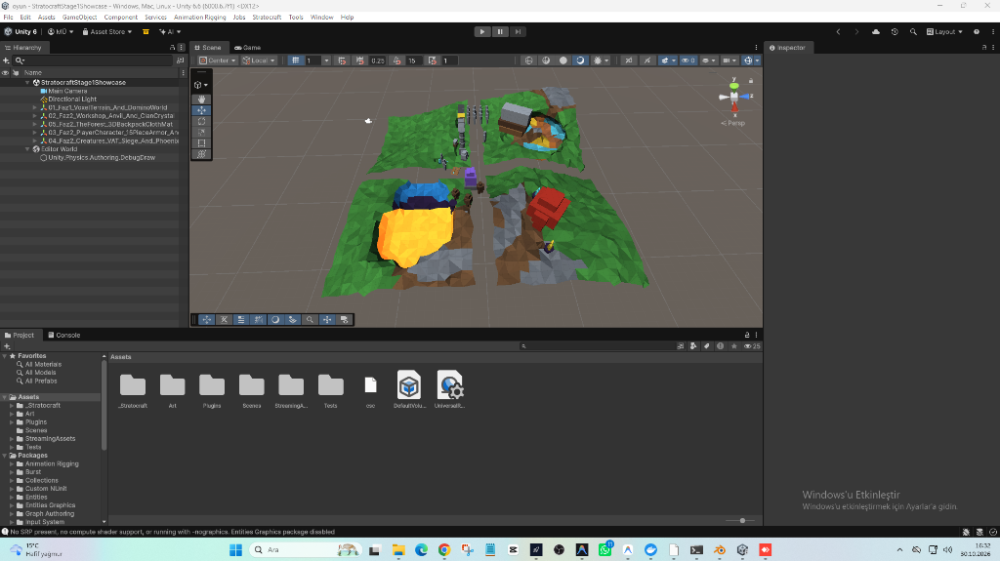
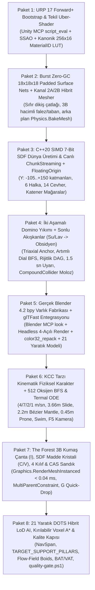

# Stratocraft — Faz 1 & Faz 2 Tam Denetim, Kök Neden ve Çözüm Mimarisi Raporu

> [!IMPORTANT]
> **Şeffaf Genel Tespit (6 Paralel Araştırma Ajanı + Kod Denetimi Özeti):**
> Mevcut repoda 24 C#, 9 Python ve 6 C++ birim testi geçmektedir; ancak bu testlerin tamamı **sahneye bağlı olmayan izole mantık sınıflarını** test etmektedir. `Assets/_Stratocraft` altında gerçek anlamda tek bir Unity DOTS `ISystem`, `[BurstCompile] IJob` veya `NativeArray` tabanlı çalışma zamanı döngüsü yoktur. Canlı sahne ([StratocraftStage1Showcase.unity](file:///d:/oyun/Assets/Scenes/StratocraftStage1Showcase.unity)) yalnızca editörde statik mesh üreten [StratocraftStage1SceneBuilder.cs](file:///d:/oyun/Assets/_Stratocraft/Editor/StratocraftStage1SceneBuilder.cs) ve 577 satırlık tekil [Stage1InteractivePlayController.cs](file:///d:/oyun/Assets/_Stratocraft/Character/Stage1InteractivePlayController.cs) üzerinden yürümekte olup Faz 1–2 sistemlerinin (streaming, yıkım fiziği, akışkanlar, oksijen, çanta, kılıf, yaratık AI) hiçbirini çağırmamaktadır.

---

## Bölüm 1 — `DURUM_VE_DEVIR.md` İçindeki 4 Sorunun Gerçek Kök Nedenleri ve Kesin Çözümleri

Devir teslim raporunda ([DURUM_VE_DEVIR.md](file:///d:/oyun/DURUM_VE_DEVIR.md#L46-L79)) listelenen 4 görsel sorunun kod üzerinde yapılan incelemesinde, rapordaki bazı teşhislerin **asıl kök nedeni ıskaladığı** tespit edilmiştir. Her birinin gerçek teknik sebebi ve *Astroneer / Deep Rock Galactic / 7 Days to Die* standartlarındaki kalıcı çözümü aşağıdadır:

### 1.1. Sorun #1 & #2: "Zemin kağıt gibi 3B değil, altı yok" ve "Chunk'lar arasında haç şeklinde yarıklar var"
* **Devir Raporundaki Önerinin Neden Uygulanmaması Gerektiği:**
  Devir raporunda önerilen `(x + localPos.X - 0.5f) * (16.0f / 14.0f)` ölçekleme formülü **hatalı bir yamadır**: `1.0m` olması gereken voksel ızgarasını `1.1428m`'ye sündürerek Anayasa Madde 2.1'deki `1 Birim = 1m³` kuralını bozar, mimari bloklarla (`ShapeID >= 1`) doğal araziyi birbirinden kaydırır ve komşu chunk yoğunluğu okunmadığı için sınır yüksekliğinde yine çatlak bırakır.
* **Gerçek Kök Neden ([HybridSurfaceNetsAndShapeMesher.cs](file:///d:/oyun/Assets/_Stratocraft/Voxel/Jobs/HybridSurfaceNetsAndShapeMesher.cs#L82-L87) ve [L224-L284](file:///d:/oyun/Assets/_Stratocraft/Voxel/Jobs/HybridSurfaceNetsAndShapeMesher.cs#L224-L284)):**
  1. **Komşu Hücre Tamponu (Padding / Apron) Yok:** Mesher yalnızca kendi `16×maxY×16` dizisini okuyor. Surface Nets algoritmasında `16×16×16` vokselden oluşan bir chunk'ın sınır yüzeylerini kesintisiz örebilmesi için komşu chunk'lardan `+1` voksel taşma payı (`Apron`) okunması zorunludur.
  2. **Kenar Atlama Hatası:** Üçgen üretim döngüsü `x=1, y=1, z=1` indeksinden başladığı için `x=0`, `y=0` ve `z=0` sınır şeritleri hiç örülmemekte, chunk birleşimlerinde ~2 metrelik haç şeklinde yarık oluşmaktadır.
  3. **Alt ve Yanlarda `Katı → Hava` Geçişi Olmaması:** [StratocraftStage1SceneBuilder.cs](file:///d:/oyun/Assets/_Stratocraft/Editor/StratocraftStage1SceneBuilder.cs#L273-L306) içinde `y=0` tabanı ve dış sınırlar tamamen katı (`density >= 64`) bırakılmıştır. Surface Nets yalnızca `katı ↔ hava` (`IsoLevel = 64`) geçişinde üçgen ürettiği için adanın altını ve yan falezlerini örememekte, zemin havada süzülen tek katlı bir kağıt gibi kalmaktadır.
* **Karar:** **Çekirdeği Baştan Yaz (`[BurstCompile] IJob` Naive Surface Nets), Algoritmayı Koru.**
* **Araştırılmış Çözüm (*Astroneer / godot_voxel / bigos91* Standardı):**
  * **Padded Örneklem Izgarası (`S = N + 2 = 18`):** Her `16³` sub-chunk için komşulardan `UnsafeUtility.MemCpy` ile (komşu yüklü değilse dünya SDF fonksiyonundan) `18×18×18` (`5.832` hücre) yoğunluk tamponu doldurulur.
  * **Dual Hücre Izgarası (`C = N + 1 = 17`):** `17³ = 4.913` dual hücrede 12 kenar kesişim ortalaması hesaplanır (`UInt16` indeks tamponu yeterlidir). Sınır dikişlerinde kayan nokta hatasını sıfırlamak için pozisyon `round(pos * 256f) / 256f` ile kuantize edilir (`0.000m` sapma).
  * **Tekil Kenar Sahiplik Kuralı:** `(p → p + e_a)` kenarı yalnızca başlangıç noktası `p ∈ [1..16]` aralığındaysa quad üretir (`+X`, `+Y`, `+Z` eksen döngüleri ayrıştırılır). Böylece her sınır yüzeyi tam 1 chunk tarafından sıfır boşlukla örülür.
  * **Gerçek 3B Ada / Hacim:** Showcase adasının altında (`y < bottomH`) ve dış falez sınırlarında yoğunluk `0` (hava) tanımlanarak altı kayalık tabanlı, yanları dik falezli tam kapalı 3B hacim üretilir.

---

### 1.2. Sorun #3: "Low-poly smooth/faceted ışıklandırma çalışmıyor, gölgesiz ve düz görünüyor"
* **Gerçek Kök Neden (3 Katmanlı Render Arızası):**
  1. **Projede URP Aktif Değil (`No SRP present`):** Ekran görüntüsünün en alt çubuğunda görüldüğü üzere, [GraphicsSettings.asset](file:///d:/oyun/ProjectSettings/GraphicsSettings.asset#L49) içinde `m_CustomRenderPipeline: {fileID: 0}` ve [QualitySettings.asset](file:///d:/oyun/ProjectSettings/QualitySettings.asset#L51) içindeki 6 kalite seviyesinin tamamında `customRenderPipeline: {fileID: 0}` durumdadır. `Assets/` altında hiçbir `UniversalRenderPipelineAsset` yoktur; proje fiilen **eski Built-in Render Pipeline** üzerinde çalışmaktadır ve bu yüzden `Entities Graphics` paketi kendini kapatmıştır.
  2. **Aynı İsimli İki Shader Çakışması:** Eski Built-in CG shader'ı olan [StratocraftVertexColorLit.shader](file:///d:/oyun/Assets/_Stratocraft/Rendering/Shaders/StratocraftVertexColorLit.shader#L1) (gölgesiz, sabit ışık yönlü `float3(0.45, 0.82, -0.35)`) ile URP için yazılan [StratocraftVertexColorUberLit.shader](file:///d:/oyun/Assets/_Stratocraft/Rendering/Shaders/StratocraftVertexColorUberLit.shader#L1) **ikisi de `Shader "Stratocraft/VertexColorUberLit"` adını taşımaktadır!** Built-in RP aktif olduğu için Unity URP shader'ını yok sayıp gölgesiz CG shader'ını çalıştırmaktadır.
  3. **SRP Batcher & URP 17 Uyumsuzluğu:** URP shader'larının `ShadowCaster` ve `DepthOnly` pass'leri `LitInput.hlsl` çağırdığı için `ForwardLit` pass'indeki `UnityPerMaterial` CBUFFER düzeniyle çakışmakta ve SRP Batcher'ı kırmaktadır. Ayrıca URP 17'de `_FORWARD_PLUS` kaldırılıp yerine `_CLUSTER_LIGHT_LOOP` gelmiştir ve Anayasa Bölüm 16'daki asıl [StratocraftUberShader.shader](file:///d:/oyun/Assets/_Stratocraft/Rendering/Shaders/StratocraftUberShader.shader) (`MatCap + 2-Tap Biplanar + LUT`) sahnede hiç kullanılmamaktadır.
* **Karar:** **Yeniden Yapılandır (Otomatik URP 17 Forward+ Kurucusu + Tekil SRP-Batcher/DOTS Uyumlu Uber-Shader).**
* **Araştırılmış Çözüm:**
  * Editör betiğiyle (`StratocraftUrpBootstrap.Ensure()`, Unity MCP `script_eval` ile tek komutta) `UniversalRendererData` (`RenderingMode.ForwardPlus` + `ScreenSpaceAmbientOcclusion` DepthNormals) ve `UniversalRenderPipelineAsset` (SRP Batcher açık, 4 kaskad gölge, Soft Shadows) üretilip `GraphicsSettings.defaultRenderPipeline` ve tüm `QualitySettings` seviyelerine atanacak.
  * İsim çakışması yaratan [StratocraftVertexColorLit.shader](file:///d:/oyun/Assets/_Stratocraft/Rendering/Shaders/StratocraftVertexColorLit.shader) silinecek; [Stratocraft.Editor.asmdef](file:///d:/oyun/Assets/_Stratocraft/Editor/Stratocraft.Editor.asmdef) içine `Unity.RenderPipelines.Universal.Runtime` ve `Core.Runtime` referansları eklenecek.
  * Ortak `StratocraftInput.hlsl` içinde tek `UnityPerMaterial` CBUFFER tanımlanıp 4 zorunlu pass (`UniversalForward`, `ShadowCaster`, `DepthOnly`, `DepthNormals`) + `DOTS.hlsl` + `_CLUSTER_LIGHT_LOOP` + `ddx/ddy` faset normali + `nointerpolation uint matId` üzerinden `LOAD_TEXTURE2D(_MaterialPaletteLUT, ...)` okuması tek `StratocraftUberShader` altında birleştirilecek.

---

### 1.3. Sorun #4: "Bazı 3B modeller eski küp/prizma hallerinde duruyor"
* **Gerçek Kök Neden (Önbellek Değil, Üretim Hattı Sahte Prizma Üretiyor):**
  1. **Blender Hiç Çağrılmıyor:** [base_generator.py](file:///d:/oyun/Tools/AutonomousAssetFactory/generators/base_generator.py#L107-L269) içindeki `_append_box_part` metodu saf Python ile 8 köşeli basit prizmalar (parça başı 48 üçgen) birleştiriyor. Üretilen 32 `.glb` modelin tamamı iskeletsiz (`skins=0, animations=0`) basit prizma yığınıdır (15 zırh parçasının hepsi aynı 288 üçgenlik şablon, kurt modeli 432 üçgenlik kutu yığını).
  2. **4 Açılı PNG Gerçek Render Değil:** [agent_generate_asset.py](file:///d:/oyun/Tools/AutonomousAssetFactory/agent_generate_asset.py#L106-L112) içinde `prefer_blender_cli=False` sabit bırakılmış; [contact_sheet_renderer.py](file:///d:/oyun/Tools/AutonomousAssetFactory/contact_sheet_renderer.py#L16-L85) PIL ile 2B poligon çiziyor.
  3. **Unity Tarafında Kırılgan Regex GLB Okuyucusu:** [StratocraftStage1SceneBuilder.cs](file:///d:/oyun/Assets/_Stratocraft/Editor/StratocraftStage1SceneBuilder.cs#L1035-L1155) içindeki `LoadOrConvertGlbToUnityMesh` metodu GLB JSON'unu Regex ile tarayıp sabit 4 `bufferView` sırası varsayıyor; gerçek Blender GLB çıktısını, `Socket_*` düğümlerini ve kemikleri okuyamaz. [StratocraftAssetPostprocessor.cs](file:///d:/oyun/Assets/_Stratocraft/Editor/StratocraftAssetPostprocessor.cs) ise `ModelImporter` beklediği için `.glb` dosyalarında hiç çalışmıyor.
* **Karar:** **Üreticileri Gerçek Headless Blender 4.2 `bpy` İle Baştan Yaz + Unity'ye Resmi `glTFast` Kur.**
* **Araştırılmış Çözüm (*Deep Rock Galactic / V Rising* Stilize Heykelsi Low-Poly Hattı):**
  * Bilgisayarda **Blender 4.2.16 LTS** (`Tools/bin/blender-4.2/blender.exe`), canlı **Blender MCP** sunucusu ve `Tools/bin/gltfpack.exe` zaten hazır durumdadır. (GTX 1650 4GB VRAM nedeniyle 8–16 GB VRAM isteyen `TRELLIS`/`TripoSG`/`UniRig` bu PC'de çalıştırılmayacak, Anayasa Bölüm 16.3 Güvence 2 gereği deterministik **Yol A: Blender `bpy`** ana hat olacaktır).
  * `generators/blender/` altında gerçek `bpy` betikleri (`bpy_weapon.py`, `bpy_armor.py`, `bpy_creature.py`, `bpy_structure.py`) yazılacak: `Skin Modifier` + `Subdivision` + `Mirror + Solidify + Bevel (chamfer)` + `Planar Decimate (5°–12°)` + `use_smooth=False` sert fasetler + Cavity AO fırınlama + prosedürel `Armature` kemikleri ve `Socket_*` Empty düğümleri.
  * **Blender 4.2 glTF Renk Tuzağı Çözümü:** Blender 4.2 `BYTE_COLOR` verisini sRGB `UNSIGNED_SHORT` olarak dışa aktarıp `MatID` tam sayısını bozduğu için, Blender'da `FLOAT_COLOR` yazılıp Python `color32_repack.py` son-geçişiyle `COLOR_0 = UNSIGNED_BYTE (R=MatID, G=Temp, B=Sharp, A=AO)` olarak paketlenecek.
  * **Görsel Öz-Denetim:** Canlı tasarımda Blender MCP `look(mode="angles")`, otomasyonda ise Headless Blender Workbench/EEVEE 4 açılı gerçek kamera render'ı + `trimesh` su sızdırmazlık (`manifold`) ve minimum poligon eşiği kontrolü yapılacak.
  * **Unity İçe Aktarım:** Unity resmi `com.unity.cloud.gltfast` paketi (`package_add`) eklenip Regex GLB okuyucusu silinecek; `OnPostprocessAllAssets` ile tüm GLB prefab'larına otomatik `StratocraftUberShader` materyali atanacak.

---

## Bölüm 2 — Anayasada (Faz 1 & Faz 2) Şart Koşulup Kodda Eksik, Farklı veya Bağlı Olmayan Mekanikler

Durum sınıflandırması:
* **`[E - Çelişkili]`**: Kod Anayasa kurallarına aykırı çalışıyor.
* **`[B - Bağsız]`**: İzole sınıf/test var ama DOTS/Burst değil ve canlı sahneye hiç bağlı değil.
* **`[C - Stub/Sahte]`**: İsim/yorum olarak var ama içeride basitleştirilmiş/sahte mantık çalışıyor.
* **`[D - Eksik]`**: Kod tabanında hiç yok.

### 2.1. FAZ 1 — Voxel Çekirdeği, Dünya Üretimi, Akışkanlar ve Domino Yıkım Fiziği

| # | Mekanik ve Anayasa Referansı | Mevcut Kod Durumu (Dosya & Satır Kanıtı) | Sınıf | Karar ve Araştırılmış Çözüm Mimarisi |
| :--- | :--- | :--- | :---: | :--- |
| **F1-01** | **Tekil `MaterialID` Kataloğu ve Color32 Sözleşmesi** *(Anayasa 2.7.A & 16.2.B)* | **3 farklı şema var:** Anayasa (`1=Toprak, 2=Taş, 14=Obsidyen, 28=Titanyum`), [MaterialIdCatalog.cs](file:///d:/oyun/Assets/_Stratocraft/Core/Constants/MaterialIdCatalog.cs#L14-L103) (`1=Stone, 6=Obsidian, 36=Titanium`) ve [StratocraftStage1SceneBuilder.cs](file:///d:/oyun/Assets/_Stratocraft/Editor/StratocraftStage1SceneBuilder.cs#L303-L334) (`1=Bazalt, 8=Obsidyen, 9=Su, 10=Magma`). Vertex rengine `MatID` yerine pişmiş RGB yazılıyor ([L472](file:///d:/oyun/Assets/_Stratocraft/Editor/StratocraftStage1SceneBuilder.cs#L472)). | **`[E]`** | **Yeniden Yapılandır:** Anayasa tablosunu tek doğruluk kaynağı yap; C#, C++ DLL ve Python fabrikasının aynı JSON/sabit tablosunu ve `256x16` LUT dokusunu okumasını sağla. |
| **F1-02** | **`16×16×16` Sub-Chunk & `4.096` Mikro-Voxel (`ShapeID=63`)** *(Anayasa 2.7.A & 2.7.B Kanal 2A)* | [VoxelChunkComponent.cs](file:///d:/oyun/Assets/_Stratocraft/Voxel/Data/VoxelChunkComponent.cs#L8-L55) `16×256×16` managed `uint[]` kullanıyor (Burst uyumsuz). [MicroVoxelPool4096.cs](file:///d:/oyun/Assets/_Stratocraft/Voxel/Data/MicroVoxelPool4096.cs) var ama mesher `ShapeID=63`'ü pahlı tam küp çiziyor ([HybridSurfaceNets...cs](file:///d:/oyun/Assets/_Stratocraft/Voxel/Jobs/HybridSurfaceNetsAndShapeMesher.cs#L518)). | **`[B/E]`** | **Baştan Yaz (Burst):** Sub-chunk başına `NativeArray<uint>(4096, Persistent)`. `ShapeID=63` hücreleri için `ulong` (`4×4×4`) 64-bit Binary Greedy alt-mesher bağla. |
| **F1-03** | **Kanal 2B: `62` Mimari Şekil, `32` Yön Dönüş ve Komşu Yüz Eleme** *(Anayasa 2.1 & 2.7.B)* | [HybridSurfaceNets...cs](file:///d:/oyun/Assets/_Stratocraft/Voxel/Jobs/HybridSurfaceNetsAndShapeMesher.cs#L484-L523) yalnızca `2..7` arası 6 şekil ve `rot & 3` (4 yön) içeriyor; komşu yüz eleme (`FullFaceMask`) yok. | **`[C]`** | **Genişlet (7DTD Hibrit Modeli):** Şekil şablonlarını veri tabanlı `BlobAsset` mesh tablosuna taşı, `FullFaceMask` elemesi ekle; doğal araziye oturan şekillerin altına `0.15m` gömülü etek/flanş koyarak çatlağı sıfırla. |
| **F1-04** | **Sıfır-GC Canlı Arazi Kazma / Yeniden Meshleme** *(Anayasa 1.5 & DevDoc 2.7)* | [Stage1InteractivePlayController.cs](file:///d:/oyun/Assets/_Stratocraft/Character/Stage1InteractivePlayController.cs#L333-L393) her kazıda `new Mesh()` yaratıp eskisini silmiyor (bellek sızıntısı), ofset hatası yüzünden jitter kayıyor, `1..14` sınırı yüzünden chunk kenarı kazılamıyor. | **`[E]`** | **Baştan Yaz (*DRG / Eldemarkki* Modeli):** Kirli chunk kuyruğu + Burst `Mesh.AllocateWritableMeshData` + işçi izlekte `Physics.BakeMesh`. Sınır vokseli değişince komşu chunk'ları da kuyruğa ekle (`0 B/kare` GC). |
| **F1-05** | **C++20 SIMD Dünya Üretimi, Negatif Y Katmanları, 6 Halka & 14 Cevher** *(Anayasa 2.3, 2.4 & 2.7)* | `simd_world_noise.cpp` sabit `Density=127` yazıyor (eğim oluşmaz), negatif Y katmanları (`-40` Titanyum, `-50` Kızıl Elmas, `-80..-100` Lav Denizi, `-105` Manto) yok, 14 cevherden Boksit ve Astral eksik. Halka sınırları 3 dosyada birbirinden farklı. Sahne DLL'i hiç çağırmıyor (`Mathf.Sin` kullanıyor). | **`[E/B]`** | **Yeniden Yapılandır:** Dikey ekseni `-112..+144` (16 dikey sub-chunk) olarak haritala; C++ tarafında sürekli 7-bit SDF yoğunluk gradyanı, kanonik 6 halka (`0..18.000m`), eksiksiz 14 cevher ve katener kubbeli mağaraları üretip canlı `ChunkStreamingSystem` ile sahneye akıt. |
| **F1-06** | **Chunk-Snapped Floating Origin (`±4.096m`)** *(Anayasa 1.8 & DevDoc F-07)* | [ChunkSnappedFloatingOriginSystem.cs](file:///d:/oyun/Assets/_Stratocraft/Voxel/Systems/ChunkSnappedFloatingOriginSystem.cs) sadece koordinat tuple'ı kaydıran izole sınıf; sahnedeki chunk `Transform`'larına bağlı değil. | **`[B]`** | **Sahneye Bağla:** Kamera `±4.096m` aştığında aktif chunk köklerini ve oyuncu/yaratık konumlarını `K × 32m` kaydıran gerçek runtime sistemi olarak bağla. |
| **F1-07** | **İki Aşamalı Domino Yıkım Fiziği (`Two-Phase DAG`), `1.5 sn` Uyarı, Terzaghi Göçüğü ve Moloz (`Rubble`)** *(Anayasa 2.6.D & 2.7.C)* | [GeodesicSupportDijkstraJob.cs](file:///d:/oyun/Assets/_Stratocraft/Physics/Jobs/GeodesicSupportDijkstraJob.cs) sabit `+1` ağırlık ve `new int[]` (GC) kullanıyor; `Triaxial Anchor` ([L214](file:///d:/oyun/Assets/_Stratocraft/Physics/Jobs/GeodesicSupportDijkstraJob.cs#L214): `y==0 && hasBottomNeighbor`) imkansız koşul yüzünden çalışmıyor! [StructuralMaterialProps.cs](file:///d:/oyun/Assets/_Stratocraft/Physics/Data/StructuralMaterialProps.cs#L42-L56) Anayasa tablosuyla (`80..25.000`) uyumsuz. `1.5 sn` çatırdama uyarısı, amortize kuyruk, `Rubble` re-voxelization ve blok kırma bağlantısı **hiç yok**. | **`[C/E/D]`** | **Baştan Yaz (*Valheim + 7DTD + Red Faction* Modeli):** 1. Anayasa malzeme `BlobAsset` tablosu. 2. `Triaxial Anchor` ($N_{\text{lat}}==4$) + çift kuyruklu artımlı Burst Dial Dijkstra (`d_sup < 64`, kemer/keystone indirimli). 3. `d_sup` azalan sırada (döngüsüz) rijitlik ağırlıklı yük DAG'ı. 4. `1.5 sn` çatırdama kuyruğu $\to$ CCL + Greedy Box ($\le 12$ kutu `CompoundCollider`) $\to$ uyku sonrası `Rubble Voxel` + Terzaghi mağara göçüğü kuralı. |
| **F1-08** | **16-Bit Sonlu Akışkanlar ve Tek Seferlik Obsidyen Sönümlenmesi** *(Anayasa 2.6.B & 2.7.D)* | [FluidCellularAutomataJob.cs](file:///d:/oyun/Assets/_Stratocraft/Physics/Jobs/FluidCellularAutomataJob.cs) sahnede çalışmıyor (sahnedeki su/magma katı blok, obsidyen `wx < 5.6f` ile sahte boyalı: [SceneBuilder L307](file:///d:/oyun/Assets/_Stratocraft/Editor/StratocraftStage1SceneBuilder.cs#L307)). Su+Lav tepkimesi sıvıları tamamen tüketmek yerine 128 çıkarıp kalanını bırakıyor. | **`[B/C]`** | **Yamala & Sahneye Bağla (*Noita + Dwarf Fortress* Modeli):** Burst `IJob` + aktif chunk/dirty-rect uyku modu (`IsSettled` `%0` CPU) + DF sınırlı BFS U-borusu basıncı + Su($\ge 128$)+Lav($\ge 128$) temasında ikisini de sıfırlayıp 1 doğal SDF obsidyen üretme + ayrı sıvı Surface Nets mesh katmanı (`+0.35m` kıyı etekli). |

---

### 2.2. FAZ 2 — Karakter Fiziği, Madde Kristali, 3B Çanta, Kılıflar ve Yaşayan Canlılar

| # | Mekanik ve Anayasa Referansı | Mevcut Kod Durumu (Dosya & Satır Kanıtı) | Sınıf | Karar ve Araştırılmış Çözüm Mimarisi |
| :--- | :--- | :--- | :---: | :--- |
| **F2-01** | **7 Duruşlu Fiziksel Karakter, `3.66m` Kayma, `2.20m` 3-Işınlı Tırmanma ve `F5` Kamera** *(Anayasa 3.1 & 3.5.D)* | [Stage1InteractivePlayController.cs](file:///d:/oyun/Assets/_Stratocraft/Character/Stage1InteractivePlayController.cs#L526-L541) kapsül çarpışmasız tek Raycast ile `transform.position` kaydırıyor (duvardan geçer). Hızlar sahnede `6.5/10.5`, logic'te `4/6.8/2.2/1.1` (Anayasa: `4/7/2/1`). Eğilme (`0.90m`), `Z` sürünme (`0.45m` tünel), 3-ray Bézier tırmanma (`2.2m`), yüzme, `F5` FPS/TPS ve `%15` stamina histerezisi yok. `OnGUI` her kare GC üretiyor. | **`[C/E/D]`** | **Baştan Yaz (*KCC Collide-and-Slide* Modeli):** Yeni Input System + PhysX `CapsuleCast` / `ComputePenetration` / `CheckCapsule` tabanlı kinematik motor (canlı remesh altında düşme korumalı). Tam Anayasa sabitleriyle 10 durumlu hareket makinesi (`3.66m` eğim-sürtünmeli slide, L-ray + kübik Bézier `2.2m` mantle, tavan kontrollü `0.45m` prone, su derinliği `>1.3m` swim, `F5` FPS/TPS). |
| **F2-02** | **Kapalı Alan Oksijen (`512` BFS + Gökyüzü Erken Çıkış) ve Termal/Islaklık ODE** *(Anayasa 3.2, 3.5.A & 3.5.B)* | [EnclosedOxygenFloodFillSystem.cs](file:///d:/oyun/Assets/_Stratocraft/Character/Systems/EnclosedOxygenFloodFillSystem.cs#L18-L83) `2048` düğüm, `64` eşik, `HashSet/Queue` (GC) kullanıyor, chunk sınırını açık hava sanıyor ve gökyüzü ışığı kontrolü yok. [ThermalAndBiologySystem.cs](file:///d:/oyun/Assets/_Stratocraft/Character/Systems/ThermalAndBiologySystem.cs) basit yaklaşım, sahnede bağlı değil. | **`[C/E]`** | **Baştan Yaz (Burst `IJob`):** `512` kapasiteli `NativeArray` BFS + `SKY_LIGHT > 0` baca erken çıkışı + $O_{\max} = 15 V_{\text{hava}}$ (`1×1×2` kutuda tam `30 sn` oksijen) + 6 bileşenli çevre sıcaklığı ve ıslaklık ($3\times$ soğuma) ODE'si. |
| **F2-03** | **Madde Kristali (`C`) CSG Arazi Fırçası, `G_vac` Kapısı ve `V` Çift Halkalı Radyal Menü** *(Anayasa 2.2, 2.7.A & 3.5.E)* | [MatterCrystalVacuumSystem.cs](file:///d:/oyun/Assets/_Stratocraft/Inventory/Systems/MatterCrystalVacuumSystem.cs) sertlik kademesi (`1..5`), `y > -105` ve kısmi hasar istismarını kontrol etmiyor; SDF fırçası yerine küp silip küp koyuyor. Sahnede çağrılmıyor. [CrystalMassStorage.cs](file:///d:/oyun/Assets/_Stratocraft/Inventory/Data/CrystalMassStorage.cs) `264B` struct yerine `Dictionary`; `StackableItemSlot` (`8B` vs `16B`) ve `UniqueEquipmentInstance` (`48B` vs `128B`) boyutları yanlış. | **`[B/C/E]`** | **Yeniden Yapılandır (*Astroneer Deform Tool* Modeli):** 3 envanter struct'ını Anayasadaki kesin byte boyutlarında `unmanaged struct` yap. Küresel smoothstep SDF fırçası, tam `G_vac` 5'li kapısı (`ERR_ORE_RESONANCE_IMMUNE` + sertlik + kısmi hasar `Q8`), `V` çift halkalı radyal seçim UI Toolkit ekranı ve `Alt+V` mikro-voxel modunu bağla. |
| **F2-04** | ***The Forest* Tarzı `1.40×1.00m` 3B Kumaş Çanta (`I`), 4 Vücut Kılıfı ve CAS Sandık** *(Anayasa 3.3 & 3.5.F)* | Sahnede `I` tuşu yalnızca `SetActive` yapıyor; hız `-%70` düşmüyor, `3–4 sn` kuşanma ve darbede iptal yok. [BackpackInstancedRenderer.cs](file:///d:/oyun/Assets/_Stratocraft/Inventory/Systems/BackpackInstancedRenderer.cs) hiçbir `Graphics.RenderMeshInstanced` çağrısı yapmıyor. `G` yere silah atmıyor. Sahnede 3B CAS sandık yok. | **`[C/B]`** | **Baştan Yaz:** `I` ile oyuncu önüne serilen 6 bölgeli örtü + dirty-flag önbellekli `Graphics.RenderMeshInstanced` piramit/kule çizimi (`< 0.04 ms`, `0 B` GC) + `Plane.Raycast` analitik UV slot seçimi + `-%70` hız ve `3–4 sn` kuşanma + `MultiParentConstraint` ile `0.6/1.3/1.8 sn` kılıf geçişi + `G` fiziksel silah atma + kapaklı 3B CAS sandık. |
| **F2-05** | **21 Özel Yaratık, 3 Katmanlı Hibrit LoD AI (`NavSpan`), Kırılabilir Voxel A\* ve VAT/BAT** *(Anayasa 1.5, 13.0, 13.3.A & 16.3)* | [Creature21BehaviorSystem.cs](file:///d:/oyun/Assets/_Stratocraft/CreaturesAI/CreaturesAndBosses/Creature21BehaviorSystem.cs#L54-L86) isimleri ve canları (`85..1650 HP`) Anayasa 13.0 tablosuyla (`Goblin..Void Stalker`, `120..12.000 HP`) uyuşmuyor. Hareket, sürü, beslenme ve **Kırılabilir Voxel A\*** hiç yok; sahnede 3 statik heykel duruyor. [vat_texture_baker.py](file:///d:/oyun/Tools/AutonomousAssetFactory/rigging_and_vat/vat_texture_baker.py) geçersiz EXR üretiyor. Manifest'te 21 yaratık yerine tek 1 yaratık kaydı var. | **`[E/D/C]`** | **Baştan Yaz (Gerçek DOTS ECS + Burst):** 1. Anayasa 13.0 kanonik 21 yaratık tablosu ve Blender `bpy` modelleri. 2. Çok katlı mağara uyumlu `4-Byte NavSpan` + T0 (`0–128m` 7DTD tarzı duvar HP maliyetli Kırılabilir Voxel A\* ve `TARGET_SUPPORT_PILLARS`), T1 (`128–512m` paylaşımlı Flow-Field + Boids), T2 (`>512m` analitik makro) `ISystem`. 3. `< 16 MB` VRAM bütçesini korumak için **Bone Animation Texture (`~115 KB/tür`)** + `fuqunaga/VatBaker` (MIT) ve çok bacaklılarda Burst 2-Bone IK. |

---

## Bölüm 3 — İki Ana Doküman Arasında Tespit Edilen 7 Çelişki ve Kanonik Çözüm Kararı

Denetim sırasında `GAME LOGIC BIBLE` (Anayasa) ile `STRATOCRAFT_GELISTIRICI_DOKUMANI.md` arasında aşağıdaki 7 teknik çelişki yakalanmıştır. Kodlamada karışıklık çıkmaması için **Anayasa (Game Logic Bible) hükümlerinin esas alınması** önerilmektedir:

| # | Konu | `GAME LOGIC BIBLE` (Anayasa — Önerilen Kanonik Kural) | `STRATOCRAFT_GELISTIRICI_DOKUMANI` İçindeki Çelişen İfade |
| :-: | :--- | :--- | :--- |
| **1** | **32-Bit Voxel Dizilimi** | `[8b MatID \| 7b Density \| 6b ShapeID \| 5b Rot \| 2b Origin \| 4b Dmg]` *(Bölüm 2.7.A — `VoxelBitUtility` zaten buna uygun)* | Bölüm 4.6.1 Anayasa ile aynıyken, Bölüm 5.2.3 (`L3065`) `[8b Mat \| 6b Dmg \| 4b Temp \| 2b Origin \| 12b Micro]` yazıyor. |
| **2** | **Madde Kristali Koyma Kökeni** | Sağ tıkla dünyaya koyulan kütle **daima `OriginState = 0`** yazar; batarya yapılamaz, düşman kristali çekebilir *(Bölüm 2.2 & 2.7.A)*. | Bölüm 5.3.3 (`L3122`) `"sıkıştırıp koyduğunda bloğu OriginState = 1 yapar"` diyor *(bu ifade kazma/anti-cheese kuralını bozar)*. |
| **3** | **Su + Lav Obsidyen Eşiği** | `0..255` ölçeğinde `V_su >= 128 VE V_lav >= 128` ise tek seferde **ikisi de sıfırlanır** ve `1` doğal obsidyen oluşur *(Bölüm 2.7.D)*. | Bölüm 5.2.3 (`L3074`) `Su 8 / Lav 4 seviye` ve `>= 4 Lav + >= 1 Su` diyor. |
| **4** | **Zorluk Halkası Ölçeği** | `0–200m (Lv0)`, `200–1.000m (Lv1)` ... `10.000–15.000m (Lv5)`, `15–18km` Anomali, `18.000m` Boyutsal Kırılma *(Bölüm 2.3–2.4)*. | Bölüm 5.2.1 (`L3053`) `0–3.000m` arası 5 halka + `3.000–3.600m` felaket kuşağı diyor. |
| **5** | **Karakter Kapsül Boyları** | Ayakta `1.80m`, Eğilme `0.90m`, Sürünme `0.45m` *(Bölüm 3.1 & 3.5.D — dar tüneller için şart)*. | Bölüm 5.3.3 (`L3119`) Eğilme `1.2m`, Sürünme `0.6m` diyor. |
| **6** | **Arazi Meshing Yöntemi** | Küp dünya yasak; `Kanal 1 Surface Nets / Dual Contouring + Kanal 2A/2B Hibrit` *(Bölüm 1.1 & 2.7.B)*. | Bölüm 5.2.3 Adım 3 yalnızca `Binary Greedy Meshing` (kübik) anlatıyor. |
| **7** | **MaterialID Numaraları** | `1=Toprak, 2=Ham Taş, 14=Obsidyen, 28=Titanyum, 45=Kızıl Elmas, 240..255=Zindan` *(Bölüm 2.7.A)*. | `MaterialIdCatalog.cs` farklı sıra kullanıyor (`1=Stone, 6=Obsidian, 36=Titanium`). |

---

## Bölüm 4 — Başvurulan Açık Kaynak Referanslar ve Oyun Mühendisliği Kaynakları

Alt ajan araştırmalarında incelenen ve ticari-dostu lisanslarıyla (`MIT / BSD-3 / zlib / Unity Companion`) mimariye referans alınan başlıca projeler:

* **Smooth/Faceted Voxel & Meshing:**
  * `bigos91/fastNaiveSurfaceNets` (**MIT**) — Unity C# Burst + SIMD köşe maskeleme ve `MeshData` yazımı.
  * `Eldemarkki/Marching-Cubes-Terrain` (**MIT**) — Unity Jobs + Burst chunk yönetimi ve canlı SDF arazi şekillendirme (deform) kuyruğu.
  * `Zylann/godot_voxel` (**MIT**) & Mikola Lysenko (`0fps.net`) — `MIN_PADDING = 1 / MAX_PADDING = 2` chunk sınır dikişi matematiği.
  * Eric Lengyel `Transvoxel` (**MIT** tablolar) — İleri aşama çoklu-LOD dikiş referansı.
* **URP 17 Shader & Görsel Dil:**
  * Unity 6 URP 17.6 paket kaynakları (`SimpleLit.shader`, `DOTS.hlsl`, `ShadowCasterPass.hlsl`, `DepthNormalsPass.hlsl`).
  * Inigo Quilez *Biplanar Mapping* (`iquilezles.org/articles/biplanar/`) — `SAMPLE_TEXTURE2D_ARRAY_GRAD` ile 2-okumalı UV'siz yüzey detayı.
  * Cyanilux URP Shader Code rehberi & `ColinLeung-NiloCat/UnityURPToonLitShaderExample` (**MIT**).
* **Yapısal Bütünlük (Domino) & Sonlu Akışkanlar:**
  * *7 Days to Die* (`StabilityCalculator` zaman dilimli kuyruk & blok HP tabanlı A\*), *Valheim* (`WearNTear` yatay/dikey kayıp), *Red Faction: Guerrilla* (GDC 2011 Geo-Mod 2.0 stres grafı), *Seed of Andromeda* (çift kuyruklu artımlı BFS silme/tamir).
  * *Noita* (GDC 2019 dirty-rect + checkerboard çok izlekli sıvı), *Dwarf Fortress* (sınırlı BFS hidrostatik U-borusu), `jongallant/LiquidSimulator` & `MaxBittker/sandspiel` (**MIT**).
* **Karakter, 3B Varlık Fabrikası & Kalabalık AI/VAT:**
  * `Unity-Technologies/CharacterControllerSamples` (**Unity Companion**) & KCC *Collide-and-Slide* kinematik süpürme prensibi.
  * `Unity-Technologies/com.unity.cloud.gltfast` (Resmi Unity glTF 2.0 ScriptedImporter — `COLOR_0` ve `Socket_*` hiyerarşi koruma).
  * `fuqunaga/VatBaker` (**MIT**) & `recastnavigation/recastnavigation` (**zlib** — `rcCompactSpan` sütun özeti mimarisi).

---

### Ayrıntılı Alt Ajan Araştırma Dokümanları
Bu ana mimari rapora girdi sağlayan 6 odaklı alt alan denetim ve araştırma raporu docs/arastirma/ dizininde saklanmaktadır:
1. [01. Kod Açıkları ve Anayasa Uygunluk Denetimi](arastirma/01_kod_aciklari_ve_anayasaya_uygunluk_denetimi.md)
2. [02. Padded Naive Surface Nets ve Sınır Seam Çözümü](arastirma/02_smooth_voxel_meshing_ve_seam_cozumu.md)
3. [03. URP 17 Forward+ Kurulumu ve Tekil Uber-Shader Mimarisi](arastirma/03_urp17_forward_plus_ve_uber_shader.md)
4. [04. İki Aşamalı Domino Yıkım Fiziği ve 16-Bit Sonlu Akışkanlar](arastirma/04_iki_asamali_domino_ve_sonlu_akiskanlar.md)
5. [05. Fiziksel Karakter Motoru, 3B Kumaş Çanta ve Hibrit LoD AI](arastirma/05_fiziksel_karakter_envanter_ve_hibrit_ai.md)
6. [06. Headless Blender 4.2 bpy Varlık Üretim Hattı ve glTFast](arastirma/06_blender42_otonom_varlik_hatti.md)

---

## Bölüm 5 — Uygulama Sırası ve Araç (`Unity MCP` + `Blender MCP` + `CLI`) Yürütme Planı

Onayınızın ardından hiçbir manuel işlem istemeden, doğrudan aşağıdaki sırayla ve her adımı sahnede doğrulayarak ilerleyeceğiz:

### Açık Karar Noktaları (Onayınız İçin)
1. **7 Doküman Çelişkisi (Bölüm 3):** Tablodaki 7 maddenin tamamında **Anayasa (`GAME LOGIC BIBLE`)** kurallarını kanonik kabul edip Geliştirici Dokümanı'ndaki çelişen notları da buna göre güncelleyelim mi?
2. **Karakter Kontrolcüsü Mimarisi (`Paket 6`):** Arazi PhysX `MeshCollider` kullandığı için çifte collider pişirme maliyetinden kaçınmak adına oyuncuyu **PhysX `CapsuleCast` tabanlı Kinematik Collide-and-Slide (Hibrit GameObject)** olarak mı kuralım, yoksa Faz 2'den itibaren tüm arazi collider'larını doğrudan **DOTS `Unity.Physics` + `com.unity.charactercontroller`** tarafına mı taşıyalım? *(Öneri: Binlerce düşen domino parçası ve gelecekteki Netcode sunucu otoritesi için `Unity.Physics` veya hibrit köprü; tek oyunculu/hızlı iterasyon için Kinematik PhysX daha çeviktir).*
3. **İlerleme Şekli:** Onay verdiğiniz anda **Paket 1 (URP 17 Forward+ & Uber-Shader)** ve **Paket 2 (Sıfır Çatlaklı 3B Padded Surface Nets Mesher)** ile başlayıp Unity MCP üzerinden canlı sahne ekran görüntüsünü paylaşarak adım adım ilerleyelim mi?
