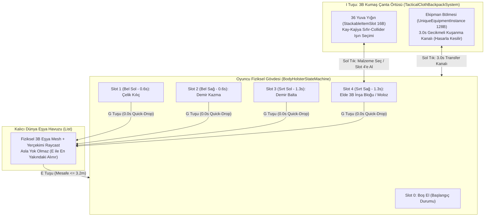

# FİZİKSEL ENVANTER, 3B KUMAŞ ÇANTA ÖRTÜSÜ, FİZİKSEL KILIFLAR (HOLSTER) VE GERÇEK MADENCİLİK SERTLİK SİSTEMİ MİMARİ RAPORU

> **Rapor Kapsamı:** *Stratocraft* Faz 1 & Faz 2 denetiminde tespit edilen envanter, kılıf (holster/hotbar), yere eşya bırakma (`G` tuşu), 3B kumaş çanta örtüsü (`I` tuşu) ve fiziksel/kristal madencilik sertlik mekaniklerindeki illüzyonların kök neden analizi, endüstri standartları (*The Forest / Sons of the Forest*, *Outward*, *Green Hell*, *Metro Exodus*, *Into the Radius VR*, *Escape from Tarkov*, *Ultima Online*, *Vintage Story*) ve sıfır-GC gerçek mimari çözüm spesifikasyonu.

---

## BÖLÜM 1: ENDÜSTRİ ANALİZİ VE AÇIK KAYNAK MİMARİ İNCELEMESİ

### 1.1 Fiziksel / Diegetic Envanter ve Sırt Çantası Sistemleri
Geleneksel oyunlarda envanter, zamanı durduran soyut bir 2B ızgara (grid) penceresidir. Ancak *Stratocraft* Anayasası (Bölüm 4.2 & 4.3), oyuncuyu dünyadan koparmayan **Diegetic (Oyun İçi Fiziksel)** ve **Taktiksel Ağırlıklı** bir envanter mimarisi emreder. Endüstrideki referans oyunların mekanik ve teknik çözümleri şunlardır:

1. **The Forest & Sons of the Forest (3B Kumaş Çanta Örtüsü / Diegetic Inventory Mat):**
   - **Tasarım:** `I` tuşuna basıldığında ekrana 2B menü gelmez; oyuncu yere bir kumaş/branda örtü (*tarp/cloth mat*) serer. Kamera aşağı eğilir, eşyalar örtünün üzerindeki belirli bölgelerde gerçek 3B modeller (külçe piramitleri, silahlar, iksirler, taşlar) olarak dizilir.
   - **Teknik Uygulama:** Örtü, oyuncunun önünde (`playerTransform.position + fwd * 1.30m`) açılan dünya uzayında (World-Space) bir kök nesnedir. Fare imleci serbest bırakılır ve kameradan gönderilen ışın (`ScreenPointToRay`) ile örtü üzerindeki eşyaların AABB kutuları test edilir. Tıklanan eşya doğrudan kılıfa (kemere) veya merkeze (zanaat/birleştirme alanına) taşınır.
2. **Outward (Taktiksel Sırt Çantası Ağırlığı ve Savaşta Yere Bırakma):**
   - **Tasarım:** Sırt çantası ve ağır ekipmanlar oyuncunun hareket hızını, yuvarlanma/kaçınma (dodge) çevikliğini ve stamina tüketimini doğrudan etkiler. Savaş başladığında oyuncu tek tuşla ağır yükünü/silahını **0.0 saniyede fiziksel olarak yere bırakır**, hafifleyerek savaşır ve savaş bittiğinde yerdeki çantasını/silahını geri alır.
   - **Risk-Ödül Dengesi:** Yere bırakılan eşya asla silinmez (despawn olmaz); dünya üzerinde kalıcı bir fiziksel nesnedir. Oyuncu kaçmak zorunda kalırsa eşyası orada kalır ve geri dönüp kurtarması gerekir.
3. **Metro Exodus & Green Hell (Zamanı Durdurmayan Gerçek Zamanlı Çanta ve Kanal Süresi):**
   - **Tasarım:** Çantayı açmak (`I`) dünyayı **durdurmaz (No Pause)**. Karakter diz çöker veya yavaşlar (`%70` hız cezası: `4.0 m/s -> 1.2 m/s`). Çantanın içinden ağır bir zırh veya silah çıkarıp kuşanmak anlık değildir; **3.0 – 4.0 saniyelik** bir kanal (channeling) süresi gerektirir. Bu sırada yaratık saldırısına uğranırsa kuşanma işlemi anında kesilir (`OnDamageTaken`).
4. **Into the Radius VR, Escape from Tarkov & Ultima Online (Fiziksel Kılıflar ve Serbest Yerleşim):**
   - **Kemer ve Sırt Kılıfları (Body Sockets / Holsters):** Oyuncunun çantasındaki her eşyaya savaş ortasında anında ulaşılamaz. Yalnızca **Bel Sol (`1`), Bel Sağ (`2`), Sırt Sol (`3`) ve Sırt Sağ (`4`)** kılıflarına takılı olan 4 ekipman hızlı çekilebilir. Bel kılıfları `0.60s`, sırt kılıfları `1.30s` çekim süresine sahiptir. Sırtta ağır bir Kuşatma Bataryası taşınırken Sırt Kılıfları (`3` ve `4`) fiziksel olarak kilitlenir.
   - **Görsel Kılıf Göstergesi (Diegetic Hotbar HUD):** Birinci şahıs (FPS) kamerasında oyuncu kendi belini sürekli göremediği için, ekranın alt orta kısmında minimalist bir **Fiziksel Kılıf Barı (1: Bel Sol | 2: Bel Sağ | 3: Sırt Sol | 4: Sırt Sağ | 0: Boş El)** bulunmak zorundadır. Bu bar hangi yuvanın dolu/boş olduğunu, eldeki aktif yuvayı ve kuşanma geçiş süresini (`RemainingTransitionSeconds`) anlık gösterir.

### 1.2 Voksel Madencilik Sertlik ve Alet Kademesi Sistemleri
1. **Vintage Story (Cevher/Kaya Kademesi ve Alet Sekme/Kırılma Mekaniği):**
   - Her kaya katmanı (Tortul, Metamorfik, Magmatik) ve her cevher damarı sayısal bir **Kademe (Mining Tier: 0..5)** ve **Sertlik (Hardness)** değerine sahiptir.
   - Eğer oyuncunun elindeki kazmanın kademesi (`ToolTier`), bloğun istediği minimum kademeden (`RequiredTier`) düşükse, blok **hiç hasar almaz (Sekme / Ricochet)** veya kırılması imkansızdır (`ERR_TOOL_TIER_INSUFFICIENT`).
   - Örneğin: Çıplak elle (`Tier 0`) yalnızca Toprak, Çimen, Kum ve Gevşek Moloz kazılabilir; Ham Taş (`Tier 1`) çıplak elle kırılamaz. Bakır Kazma (`Tier 1`) Ham Taşı ve Bakır/Kalay cevherini kırar ama Demir Cevherini (`Tier 2`) kıramaz. Demir Kazma (`Tier 2`) Bazalt ve Demir/Altın cevherini kırar ama Mithril/Titanyum (`Tier 3`) ve Doğal Obsidyeni (`Tier 4`) kıramaz.
2. **Minecraft / Terraria / Valheim Alet-Malzeme Uyumluluk Matrisi:**
   - **Alet Uzmanlığı (Tool Type Affinity):** Kazma (`Pickaxe`) kaya ve cevherlerde `%100` verimliyken ahşapta yavaş; Balta (`Axe`) ahşap ve organik yapılarda `%100` verimliyken kayada `%15` verimli; Kılıç (`Sword`) ise madencilik aleti değildir (kaya/cevherde `%0` hasar ve yüksek körelme cezası).

### 1.3 Açık Kaynak GitHub Projeleri ve Unity Mimari Desenleri
GitHub üzerindeki açık kaynak `diegetic inventory unity`, `spatial inventory` ve `physical holster` projelerinde (örn. *XR Socket Interactor* türevleri, *CodeMonkey Spatial Inventory*, *Kay-Kajiya Zero-Collider Slab Picking* mimarileri) öne çıkan 3 temel mühendislik deseni zaten çekirdek sınıflarımızda mevcuttur ancak sahne kontrolcüsüne bağlanmamıştır:
- **Sıfır-Collider Analitik Işın Seçimi (`BackpackInstancedRenderer.RaycastPickSlotZeroCollider`):** Çanta içindeki 36 yuvanın her birine ağır Unity `BoxCollider` bileşeni eklemek yerine, Kumaş Örtü yerel uzayında (`localRayOrigin`, `localRayDir`) Kay-Kajiya Slab algoritmasıyla `< 2 µs` içinde sıfır GC ile hangi yuvaya tıklandığını bulur.
- **GPU Instanced Çapraz Külçe Piramidi (`BackpackInstancedRenderer.BuildGridPyramidInstances`):** Tek katmanları `0°`, çift katmanları `90°` (`PI/2`) döndürerek külçe ve kalasları 1–4 katmanlı 3B piramitler halinde tek Draw Call ile çizer.
- **2-Fazlı 64-Bit Lock-Word Atomik CAS (`VisualChestCasSystem`):** Çok oyunculu/çok iş parçacıklı sandık erişiminde `Interlocked.CompareExchange` ile `%0` eşya kopyalama (duplication) ve `%0` struct yırtılması garantiler.

---

## BÖLÜM 2: MEVCUT KOD TABANINDAKİ 5 KÖK NEDEN ANALİZİ (NEDEN SAHTE / BOZUK ÇALIŞIYOR?)

`Assets/_Stratocraft/Character/Stage1HolsterAndBackpackController.cs`, `Assets/_Stratocraft/Character/Stage1MatterCrystalAndMiningController.cs`, `Assets/_Stratocraft/Character/Stage1InteractivePlayController.cs` ve `Assets/_Stratocraft/Inventory/` altındaki dosyaların satır satır incelenmesi sonucunda tespit edilen **5 kritik kök neden** aşağıdadır:

### Kök Neden 1: Oyuncunun Dolu Elle Başlaması ve "Boş El (Slot 0)" Tuşunun Olmaması
- **Dosya & Satır:** `Assets/_Stratocraft/Character/Stage1HolsterAndBackpackController.cs` (Satır `34` ve `43–50`).
- **Mevcut Hatalı Kod:**
  ```csharp
  public int ActiveHolsterSlot { get; private set; } = 1;
  // ...
  public Stage1HolsterAndBackpackController()
  {
      HolsterMachine.AssignHolsterSlot(HolsterSlotIndex.WaistLeft_Slot1, ...);
      // ...
      HolsterMachine.RequestDrawSlot(HolsterSlotIndex.WaistLeft_Slot1);
      HolsterMachine.StepHolster(2.0f);
  }
  ```
- **Analiz:** Yapıcı metot (`constructor`), oyun başlar başlamaz 4 kılıfı da doldurmakta ve zorla `RequestDrawSlot(WaistLeft_Slot1)` + `StepHolster(2.0f)` çağırarak oyuncunun eline 1.85 kg'lık Çelik Uzun Kılıcı vermektedir. Ayrıca `HandleHolsterSlotHotkeys` (Satır `125–145`) içinde oyuncu elindeki aktif kılıf tuşuna tekrar bastığında (örneğin elinde `1` varken tekrar `1`'e veya `H` / `0` tuşuna bastığında) silahı kılıfına geri sokup **Boş Ele (`HolsterSlotIndex.None = 0`)** geçmesini sağlayan hiçbir kod yoktur (`if (requestedSlot == ActiveDrawnSlot) return 0.0f;` yüzünden kilitli kalmaktadır).

### Kök Neden 2: Ekran Altında Fiziksel Kılıf / Kemer (Hotbar) Göstergesinin Olmaması
- **Dosya & Satır:** `Assets/_Stratocraft/Character/Stage1InteractivePlayController.cs` (Satır `362–395`, `OnGUI()`).
- **Analiz:** Ekranın sol üst köşesinde 6 satırlık karmaşık bir metin kutusu (`GUI.Box(new Rect(12f, 12f, 920f, 158f), ...)`) vardır; ancak ekranın alt ortasında oyuncunun **4 Fiziksel Gövde Kılıfını (`[1] Bel Sol`, `[2] Bel Sağ`, `[3] Sırt Sol`, `[4] Sırt Sağ`) ve `[0/Q] Boş El`** durumunu gösteren hiçbir görsel Hotbar/Kemer kutusu yoktur. Oyuncu hangi kılıfta ne olduğunu, hangi kılıfın `G` ile yere atıldığı için boşaldığını veya kılıftan çekme süresini (`0.6s / 1.3s`) görememektedir.

### Kök Neden 3: `G` Tuşuyla Yere İkinci Eşya Atıldığında Birincisinin Yok Olması (`Destroy`)
- **Dosya & Satır:** `Assets/_Stratocraft/Character/Stage1HolsterAndBackpackController.cs` (Satır `27`, `32–33` ve `152–204`).
- **Mevcut Hatalı Kod:**
  ```csharp
  private GameObject? _droppedWorldToolProxy;
  private int _droppedSlotIndex;
  private UniqueEquipmentInstance _droppedEquipment;
  // ...
  if (Input.GetKeyDown(KeyCode.G) && ActiveHolsterSlot != 0)
  {
      // ...
      if (_droppedWorldToolProxy != null) UnityEngine.Object.Destroy(_droppedWorldToolProxy);
      _droppedWorldToolProxy = new GameObject(...);
  }
  ```
- **Analiz:** Yere atılan eşyaları tutmak için bir koleksiyon/havuz (`List<WorldDroppedItem>`) yerine **tek bir skaler değişken (`_droppedWorldToolProxy` ve `_droppedEquipment`)** kullanılmıştır! Oyuncu `[1]` Kılıcı `G` ile yere atıp, ardından `[2]` Kazmayı eline alıp tekrar `G`'ye bastığında, `if (_droppedWorldToolProxy != null) Destroy(_droppedWorldToolProxy);` satırı çalışmakta ve **yerdeki ilk kılıcı hem sahneden hem de bellekten kalıcı olarak silmektedir!** Bu durum Anayasa Bölüm 4.3 (*"G Tuşu Quick-Drop: Eldeki ağır silahı 0.0 sn içinde yere KALICI 3B dünya nesnesi olarak bırakır, ASLA yok olmaz!"*) kuralının doğrudan ihlalidir.

### Kök Neden 4: `I` 3B Kumaş Çantasında Eşya Transferinin Sahte Olması (`TacticalClothBackpackSystem`'in Bypass Edilmesi)
- **Dosya & Satır:** `Assets/_Stratocraft/Character/Stage1HolsterAndBackpackController.cs` (Satır `223–280`, `UpdateBackpackMatClickInteraction`).
- **Mevcut Hatalı Kod:**
  ```csharp
  int zone = local.z > 0.12f ? (local.x <= 0f ? 3 : 4) : (local.x < -0.18f ? 0 : (local.x <= 0.18f ? 1 : 2));
  // ...
  if (zone == 3)
  {
      ActiveHolsterSlot = 2;
      HolsterMachine.RequestDrawSlot(HolsterSlotIndex.WaistRight_Slot2);
  }
  else if (zone == 0 && CopperIngotCount > 0) {
      CopperIngotCount--;
      miningCtrl.CrystalStorage.TryDepositMassQ24_8(chosenMat, 4u * CrystalMassStorageData.OneBlockQ24_8);
  }
  ```
- **Analiz:**
  1. `TacticalClothBackpackSystem` (`Assets/_Stratocraft/Inventory/Systems/TacticalClothBackpackSystem.cs`) içinde 36 yuvalı `_slots`, `_storedEquipment`, `BeginEquipFromBackpack` (`3.0s - 4.0s` kanal süresi), `StepEquipChannel` ve `OnDamageTaken` kusursuz yazılmış olmasına rağmen, `Stage1HolsterAndBackpackController` bu sınıfın **yalnızca `IsBackpackOpen` bayrağını kullanmakta, içindeki hiçbir metodu çağırmamaktadır!**
  2. `BackpackInstancedRenderer.RaycastPickSlotZeroCollider` hiç çağrılmamış, yerine kumaş örtü 5 sabit koordinat bölgesine (`zone 0..4`) bölünmüştür.
  3. Çantadaki kazmaya (`zone == 3`) tıklandığında çantadan kemere `3.0` saniyelik transfer yapılmamakta, zaten kemerde (`Slot 2`) takılı olan kazma `0.6` saniyede ele çekilmektedir! Eğer oyuncu kazmayı `G` ile yere atmışsa, çantada kazma varmış gibi tıklasa bile `Slot 2` boş olduğu için eline hiçbir şey gelmemektedir.
  4. Daha da kötüsü, çantadaki "Bakır/Demir/Mithril Külçeye" (`zone 0..2`) tıklandığında, külçe elinize alınmak yerine `CopperIngotCount--` yapılıp **Madde Kristaline yoktan `4 Blok` Ham Taş/Bazalt/Kırıktaş eklenmektedir (`TryDepositMassQ24_8`)!**

### Kök Neden 5: `Mathf.Max(3, ...)` Yüzünden Obsidyenin Bile `0.45` Saniyede Kırılması ve Alet Kademesi Kontrolünün Olmaması
- **Dosya & Satır:** `Assets/_Stratocraft/Character/Stage1MatterCrystalAndMiningController.cs` (Satır `108`, `122–125` ve `197`).
- **Mevcut Hatalı Kod:**
  ```csharp
  // Satır 108: Her 0.09 saniyede bir vuruş! (Saniyede ~11.1 vuruş)
  _actionCooldown = 0.09f;
  // ...
  // Satır 122-125:
  float toolPower = (slot == 3 && centerMat == MaterialIdCatalog.OakWood) ? 24f : (slot == 2 ? 16f : 12f);
  _miningDamageAccumulator += (toolPower / GetMaterialHardness(centerMat)) * Mathf.Max(0.10f, dt * 7f);
  int dmgStep = Mathf.Max(3, Mathf.FloorToInt(_miningDamageAccumulator));
  _miningDamageAccumulator -= dmgStep;
  ```
- **Matematiksel Çöküş Analizi:**
  1. **Taban Hasar Ezmesi (`Mathf.Max(3, ...)`):** Bir vokselin kırılması için `DamageState` değerinin `15`'e ulaşması gerekir (`0..15`). Satır 124'teki `Mathf.Max(3, ...)` ifadesi yüzünden, `_miningDamageAccumulator` `0.01` bile olsa her vuruşta bloğa **en az `3` hasar** uygulanmaktadır!
  2. **Negatif Akümülatör Hatası:** `_miningDamageAccumulator -= dmgStep;` satırı, akümülatör `0.3` iken `3` çıkararak akümülatörü `-2.7`'ye düşürmekte, bir sonraki karede `Mathf.Max(3, ...)` yine `3` vurmaya devam etmektedir!
  3. **0.09s Cooldown İllüzyonu:** Sol tık basılı tutulduğunda her `0.09` saniyede bir `3` hasar vurulduğu için, `15 / 3 = 5` vuruşta, yani **`5 * 0.09s = 0.45` saniyede** dünyadaki **TÜM BLOKLAR** (Toprak da, Taş da, Demir Cevheri de, `Hardness = 5.2` olan Doğal Obsidyen ve Mithril de) birebir aynı sürede (`0.45s`) kırılmaktadır!
  4. **Boş Elle (`slot == 0`) Kayaları Kırma Hatası:** `toolPower` hesaplanırken `slot == 0` (Boş El) veya `slot == 4` (Elde İnşa Bloğu) için `12f` güç verilmiştir! Yani oyuncu çıplak elle veya elinde taş tutarken Obsidyeni `0.45` saniyede kırabilmektedir.
  5. **Madde Kristali Vakum Bypass Hatası (Satır `170–214`):** `MatterCrystalVacuumSystem.cs` içinde 5-Kapılı Anayasal doğrulayıcı (`ValidateVacuumEligibility`: `OriginState == DogalKutle` kontrolü ve `GetRequiredCrystalTierForTerrain` kontrolü) yazılmış olmasına rağmen, `Stage1MatterCrystalAndMiningController.ExecuteCrystalVacuumBrush` bu sınıfı **hiç çağırmamakta**, kendi yazdığı döngüde `r <= 0.6f` (yani varsayılan `1x1x1` fırça, `r = 0.5f`) iken **sertliğe hiç bakmadan tek tıkta (`0.09s`) bloğu anında silmektedir (`voxels[idx] = 0u`)!** Üstelik oyuncunun kendi koyduğu `OyuncuItemBlogu` (`OriginState = 1`) mimari bloklarını da vakumlayarak Anayasa Bölüm 4.1'i ihlal etmektedir.

---

## BÖLÜM 3: KURULACAK GERÇEK MİMARİ VE ALGORİTMA SPESİFİKASYONU

Yukarıdaki 5 kök nedeni tamamen ortadan kaldırmak ve *Stratocraft* Anayasasına `%100` sadık, sıfır-GC bir simülasyon kurmak için uygulanacak mimari tasarım aşağıdadır:



### 3.1 Kural 1: Boş Elle Başlama (`ActiveHolsterSlot = 0`) ve Silahı Kılıfa Geri Sokma (Sheathe)
1. **Başlangıç Durumu:** Oyuncu dünyaya doğduğunda elleri **BOŞ (`ActiveHolsterSlot = 0`, `HolsterMachine.ActiveDrawnSlot == HolsterSlotIndex.None`)** olarak başlar. Kılıflardaki ekipmanlar (`1: Kılıç`, `2: Demir Kazma`, `3: Demir Balta`, `4: İnşa Bloğu`) kemerde ve sırtta takılıdır ancak elde çekili değildir.
2. **Kılıfa Geri Sokma (`SheatheToEmptyHands`):**
   - `BodyHolsterStateMachine` içerisine `RequestSheatheCurrentWeapon()` metodu eklenir.
   - Oyuncu elinde hangi slot (`1..4`) aktifse, **aynı rakam tuşuna tekrar bastığında** (örn. elinde `2` Kazma varken tekrar `2`'ye bastığında) veya `0` / `H` tuşuna bastığında, eldeki alet kılıfına geri sokulur (`WaistSheatheSeconds = 0.35s` veya `BackSheatheSeconds = 0.50s`) ve `ActiveHolsterSlot = 0` (**Boş El**) olur.
   - Bir kılıftan (`1..4`) eşya çekilirken `HolsterMachine.RemainingTransitionSeconds > 0` olduğu sürece (`0.6s` bel, `1.3s` sırt) silah henüz ele gelmemiştir; bu geçiş süresince oyuncu vuruş veya kazı yapamaz!

### 3.2 Kural 2: Ekran Altı Fiziksel Kemer / Sırt Kılıfı Göstergesi (Diegetic Hotbar HUD)
- Ekranın alt orta kısmında (`Screen.height - 68f`) 5 kutulu bir **Fiziksel Kemer ve Sırt Kılıfı Barı** çizilir:
  - **`[0 / H] Boş El`**
  - **`[1] Bel Sol (0.6s)`:** İçindeki ekipmanın adı ve ağırlığı (örn. `Çelik Kılıç 1.85kg`) veya `G` ile atılmışsa `[BOŞ KILIF]`.
  - **`[2] Bel Sağ (0.6s)`:** `Demir Kazma (Kademe 2)` veya `[BOŞ KILIF]`.
  - **`[3] Sırt Sol (1.3s)`:** `Demir Balta (Kademe 2)` veya `[BOŞ KILIF]` (Sırtta Batarya varsa `[BATARYA KİLİTLİ]`).
  - **`[4] Sırt Sağ (1.3s)`:** Seçili 3B İnşa Bloğu / Moloz adı ve adedi (örn. `Ham Taş [64]`).
- Aktif olan yuva altın sarısı çerçeve ile vurgulanır; kılıf geçişi (`IsTransitioning`) veya çantadan `3.0s` kuşanma kanalı (`EquipChannelRemainingSeconds > 0`) devam ediyorsa kutunun üzerinde canlı bir ilerleme çubuğu (`[Çekiliyor: 0.42s]`) gösterilir.

### 3.3 Kural 3: Kalıcı `WorldDroppedItem` Havuzu (`G` ile Atılan Hiçbir Eşya Silinmez)
- Tekil `_droppedWorldToolProxy` alanı tamamen kaldırılarak yerine `readonly List<WorldDroppedItem> _droppedWorldItems = new(32);` koleksiyonu kurulur:
  ```csharp
  public struct WorldDroppedItem
  {
      public GameObject VisualProxy;
      public HolsterSlotIndex OriginalSlot;
      public UniqueEquipmentInstance Equipment;
      public byte MaterialBlockId;
      public ushort MaterialBlockCount;
      public Vector3 WorldPosition;
  }
  ```
- **Fiziksel Yerçekimi Oturtması:** `G` tuşuna basıldığında eldeki ekipman `0.0` saniyede bırakılırken, oyuncunun önündeki nokta (`playerPos + forward * 1.05f`) üzerinden aşağı doğru `Physics.Raycast` atılarak tam zemin yüksekliği bulunur ve eşya havada asılı kalmak yerine **zeminin üstüne (`hit.point.y + 0.06f`)** hafif rastgele açıyla bırakılır.
- **Çoklu Atma ve En Yakındakini Geri Alma (`E` Tuşu):** Oyuncu sırasıyla `1` Kılıcı, `2` Kazmayı ve `3` Baltayı yere atarsa **üçü de yerde ayrı 3B modeller olarak kalır (asla `Destroy` edilmez)**. Oyuncu `E` tuşuna bastığında `3.2m` yarıçap içindeki **en yakın** `WorldDroppedItem` bulunur; kendi kılıfı boşsa oraya, doluysa boş olan uygun bir kılıfa veya `TacticalClothBackpackSystem` çantasına geri alınır.

### 3.4 Kural 4: `I` 3B Kumaş Çanta Örtüsü ile Kemer Arasında Gerçek Eşya Transferi (`3.0s` Kanal Süresi)
1. **Gerçek Veri Bağlantısı:** `Stage1HolsterAndBackpackController` başlatıldığında başlangıç külçeleri (`Bakır Külçe`, `Demir Külçe`, `Mithril Külçe`), inşa malzemeleri ve yedek aletler (örneğin **Taş Kazma - Kademe 1** ve **Mithril Kazma - Kademe 3**) gerçekten `BackpackSystem.TryAddStackable(...)` ve `BackpackSystem.AddUniqueEquipment(...)` ile 3B çantaya yerleştirilir.
2. **Sıfır-Collider Kay-Kajiya Seçimi ve 3B Görsel Yığınlar:**
   - `I` tuşuna basıldığında yerde açılan kumaş örtü üzerinde `TacticalClothBackpackSystem.Slots` ve `StoredEquipment` içindeki gerçek veriler gösterilir.
   - Oyuncu çantadaki bir silah/kazma üzerine **Sol Tık** yaptığında `BackpackSystem.BeginEquipFromBackpack(instanceGuid, 3.0f)` başlatılır!
   - **3.0 Saniyelik Gerçek Kanal Süresi:** Tıklar tıklamaz eşya anında ele ışınlanmaz! `3.0` saniye boyunca `BackpackSystem.StepEquipChannel(dt, out UniqueEquipmentInstance equippedItem)` çalışır (HUD üzerinde `"Çantadan Kuşanılıyor: 2.4s... (Hasar alırsanız iptal olur!)"` yazar). Eğer bu 3 saniye içinde yaratık oyuncuya vurursa `BackpackSystem.OnDamageTaken(dmg)` çağrılır ve kuşanma iptal olur!
   - Süre tamamlandığında çantadaki alet kemerdeki hedef kılıfa (`WaistRight_Slot2` vb.) takılır, kemerdeki eski alet ise çantaya (`BackpackSystem.AddUniqueEquipment`) geri konur!
   - Oyuncu çantası açıkken **Sağ Tık** veya **`1-4`** tuşuyla kemerindeki bir aleti çantaya geri koyabilir (`UnequipToBackpack`).

### 3.5 Kural 5: Anayasal Alet-Malzeme Sertlik Matrisi, Kademe (Tier) Kapısı ve Gerçek Kazı Süreleri
`Mathf.Max(3, ...)` hilesi tamamen kaldırılarak, her vuruşun gerçek fiziksel vuruş aralığı (`_actionCooldown = 0.25f`, yani saniyede `4` kazma darbesi) ve kesirli hasar biriktiricisi (`float _miningDamageAccumulator`) ile çalıştığı **Anayasal Madencilik Matrisi** kurulur:

| Malzeme Grubu | Örnek Bloklar (`MaterialIdCatalog`) | Sertlik (`Hardness`) | Min. Kazma Kademesi (`ReqTier`) | Boş El (`Tier 0`) | Taş/Bakır Kazma (`Tier 1`) | Demir Kazma (`Tier 2`) | Mithril Kazma (`Tier 3`) |
| :--- | :--- | :---: | :---: | :---: | :---: | :---: | :---: |
| **Yumuşak Zemin** | Toprak (`2`), Çimen (`3`), Kum (`4`), Çakıl (`9`), Kil (`16`), Moloz (`15`) | `0.8` | **Tier 0** (Boş El) | `~1.5 sn` | `~0.6 sn` | `~0.4 sn` | `~0.25 sn` |
| **Ahşap & Organik** | Meşe Odunu (`70`), Kalas (`121`), Saman (`124`) | `1.4` | **Tier 0** (Balta ile `3x` Hızlı) | `~3.0 sn` | Kazma `2.2s` / **Balta `0.75s`** | Kazma `1.5s` / **Balta `0.5s`** | **Balta `0.35s`** |
| **Standart Kaya & Kademe 1 Cevher** | Ham Taş (`1`), Kırıktaş (`8`), Kömür (`44`), Bakır (`30`), Kalay (`31`), Taş Tuğla (`120`) | `2.4` | **Tier 1** (Taş/Bakır Kazma) | **KIRILAMAZ (`Sekme!`)** | `~2.2 sn` | `~1.2 sn` | `~0.75 sn` |
| **Sert Kaya & Kademe 2 Cevher** | Mermer (`14`), Sarkıt (`17`), Demir (`32`), Gümüş (`34`), Altın (`35`), Kuvars (`53`) | `4.0` | **Tier 2** (Demir Kazma) | **KIRILAMAZ (`Sekme!`)** | **KIRILAMAZ (`Tier < 2`)** | `~2.5 sn` | `~1.4 sn` |
| **Volkanik Kaya & Kademe 3 Cevher** | Bazalt (`7`), Magma (`11`), Titanyum (`36`), Mithril (`37`), Safir/Zümrüt/Yakut (`55..57`) | `6.5` | **Tier 3** (Çelik/Mithril Kazma) | **KIRILAMAZ (`Sekme!`)** | **KIRILAMAZ (`Tier < 3`)** | **KIRILAMAZ (`Tier < 3`)** | `~3.2 sn` |
| **Obsidyen & Kozmik Cevher** | Doğal Obsidyen (`6`), Obsidyen Tuğla (`123`), Elmas (`58`), Adamantite (`42`), Void (`43`) | `12.0` | **Tier 3+** (Mithril Kazma / Seviye 4 Kristal) | **KIRILAMAZ (`Sekme!`)** | **KIRILAMAZ** | **KIRILAMAZ** | `~6.0 sn` |

#### Matematiksel Hasar Formülü (Sıfır Hileli Akümülatör):
1. Hedef koordinat (`AimVoxelCoord`) değiştiğinde `_miningDamageAccumulator = 0f` sıfırlanır.
2. Oyuncu sol tık basılı tuttuğunda her darbe aralığında (`StrikeInterval = 0.25s`):
   - Önce **Kademe Kapısı (`ToolTier < RequiredMiningTier`)** kontrol edilir. Eğer oyuncunun eli boşsa (`Slot 0`), elinde Kılıç (`Slot 1`) veya Blok (`Slot 4`) varsa ve hedef Taş/Cevher (`ReqTier >= 1`) ise vuruş **seker (`0` hasar)** ve ekranda `"ERR_TOOL_TIER_INSUFFICIENT: [Ham Taş] kırmak için en az Kademe 1 Kazma gerekir! (Eliniz: Boş El)"` uyarısı çıkar.
   - Kademe yeterliyse:
     $$\Delta D = \frac{\text{ToolMiningPower} \times \text{AffinityMultiplier}}{\text{MaterialHardness}}$$
     burada $\text{DamageState} \in [0, 15]$ tam sayı basamaklarına yalnızca $\lfloor \text{Accumulator} \rfloor \ge 1$ olduğunda aktarılır:
     ```csharp
     _miningDamageAccumulator += deltaDamage;
     int dmgStep = Mathf.FloorToInt(_miningDamageAccumulator);
     if (dmgStep <= 0)
     {
         // Henüz 1 tam hasar kademesi birikmedi; sonraki darbede birikmeye devam eder!
         return;
     }
     _miningDamageAccumulator -= dmgStep;
     ```
   - Bu sayede `Mathf.Max(3, ...)` tamamen kalkar; Toprak `0.4–1.5` saniyede, Taş `1.2` saniyede, Demir Cevheri `2.5` saniyede, Obsidyen ise yalnızca üst kademe kazmayla `~6.0` saniyede gerçekçi biçimde kırılır.
3. **Madde Kristali Vakum Doğrulaması (`G_vac`):**
   - `ExecuteCrystalVacuumBrush` içinde her voksel için `VacuumSystem.ValidateVacuumEligibility(cell, CrystalStorage.CrystalTier, lx, wy, lz, 0)` zorunlu olarak çağrılır.
   - `OriginState != DogalKutle` olan (oyuncunun koyduğu mimari bloklar) `ERR_CRYSTAL_CRAFTED_BLOCK_FORBIDDEN` ile reddedilir.
   - `r <= 0.6f` (Tek Blok) modunda bile anında silme (`voxels[idx] = 0u`) kaldırılır; yoğunluk (`Density`) bloğun sertliğine (`GetMaterialHardness`) bölünerek kademeli olarak vakumlanır.

---

## BÖLÜM 4: DOĞRULAMA VE KALİTE KAPISI KRİTERLERİ

Bu mimari tasarım kodlandığında aşağıdaki kabul kriterleri EditMode ve PlayMode testleriyle doğrulanacaktır:
1. **Boş El Başlangıcı:** Oyun başladığında `ActiveHolsterSlot == 0` olmalı, elde hiçbir silah görünmemeli; `1-4` tuşlarıyla kılıftan çekilmeli ve aynı tuşa tekrar basıldığında veya `0`/`H` tuşuna basıldığında el tekrar boşalmalıdır.
2. **Ekran Altı Fiziksel Kılıf HUD Barı:** Ekranın alt ortasında 4 kılıfın (`1: Bel Sol`, `2: Bel Sağ`, `3: Sırt Sol`, `4: Sırt Sağ`) ve `0: Boş El` durumunun canlı kutuları yer almalıdır.
3. **Çoklu Kalıcı `G` Quick-Drop:** `1` Kılıç ve `2` Kazma ardı ardına `G` ile yere atıldığında her ikisi de yerde kalıcı 3B nesne olarak durmalı (`_droppedWorldItems.Count == 2`), `E` tuşuyla en yakındaki geri alınabilmelidir.
4. **Gerçek `I` 3B Kumaş Çanta ve `3.0s` Kanal Transferi:** `I` çantası `TacticalClothBackpackSystem` ile tam senkron çalışmalı, çantadaki yedek kazmaya (örn. Mithril Kazma) tıklandığında `3.0` saniyelik gerçek kuşanma kanalı başlamalı ve süre bitince kemerdeki kazma ile yer değiştirmelidir.
5. **Gerçek Madencilik Sertliği:** Boş elle (`Slot 0`) veya Kılıçla (`Slot 1`) Taş/Cevher kırılmaya çalışıldığında `0` hasar vurup sekmeli; Kazma ile Toprak `< 0.5s`, Taş `~1.2s`, Demir Cevheri `~2.5s`, Obsidyen ise Mithril Kazma ile `~6.0s` sürede kırılmalıdır.
