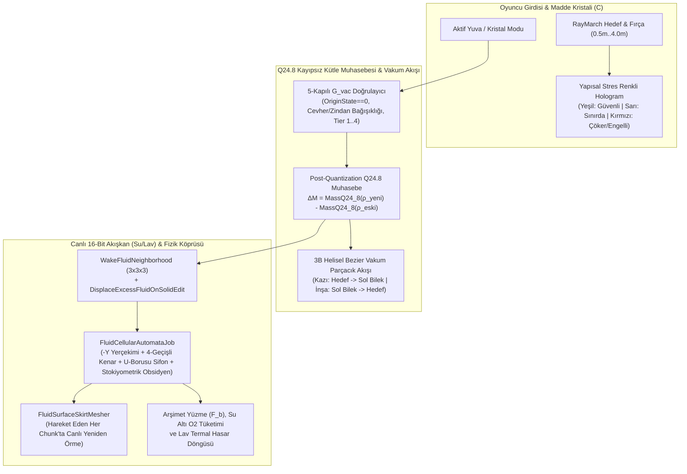

# 📌 Stratocraft: Madde Kristali Rezonans Vakum Akışı, Hibrit Voksel Kütle Muhasebesi (`Q24.8`) ve Canlı Akışkan (Su/Lav) Simülasyonu Mimari Raporu

Bu teknik mimari rapor; Stratocraft'ın **Madde Kristali (`Matter Crystal`)**, **Çift Kanallı Hibrit Voksel (`Surface Nets + Mimari Şekil`) Kütle Muhasebesi** ve **16-Bit Sonlu Akışkan (`Su / Lav / Asit`) Hücresel Otomat** sistemlerinin endüstri standartları (*Astroneer, No Man's Sky, Enshrouded, 7 Days to Die, Vintage Story, Dwarf Fortress, Terraria*), açık kaynak referansları ve mevcut kod tabanımızdaki kök neden analizleriyle sıfır hileli (zero-stub) gerçek oyun döngüsüne taşınma planını içerir.

---

## 1. Endüstri Referansları, Oyun Örnekleri ve Açık Kaynak İncelemesi

### 1.1. Arazi Vakumlama, Kütle Muhasebesi ve Hibrit İnşa Sistemleri
| Oyun / Referans | Teknik Mekanizma | Stratocraft Karşılığı ve Alınan Dersler |
| :--- | :--- | :--- |
| **Astroneer** *(System Era Softworks — Terrain Tool & Soil Canister)* | Küresel SDF voksel ızgarasında `Excavate / Elevate / Flatten` fırçaları yoğunluk (`density`) değerlerini değiştirir. Kazılan her voksel anında envantere ışınlanmaz; kırılan yüzeyden kopan düşük poligonlu madde parçacıkları (`resource flecks / soil stream`) özel bir çekim ve burgaç (vortex/helical spline) vektörüyle aletin namlusuna doğru vakumlanır ve `Soil Canister` içindeki kesirli hacim sayacını doldurur. Kapasite dolarsa fazla toprak arkadan parçacık olarak tahliye edilir. | Stratocraft'ta sol bilekteki **Madde Kristali (`C`)** ile kazı yapılırken delinen noktalardan ($\vec{P}_{\text{world}}$) oyuncunun sol bileğindeki kristale ($\vec{P}_{\text{wrist}}$) doğru **3B Kubik Bezier + Helisel Burgaç (Vorteks) Rezonans Parçacık Akışı** kurulmalıdır. İnşa (Püskürtme) sırasında ise akış yönü tersine ($\vec{P}_{\text{wrist}} \to \vec{P}_{\text{target}}$) dönmelidir. |
| **No Man's Sky** *(Hello Games — Terrain Manipulator)* | `Mine / Create / Flatten / Restore` modlarında küresel/silindirik SDF fırçası 3B tel kafes/hologram küre olarak arazinin üzerinde gerçek zamanlı önizlenir. Sert kayaç ve cevher damarlarında lazerin yüzeyde geçirdiği süre malzeme direncine göre ölçeklenir. | Fırça yarıçapı (`0.5m .. 4.0m`) ve kazı hızı tüm malzemelerde sabit olamaz; malzemenin Anayasal sertliğine (`Hardness`) ve Kristal Kademesine (`CrystalTier 1..4`) bağlı olmalıdır. |
| **Enshrouded & 7 Days to Die** *(Keen Games / The Fun Pimps)* | Yumuşak SDF arazi (`Channel 1`) ile keskin mimari bloklar (`Channel 2`) aynı ızgarada birleşir. İnşa sırasında yarı saydam bir **Hologram Önizleme (`Ghost Preview`)** sürekli görünür ve *7 Days to Die* yapısal bütünlük sisteminde olduğu gibi bloğun konulacağı yerdeki **Yapısal Stres / Destek Durumuna** göre renk değiştirir: **Yeşil** (Tam Destekli/Güvenli), **Sarı/Turuncu** (Konsol Yükü Sınırda), **Kırmızı/Pembe** (Desteksiz / Konulduğu Anda Domino Çökmesi Tetiklenir veya Oyuncu Kapsülü İçi Geçersiz). | `Stage1MatterCrystalAndMiningController` içindeki önizleme yalnız Slot 4'e hapsolmamalı; Kristal (`C`) veya İnşa modunda `Dial's Bucket Geodesic Support` + `Tributary Load` öngörüsüyle **Yeşil / Sarı / Kırmızı** renkli hologram olarak çalışmalıdır. |

### 1.2. Sonlu Akışkan Simülasyonu (Cellular Automata) ve Yüzme Fiziği
| Oyun / Referans | Teknik Mekanizma | Stratocraft Karşılığı ve Alınan Dersler |
| :--- | :--- | :--- |
| **Dwarf Fortress & Terraria** *(Sonlu Hacim + Uyku/Uyandırma)* | Her hücre sonlu sıvı kütlesi (`1..7` veya `0..255`) ve hidrostatik basınç taşır. Durgun su/lav kütleleri `%0 CPU` tüketmek için `Settled / Sleeping` bayrağıyla uyutulur. Ancak **bir katı blok kırıldığında, konulduğunda veya SDF yoğunluğu değiştiğinde** komşu $3\times 3\times 3$ hücrelerin uyku biti (`WakeFluidNeighborhood`) zorunlu olarak temizlenir ve chunk aktif simülasyon kuyruğuna alınır. | Bizde `FluidSimulationSystem.WakeFluidNeighborhood` ve `FluidPorosityUtility.DisplaceExcessFluidOnSolidEdit` metodları yazılmış olmasına rağmen `Stage1MatterCrystalAndMiningController` içinden **hiç çağrılmamaktadır**. |
| **Vintage Story & Modded Minecraft** *(Arşimet Kaldırma Kuvveti & Stokiyometri)* | Sıvı hacmi korunumludur. Oyuncu veya fiziksel nesne sıvı dolu voksellerle kesiştiğinde batan hacim oranında ($\eta_{\text{sub}} \in [0, 1]$) Arşimet kaldırma kuvveti ($\vec{F}_b = \rho_f \cdot V_{\text{sub}} \cdot g$), viskoz sürüklenme (su içinde yavaşlama) ve kafa su altındayken (`headSubmerged`) oksijen (`LungOxygenPercent`) tüketimi uygulanır. Lav temasında ise anlık termal yanma hasarı (`HP` düşüşü) verilir. | `Stage1PlayerMovementBridge` ve `UpdateOxygenAndFloatingOrigin` şu an `_fluidChunks` dizisini hiç okumamaktadır; oyuncu suyun ve lavın içinden kuru havadaymış gibi yürüyüp geçmektedir. |

### 1.3. Açık Kaynak GitHub Referans Mimari Desenleri
- **`bigos91/fastNaiveSurfaceNets` & `Dmajster/surface_nets` (Unity C# / Burst):** Her aktif voksel hücresi için tekil dual köşe üreten, kenar kesişimlerini (`IsoLevel`) ortalama alarak pürüzsüzleştiren ve chunk sınırlarında dikişsiz birleşen Surface Nets referansları. Stratocraft'ın `HybridSurfaceNetsAndShapeMesher` sınıfı bu mimariyi `Face-Solidarity` (`Density = 96` iç ankraj) ile birleştirerek kullanmaktadır.
- **`ccrock4t/3DCellularWorld` & Falling-Sand CA (Unity / C#):** 3B hücresel otomatlarda yönsüz (isotropic) akış için ayrık kenar değişimi (`Disjoint Pairwise Edge Exchange: Even-X, Odd-X, Even-Z, Odd-Z`) ve aktif/kirli hücre maskelemesi (`changedMask` + `SettledBitMask`). Stratocraft'ın `FluidCellularAutomataJob` sınıfı bu matematiksel çekirdeğe sahiptir.

---

## 2. Mevcut Kod Tabanındaki Kök Neden Analizi (Satır Satır Teşhis)

İncelenen 8 çekirdek dosyada tespit edilen **5 kritik kök neden** aşağıdadır:

### Kök Neden 1: Sıvıların Havada (`y = 9.96m`) ve Uykuda (`isSettled = true`) Doğması
- **Dosya:** [`StratocraftFloatingIslandWorldGen.cs`](../Assets/_Stratocraft/WorldGen/StratocraftFloatingIslandWorldGen.cs#L114-L148)
- **Mevcut Hatalı Kod:**
  - Satır `116-127`'de Lav Kalderası (`inLavaCaldera`) ve Su Havuzu (`inWaterPool`) bölgelerinde arazi üst yüksekliği `topH = MathF.Min(topH, 9.15f)` olarak sınırlandırılmış, ancak gerçek bir çukur/çanak (`basin`) oyulmamıştır!
  - Üstelik satır `138-148`'de `if (inLavaCaldera && y >= 7 && y <= 9)` koşuluyla `y = 7, 8, 9` hücrelerine katı voksel yazmak `continue` ile atlanmış (`voxels[idx] = 0u` hava bırakılmış) ve doğrudan `FluidCell16.Pack(..., 255, isSettled: true)` yazılmıştır!
  - Çevredeki kıyı arazisi `topH ≈ 9.15f` iken, `y = 8`'deki katı vokselin SDF yoğunluğu `64 + (9.15 - 8) * 28 = 96` olup Surface Nets kıyı yüzeyini **`y ≈ 8.88m`** seviyesinde kapatmaktadır. Oysa `y = 9` hücresine konulan `255` kütleli sıvının üst yüzeyi `FluidSurfaceSkirtMesher` tarafından **`y = 9 + 0.96 = 9.96m`** yüksekliğinde örülmektedir!
  - **Sonuç:** Sıvı kütlesi kıyı çanağının **~1.08 metre üstünde havada asılı bir su/lav kulesi** gibi doğmakta, `isSettled: true` olduğu için de ilk karede aşağı ve yanlara yayılıp çanağa oturmamaktadır.

### Kök Neden 2: Kazı ve İnşa Sırasında Sıvıların Uyandırılmaması (`WakeFluidNeighborhood` Kopukluğu)
- **Dosya:** [`Stage1MatterCrystalAndMiningController.cs`](../Assets/_Stratocraft/Character/Stage1MatterCrystalAndMiningController.cs#L95-L254) ve [`Stage1InteractivePlayController.cs`](../Assets/_Stratocraft/Character/Stage1InteractivePlayController.cs#L111-L133)
- **Mevcut Hatalı Kod:**
  1. `ExecutePhysicalToolStrike`, `ExecuteCrystalVacuumBrush` ve `ExecuteCrystalOrRubblePlacement` metodlarına `_fluidChunks` ve `_dirtyFluidChunks` parametreleri **hiç geçirilmemiştir**.
  2. Oyuncu su veya lav havuzunun yanındaki/altındaki bendi kırdığında `FluidSimulationSystem.WakeFluidNeighborhood` **hiçbir yerde çağrılmamaktadır**. Sıvı hücrelerinde `IsSettled == true` biti takılı kaldığı için `FluidCellularAutomataJob.StepFluidGridVolumeConservative` satır `128`'deki `if (!anyActive) return fastMassSum;` erken çıkışıyla anında dönmekte ve sıvı **asla akmamaktadır**.
  3. Oyuncu sıvı dolu bir hücreye katı blok koyduğunda `FluidPorosityUtility.DisplaceExcessFluidOnSolidEdit` çağrılmadığı için sıvı hacmi yer değiştirmemektedir.
  4. Ayrıca `StepFluidSimulation` (satır `127`) yalnızca `if (obsidianCount > 0 || steamCount > 0)` olduğunda `_dirtyFluidChunks.Add(kv.Key)` yapmaktadır! Yani su/lav obsidyen oluşturmadan normal şekilde aktığında **`_dirtyFluidChunks` tetiklenmediği için sıvı meşi (`FluidSurfaceSkirtMesher`) güncellenmemektedir!**

### Kök Neden 3: Suya ve Lava Girildiğinde Fiziksel/Biyolojik Etkileşimin (`0%`) Olmaması
- **Dosya:** [`Stage1PlayerMovementBridge.cs`](../Assets/_Stratocraft/Character/Stage1PlayerMovementBridge.cs#L90-L200) ve [`Stage1InteractivePlayController.cs`](../Assets/_Stratocraft/Character/Stage1InteractivePlayController.cs#L230-L258)
- **Mevcut Hatalı Kod:**
  - Karakter hareket köprüsü `_fluidChunks` verisine erişmemektedir. Oyuncu suya girdiğinde Arşimet kaldırma kuvveti (`Buoyancy`), su direnci (`Hydrodynamic Drag`) ve `Space` ile yukarı yüzme (`Swim Up`) çalışmamaktadır.
  - Kafa (`transform.position + Vector3.up * 1.4f`) suyun altındayken `UpdateOxygenAndFloatingOrigin` sadece katı voksellere (`_worldChunks`) baktığı için suyun altını "açık atmosfer (`OpenAtmosphereThresholdVoxels`)" sanmakta ve boğulma/oksijen düşüşü başlamamaktadır.
  - Oyuncu lav kalderasına girdiğinde `Vitals.CurrentHp` hiç azalmamakta ve termal yanma geri bildirimi verilmemektedir.
  - `[F6]` / `[F9]` `.sregion` kayıt/yükleme metodları (`SaveAllChunksToRegionStore` satır `215`) gerçek `_fluidChunks` yerine `new ushort[65536]` boş dizi kaydetmektedir!

### Kök Neden 4: Madde Kristali `Q24.8` Kütle Muhasebesi Açıkları ve Bedava Başlangıç Stoğu
- **Dosya:** [`Stage1MatterCrystalAndMiningController.cs`](../Assets/_Stratocraft/Character/Stage1MatterCrystalAndMiningController.cs#L52-L59) ve satır `197-249`
- **Mevcut Hatalı Kod:**
  1. **Yapıcıda Bedava Stok Hilesi (Satır 52-59):** Oyun başında kristale havadan `64 Taş + 32 Toprak + 16 Kum + 16 Bazalt + 8 Obsidyen + 16 Kırıktaş + 16 Odun + 12 Moloz` bedava yüklenmektedir.
  2. **Küçük Fırçada (`r <= 0.6f`) 1:1 Muhasebe İhlali (Satır 197-201):** `if (VoxelBitUtility.GetShapeId(curRaw) != 0 || forceBreak || r <= 0.6f)` koşulu yüzünden, varsayılan tekli fırçada (`r = 0.5f`) yoğunluğu `Density = 32` (yani sadece `%25` dolu bir tepecik kenarı) olan doğal SDF vokseli vakumlandığında `MassQ24_8FromDensity7(curDens)` yerine **tam 1.0 blok (`OneBlockQ24_8 = 256`)** kütle kristale eklenmektedir!
  3. **Doğal Arazi Koyarken (`ShapeID == 0`) Bedava Alt Blok Şişirme (Satır 243-249):** Doğal modda blok koyarken altındaki (`wy - 1`) kısmi yoğunluklu bloğun yoğunluğu kristalden hiçbir kütle düşülmeden bedavaya `FullDensity (127)` yapılmaktadır (`%100` madde kopyalama açığı!).
  4. **Yutulan `MatterCrystalVacuumSystem`:** `MatterCrystalVacuumSystem.cs` içinde 5-Kapılı `G_vac` doğrulaması ve `ApplyLosslessSdfSphereBrush` kusursuz yazılmışken, `Stage1MatterCrystalAndMiningController` bu sınıfı kullanmak yerine kendi içinde eksik kurallı ayrı bir döngü çalıştırmaktadır (`OriginState != DogalKutle` kontrolü bile atlanmıştır!).

### Kök Neden 5: Görsel Rezonans Vakum Parçacık Akışı ve Yapısal Stres Hologramının Eksikliği
- **Dosya:** [`Stage1MatterCrystalAndMiningController.cs`](../Assets/_Stratocraft/Character/Stage1MatterCrystalAndMiningController.cs#L287-L320)
- **Mevcut Hatalı Kod:**
  - Madde Kristali ile vakumlama veya inşa yapılırken kazılan voksel ile sol bilekteki kristal (`LeftWristCrystalTransform`) arasında hiçbir görsel parçacık/enerji akışı yoktur; bloklar büyü yapılmış gibi anında yok olup var olmaktadır.
  - `_placementGhostGo` (İnşa Hayaleti) malzeme renginde opak bir meş olarak çizilmekte; konulacak noktanın yapısal desteğini (Yeşil/Sarı/Kırmızı) veya oyuncu kapsülü çakışmasını renk ile göstermemektedir.

---

## 3. Kurulacak Gerçek Algoritma ve Mimari Tasarım

### 3.1. `Q24.8` Gerçek 1:1 Kütle/Hacim Muhasebesi (`Zero-Exploit Conservation`)
1. **Gerçek Stok Başlangıcı ve Şeffaf Gösterim:**
   - Her doğal vokselin kütlesi 7-bit SDF yoğunluğundan (`0..127`) `CrystalMassStorage.MassQ24_8FromDensity7(density)` ile hesaplanır:
     $$M_{\text{Q24.8}}(\rho) = \left\lfloor \frac{\rho \times 256 + 63}{127} \right\rfloor \in [0, 256]$$
   - Bir tam blok $256\text{ birim}$ (`1.00 Blok`), bir `0.25m` mikro-voksel (`ShapeID = 63`) tam $4\text{ birim}$ (`1/64 Blok`) kütleye eşittir.
2. **Post-Quantization Fark Muhasebesi (Oyma ve Püskürtme):**
   - Fırça yarıçapı ne olursa olsun (`0.5m` dahil), doğal arazi (`ShapeID == 0`) vakumlanırken veya doldurulurken:
     $$\Delta M = \left| M_{\text{Q24.8}}(\rho_{\text{yeni}}) - M_{\text{Q24.8}}(\rho_{\text{eski}}) \right|$$
   - Vakumlama hızı malzemenin sertliğiyle (`GetMaterialHardness(mat)`) ters orantılıdır: Toprak/Kum (`0.8`) hızlı vakumlanırken, Bazalt (`3.2`) ve Doğal Obsidyen (`5.2`, yalnız `Tier 4`) yavaş vakumlanır.
   - Doğal arazi püskürtülürken alt hücrede (`wy - 1`) yoğunluk tamamlanacaksa, gereken $\Delta M_{\text{alt}}$ kütlesi de `CrystalStorage.TryWithdrawMassQ24_8` ile **zorunlu olarak kristalden düşülür**.
   - **5-Kapılı `G_vac` Kuralı:** `OriginState != BlokKokenDurumu.DogalKutle` olan oyuncu/batarya/zindan blokları ve `14` Rezonans Cevheri (`30..46`) kristal ile vakumlanamaz (`ERR_CRYSTAL_CRAFTED_BLOCK_FORBIDDEN` / `ERR_ORE_RESONANCE_IMMUNE`). Cevherler fiziksel kazma ile kırıldığında taş yerine **kendi cevher kimliğiyle** envantere/sayaca eklenir.

### 3.2. 3B Helisel Bezier Rezonans Vakum Parçacık Akışı (`Zero-GC Particle Ring Buffer`)
*Astroneer* `Terrain Tool` referans alınarak `0 B/kare` GC tahsisiyle çalışan **64 yuvalı sabit halka tampon (`ResonanceParticleStream`)** kurulacaktır:
- **Yörünge Denklemi (Kubik Bezier + Helisel Burgaç):**
  Kazılan dünya noktası $\vec{P}_0$ ile sol bilekteki Madde Kristali konumu $\vec{P}_3$ (inşa modunda $\vec{P}_0 = \vec{P}_{\text{wrist}}, \vec{P}_3 = \vec{P}_{\text{target}}$) arasında normalize ömür $u \in [0, 1]$ için:
  $$\vec{B}(u) = (1-u)^3 \vec{P}_0 + 3(1-u)^2 u \vec{P}_1 + 3(1-u) u^2 \vec{P}_2 + u^3 \vec{P}_3$$
  $$\vec{P}(u) = \vec{B}(u) + r_{\text{helix}} \sin(\pi u) \Big( \cos(\omega u + \phi_i)\,\vec{e}_1 + \sin(\omega u + \phi_i)\,\vec{e}_2 \Big)$$
- **Görsel Temsil:** Parçacıklar kazılan/püskürtülen malzemenin gerçek `MaterialId` rengini (`Color32.r = matId`) ve rezonans ışımasını (`Temperature`) taşır; kristale yaklaştıkça ($u \to 1$) ölçekleri küçülerek kristal çekirdeğine emilir.

### 3.3. Yapısal Stres Renkli Hologram Önizleme (`Enshrouded / 7DTD Stability Ghost`)
- İnşa veya Kristal modu aktifken hedef hücrede (`PlacementVoxelCoord`) seçili `ShapeID` (`0..7, 63`) ve `SelectedRotation` ile birebir aynı geometride önizleme meşi gösterilir.
- **3-Kademeli Stres/Geçerlilik Rengi (`Color32` Kodlaması):**
  1. **Yeşil / Camgöbeği (`Valid & Stable`):** Altında doğrudan katı blok bulunan (`wy - 1` dolu) veya `GeodesicSupport` mesafesi güvenli olan hücreler.
  2. **Sarı / Kehribar (`Cantilever Warning`):** Altı boş olup yalnızca yandan konsol (`cantilever`) olarak tutunan ve yük sınırına yaklaşan hücreler.
  3. **Kırmızı (`Invalid / Collapse Risk`):** Oyuncu kapsülüyle çakışan (`!CanPlaceBlockOutsidePlayerCapsule`), kristal deposunda yeterli kütlesi olmayan veya hiçbir katı komşusu bulunmayan (havada asılı, konulduğu an düşecek) hücreler.

### 3.4. Çukura Gömülü, Kazıyla Uyanan Canlı Su/Lav ve Arşimet Yüzme/Lav Hasarı
1. **Dünya Üretiminde Gerçek Çanak (`Basin`) Oyulması ve Canlı Başlangıç (`isSettled: false`):**
   - `StratocraftFloatingIslandWorldGen.PopulateVolumetricFloatingIslandChunk` içinde Su Havuzu (`waterPoolDist < 3.2f`) ve Lav Kalderası (`calderaDist < 4.2f`) merkezlerinde katı arazi tabanı `y = 6`'ya kadar çanak şeklinde (`basinFloorY = 6.2f`) indirilecek, çevresindeki kıyı duvarları `y = 9.2f` yüksekliğinde doğal bent oluşturacaktır.
   - Çanağın içindeki **yalnızca hava (`voxels[idx] == 0u`) olan hücrelere** `y = 7` ve `y = 8` seviyelerinde (`y = 8.88m` kıyı kotunun **altında**, çukurun içinde!) `isSettled: false` ile Su ve Lav doldurulacaktır. Böylece oyun başladığı anda sıvılar doğal çanaklarına hidrostatik olarak yayılıp yerleşir.
2. **Kazı, Vakum, İnşa ve Domino Yıkımda `WakeFluidNeighborhood` Tetiklemesi:**
   - Her katı voksel kırıldığında, vakumlandığında veya konulduğunda (`Stage1MatterCrystalAndMiningController` ve `Stage1StructuralCollapseBridge`), o hücre ve komşu chunk sınırlarındaki sıvı hücreleri için:
     - Blok konulduysa önce `FluidPorosityUtility.DisplaceExcessFluidOnSolidEdit(...)` çağrılarak sıkışan sıvı üst/yan hücrelere taşırılır.
     - Ardından `FluidSimulationSystem.WakeFluidNeighborhood(fluids, 16, MaxEditableVoxelY, 16, lx, wy, lz, radius: 2)` çağrılarak komşu sıvılar uyandırılır ve `_dirtyFluidChunks` kümesine eklenir.
   - `StepFluidSimulation` içinde bir chunk'ta **herhangi bir aktif (`!IsSettled`) sıvı hücresi varsa veya kütle/reaksiyon değişimi olduysa** `_dirtyFluidChunks.Add(kv.Key)` tetiklenerek sıvı yüzey meşinin (`FluidSurfaceSkirtMesher`) her adımda canlı akması sağlanır.
3. **Arşimet Yüzme Kuvveti, Su Altı Oksijen ve Lav Hasarı:**
   - `Stage1PlayerMovementBridge.StepCharacterPhysics` içinde oyuncunun ayak/gövde/baş noktalarındaki `_fluidChunks` hücreleri okunur:
     - **Su (`FluidType.Water`):** Batan hacim oranı $\eta_{\text{sub}} = \text{Mass} / 255.0$ için düşey hıza yukarı yönlü Arşimet ivmesi ($a_{\text{buoy}} = 14.5 \cdot \eta_{\text{sub}}$) ve su viskoz sönümlemesi uygulanır; `Space` basılı tutulduğunda oyuncu su yüzeyine doğru yüzer (`_verticalVelocity = 3.8f`).
     - **Su Altı Oksijen:** Göz hizası (`pos.y + 1.45f`) sıvı seviyesi altındaysa `UpdateOxygenAndFloatingOrigin` bağlı hava hacmini `0` kabul eder (`EnclosedOxygenFloodFillSystem` akciğer oksijenini tüketir).
     - **Lav (`FluidType.Lava`):** Daha yüksek viskozite direnci (`%65` yavaşlama) uygulanır ve temas süresince `Vitals.CurrentHp -= 18.0f * dt` yanma hasarı ile ekran geri bildirimi (`"UYARI: Lav Temasi! (-HP)"`) üretilir.
4. **`.sregion` Kayıt/Yükleme Tamamlaması:**
   - `SaveAllChunksToRegionStore` ve `LoadAllChunksFromRegionStore` metodları `_fluidChunks` dizilerini doğrudan okuyup yazacak ve yükleme sonrasında `_dirtyFluidChunks` kümesini güncelleyecektir.

---

## 4. Uygulama Kontrol Listesi (Sonraki Adım)

1. `StratocraftFloatingIslandWorldGen.cs`: Su havuzu ve lav kalderası çanaklarını (`y = 6..8`) gerçek kıyı kotunun (`9.15m`) altına göm ve sıvıları `isSettled: false` ile başlat.
2. `Stage1MatterCrystalAndMiningController.cs`:
   - Bedava başlangıç stoğunu gerçekçi test/başlangıç dengesine çek ve `r <= 0.6f` dahil tüm SDF kazılarında `MassQ24_8FromDensity7` 1:1 kütle muhasebesini ve `ValidateVacuumEligibility` 5-kapılı kuralını zorunlu kıl.
   - Kazı/İnşa işlemlerine `_fluidChunks` ve `_dirtyFluidChunks` bağla (`WakeFluidNeighborhood` + `DisplaceExcessFluidOnSolidEdit`).
   - Sol bilek (`LeftWristCrystalTransform`) ile hedef nokta arasında `64` parçacıklı **3B Helisel Bezier Vakum Akışı** ve **Yapısal Stres Renkli Hologram** sistemini devreye al.
3. `Stage1PlayerMovementBridge.cs` & `Stage1InteractivePlayController.cs`:
   - `StepFluidSimulation` içinde aktif sıvı akışı olan her chunk için `_dirtyFluidChunks` güncellemesini aç.
   - Arşimet yüzme fiziği, su altı O2 tüketimi, lav yanma hasarı ve `.sregion` sıvı kaydını bağla.
