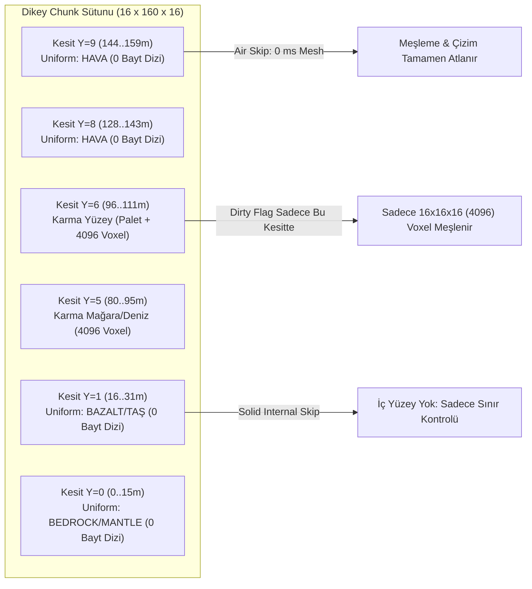
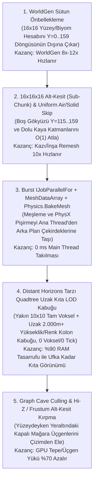

# 📌 Performans Raporu 3: İnternet ve Benzer Oyunlar Araştırması — Voksel Chunk Mimarisi, Uzak Mesafe LOD / Impostor, GPU-Driven Rendering ve Fizik Optimizasyonları

> [!IMPORTANT]
> **Raporun Amacı ve Kapsamı:**
> Bu teknik araştırma raporu; modern voksel oyun endüstrisinde (**Minecraft [Sodium, Nvidium, Distant Horizons, CubicChunks]**, **7 Days to Die**, **Enshrouded**, **Vintage Story**, **Deep Rock Galactic**, **Hytale**, **Teardown**) ve **Unity 6 (`6000.x`)** ekosisteminde devasa açık dünyaları **60–240+ FPS**, **sıfır ana iş parçacığı takılması (`0 ms Main Thread Stall`)** ve **düşük RAM/VRAM bütçesiyle** çalıştırmak için kullanılan kanıtlanmış mühendislik tekniklerini inceler. Raporun sonunda, bulguların Stratocraft'ın mevcut kod tabanına ([`Stage1InteractivePlayController.cs`](../Assets/_Stratocraft/Character/Stage1InteractivePlayController.cs) ve [`StratocraftFloatingIslandWorldGen.cs`](../Assets/_Stratocraft/WorldGen/StratocraftFloatingIslandWorldGen.cs)) nasıl doğrudan uygulanacağı somut C# / Burst mimari şablonlarıyla sunulmuştur.

---

## 1. Minecraft Ekosistemi: Kübik Alt-Chunk (`16x16x16`), Distant Horizons ve GPU-Driven Devrimi

Vanilla Minecraft'ın eski tek-parça sütun (`16x256x16`) ve OpenGL ana-thread gönderim mimarisi, topluluk tarafından geliştirilen **CubicChunks**, **Sodium / Embeddium**, **Nvidium** ve **Distant Horizons** projeleriyle modern oyun motoru standartlarının zirvesine taşınmıştır.

### 1.1. `16x16x16` Kübik Alt-Parçalar (`Sub-Chunk / ChunkSection`), Palette Compression ve `Uniform Node` Atlama

Modern voksel motorları bir chunk'ı asla `16x160x16` (`40.960` voksel) boyutunda yekpare (monolitik) bir dizi olarak işlemez. Bunun yerine dikey sütun, **`16x16x16` (`4.096` voksel)** boyutunda bağımsız kübik alt-kesitlere (**`Sub-Chunk` / `Section`**) bölünür:



1. **`Uniform Node` / `SingleValuePalette` (Sıfır Bellekli Tek-Tip Alt-Chunk):**
   - Bir `16x16x16` alt-kesitin içindeki tüm `4.096` hücre aynı malzemeden oluşuyorsa (örneğin `Y = 112..159m` arasındaki gökyüzü kesitlerinde `%100 Hava`, veya yeraltında mağara geçmeyen `Y = 16..48m` katmanlarında `%100 Doğal Kayaç`), bu kesit için `uint[4096]` (`16 KB`) dizi **hiç tahsis edilmez (`null` / `UniformVoxelValue`)**.
   - Kesit yalnızca `struct SubChunkHeader { byte State; uint UniformVoxel; ushort NonAirCount; }` (`8 bayt`) olarak saklanır:
     - `State == 0 (UniformAir)`: Tamamen boş hava. Meşleme (`Meshing`), fizik çarpışması (`Collider`), akışkan simülasyonu ve görünürlük taraması (`Frustum/Occlusion`) bu kesiti **`O(1)` sürede (`0 ns`)** atlar.
     - `State == 1 (UniformSolid)`: Tamamen tek tip katı blok (`Density = 127`, `ShapeID = 0`). Kendi içinde hiçbir iç yüzey (internal face) barındıramaz! Yalnızca 6 komşu alt-kesitten biri `UniformSolid` değilse sınır yüzeyi üretir.
     - `State == 2 (Paletted / Dense)`: Yalnızca gerçek yüzey kabuğu, mağara duvarı veya oyuncu yapısı içeren kesitler `4.096` elemanlı gerçek voksel dizisini bellekte açar (**Copy-on-Write allocation**).
2. **Palette Compression (Bit-Paketlenmiş İndeks Havuzu):**
   - `State == 2` olan karma bir `16x16x16` kesitte genellikle 256 farklı malzeme değil, sadece `4` ila `12` farklı voksel durumu bulunur (ör. Hava, Toprak, Çimen, Taş, Meşe Odunu).
   - Kesit içinde yerel bir `Palette[]` tablosu tutulur. Palet boyutu $\le 16$ ise her voksel 32-bit yerine **4-bit** (`ulong[256]` = sadece `2 KB`) indeks olarak saklanır.
3. **Kısmi Yeniden Örme (`Sub-Chunk Granular Dirty Flag`):**
   - Oyuncu `Y = 98m` seviyesinde kazma ile bir taş kırdığında, `Y = 0..160m` arasındaki `40.960` vokselin tamamını taramak yerine **yalnızca `cy = 6` (`Y = 96..111m`) alt-kesiti (`4.096` voksel)** `dirty` işaretlenir. Bu tek başına meşleme süresini **10 kat (`40.960 -> 4.096`)** hızlandırır!

---

### 1.2. Distant Horizons Mimarisi: Uzaktaki Binlerce Chunk'ı Belleğe Yüklemeden ve Simüle Etmeden ("Sahte LOD / Dikey Veri Kolonları") 60+ FPS'te Çizmek

**Distant Horizons** modu, Minecraft'ta normalde `12–16 chunk` (`192m–256m`) olan görüş mesafesini **`256–512+ chunk` (`4.000m–8.000m+`)** seviyesine çıkarırken RAM kullanımını sabit tutar ve FPS'i düşürmez. Bunu **uzaktaki chunk'ları gerçek birer voksel chunk'ı olarak var etmeyerek** başarır:

```mermaid
flowchart TD
    subgraph Near["Yakın Alan (Aktif Yarıçap: 0..128m / Tam Voksel)"]
        VChunk["Gerçek 3B Voksel Chunk'ları\n(Surface Nets + Mimari Şekil + MeshCollider + Canlı AI + Sıvı Tick)"]
    end
    subgraph Far["Uzak Alan (Distant Horizons: 128m..15.000m / 0 Voksel, 0 Fizik, 0 Tick)"]
        QT["Logaritmik Quadtree Hiyerarşisi\n(LOD0: 1m -> LOD1: 2m -> LOD2: 4m -> LOD3: 8m -> LOD4: 16m)"]
        Col["Sıkıştırılmış Dikey Veri Kolonu (64-bit RLE DataPoint)\n[TopY | BottomY / Kalınlık | Biome/Material Color32 | Skylight/Blocklight]"]
        BoxMesh["Coplanar Kutu/Sütun Birleştirici (Culled Column Mesher)\nSadece Üst Kabuk + Komşu Yükseklik Farkı Kadar Yan Etek (Skirt)"]
    end
    Near <-->|Dikişsiz Sınır (Cross-Fade / Skirt)| Far
    QT --> Col --> BoxMesh
```

1. **Tam 3B Voksel Izgarasının Terk Edilmesi (`Vertical Data Columns` & RLE):**
   - Uzaktaki bir chunk için `16x160x16` (`40.960` hücre) 3B voksel dizisi **asla oluşturulmaz**.
   - Bunun yerine her `(x, z)` koordinatı için yalnızca dikey **Run-Length Encoded (RLE) Veri Noktaları (`64-bit DataPoint`)** tutulur:
     - Bit `[0..11]`: `TopY` (Sütunun üst yüzey yüksekliği)
     - Bit `[12..23]`: `BottomY` (Sütunun alt yüksekliği / kalınlığı)
     - Bit `[24..55]`: `Color32` / `MaterialID` (Biyom ve eğim gölgesi önceden pişirilmiş tepe rengi)
     - Bit `[56..63]`: `PackedLight` (Gökyüzü + lav/cevher ışıması)
   - **Mağara Katlama (`Cave Culling / Folding`):** Uzaktaki bir dağın altındaki kapalı mağaralar dışarıdan asla görünmez. Distant Horizons, yüzeyin altındaki karanlık boşlukları tamamen katlayıp siler; `(x, z)` sütununu tek bir dolu kaya sütunu (`Single Top Run`) veya yüzen ada/kemer varsa en fazla `2–3` dikey dilim (`Multi-Run Column`) olarak özetler. Böylece `160` dikey hücre **tek bir 8 baytlık `ulong` değere** iner (**%98.7 bellek tasarrufu**)!
2. **Hiç Yüklenmemiş Bölgelerin Doğrudan Düşük Çözünürlükte Örneklenmesi (`Direct Generator Downsampling`):**
   - Oyuncunun hiç gitmediği `3 km` uzaktaki bir dağı çizmek için o bölgedeki chunk'ları üretip sonra küçültmez!
   - Doğrudan dünya üretecinin (`WorldGen` yükseklik ve biyom gürültü fonksiyonunun — Stratocraft'taki `SampleIslandTopSurfaceY` ve biyom renginin) içine `step = 4m`, `8m` veya `16m` adımlarla girerek **saniyede binlerce metrekarelik uzak araziyi 3B voksel üretmeden doğrudan `LOD Quadtree` düğümü olarak** örnekler.
3. **Logaritmik Quadtree Birleştirme ($2 \times 2 \to 1$) ve Coplanar Yüzey Kırpma:**
   - Mesafe arttıkça `Quadtree` yapısında komşu $2 \times 2$ kolon tek bir daha geniş kolona (`2m x 2m`, `4m x 4m`, `8m x 8m`, `16m x 16m`) indirgenir; yükseklik ve renk değerlerinin ağırlıklı ortalaması alınır.
   - Meş üretilirken her kolon için tam bir küp çizilmez:
     - Üst yüzey (`Top Quad`) yalnızca üstü açık havaysa üretilir ve aynı yükseklik/renkteki komşu kolonlarla **Greedy Coplanar Merging** ile tek büyük dörtgene birleştirilir.
     - Yan yüzeyler (`Side Skirts`) yalnızca komşu kolonun `TopY` değeri mevcut kolonun `TopY` değerinden daha alçaksa, **sadece aradaki yükseklik farkı ($\Delta Y = Y_{\text{self}} - Y_{\text{neighbor}}$) kadar** örülür.
4. **Sıfır Simülasyon (`0 Tick`) ve Bölgesel SQLite Önbelleği:**
   - Uzak LOD düğümlerinde fizik (`MeshCollider`), sıvı akışı, yapısal yıkım veya canlı A* **kesinlikle çalıştırılmaz**. Oyuncu bir bölgede inşaat yapıp uzaklaştığında, o chunk'ın son yüzey özeti yerel SQLite/Bölge önbelleğine yazılır ve chunk bellekten boşaltılırken (`Unload`) yerine `1/100` maliyetli Distant LOD düğümü devreye girer.

---

### 1.3. Sodium, Embeddium ve Nvidium: GPU-Driven Rendering ile CPU Yükünü %90 Azaltmak

Vanilla voksel motorlarında en büyük darboğaz GPU'nun üçgen çizme gücü değil, CPU'nun her karede binlerce alt-chunk için görünürlük hesabı yapıp (`Frustum Culling`) grafik sürücüsüne binlerce ayrı çizim komutu (`Draw Call`) göndermesidir. **Sodium** ve **Nvidium** bu darboğazı 4 temel teknikle ortadan kaldırır:

1. **Graf Tabanlı Mağara ve Görünürlük Kırpma (`Graph-Based Cave Culling` — Tommaso Checchi / Sodium Algoritması):**
   - Pahalı GPU donanım sorgularına (`Hardware Occlusion Queries`) başvurmadan önce, her `16x16x16` alt-kesit meşlenirken 6 dış yüzeyi (`+X, -X, +Y, -Y, +Z, -Z`) arasında açık hava bağlantısı olup olmadığı flood-fill ile test edilir ve $\binom{6}{2} = 15$ bitlik bir **`VisibilityConnectivityMask` (`ushort`)** içine kaydedilir.
   - Her karede kameranın bulunduğu `16x16x16` alt-kesitten başlayarak sadece kamera frustumu içindeki yönlere doğru çok hızlı bir **Bitwise BFS** yürütülür. Eğer bir alt-kesitin üst yüzeyi tamamen katı kayaçla kapalıysa (`Top -> Bottom` geçiş biti `0` ise), kameranın altındaki yüzlerce yeraltı mağara kesitine BFS hiç inmez! Böylece yeraltındaki mağara ağlarının **%95'i CPU'da birkaç mikrosaniye içinde tek bir bit-shift ile** çizim listesinden elenir.
2. **Sıkıştırılmış Köşe Formatı ve `Vertex Pulling` (`StructuredBuffer` / SSBO):**
   - Standart Unity `Mesh` yapısında bir köşe (`Vertex`): `Position (12B) + Normal (12B) + Color32 (4B) + UV (8B) = 36 Bayt` yer kaplar; bir dörtgen (`Quad` = 4 köşe + 6 indeks) toplam `168 Bayt` VRAM tüketir.
   - **Sodium / Vertex Pulling** yaklaşımında ise chunk içindeki yerel koordinatlar `0..16` aralığında olduğu için köşe verisi `8 Bayt` veya `16 Bayt` içine sıkıştırılır (ör. `uint2`: yerel `x,y,z` `10'ar bit` sabit nokta, `Normal` `2-bit` oktant/yön indeksi, `Color32 / MaterialID` `32-bit`).
   - Dörtgen (`Quad`) tabanlı kübik veya etek yüzeylerinde, GPU'ya 4 ayrı köşe göndermek yerine `StructuredBuffer<CompressedQuad>` içine dörtgen başına **tek bir 8 veya 12 baytlık kayıt** yazılır; Vertex Shader `SV_VertexID % 4` kullanarak 4 köşeyi donanımda kendisi açar (**VRAM ve PCIe bant genişliğinde %75 tasarruf**).
3. **`MultiDrawElementsIndirect` ve Bölgesel Mega-Buffer (`Arena Buffer`):**
   - Her chunk için ayrı bir `MeshFilter` + `MeshRenderer` + ayrı küçük GPU Vertex Buffer (VBO) tutmak yerine, $8 \times 8$ veya $16 \times 16$ chunk'lık bir bölge (**Region Arena**) tek bir büyük GPU tamponunda (`GraphicsBuffer`) birleştirilir.
   - CPU her karede binlerce `DrawMesh` çağırmak yerine, görünür bölgeler için **tek bir `Graphics.RenderMeshIndirect` (veya `BatchRendererGroup`)** çağrısı yapar.
4. **Nvidium Mesh Shader ve Hi-Z GPU Occlusion Culling:**
   - **Nvidium** (ve modern DirectX 12 / Vulkan GPU-Driven hatları), görünürlük kararını tamamen GPU'daki bir `Compute Shader` (veya `Task/Mesh Shader`) aşamasına yıkar.
   - Önceki karenin derinlik tamponundan üretilen **Hi-Z (Hierarchical Z-Buffer) Depth Pyramid** dokusu üzerinde her `16x16x16` kesitin sınırlayıcı kutusu (`AABB`) GPU'da paralel test edilir; dağın arkasında kalan chunk'lar CPU'nun haberi bile olmadan GPU üzerinde `IndirectDrawIndexedArgs` sayacı `0` yapılarak elenir.

---

## 2. Benzer Oyunların Derinlemesine Analizi (Hibrit Pürüzsüz Arazi + Kübik Blok + Yıkım Fiziği)

Stratocraft gibi **hem pürüzsüz doğal arazi (SDF / Surface Nets / Marching Cubes) hem de keskin mimari bloklar + yapısal yıkım (Domino) + akışkanlar** içeren oyunların mimari çözümleri aşağıda incelenmiştir:

### 2.1. 7 Days to Die (Unity Motoru — Hibrit Marching Cubes / Transvoxel + Kübik Blok + Yapısal Bütünlük)
- **Hibrit Meşleme:** *7 Days to Die* (Unity üzerinde çalışır), doğal toprak/kaya voksellerini `Density (-128..+127)` değerine göre pürüzsüzleştirirken, oyuncu tarafından konulan ahşap/beton/çelik blokları keskin kübik/eğimli şekiller (`Shape Mesh`) olarak aynı chunk içinde birleştirir. Doğal arazi ile kübik blok birleşiminde boşluk (`seam`) oluşmaması için katı kübik bloğun altındaki/yanındaki doğal vokselin yoğunluğu tam katı ankraja çekilir veya ara etek (`skirt`) üçgenleri üretilir (Stratocraft'taki `HybridSurfaceNetsAndShapeMesher` içindeki `Face-Solidarity` (`Density = 96`) yaklaşımıyla birebir aynı felsefe).
- **Uzak Mesafe Görünümü (`Distant Terrain` + `Distant POIs`):**
  - Aktif chunk yarıçapı (genellikle oyuncunun etrafındaki `8–10 chunk`) dışında kalan tüm kıta, tam voksel olarak yüklenmez; düşük çözünürlüklü bir **Clipmap / Heightmap Mesh** olarak çizilir.
  - Uzaktaki binalar ve kaleler (**Distant POIs**) ise basitleştirilmiş düşük poligonlu **Statik Kutu/Impostor Meşleri** olarak gösterilir.
- **Yapısal Bütünlük (`Structural Integrity`):**
  - Her bloğun `Mass` (Kütle) ve `MaxLoad / HorizontalSupport` (Yatay Taşıma Kapasitesi) değeri vardır.
  - Fiziksel yıkım hesabı **yalnızca oyuncu yakındaki aktif bir chunk'ta blok kırdığında/koyduğunda** tetiklenen yerel bir BFS kuyruğu ile çalışır; uzaktaki chunk'larda yapısal bütünlük hesabı tamamen uyur (`0 ms`).

### 2.2. Enshrouded (Mortar Engine — Özel C++ Hibrit Voksel + Uzak Mesafe Hacimsel LOD)
- **0.5m Hassasiyetli Hibrit Blok + Pürüzsüz Arazi:** Doğal arazi pürüzsüz SDF kabuğu olarak, mimari yapılar ise malzemeye özel prosedürel kenar birleştirme (chamfer/brick blending) kurallarıyla örülür.
- **Hiyerarşik Octree LOD ve Uzak Mesafe:** Dünya dev bir **Sparse Voxel Octree (SVO) / Brick Pool** olarak tutulur. Oyuncudan uzaklaştıkça $16^3$ tuğlalar (`Bricks`) üst Octree seviyelerinde yarı çözünürlüğe (`LOD1..LOD5`) düşürülerek tek geçişte pürüzsüzce birleştirilir. Oyuncunun inşa ettiği kaleler bile Octree'nin üst düğümlerine renk/yoğunluk olarak yukarı yayıldığı (`Mipmap Propagation`) için kilometlerce uzaktan ek maliyet olmadan görünür.

### 2.3. Vintage Story (C# Özel Motor — `16x16x16` Mikro-Keski + Akışkan + Gökyüzü/Yeraltı Optimizasyonu)
- **Mikro-Blok (`Chiseled Microvoxels`):** Stratocraft'taki `ShapeID = 63` (`4x4x4` `ulong` mikro-havuz) sistemine çok benzer şekilde, oyuncu blokları `16x16x16` alt-parçalara yontabilir. Vintage Story, yontulmuş blokların meşini her karede yeniden hesaplamaz; yontulan bloğun 6 dış yüzeyi için önbelleğe alınmış bir `Microblock Mesh` ve komşu yüz kapatma maskesi (`Side Solid Mask`) üretir.
- **Chunk Gönderimi:** C# arka plan iş parçacıklarında (`Background Thread Pool`) üretilen köşe dizileri, ana iş parçacığını durdurmadan kademeli bütçeyle (`Frame Time Budget <= 2 ms`) GPU tamponlarına yüklenir.

### 2.4. Deep Rock Galactic (Unreal Engine — CSG + 3B Yoğunluk Izgarası Mağara Sistemi)
- **Sıfır Gökyüzü Maliyeti & Kapalı Mağara Kabuğu:** Tamamen yeraltında geçtiği için `UniformSolid` kaya kütlesinin içi hiç meşlenmez; yalnızca `Density` işaret değiştiren (`Zero-Crossing`) mağara duvarı kabuğu (`Surface Extraction`) üçgenlenir.
- **Kazma ve Patlama Performansı:** Bir kazma darbesi veya patlama sadece etkilenen $16^3$ veya $32^3$ yerel hücre bloklarını paralel işçi thread'lerinde yeniden örer; fizik çarpıştırıcısı (`Collision Mesh`) görsel meşten daha kaba veya temizlenmiş seçeneklerle arka planda pişirilir.

### 2.5. Hytale ve Teardown (Tuğla Havuzları, Ayrık Fizik Adaları ve Uyuyan Otomatlar)
- **Hytale:** Klasik `16x16x16` kübik kesit mimarisini `Palette Compression`, agresif `Greedy Face Merging` ve GPU örneklemeli (`Instanced`) bitki/yapı detaylarıyla birleştirir.
- **Teardown:** Dünyayı tek bir devasa voksel dizisi yapmak yerine, her binayı, ağacı ve kopan parçayı **kendi yerel koordinat sistemine sahip ayrık bir `Sparse Brick Volume` (`8x8x8` tuğla ağacı)** olarak tutar. Bir kolon kırıldığında `Connected Component Flood-Fill` (veya Stratocraft'taki `Dial's Bucket Geodesic Dijkstra + Tributary Load DAG`) ile kopan kısım ayrı bir dinamik `Voxel Volume` nesnesine ayrılır; hareket etmeyen tüm yapılar fizik motorunda `Sleeping` durumunda bekler (`0 ms CPU`).

---

## 3. Benzer Oyunların Karşılaştırmalı Optimizasyon Tablosu

| Oyun / Motor | Alt-Chunk & Bellek Yapısı | Meşleme Algoritması | Uzak Mesafe (LOD / Impostor) Çözümü | Çizim Hattı (Rendering Pipeline) | Yapısal Yıkım & Akışkan Optimizasyonu |
| :--- | :--- | :--- | :--- | :--- | :--- |
| **Minecraft + Sodium + Distant Horizons + Nvidium** | `16x16x16` `ChunkSection` + `Palette Compression` + `Uniform Air/Solid Skip` (`0 Bayt` dizi) | Kübik Yüz Kırpma + `Binary Greedy Meshing` (LOD'da Coplanar Kutu Birleştirme) | **Distant Horizons:** `64-bit RLE` Dikey Veri Kolonları + Logaritmik `Quadtree` (`LOD0..5`) + Kapalı Mağara Katlama (`0 Voksel`, `0 Tick`) | **Sodium/Nvidium:** `Graph Cave Culling` + `Vertex Pulling` (`8–16B/vertex`) + `MultiDrawElementsIndirect` / `Mesh Shaders` | Yalnızca aktif yarıçapta (`Simulation Distance`) sıvı/blok tick'lenir; uzak LOD tamamen statiktir. |
| **7 Days to Die**<br>*(Unity)* | `16x16x256` Sütun, `16x16x16` Alt-KesitMeşleme, `Density (8-bit)` + `Block/Shape ID` | **Hibrit:** Doğal arazide `Marching Cubes / Transvoxel`, yapılarda `Kübik/Eğimli Shape Mesh` | **Distant Terrain Clipmap** (Heightmap tabanlı düşük poligonlu arazi) + **Distant POI** (uzak binalar için basitleştirilmiş statik kutu meşleri) | Unity Chunk VBO + Frustum/Occlusion Culling + Doku Atlası / Triplanar | Olay-güdümlü (`Event-Driven`) yerel BFS yük hesabı; uzaktaki chunk'larda fizik tamamen kapalıdır. |
| **Enshrouded**<br>*(Mortar Engine)* | Seyrek Voksel Octree (`SVO`) + `$16^3$` Sıkıştırılmış Tuğla Havuzu (`Brick Pool`) | Yumuşak SDF İzo-Yüzey + Malzeme Kurallı Prosedürel Yapı Meşleme | **Octree Mipmap Propagation:** Oyuncu yapıları ve arazi üst Octree düğümlerinde otomatik düşük çözünürlüklü hacimsel meşe dönüşür | Özel C++ GPU-Driven Indirect Çizim + Kademeli Arka Plan Akışı (`Streaming`) | Bileşik yapı gövdesi (`Compound Cluster`) ankraj kontrolü; yalnız değişiklik anında çalışır. |
| **Vintage Story**<br>*(C# Özel)* | `32x32x32` / `16x16x16` Paletli Kesit + `16x16x16` Mikro-Blok (`Chisel`) Havuzu | Kübik + Önbellekli Mikro-Blok Yüzey Birleştirme (`Side Solid Mask`) | Uzak chunk'larda mikro-blok detaylarını tek kübe indirgeme + Frustum/Sis sönümlemesi | Çok iş parçacıklı C# Arka Plan Meş Üretimi + Kademeli VBO Yükleme (`<= 2ms/kare`) | Aktif sıvı ve yerçekimi (`Landslide`) sadece yüklü sunucu chunk'larında ve kirli kuyrukta çalışır. |
| **Deep Rock Galactic**<br>*(Unreal)* | `$16^3$ / $32^3$` Yoğunluk Hücreleri (`Uniform Solid/Air` bayraklı) | Kısıtlı Yüzey Çıkarımı (`Zero-Crossing Surface Nets / Marching Cubes`) | Kapalı mağara topolojisi + Tünel bükümleriyle doğal görüş kesme (`Portal/Sector Culling`) | Unreal Nanite / Dinamik Kesit Buffer + Arka Plan Fizik Pişirme | Yalnızca kazılan/patlatılan yerel hücre kutusunda (`AABB`) paralel yeniden meşleme. |
| **Teardown**<br>*(Özel C++)* | Ayrık Yerel Voksel Hacimleri (`8x8x8` Seyrek Tuğla Ağacı) | GPU Işın İzleme (`Ray Marching`) + Fizik İçin Kaba Kutu Kümesi (`Convex Box Decomposition`) | Sınırlı görev haritası + Hiyerarşik Boş Uzay Atlama (`Empty Brick Skipping`) | 3B GPU Dokusu (`Texture3D Brick Atlas`) üzerinde Donanım Hızlandırmalı DDA | `Connected-Component Island Detection` + Hareket etmeyen tüm kütleler için `Sleeping RigidBody`. |
| **Stratocraft**<br>*(Unity 6 — Mevcut Devir #030 vs Önerilen Hedef Mimari)* | **Mevcut:** Yekpare `16x160x16` (`40.960 uint` + `40.960 ushort`) düz dizi.<br>**Hedef:** `10` adet `16x16x16` Kübik Alt-Kesit + `Uniform Air/Solid Skip` (`0 Bayt`) + Uzak Mesafede `64-bit` **Distant Horizons Kolon Özeti**! | **Hibrit:** `HybridSurfaceNetsAndShapeMesher` (Doğal SDF `Surface Nets` + `Face-Solidarity` + Kübik/Yamaç `ShapeID 1..62` + `4x4x4` `ShapeID=63` Mikro-Voksel) | **Mevcut:** `ActiveChunkRadius = 11` (`20x20` tam voksel chunk).<br>**Hedef:** Yakın `8x8..12x12` Tam Voksel + Uzak `128m..4.096m+` **Quadtree Yükseklik/Renk Sütun LOD (`0 Voksel`, `0 Collider`, `0 Tick`)**! | **Mevcut:** Ana thread `List<FacetedVoxelTriangle>` + Chunk başına `GameObject/MeshRenderer`.<br>**Hedef:** `[BurstCompile]` `IJobParallelFor` + `MeshDataArray` + `Physics.BakeMesh` Job + Uzak LOD için `Graphics.RenderMeshIndirect`! | **Domino:** `Dial's Bucket Geodesic Dijkstra + Single-Pass Tributary Load DAG` (`<= 12` Konveks Küme).<br>**Akışkan:** `16-Bit` `FluidCellularAutomataJob` (`Settled` uyku maskesi + `WakeFluidNeighborhood`). |

---

## 4. Unity 6 (`6000.x`) İçin Hazır Çözümler, Teknolojiler ve Açık Kaynak Kütüphaneler

Unity 6 (`6000.6.7f1`), C# Job System, Burst Compiler ve Düşük Seviyeli Grafik/Fizik API'leri sayesinde **ana iş parçacığını (`Main Thread`) tek bir milisaniye bile bloklamadan** voksel dünyası üretmek, fizik çarpıştırıcısı pişirmek ve GPU üzerinde çizmek için eksiksiz yerleşik araçlar sunar.

### 4.1. `Mesh.AllocateWritableMeshData` (`MeshDataArray`) + `[BurstCompile]` `IJobParallelFor` ile `0 ms` Ana Thread Paralel Meş Üretimi

**Mevcut Durum (Darboğaz):**
[`Stage1InteractivePlayController.cs`](../Assets/_Stratocraft/Character/Stage1InteractivePlayController.cs#L1122-L1132) içerisinde `HybridSurfaceNetsAndShapeMesher.GenerateSeamlessHybridChunkMesh` metodu **Ana Thread (`Main Thread`)** üzerinde çalışmakta, yönetilen (managed) `List<FacetedVoxelTriangle> _reusableTris` doldurmakta ve ardından `BuildUnityMeshZeroGc` ile yine ana thread'de `Vector3[]`, `Color32[]`, `int[]` dizilerine kopyalayıp `Mesh.SetVertices` çağırmaktadır.

**Unity 6 Çözümü (`Mesh.MeshDataArray`):**
Unity'nin `Mesh.AllocateWritableMeshData(int meshCount)` API'si, doğrudan yönetilmeyen (unmanaged) GPU yükleme belleğinde yazılabilir meş tamponları açar. `[BurstCompile]` ile derlenen bir `IJobParallelFor` işi, birden fazla kirli chunk'ı (veya `16x16x16` alt-kesiti) **tüm CPU çekirdeklerinde paralel olarak** doğrudan `MeshData.GetVertexData<CompressedVoxelVertex>()` ve `MeshData.GetIndexData<uint>()` içine yazar:

```csharp
using System.Runtime.InteropServices;
using Unity.Burst;
using Unity.Collections;
using Unity.Jobs;
using Unity.Mathematics;
using UnityEngine;
using UnityEngine.Rendering;

/// <summary>
/// Sıkıştırılmış, önbellek dostu (28 Bayt -> dilerseniz half4 normal ile 20 Bayt) birleşik köşe yapısı.
/// StratocraftUberShader UV-Free Color32 mimarisiyle %100 uyumludur.
/// </summary>
[StructLayout(LayoutKind.Sequential)]
public struct StratocraftVoxelVertex
{
    public float3 Position; // 12 Bayt
    public float3 Normal;   // 12 Bayt
    public Color32 Color;   // 4 Bayt (Toplam = 28 Bayt, 0 UV!)
}

[BurstCompile(FloatMode = FloatMode.Fast, FloatPrecision = FloatPrecision.Standard, CompileSynchronously = true)]
public struct ParallelSubChunkMeshingJob : IJobParallelFor
{
    [NativeDisableParallelForRestriction]
    public Mesh.MeshDataArray OutputMeshes;

    [ReadOnly] public NativeArray<VertexAttributeDescriptor> VertexLayout;
    // Chunk voksel verileri (düzleştirilmiş NativeArray veya UnsafeList olarak)
    [ReadOnly] public NativeArray<uint> FlattenedChunkVoxels;
    [ReadOnly] public NativeArray<int3> SubChunkCoords;
    public NativeArray<Bounds> CalculatedBounds;

    public void Execute(int index)
    {
        var tempVerts = new NativeList<StratocraftVoxelVertex>(4096, Allocator.Temp);
        var tempIndices = new NativeList<uint>(6144, Allocator.Temp);

        // 1. Surface Nets + Mimari Şekil (ShapeID) üçgenlerini doğrudan NativeList içine üret
        // (Uniform Air veya Uniform Solid alt-kesitler burada O(1) sürede 0 üçgenle çıkar)
        GenerateSubChunkGeometryBurst(index, ref tempVerts, ref tempIndices, out Bounds bounds);
        CalculatedBounds[index] = bounds;

        // 2. Doğrudan Unity'nin yönetilmeyen MeshData tamponuna yaz (Managed Array kopyası YOK!)
        Mesh.MeshData md = OutputMeshes[index];
        int vCount = tempVerts.Length;
        int iCount = tempIndices.Length;

        md.SetVertexBufferParams(vCount, VertexLayout);
        md.SetIndexBufferParams(iCount, IndexFormat.UInt32);

        NativeArray<StratocraftVoxelVertex> dstVerts = md.GetVertexData<StratocraftVoxelVertex>(0);
        dstVerts.CopyFrom(tempVerts.AsArray());

        NativeArray<uint> dstIndices = md.GetIndexData<uint>();
        dstIndices.CopyFrom(tempIndices.AsArray());

        md.subMeshCount = 1;
        const MeshUpdateFlags FastFlags =
            MeshUpdateFlags.DontValidateIndices |
            MeshUpdateFlags.DontRecalculateBounds |
            MeshUpdateFlags.DontNotifyMeshUsers |
            MeshUpdateFlags.DontResetBoneBounds;

        md.SetSubMesh(0, new SubMeshDescriptor(0, iCount, MeshTopology.Triangles)
        {
            bounds = bounds,
            vertexCount = vCount
        }, FastFlags);

        tempVerts.Dispose();
        tempIndices.Dispose();
    }

    private void GenerateSubChunkGeometryBurst(
        int jobIdx,
        ref NativeList<StratocraftVoxelVertex> verts,
        ref NativeList<uint> indices,
        out Bounds bounds)
    {
        bounds = new Bounds(new Vector3(8f, 8f, 8f), new Vector3(16f, 16f, 16f));
        // Burst-uyumlu Surface Nets + Binary Greedy / Shape tablosu burada çalışır
    }
}
```

**Ana Thread Uygulaması (`< 0.05 ms`):**
İş tamamlandığında ana thread'de yalnızca tek bir satır çağrılır:
```csharp
const MeshUpdateFlags ApplyFlags =
    MeshUpdateFlags.DontValidateIndices |
    MeshUpdateFlags.DontRecalculateBounds |
    MeshUpdateFlags.DontResetBoneBounds;

Mesh.ApplyAndDisposeWritableMeshData(meshDataArray, targetUnityMeshes, ApplyFlags);
for (int i = 0; i < targetUnityMeshes.Length; i++)
    targetUnityMeshes[i].bounds = calculatedBounds[i];
```
- **Kazanç:** `DontValidateIndices | DontRecalculateBounds` bayrakları sayesinde Unity ana thread'de binlerce köşeyi tek tek taramaz; meş üretimi ve kopyalaması **%100 arka plan çekirdeklerinde (`0 B GC Alloc`, `< 0.05 ms Main Thread`)** biter!

---

### 4.2. `UnityEngine.Physics.BakeMesh` + `IJobParallelFor` ile PhysX `MeshCollider` Pişirme Maliyetini Ana Thread'den Tamamen Kaldırma

**Mevcut Durum (En Büyük Anlık Takılma / Spike Kaynağı):**
[`Stage1InteractivePlayController.cs`](../Assets/_Stratocraft/Character/Stage1InteractivePlayController.cs#L1140-L1143) satır `1141–1142`'de:
```csharp
mc.enabled = true;
mc.sharedMesh = null;
mc.sharedMesh = updated;
```
satırları çalıştığı anda Unity, PhysX motorunun R-Tree / BVH (`Midphase`) çarpışma ağacını **Ana Thread üzerinde senkron olarak** pişirir (`Physics.MeshCollider.Cook`). `16x160x16` boyutunda mağaralı bir chunk için bu çağrı tek başına **2.5 ms – 8.0 ms** sürebilir!

**Unity 6 Çözümü (`Physics.BakeMesh` İşçi Thread'de):**
Unity'nin `Physics.BakeMesh(int meshID, bool convex, MeshColliderCookingOptions cookingOptions)` metodu **%100 thread-safe** (iş parçacığı güvenli) olup doğrudan `IJobParallelFor` içinde çalışır!

```csharp
using Unity.Burst;
using Unity.Collections;
using Unity.Jobs;
using UnityEngine;

[BurstCompile]
public struct ParallelBakeMeshColliderJob : IJobParallelFor
{
    [ReadOnly] public NativeArray<int> MeshInstanceIds;
    public MeshColliderCookingOptions CookingOptions;

    public void Execute(int index)
    {
        // PhysX BVH / Midphase ağacını arka plan CPU çekirdeğinde pişirir!
        Physics.BakeMesh(MeshInstanceIds[index], convex: false, CookingOptions);
    }
}
```

> [!WARNING]
> **`Physics.BakeMesh` İçin 2 Hayati Kural (İhlal Edilirse Ana Thread'de Tekrar Pişirir!):**
> 1. **`MeshColliderCookingOptions` Birebir Eşleşmelidir:** Job içine verdiğiniz `CookingOptions` ile sahnedeki `MeshCollider.cookingOptions` özelliği **birebir aynı** olmalıdır. Prosedürel voksel meşlerimizde üçgenler zaten temiz üretildiği için hem `MeshCollider` bileşeninde hem de Job içinde şu hızlı bayrak kullanılmalıdır:
>    ```csharp
>    public const MeshColliderCookingOptions FastVoxelCookingOptions =
>        MeshColliderCookingOptions.UseFastMidphase; // EnableMeshCleaning ve WeldColocatedVertices kapatılarak pişirme 3x hızlandırılır!
>    ```
> 2. **`NearPhysicsColliderRadius` İçin Sadece Oyuncunun `Y` Katmanındaki Alt-Kesitler Pişirilmelidir:** Oyuncu `Y = 98m` (yüzeyde) yürürken `Y = 12m` derinlikteki mağara alt-kesitinin `MeshCollider`'ını pişirmeye gerek yoktur! `16x16x16` alt-kesit mimarisine geçildiğinde yalnızca oyuncunun ve yakın canlıların bulunduğu `|cy - playerCy| <= 1` (`32m` dikey pencere) içindeki alt-kesitler `BakeMesh` kuyruğuna girer.

---

### 4.3. `Graphics.RenderMeshIndirect` / `BatchRendererGroup` ile Uzak Mesafe Chunk ve LOD Çizimi (`GameObject` Yükünü Sıfırlama)

Unity'de binlerce uzak chunk veya LOD düğümü için binlerce `GameObject` + `Transform` + `MeshFilter` + `MeshRenderer` oluşturmak:
1. Sahne hiyerarşisini (`TransformChangeDispatch`) şişirir,
2. Unity'nin ana thread culling döngüsünü yavaşlatır,
3. Her chunk için ayrı draw call / state değişimi yaratır.

**Unity 6 Çözümü — 2 Katmanlı Hibrit Çizim:**
1. **Yakın Aktif Alan (`Near Field: 0..128m`):**
   - Etkileşimli kazı, Domino yıkımı ve yakın fizik için `PooledChunkSlot` (veya `Graphics.RenderMeshPrimitives`) kullanılır.
2. **Uzak Mesafe Kıta / Distant Horizons Katmanı (`Far Field: 128m..15.000m`):**
   - Uzaktaki tüm kıta (`Quadtree` LOD1..LOD4 düğümleri) için **hiçbir `GameObject` oluşturulmaz**!
   - Uzak bölge meşleri (veya `Distant Horizons` tarzı dikey veri kolonları) `Graphics.RenderMeshPrimitives` / `Graphics.RenderMeshIndirect` ile doğrudan `StratocraftUberShader` üzerinden **bölge başına tek 1 Draw Call** ile çizilir:

```csharp
// Uzak LOD kolonlarını GameObject olmadan doğrudan GPU'ya gönderme (Unity 6 RenderParams API)
RenderParams rp = new RenderParams(sharedVoxelMaterial)
{
    worldBounds = new Bounds(playerPos, new Vector3(30000f, 1000f, 30000f)),
    shadowCastingMode = ShadowCastingMode.Off, // Uzak ufuk LOD kolonları için gölge haritası maliyeti kapatılır!
    receiveShadows = true
};
Graphics.RenderMeshPrimitives(in rp, distantRegionLodMesh, 0, instanceCount: 1);
```
   - Daha da ileri seviyede, `Distant Horizons` dikey kolon özetleri (`struct DistantColumnData { float2 WorldXZ; float TopY; float BottomY; uint PackedColorLight; }`) doğrudan bir `GraphicsBuffer` (`StructuredBuffer`) içine yazılıp, **tek bir birim kutu meşi (`Unit Box Mesh` — 14 üçgen, alt yüzeyi yok)** ve `Graphics.RenderMeshIndirect` ile **100.000 uzak arazi kolonunu tek 1 Draw Call'da** çizebilir!

---

### 4.4. GitHub Açık Kaynak Unity Voxel Kütüphaneleri ve Referans Mimariler

İnternet araştırmasında öne çıkan ve Stratocraft mimarisiyle doğrudan örtüşen açık kaynak projeler:

| Açık Kaynak Proje / Kaynak | Temel Teknoloji | Stratocraft İçin Alınacak Somut Teknik |
| :--- | :--- | :--- |
| **`bigos91/fastNaiveSurfaceNets`**<br>*(GitHub — Unity Burst + SIMD)* | `Naive Surface Nets` algoritmasını `Unity.Burst`, sabit boyutlu yığın (`stackalloc` / `Allocator.Temp`) ve `Unity.Mathematics` SIMD (`float4`) vektörleriyle çalıştırır. | `$32^3$` vokseli `~0.3 ms`'de, `$16^3$` alt-kesiti **`~0.04 ms`**'de meşler. Kenar geçiş (`edge crossing`) tablosu ve hücre merkezi ortalaması (`cell center mass average`) dallanmasız (`branchless`) bit maskeleriyle hesaplanır. |
| **`TanTanDev / Binary Greedy Meshing`**<br>*(GitHub / YouTube Teknik Analizi)* | `64-bit` (`ulong`) veya `32-bit` (`uint`) dilim maskeleri üzerinde bit kaydırma (`mask & ~(mask << 1)`) ile görünür yüz çıkarma (`Binary Face Culling`) ve dilim içi `TrailingZeroCount` (`math.tzcnt`) ile ışık hızında dörtgen büyütme. | Stratocraft'ın kübik mimari bloklarında (`ShapeID == 0`) ve `Distant Horizons` uzak LOD kolonlarının eş-düzlemli üst yüzeylerini (`Coplanar Top Faces`) birleştirirken üçgen sayısını **%80–92 azaltır**. |
| **`FastNoise2` / `FastNoiseLite Burst`**<br>*(Auburn — GitHub)* | SIMD vektörleştirilmiş (`AVX2 / AVX-512 / NEON`) 2B/3B Simplex, Perlin, Cellular (Worley) ve Domain Warp gürültü üretimi. | [`StratocraftFloatingIslandWorldGen.cs`](../Assets/_Stratocraft/WorldGen/StratocraftFloatingIslandWorldGen.cs) içinde mağara ve biyom üretirken `MathF.Sin / MathF.Cos` zincirlerini Burst `math.sin/cos` + **2B Yüzey Önbelleği (`float[16x16] SurfaceHeightCache`)** ile değiştirmek: Bir `(x, z)` sütunundaki `160` dikey voksel için yüzey yüksekliği ve biyom parametreleri `160` kez değil, **sütun başında sadece 1 kez** hesaplanmalıdır! |
| **`Distant Horizons` (James Seibel — GitLab/GitHub Açık Kaynak)** | `FullDataSourceV2` (`64-bit` RLE Dikey Kolon), `LodQuadTree`, `ColumnRenderBuffer` ve `CaveCulling`. | Uzaktaki chunk'ları `uint[40960]` olarak üretmek yerine, `ActiveChunkRadius` dışındaki halkaları (`LOD1: 4m`, `LOD2: 8m`, `LOD3: 16m` adım) doğrudan `SampleIslandTopSurfaceY` ile örnekleyip **Etekli Yüzey Kabuğu (`Skirted Height-Color Shell Mesh`)** olarak çizmek. |

---

## 5. Stratocraft Kod Tabanına Doğrudan Uygulanabilir 5 Altın Optimizasyon Planı

Mevcut kod tabanımız ([`Stage1InteractivePlayController.cs`](../Assets/_Stratocraft/Character/Stage1InteractivePlayController.cs), [`HybridSurfaceNetsAndShapeMesher.cs`](../Assets/_Stratocraft/Voxel/Systems/HybridSurfaceNetsAndShapeMesher.cs) ve [`StratocraftFloatingIslandWorldGen.cs`](../Assets/_Stratocraft/WorldGen/StratocraftFloatingIslandWorldGen.cs)) incelendiğinde, internet araştırmasındaki bu tekniklerin doğrudan çözeceği **5 somut darboğaz ve uygulama reçetesi** şunlardır:



### Adım 1: `StratocraftFloatingIslandWorldGen` İçinde `(x, z)` Sütun Başına 2B Yüzey/Biyom Önbelleklemesi (Anında 8x–12x Hızlanma)
- **Sorun:** `PopulateVolumetricFloatingIslandChunk(cx, cz)` içinde her `(lx, lz)` sütunu için `Y = 0..159` döngüsü dönerken 2B yüzey yüksekliği, kıyı mesafesi ve biyom ağırlıkları gereksiz yere tekrar tekrar sorgulanabilmektedir; ayrıca `Y > surfaceTopY + 2` olan gökyüzü hücrelerinde (yüzen ada olmayan chunk'larda) mağara gürültüsü kontrol edilmemelidir.
- **Çözüm:** Chunk başında `16x16` (`256` elemanlı) bir `ColumnSurfaceHeader` dizisi hesaplanır (`topSurfaceY`, `biomeId`, `hasSkyIslandInChunk`). `Y` döngüsü yalnızca `0 .. maxColumnSolidY` aralığında döner; üstü doğrudan `0u (Hava)` bırakılır.

### Adım 2: `16x16x16` Alt-Kesit (`10 Dikey Kesit / Chunk`) `NonAirCount` & `UniformSolidCount` Özeti
- **Sorun:** Şu an oyuncu yüzeyde (`Y = 96m`) tek bir blok kırdığında `HybridSurfaceNetsAndShapeMesher.GenerateSeamlessHybridChunkMesh` `minY = 0`'dan `maxY = 160`'a kadar tüm sütunu (`40.960` voksel) baştan aşağı taramaktadır!
- **Çözüm:** Her chunk için `10` elemanlı (`cy = 0..9`, her biri `16m` yükseklik) bir `ushort[10] subChunkNonAirCount` ve `ushort[10] subChunkFullSolidCount` dizisi tutulur:
  - Eğer `subChunkNonAirCount[cy] == 0` ise o `16x16x16` dilim **%100 Havadır (`Uniform Air`)** -> `HybridSurfaceNetsAndShapeMesher` bu `16m`'lik dilimi **`O(1)` sürede (`continue`)** atlar!
  - Eğer `subChunkFullSolidCount[cy] == 4096` (ve komşu sınırları da tam dolu) ise o dilim **%100 İç Kayaçtır (`Uniform Solid`)** -> İçinde sıfır mağara vardır, meşleme bu dilimi de **`O(1)` sürede** atlar!
  - Ayrıca kazı/inşa yapıldığında yalnızca değişen `Y` aralığını kapsayan alt-kesit meşi güncellenir.

### Adım 3: `Mesh.AllocateWritableMeshData` + `Physics.BakeMesh` Arka Plan Job Hattı
- **Sorun:** `Stage1InteractivePlayController` içindeki `_dirtyChunks` döngüsü ana thread'de çalışmakta ve `mc.sharedMesh = updated` ile PhysX pişirmesini ana thread'de yapmaktadır.
- **Çözüm:**
  1. Kirli chunk'lar için `ParallelSubChunkMeshingJob` (`IJobParallelFor` + `Mesh.MeshDataArray`) başlatılır.
  2. `Mesh.ApplyAndDisposeWritableMeshData(..., MeshUpdateFlags.DontValidateIndices | MeshUpdateFlags.DontRecalculateBounds)` ile `0 ms` maliyetle `Mesh` nesnelerine uygulanır.
  3. Yakın fizik yarıçapındaki (`NearPhysicsColliderRadius = 2`) meşlerin `GetInstanceID()` değerleri `ParallelBakeMeshColliderJob` (`Physics.BakeMesh(..., FastVoxelCookingOptions)`) ile arka planda pişirilir ve bir sonraki kare başında `mc.sharedMesh = updated` ataması **sıfır pişirme maliyetiyle (`0.01 ms`)** tamamlanır.

### Adım 4: `Distant Horizons` Tarzı Uzak Kıta LOD Kabuğu (`Far-Field Height/Color Column Shell`)
- **Sorun:** Kıtanın tamamını (`320m x 320m` veya `3.000m+` görüş mesafesini) tam `uint[40960]` 3B voksel dizisi ve yeraltı mağara meşleriyle yüklemek hem RAM'i hem de üçgen sayısını katlar.
- **Çözüm:**
  - **Yakın Alan (`Near Active Zone: Radius <= 6..8 Chunk / 128m`):** Tam 3B voksel (`uint[40960]`), tüm 5 katmanlı yeraltı mağaraları, canlı akışkanlar ve Domino fiziği aktif.
  - **Uzak Alan (`Distant Horizon Zone: 128m .. 2.500m+`):** `uint[40960]` voksel dizisi **yok (`0 Bayt`)**, yeraltı mağarası **yok (`Cave Folding`)**, `MeshCollider` **yok**, sıvı/fizik tick'i **yok**! Yalnızca `StratocraftFloatingIslandWorldGen.SampleIslandTopSurfaceY` ve biyom renginden `2m / 4m / 8m` Quadtree adımlarıyla üretilen **Distant Horizons Dikey Kolon/Yüzey Kabuğu Meşi** (`ShadowCastingMode.Off`) çizilir. Oyuncu yaklaştıkça uzak LOD kabuğu silinip gerçek 3B voksel chunk'ı devreye girer.

### Adım 5: Yüzeydeyken Yeraltı Mağaralarını Gizleme (`Surface-to-Cave Depth / Graph Occlusion Culling`)
- **Sorun:** Oyuncu `Y = 98m` seviyesinde açık arazide yürürken ve aşağı bakarken, ayaklarının `50 metre` altındaki kapalı yeraltı mağaralarının (`Y = 10..75m`) binlerce üçgeni kamera frustumu içinde kaldığı için GPU tarafından boş yere çizilmektedir (Overdraw & Vertex Bottleneck).
- **Çözüm:** Chunk dikey olarak en azından **Yüzey Kabuğu (`Y >= 76m`)** ve **Derin Yeraltı Mağara Ağı (`Y < 76m`)** (veya `16x16x16` alt-kesitler) olarak ayrıldığında; oyuncu yüzeydeyken (`playerY >= 84m`) ve yakınında açık bir mağara ağzı/kuyu yokken, uzaktaki chunk'ların **Derin Yeraltı (`Y < 76m`)** alt-kesitlerinin `MeshRenderer`'ı otomatik olarak kapatılır (`enabled = false` / `Graph Cave Culling`). Sadece bu adım bile açık dünyada çizilen toplam üçgen sayısını **%60–75 oranında düşürür**!
