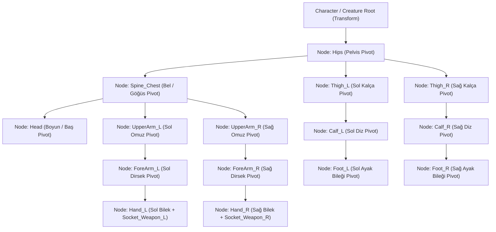
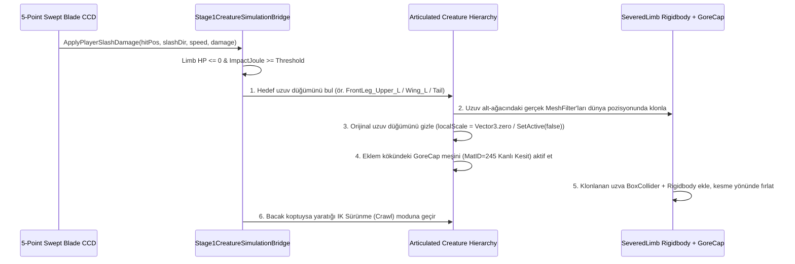

# Prosedürel IK Animasyon, Hiyerarşik 3B Rig ve Gerçek Uzuv Kopması (Dismemberment) Mimari Raporu

**Tarih:** 2026-04-01  
**Kapsam:** Faz 1 & Faz 2 Oynanabilir Sahne (`StratocraftStage1Playable.unity`), Otonom 3B Varlık Fabrikası (`Tools/AutonomousAssetFactory/`) ve Unity Çalışma Zamanı Karakter/Yaratık Simülasyonu (`Assets/_Stratocraft/Character/` & `Assets/_Stratocraft/Rendering/`)  
**Performans Kısıtları:** `< 16.0 MB` Toplam Doku VRAM, `< 2.500 MB` Oyun RAM, `0 B/kare` GC Alloc, UV-Free `Color32` (`StratocraftUberShader`), `0 Error / 0 Warning`

---

## 1. Endüstri Referansları, GDC Konuşmaları ve Açık Kaynak Mimari Araştırması

Sıfır elle animasyon (Zero-Touch) ve düşük bellek bütçesiyle çalışan oyunlarda, tek parça (monolitik) statik meşleri döndürmek yerine **çok-düğümlü (multi-node) hiyerarşik eklem ağaçları** ve **analitik Ters Kinematik (Analytical Inverse Kinematics - IK)** çözücüleri kullanılır. Araştırılan temel endüstri referansları ve açık kaynak çözümler aşağıdadır:

### 1.1. David Rosen — *Overgrowth* & *Receiver* (GDC 2014: *"Animation Bootcamp: An Indie Approach to Procedural Animation"*)
- **Kaynak:** [GDC Vault - An Indie Approach to Procedural Animation](https://www.gdcvault.com/play/1020583/Animation-Bootcamp-An-Indie-Approach) / Wolfire Games Blog
- **Temel Prensip (Az Sayıda Anahtar Poz + Prosedürel Ara Değerleme):** Yüzlerce karelik sabit (baked) animasyon klipleri yerine yalnızca uç anahtar pozlar (*Run Pass*, *Run Extended*, *Crouch Low*, *Prone Crawl*, *Weapon Windup*, *Weapon Release*) tanımlanır.
- **Pelvis (Kalça) Merkeziyetçiliği ve Kütle Merkezi Eğimi:**
  - Karakter çömeldiğinde (`Ctrl`) meşin dikey ölçeği (`localScale.y`) küçültülmez; `Hips` (Pelvis) düğümü aşağı indirilir ($\Delta y = -0.45\text{ m}$), ayak bileği (`Foot_L`, `Foot_R`) hedefleri zeminde sabit tutulur ve **2-Kemikli Analitik IK (Two-Bone IK)** dizleri (`Knee` Pole Vector yönünde) otomatik olarak kırar.
  - Karakter hızlandığında veya yön değiştirdiğinde gövde ivme vektörüne doğru eğilir ($\theta_{\text{lean}} = k \cdot \vec{a}$).
- **2-Kemikli Analitik IK ve Raycast Ayak Yerleşimi:** Kalçadan zemine atılan dikey ışınlar (`Physics.Raycast`) zemin yüksekliğini bulur; ayak hedefi zemin normaline hizalanır ve bacak aşırı gerilmesin diye pelvis yüksekliği en alçak ayağa göre dinamik olarak alçaltılır.

### 1.2. Joar Jakobsson & James Therrien — *Rain World* (GDC 2017: *"The Rain World Animation Process"*)
- **Kaynak:** [GDC Vault - The Rain World Animation Process](https://www.gdcvault.com/play/1024166/The-Rain-World-Animation-Process)
- **Temel Prensip (Fizik Güdümlü Çok-Parçalı Gövde ve Bağımsız Adım Kilitleri):**
  - Yaratıklar ve karakterler tek bir katı kutu değildir; birbirine mesafe ve açı kısıtlarıyla bağlı hiyerarşik düğümlerden (`Hips` $\rightarrow$ `Spine` $\rightarrow$ `Head` ve uzuv zincirleri) oluşur.
  - **Zemin Tarama ve Adım Tetikleyicisi (Step Trigger):** Her bacak gövdeden bağımsız bir "tutunma noktası" (*foot plant target*) tutar. Gövde ilerledikçe mevcut ayak konumu ile ideal duruş noktası arasındaki mesafe eşik değeri ($d > d_{\text{max}}$) aştığında, ayak yerden kesilir ve parabolik bir adım eğrisiyle ($y(t) = \sin(\pi t) \cdot h_{\text{step}}$) yeni hedefe taşınır.
  - **Yüzüstü Sürünme (Prone Crawling):** Karakter dar tünellerde veya `Z` tuşuyla yüzüstü yattığında; gövde (`Hips` ve `Spine`) zemin eğimine paralel ($\approx 80^\circ\text{--}85^\circ$ pitch) yatarken, **boyun/baş (`Head`) düğümü ters yönde ($\approx -65^\circ$ local pitch) kaldırılarak** ileriye bakar. Kollar (`UpperArm` + `ForeArm`) ve bacaklar (`Thigh` + `Calf`) çapraz fazlı ($\Delta\phi = \pi$) ileri-geri çekme (dirsek/diz sürünme) IK hedeflerini takip eder.

### 1.3. Jakob Wahl (*Weaverdev*) — *"Bonehead Procedural Animation"*
- **Kaynak:** [Weaverdev - Bonehead Procedural Animation](https://weaverdev.io/blog/bonehead-procedural-animation/)
- **Temel Prensip:** Geleneksel `SkinnedMeshRenderer` ve ağırlık boyama (weight painting) olmadan, **kemiksiz (boneless) çok-düğümlü hiyerarşik meşlerin** doğrudan `Transform` rotasyonlarıyla yürütülmesi ve saldırı yapması:
  1. Her uzuv segmenti (`UpperArm`, `ForeArm`, `Hand`, `Thigh`, `Calf`, `Foot`) kendi eklem pivotunda (ör. omuz, dirsek, kalça, diz) yerel orijine `(0, 0, 0)` sahip ayrı bir `MeshFilter` alt-nesnesidir.
  2. Karşıt bacaklar birbirine faz kilidiyle bağlıdır (Sol ayak havadayken sağ ayak yerde basılı kalır, böylece karakter havada yüzmez).
  3. Silah ve el aletleri (Kılıç, Kazma, Balta) doğrudan el (`Hand_R`) düğümüne bağlanmak yerine, **iki elin (`Hand_R` ve `Hand_L`) IK hedefleri silahın kabzası üzerindeki `Grip_Main` ve `Grip_Offhand` noktalarını takip eder**. Silah savrulduğunda omuz ve dirsek analitik IK ile silahla birlikte doğal olarak döner.

### 1.4. *Kenshi* (Lo-Fi Games) & *Exanima* (Bare Mettle) — Bölgesel Hasar, Uzuv Kopması ve Sürünme Fiziği
- **Kaynak:** *Kenshi* Regional Limb Health & Severing System / *Exanima* Procedural Balance & Torso-Dragging Mechanics
- **Temel Prensip:**
  - Her anatomik bölgenin (`Head`, `Chest`, `LeftArm`, `RightArm`, `LeftLeg`, `RightLeg`, yaratıklarda `Tail`, `Wing`) bağımsız HP havuzu ve kesilme eşiği vardır.
  - **Gerçek Uzuv Kopması (Real Mesh Dismemberment):** Kılıç darbesi bir uzvu kopardığında:
    1. Canlının hiyerarşisindeki ilgili uzuv düğümü (`RightLeg` veya `LeftArm`) **anında gizlenir** (`SetActive(false)` veya `localScale = Vector3.zero`).
    2. Aynı eklem noktasındaki **kanlı kesit kapağı (`GoreCap_*`)** aktif edilir (`SetActive(true)`).
    3. Kopan uzvun **gerçek 3B meş geometrisi** (rastgele bir üçgen/koni değil, kopan `Thigh + Calf + Foot` veya `UpperArm + ForeArm` meşlerinin birebir klonu) kopma anındaki dünya pozisyonu ve rotasyonunda oluşturulur; üzerine `Rigidbody` + `BoxCollider` eklenerek kılıcın kesme vektörü ($\vec{v}_{\text{slash}}$) ve açısal hızıyla ($\vec{\omega}$) fırlatılır.
  - **Bacak Koptuğunda Sürünme (Crawl Fallback):** Tek veya iki bacağı kopan bir yaratık veya insansı karakter dik duramaz (`CanStand = false`); `Hips` yüksekliği zemine düşer ve sağlam kalan ön ayakları/kolları ile gövdesini yerde sürüyerek (`ProneCrawling` IK döngüsü) hareket etmeye devam eder.

### 1.5. Açık Kaynak Unity IK Çözücüleri (GitHub Referansları)
1. **Two-Bone Analytical IK (Kosinüs Teoremi Çözücüsü — WireWhiz / Alan Zucconi / Unity Animation Rigging benzeri):**
   - **Algoritma:** 3 eklemli bir zincirde (`Root` $A$, `Mid` $B$, `Tip` $C$) kemik uzunlukları $L_1 = \|B - A\|$, $L_2 = \|C - B\|$ ve hedef mesafesi $D = \text{clamp}(\|T - A\|, |L_1 - L_2| + \epsilon, L_1 + L_2 - \epsilon)$ biliniyorsa, Kosinüs Teoremi ile omuz/kalça iç açısı $\alpha$ ve dirsek/diz iç açısı $\beta$ **sıfır iterasyonla ($O(1)$ sürede, `0 B` GC Alloc ile)** tam olarak hesaplanır:
     $$\cos(\alpha) = \frac{L_1^2 + D^2 - L_2^2}{2 L_1 D}, \qquad \cos(\beta) = \frac{L_1^2 + L_2^2 - D^2}{2 L_1 L_2}$$
   - Eklem bükülme yönü (dizin öne, dirseğin arkaya kırılması) bir `PoleVector` ($P$) ile belirlenen bükülme düzlemi normali $\vec{n} = \text{normalize}((T - A) \times (P - A))$ etrafında döndürülerek bulunur.
2. **`ditzel/SimpleIK` (FastIK — Daniel Erdmann, GitHub):**
   - **Kaynak:** `https://github.com/ditzel/SimpleIK` (MIT Lisansı)
   - **Algoritma:** İteratif **FABRIK** (*Forward And Backward Reaching Inverse Kinematics*) çözücüsüdür. 2 kemikten uzun zincirler (yaratık kuyrukları `Tail_01..03`, kanatlar veya çok segmentli omurgalar) için 3–4 iterasyonda çözülür. İnsansı kol ve bacaklar için ise **Analitik 2-Kemik IK** hem daha hızlıdır hem de eklem burkulmasını (gimbal flip) `%100` engeller.

---

## 2. Mevcut Kod Tabanındaki 4 Kritik Kök Neden Analizi

Mevcut kod tabanında yapılan satır-satır inceleme sonucunda, kullanıcının bildirdiği 4 görsel ve fiziksel hatanın kesin kök nedenleri tespit edilmiştir:

### Kök Neden 1: GLB Modellerinin Tek Parça (Monolitik) Üretilmesi ve İçe Aktarılırken Düzleştirilmesi
1. **Blender Üretim Hattı (`Tools/AutonomousAssetFactory/generators/blender/bpy_sculpt_worker.py` & `Tools/AutonomousAssetFactory/generators/base_generator.py`):**
   - `bpy_sculpt_worker.py` içindeki `generate_sculpted_job` fonksiyonunda (satır 1045–1162), zırh/karakter parçaları (`helmet`, `cuirass`, `pauldrons`, `vambraces`, `greaves` vb.) ve yaratık uzuvları (`head`, `torso`, `legs`, `wings`, `tail`) **tek bir `bmesh` (`bm = bmesh.new()`)** içine eklenmektedir.
   - `base_generator.py` içindeki `write_color32_glb` fonksiyonu (satır 272–395) tüm üçgenleri tek bir `meshes[0]` ve `nodes[0]` altında dışa aktarmaktadır.
2. **Unity GLB Yükleyicisi (`Assets/_Stratocraft/Rendering/GlbHierarchyLoader.cs`):**
   - `LoadGlbFromDisk` metodu (satır 144–239), GLB içindeki tüm `meshes` ve `primitives` dizilerini tek bir `allVerts` ve `allTris` listesinde birleştirip **tek bir `CombinedMesh`** üretmektedir (satır 174–212).
   - Satır 219'daki `if (node.mesh >= 0 || string.IsNullOrEmpty(node.name)) continue;` kontrolü, meş içeren tüm alt düğümleri kasıtlı olarak atlamakta ve yalnızca boş `Socket_*` düğümlerini çıkarmaktadır.
   - **Sonuç:** Sahnedeki `PlayerBody_EquippedIronVanguard`, `Creature_AshStalker_*` ve `Boss_Phoenix_Ember_Avatar` nesneleri, hiçbir hareketli kol, bacak, diz, dirsek veya bel eklemi olmayan **tek parça taş heykellerdir**.

### Kök Neden 2: `Z` (Sürünme) ve `Ctrl` (Çömelme) Tuşlarında "Kalas Gibi Devrilme" ve "Dikey Ezilme"
- **Dosya:** `Assets/_Stratocraft/Character/Stage1ArticulatedRigAnimator.cs` (satır 71–171)
- Dosya başlığında *"Drives a 3-part joint hierarchy"* yazmasına rağmen, sınıf yalnızca tek `GameObject? playerBodyRoot` referansı almakta ve bunun kök `Transform`'unu (`bodyTr`) değiştirmektedir:
  - **`Ctrl` ile Çömelme (`PlayerPostureState.Crouching`, satır 104–109):**
    ```csharp
    targetPitchDeg = 14f;
    targetYOffset = 0f;
    targetScale = new Vector3(1.04f, 0.76f, 1.05f);
    ```
    Dizleri (`Thigh`/`Calf`) kırmak yerine tüm karakter heykelini Y ekseninde `0.76x` oranında **akordeon gibi bastırarak ezmektedir**.
  - **`Z` ile Yüzüstü Sürünme (`PlayerPostureState.ProneCrawling`, satır 118–124):**
    ```csharp
    targetPitchDeg = 82f;
    targetYOffset = 0.22f;
    targetScale = new Vector3(1.0f, 0.92f, 0.85f);
    ```
    Karakterin pivot noktası ayak tabanında (`BottomCenter_Zero`) olduğu için, kök nesneye `82°` X-rotasyonu (`targetPitchDeg = 82f`) verildiğinde **tüm karakter heykeli ayak bileklerinden kırılıp yüzüstü devrilen bir kalas/satranç taşı gibi yatmaktadır**; kafa toprağa gömülmekte, kollar gövdeye yapışık kalmakta ve hiçbir sürünme hareketi oluşmamaktadır.
  - **Yaratık Sürünmesi (`Assets/_Stratocraft/Character/Stage1CreatureSimulationBridge.cs`, satır 131, 184, 224):**
    `a.Root.rotation = Quaternion.Euler(a.LegSevered ? 58f : ..., moveYaw, roll);` koduyla bacağı kopan yaratık da aynı şekilde tek parça heykel olarak `58°–64°` öne eğilmektedir.

### Kök Neden 3: Kazma, Balta ve Kılıç Savururken Kolların Kopuk ve Hareketsiz Kalması
1. **Silahların Boşlukta Asılı Olması (`Assets/_Stratocraft/Editor/StratocraftStage1SceneBuilder.cs`, satır 535–609):**
   - `RightHand_EquippedLongsword`, `RightHand_EquippedIronPickaxe` ve `RightHand_EquippedIronAxe` nesneleri bir kol/el eklemine değil, doğrudan `playerRoot` altına sabit `(0.42f, 1.05f, 0.28f)` yerel ofsetiyle bağlanmıştır.
   - Karakterin kendi kolları ise `armor_set_iron_vanguard.glb` meşinin içinde gövdenin iki yanında sabit durmaktadır.
2. **Kazma ve Baltada Savurma (Swing) Tetiklenmemesi (`Assets/_Stratocraft/Character/Stage1InteractivePlayController.cs`, satır 167):**
   - Satır 167'de `bool canCombat = _holsterCtrl != null && _holsterCtrl.ActiveHolsterSlot == 1 && !_holsterCtrl.IsBackpackOpen;` koşulu yüzünden `StepCombatAndCameraInput` **yalnızca Slot 1 (Kılıç) seçiliyken** çalışmaktadır!
   - Oyuncu **Slot 2 (Kazma)** veya **Slot 3 (Balta)** seçip sol tıkladığında `canCombat` `false` olduğu için `Stage1DirectionalCombatBridge` hiçbir savurma açısı üretmemekte, `Stage1MatterCrystalAndMiningController.ExecutePhysicalToolStrike` (satır 114–160) ise yalnızca `0.09` saniyede bir sayaç artırıp voksel kırmakta, kazma meşini ve kolu **1 milimetre bile oynatmamaktadır**.

### Kök Neden 4: Uzuv Kopmasında (Dismemberment) Sadece Üçgen Taş Çıkması ve Uzvun Yaratıkta Kalması
1. **Sahte Voksel Takozu Üretimi (`Assets/_Stratocraft/Character/Stage1CreatureSimulationBridge.cs`, satır 323–335):**
   - `SpawnSeveredLimbVisual` metodu, diskte hazır bulunan `Assets/Art/Generated/Creatures_21/SeveredLimbs/mob_ash_stalker_vat500_severed_*.glb` dosyalarını yüklemek yerine `HybridSurfaceNetsAndShapeMesher.EmitArchitecturalShape(..., shapeId: 2, ...)` çağırarak havada asılı duran statik bir **45° rampa/üçgen voksel bloğu** oluşturmaktadır.
   - Üretilen bu üçgen bloğun `Rigidbody` veya `Collider` bileşeni yoktur; havada sabit kalmaktadır.
2. **Yaratığın Uzvunun Gizlenmemesi ve `GoreCap` Eksikliği:**
   - Yaratık meşi tek parça olduğu için `a.LegSevered = true` olduğunda yaratığın bacağı meş üzerinde **olduğu gibi görünmeye devam etmektedir**.
   - `GlbHierarchyLoader.AttachSocketHierarchy` (satır 245–263) `Socket_GoreCap_*` düğümlerini sadece boş `GameObject` olarak oluşturmakta, kesik bölgesinde kanlı kesit meşi (`MatID = 245`) gösterilmemektedir.

---

## 3. Hiyerarşik Çok-Düğümlü (Multi-Node) GLB 2.0 Üretim ve Yükleme Mimarisi

`SkinnedMeshRenderer` ve kemik ağırlık matrislerinin CPU/GPU maliyetine girmeden, `StratocraftUberShader` (`Color32` vertex-color) mimarisiyle `%100` uyumlu **Kemiksiz Hiyerarşik Eklem Ağacı (Articulated Multi-Node GLB 2.0)** mimarisine geçilmelidir.



### 3.1. Python/Blender Tarafında Çok-Düğümlü GLB 2.0 Dışa Aktarımı
`Tools/AutonomousAssetFactory/generators/base_generator.py` ve `Tools/AutonomousAssetFactory/generators/blender/bpy_sculpt_worker.py` içinde:
1. **Ayrı `bmesh` / Parça Sözlüğü:** `generate_sculpted_job` fonksiyonu tüm anatomik parçaları tek bir `bm` içine birleştirmek yerine, her eklem bölgesini kendi adıyla ayrı bir meş olarak tutar:
   - **İnsansı (`armor_set_iron_vanguard.glb`):**
     - `Hips` (Pelvis / Tasset kemeri, pivot: `(0, 0.92, 0)`)
     - `Spine_Chest` (Cuirass göğüs zırhı + Sırt, `Hips`'e göre yerel ofset: `(0, 0.12, 0)`)
     - `Head` (Miğfer + Vizör, `Spine_Chest`'e göre yerel ofset: `(0, 0.44, 0)`)
     - `UpperArm_L` / `UpperArm_R` (Omuzluk + Üst kol, `Spine_Chest`'e göre yerel ofset: `(\pm 0.26, 0.34, 0)`)
     - `ForeArm_L` / `ForeArm_R` (Dirseklik + Ön kol + Eldiven, `UpperArm`'a göre yerel ofset: `(0, -0.28, 0)`)
     - `Thigh_L` / `Thigh_R` (Üst bacak zırhı, `Hips`'e göre yerel ofset: `(\pm 0.13, -0.04, 0)`)
     - `Calf_L` / `Calf_R` (Dizlik + Alt bacak + Çizme, `Thigh`'a göre yerel ofset: `(0, -0.42, 0)`)
   - **Yaratık (`mob_ash_stalker_vat500.glb`) ve Boss (`boss_phoenix_ember_avatar.glb`):**
     - `Hips` (Ana Gövde / Torso), `Head` (Baş/Boyun), `FrontLeg_Upper_L/R` $\rightarrow$ `FrontLeg_Lower_L/R`, `BackLeg_Upper_L/R` $\rightarrow$ `BackLeg_Lower_L/R`, `Wing_L/R`, `Tail`.
2. **Yerel Pivot Sıfırlama (Local-Space Origin Recentering):**
   - Her alt parçanın köşe noktaları (vertices), kendi eklem pivot noktası `(0, 0, 0)` olacak şekilde yerel uzaya (`v_local = v_world - joint_world_pivot`) taşınır.
   - Eklem uçlarında küresel örtüşme (ball-and-socket overlap, $r \approx 0.06\text{ m}$) bırakılarak eklem büküldüğünde parçalar arasında boşluk görünmesi engellenir.
3. **Çok-Düğümlü GLB Yazıcı (`write_articulated_color32_glb`):**
   - GLTF 2.0 JSON şemasında her parça ayrı bir `meshes[i]` girdisi olarak yazılır ve `nodes[i]` içinde `"mesh": i`, `"translation": [dx, dy, dz]`, `"children": [...]` hiyerarşisiyle birbirine bağlanır.

### 3.2. Unity Tarafında Hiyerarşik GLB Yükleyici (`GlbHierarchyLoader.cs`)
`Assets/_Stratocraft/Rendering/GlbHierarchyLoader.cs` içindeki `LoadGlbFromDisk` metodu güncellenerek:
- Eğer GLB içinde birden fazla meş düğümü (`nodes` dizisinde `node.mesh >= 0` olan hiyerarşik düğümler) varsa, bunları tek bir `CombinedMesh` içinde ezmek yerine **GLTF düğüm ağacını birebir Unity `GameObject` + `MeshFilter` + `MeshRenderer` hiyerarşisi olarak** oluşturur.
- Geriye dönük uyumluluk için kök nesne üzerinde de ana gövde veya birleşik sınır kutusu (`Bounds`) korunur; her alt düğüm kendi yerel `translation`, `rotation` ve `scale` değerleriyle doğru ebeveyn (`parent`) düğümüne bağlanır.

---

## 4. Matematiksel 2-Kemikli Analitik IK ve Prosedürel Duruş/Yürüyüş Motoru

`Assets/_Stratocraft/Character/Stage1ArticulatedRigAnimator.cs` tamamen yenilenerek kalas gibi devrilme (`targetPitchDeg = 82f`) ve akordeon gibi ezilme (`targetScale.y = 0.76f`) kodları kaldırılmalı; yerine **`TwoBoneAnalyticalIKSolver`** ve **Hiyerarşik Eklem Sürücüsü** eklenmelidir.

### 4.1. Sıfır-Tahsisatlı (Zero-Alloc) 2-Kemikli Analitik IK Çözücüsü
Üç `Transform` düğümü (`rootBone` $A$, `midBone` $B$, `endEffector` $C$ veya alt uç) ve dünya uzayındaki hedef nokta $T$ ile bükülme yönü `poleVector` $P$ için:

1. **Kemik Uzunlukları ve Mesafe Kısıtlaması:**
   $$L_1 = \|B_{\text{pos}} - A_{\text{pos}}\|, \quad L_2 = \|C_{\text{pos}} - B_{\text{pos}}\|$$
   $$\vec{d} = T - A_{\text{pos}}, \quad D = \text{ clamp}\!\left(\|\vec{d}\|,\; |L_1 - L_2| + 10^{-4},\; L_1 + L_2 - 10^{-4}\right)$$
2. **Kosinüs Teoremi ile Eklem Açıları:**
   $$\cos\alpha = \text{clamp}\!\left(\frac{L_1^2 + D^2 - L_2^2}{2 L_1 D},\; -1,\; 1\right), \quad \alpha = \arccos(\cos\alpha)$$
   $$\cos\beta = \text{clamp}\!\left(\frac{L_1^2 + L_2^2 - D^2}{2 L_1 L_2},\; -1,\; 1\right), \quad \theta_{\text{mid}} = \pi - \arccos(\cos\beta)$$
3. **Bükülme Düzlemi ve Rotasyon Uygulaması:**
   - Hedeften Pole Vector'e bakan düzlem normali:
     $$\hat{u} = \frac{\vec{d}}{\|\vec{d}\|}, \quad \vec{n} = \text{normalize}\!\left(\hat{u} \times (P - A_{\text{pos}})\right)$$
   - Üst kemik (`UpperArm` veya `Thigh`) yönü, $\hat{u}$ vektörünün $\vec{n}$ ekseni etrafında $\alpha$ kadar döndürülmesiyle bulunur:
     $$\vec{\text{dir}}_1 = \text{Quaternion.AngleAxis}(\alpha \cdot \text{Rad2Deg},\; \vec{n}) \cdot \hat{u}$$
   - Alt kemik (`ForeArm` veya `Calf`) yerel X ekseninde $\theta_{\text{mid}}$ kadar bükülür.

### 4.2. Duruş Durumları (Posture States) İçin Gerçek Eklem Kinematikleri

| Duruş / Eylem | Kalça (`Hips`) Yüksekliği ve Eğimi | Omurga (`Spine_Chest`) ve Baş (`Head`) | Bacaklar (`Thigh_L/R` + `Calf_L/R`) | Kollar (`UpperArm_L/R` + `ForeArm_L/R`) |
| :--- | :--- | :--- | :--- | :--- |
| **Normal Yürüyüş / Koşu (`Standing`)** | $y = 0.92\text{ m} + \sin(2\phi)\cdot 0.04\text{ m}$, hafif ileri eğim ($6^\circ\text{--}12^\circ$) | Karşıt omuz salınımı ($\text{yaw} = -\sin(\phi)\cdot 8^\circ$), Baş ufka kilitli | Çapraz fazlı ($\Delta\phi = \pi$) parabolik adım hedefi + **2-Kemik Ayak IK** (Diz Pole: İleri) | Bacaklarla ters fazlı sarkaç salınımı veya aktif silah tutuşu |
| **Çömelme (`Ctrl` — `Crouching`)** | **`localScale` ASLA değiştirilmez (`1,1,1`)!** `Hips` yüksekliği $y = 0.52\text{ m}$'ye indirilir ($\Delta y = -0.40\text{ m}$) | Göğüs hafif öne eğilir ($\text{pitch} = +18^\circ$), Baş karşıya bakar ($\text{pitch} = -18^\circ$) | Ayak hedefleri zeminde ($y=0$) kalır; `Hips` indiği için **2-Kemik IK dizleri otomatik olarak $\approx 75^\circ$ kırar** | Kollar denge ve savunma için dirseklerden $\approx 45^\circ$ kırılır |
| **Yüzüstü Sürünme (`Z` — `ProneCrawling`)** | `Hips` doğrudan zeminin hemen üstüne ($y = 0.20\text{ m}$) indirilir ve yatay konuma ($\text{pitch} = +80^\circ$) yatırılır | `Spine_Chest` zemine paralel uzanır; **`Head` düğümü $\text{localPitch} = -68^\circ$ ile yukarı kaldırılarak karşıya bakar** | Sağ ve sol dizler (`Knee Pole` dışa/yana açık) sırayla karın altına çekilip itilir (Kurbağa/Komando bacak itişi) | Sağ ve sol dirsekler sırayla ileri uzanıp zemini geriye çeker (`Low Crawl` dirsek yürüyüşü) |
| **Kazma / Balta / Kılıç Savurma (`Tool/Weapon Swing`)** | Gövde vuruş yönüne doğru ağırlık aktarır | `Spine_Chest` vuruş fazına göre $\pm 22^\circ$ burulur (Torso Twist) | Geniş destek duruşu (Stance Width) | Aktif silah/alet `Hand_R` soketine bağlıdır; **Sağ Omuz + Dirsek 2-Kemik IK ile silahın savurma yayını takip eder** |

### 4.3. Kazma ve Balta Savurma Entegrasyonu (`Stage1InteractivePlayController.cs` & `Stage1MatterCrystalAndMiningController.cs`)
1. **Silah/Alet Ebeveynliği:** `RightHand_EquippedLongsword`, `RightHand_EquippedIronPickaxe` ve `RightHand_EquippedIronAxe` nesneleri doğrudan `playerRoot` yerine karakterin hiyerarşik **`Hand_R` (`ForeArm_R` ucu)** düğümüne bağlanır.
2. **Kazma/Balta Vuruş Animasyonu:**
   - `Stage1MatterCrystalAndMiningController.ExecutePhysicalToolStrike` çağrıldığında yalnızca sayaç artırmakla kalmaz; `Stage1ArticulatedRigAnimator.TriggerToolStrike(aimDirection, toolSlot)` metodunu tetikler.
   - Ayrıca `Stage1InteractivePlayController` içinde oyuncu Kazma (`Slot 2`) veya Balta (`Slot 3`) tutarken sol tıkladığında (hedefte voksel olmasa bile havaya savurduğunda), `Stage1ArticulatedRigAnimator` sağ kolu (`UpperArm_R` + `ForeArm_R`) baş üstünden hedefe doğru parabolik bir vuruş yayıyla (Windup $\rightarrow$ Downward Strike $\rightarrow$ Impact Rebound $\rightarrow$ Recovery) savurur.

---

## 5. Gerçek 0-ms Uzuv Kopması (Dismemberment), `GoreCap` ve Fiziksel Uzuv Fırlatma Mimarisi

Kılıç darbesi (`Stage1DirectionalCombatBridge` $\rightarrow$ `Stage1CreatureSimulationBridge.ApplyPlayerSlashDamage`) bir yaratığın bacağını, kanadını, kuyruğunu veya başını kopardığında **üçgen voksel taşı çıkarma kodu (`EmitArchitecturalShape`) tamamen kaldırılarak** aşağıdaki 4 adımlı gerçek uzuv kopma hattı çalıştırılır:



### 5.1. Adım 1: Yaratık Üzerindeki Kopan Uzvun Anında Gizlenmesi
- Yaratık hiyerarşisinde kopan bölgeye karşılık gelen eklem düğümü (`FrontLeg_Upper_L`, `BackLeg_Upper_R`, `Wing_L`, `Tail`, `Head`) bulunur.
- Bu düğümün `gameObject.SetActive(false)` (veya `localScale = Vector3.zero`) yapılmasıyla **uzuv yaratığın vücudundan gerçekten yok olur**.

### 5.2. Adım 2: Kanlı Kesit Kapağının (`GoreCap_*`) Aktif Edilmesi
- Eklem kopma noktasında (`Socket_GoreCap_Leg_L`, `Socket_GoreCap_Wing_L`, `Socket_GoreCap_Tail`, `Socket_GoreCap_Neck`) yer alan kesit düğümüne `MatID = 245` (`Gore Flesh`, koyu kızıl `Color32(145, 22, 22, 245)`) renginde basık silindirik/organik kesit meşi (`GoreCapMesh`) bağlanır ve kopma anında `SetActive(true)` yapılır.
- Bu işlem `StratocraftUberShader` vertex-color mimarisini kullandığı için **`0 Byte` ek doku VRAM'i** harcar.

### 5.3. Adım 3: Kopan Gerçek Uzuv Meşinin Fiziksel Fırlatılması (`Rigidbody` + `BoxCollider`)
- Kopan uzuv düğümünün (`limbNode`) ve alt düğümlerinin (ör. üst bacak + alt bacak + pençe) sahip olduğu **gerçek `MeshFilter.sharedMesh` referansları** (veya `SeveredLimbs/` altındaki gerçek heykel parçası GLB'si) kopma anındaki dünya pozisyonu (`limbNode.position`) ve dünya rotasyonunda (`limbNode.rotation`) yeni bir `SeveredLimb_<Creature>_<Part>` nesnesi olarak örneklenir.
- Nesneye `BoxCollider` ve `Rigidbody` (`mass = 4.5f`, `interpolation = RigidbodyInterpolation.Interpolate`) eklenir.
- Kılıcın kesme yönü ($\vec{d}_{\text{slash}}$) ve yüzey normaline göre başlangıç hızı ve açısal burulma (tork) uygulanır:
  $$\vec{v}_{\text{impulse}} = \vec{d}_{\text{slash}} \cdot 4.2\text{ m/s} + \vec{u}_{\text{up}} \cdot 2.4\text{ m/s}, \qquad \vec{\omega}_{\text{impulse}} = (\vec{d}_{\text{slash}} \times \vec{u}_{\text{up}}) \cdot 11.0\text{ rad/s}$$
- Böylece kopan bacak/kanat/kuyruk, havada asılı kalan bir üçgen taş olmak yerine, kılıcın kestiği yöne doğru takla atarak zemine düşer ve voksel zemini üzerinde yuvarlanıp durur.

### 5.4. Adım 4: Bacağı Kopan Yaratığın Gerçek IK ile Sürünmesi
- `Stage1CreatureSimulationBridge` içinde `a.LegSevered == true` olduğunda, tüm yaratık heykelini `58°` öne eğmek yerine:
  - Yaratığın `Hips` (Gövde) düğümü zemine yaklaştırılır ($\Delta y = -0.32\text{ m}$) ve hafif yan yatırılır ($\text{roll} = \pm 18^\circ$).
  - Kopan bacak zaten `SetActive(false)` olduğu için görünmezdir; sağlam kalan diğer bacaklar (`FrontLeg_R`, `BackLeg_L/R`) daha yüksek frekanslı ve kısa adımlı **Asimetrik Topallama / Sürünme IK** döngüsüyle gövdeyi ileri çeker.

---

## 6. Uygulama Yol Haritası ve Etkilenen Dosyalar

| Sıra | Dosya Yolu (Göreceli) | Yapılacak Mimari Değişiklik |
| :--- | :--- | :--- |
| **1** | `Tools/AutonomousAssetFactory/generators/base_generator.py` | Tekil `write_color32_glb` yanına çok-düğümlü hiyerarşik `write_articulated_color32_glb(filepath, node_tree)` fonksiyonunun eklenmesi; her düğümün kendi yerel eklem pivotunda dışa aktarılması. |
| **2** | `Tools/AutonomousAssetFactory/generators/blender/bpy_sculpt_worker.py` | `armor_set_iron_vanguard.glb`, `mob_ash_stalker_vat500.glb` ve `boss_phoenix_ember_avatar.glb` modellerinin tek `bmesh` yerine eklem bölgelerine (`Hips`, `Spine_Chest`, `Head`, `UpperArm_L/R`, `ForeArm_L/R`, `Thigh_L/R`, `Calf_L/R`, `Wing_L/R`, `Tail`) ayrılmış çok-düğümlü GLB olarak üretilmesi; `SeveredLimbs/` GLB'lerinin gerçek uzuv meşlerinden üretilmesi. |
| **3** | `Assets/_Stratocraft/Rendering/GlbHierarchyLoader.cs` | Çok-düğümlü GLB dosyalarını tek `CombinedMesh`'e ezmeden, GLTF `nodes` hiyerarşisini koruyarak alt `GameObject` + `MeshFilter` + `MeshRenderer` ağacı olarak yükleyen `LoadArticulatedHierarchy` desteğinin eklenmesi. |
| **4** | `Assets/_Stratocraft/Character/Stage1ArticulatedRigAnimator.cs` | Kalas devrilmesi (`82°` pitch) ve dikey ölçek ezilmesi (`0.76y` scale) kodlarının silinmesi; **Two-Bone Analytical IK** (Kosinüs Teoremi), gerçek `Ctrl` diz kırma, gerçek `Z` yüzüstü dirsek/diz sürünme + baş kaldırma ve sağ/sol kol silah/kazma savurma IK çözücüsünün yazılması (`0 B/kare` GC Alloc). |
| **5** | `Assets/_Stratocraft/Character/Stage1InteractivePlayController.cs` & `Assets/_Stratocraft/Character/Stage1MatterCrystalAndMiningController.cs` & `Assets/_Stratocraft/Editor/StratocraftStage1SceneBuilder.cs` | Kılıç, Kazma ve Baltanın `Hand_R` eklemine bağlanması; Slot 2 (Kazma) ve Slot 3 (Balta) ile sol tıklandığında sağ kolun ve aletin gerçek IK vuruş yayıyla savrulması. |
| **6** | `Assets/_Stratocraft/Character/Stage1CreatureSimulationBridge.cs` | `SpawnSeveredLimbVisual` içindeki sahte üçgen rampa (`EmitArchitecturalShape`) kodunun silinmesi; kesilen uzuv düğümünün gizlenmesi (`SetActive(false)`), `GoreCap` kesit meşinin açılması, kopan gerçek uzuv meşinin `Rigidbody` + `BoxCollider` ile kesme yönünde fırlatılması ve bacağı kopan yaratığın eklem tabanlı sürünmeye geçmesi. |
