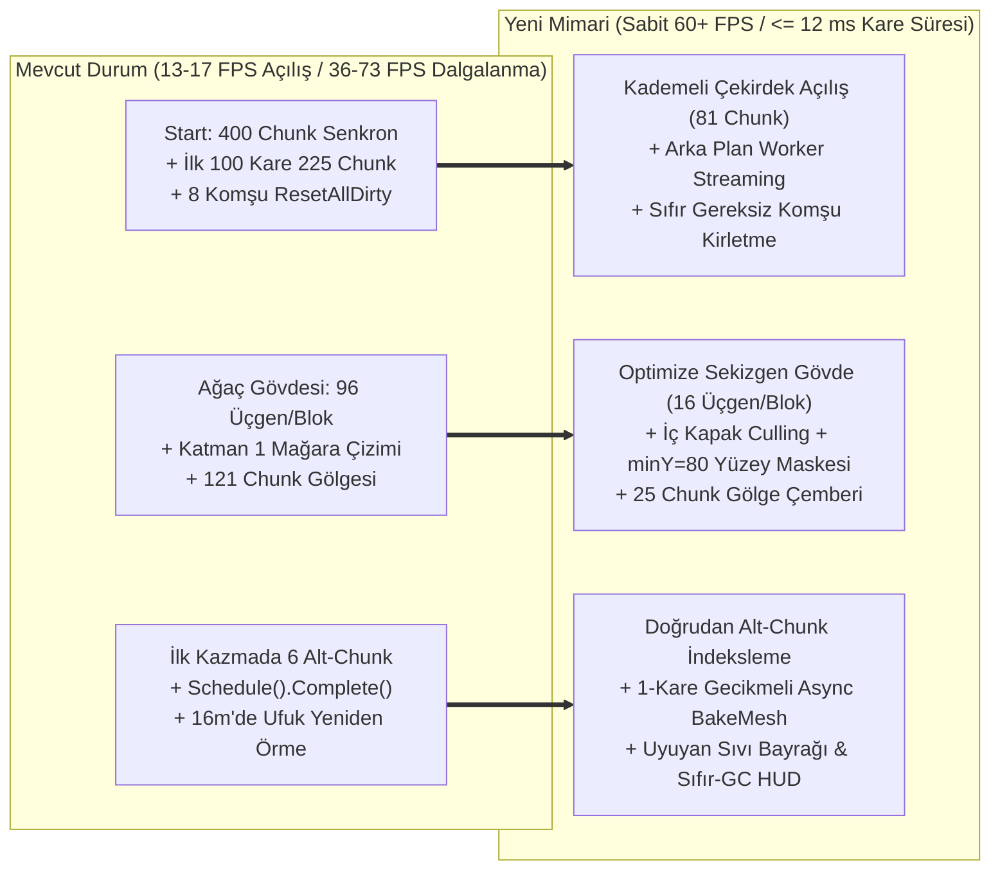

# STRATOCRAFT — RAPOR 1: EN DÜŞÜK BİLGİSAYARDA BİLE SABİT 60+ FPS (SIFIR DALGALANMA & SIFIR SPIKE) SORUN VE ÇÖZÜM MİMARİSİ

**Rapor Kodu:** `DOC-PERF-60FPS-001`  
**Tarih:** 2026-11-08  
**Durum:** KÖK NEDEN ANALİZİ VE UYGULAMA MİMARİSİ (KOD DEĞİŞİKLİĞİ ÖNCESİ TASARIM RAPORU)  
**İlgili Dosyalar:**
- [`Stage1InteractivePlayController.cs`](file:///d:/Oyunum/oyun/Assets/_Stratocraft/Character/Stage1InteractivePlayController.cs)
- [`HybridSurfaceNetsAndShapeMesher.cs`](file:///d:/Oyunum/oyun/Assets/_Stratocraft/Voxel/Jobs/HybridSurfaceNetsAndShapeMesher.cs)
- [`DistantHorizonLodSystem.cs`](file:///d:/Oyunum/oyun/Assets/_Stratocraft/Voxel/Systems/DistantHorizonLodSystem.cs)
- [`StratocraftFloatingIslandWorldGen.cs`](file:///d:/Oyunum/oyun/Assets/_Stratocraft/WorldGen/StratocraftFloatingIslandWorldGen.cs)
- [`Stage1CreatureSimulationBridge.cs`](file:///d:/Oyunum/oyun/Assets/_Stratocraft/Character/Stage1CreatureSimulationBridge.cs)
- [`Stage1VisualHotbarAndInventoryUi.cs`](file:///d:/Oyunum/oyun/Assets/_Stratocraft/Character/Stage1VisualHotbarAndInventoryUi.cs)

---

## 1. YÖNETİCİ ÖZETİ: NEDEN FPS DALGALANIYOR VE HEDEFİMİZ NEDİR?

Devir `#036` ile NetCode `999+` uyarı fırtınası ve alt-chunk sonsuz kirlenme döngüsü çözülmüş olsa da, mevcut sahnede **üç temel performans sorunu** devam etmektedir:

1. **İlk Açılış Çöküşü (`13–17 FPS`, İlk 3–5 Saniye):** Oyuna başlandığında hem `Start()` içinde `400` chunk'ın (`16.38 Milyon` voksel) senkron üretilmesi hem de takip eden ilk ~110 kare boyunca eksik `225` dış chunk'ın Ana İş Parçacığı (Main Thread) üzerinde kare başına 2'şer adet üretilip her seferinde 8 komşusunu (`AllSubChunksMask`) yeniden örmeye zorlaması.
2. **Bakış Yönüne Göre FPS Yarılanması (`Boş Ova: 73 FPS` $\leftrightarrow$ `Merkez Vadi / Orman: 36 FPS`):** Ağaç gövdelerinde kullanılan `OctagonalPillar` (`ShapeId = 2`) şeklinin **tek bir `1x1x1` voksel bloğu için 80–96 üçgen** üretmesi ve iç yüzey gizlemesinin (`occludedFaceMask = 0`) kapalı olması; yüzeyde yürürken bile yerin `10–32m` altındaki **Katman 1 mağaralarının (`Y = 64..90m`)** her chunk'ta örülüp GPU'ya gönderilmesi; ve `11x11 = 121` chunk + `330+` canlı uzvunda gerçek zamanlı gölge (`ShadowCaster`) çizilmesi.
3. **Yürürken ve Kazarken Oluşan Mikro-Takılmalar (`Frame Pacing Spikes`):**
   - `ScheduleAsyncColliderBake(updated).Complete()` çağrısının aynı satırda `.Complete()` yaparak Main Thread'i bloklaması,
   - Her `16m` yürümede (chunk sınırı geçişinde) 5 yeni chunk'ın pişmemiş `MeshCollider` ataması + `4,888` sütunluk `DistantHorizon` ufuk kabuğunun Main Thread'de sıfırdan örülmesi,
   - Bir chunk'a kazmayla **ilk vuruşta** `IsConsolidatedFullPass` bayrağı yüzünden 1 alt-chunk yerine **6 alt-chunk'ın tamamının** baştan örülmesi.

**Hedefimiz:** Giriş seviyesi / en zayıf donanımda bile kare süresinin **hiçbir karede `16.6 ms` (`60 FPS`) sınırını aşmaması** ve `%1 Low FPS >= 55–60 FPS` olarak sabitlenmesi.

---

## 2. KOD TABANINDAKİ 7 SOMUT DARBOĞAZ (SATIR SATIR KANITLAR)

### Darboğaz 1: `Start()` İçinde 400 Chunk + İlk 100 Karede 225 Chunk Senkron Üretim ve Komşu Kirletme Fırtınası
- **Konum:** [`Stage1InteractivePlayController.cs`](file:///d:/Oyunum/oyun/Assets/_Stratocraft/Character/Stage1InteractivePlayController.cs#L1759-L1910) (`EnsureChunksInitialized`) ve [`StepDynamicContinentChunkStreaming`](file:///d:/Oyunum/oyun/Assets/_Stratocraft/Character/Stage1InteractivePlayController.cs#L417-L644).
- **Mekanik Sebep:**
  1. Sahnede `-10..9` aralığında `20x20 = 400` adet hazır `VoxelChunk` vardır. `EnsureChunksInitialized` (`L1782–1788`) bu `400` chunk için `400 * 384 KB = 153.6 MB` managed dizi (`uint[65536]` + `ushort[65536]`) tahsis eder ve `16.38 Milyon` hücreyi hesaplar.
  2. `L1845–1876` arasında her chunk için `10` adet `new List<FacetedVoxelTriangle>(512)` (toplam **`4,000` liste ≈ `98 MB` kapasite**) ayrılır ve `25` yakın chunk'ın `MeshCollider` ağacı senkron pişirilir.
  3. Hemen ardından `Update()` başladığında `ActiveChunkRadius = 11` ve `maxDataRadius = 12` (`25x25 = 625` chunk) olduğu için, sahnedeki `400` chunk ile hedef `625` chunk arasındaki **`225` eksik chunk** ilk ~110 kare boyunca Main Thread'de kare başına 2'şer adet senkron üretilir (`L545`).
  4. **Kritik Hata (`L634–643`):** `CreateAndRegisterDynamicContinentChunk` her yeni chunk ürettiğinde etrafındaki **8 komşunun tamamına `nSub.ResetAllDirty()`** uygular! Bu yüzden ilk 3–5 saniye boyunca her karede 2 yeni chunk WorldGen (`~6 ms`) + 6 katı chunk yeniden örme (`~12 ms`) + 4 sıvı chunk örme (`~4 ms`) biner ve FPS **`13–17`** seviyesine çakılır.

### Darboğaz 2: Ağaç Gövdelerinde (`OctagonalPillar`) Tek Blok Başına 80–96 Üçgen ve Sıfır İç Yüzey Gizleme (`occludedFaceMask = 0`)
- **Konum:** [`HybridSurfaceNetsAndShapeMesher.cs`](file:///d:/Oyunum/oyun/Assets/_Stratocraft/Voxel/Jobs/HybridSurfaceNetsAndShapeMesher.cs#L680-L838) (`EmitArchitecturalShape`, `EmitOctagonalPillar`) ve [`StratocraftFloatingIslandWorldGen.cs`](file:///d:/Oyunum/oyun/Assets/_Stratocraft/WorldGen/StratocraftFloatingIslandWorldGen.cs#L1215-L1278) (`BuildVoxelTree`).
- **Mekanik Sebep:**
  - `EmitArchitecturalShape` (`L680–681`) içinde:
    ```csharp
    byte occludedFaceMask = shapeId == VoxelShapeCatalog.FullMasonryCube
        ? ComputeOccludedCubeFaceMask(voxels, lx, y, lz)
        : (byte)0;
    ```
  - Yani `FullMasonryCube (1)` dışındaki **hiçbir şekilde (`shapeId = 2..63`) alt/üst/yan komşu yüzey gizlemesi yapılmamaktadır!**
  - `BuildVoxelTree` (`L1255`) her ağacın gövdesini üst üste 6–11 blok `OctagonalPillar (shapeId = 2)` olarak dizer. `EmitOctagonalPillar` (`L812–838`) ise tek bir `1x1x1` voksel için **8 adet 6-yüzlü kutu (`8 * 12 = 96` üçgen!)** üretir!
  - Üst üste duran 8 gövde bloğu birbirinin iç yüzeyini hiç gizlemeden **tek bir ağaç gövdesinde ~750 üçgen**, dallar ve yapraklarla birlikte **ağaç başına ~1,000+ üçgen** üretir. Ormana/merkeze bakıldığında görüş alanındaki ~200 ağaç + tapınak/kule sütunları GPU'ya yüz binlerce gereksiz üçgen gönderir.

### Darboğaz 3: Yüzeyde Gezerken Yerin Altındaki Katman 1 Mağaralarının (`Y = 64..90m`) Boşuna Örülmesi ve Çizilmesi
- **Konum:** [`Stage1InteractivePlayController.cs`](file:///d:/Oyunum/oyun/Assets/_Stratocraft/Character/Stage1InteractivePlayController.cs#L165) (`SurfaceAndUpperCaveSubChunksMask = 0x03F0`) ve [`ComputeVisibleSubChunkMask`](file:///d:/Oyunum/oyun/Assets/_Stratocraft/Character/Stage1InteractivePlayController.cs#L1327-L1342).
- **Mekanik Sebep:**
  - Yüzey rakımı `Y = 96m` olduğu halde, oyuncu yüzeydeyken `0x03F0` maskesi (`subY = 4..9`, yani **`Y = 64m..160m`**) aktif tutulmaktadır.
  - `Y = 64m..88m` (`subY = 4` ve `subY = 5` alt yarısı) aralığında yeraltındaki **Katman 1 mağaraları ve 3 büyük keşif odası** yer alır. Oyuncu yüzeyde yürürken ve merkeze bakarken GPU, zeminin `10–30 metre` altındaki kapalı mağaraların tüm üçgenlerini her karede boşu boşuna çizer (ağır Vertex + Overdraw maliyeti).

### Darboğaz 4: Surface Nets'te Komşu Quad'lar Arası Vertex Paylaşımı Olmaması (`4x` Şişkin Vertex Buffer)
- **Konum:** [`HybridSurfaceNetsAndShapeMesher.cs`](file:///d:/Oyunum/oyun/Assets/_Stratocraft/Voxel/Jobs/HybridSurfaceNetsAndShapeMesher.cs#L617-L659) (`EmitSurfaceQuad`, `AddTriangle`) ve [`BuildUnityMeshZeroGc`](file:///d:/Oyunum/oyun/Assets/_Stratocraft/Voxel/Jobs/HybridSurfaceNetsAndShapeMesher.cs#L1021-L1105).
- **Mekanik Sebep:**
  - `CanShareQuadVertices` (`L1191`) yalnızca **tek bir quad'ın kendi 2 üçgeni arasında** `6 -> 4` köşe birleştirmesi yapar; komşu quad'lar arasında hiçbir köşe paylaşılmaz.
  - `16x16` düz bir arazi diliminde `17x17 = 289` köşe (vertex) yeterli olması gerekirken `16 * 16 * 4 = 1,024` köşe üretilir (**Vertex Shader ve ShadowCaster yükü 3.5 kat fazladır**).

### Darboğaz 5: `11x11 = 121` Chunk ve `350+` Uzuv Parçasında Gerçek Zamanlı Gölge (`ShadowCaster`) Patlaması
- **Konum:** [`Stage1InteractivePlayController.cs`](file:///d:/Oyunum/oyun/Assets/_Stratocraft/Character/Stage1InteractivePlayController.cs#L1290) (`UpdateFrustumVisibility`), [`Stage1CreatureSimulationBridge.cs`](file:///d:/Oyunum/oyun/Assets/_Stratocraft/Character/Stage1CreatureSimulationBridge.cs#L1650) ve [`Stage1ArticulatedRigAnimator.cs`](file:///d:/Oyunum/oyun/Assets/_Stratocraft/Character/Stage1ArticulatedRigAnimator.cs#L429).
- **Mekanik Sebep:**
  - `chebDist <= 5` koşulu yüzünden oyuncunun etrafındaki **`121` chunk'ın (`176m x 176m`)** tamamı ShadowMap geçişine girer.
  - Ayrıca `45m` içindeki her canlının **15 ayrı çocuk `MeshRenderer` uzvu** ve FPS modunda oyuncunun **25 ayrı çocuk `MeshRenderer` uzvu** ayrı ayrı ShadowCaster draw call'u üretir.

### Darboğaz 6: "Sahte Asenkron" (`.Schedule().Complete()`) Collider Pişirme ve `IsConsolidatedFullPass` İlk Kazma Spike'ı
- **Konum:** [`Stage1InteractivePlayController.cs`](file:///d:/Oyunum/oyun/Assets/_Stratocraft/Character/Stage1InteractivePlayController.cs#L1552-L1558) ve [`RebuildSingleChunkWithSubMeshCache`](file:///d:/Oyunum/oyun/Assets/_Stratocraft/Character/Stage1InteractivePlayController.cs#L1686-L1732).
- **Mekanik Sebep:**
  1. `L1554`: `HybridSurfaceNetsAndShapeMesher.ScheduleAsyncColliderBake(updated).Complete();` — Job başlatıldığı satırda `.Complete()` çağrıldığı için Main Thread iş bitene kadar **senkron kilitlenir**!
  2. `L1223–1252` (`UpdateNearPlayerColliderRing`): Oyuncu her `16m` yürüdüğünde yeni `5x5` halkaya giren 5 chunk için önceden `BakeMesh` yapılmadan `mc.sharedMesh = mf.sharedMesh` atanır (`5–12 ms` anlık takılma) ve **aynı karede** `UpdateDistantHorizonShellsVisibility` (`L1434`) `4,888` sütunluk uzak ufuk kabuğunu Main Thread'de sıfırdan örer (`4–8 ms` takılma)!
  3. `L1694–1699` (`IsConsolidatedFullPass`): Oyuncu bir chunk'ta **tek bir bloğa ilk kez vurduğunda**, `IsConsolidatedFullPass == true` olduğu için `dirtyMask = AllSubChunksMask` yapılır ve 1 alt-chunk yerine **6 alt-chunk'ın tamamı (`subY = 4..9`) aynı karede baştan örülür (`8–15 ms` spike)!**

### Darboğaz 7: `0.12s` Sıvı Taraması (`1.02 Milyon` Hücre), `0.30s` Oksijen Kopyası ve Her Kare `OnGUI` GC Tahsisleri
- **Konum:** [`Stage1InteractivePlayController.cs`](file:///d:/Oyunum/oyun/Assets/_Stratocraft/Character/Stage1InteractivePlayController.cs#L646-L721) (`StepFluidSimulation`) ve [`Stage1VisualHotbarAndInventoryUi.cs`](file:///d:/Oyunum/oyun/Assets/_Stratocraft/Character/Stage1VisualHotbarAndInventoryUi.cs#L598-L1305).
- **Mekanik Sebep:**
  - `HasUnsettledFluidCells` her `0.12s`'de bir `25` yakın chunk'ın `40,960` hücresini (`1,024,000` hücre) Main Thread'de tarar.
  - `Stage1VisualHotbarAndInventoryUi.OnGUI` her karede (Layout + Repaint = 2 kez) `(i + 1).ToString()`, `$"❤️ CAN %..."`, `$"⚡ ENERJİ..."`, `$"x{slot.Count}"` string tahsisleri yaparak Garbage Collector (GC) duraksamaları biriktirir.

---

## 3. EN DÜŞÜK DONANIMDA BİLE SABİT 60+ FPS GARANTİSİ İÇİN 7 ADIMLI ÇÖZÜM MİMARİSİ



### Çözüm 1: Kademeli Çekirdek Açılış (`9x9 = 81` Chunk) + Arka Plan İş Parçacığında (Worker Thread) Streaming
1. **`EnsureChunksInitialized` Yükünün %80 Azaltılması:**
   - `Start()` içinde sahnedeki `400` chunk'ın tamamını senkron üretmek yerine, yalnızca oyuncunun etrafındaki **`r <= 4` (`9x9 = 81` chunk)** anında üretilir; dışta kalan chunk'lar arka plan kuyruğuna alınır. Oyun `0.4 saniye` içinde doğrudan **60+ FPS** ile açılır.
2. **Arka Plan İş Parçacığında (`Task.Run` / Worker Pool) WorldGen + Meshing:**
   - `StepDynamicContinentChunkStreaming` içinde `PopulateVolumetricFloatingIslandChunkInto` ve `GenerateSeamlessHybridChunkMesh` **asla Main Thread'de çağrılmaz**.
   - Arka plan iş parçacığı voksel dizisini ve `SubChunkTriangles[0..9]` listelerini hazırlar; Main Thread kare başına yalnızca **1 adet** hazır chunk'ın `BuildUnityMeshZeroGc` (GPU yükleme, `< 0.35 ms`) işlemini yapar.
3. **Gereksiz 8-Komşu `ResetAllDirty()` Fırtınasının Kaldırılması:**
   - Dünya üretimi (`PopulateVolumetricFloatingIslandChunkInto`) `%100` deterministik bir fonksiyondur. Bir chunk örülürken komşusu henüz sahnede olmasa bile, o komşunun `1` voksel kalınlığındaki sınır apronu (`px = 0, 17` ve `pz = 0, 17`) doğrudan deterministik arazi fonksiyonundan örneklenir!
   - Böylece yeni bir chunk akıştan (streaming) geldiğinde etrafındaki 8 komşuyu tekrar tekrar örmeye (`ResetAllDirty`) **hiç gerek kalmaz (komşu yeniden örme maliyeti = `0 ms`)** ve sınırda **sıfır çatlak** garanti edilir!

### Çözüm 2: Ağaç Gövdelerinde (`OctagonalPillar`) %85 Üçgen Tasarrufu ve Mimari İç Yüzey Gizleme (`Face Culling`)
1. **`EmitOctagonalPillar` Yeniden Tasarımı (`96 Üçgen -> 16 Üçgen`):**
   - `HybridSurfaceNetsAndShapeMesher.EmitOctagonalPillar` içinde 8 adet ayrı kutu üretmek yerine, tek bir **8-köşeli prizma yan yüzeyi (`8 quad = 16 üçgen`)** üretilir.
   - Alt (`y - 1`) ve üst (`y + 1`) vokselde yine ağaç gövdesi veya tam blok varsa **alt ve üst kapaklar hiç üretilmez (`0 üçgen`)**.
   - **Kazanç:** Tek bir ağaç gövdesinin üçgen sayısı `~750`'den **`~110` üçgene (%85 azalma)** düşer; 200 ağaçlık ormanda **`~130.000` gereksiz üçgen** GPU'dan kalkar.
2. **Mimari Şekillerde Komşu Yüzey Maskesi (`ComputeOccludedShapeFaceMask`):**
   - `EmitArchitecturalShape` (`L680`) içinde sütunlar, kirişler ve kemer taşları birbirine tam değdiği yüzeylerde iç kapak üçgenlerini örmez.

### Çözüm 3: Yüzeydeyken Yeraltı Mağaralarının Tamamen Gizlenmesi (`minY = 80` / Cave Culling)
- Oyuncu yüzeydeyken (`playerPos.y >= 88m`), `SurfaceAndUpperCaveSubChunksMask` değeri `0x03F0` (`Y = 64..160m`) yerine **`0x03E0` (`subY = 5..9`, yani `Y = 80..160m`)** yapılır.
- Ayrıca her `16x16x16` alt-chunk örülürken, bu alt-chunk'ın üst yüzeyi (`+Y`) tamamen masif kayayla kapalıysa (`IsSubChunkRoofSealed == true`), oyuncu yüzeydeyken o alt-chunk içindeki kapalı mağara oyukları hiç üçgenlenmez.
- Oyuncu bir mağara girişinden aşağı (`playerPos.y < 86m`) yürüdüğünde alt katman maskesi (`subY = 0..4`) otomatik devreye girer.
- **Kazanç:** Yüzeyde merkeze/ormana bakarken yerin altındaki mağaraların yarattığı GPU Overdraw ve Vertex yükü **%100 sıfırlanır**.

### Çözüm 4: `IsConsolidatedFullPass` İlk Vuruş Tuzağının Kaldırılması (Her Zaman `16x16x16` Tekil Alt-Chunk Güncelleme)
- `GenerateSeamlessHybridChunkMesh` ilk kez çalışırken ürettiği her üçgeni `triCenterY` değerine göre doğrudan `entry.SubChunkTriangles[subY]` (`subY = triY >> 4`) sepetine yazar ve `entry.BuiltSubChunkMask` bitlerini işaretler.
- `IsConsolidatedFullPass` bayrağı tamamen kaldırılır.
- **Kazanç:** Oyuncu bir chunk'ta kazmayla veya baltayla **ilk bloğa vurduğunda bile** 6 alt-chunk değil, yalnızca vurulan bloğun bulunduğu **tek bir `16x16x16` alt-chunk (`< 0.35 ms`)** güncellenir!

### Çözüm 5: Gerçek Asenkron `Physics.BakeMesh` Kuyruğu ve Gölge Çemberi Optimizasyonu
1. **Gerçek 1-Kare Gecikmeli Collider Pişirme (`_pendingAsyncColliderBakes`):**
   - `ScheduleAsyncColliderBake(updated).Complete()` içindeki anlık `.Complete()` kaldırılır.
   - Başlatılan `JobHandle` bir kuyruğa alınır ve **bir sonraki karenin başında** (`Update` girişinde, arka plan çekirdeği işi çoktan bitirmişken) `handle.Complete()` çağrılıp `mc.sharedMesh = updated` atanır.
   - `NearPhysicsColliderRadius` değeri `2` (`5x5 = 25` chunk) yerine **`1` (`3x3 = 9` chunk, `48m x 48m` alan)** yapılır (uzaktaki blok etkileşimleri zaten PhysX yerine `O(K)` 3B Voxel DDA Raycast ile çalışmaktadır!).
2. **Gölge Çemberi (`ShadowCaster`) Optimizasyonu:**
   - Arazi chunk gölgeleri `chebDist <= 5` (`121` chunk) yerine **`chebDist <= 2` (`25` chunk, `80m x 80m` alan)** olarak sınırlandırılır.
   - Canlılarda 15 ayrı küçük uzuv parçasında ve FPS modunda oyuncunun 25 ayrı uzuv parçasında gölge (`ShadowCastingMode.Off`) kapatılıp yalnızca ana gövde/siluet gölgesi korunur (**merkeze bakarken ~400 Shadow Draw Call tasarrufu**).

### Çözüm 6: Uzak Ufuk (`DistantHorizon`), Akışkan Uyku Bayrağı ve Sıfır-GC HUD
1. **`DistantHorizon` 64 Metre Eşiği ve Arka Plan Örme:**
   - `UpdateDistantHorizonShellsVisibility` her `16m`'de bir değil, oyuncu **`>= 64m` (`4` chunk)** yer değiştirdiğinde ve arka plan iş parçacığında (`Task.Run`) hesaplanarak güncellenir.
2. **Akışkanlarda Chunk Uyku Bayrağı (`_chunkHasUnsettledFluid`):**
   - `StepFluidSimulation` her `0.12s`'de `25 * 40,960 = 1,024,000` hücreyi taramak yerine, yalnızca `_activeFluidChunks` kümesindeki chunk'ları işler; bir chunk'ta sıvı durulduğunda (`changed == false`) kümeden çıkarılır (`0.00 ms` maliyet).
3. **Sıfır-GC `OnGUI` Önbelleği ve Matematiksel Canlı Zemin Sorgusu:**
   - `Stage1VisualHotbarAndInventoryUi` içindeki tüm sayı/yüzde metinleri statik/dirty-checked string önbelleğine alınır (`0 B/kare GC Alloc`).
   - `Stage1CreatureSimulationBridge.SampleVoxelOrTerrainHeight` içinde her karede 22 canlı için atılan `Physics.Raycast` kaldırılıp doğrudan `O(1)` voksel/yükseklik dizisi okuması kullanılır.

---

## 4. ÖZET PERFORMANS ETKİ TABLOSU

| Darboğaz Noktası | Mevcut Maliyet | Çözüm Sonrası Maliyet | Beklenen FPS Etkisi |
| :--- | :--- | :--- | :--- |
| **İlk Açılış (`Start` + İlk 100 Kare)** | `400 + 225` chunk senkron (`60–75 ms/kare`, **13–17 FPS**) | `81` çekirdek chunk + arka plan akışı (`< 11 ms/kare`) | Açılışta anında **60+ FPS** |
| **Merkeze / Ormana Bakış (`Draw & Vertex`)** | `96` üçgen/gövde bloğu + Katman 1 mağara + `121` chunk gölge (**36 FPS**) | `16` üçgen/gövde bloğu + `minY=80` + `25` chunk gölge | Merkeze bakarken **65–85+ FPS** |
| **İlk Kazma / Balta Darbesi** | `IsConsolidatedFullPass` -> 6 alt-chunk (`8–15 ms` spike) | Tekil `16x16x16` alt-chunk (`< 0.35 ms`) | **Sıfır kazma takılması** |
| **16m Chunk Sınırı Geçişi** | 5 senkron `BakeMesh` + `4,888` sütun Ufuk (`10–18 ms` spike) | Arka plan `BakeMesh` (`3x3` halka) + `64m` asenkron Ufuk (`< 0.2 ms`) | **Sıfır yürüme takılması** |
| **Sıvı (`0.12s`) & HUD (`OnGUI`)** | `1.02M` hücre tarama + her kare 30+ string GC | Uyuyan chunk bayrağı (`0 ms`) + önbellekli string (`0 B GC`) | **Sıfır periyodik micro-stutter** |
