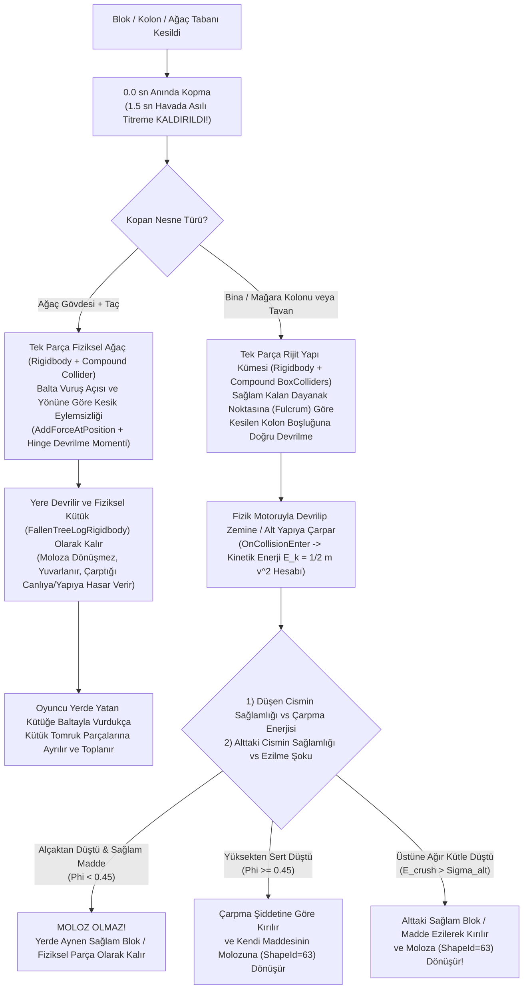

# STRATOCRAFT — RAPOR 2: HALF-LIFE / TEARDOWN / VALHEIM TARZI GERÇEK FİZİK MOTORLU DEVRİLME, AĞAÇ KESME VE DARBE ENERJİLİ MOLOZ MİMARİSİ

**Rapor Kodu:** `DOC-PHYS-RIGID-002`  
**Tarih:** 2026-11-08  
**Durum:** KÖK NEDEN ANALİZİ VE UYGULAMA MİMARİSİ (KOD DEĞİŞİKLİĞİ ÖNCESİ TASARIM RAPORU)  
**İlgili Dosyalar:**
- [`Stage1StructuralCollapseBridge.cs`](file:///d:/Oyunum/oyun/Assets/_Stratocraft/Character/Stage1StructuralCollapseBridge.cs)
- [`StructuralCollapseSystem.cs`](file:///d:/Oyunum/oyun/Assets/_Stratocraft/Physics/Systems/StructuralCollapseSystem.cs)
- [`GreedyBoxFractureJob.cs`](file:///d:/Oyunum/oyun/Assets/_Stratocraft/Physics/Jobs/GreedyBoxFractureJob.cs)
- [`PrebakedFracturePatternLut.cs`](file:///d:/Oyunum/oyun/Assets/_Stratocraft/Physics/Data/PrebakedFracturePatternLut.cs)
- [`Stage1MatterCrystalAndMiningController.cs`](file:///d:/Oyunum/oyun/Assets/_Stratocraft/Character/Stage1MatterCrystalAndMiningController.cs)

---

## 1. MEVCUT ÇÖKME VE AĞAÇ KESME SİSTEMİNDEKİ 5 KÖK NEDEN (NEDEN YAPAY GÖRÜNÜYOR?)

Kod tabanımızda yapılan satır satır incelemede, mevcut yıkım ve ağaç devrilme mekaniğinin neden *Half-Life / Valheim / Teardown* gibi gerçek bir fizik motoru hissiyatı vermediği **5 somut kod hatasıyla** tespit edilmiştir:

### Kök Neden 1: Kopan Parçanın `1.5 Saniye` Havada Asılı Bekleyip Titremesi (`PreCollapseWarningDurationSeconds = 1.5f`)
- **Kod Konumu:** [`Stage1StructuralCollapseBridge.cs`](file:///d:/Oyunum/oyun/Assets/_Stratocraft/Character/Stage1StructuralCollapseBridge.cs#L28) ve [`StepSingleFallingSlot`](file:///d:/Oyunum/oyun/Assets/_Stratocraft/Character/Stage1StructuralCollapseBridge.cs#L424-L460).
- **Mevcut Kodda Ne Oluyor?**
  - Oyuncu ağacın tabanını veya binanın kolonunu kırdığı anda (`EvaluateChunkStability`, `L115–128`), kopan vokseller dünya chunk'ından anında silinir (`chunkVoxels[i] = 0u`) ve `VisualProxy` objesine dönüştürülür.
  - Ancak `L365`'te `WarningTimer = 1.5f` atanır ve `L428–459` arasında `WarningTimer > 0f` olduğu sürece `fallDt = 0` tutulur:
    ```csharp
    float jitterX = Mathf.Sin(elapsedWarning * 48f) * (0.025f + 0.045f * intensity);
    float jitterZ = Mathf.Cos(elapsedWarning * 53f) * (0.025f + 0.045f * intensity);
    slot.VisualProxy.transform.position = slot.BaseWorldCenter + new Vector3(jitterX, sagY, jitterZ);
    ```
  - **Sonuç:** Altındaki kolon veya kütük tamamen yok olduğu halde, üstteki bina veya ağaç **1.5 saniye boyunca yerçekimine meydan okuyarak havada asılı bekler**, yapay bir sinüs dalgasıyla titrer ve ancak 1.5 saniye sonra düşmeye başlar!

### Kök Neden 2: Gerçek Unity `Rigidbody` ve `Collider` Hiç Kullanılmaması (Sadece `-Y` Asansör İnişi)
- **Kod Konumu:** [`Stage1StructuralCollapseBridge.cs`](file:///d:/Oyunum/oyun/Assets/_Stratocraft/Character/Stage1StructuralCollapseBridge.cs#L343-L351) (`SpawnFallingClusterIntoRingBuffer`) ve [`StepSingleFallingSlot`](file:///d:/Oyunum/oyun/Assets/_Stratocraft/Character/Stage1StructuralCollapseBridge.cs#L462-L470).
- **Mevcut Kodda Ne Oluyor?**
  - `SpawnFallingClusterIntoRingBuffer` içinde oluşturulan `FallingCluster` objesine yalnızca `MeshFilter` ve `MeshRenderer` eklenmektedir; **hiçbir `Rigidbody`, `BoxCollider` veya `Convex MeshCollider` eklenmemektedir!**
  - `StepSingleFallingSlot` (`L463–469`) içinde cismin hareketi şu 3 satırdan ibarettir:
    ```csharp
    slot.VerticalVelocity -= GravityAcceleration * fallDt;
    slot.CurrentCenterY += slot.VerticalVelocity * fallDt;
    slot.VisualProxy.transform.position = new Vector3(slot.Cluster.CenterOfMass.X, slot.CurrentCenterY, slot.Cluster.CenterOfMass.Z);
    slot.VisualProxy.transform.Rotate(slot.AngularVelocityDeg * fallDt, Space.Self);
    ```
  - **Sonuç:** Kopan cismin `X` ve `Z` koordinatları düşüş boyunca **1 milimetre bile değişmez**! Cisim bir dayanak noktası (menteşe/kolon) etrafında yana doğru devrilmez; olduğu yerde dümdüz `-Y` yönünde asansör gibi aşağı iner ve havada kendi ağırlık merkezi (`Space.Self`) etrafında fırıldak gibi döner.

### Kök Neden 3: Tek Bir Ağacın veya Binanın `GreedyBoxFractureJob` Yüzünden Havada 12 Ayrı Kutuya Bölünmesi ve Ters Tork Hesabı
- **Kod Konumu:** [`GreedyBoxFractureJob.cs`](file:///d:/Oyunum/oyun/Assets/_Stratocraft/Physics/Jobs/GreedyBoxFractureJob.cs#L109-L257) ve [`Stage1StructuralCollapseBridge.cs`](file:///d:/Oyunum/oyun/Assets/_Stratocraft/Character/Stage1StructuralCollapseBridge.cs#L133-L145).
- **Mevcut Kodda Ne Oluyor?**
  1. `GreedyBoxFractureJob` 6-komşulu BFS ile tek bir bağlı bileşeni (ör. tek bir ağacı veya tek bir çatı parçasını) bulduktan sonra, bunu tek bir bütün cisim olarak tutmak yerine **`MaxCompoundBoxes = 12` adede kadar ayrı dikdörtgen kutuya böler** ve her kutuyu **ayrı bir `FallingStructureClusterComponent`** olarak dışarı verir!
  2. `Stage1StructuralCollapseBridge` bu 12 kutuyu 12 ayrı `VisualProxy` olarak spawn eder. Böylece bir ağaç kesildiğinde gövdesi ayrı, dalları ayrı, yaprakları ayrı kutulara bölünüp birbirinden bağımsız düşer!
  3. **Ters Tork Hatası (`GreedyBoxFractureJob.cs#L172`):**
     ```csharp
     Vector3 r = cellWorldPos - anchorPivotWorld;
     totalTorque += Vector3.Cross(r, gravity * m);
     ```
     Burada `anchorPivotWorld` olarak sağlam kalan dayanak (fulcrum) değil, **kırılan/boşalan kolonun koordinatı** verilmiştir! $\vec{r} = \vec{P}_{\text{kütle}} - \vec{P}_{\text{kırılanKolon}}$ vektörü ile $\vec{g} = (0, -g, 0)$ çarpıldığında oluşan tork, binayı kırılan kolona (boşluğa) doğru eğmek yerine **tam tersi yöne (sağlam kolona doğru)** döndürür!

### Kök Neden 4: Ağaç Kesildiğinde Baltanın Vuruş Yönünün Yok Sayılması ve Ağacın Yere Değer Değmez Yok Olup Moloza Dönüşmesi
- **Kod Konumu:** [`Stage1MatterCrystalAndMiningController.cs`](file:///d:/Oyunum/oyun/Assets/_Stratocraft/Character/Stage1MatterCrystalAndMiningController.cs#L594-L625) (`ExecutePhysicalToolStrike`) ve [`Stage1StructuralCollapseBridge.cs`](file:///d:/Oyunum/oyun/Assets/_Stratocraft/Character/Stage1StructuralCollapseBridge.cs#L575-L629) (`FinalizeClusterImpact`).
- **Mevcut Kodda Ne Oluyor?**
  - Oyuncu baltayla ağacı kestiğinde baltanın savurma yönü (`CurrentSlashDirUnit`) veya vuruş açısı çökme sistemine hiç iletilmez.
  - Ağaç yere değdiği anda (`L575–579`) `VisualProxy` **anında `Destroy()` edilir**, yerine 1–4 adet `ShapeId = 63` mikro-moloz bloğu ve oyuncuya mıknatıs gibi uçan küçük `DroppedWorldItem` kutucukları bırakılır.
  - Ağaç **hiçbir zaman** kütük olarak yan devrilmez ve yerde gerçek bir tomruk/kütük olarak yatmaz.

### Kök Neden 5: Düşme Yüksekliği ve Malzeme Sağlamlığına Bakılmaksızın Her Şeyin `%100` Moloza Dönüşmesi & Üstüne Düşen Cisimle Ezilmeme
- **Kod Konumu:** [`Stage1StructuralCollapseBridge.cs`](file:///d:/Oyunum/oyun/Assets/_Stratocraft/Character/Stage1StructuralCollapseBridge.cs#L510-L612) ve [`StructuralCollapseSystem.cs`](file:///d:/Oyunum/oyun/Assets/_Stratocraft/Physics/Systems/StructuralCollapseSystem.cs#L231-L348).
- **Mevcut Kodda Ne Oluyor?**
  1. `FinalizeClusterImpact` (`L600`) içinde `phi = ComputeImpactFractureRatio(...)` hesaplansa bile, **hiçbir `if (phi > threshold)` kontrolü yapılmadan** her düşen küme için `RevoxelizeClusterToLooseRubble` çağrılır! `SelectShardMask64` ise `phi = 0.01f` (yarım metreden düşen sağlam granit/demir blok) olsa bile onu `ShapeId = 63` kırık moloza çevirir!
  2. `DoesImpactBreachFloorBlock` (`L517`) içinde `if (VoxelBitUtility.GetOriginState(bRaw) != BlokKokenDurumu.OyuncuItemBlogu) continue;` yazıldığı için doğal zemin/kaya blokları üzerine ne kadar ağır kütle düşerse düşsün ezilmez; kırılan `OyuncuItemBlogu` ise moloza dönüşmek yerine `chunkVoxels[bIdx] = 0u` ile doğrudan silinir!

---

## 2. YENİ MİMARİ ÇÖZÜM: HALF-LIFE / VALHEIM / TEARDOWN GERÇEK FİZİK SİSTEMİ



---

### 2.1. Çözüm Adımı 1: `1.5s` Havada Asılı Beklemenin Kaldırılması ve Gerçek Unity `Rigidbody` + `Compound BoxCollider` Mimarisi
1. **Anında Fiziksel Kopma (`PreCollapseWarningDurationSeconds = 0.0f`):**
   - Bir kolon veya ağaç tabanı kesildiği anda havada `1.5s` asılı kalıp titreme aşaması tamamen kaldırılır.
   - Çatırdama sesi (`Creak`) ve kopma yerinden çıkan toz parçacıkları (`DustPuff`), cisim fizik motoruyla devrilmeye başladığı **ilk salisede** eşzamanlı olarak çalınır.
2. **12 Ayrı Parçaya Bölme Hatasının Düzeltilmesi (Bileşen Başına Tek `Rigidbody` + Bileşik `BoxCollider`):**
   - `GreedyBoxFractureJob` içindeki 6-komşulu bağlantılı bileşen (`ConnectedComponentId`) bir bütün olarak korunur.
   - Kopan yapı parçası (ör. L-şeklinde bir duvar+çatı veya gövde+dallarıyla tam bir ağaç) sahnede **tek bir `GameObject` + tek bir `Rigidbody`** olarak oluşturulur.
   - `GreedyBoxFractureJob`'un ürettiği kutular (`MaxCompoundBoxes = 12`), ayrı ayrı düşen objeler olmak yerine bu **tek `Rigidbody`'nin alt çocuklarına eklenen `BoxCollider` bileşenleri (Compound Collider)** olur!
   - Unity PhysX motoru, alt `BoxCollider`ların hacim ve kütlelerine göre birleşik ağırlık merkezini (`rb.centerOfMass`) ve eylemsizlik tensörünü (`rb.inertiaTensor`) otomatik ve gerçekçi olarak hesaplar.

---

### 2.2. Çözüm Adımı 2: Kesilen Kolon Yönüne Doğru Gerçekçi Devrilme Momenti (`Fulcrum Pivot Torque`)
Bir binanın sağ alt kolonu kırıldığında binanın **sağa (kırılan kolonun olduğu boşluğa) doğru** eğilip devrilmesi için:
1. **Gerçek Dayanak Noktası (`Fulcrum`) ve Boşluk Vektörü:**
   - Kırılan kolon noktası $\vec{P}_{\text{cut}}$ ve kopan kütlenin ağırlık merkezi $\vec{P}_{\text{com}}$ olsun.
   - Yapının hala zemine/duvara değdiği son temas noktalarının ortalaması **Dayanak Noktası ($\vec{P}_{\text{fulcrum}}$)** olarak alınır.
   - Devrilme kolu vektörü $\vec{r}_{\text{lever}} = \vec{P}_{\text{cut}} - \vec{P}_{\text{com}}$ (kütle merkezinden kırılan desteğin olduğu boşluğa doğru) yönündedir.
2. **Fizik Motoru İmpulsu:**
   - `Rigidbody` serbest bırakıldığı anda, hem yerçekimi kendi doğal devrilme momentini üretir hem de kırılan desteğin boşalttığı yöne doğru:
     $$\vec{\tau}_{\text{initial}} = (\vec{P}_{\text{cut}} - \vec{P}_{\text{fulcrum}}) \times (m \vec{g})$$
     torku (`rb.AddTorque` / `rb.AddForceAtPosition`) uygulanır.
   - Böylece sol kolon kesilirse bina sola, sağ kolon kesilirse sağa doğru *Half-Life 2 / Teardown* fiziğiyle devrilir, alt köşesi zemine sürtünerek menteşe gibi döner ve karşı duvara veya yere çarpar!

---

### 2.3. Çözüm Adımı 3: Fiziksel Ağaç Kesme, Devrilme ve Yerde Yatan Kütüğü Parçalama (*Valheim / The Forest* Modeli)
Ağaç kesme mekaniği Minecraft tarzı "blok kır -> moloza dönüşsün" yapısından çıkarılıp **3 aşamalı gerçek ormancılık fiziğine** geçirilecektir:

1. **Aşama 1 — Balta Vuruş Açısı ve Yönüne Göre Kesilme (`Directional Felling`):**
   - Oyuncu baltayı (`[3]`) savurup ağacın taban gövde bloğunu kestiğinde, baltanın vuruş yönü $\vec{d}_{\text{swing}}$ ve oyuncudan ağaca giden bakış vektörü $\vec{d}_{\text{push}} = \text{Normalize}(\vec{P}_{\text{tree}} - \vec{P}_{\text{player}})$ alınır.
   - Ağacın üst gövdesi ve yaprak tacı dünya voksellerinden ayrılıp **tek parça `FelledTreeRigidbody`** (`Rigidbody` + Gövde için `CapsuleCollider` + Taç için `SphereCollider`) haline gelir.
   - Kesik noktasından baltanın savrulduğu/ittiği yöne doğru darbe impulsu uygulanır; ağaç taban kesik noktasını menteşe (pivot) alarak o yöne doğru hızlanarak devrilir.
2. **Aşama 2 — Yere Çarpma ve Yerde Fiziksel Kütük Olarak Kalma:**
   - Devrilen ağaç yere çarptığında (`OnCollisionEnter`), taç kısmındaki ince yapraklar etrafa savrulur, **ancak ağaç gövdesi YOK OLMAZ ve MOLOZA DÖNÜŞMEZ!**
   - Ağaç gövdesi yerde gerçek bir **Fiziksel Kütük (`PhysicalLogBody`)** olarak kalır; eğimli bir yamaçtaysa fizik motoruyla aşağı doğru yuvarlanır (hatta devrilirken veya yuvarlanırken bir yaratığa/oyuncuya/zayıf çite çarparsa $E_k = \frac{1}{2}mv^2$ darbe hasarı verir!).
3. **Aşama 3 — Yerde Yatan Kütüğü Baltayla Parçalayıp Odun Toplama (`Log Bucking & Harvesting`):**
   - Oyuncu yerde yatan devrilmiş kütüğün yanına gidip baltayla kütüğe vurduğunda (`Physics.Raycast` / `SweptBlade` kütük collider'ına çarptığında):
   - Her `2` balta darbesinde kütük vurulan noktadan **ikiye bölünür** (`6m` kütük $\rightarrow$ iki adet `3m` tomruk $\rightarrow$ dört adet `1.5m` odun kütüğü) veya doğrudan toplanabilir kütük parçalarına ayrılır!
   - Oyuncu bu kesilmiş tomrukları `[E]` tuşuyla veya Madde Kristali (`[C]`) vakumuyla gerçek odun olarak toplar.

---

### 2.4. Çözüm Adımı 4: Darbe Şiddetine (Kinetik Enerji) ve Malzeme Sağlamlığına Göre "Sağlam Kalma vs. Moloz Olma" + "Üstüne Düşen Cisimle Ezilme"

Bir yapı kümesi veya blok fizik motoruyla (`Rigidbody`) yere ya da başka bir bloğun üzerine çarptığında (`OnCollisionEnter(Collision col)`), gerçek çarpışma hızı $v_{\text{impact}} = \text{col.relativeVelocity.magnitude}$ ölçülür ve **iki yönlü enerji denklemi** çalıştırılır:

#### A) Düşen Cismin Kendisi Kırılacak mı, Yoksa Sağlam mı Kalacak?
Düşen cismin çarpma kinetik enerjisi ve malzeme kırılma eşiği:
$$E_{\text{impact}} = \frac{1}{2} m_{\text{falling}} v_{\text{impact}}^2, \qquad E_{\text{yield}}(\text{MatId}) = V_{\text{voxel}} \cdot \sigma_{\text{crush}}(\text{MatId}) \cdot g \cdot d_{\text{elastic}}$$
Buradan boyutsuz **Kırılma Oranı ($\Phi_{\text{impact}}$)** hesaplanır:
$$\Phi_{\text{impact}} = \frac{E_{\text{impact}}}{E_{\text{yield}}(\text{MatId})}$$

| Rejim | Koşul ($\Phi_{\text{impact}}$) | Fiziksel Senaryo Örneği | Sonuç (Ne Olur?) |
| :--- | :--- | :--- | :--- |
| **1. Sağlam Kalma (Elastik Çarpma)** | $\Phi_{\text{impact}} < 0.45$ | Alçaktan (`1–3m`) düşen Taş/Mermer/Demir blok veya devrilen Ağaç Kütüğü | **MOLOZ OLMAZ!** Cisim kırılmaz; düştüğü konumdaki voksel ızgarasına kendi orijinal `MaterialId` ve `ShapeId` değeriyle **sağlam blok olarak** yerleşir (veya kütük olarak yerde kalır). |
| **2. Kısmi Kenar Kırılması** | $0.45 \le \Phi_{\text{impact}} < 1.15$ | Orta yükseklikten (`4–7m`) devrilen duvar veya sütun | Sadece yere ilk çarpan temas yüzeyindeki (`alt %30`) bloklar darbe yüzünden `ShapeId = 63` moloza dönüşür; üstteki sağlam bloklar kırılmadan bütün olarak kalır. |
| **3. Tam Parçalanma (Sert Çarpma)** | $\Phi_{\text{impact}} \ge 1.15$ | Yüksekten (`> 8m`) hızla çakılan ağır tavan veya zayıf madde (Toprak, Kireçtaşı, Çürük Ahşap) | Çarpma enerjisi malzemenin dayanımını tamamen aşar; çarpan kütle kendi maddesinin `ShapeId = 63` **moloz yığınına** dönüşür. |

#### B) Üstüne Bir Şey Düşen Alttaki Sağlam Maddeye Ne Olacak? (Crush / Impact Transfer)
Yerde sağlam duran bir bloğun (ister oyuncunun koyduğu blok, ister doğal zemin/kaya, ister yerde sağlam kalmış bir taş/kütük olsun) **üzerine** yukarıdan bir `Rigidbody` kümesi çarptığında:
1. Üstten binen **Dinamik Darbe Şok Yükü ($F_{\text{crush}}$)** hesaplanır:
   $$M_{\text{shock}} = m_{\text{falling}} + \frac{\frac{1}{2} m_{\text{falling}} v_{\text{impact}}^2}{g \cdot \Delta s_{\text{stop}}}$$
2. Altta duran bloğun kendi malzeme dayanımı $M_{\text{limit}}(\text{AltMatId})$ (`StructuralMaterialProps.CompressiveCrushLimitKg`) ile karşılaştırılır:
   - **Eğer $M_{\text{shock}} \le M_{\text{limit}}(\text{AltMatId})$ ise:** Alttaki madde darbeden sağ çıkar (yalnızca `DamageState` çatlağı artar), kırılmaz.
   - **Eğer $M_{\text{shock}} > M_{\text{limit}}(\text{AltMatId})$ ise (Örn. Yerde sağlam duran bir taş veya ahşap bloğun üzerine yukarıdan 5 tonluk mağara tavanı veya ağır kolon düştü):**
     - Alttaki madde sağlam olsa bile üzerine binen şok yüküne dayanamaz!
     - Alttaki blok **anında ezilerek kırılır ve kendi maddesinin `ShapeId = 63` molozuna (`PackChiseled`) dönüşür!**
     - Üstten düşen ağır kütle, kırdığı bloğun enerjisini sönümleyerek ($\Delta E = E_{\text{yield,alt}}$) bir alt kata inmeye devam eder (gerçek fiziksel **Zincirleme Ezilme / Pancake Crush**).
