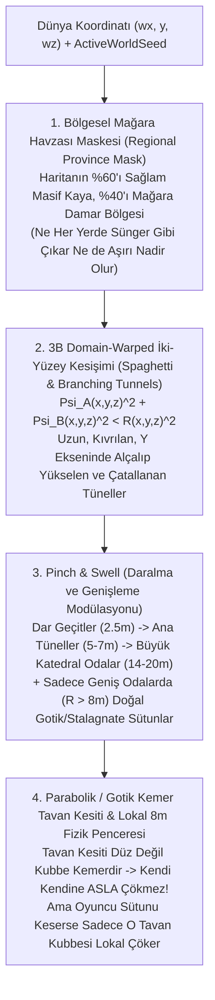

# STRATOCRAFT — RAPOR 3: ÇÖKMEYEN, UZUN, DALLANAN VE GENİŞLEYİP DARALAN DOĞAL MAĞARA SİSTEMİ MİMARİSİ

**Rapor Kodu:** `DOC-WORLD-CAVE-003`  
**Tarih:** 2026-11-08  
**Durum:** KÖK NEDEN ANALİZİ VE UYGULAMA MİMARİSİ (KOD DEĞİŞİKLİĞİ ÖNCESİ TASARIM RAPORU)  
**İlgili Dosyalar:**
- [`StratocraftFloatingIslandWorldGen.cs`](file:///d:/Oyunum/oyun/Assets/_Stratocraft/WorldGen/StratocraftFloatingIslandWorldGen.cs)
- [`GeodesicSupportDijkstraJob.cs`](file:///d:/Oyunum/oyun/Assets/_Stratocraft/Physics/Jobs/GeodesicSupportDijkstraJob.cs)
- [`TributaryLoadDagJob.cs`](file:///d:/Oyunum/oyun/Assets/_Stratocraft/Physics/Jobs/TributaryLoadDagJob.cs)
- [`Stage1StructuralCollapseBridge.cs`](file:///d:/Oyunum/oyun/Assets/_Stratocraft/Character/Stage1StructuralCollapseBridge.cs)

---

## 1. KÖK NEDEN ANALİZİ: NEDEN İLK SÜRÜMDE HER YER ÇÖKÜYORDU VE ŞİMDİ NEDEN SADECE "TOP ŞEKLİNDE KÜÇÜK BOŞLUKLAR" VAR?

Git geçmişi ve [`StratocraftFloatingIslandWorldGen.cs`](file:///d:/Oyunum/oyun/Assets/_Stratocraft/WorldGen/StratocraftFloatingIslandWorldGen.cs#L373-L527) (`EvaluateUndergroundCaveNetwork`) satır satır incelendiğinde iki uç sorunun matematiksel nedeni net olarak ortaya çıkmıştır:

### 1.1. İlk Sürümde (Devir #024–#027) Neden Her Yer Mağaraydı ve Nereyi Kazsan Çöküyordu?
1. **Sünger / İsviçre Peyniri Etkisi:** İlk sürümde mağaralar yüzeyin hemen `3.2m` altından başlıyor ve her yerde aynı yoğunlukta tekil bir $|\sin(x) + \cos(z)| < 0.44$ şeridiyle oyuluyordu. Bölgesel bir seyreklik maskesi olmadığı için oyuncu nereyi kazsa 3 metre altında boşluğa düşüyordu.
2. **Düz Tavan Açıklığı ve Terzaghi Çökmesi:** Şerit formülü `8–12 metre` genişliğinde **düz tavanlı** boşluklar açıyordu. `Stone` malzemesinin konsol (cantilever) sınırı `4 blok` olduğu için, oyuncu mağarada tek bir blok kırdığında [`TributaryLoadDagJob.Evaluate2DTerzaghiRoofLoosening`](file:///d:/Oyunum/oyun/Assets/_Stratocraft/Physics/Jobs/TributaryLoadDagJob.cs#L263-L334) `8–12m` düz tavanı desteksiz sayıp tüm mağara tavanını komple çökertiyordu.

### 1.2. Şu Anki Kodda (Devir #032–#036) Neden Mağaralar "Arada Bir Olan Top Şeklinde Boşluklar" Haline Geldi?
[`StratocraftFloatingIslandWorldGen.cs`](file:///d:/Oyunum/oyun/Assets/_Stratocraft/WorldGen/StratocraftFloatingIslandWorldGen.cs#L446-L526) içindeki mevcut kodda şu **3 satır grubu** gerçek mağara oluşumunu tamamen engellemektedir:

1. **Her 4 Metrede Bir Kesintisiz Izgara Duvar / Sütun Kilidi (`Satır 454–458`):**
   ```csharp
   if ((wx & 3) == 2 || (wz & 3) == 2)
   {
       if (((wx + wz) & 7) == 0) isCaveSupportPillar = true;
       return; // <-- MAĞARA OLUŞUMUNU DURDURUR!
   }
   ```
   - Bu satır, dünya genelinde `wx % 4 == 2` **VEYA** `wz % 4 == 2` olan her koordinatta mağara oyulmasını iptal etmektedir! Yani her 4 metrede bir X ve Z eksenleri boyunca görünmez bir kafes duvar örülmekte ve mağaralar maksimum `3m x 3m` odacıklara hapsedilmektedir.
2. **"Yumurta Kartonu" Tepe Noktası Formülü (`wave > 0.62`, `Satır 467–526`):**
   ```csharp
   float wave1 = MathF.Sin(wx * 0.11f + p1) + MathF.Cos(wz * 0.11f - p2) - archY * archY * 0.65f;
   if (wave1 > 0.62f) { inCaveVoid = true; ... }
   ```
   - Matematiksel olarak $f(x,z) = \sin(kx) + \cos(kz)$ fonksiyonu 2B bir **yumurta kartonu** yüzeyidir.
   - Bu fonksiyonun `> 0.62` olduğu yerler yalnızca kartonun **izole tepe noktalarıdır**. Tepe noktalarının etrafındaki $f(x,z) - c \cdot y^2 > 0.62$ bölgesi, birbirine **hiçbir tünel ile bağlanmayan kapalı birer küre / elipsoiddir (top şeklindedir)**!
3. **Katmanlar Arası Dikey Kopukluk (`Satır 464–525`):**
   - Mağaralar yalnızca sabit 4 yatay dilimde (`y=63..73`, `y=42..58`, `y=24..37`, `y=9..19`) tanımlanmıştır; aradaki `y=59..62`, `y=38..41`, `y=20..23` katmanları `%100` kapalı kaya tabakasıdır ve yüzeyden (`y > 74`) aşağı inen hiçbir doğal mağara girişi yoktur!

---

## 2. ÇÖZÜM MİMARİSİ: BÖLGESEL SEYREKLİKLİ, DALLANAN, DARALIP GENİŞLEYEN VE ÇÖKMEYEN DOĞAL MAĞARA AĞI

Modern voksel oyunlarında (*Minecraft 1.18+ Caves & Cliffs [Spaghetti, Noodle & Cheese Caves]*, *Deep Rock Galactic*, *Vintage Story*) kullanılan ve bizim deterministik/paralel `PopulateVolumetricFloatingIslandChunkInto(chunkX, chunkZ)` mimarimize **%100 uyumlu (komşu chunk bağımsız, $O(1)$ durumsuz)** matematiksel çözüm **4 bileşenden** oluşur:



---

### 2.1. Bileşen 1: Bölgesel Mağara Havzası Maskesi (`RegionalCaveProvinceMask` — İdeal Sıklık Dengesi)
Mağaraların ilk sürümdeki gibi "nereyi kazsan mağara" olmaması ama şu anki gibi de aşırı nadir/kopuk kalmaması için düşük frekanslı ($\lambda \approx 220\text{m}$) bir **Bölgesel Karstik Havza Alanı ($M_{\text{province}}(wx, wz) \in [0, 1]$)** tanımlanır:
- **$M_{\text{province}} < 0.48$ (Haritanın ~%55'i — Masif Ana Kaya Bölgeleri):** Bu bölgelerde oyuncu güvenle derin maden kuyuları kazabilir, temel atabilir; sadece çok nadir tekil maden damarı çatlakları bulunur.
- **$M_{\text{province}} \ge 0.48$ (Haritanın ~%45'i — Karstik Mağara Sistemi Bölgeleri):** Bu bölgelerde yüzeydeki doğal mağara ağızlarından başlayıp yerin 5 katmanına kadar dallanarak inen tam teşekküllü mağara ağları yer alır.

---

### 2.2. Bileşen 2: Top Şeklinde Boşluklar Yerine Uzun ve Dallanan Tüneller (`3D Spaghetti Ridge Intersection`)
Neden bir fonksiyon top üretirken diğeri uzun tünel üretir?
- 3B uzayda **tek bir** skaler alanın tepe noktası ($F(x,y,z) > T$) **0-boyutlu bir nokta (yani şişirilince 3B Küre / Top)** üretir.
- Oysa 3B uzayda birbirine dik/çapraz **iki ayrı 3B dalga yüzeyinin** ($\Psi_1(x,y,z) = 0$ ve $\Psi_2(x,y,z) = 0$) **arakesiti**, 3B uzayda kesintisiz kıvrılan **1-boyutlu bir eğri (yani şişirilince Uzun Tünel / Solucan)** üretir!

**Ana Tünel ve Dallanma Denklemi:**
1. Önce koordinatlara 3B **Domain Warping** (organik kıvrılma bükmesi) uygulanır:
   $$\vec{p}' = (wx, y, wz) + \vec{W}(wx, y, wz)$$
2. **Ana Tünel Omurgası ($\mathcal{T}_{\text{main}}$):**
   $$\Psi_1(\vec{p}') = \sin(k_1 x' + \cos(k_2 z')) + 0.65 \sin(k_y y' - k_1 z')$$
   $$\Psi_2(\vec{p}') = \cos(k_1 z' - \sin(k_2 x')) + 0.65 \cos(k_y y' + k_1 x')$$
   $$D_{\text{main}}(\vec{p}') = \sqrt{\Psi_1(\vec{p}')^2 + \Psi_2(\vec{p}')^2}$$
   Burada $D_{\text{main}}(\vec{p}') < R_{\text{tunnel}}(\vec{p}')$ koşulu; X, Y ve Z eksenlerinde kesintisiz ilerleyen, **hem yatayda kıvrılan hem de Y ekseninde alçalıp yükselerek Katman 1'den Katman 4'e kadar tüm katmanları birbirine bağlayan** ana mağara tünellerini oluşturur!
3. **Doğal Dallanma (`Branching Forks` — $\mathcal{T}_{\text{branch}}$):**
   - İkinci bir frekans ve açıda tanımlanan $(\Psi_3, \Psi_4)$ tünel ağı, yalnızca ana tünelle kesiştiği komşuluk kuşağında ($D_{\text{main}} < 3.2 R_{\text{tunnel}}$) aktif edilerek ana tünelden sağa/sola/aşağı **çatallanarak ayrılan yan kolları ve döngüleri** oluşturur!

---

### 2.3. Bileşen 3: Daralan Geçitler (`2.5m`), Genişleyen Salonlar (`16m–22m`) ve Doğal Sütunlar (`Pinch & Swell`)
Tünelin yarıçapı $R_{\text{tunnel}}(\vec{p}')$ sabit değildir; yol boyunca sürekli değişen bir **Genişleme/Daralma Modülatörü ($S_{\text{swell}}(\vec{p}) \in [0, 1]$)** ile kontrol edilir:

| Bölge Tipi | Modülatör ($S_{\text{swell}}$) | Yatay Genişlik | Dikey Yükseklik | Mimari & Görsel Karakter |
| :--- | :--- | :--- | :--- | :--- |
| **Dar Geçit (`Noodle Squeeze`)** | $0.00 \dots 0.25$ | **`2.2m – 3.0m`** | `2.5m – 3.2m` | Oyuncunun eğilerek veya tek sıra geçtiği dar, klostrofobik kaya çatlağı. |
| **Standart Mağara Tüneli (`Spaghetti Tunnel`)** | $0.25 \dots 0.70$ | **`4.5m – 7.5m`** | `4.5m – 6.5m` | Doğal kemerli, kıvrılarak ilerleyen ve yan kollara ayrılan ana keşif koridoru. |
| **Büyük Yeraltı Galerisi / Odası (`Cavern Chamber`)** | $0.70 \dots 1.00$ | **`12.0m – 20.0m`** | `8.0m – 14.0m` | Tünelin aniden genişleyerek açıldığı büyük yeraltı salonu; içinde cevher damarları, yeraltı göleti/lav ve **doğal taşıyıcı sütunlar** bulunur. |

- **`(wx & 3) == 2` Izgara Duvarının Kaldırılması:** Mevcut koddaki her 4 metrede bir duvar ören `(wx & 3) == 2 || (wz & 3) == 2` satırı **tamamen silinecektir**.
- **Sadece Geniş Odalarda Doğal Sütunlar:** Taşıyıcı `Stalagnate / Stone` sütunlar dar tünellerin ortasına çıkmayacak; **yalnızca $S_{\text{swell}} > 0.72$ olan geniş mağara odalarının içinde**, `12–16m` aralıklarla tabanı ve tavanı kemer gibi genişleyen (`hourglass / gothic pier`) doğal kaya sütunları olarak üretilecektir.
- **Doğal Yüzey Girişleri (Cave Entrances):** Kuru karada (`topH > SeaLevelY + 6m`, sıvı havzası dışında ve merkez başlangıç üssünden $r > 32\text{m}$ uzakta) ana tünelin yüzeye yükseldiği noktalarda `topH` kilidi açılarak dışarıdan yürüyerek girilebilen **doğal mağara ağızları** oluşturulacaktır.

---

## 3. MAĞARALAR NEDEN KENDİLİĞİNDEN ÇÖKMEYECEK AMA TAŞIYICI SÜTUN KESİLİRSE GERÇEKÇİ ÇÖKECEK?

Mağaraların hem durduk yere (veya duvardan bir cevher kazıldığında) çökmemesi, hem de oyuncu özellikle bir taşıyıcı sütunu veya ince tavanı kestiğinde lokal olarak gerçek fizikle çökmesi için **3 kilit kural** uygulanacaktır:

### 3.1. Kural 1: Düz Tavan Yerine Parabolik / Gotik Kemer Tavan Kesiti (`Natural Arch Profile`)
[`TributaryLoadDagJob.Evaluate2DTerzaghiRoofLoosening`](file:///d:/Oyunum/oyun/Assets/_Stratocraft/Physics/Jobs/TributaryLoadDagJob.cs#L263-L334) fonksiyonu, aynı `y` yüksekliğinde yan yana uzanan **düz tavan açıklığını (`currentSpan`)** ölçer (`Stone` için `> 4` blok düz tavan çöker).
- Yeni mağara denklemimizde tünelin ve odanın üst yarı kesiti daire veya düz kutu değil, **Parabolik / Gotik Kemer** denklemine sahiptir:
  $$\Delta y_{\text{roof}}(\Delta r_{\text{horiz}}) = H_{\text{crown}} - \kappa \cdot (\Delta r_{\text{horiz}})^{1.65}$$
- Bu profil sayesinde mağara `16 metre` genişliğinde olsa bile, yan duvarlardan yükselen kemer basamaklarının her `y` katmanındaki yatay çıkıntısı **`1–2 blok` ($\le 4$)** olur ve en tepedeki kilit taşı (`crown`) açıklığı `<= 3 blok` kalır!
- Böylece [`GeodesicSupportDijkstraJob.VerifyAndLockClosedArches`](file:///d:/Oyunum/oyun/Assets/_Stratocraft/Physics/Jobs/GeodesicSupportDijkstraJob.cs#L285-L385) mağara tavanını karşılıklı iki duvardan yükselen **Kilitli Doğal Kemer (`archLocked = 1`)** olarak tanır ve Terzaghi gevşeme yüksekliği **`0` (Sıfır Çökme)** çıkar!

### 3.2. Kural 2: Üst Kaya Kabuğu (`Overburden Arch Lock`) Koruması
- Üzerinde en az `4 blok` kesintisiz doğal ana kaya (`BlokKokenDurumu.DogalKutle`) bulunan ve yan duvarlara `archLocked == 1` ile basan doğal mağara tavanları, oyuncu mağara duvarından veya tabanından normal maden/taş kazdığında **%100 kararlıdır; tüm mağara asla zincirleme çökmez**.

### 3.3. Kural 3: `PrepareLocalSolveScratch` İçinde `8m` Lokal Fizik Penceresi (Sütun Kesilince Lokal Çökme)
- Mevcut [`Stage1StructuralCollapseBridge.PrepareLocalSolveScratch`](file:///d:/Oyunum/oyun/Assets/_Stratocraft/Character/Stage1StructuralCollapseBridge.cs#L185-L196) içindeki *"tüm doğal kayaları `KaliciYapi` yap"* kilidi kaldırılıp **Lokal Etki Penceresi (`r <= 8m`)** uygulanacaktır:
  - Oyuncunun kazmayla kırdığı bloğun (`pivotWorld`) `8m` yatay yarıçapı dışındaki kıta/dağ sınırları `KaliciYapi` (sabit mesnet) olarak tutulur (böylece çökme asla tüm haritaya yayılmaz).
  - Ancak kırılan bloğun `8m` etrafındaki mağara sütunu ve hemen üstündeki tavan kubbesi `DogalKutle` olarak çözücüye girer.
  - Eğer oyuncu geniş bir mağara odasının ortasındaki **taşıyıcı sütunu keserse** (veya tavanı oyup `<= 2` blok inceliğinde düz desteksiz plaka bırakırsa), sadece o sütunun tuttuğu lokal tavan bölgesi **Rapor 2'deki gerçek `Rigidbody` fizik motoruyla** kesilen sütun yönüne doğru devrilerek iner ve çarpma şiddetine göre kaya bloklarına / moloza dönüşür!
