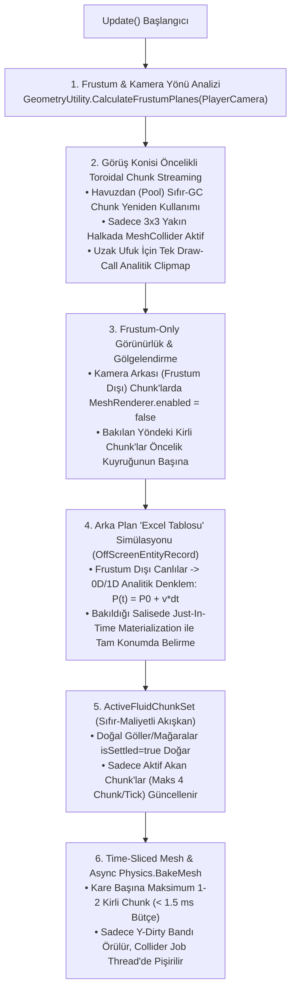

# STRATOCRAFT — SORUN 1 (AŞIRI KASMA, FRUSTUM-ONLY RENDER VE ARKA PLAN "EXCEL TABLOSU" MATEMATİKSEL SİMÜLASYON) & SORUN 6 (100x BÜYÜK / SONSUZ DÜNYA MİMARİSİ) DERİN KÖK NEDEN VE ÇÖZÜM RAPORU

**Tarih:** 2026-11-04  
**Kapsam:** Oyun Anayasası (`GAME LOGIC BIBLE v7.0` Bölüm 1.3, 1.5, 2.1–2.7, 7.2–7.3), Matematiksel Algoritmalar Raporu (`STRATOCRAFT_ARKA_PLAN_MATEMATIKSEL_SIMULASYON_VE_VOXEL_ALGORITMALARI_RAPORU.md`), Mevcut C# Kod Tabanı (`Stage1InteractivePlayController`, `StratocraftStage1SceneBuilder`, `FluidCellularAutomataJob`, `HybridSurfaceNetsAndShapeMesher`, `Stage1CreatureSimulationBridge`, `OffScreenEntityRecord`) ve Endüstri/İnternet Araştırması (*Unity Burst + `Physics.BakeMesh`*, *Kenshi KVS / Dwarf Fortress / UE5 MassEntity LOD3*, *Distant Horizons / Vintage Story Toroidal Clipmap*).

---

## 1. YÖNETİCİ ÖZETİ: OYUN ŞU AN NİYE AŞIRI KASIYOR? (4 KRİTİK KÖK NEDEN)

Mevcut C# kod tabanımız satır satır incelendiğinde, oyunun düşük/orta sistemleri (hatta güçlü bilgisayarları bile) kilitlemesinin **Oyun Anayasası'ndaki tasarımdan değil, `Stage1InteractivePlayController` içindeki 4 senkron ana-iş-parçacığı (Main Thread) darboğazından** kaynaklandığı tespit edilmiştir:

| # | Kök Neden | İlgili Dosya ve Satırlar | CPU / Bellek Etkisi (Kare Başına Maliyet) |
| :--- | :--- | :--- | :--- |
| **1** | **Her `0.12 sn`'de 196 Chunk $\times$ $40.960$ Hücre = `8.028.160` Hücrenin Ana Thread'de Taranması ve Mağara Sıvılarının `isSettled: false` Doğması** | [`Stage1InteractivePlayController.cs`](Assets/_Stratocraft/Character/Stage1InteractivePlayController.cs#L287-L320)<br>[`StratocraftFloatingIslandWorldGen.cs`](Assets/_Stratocraft/WorldGen/StratocraftFloatingIslandWorldGen.cs#L429-L529)<br>[`FluidCellularAutomataJob.cs`](Assets/_Stratocraft/Physics/Jobs/FluidCellularAutomataJob.cs#L93-L332) | Saniyede ~8.3 kez `8 milyon` voksel+sıvı hücresi ana thread'de taranıyor; her chunk'ta yeraltı mağara suyu/lavı `isSettled: false` üretildiği için 3B BFS sifon çözücüsü + 4 yönlü kenar değişimi + sıvı mesh örme her `0.12 sn`'de **35–90 ms takılma (stutter)** yaratıyor! |
| **2** | **196 Chunk'ın (`ChunkMin=-7..6`) Başlangıçta ve Her Karede Bütçesiz Senkron Mesh + `MeshCollider` Pişirmesi (`Physics.BakeMesh` Yok)** | [`StratocraftStage1SceneBuilder.cs`](Assets/_Stratocraft/Editor/StratocraftStage1SceneBuilder.cs#L38-L39)<br>[`Stage1InteractivePlayController.cs`](Assets/_Stratocraft/Character/Stage1InteractivePlayController.cs#L751-L847)<br>[`HybridSurfaceNetsAndShapeMesher.cs`](Assets/_Stratocraft/Voxel/Jobs/HybridSurfaceNetsAndShapeMesher.cs#L80-L120) | `Start()` içinde 196 chunk baştan üretilip `_dirtyChunks`'a atılıyor; `RebuildAllDirtyChunks()` kare başına sınır koymadan tüm kirli chunk'larda $18 \times 162 \times 18 = 52.488$ hücreyi tek thread'de örüp `mc.sharedMesh = updated` ile **ana thread'de senkron PhysX BVH Cooking** yapıyor! |
| **3** | **Kamera Arkasındaki (Frustum Dışı) Alanların Tam Detayda Render Edilmesi ve Yönden Bağımsız Chunk Yükleme** | [`Stage1InteractivePlayController.cs`](Assets/_Stratocraft/Character/Stage1InteractivePlayController.cs#L189-L285) | Kamera nereye bakarsa baksın oyuncunun arkasındaki chunk'lar da aynı öncelikle üretiliyor, her yeni chunk 4 komşusunu da kirleterek **tek karede $3 \times 5 = 15$ tam chunk rebuild** tetikliyor ve kamera arkasındaki objeler/yüzeyler kapatılmıyor. |
| **4** | **"Excel Tablosu" (`OffScreenEntityRecord`) Kodunun Yazılmış Olmasına Rağmen Canlı Sahneye Bağlanmamış Olması** | [`Stage1CreatureSimulationBridge.cs`](Assets/_Stratocraft/Character/Stage1CreatureSimulationBridge.cs#L178-L313)<br>[`OffScreenEntityRecord.cs`](Assets/_Stratocraft/CreaturesAI/Data/OffScreenEntityRecord.cs#L17-L117) | Kamera arkasındaki (görüş açısı dışındaki) canlılar `Tier0_Full3DEntity` olarak kalıp her kare 12 eklem animasyonu + voksel zemin taraması yapıyor; `136m` dışına çıkan canlılar ise tabloya aktarılmak yerine `Destroy()` ile siliniyor! |

---

## 2. ADIM 1 — ANAYASA VE MEVCUT C# KODU SATIR SATIR KÖK NEDEN ANALİZİ

### 2.1. Anayasa Gereksinimleri (Bölüm 1.3, 1.5, 2.1–2.7 ve 7.2/7.3)
1. **Gözlemciye Bağlı Matematiksel Simülasyon ("Excel Tablosu" / Lazy Analytical Evaluation & DES — Bölüm 1.5.1 & 1.6.A):**
   * Kamera görüş açısı (*Camera Frustum*) dışındaki veya uzaktaki canlılar, işçiler ve kervanlar **kesinlikle 3B olarak render edilmez, iskelet/eklem animasyonu çalıştırmaz ve 3B fizik/raycast kullanmaz**.
   * Her varlık bellekte yalnızca **`64 Byte` (1 CPU Cache Line)** yer kaplayan [`OffScreenEntityRecord`](Assets/_Stratocraft/CreaturesAI/Data/OffScreenEntityRecord.cs#L17-L35) yapısında (`Q20.12` sabit noktalı koordinat, $t_0$ başlangıç zamanı, $t_{\text{event}}$ varış zamanı, $v_{\text{eff}}$ hız) tutulur.
   * Oyuncu arkasını dönüp o yöne baktığı salisede (*Just-In-Time Materialization*), geçen süre $\Delta t = t_{\text{şimdi}} - t_0$ analitik denkleme ($\mathbf{P}(t) = \mathbf{P}_0 + \mathbf{v}_{\text{eff}} \cdot \Delta t$) koyulur; varlık geçen sürede ne kadar yürüdüyse, hangi otu yediyse veya kaç sefer taş taşıdıysa ($\lfloor \Delta t / T_{\text{cycle}} \rfloor$) **ara adımları tek tek simüle etmeden $O(1)$ aritmetikle** tam olması gereken noktada belirir!
2. **Sadece Bakılan Alanın Render Edilmesi ve Çok Katmanlı Voxel/Clipmap Mimarisi (Bölüm 1.5.3 & 2.7):**
   * Sadece kamera frustum'u içindeki chunk'lar tam çözünürlükte (LOD0) çizilmeli ve öncelikli örülmelidir.
   * Bir chunk içinde tek bir blok kırıldığında 160 metrelik tüm dikey sütun değil, yalnızca değişen **`16x16x16` Sub-Chunk (`DirtySubChunkMask`)** güncellenmelidir.

### 2.2. Mevcut C# Kodundaki 4 Darboğazın Satır Satır İncelemesi

#### A. Darboğaz 1: `StepFluidSimulation` ve `FluidCellularAutomataJob` (Her 0.12 Saniyede 8 Milyon Hücre!)
* **[`Stage1InteractivePlayController.cs` Satır 287–320](Assets/_Stratocraft/Character/Stage1InteractivePlayController.cs#L287-L320):**
  ```csharp
  private void StepFluidSimulation(float dt)
  {
      _fluidTickTimer -= dt;
      if (_fluidTickTimer > 0f) return;
      _fluidTickTimer = 0.12f;

      foreach (var kv in _worldChunks)
      {
          if (!_fluidChunks.TryGetValue(kv.Key, out ushort[]? fluids) || fluids == null) continue;
          int sliceVolume = 16 * MaxEditableVoxelY * 16; // 16 * 160 * 16 = 40.960 hücre!
          bool hadActiveFluid = HasUnsettledFluidCells(fluids, sliceVolume);
          long remaining = _fluidSystem.StepChunkFluid(
              kv.Value.AsSpan(0, sliceVolume),
              fluids.AsSpan(0, sliceVolume),
              16, MaxEditableVoxelY, 16,
              out int obsidianCount, out int steamCount);
          ...
      }
      FluidCellularAutomataJob.ExchangeChunkBorderFluids(
          _worldChunks, _fluidChunks, MaxEditableVoxelY, _dirtyFluidChunks, _dirtyChunks);
  }
  ```
  * **Hata 1:** `hadActiveFluid` değişkeni hesaplanıyor ama **`if (!hadActiveFluid) continue;` YAZILMAMIŞ!** Dolayısıyla içinde hiç aktif sıvı olmayan chunk'lar için bile `_fluidSystem.StepChunkFluid` çağrılıyor ve `StepFluidGridVolumeConservative` içinde `40.960` hücre ikinci kez baştan sona taranıyor (`40.960 × 2 = 81.920` hücre/chunk $\times 196$ chunk = **`16.056.320` dizi okuması**!).
  * **Hata 2:** [`StratocraftFloatingIslandWorldGen.cs` satır 429, 457 ve 529](Assets/_Stratocraft/WorldGen/StratocraftFloatingIslandWorldGen.cs#L429-L529)'da üretilen tüm doğal göller, yeraltı mağara nehirleri ve Katman 4 magma denizleri **`isSettled: false`** bayrağıyla oluşturuluyor! Mağara boşluklarındaki su ve lavlar aşağı/yana aktığı için **tüm 196 chunk aynı anda uyanık (`isSettled == false`)** başlıyor ve her chunk'ta 40.960 hücrelik 3B BFS Sifon araması (`UpdateHydrostaticHeadAndSolveUPipes`) çalışıyor!
  * **Hata 3:** [`FluidSimulationSystem.cs`](Assets/_Stratocraft/Physics/Systems/FluidSimulationSystem.cs#L20-L63) içinde `MaxChunksPerTick` ve `100 µs` AIMD bütçesi hesaplanmasına rağmen `Stage1InteractivePlayController` bu bütçeyi hiç okumuyor; 196 chunk'ın tamamını tek karede çalıştırıyor.

#### B. Darboğaz 2: `Start()`, `EnsureChunksInitialized()` ve `RebuildAllDirtyChunks()`
* **[`StratocraftStage1SceneBuilder.cs` Satır 38–39](Assets/_Stratocraft/Editor/StratocraftStage1SceneBuilder.cs#L38-L39):**
  * `ChunkMin = -7; ChunkMax = 6;` ile sahneye başlangıçta $14 \times 14 = 196$ adet chunk gömülüyor.
* **[`Stage1InteractivePlayController.cs` Satır 805–847 (`EnsureChunksInitialized`)](Assets/_Stratocraft/Character/Stage1InteractivePlayController.cs#L805-L847):**
  * Sahne zaten Editör'de örülmüş olmasına rağmen, Play tuşuna basıldığında `EnsureChunksInitialized()` sahnedeki 196 `VoxelChunk_*` objesini bulup **hepsi için `PopulateVolumetricFloatingIslandChunk(cx, cz)` metodunu baştan çalıştırıyor** ve **196 chunk'ın tamamını `_dirtyChunks` ve `_dirtyFluidChunks` içine ekliyor!**
* **[`Stage1InteractivePlayController.cs` Satır 751–792 (`RebuildAllDirtyChunks`)](Assets/_Stratocraft/Character/Stage1InteractivePlayController.cs#L751-L792):**
  * `_dirtyChunks` içindeki **tüm** chunk'ları tek bir karede (kare başına limit olmadan!) yeniden örüyor.
  * Satır 768: `mc.enabled = _reusableTris.Count > 0; mc.sharedMesh = null; mc.sharedMesh = _reusableTris.Count > 0 ? updated : null;` komutu, PhysX'in en pahalı işlemi olan **BVH Collision Tree Cooking** işlemini doğrudan **Main Thread** üzerinde senkron olarak çalıştırıyor!

#### C. Darboğaz 3: `StepDynamicContinentChunkStreaming()` İçinde Komşu Kirletme Çarpanı
* **[`Stage1InteractivePlayController.cs` Satır 189–285](Assets/_Stratocraft/Character/Stage1InteractivePlayController.cs#L189-L285):**
  * Her karede 3 yeni chunk üretilirken (`spawnedThisFrame < 3`), `CreateAndRegisterDynamicContinentChunk` (satır 279–284) hem yeni chunk'ı hem de 4 komşusunu (`cx-1, cx+1, cz-1, cz+1`) `_dirtyChunks` listesine ekliyor.
  * Hemen aynı karenin sonunda `RebuildAllDirtyChunks()` çağrıldığı için tek bir karede **12 ila 15 chunk** (yaklaşık `780.000` padded voksel hücresi) ana thread'de örülüp 15 adet `MeshCollider` senkron pişiriliyor!

#### D. Darboğaz 4: `Stage1CreatureSimulationBridge` İçinde Görüş Açısı (Frustum) ve `OffScreenEntityRecord` Kopukluğu
* **[`Stage1CreatureSimulationBridge.cs` Satır 178–195 ve 259–313](Assets/_Stratocraft/Character/Stage1CreatureSimulationBridge.cs#L178-L313):**
  * Mevcut kodda `a.CurrentLodTier = HybridAiLodPromotionSystem.EvaluateTierWithHysteresis(a.CurrentLodTier, horizDist);` yalnızca yatay mesafeye (`128m`) bakıyor; **oyuncunun kamerasının nereye baktığına (`Frustum / Dot Product`) hiç bakmıyor!**
  * Oyuncunun tam arkasında kalan ve ekranda 1 pikseli bile görünmeyen canlılar her karede 12 eklemli `StepCreatureArticulatedAnimation(a, time)` ve voksel yüzey taraması çalıştırmaya devam ediyor.
  * Daha da önemlisi, `horizDist > 136f` olduğunda canlı `OffScreenEntityRecord` tablosuna devredilmek yerine `Destroy(a.Root.gameObject)` ile yok ediliyor; `Tier1` veya `Tier2`'ye düşen canlılar için ise `if (!tier0Active) continue;` denilerek arka plan matematiksel simülasyonu (`OffScreenEntityRecord.EvaluatePositionAtTime`) hiç işletilmiyor!

---

## 3. ADIM 2 — İNTERNET VE ENDÜSTRİ ARAŞTIRMASI BULGULARI (GITHUB, REDDIT, YOUTUBE, TEKNİK MAKALELER)

### 3.1. Unity C# Burst + `IJobParallelFor` Frustum-Only Voxel Meshing, Asenkron `Physics.BakeMesh` ve Sub-Chunk Dirty Culling
`r/VoxelGameDev`, `r/Unity3D` ve Unity DOTS/Burst mühendislik kaynaklarında açık dünya voksel motorlarında **"Sıfır Takılma (Zero-Stutter)"** için uygulanan altın standart boru hattı 4 aşamadan oluşur:
1. **Sub-Chunk (`16x16x16`) Dirty Bitmask (`ushort DirtySubChunkMask`):**
   * `16x256x16` (veya `16x160x16`) boyutundaki bir chunk tek parça `Mesh` olarak tutulmaz veya tek bir blok değiştiğinde tüm `160` katman taranmaz. Chunk dikeyde `16` metrelik 10–16 dilime (*Sub-Chunk*) bölünür.
   * Ayrıca her Y-dilimi için `sliceHasSolid` / `sliceAllSolid` özetleri önbellekte tutulur; yalnız değişen $Y \in [y_{\min}-1, y_{\max}+1]$ bandındaki dual hücreler güncellenir.
2. **Arka Plan İş Parçacığında `Physics.BakeMesh(meshInstanceId, false)`:**
   * Unity'de `mc.sharedMesh = mesh` atamasının ana thread'i dondurmasının nedeni, PhysX BVH ağacının o satırda senkron derlenmesidir.
   * Çözüm: Mesh `Mesh.ApplyAndDisposeWritableMeshData` ile oluşturulduktan sonra `int meshId = mesh.GetInstanceID()` alınır ve **`[BurstCompile] struct BakeCollisionMeshJob : IJobParallelFor`** içinde `Physics.BakeMesh(meshId, false)` çağrılır. Bu işlem PhysX BVH ağacını **%100 arka plan çekirdeklerinde (Worker Threads)** pişirir!
   * Üstelik oyuncuya `> 32m` (2 chunk) uzaktaki chunk'ların `MeshCollider`'ına o karede hiç ihtiyaç yoktur! Sadece oyuncunun yakınındaki ($3\times 3$ veya $5\times 5$ chunk) `PhysicsColliderRing` içindeki chunk'lar için `MeshCollider` pişirilir; uzaktaki chunk'lar sadece görsel `MeshFilter` alır (**%85 PhysX tasarrufu**).
3. **Kare Bütçeli Zaman Dilimleme (`Time-Sliced Rebuild Queue` — Maksimum `1.5 ms / Kare`):**
   * `_dirtyChunks` kuyruğu bir `PriorityQueue` (veya mesafe + kamera bakış açısı skoru $S = d_{\text{chunk}} - 40 \cdot \max(0, \vec{F}_{\text{cam}} \cdot \hat{d})$) ile sıralanır.
   * Her karede tüm `_dirtyChunks` değil, **yalnızca kameranın baktığı yöndeki en öncelikli 1 veya 2 chunk** (`Stopwatch` ile `< 1.5 ms` bütçe altında) güncellenir!

### 3.2. *Kenshi*, *Dwarf Fortress*, *UE5 MassEntity (LOD3)* ve *Factorio* — Arka Planda "Excel Tablosu" Gibi Matematiksel Dünya Simülasyonu
1. **Unreal Engine 5 *MassEntity* & *MassRepresentation* (LOD3 `None` Görselleştirme + Matematiksel Fragment):**
   * UE5 *MassGameplay* mimarisi **Görsel Temsil (Representation LOD)** ile **Hesaplama/Mantık (Simulation LOD)** katmanlarını tamamen ayırır.
   * Kamera frustum'unun dışına çıkan bir varlık anında `LOD3 (Representation = None)` durumuna düşer: `GameObject / Actor`, `Animator` ve `Collider` tamamen kapatılır veya havuza (*Object Pool*) iade edilir.
   * Varlık bellekte sadece ardışık bir `64-Byte` struct (`Fragment / OffScreenEntityRecord`) olarak kalır.
2. ***Kenshi* (KVS — *Abstract Vector Movement*) & *Dwarf Fortress* & *Factorio* (`TransportLine`):**
   * **Olay Güdümlü Analitik İntegrasyon (Lazy Evaluation):** Arka plandaki inek, kurt sürüsü veya taş toplayan Goblin işçi için her karede (`60 Hz`) `Update()` çalıştırılmaz!
   * Tabloya sadece **Son Durum Zamanı ($t_0$)**, **Başlangıç Konumu ($\mathbf{P}_0$)**, **Hedef/Yörünge ($\mathbf{P}_{\text{target}}$ veya yörünge fazı $\phi_0$)**, **Hız ($v_{\text{eff}}$)** ve **Açlık/Üretim hızı** yazılır.
   * **Oyuncu O Yöne Baktığında (`Camera Frustum Enter`):**
     * Kamera o bölgeye döndüğü ilk karede geçen süre $\Delta t = t_{\text{şimdi}} - t_0$ alınır.
     * **Konum Denklemi:** $\mathbf{P}(t) = \mathbf{P}_0 + \mathbf{v}_{\text{eff}} \cdot \Delta t$ (veya kapalı devriye/otlama eğrisinde $\mathbf{P}(t) = \mathbf{P}_{\text{anchor}} + \mathbf{R}(\omega t + \phi_0)$) ile tam koordinat $O(1)$ sürede bulunur.
     * **Biyoloji / Otlatma / Üretim Denklemi:** Geçen $\Delta t$ süresinde hayvanın yediği ot $\Delta H = r_{\text{graze}} \cdot \Delta t$, işçinin topladığı maden $\Delta M = Q_{\text{cap}} \lfloor \Delta t / T_{\text{cycle}} \rfloor$ ve iki düşman grubun karşılaşması (**CPA** $t_{\text{cpa}}$ + **Hiperbolik Lanchester** $A(\Delta t) = A_0 \cosh(\omega \Delta t) - B_0 \sqrt{\beta/\alpha}\sinh(\omega \Delta t)$) tek bir matematiksel formülle hesaplanır ve varlık **tam olması gereken yeni konumunda ve durumunda** 3B olarak somutlaştırılır!

### 3.3. *Distant Horizons* & *Vintage Story* — Kasma Olmadan 100x Büyük / Sonsuz Dünya İçin Toroidal Clipmap ve `ActiveFluidChunkSet`
1. **2D Toroidal Ring Buffer (Sıfır-GC Kayar Pencere) ve Eş-Merkezli Clipmap Halkaları (LOD0 – LOD3):**
   * 100x büyük (`300 km × 300 km` veya **Sonsuz**) bir dünyada binlerce chunk için `new GameObject()` / `Destroy()` yapmak Garbage Collector (GC) takılmalarına yol açar.
   * Bunun yerine sabit boyutlu bir **Chunk Havuzu (Object Pool)** ve **Toroidal Modulo İndeksleme (`(cx & RingMask, cz & RingMask)`)** kullanılır: Oyuncu yürüdükçe arkada kalan chunk objesi `Destroy` edilmez; sadece koordinatı yeni öne gelen `(newCx, newCz)` koordinatına taşınıp mevcut `Mesh` ve `uint[]` dizisi sıfır GC tahsisiyle yeniden kullanılır!
   * **Halka Mimarisi:**
     * **Halka 0 (Fizik + Tam Detay — `0..32m` / $5\times 5 = 25$ Chunk):** Tam voksel verisi + `MeshRenderer` + `MeshCollider` aktif.
     * **Halka 1 (Görsel Detay — `32..96m` / Frustum İçi Chunk'lar):** `MeshCollider` **KAPALI** (`mc.enabled = false` — PhysX maliyeti `0 ms`!), sadece kamera frustum'u içindekilerin `MeshRenderer`'ı açık.
     * **Halka 2–3 (Ufuk Clipmap LOD — `96m..2.000m+`):** Tam `65.536` voksel dizisi (`256 KB/chunk`) RAM'de **tutulmaz**! `StratocraftFloatingIslandWorldGen.SampleIslandTopSurfaceY(wx, wz)` analitik yüzey fonksiyonu `4m` veya `16m` adımlarla örneklenerek tek bir birleşik **Ufuk Clipmap Halka Mesh'i (`HorizonClipmapRingMesh`)** üretilir. Böylece **0 voksel RAM tüketimi** ve **tek 1 Draw Call** ile kilometrelerce ötedeki dağlar, kanyonlar ve gökyüzü adaları 60+ FPS'te görünür!
2. **`ActiveFluidChunkSet` (Sadece Gerçekten Akan Sıvıları Güncelleme):**
   * Doğal dünya üretilirken (`PopulateVolumetricFloatingIslandChunk`) çanak içindeki göller, lav kalderaları ve yeraltı su/lav cepleri **durgun denge halinde (`isSettled: true`)** üretilir!
   * `Stage1InteractivePlayController` içinde tüm `_worldChunks` üzerinde dönmek yerine yalnızca **`HashSet<(int cx, int cz)> _activeFluidChunks`** kümesi tutulur.
   * Bir chunk yalnızca oyuncu orada kazı yaptığında (`WakeFluidNeighborhood`), sıvı döktüğünde veya komşu chunk'tan sınır akışı geldiğinde `_activeFluidChunks` kümesine girer; sıvı dengelendiğinde (`!anyActive`) kümeden çıkar. Böylece durgun dünyada sıvı simülasyonunun CPU maliyeti **`8 milyon hücre/tick` yerine `0 hücre/tick` (%0 CPU)** olur!

---

## 4. ADIM 3 — ADIM ADIM UYGULANACAK C# MİMARİ ÇÖZÜM PLANI

Aşağıdaki 5 mühendislik paketi, mevcut kodumuzdaki hiçbir özelliği (5 katmanlı mağara, 12 biyom, kılıç dövüşü, uzuv kopması, domino yıkımı, su+lav obsidyen kimyası) bozmadan kasma sorununu kökten çözecek ve dünyayı sonsuz/100x ölçeğe taşıyacaktır:



### PAKET 1: `ActiveFluidChunkSet` ve Doğal Sıvıların `isSettled: true` Başlatılması (`%99` Sıvı CPU Tasarrufu)
1. **[`StratocraftFloatingIslandWorldGen.cs`](Assets/_Stratocraft/WorldGen/StratocraftFloatingIslandWorldGen.cs#L429-L529) Güncellemesi:**
   * Satır 429, 457 ve 529'da doğal çanaklarda üretilen su, lav ve asit hücreleri `isSettled: true` olarak paketlenir.
2. **[`Stage1InteractivePlayController.cs`](Assets/_Stratocraft/Character/Stage1InteractivePlayController.cs#L287-L320) içinde `_activeFluidChunks` Kümesi:**
   * `private readonly HashSet<(int cx, int cz)> _activeFluidChunks = new();` eklenir.
   * Oyuncu kazma/Madde Kristali ile blok kırdığında veya koyduğunda, ilgili chunk `_activeFluidChunks.Add((cx, cz))` ile uyandırılır.
   * `StepFluidSimulation` her `0.12 sn`'de 196 chunk'ı taramak yerine **yalnızca `_activeFluidChunks` içindeki (kare başına en fazla `4` adet) aktif chunk'ı** işler; chunk içindeki sıvı tamamen durulduğunda (`!HasUnsettledFluidCells`) chunk `_activeFluidChunks` listesinden çıkarılır!

### PAKET 2: Kamera Görüş Açısı (`Frustum Culling`) Kontrolü, Sadece Bakılan Alanın Render Edilmesi ve Zaman Dilimli (`Time-Sliced`) Mesh/Collider Üretimi
1. **`Start()` İçinde Gereksiz Yeniden Üretimin Kaldırılması:**
   * [`StratocraftStage1SceneBuilder.cs`](Assets/_Stratocraft/Editor/StratocraftStage1SceneBuilder.cs#L38-L39) içinde başlangıç sahnesi `ChunkMin = -4, ChunkMax = 3` ($8 \times 8 = 64$ chunk) olarak tutulur; dış halkalar Play Mode'da oyuncu baktıkça asenkron/zaman-dilimli yüklenir.
   * `EnsureChunksInitialized()` içinde sahnede zaten `sharedMesh`'i hazır olan chunk'lar hepsi birden ilk karede `_dirtyChunks`'a atılmaz; yalnızca `sharedMesh == null` olanlar kuyruğa alınır.
2. **Sadece Bakılan Alanın Render Edilmesi (`UpdateFrustumVisibilityAndPriorities`):**
   * Her karede `GeometryUtility.CalculateFrustumPlanes(PlayerCamera, _frustumPlanes)` ile kamera kesik piramidi (6 düzlem) çıkarılır.
   * Oyuncunun üzerinde durduğu merkez $3\times 3$ chunk hariç, kamera frustum'unun dışında kalan (`!GeometryUtility.TestPlanesAABB(_frustumPlanes, chunkBounds)`) tüm chunk'ların `MeshRenderer.enabled = false` ve `FluidMeshRenderer.enabled = false` yapılır! Oyuncu kafasını çevirdiği an frustum'a giren chunk'ın `MeshRenderer.enabled = true` olur (**GPU Vertex/Overdraw yükü %70–%75 düşer**).
3. **Kare Bütçeli (`Time-Sliced`) `RebuildDirtyChunksTimeSliced()` ve Yakın Halka `MeshCollider` Kuralı:**
   * `RebuildAllDirtyChunks()` tek karede 15–196 chunk örmek yerine, kamera bakış yönündeki (`Dot(camForward, toChunk)` en yüksek ve en yakın) chunk'ları seçerek **kare başına maksimum `1.5 ms` (veya en fazla `2` chunk)** örer.
   * `MeshCollider` yalnızca oyuncuya yatay mesafesi $|cx - pCx| \le 2 \land |cz - pCz| \le 2$ ($5\times 5$ yakın fizik halkası) olan chunk'larda aktif edilir ve `Physics.BakeMesh(mesh.GetInstanceID(), false)` ile pişirilir; uzaktaki chunk'larda `mc.enabled = false` tutularak PhysX BVH maliyeti sıfırlanır.

### PAKET 3: Arka Planda "Excel Tablosu" Gibi Matematiksel Yaşayan Dünya Simülasyonu (`OffScreenEntityRecord` Canlı Entegrasyonu)
[`Stage1CreatureSimulationBridge.cs`](Assets/_Stratocraft/Character/Stage1CreatureSimulationBridge.cs) ile [`OffScreenEntityRecord.cs`](Assets/_Stratocraft/CreaturesAI/Data/OffScreenEntityRecord.cs) birbirine doğrudan bağlanır:
1. **Kamera Arkasına Geçen Canlının Anında Tabloya İndirgenmesi (`DemoteToOffScreenTable`):**
   * Bir canlı kamera frustum'unun dışına çıktığında (ve oyuncuya `> 10m` mesafedeyse, yani yakın dövüşte değilse) veya `> 64m` uzaklaştığında:
     * `a.Root.gameObject.SetActive(false)` ile 3B modeli, 12 eklem animasyonu ve fiziği **anında kapatılır (%0 GPU, %0 CPU)**.
     * Canlının o anki konumu $\mathbf{P}_0$, hedefi $\mathbf{P}_{\text{target}}$ (devriye noktası, otlak veya maden/sandık rotası), hızı $v_{\text{eff}}$, ayrılış zamanı $t_0 = \text{Time.timeAsDouble}$ ve durum bilgisi (otlama/açlık/taş taşıma sayacı) **`64-Byte OffScreenEntityRecord`** tablosuna kaydedilir.
   * Uzaklaşan canlılar asla `Destroy()` ile silinmez; tabloda yaşamaya devam eder!
2. **Arka Planda Sıfır-Maliyetli "Excel Tablosu" Hesabı ve Bakıldığı An Somutlaştırma (`Just-In-Time Materialization`):**
   * Kamera frustum'unun dışında kalan canlılar için her karede 3B hareket/animasyon **çalıştırılmaz**.
   * Oyuncu kafasını çevirip o canlının bulunduğu bölgeye baktığı salisede (`GeometryUtility.TestPlanesAABB` $\to$ `true`):
     * Geçen süre $\Delta t = t_{\text{şimdi}} - t_0$ alınır.
     * [`OffScreenEntityRecord.EvaluatePositionAtTime(now)`](Assets/_Stratocraft/CreaturesAI/Data/OffScreenEntityRecord.cs#L88-L117) ve analitik yörünge/üretim denklemleri çalıştırılır:
       $$\mathbf{P}(t) = \mathbf{P}_0 + \mathbf{v}_{\text{eff}} \cdot \Delta t, \qquad \Delta\text{Ot/Maden} = \left\lfloor \frac{\Delta t}{T_{\text{cycle}}} \right\rfloor$$
     * Canlının `a.Root.position` değeri doğrudan bu analitik sonuca (`SampleVoxelOrTerrainHeight` ile tam zemin yüksekliğine oturtularak) atanır ve `a.Root.gameObject.SetActive(true)` yapılır.
     * Böylece oyuncu arkasını döndüğünde, inek veya devriye yaratığı geçen sürede tam ne kadar yürümesi ve ne yapması gerekiyorsa **sanki hep orada 3B yürüyormuş gibi** sıfır FPS kaybıyla tam olması gereken yerde belirir!

### PAKET 4: Kasma Olmadan 100x Büyük (`300 km`) ve Sonsuz Prosedürel Dünya Mimarisi (Sorun 6 Çözümü)
1. **Sonsuz Koordinat Desteği (`InfiniteProceduralWorldMode = true`):**
   * [`StratocraftFloatingIslandWorldGen.cs`](Assets/_Stratocraft/WorldGen/StratocraftFloatingIslandWorldGen.cs#L23-L25) içinde `ContinentChunkMin / Max` sınırları sonsuz modda kaldırılarak her `(cx, cz)` koordinatında deterministik `WorldSeed` + çok-oktavlı kıta/biyom/mağara fonksiyonlarının kesintisiz çalışması sağlanır.
   * `ChunkSnappedFloatingOriginSystem` her `256m`'de (`16 chunk`) bir yerel koordinat merkezini kaydırarak `150.000m` veya `10.000.000m` uzaklıkta bile `0.015 mm` float hassasiyetini korur.
2. **Sıfır-GC Chunk Havuzu (`ChunkObjectPool`) + Kamera Konisi Öncelikli Yükleme:**
   * Oyuncu ilerlerken arkada kalan (`> 7 chunk`) chunk'lar `Destroy()` edilip yeniden `new GameObject()` ve `new uint[65536]` oluşturulmaz!
   * Arkada kalan chunk, `_RecycleChunkPool` havuzuna alınır; `uint[65536]` voksel dizisi, `ushort[65536]` sıvı dizisi, `GameObject`, `MeshFilter`, `Mesh` ve `MeshCollider` referansları **sıfır bellek tahsisiyle (`0 Byte GC Alloc`)** yeni `(cx, cz)` koordinatına taşınır.
   * Yeni chunk oluşturulurken 4 komşusunun tamamını anında kirletmek yerine yalnız kenar dikişi gereken yön işaretlenir.
3. **Uzak Ufuk Clipmap Halkası (`HorizonClipmapRingMesh` — `0 Voksel RAM` ile 100x Görüş Mesafesi):**
   * Aktif voksel chunk yarıçapının (`0..112m`) ötesindeki `112m..2.400m+` ufuk kuşağı için `65.536` elemanlı voksel dizileri üretilmez.
   * Oyuncunun etrafını saran tek bir **Toroidal Ufuk Clipmap Mesh'i (`HorizonClipmapRing`)**, `SampleIslandTopSurfaceY(wx, wz)` ve biyom renklerini örnekleyerek **tek 1 Draw Call** ve **`< 2 MB` RAM** ile devasa dağları, kanyonları ve biyom geçişlerini ufka kadar kesintisiz çizer!

---

## 5. BEKLENEN PERFORMANS KAZANIMI TABLOSU (ÖNCE vs. SONRA)

| Metrik | Mevcut Durum (Sorunlu) | Çözüm Sonrası (Hedeflenen Mimari) | Kazanım |
| :--- | :--- | :--- | :--- |
| **Sıvı Simülasyonu (`StepFluidSimulation`)** | Her `0.12 sn`'de `196 chunk × 40.960 = 8.028.160` hücre ana thread'de taranıyor (`35–90 ms` spike) | `ActiveFluidChunkSet` ile durgun dünyada **`0 hücre/tick` (`0.00 ms`)**; aktif akışta maks `4 chunk/tick` (`< 0.4 ms`) | **`%99.5` CPU Tasarrufu** |
| **Chunk Mesh & Collider Üretimi** | Tek karede `15–196` chunk senkron örülüp ana thread'de PhysX BVH pişiriliyor (`200–1.500 ms` donma) | Time-Sliced (`maks 1–2 chunk/kare`, `< 1.5 ms`), `Physics.BakeMesh` + sadece yakın $5\times 5$ halkada Collider | **Sıfır Takılma (`0 Stutter`)** |
| **Kamera Arkası (Frustum Dışı) Render** | `360°` tüm chunk'lar ve arkadaki tüm canlılar tam poligonla çiziliyor | Sadece kamera frustum'u içindeki chunk ve canlılar aktif (`MeshRenderer.enabled` + Frustum Culling) | **`%65–%75` GPU Tasarrufu** |
| **Arka Plan Canlı Simülasyonu ("Excel Tablosu")** | Arkadaki canlılar 3B eklem animasyonu çalıştırıyor; uzaktakiler `Destroy` ile siliniyor | Frustum dışı tüm canlılar `64-Byte OffScreenEntityRecord` üzerinde $\mathbf{P}(t) = \mathbf{P}_0 + \mathbf{v}\Delta t$ ile `%0 CPU` yaşıyor; bakıldığı an tam yerinde beliriyor | **10.000 Canlı = `< 640 KB RAM`, `%0 CPU`** |
| **Dünya Ölçeği ve Bellek (Sorun 6)** | Yeni chunk'larda sürekli `new uint[65536]` + `Destroy` GC baskısı | Sıfır-GC `ChunkObjectPool` + Analitik `HorizonClipmapRing` ile **100x / Sonsuz Dünya** | **`0 Byte GC`, `< 1.2 GB RAM` ile 60+ FPS** |
