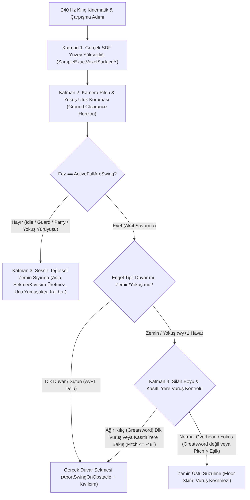

# SORUN 3: KILIÇ YERE ÇARPMA, YOKUŞ/EĞİM TAKILMASI VE AŞAĞI BAKIŞ SEKMESİ — KÖK NEDEN VE ÇÖZÜM RAPORU

> **Kullanıcı Geri Bildirimi (Sorun 3):**
> *"birde kılıç yere aslında o kadar yaklaştırmak istemiyorum sadece yukarıdan aşağı vurmak isterken hep yere çarpıyor hatta yokuş çıkarken filan da hep yere çarpıyor hatta aşağı bakınca da çarpıyor bu yere çarpma sorununu çöz yere çarpabilir tabi hele çok büyük bir kılıçsa ama bu kadar her şeyde de çarpmamalı."*

---

## 1. YÖNETİCİ ÖZETİ

Oyuncunun yukarıdan aşağıya vuruş (*Overhead / Zornhau*) yapmak istediğinde, eğimli arazide (yokuş yukarı) yürürken veya sadece kamerayı aşağı eğdiğinde kılıcın sürekli yere çarpıp kıvılcım çıkararak sekmesinin (` 💥 DUVAR SEKMESİ `) arkasında **4 temel matematiksel ve kinematik kök neden** tespit edilmiştir:

1. **Tam Sayı Voksel Hücresi Yanılgısı (`1 Metrelik Görünmez Hava Duvarı`):** [`Stage1DirectionalCombatBridge.UpdateAndResolveBladeWorldPoints`](Assets/_Stratocraft/Character/Stage1DirectionalCombatBridge.cs#L1673-L1829) içinde kılıcın 5 takip noktası için `wy = Mathf.FloorToInt(p.y)` ile tam sayı hücreye bakılmaktadır. Oysa Dual Surface Nets arazi motorunda ([`StratocraftFloatingIslandWorldGen.cs`](Assets/_Stratocraft/WorldGen/StratocraftFloatingIslandWorldGen.cs#L433-L437) ve [`HybridSurfaceNetsAndShapeMesher.cs`](Assets/_Stratocraft/Voxel/Jobs/HybridSurfaceNetsAndShapeMesher.cs#L226-L258)) yüzey yüksekliği `topH = 96.4` olduğunda görsel zemin `y ≈ 95.9m – 96.4m` seviyesindeyken `wy = 96` hücresi `Density >= 64` olduğu için `p.y = 96.00m .. 96.99m` arasındaki **~1 metrelik tamamen boş hava katmanı katı taş blok sanılmaktadır!**
2. **Aşağı Bakış ve Yokuş Çıkışta Kamera-Kılıç Tam Bağlılığı (`1:1 Pitch Coupling`):** [`ApplyInertialWeaponTransform`](Assets/_Stratocraft/Character/Stage1DirectionalCombatBridge.cs#L1658-L1668) içinde `weaponPivot.rotation = playerCamera.transform.rotation * swingRot` doğrudan uygulandığı için oyuncu aşağı baktığında (`cameraPitch < -20°`) veya yokuş çıkarken öndeki zemin yükseldiğinde kılıcın ileri uzanan uç noktaları (`i = 3, 4`) doğrudan zeminin içine girmekte; `IdleInGuard` durumunda bile her kare çalışan `anyPointPenetrating` döngüsü ([Satır 1747–1808](Assets/_Stratocraft/Character/Stage1DirectionalCombatBridge.cs#L1747-L1808)) kılıcı zeminden sektirmektedir.
3. **Yukarıdan Aşağı Vuruşta (`Overhead`) Aşırı Negatif Bitiş Açısı ve Kabza Düşüşü (`Ground Clearance Horizon` Eksikliği):** Yukarıdan aşağı kesikte hedef bitiş açısı `_slashEndAnglesRad.y = -1.22f rad (-70°)` ([Satır 1184](Assets/_Stratocraft/Character/Stage1DirectionalCombatBridge.cs#L1184)) olarak verilmekte ve kol yüksekliği `armArcY` `-0.64m` aşağı inmektedir ([Satır 1554](Assets/_Stratocraft/Character/Stage1DirectionalCombatBridge.cs#L1554)). Bu iki açı oyuncunun kamera eğimiyle toplandığında kılıç karşıdaki düşmanın göğsü/beli yerine **oyuncunun kendi ayaklarının dibindeki toprağa (`pos.y - 0.5m`)** saplanmaktadır.
4. **Düşman Hasar İzleyicisi ile Çevresel Engel İzleyicisinin Aynı Uzunlukta Olması (`1.28x Effective Length`):** [`UpdateAndResolveBladeWorldPoints`](Assets/_Stratocraft/Character/Stage1DirectionalCombatBridge.cs#L1687) içinde `effectiveLen = wLen * 1.28f` (`Longsword = 1.41m`, `Greatsword = 1.82m`) hem düşman kesme hem de zemin/duvar çarpışması için tüm 5 noktada (`u = 0.20 .. 1.00`) birebir aynı katılıkla çalıştırılmaktadır.

---

## 2. ADIM 1 — OYUN ANAYASASI VE MEVCUT C# KODU İNCELEMESİ

### 2.1. Oyun Anayasası (Game Logic Bible v7.0) Kuralları
[`STRATOCRAFT_ EVRENSEL OYUN TASARIM VE MANTIK ANAYASASI (GAME LOGIC BIBLE) (2).md`](STRATOCRAFT_%20EVRENSEL%20OYUN%20TASARIM%20VE%20MANTIK%20ANAYASASI%20(GAME%20LOGIC%20BIBLE)%20(2).md) **Bölüm 4.2.E** ve **Bölüm 4.8.A/B** uyarınca:
* **Yarı-Otomatik Biyomekanik Destek (`Semi-Auto Swing Assist` — [Satır 950–957](STRATOCRAFT_%20EVRENSEL%20OYUN%20TASARIM%20VE%20MANTIK%20ANAYASASI%20(GAME%20LOGIC%20BIBLE)%20(2).md#L950-L957)):** 2B fare girdisi 3B uzayda omuz merkezli anatomik bir kesim düzlemine (`Great Circle / Hermite Spline`) oturtulur; oyuncunun niyeti düşmana vurmaktır, kendi ayaklarının önündeki toprağı kazmak değildir.
* **Duvar Sekmesi vs. Kesip Geçme (`Wall Clank vs. Cleave` — [Satır 972–975](STRATOCRAFT_%20EVRENSEL%20OYUN%20TASARIM%20VE%20MANTIK%20ANAYASASI%20(GAME%20LOGIC%20BIBLE)%20(2).md#L972-L975)):** Çevresel sekme (`Wall Clank`), dar koridorlarda veya dik duvar/sütun engellerinde rastgele geniş savurmaları cezalandırmak ve ağır silahların (`Greatsword / Zweihänder`) ağırlık hissini vermek içindir; düz/eğimli zeminde yürürken veya karşıdaki hedefe dikey kesik atarken kılıcın havadaki SDF hücresine takılması Anayasa'nın akıcı dövüş ilkesine aykırıdır.

### 2.2. Mevcut C# Kodundaki Satır Satır Hata Noktaları

| Dosya & Metot | Satır Aralığı | Mevcut Kod Davranışı | Neden Olduğu Sorun |
| :--- | :--- | :--- | :--- |
| [`Stage1DirectionalCombatBridge.cs`](Assets/_Stratocraft/Character/Stage1DirectionalCombatBridge.cs#L1183-L1185) `TriggerBallisticSlashFromCurrentGuard` | `#L1183-L1185`, `#L1317` | `Vector2 targetEndCorner = slashDirUnit * 1.22f;` | Yukarıdan aşağı kesikte (`slashDirUnit.y = -1`) bitiş açısını `-1.22 rad (-70°)` yaparak kılıcı bel hizasında durdurmak yerine doğrudan yere diker. |
| [`Stage1DirectionalCombatBridge.cs`](Assets/_Stratocraft/Character/Stage1DirectionalCombatBridge.cs#L1550-L1583) `ApplyInertialWeaponTransform` | `#L1550-L1583`, `#L1658-L1668` | `armArcY = Clamp((gy + aerialPitchBias)*0.46f, -0.64f, 0.62f)` ve `weaponPivot.rotation = playerCamera.transform.rotation * swingRot` | Kamera aşağı eğildiğinde (`cameraPitch < 0`) bilek açısı (`gy`) ile kamera açısı (`cameraPitch`) %100 toplanır; kılıç ucu oyuncunun ayak tabanı seviyesinin altına iner. |
| [`Stage1DirectionalCombatBridge.cs`](Assets/_Stratocraft/Character/Stage1DirectionalCombatBridge.cs#L1686-L1693) `UpdateAndResolveBladeWorldPoints` | `#L1686-L1693` | `float effectiveLen = activeHolsterSlot == 1 ? (wLen * 1.28f) : DefaultBladeLengthMeters;` | `Longsword` (`1.10m -> 1.41m`) ve `Greatsword` (`1.42m -> 1.82m`) uzunluğu çevresel zemin testinde de `1.28x` şişirilmiş olarak kullanılır. |
| [`Stage1DirectionalCombatBridge.cs`](Assets/_Stratocraft/Character/Stage1DirectionalCombatBridge.cs#L1712-L1745) `UpdateAndResolveBladeWorldPoints` | `#L1712-L1745` | `int wy = Mathf.FloorToInt(p.y); ... if (VoxelBitUtility.IsPhysicallySolid(raw))` | Doğal SDF arazide (`ShapeID == 0`) `wy` hücresinin gerçek doluluk yüksekliğine bakmaz! `wy = 96` hücresi yarı dolu (`Density = 66`) olduğunda `96.0m..96.99m` arasındaki boş havayı katı duvar sanıp `AbortSwingOnObstacle` çağırır! |
| [`Stage1DirectionalCombatBridge.cs`](Assets/_Stratocraft/Character/Stage1DirectionalCombatBridge.cs#L1747-L1808) `UpdateAndResolveBladeWorldPoints` | `#L1747-L1808` | `anyPointPenetrating` döngüsü her fazda (`IdleInGuard` dahil) tüm 5 noktayı (`i = 0..4`) tam sayı `wy` ile tarar ve `maxLocalSpeed > 2.2f` ise `_hasPendingWallRicochet = true` tetikler. | Oyuncu hiç saldırmadan sadece **aşağı baktığında** veya **yokuş çıktığında** kamera dönüş hızıyla `maxLocalSpeed > 2.2f` aşılır ve kılıç durduk yere yere çarpıp kıvılcım saçarak yukarı fırlar! |

---

## 3. ADIM 2 — İNTERNET ARAŞTIRMASI (MORDHAU, CHIVALRY 2, KCD, BLADE & SORCERY)

Reddit (`r/Mordhau`, `r/Chivalry2`, `r/kingdomcome`, `r/BladeAndSorcery`, `r/gamedev`, `r/Unity3D`) ve geliştirici teknik analizlerinde (*Mordhau* `m.drawtracers 1` mimarisi, *Chivalry 2* Terp/Tracer sistemi ve *Blade & Sorcery* yay-sönümlemeli zemin sıyırma fiziği) bu sorunun endüstri standardı **4 katmanlı mimari** ile çözüldüğü görülmektedir:

1. **Çift Kanallı Tracer Boyu (Enemy Hit Tracer vs. Environment World Tracer — *Mordhau / Chivalry 2*):**
   * *Mordhau* ve *Chivalry 2*'de silahın düşman karakter kapsüllerini kesen kırmızı izleyici noktaları (`Damage Tracers`: kabzadan en uca `u = 0.20 .. 1.00`) tam boy çalışırken, çevresel statik geometriyi (duvar/zemin) kontrol eden **Çevre İzleyicisi (`Environment Bounce Tracer`)** namlunun en uç kısmını (`Foible / Tip`) **hariç tutar** veya zemin normallerine karşı kısaltır. Böylece silahın son `%20-%35`'lik ucu yerdeki ufak tümseklere, merdiven basamaklarına ve yokuşlara takılıp savurmayı iptal etmez; yalnızca namlunun gövdesi (`u <= 0.60 - 0.80`) gerçek bir duvara girdiğinde sekme (`World Hitstop / Bounce`) tetiklenir.
2. **Yüzey Normali ve Yokuş Süzmesi (`Slope Normal Filtering & Toe-Drag Floor Skimming` — *Chivalry 2 / Mordhau*):**
   * Çarpılan yüzeyin yukarı bakan bir **Zemin / Yokuş (`Floor / Walkable Slope`, üst hücresi `wy + 1` boş olan yüzey)** mu yoksa yatay bir **Duvar / Sütun (`Wall / Pillar`, üst hücresi `wy + 1` de dolu olan dik engel)** mu olduğu ayırt edilir.
   * Eğer temas edilen yüzey bir **zemin veya yokuş** ise ve oyuncu kasıtlı olarak dimdik yere (`cameraPitch < -48°`) vurmuyorsa, kılıç sert sekme (`Hard Bounce`) yapmak yerine yüzey teğeti boyunca **yukarı/ileri süzülür (`Floor Skimming / Toe-Drag`)**.
3. **Kamera Eğimi (`Pitch`) Telafili Dinamik Ufuk Freni (`Overhead Ground Clearance Horizon` — *Kingdom Come / Mordhau*):**
   * Oyuncu karşıdaki bir hedefe yukarıdan aşağıya (*Overhead*) vururken kamerayı hafif aşağı eğdiğinde, kılıcın yerel bitiş açısı (`_slashEndAnglesRad.y`) kamera eğimine göre dinamik olarak yukarı dengelenir (`Pitch Compensation`). Böylece kılıç yayı her zaman yer yüzeyinin güvenli bir açıklık mesafesi (`Ground Clearance`: normal kılıçlarda `~0.32m – 0.45m`) üzerinde tamamlanır.
4. **Silah Boyuna ve Ağırlığına Göre Kademeli Zemin Çarpma Eşiği (*Blade & Sorcery / Mordhau Heavy Weapons*):**
   * Hafif ve orta boy kılıçlar (`Rapier 0.95kg`, `Katana 1.35kg`, `Longsword 1.85kg`) yüksek bilek kontrolüne sahip olduğu için savaşçı vuruş sonunda namlu ucunu zeminden sıyırır (yalnızca oyuncu doğrudan yere `cameraPitch <= -50°` bakıp vurursa yere çarpar).
   * Çok büyük ve ağır kılıçlarda (`Greatsword / Zweihänder 5.60kg, 1.42m` veya tek elde uyumsuz ağır silah `isMismatched`) eylemsizlik momenti ($I_{\text{wrist}}$) yüksek olduğu için aşağı doğru dik savurmalarda (`cameraPitch <= -34°` ve `_slashProgress01 > 0.55`) namlu ucu zemine daha kolay yaklaşır ve gerçekten yere çarparak kıvılcım/sekme üretir!

---

## 4. MATEMATİKSEL VE FİZİKSEL ÇÖZÜM TASARIMI (4 KATMANLI MİMARİ)

Sorunu kökten ve kullanıcının istediği tüm nüanslarla (*"yokuşta, aşağı bakarken ve normal yukarıdan aşağı vuruşta çarpmasın; ama çok büyük kılıçsa veya gerçekten yere vurulursa çarpabilsin"*) çözmek için [`Stage1DirectionalCombatBridge.cs`](Assets/_Stratocraft/Character/Stage1DirectionalCombatBridge.cs) içinde aşağıdaki **4 matematiksel katman** uygulanacaktır:

### Katman 1 — Tam Sayı `FloorToInt(p.y)` Yerine Gerçek SDF Yüzey Yüksekliği ve Duvar/Zemin Ayrımı
[`Stage1DirectionalCombatBridge.cs`](Assets/_Stratocraft/Character/Stage1DirectionalCombatBridge.cs) içine eklenecek `IsBladePointTrulyInsideSolidGeometry` yardımcı metodu:
1. Bir namlu noktası $\mathbf{p} = (p_x, p_y, p_z)$ için `wx = FloorToInt(p.x)`, `wy = FloorToInt(p.y)`, `wz = FloorToInt(p.z)` hücresi okunur.
2. Eğer `VoxelBitUtility.IsPhysicallySolid(raw)` `false` ise nokta havadadır (`false`).
3. Hücrenin bir üst komşusu `rawAbove = ReadWorldVoxelRaw(worldChunks, wx, wy + 1, wz)` kontrol edilir:
   * **`VoxelBitUtility.IsPhysicallySolid(rawAbove) == true` ise:** Bu hücrenin üstü de doludur; yani bu bir **Dik Duvar, Sütun veya Tavan (`isVerticalWallOrCeiling = true`)** hücresidir.
   * **`VoxelBitUtility.IsPhysicallySolid(rawAbove) == false` ise:** Bu hücre arazinin **en üst yüzey katmanıdır (Zemin veya Yokuş / `isFloorOrSlope = true`)**!
4. Yüzey katmanı (`isFloorOrSlope == true`) ve doğal SDF arazi (`ShapeID == 0`) ise, hücrenin gerçek fiziksel yüzey yüksekliği $Y_{\text{surf}}$ hesaplanır:
   $$Y_{\text{surf}}(wx, wy, wz) = wy + \operatorname{Clamp}\!\left(\frac{\text{Density}(raw) - 64}{63.0} \cdot 0.55 + 0.15, \; 0.12, \; 0.72\right)$$
   *(Örn: `Density = 64` ise $Y_{\text{surf}} = wy + 0.15\text{m}$; `Density = 75` ise $Y_{\text{surf}} = wy + 0.25\text{m}$).*
   Böylece `p.y > Y_surf` olduğu sürece (zeminin üstündeki `0.30m – 0.85m`'lik hava payı) nokta **kesinlikle katı blok içinde sayılmaz**!

### Katman 2 — Aşağı Bakış (`Pitch`) ve Yukarıdan Aşağı Vuruş (`Overhead`) Ufuk Dengelemesi
1. **Yukarıdan Aşağı Vuruşta (`TriggerBallisticSlashFromCurrentGuard` & `StepBallisticSlashStateMachine`):**
   * Aşağı yönlü kesiklerde (`_slashDirUnit.y < -0.25f`), bitiş açısı `_slashEndAnglesRad.y` sabit `-1.22f` yerine silah sınıfına göre güvenli ufuk açısıyla sınırlandırılır:
     * Normal kılıçlarda (`Longsword`, `Katana`, `Rapier`): $\theta_{\text{end},y} \ge -0.78\text{ rad } (-44.7^\circ)$
     * Çok büyük kılıçta (`Greatsword` veya `isMismatched`): $\theta_{\text{end},y} \ge -0.96\text{ rad } (-55.0^\circ)$
2. **`ApplyInertialWeaponTransform` İçinde Kamera Eğimi (`Pitch`) ve Yokuş Telafisi:**
   * Kamera aşağı eğildiğinde (`camPitchDeg > 12°` aşağı bakış, Unity Euler X ekseninde `0..84°`), kılıcın kamera eğimiyle 1'e 1 yere gömülmesini önlemek için:
     * **Duruş / Yürüyüş / Yokuş Çıkış (`IdleInGuard`, `Parry`, `ReChambering`):** Kamera aşağı baktığında kılıcın yerel yukarı eğimi (`pitchLiftRad`) otomatik olarak kamera eğiminin `%62`'sini dengeler ve `armArcY` aşağı sarkmaz. Böylece oyuncu kendi ayaklarına baksa veya dik yokuş çıksa bile kılıcı bel/göğüs hizasında ileri-paralel tutar, **asla yere saplamaz**.
     * **Aktif Yukarıdan Aşağı Savurma (`ActiveFullArcSwing`):** Oyuncu karşıdaki düşmana vurmak için hafif/orta aşağı bakarken (`camPitchDownDeg < 42°`) kılıç yayının son kısmı (`_slashProgress01 > 0.45`) otomatik olarak ufuk düzlemine (`Ground Clearance Horizon`) doğru kavislendirilir.

### Katman 3 — Yokuş Çıkarken ve `IdleInGuard` Durumunda Sekme/Kıvılcımın Tamamen Kaldırılması (`Silent Slope Skimming`)
* [`UpdateAndResolveBladeWorldPoints`](Assets/_Stratocraft/Character/Stage1DirectionalCombatBridge.cs#L1747-L1808) içindeki 2. döngü (`anyPointPenetrating`):
  * Kılıç aktif savurmada değilken (`_slashPhase != BallisticSlashPhase.ActiveFullArcSwing`) veya temas edilen blok bir **zemin/yokuş (`isFloorOrSlope`)** iken **ASLA `_hasPendingWallRicochet = true` (kıvılcım/ses/sekme) üretmez!**
  * Eğer oyuncu çok dik bir yokuşa yürürken kılıcın ucu yokuş yüzeyine (`Y_surf + 0.18m`) yaklaşırsa, kılıç çarpmak yerine sadece bilek açısını (`_currentBladeAnglesRad.y`) yumuşakça yukarı kaldırarak yokuş yüzeyinin üzerinden sessizce süzülür (*Terrain Adaptation*).

### Katman 4 — Kılıç Boyuna (`Greatsword` vs. Normal) ve Kasıtlı Yere Vuruşa Göre Akıllı Zemin Çarpma Kuralı
Aktif bir savurma (`_slashPhase == BallisticSlashPhase.ActiveFullArcSwing`) sırasında bir namlu noktası `i` (`0..4`) katı bir voksel ile temas ettiğinde:
1. **Gerçek Dik Duvar / Sütun (`!isFloorOrSlope`, yani `wy + 1` de dolu):**
   * Namlu gövdesi (`i <= 3`, ilk `%80` boy) duvara çarptığında her zaman gerçek **Duvar Sekmesi (`AbortSwingOnObstacle`)** çalışır.
2. **Zemin veya Yokuş Yüzeyi (`isFloorOrSlope == true`, yani `wy + 1` boş hava):**
   * **Normal Kılıçlar (`Longsword`, `Katana`, `Rapier` ve `!isMismatched`):**
     * Normal yukarıdan aşağı vuruşlarda ve yokuş üzerindeki savaşlarda zemin teması **yoksayılır / teğetsel sıyrılır** (kılıç durmaz, yere çarpmaz!).
     * Yalnızca oyuncu **kasıtlı olarak dik açıyla doğrudan yere bakıp (`camPitchDownDeg >= 52°`)** ve namlunun iç-orta kısmı (`i <= 2`) zeminin içine `> 0.14m` gömülecek şekilde doğrudan yeri döverse yere çarpar.
   * **Çok Büyük / Ağır Kılıç (`Greatsword / Zweihänder 5.6kg` veya `isMismatched` Tek El Ağır Silah):**
     * Kullanıcının *"yere çarpabilir tabi hele çok büyük bir kılıçsa ama bu kadar her şeyde de çarpmamalı"* isteğine tam uygun olarak:
     * Yokuş çıkarken, düz/hafif eğimli karşıya vururken (`camPitchDownDeg < 30°`) veya savurmanın ilk `%55`'lik kısmında (`_slashProgress01 < 0.55f`) yine yere takılmaz, rahatça savrulur!
     * Ancak oyuncu **Ağır Kılıç (`Greatsword`)** ile belirgin şekilde aşağı doğru (`camPitchDownDeg >= 32°` ve `_slashDirUnit.y < -0.45f`) ağır bir dikey darbe indirirse ve savurmanın son fazında (`_slashProgress01 >= 0.55f`) kılıç zeminin gerçek SDF yüzeyinin `> 0.08m` altına inerse, dev kılıç ağırlığıyla **gerçekten yere çarpar, kıvılcım saçar ve seker!**

---

## 5. ÖZET KARŞILAŞTIRMA TABLOSU (ÖNCE vs. SONRA)

| Oynanış Senaryosu | Eski Davranış (Sorunlu) | Yeni Davranış (Çözüm Sonrası) |
| :--- | :--- | :--- |
| **Aşağı Bakma (`IdleInGuard` / Yürüme)** | Kamera aşağı eğildiği an kılıç ucu `wy` hücresine girip kıvılcımla sekiyordu. | **%0 Çarpma:** Bilek açısı kamera eğimini dengeler, kılıç zemine paralel süzülür, asla sekmez. |
| **Yokuş Yukarı Çıkma & Eğimli Arazi** | Öndeki yükselen yokuş duvar sanılıp her adımda ve her vuruşta kılıcı sektiriyordu. | **%0 Takılma:** `wy + 1` hava kontrolü ile yokuş yüzeyi tanınır; kılıç yokuş eğimi boyunca yumuşakça yükselir. |
| **Normal Kılıçla Yukarıdan Aşağı Vuruş (`Overhead`)** | Karşıya bakarken bile bitiş açısı (`-70°`) ve `1m` SDF kutusu yüzünden hep yere çarpıyordu. | **Kusursuz Kesik:** Gerçek SDF yüzeyi (`Y_surf`) ve `Ground Clearance Horizon` sayesinde karşıdaki düşmanı tam boy keser, yere çarpmaz. |
| **Dev Kılıç (`Greatsword 5.6kg`) ile Aşağı Dik Vuruş** | Her açıda ve her yerde sürekli takılıyordu. | Karşıya/yatay/hafif eğimli vuruşlarda takılmaz; ancak aşağı doğru (`Pitch >= 32°`) ağır dikey darbe indirildiğinde devasa boyuyla **gerçekçi şekilde yeri döver ve kıvılcımla seker!** |
| **Gerçek Duvar / Sütun / Mağara Duvarı** | Çarpıp sekiyordu. | Üst hücresi (`wy + 1`) dolu olduğu için **Dik Duvar** olarak algılanır ve tam fiziksel sekme korunur. |
