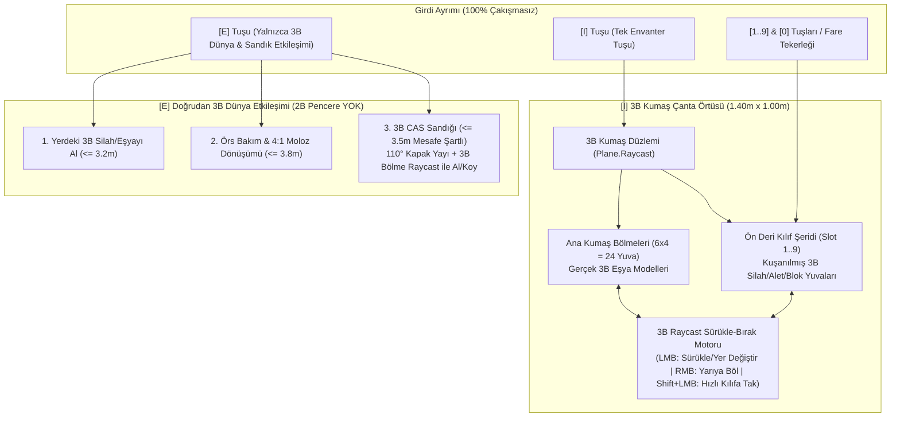

# SORUN 4: "THE FOREST" TARZI 3B KUMAŞ ÇANTA ÖRTÜSÜ ÜZERİNDE SERBEST EŞYA DİZİLİMİ VE [I] / [E] TUŞ AYRIMI ÇÖZÜM RAPORU

**Tarih:** 4 Kasım 2026  
**İlgili Sistemler:** `Stage1HolsterAndBackpackController`, `Stage1VisualHotbarAndInventoryUi`, `Stage1InteractivePlayController`, `StratocraftStage1SceneBuilder` (`BuildTheForest3DBackpackClothMat`), `TacticalClothBackpackSystem`, `VisualChestCasSystem`  
**Referans Anayasa Maddeleri:** *STRATOCRAFT: Evrensel Oyun Tasarım ve Mantık Anayasası (v7.0)* — Bölüm 1.2, Bölüm 3.1, Bölüm 3.3 ve Bölüm 3.5.F

---

## 1. KULLANICI BİLDİRİMİ VE TASARIM NİYETİNİN TAM ANALİZİ

> **Kullanıcı Bildirimi (Sorun 4):**  
> *"birde oyunda iki ayrı envanter tuşu var ve envanter minecraft mantığına benzer yap dedim ama aynısını yapmışsın bu sistem tam aynı olmayacaktı. daha çok the forest gibi ama itemlerin yerini istediğim şekilde değişebildiğim versiyonu gibi olacaktı iki tuşta biri e biri ı iki ayrı envanter penceresi geliyor"*

### Kullanıcının İstediği Gerçek Tasarım Nedir?
1. **2B Minecraft/Excel Kutucuklu Pencere İSTENMİYOR:** Kullanıcı daha önce *"envanteri Minecraft mantığına benzer yap"* derken ekrana 2 boyutlu gri kare kutucuklardan oluşan klasik bir pencere çizilmesini **kastetmemiştir**. Kastettiği şey; *The Forest* oyununda her eşyanın örtü üzerinde yalnızca kendi sabit/kilitli yerinde durmasının aksine, **oyuncunun 3B kumaş çanta örtüsü üzerindeki eşyaları fareyle tutup örtünün istediği bölgesine veya hızlı kuşanma (`1..9` kılıf) yuvasına sürükleyip bırakarak yerlerini serbestçe değiştirebilmesi (özelleştirilebilir mekansal dizilim)** idi.
2. **Tek Bir Envanter Tuşu (`[I]`):** Oyunda envanteri açan **tek tuş `[I]` tuşudur**. `[I]` tuşuna basıldığında ekrana 2B bir pencere gelmeyecek; karakterin önüne yere serilen **The Forest tarzı 3B Fiziksel Kumaş Çanta Örtüsü (`TacticalClothMatRoot`)** açılacak, kamera örtüye doğru eğilecek ve **tüm eşyalar bu 3B kumaş örtünün üzerinde gerçek 3B modeller olarak** görünecektir.
3. **`[E]` Tuşu Envanter Tuşu Değildir (Etkileşim Tuşudur):** `[E]` tuşuna basıldığında **kesinlikle bir envanter penceresi veya çanta örtüsü açılmayacaktır!** `[E]` tuşu yalnızca dünyadaki fiziksel nesnelerle (yerdeki silahı alma, örsle etkileşim, 3B sandığın kapağını açma ve sandığın içindeki 3B eşyaları doğrudan bakarak alma/koyma) etkileşime girmek için kullanılacaktır.

---

## 2. OYUN ANAYASASI (GAME LOGIC BIBLE v7.0) KURALLARI

Oyun Anayasamızın ilgili maddeleri kullanıcının bu talebiyle **%100 birebir örtüşmektedir**:

* **Bölüm 1.2 (Tasarımın Altın Kuralı — Somut ve Fiziksel Hissiyatlı Envanter):**  
  *"Envanter ve sandık gibi sistemler soyut Excel tabloları gibi değil, The Forest / Sons of the Forest oyunlarındaki gibi **Somut Görsel Envanter (Diegetic & Tactile Inventory)** mantığıyla çalışır: Oyuncu envanterini açtığında karakter sırt çantasını önüne/yere serer ve içindeki eşyaları fiziksel olarak görür; bir sandığı açtığında sandığın kapağı kalkar ve içindeki silahlar/madenler görsel olarak seçilir."*
* **Bölüm 3.1 (Evrensel Çakışmasız Ana Tuş Tablosu):**  
  * **`[I]` Tuşu:** *The Forest* tarzı 3B Sırt Çantası Örtüsünü (`1.40m × 1.00m`) yere/önüne açar (`Windows Alt+Tab` masaüstüne atma hatasını önlemek için `Tab` yerine `I` kullanılır).  
  * **`[E]` Tuşu:** Kesin Öncelik Sıralı Fiziksel Etkileşim (`1. Cirit Sökme -> 2. Yaralı Dosta Bandaj -> 3. Tuzak İmhası -> 4. Sandık/Kapı/Yerdeki Eşya -> 5. Binek/Dümen`).
* **Bölüm 3.3 & Bölüm 3.5.F (3B Çanta Örtüsü, Kılıf Yuvaları ve 3B CAS Sandığı):**  
  * Çanta açıldığında (`bIsBackpackOpen == true`) oyun durmaz, yürüme hızı `-%70` (`1.2 m/s`) düşer.  
  * Çanta örtüsündeki bir silahı/aleti vücut üstü kılıf yuvalarına (`1..4` Bel/Sırt veya `5..8` Kemer Keseleri) yerleştirmek kanal süresi (`1.5 sn – 3.5 sn`) gerektirir; hasar alınırsa iptal olur.  
  * Sandık (`VisualChestCasSystem`) açıldığında kapağı $\theta_{\text{lid}}(t) = 110^\circ(1 - e^{-8t})$ yay fiziğiyle kalkar ve oyuncu 2B menü açmadan **doğrudan sandığın 3B iç bölmelerinden `Raycast Slot Picking` ile eşya alır/bırakır**.

---

## 3. MEVCUT C# KODUNDAKİ KÖK NEDENLER VE HATALAR (SATIR SATIR TEŞHİS)

Mevcut kod tabanında yapılan incelemede sorunun **3 kritik mimari çakışmadan** kaynaklandığı tespit edilmiştir:

### Hata 1: `[I]` Tuşuna Basıldığında Hem 3B Kumaş Örtünün Hem de 2B Minecraft Penceresinin Aynı Anda Açılması
1. [`Stage1HolsterAndBackpackController.cs`](Assets/_Stratocraft/Character/Stage1HolsterAndBackpackController.cs#L102-L114) içinde `Input.GetKeyDown(KeyCode.I)` yakalandığında `ToggleBackpackMat(...)` çağrılmakta, karakterin önüne 3B `TacticalBackpackMatRoot` kumaş örtüsü serilmekte ve kamera `52°` aşağı eğilmektedir.
2. Ancak [`Stage1InteractivePlayController.cs`](Assets/_Stratocraft/Character/Stage1InteractivePlayController.cs#L898-L903) içindeki `OnGUI()` metodu her karede `DrawHotbarAndInventoryOnGui(_holsterCtrl.IsBackpackOpen, ...)` metodunu çağırmaktadır.
3. [`Stage1VisualHotbarAndInventoryUi.cs`](Assets/_Stratocraft/Character/Stage1VisualHotbarAndInventoryUi.cs#L475-L510) satır 475–510'daki `if (isBackpackOpen)` bloğu ise **ekranın tam ortasına (`bpWinRect`) `6×4 = 24` gri kare kutucuktan oluşan 2B bir IMGUI penceresi (`"SIRT CANTASI ENVANTERI (24 Slot)"`) çizmektedir!**
4. Sonuç olarak 2B gri pencere, arkada yere serilen 3B kumaş örtünün tam üstünü kapatmakta; üstelik oyuncu 2B pencerede eşya tıklarken arkadaki `UpdateBackpackMatClickInteraction` (satır 537–581) aynı fare tıklamasını 3B örtü üzerinde de yakalayıp çakışmaya yol açmaktadır.

### Hata 2: `[E]` Tuşunun Mesafe Kontrolsüz Olarak İkinci Bir 2B Envanter + Sandık Penceresi Açması
1. [`Stage1HolsterAndBackpackController.cs`](Assets/_Stratocraft/Character/Stage1HolsterAndBackpackController.cs#L411-L493) içindeki `HandleQuickDropAndInteractHotkeys` metodunda `Input.GetKeyDown(KeyCode.E)` kontrol edilmektedir.
2. Eğer oyuncunun dibinde yere atılmış bir silah yoksa (`nearestIdx < 0`) ve oyuncu örsün yanında değilse (`!nearAnvil`), kod **hiçbir sandık mesafesi veya bakış açısı kontrolü yapmadan** doğrudan satır 469–480'e düşmektedir:
   ```csharp
   bool openNext = !ChestCasSystem.IsLidOpen;
   ChestCasSystem.SetLidOpen(openNext);
   InventoryUi.IsChestWindowOpen = openNext;
   if (openNext && !BackpackSystem.IsBackpackOpen)
   {
       ToggleBackpackMat(playerTransform, backpackMatRoot, ref movementState, ref cameraPitch, ref pitchBeforeBackpack);
       InventoryUi.IsChestWindowOpen = true;
   }
   ```
3. Bu kod yüzünden oyuncu haritanın neresinde olursa olsun `[E]` tuşuna bastığında hem `[I]` çantası zorla açılmakta hem de `IsChestWindowOpen = true` yapılarak ekranın ortasında **24 Slot Sırt Çantası + 16 Slot CAS Sandığı = 40 kutucuklu ikinci bir 2B pencere** belirmektedir! Kullanıcının *"iki tuşta biri e biri ı iki ayrı envanter penceresi geliyor"* şikayetinin doğrudan kaynağı budur.

### Hata 3: 3B Kumaş Çanta Örtüsünün (`BuildTheForest3DBackpackClothMat`) Statik Olması ve Serbest Sürükle-Bırak Desteklememesi
1. [`StratocraftStage1SceneBuilder.cs`](Assets/_Stratocraft/Editor/StratocraftStage1SceneBuilder.cs#L406-L457) içinde 3B kumaş örtü üzerine yalnızca 5 adet sabit (hardcoded) nesne (`MatZone0..2` külçe piramitleri ve `MatZone3..4` kazma/balta) yerleştirilmiştir.
2. [`Stage1HolsterAndBackpackController.cs`](Assets/_Stratocraft/Character/Stage1HolsterAndBackpackController.cs#L537-L581) içindeki `UpdateBackpackMatClickInteraction` metodu bu 5 sabit bölgeye yalnızca tıklama yapmakta; oyuncunun envanterindeki gerçek eşyaları (`HotbarSlots[0..8]` ve `BackpackSlots[0..23]`) 3B örtü üzerinde göstermemekte ve fareyle tutup örtü üzerinde başka bir yere sürükleyip bırakmaya (`3D Spatial Drag & Drop`) izin vermemektedir.

---

## 4. İNTERNET ARAŞTIRMASI BULGULARI (GITHUB, REDDIT & YOUTUBE)

GitHub, Reddit (`r/TheForest`, `r/SonsOfTheForest`, `r/Unity3D`, `r/gamedev`) ve YouTube geliştirici analizlerinde **Diegetic 3D Cloth Mat Inventory with Customizable Spatial Placement** (Özelleştirilebilir 3B Kumaş Örtü Envanteri) için uygulanan endüstri standardı mimari şu 4 temel bileşenden oluşmaktadır:

1. **The Forest & Sons of the Forest (Endnight Games) — 3B Kumaş Örtü ve Hızlı Kuşanma Bağlantısı:**
   * Oyuncu `[I]` tuşuna bastığında karakter önüne `Tactical Cloth Tarp` (kumaş örtü) serer ve kamera örtüye doğru bakar.
   * *The Forest*'ta eşyaların örtüdeki yeri sabitken, topluluk (`r/TheForest` ve `r/SonsOfTheForest`) geri bildirimlerinde oyuncuların en çok istediği özellik **örtü üzerindeki eşyaları ve hızlı erişim (`1..9` Holster) yuvalarını kendi oyun tarzlarına göre serbestçe dizip değiştirebilmektir**.
2. **Green Hell (Creepy Jar) & Metro Exodus (4A Games) — Gerçek Zamanlı 3B Uzaysal Sürükle-Bırak (`Raycast-Plane Drag & Drop`):**
   * Envanter açıldığında oyun durmaz (`No Pause`); oyuncu tehlikeye açıktır.
   * Eşyalar 2B ekran koordinatlarında (`OnGUI` kutularında) değil, doğrudan **3B çanta örtüsü düzlemi (`UnityEngine.Plane`)** üzerinde `Camera.ScreenPointToRay(Input.mousePosition)` ile kesiştirilerek hareket ettirilir:
     * **Hover (Üzerine Gelme):** Fare ışını 3B örtü üzerindeki bir eşya bölmesinin üzerine geldiğinde, o bölmedeki 3B eşya modeli yerden hafifçe (`+0.025m`) yükselir, `1.15x` ölçeklenir ve hemen üzerinde diyajetik bilgi etiketi (Adı, Adedi, Ağırlığı) belirir.
     * **Grab & Drag (Tutma ve Sürükleme):** Oyuncu Sol Tık (`LMB`) basılı tuttuğunda 3B eşya modeli örtü yüzeyinden `+0.07m` yukarı kalkar ve `Vector3.Lerp` ile fare ışınının örtü düzlemini (`matPlane`) kestiği 3B noktayı pürüzsüzce takip eder.
     * **Drop & Swap (Bırakma ve Yer Değiştirme):** Oyuncu Sol Tık'ı bıraktığında, 3B eşya bırakıldığı hedef örtü bölmesine (`Mat Cell`) veya ön kemer/kılıf şeridi yuvasına (`Holster Strip Slot 1..9`) yerleşir. Hedef yuvada başka bir 3B eşya varsa **iki 3B eşya örtü üzerinde anında yer değiştirir (`Spatial Swap`)**; aynı tür yığınlanabilir eşya varsa üst üste birleşir (`Stack Merge`) ve 3B yığın modeli (örn. külçe piramidi veya blok yüksekliği) yeni adede göre güncellenir!

---

## 5. UYGULANACAK TAM MİMARİ ÇÖZÜM PLANI



### 5.1. 2B Minecraft Envanter ve Sandık Pencerelerinin (`OnGUI` Grid Windows) Kaldırılması
* [`Stage1VisualHotbarAndInventoryUi.cs`](Assets/_Stratocraft/Character/Stage1VisualHotbarAndInventoryUi.cs) içindeki `DrawHotbarAndInventoryOnGui` metodundan:
  * Ekranın ortasında açılan 2B `SIRT CANTASI ENVANTERI (24 Slot)` penceresi (`bpWinRect`) **tamamen kaldırılacaktır**.
  * Ekranın ortasında açılan 2B `ATOLYE CAS SANDIGI (16 Slot)` penceresi (`chestWinRect`) **tamamen kaldırılacaktır**.
* Ekranın en altındaki `[0..9]` barı, çanta kapalıyken oyuncunun hangi kılıf yuvasını (`1..9` veya `0: Boş El`) tuttuğunu gösteren kompakt bir **Kemer/Kılıf Durum Göstergesi** olarak çalışacak; `[I]` açıkken ise tüm eşya yönetimi **doğrudan yerdeki 3B Kumaş Örtü üzerinde** gerçekleşecektir.

### 5.2. 3B Kumaş Çanta Örtüsü (`TacticalBackpackMatRoot`) Üzerinde Dinamik 3B Eşya Izgarası ve Serbest Sürükle-Bırak
1. **Fiziksel Yerleşim Düzeni (`1.40m × 1.00m` Kumaş Örtü Üzerinde `9 + 24 = 33` 3B Yuva):**
   * **Ön Kılıf Şeridi (`Holster Strip [Slot 1..9]`, `local.z = -0.38m`):** Kumaş örtünün oyuncuya en yakın ön kenarında boydan boya dizilmiş `9` adet belirgin deri/metal yuvası (`local.x ∈ [-0.56m .. +0.56m]`, `0.14m` aralıklı). Bu 9 yuva doğrudan `HotbarSlots[0..8]` (`Tuş 1..9`) ile birebir bağlıdır.
   * **Ana Kumaş Çanta Bölmeleri (`Backpack Grid [Slot 0..23]`, `6 Sütun × 4 Satır`, `local.z ∈ [-0.16m .. +0.36m]`):** Örtünün ana gövdesinde `6×4` dikişli kumaş yuva (`local.x ∈ [-0.50m .. +0.50m]`). Bu 24 yuva doğrudan `BackpackSlots[0..23]` ile birebir bağlıdır.
2. **Her Yuvada Gerçek 3B Model (`MatSlot3DVisual`):**
   * Sahnedeki statik `MatZone0..4` objeleri yerine, örtü üzerindeki her dolu yuva kendi içerdiği `VisualInventorySlot` verisine göre **gerçek 3B mesh** gösterir:
     * `WeaponSword`: 3B Demir/Şam Çeliği Kılıç modeli,
     * `ToolPickaxe`: 3B Demir Kazma modeli,
     * `ToolAxe`: 3B Demir Balta modeli,
     * `ToolMicroChisel`: 3B Çelik Mikro-Keski modeli,
     * `ToolFluidFlask`: Sıvı türüne göre (Boş / Mavi Su / Turuncu Lav) 3B Kristal Matara modeli,
     * `VoxelBlock`: Bloğun gerçek `MaterialId` rengi/dokusuyla 3B Voxel Küpü (yığın adedine göre ölçeklenen 3B blok yığını),
     * `OreChunk` / `MetalIngot`: Cevher/Külçe türüne göre (Bakır, Demir, Altın, Mithril) 3B Külçe Piramidi / Cevher Kristali.
3. **3B Raycast-Plane Sürükle ve Bırak (`3D Drag & Drop`) Etkileşimi:**
   * **Işın Kesişimi:** `[I]` açıkken `PlayerCamera.ScreenPointToRay(Input.mousePosition)` ışını örtünün `Plane(backpackMatRoot.up, backpackMatRoot.position)` düzlemiyle kesiştirilir ve `backpackMatRoot.InverseTransformPoint(hitPoint)` ile örtü üzerindeki yerel `(local.x, local.z)` koordinatı bulunur.
   * **Sol Tık Basma (`MouseButtonDown(0)`):** Fare altında bir 3B örtü yuvası varsa eşya `CursorHeldSlot` içine alınır ve örtü üzerinde fareyi takip eden **3B Sürüklenen Eşya Modeli (`_dragged3DItemProxy`)** örtüden `+0.08m` yukarıda oluşturulur.
   * **Sürükleme (`MouseButton(0)`):** `_dragged3DItemProxy` örtü düzlemi üzerinde fareyi pürüzsüzce takip eder; altına gelen hedef 3B yuva parlak altın/yeşil vurgu çerçevesiyle (`3D Slot Highlight Pad`) aydınlanır.
   * **Sol Tık Bırakma (`MouseButtonUp(0)`):**
     * Başka bir yuvanın (ister `24`'lü ana kumaş bölmesi, ister `1..9` ön kılıf şeridi) üzerine bırakıldığında eşyalar **yer değiştirir (`Swap`)**, boşsa **yerleşir (`Place`)**, aynı türse **birleşir (`Merge`)**!
     * Eğer oyuncu örtünün dışına bırakırsa eşya kaybolmaz; alındığı orijinal 3B yuvasına geri döner.
   * **Sağ Tık (`MouseButtonDown(1)`):** Örtü üzerindeki 3B yığını yarıya böler veya elde tutulan 3B yığından hedef yuvaya `1` adet bırakır.
   * **Shift + Sol Tık:** Ana kumaş bölmesindeki 3B eşyayı tek tıkla ön kılıf şeridindeki (`1..9`) ilk uygun yuvaya (veya kılıf şeridinden ana kumaş bölmesine) aktarır.
   * **3B Diyajetik Bilgi Etiketi (`World-To-Screen 3D Label`):** Fareyle üzerine gelinen 3B eşyanın tam dünya konumunun (`Camera.WorldToScreenPoint`) hemen üstünde eşyanın adı, adedi (`x16`), kütlesi ve kılıf numarası (`[Kılıf 1]` vb.) zarif bir bilgi kartı olarak gösterilir.

### 5.3. `[E]` Tuşunun Düzeltilmesi (Envanter Açmaz, Yalnızca 3B Dünya ve 3B Sandıkla Etkileşir)
* [`Stage1HolsterAndBackpackController.cs`](Assets/_Stratocraft/Character/Stage1HolsterAndBackpackController.cs) içindeki `HandleQuickDropAndInteractHotkeys` metodunda:
  1. **`[E]` tuşu `ToggleBackpackMat` metodunu ASLA çağırmayacaktır!**
  2. **Sandık Mesafe ve Bakış Kontrolü:** Sandık etkileşimi yalnızca oyuncu `chestLidTransform` (3B CAS Sandığı) nesnesine **`<= 3.5m` mesafedeyken** çalışacaktır. Oyuncu uzaktayken `[E]` tuşuna bastığında sandık açılmayacak, *"Yakında etkileşime girilecek eşya, örs veya sandık yok"* geri bildirimi verilecektir.
  3. **3B CAS Sandığı Doğrudan Bölme Etkileşimi (`3D Raycast Chest Picking`):**
     * Oyuncu sandığın yanındayken (`<= 3.5m`) `[E]` tuşuna bastığında sandığın 3B kapağı `110°` yay fiziğiyle açılır.
     * Sandık açıkken sandığın içindeki 3B bölmeler (`ChestSlots`) gerçek 3B külçe/blok/cevher modelleri olarak sandığın içinde görünür.
     * Oyuncu sandığın içindeki 3B eşyalara bakıp `[E]` tuşuna bastığında baktığı bölmedeki eşyayı `ChestCasSystem.TryWithdrawAtomic` ile doğrudan envanterine alır; `[Shift+E]` tuşuna bastığında elindeki aktif eşyayı sandığa koyar; kapağa veya dışarı bakıp `[E]` tuşuna bastığında sandık kapağını kapatır.

---

## 6. ÖZET DOĞRULAMA KRİTERLERİ

| Kontrol Noktası | Eski Hatalı Davranış | Yeni Anayasa Uyumlu Davranış |
| :--- | :--- | :--- |
| **`[I]` Tuşu** | Hem yerde 3B örtü açılıyor hem ekranın ortasına 2B gri Minecraft penceresi çiziliyordu. | **2B pencere tamamen kaldırıldı.** Yalnızca yerde *The Forest* tarzı **3B Kumaş Çanta Örtüsü** açılır; tüm eşyalar (`24` Çanta + `9` Kılıf Şeridi) örtü üzerinde **gerçek 3B nesneler** olarak dizilir. |
| **Eşyaların Yerini Değiştirme** | 3B örtüdeki 5 eşya sabitti, yerleri değiştirilemiyordu. | Oyuncu **3B örtü üzerindeki herhangi bir 3B eşyayı fareyle tutup örtünün istediği bölmesine veya `1..9` kılıf şeridine sürükleyip bırakarak (`3D Raycast Plane Drag & Drop`)** yerlerini serbestçe değiştirebilir! |
| **`[E]` Tuşu** | Haritanın her yerinde 2B Çanta + 2B Sandık penceresi açıyordu. | **Envanter penceresi açmaz!** Yalnızca yakındaki (`<= 3.2m–3.8m`) yerdeki eşyayı alır, örsü kullanır veya 3B CAS Sandığının kapağını açıp içindeki 3B eşyaları doğrudan alır/koyar. |
