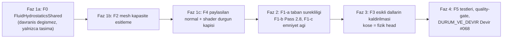

# Stratocraft — Durgun Su, Kazılmış Çukur Mesh'i ve Su Shader'ı Çözüm Dokümanı

> **Hazırlanma:** 2026-11-19 · **Referans:** `main` @ `9661445` (Devir #067) + uçuş düzeltmesi (commit edilmedi)
> **Kapsam:** (1) Durgun suyun akıyormuş gibi görünmesi, (2) su ile araziden oluşan yüzeyin birleşmemesi, (3) kazılmış çukurda suyun kırık, eğik levhalar halinde görünmesi.
> **Kapsam dışı:** Su donması (Görsel 1'de `-26°C` ortamda suyun buza dönmemesi), sel/şelale görünümü, dalga parametreleri. Ayrı iş olarak ele alınacak.

---

## 0. Yönetici Özeti

Sorunlar tek bir hatadan değil, **fizik ile mesh tarafının suyu iki farklı formülle hesaplamasından** doğuyor. Açık deniz ve düz tabanlı göllerde iki formül aynı sonucu verdiği için sorun görünmüyor. Kazma ile oluşturulan düzensiz SurfaceNets çukurlarında ise ayrışıyorlar.

**Ana tasarım kararı:** *"Fiziğin hesapladığı hidrostatik yükseklik (head) tek gerçek kaynaktır."* Kapasite, taban (bed) ve head hesapları tek bir paylaşılan modüle taşınır. Mesh bu sayıları **aynen** kullanır; kendi tahminini üretmez.

| # | Kök Neden | Çözüm | Risk | Faz |
| :--- | :--- | :--- | :---: | :---: |
| KN-1 | Alt hücre tam dolu değilse üst hücrenin tabanı 1 m aşağı atlıyor; su sonsuza kadar salınıyor | **F1:** Sürekli taban formülü + tik sonu sıkıştırma (yerçekimi) geçişi + salınım emniyet ağı | Orta | 2 |
| KN-2 | Mesh ve fizik kapasiteyi farklı hesaplıyor (kazma erozyonu hücreleri) | **F0 + F2:** Paylaşılan `FluidHydrostaticsShared` modülü, mesh fiziğin kapasitesini kullanır | Düşük | 1 |
| KN-3 | Mesh, üst üste binen suyu `180/120` eşikleriyle birleştiriyor; eşik dışı durumlar ayrı levha oluyor | **F3:** Köşe yüksekliği = sütun tepesindeki hücrenin fizik head'i; eşikli dallar kaldırılır | Orta | 3 |
| KN-4 | Shader eğik her üçgene akış animasyonu basıyor; normal hücre başına sabit | **F4:** Köşe başına paylaşılan yumuşak normal + shader'da "durgun su" kapısı | Düşük | 1 |
| — | Bu senaryolar test matrisinde yoktu | **F5:** Deney A–E kalıcı regresyon testi olur | — | 4 |

---

## 1. Kanıt Özeti (Unity 6 içinde gerçek kodla ölçüldü)

Ayrıntılar `SU_GORSEL_HATALARI_KOK_NEDEN_RAPORU.md` raporunda. Test betikleri F5'te kalıcı teste dönüşecek.

| Deney | Senaryo | Eğik üçgen (> 2°) | Yüzey Y aralığı | Durulma |
| :--- | :--- | :---: | :---: | :---: |
| A | Düz tabanlı kutu çukur, ideal denge | 0 / 98 | 0 mm | ✅ |
| B | A + kazma erozyonu (duvar dibinde yoğunluğu 30–63 olan hava hücreleri) | **73 / 98** | **670 mm** | ✅ (fizik dengede) |
| C | Düz kutu çukura kova ile dökme, 400 tik | 0 / 50 | 6 mm | ✅ 60. tikte |
| D | Düzensiz SurfaceNets çukuru + dökme, 400 tik | **22 / 36** | **590 mm** | ❌ 18 hücre sürekli aktif |
| E | Tam dolu olmayan hücrenin üstünde su | **116 / 236** | **1250 mm** | — |

**Kabul hedefi:** F1–F4 sonrası B, D ve E deneyleri, A ve C ile aynı sonucu vermeli: **eğik üçgen = 0** ve **yüzey aralığı ≤ 10 mm**. D ayrıca 120 tik içinde tamamen durulmalı.

---

## 2. F0 — Tek Gerçek Kaynak: `FluidHydrostaticsShared`

### 2.1. Sorun
- `Stratocraft.Voxel` derlemesi `Stratocraft.Physics`'e referans **veremez**. Bağımlılık yönü `Physics → Voxel` (bkz. `Stratocraft.Voxel.asmdef`).
- Bu yüzden mesher kapasite, taban ve yükseklik formüllerinin **kopyalarını** yazmış:
  - `ComputeSdfPorousCapacity`, `FluidPorosityUtility.ComputeCellFluidCapacity`'nin kopyası.
  - `ComputeHydrostaticSurfaceNetsBedMeters`, `ComputeCellBedElevationUnits255`'in kopyası.
  - `ComputeContinuousHydrostaticSurfaceY`, `ComputeCellHydrostaticHeadUnits255`'in kopyası.
- Kopyalar zamanla birbirinden ayrışmış.

### 2.2. Çözüm
Yeni dosya: `Assets/_Stratocraft/Voxel/Data/FluidHydrostaticsShared.cs` (namespace `Stratocraft.Voxel.Data`). Saf statik fonksiyonlar içerir, `0 B` GC üretir, Burst ile ve `.NET 10 Standalone` ile uyumludur.

```csharp
namespace Stratocraft.Voxel.Data
{
    /// <summary>Fizik CA ve FluidSurfaceSkirtMesher'in ORTAK hidrostatik matematigi (tek gercek kaynak).</summary>
    public static class FluidHydrostaticsShared
    {
        public const int FluidTypeMask = 0x03;

        // Fizikteki ComputeCellFluidCapacity'nin birebir tasinmis hali (mikro-maske parametresi dahil)
        public static byte ComputeCellFluidCapacity(uint solidRaw, ulong microMask64 = ulong.MaxValue);

        // Alt-voksel SurfaceNets zemin kotu [birim255]
        public static int ComputeCellBedElevationUnits255(uint belowSolidRaw, uint currentSolidRaw, int y);

        // F1 kurali ile SUREKLI hidrostatik taban (bkz. Bolum 3)
        public static int ComputeCellHydrostaticBedUnits255(
            uint belowSolidRaw, ushort belowFluidRaw, uint currentSolidRaw, byte activeFluidType, int y);

        public static int ComputeCellHydrostaticHeadUnits255(int bedUnits, int y, byte mass, byte capacity = 255);
        public static byte ComputeMassNeededForTargetHeadUnits255(int bedUnits, int y, int targetHeadUnits, byte capacity = 255);

        public static float UnitsToMeters(int units) => units * (1.0f / 255.0f);
    }
}
```

- `FluidPorosityUtility` içindeki aynı imzalı metodlar gövdelerini bu sınıfa **yönlendirir**. Genel API bozulmaz, `ComputeCellHydrostaticBedUnits255` için 15 çağrı noktası değişmez.
- Mesher'daki kopyalar **silinir**: `ComputeSdfPorousCapacity`, `ComputeHydrostaticSurfaceNetsBedMeters`, `ComputeColumnSurfaceNetsBedMeters`, `ComputeContinuousHydrostaticSurfaceY`.

---

## 3. F1 — Fizikte Sürekli Taban ve Garantili Durulma (KN-1)

### 3.1. F1-a: Sürekli taban formülü

**Mevcut kod** ([FluidPorosityUtility.cs#L103-L114](../Assets/_Stratocraft/Physics/Data/FluidPorosityUtility.cs#L103-L114)):
```csharp
if (belowFMass > 0 && sameType)
{
    byte belowCap = ComputeCellFluidCapacity(belowSolidRaw);
    if (belowCap > 0 && belowFMass >= belowCap) return y * 255;   // tam dolu -> y
}
return ComputeCellBedElevationUnits255(...);  // 248/255 dolu -> (y-1)*255  <-- 1 m SICRAMA!
```

**Yeni kod:**
```csharp
if (belowFMass > 0 && sameType)
{
    byte belowCap = ComputeCellFluidCapacity(belowSolidRaw);
    if (belowCap > 0)
    {
        if (belowFMass >= belowCap) return y * 255;
        // F1-a: Alt hucredeki su sutunun gercek parcasidir; taban, alt hucrenin su yuzeyidir.
        // belowFMass -> belowCap iken sonuc tam olarak y*255'e yaklasir (SUREKLI, 0 sicrama).
        return (y - 1) * 255 + (belowFMass * 255) / belowCap;
    }
}
```

| Durum | Eski taban | Yeni taban |
| :--- | :---: | :---: |
| Alt hücre 255/255 | 99.000 | 99.000 |
| Alt hücre 248/255 | **98.000** | **98.973** |
| Alt hücre 128/255 | 98.000 | 98.502 |

**Etkisi:** Deney D'deki `(8,99,7)` hücresinin head değeri 98.576'dan ≈ 99.55'e çıkar. Komşu hücreler artık bu hücreye su akıtmaz ve döngü kırılır.

### 3.2. F1-b: Tik sonu sıkıştırma geçişi (Pass 2.8)

Yanal geçişler, bir tik içinde suyu tam dolu olmayan bir hücrenin üstüne taşıyabilir. Mesh bu ara durumu görmemelidir.

`StepFluidGridVolumeConservative` içinde, 2.5 geçişinden (`RunDiagonalSteepSlopeEscapePass`) **sonra** ve 3. geçişten (`UpdateHydrostaticHeadAndSolveUPipes`) **önce** şu geçiş eklenir:

```csharp
// 2.8 Gecis: Tik Sonu Yercekimi Sikistirmasi — yalnizca bu tikte degisen (changedMask != 0) hucreler.
// Yanal gecislerin olusturdugu "dolu olmayan hucre ustunde su" ara durumlarini ayni tikte asagi indirir.
RunGravityCompactionPass(voxels, fluids, changedMask, sizeX, sizeY, sizeZ, windowMinY, windowMaxY, salinityBits, kinematicsSlice);
```

- 1. geçişteki yerçekimi döngüsü `RunGravityCompactionPass` adlı bir metoda çıkarılır ve iki yerden çağrılır.
- İkinci çağrı yalnızca `changedMask[idx] != 0` olan hücreleri işler. Maliyet ≈ aktif hücre sayısıyla sınırlıdır.
- Kütle korunur (ΔM = 0), tuzluluk ve kinematik aktarımı aynı yardımcılarla yapılır.

### 3.3. F1-c: Salınım emniyet ağı (son çare)

F1-a ve F1-b'ye rağmen ±1–2 birimlik ping-pong salınımı kalırsa (yuvarlama kaynaklı), sistem chunk düzeyinde bunu tespit edip suyu zorla durgun ilan eder:

```csharp
// ActiveChunkFluidKinematicsSlice'a eklenir
public byte QuiescentTicks;   // ardisik "neredeyse durgun" tik sayaci

// Pass 4 sonunda:
bool nearlyStill = maxAbsCellDeltaThisTick <= 2 && totalRemainingMass == massAtTickStart;
QuiescentTicks = nearlyStill ? (byte)Math.Min(255, QuiescentTicks + 1) : (byte)0;
if (QuiescentTicks >= 24)           // 2.4 sn @10 Hz
{
    SettleAllInWindow(fluids, windowStartCell, windowEndCell);   // SettleRaw + Vel = 0
}
```

- `maxAbsCellDeltaThisTick`, Pass 4 içinde `|PrevMass[i] - m|` değerlerinin maksimumu olarak hesaplanır. Ek dizi gerekmez.
- Oyuncu suya dokunduğunda, kova ile su döktüğünde ya da blok koyup kırdığında hücre zaten `WakeRaw` ile uyanır. Bu yüzden emniyet ağı gerçek akışı dondurmaz.

### 3.4. F1 riskleri ve önlemler

| Risk | Önlem |
| :--- | :--- |
| `WorldGen` deniz damgalaması (`StratocraftFloatingIslandWorldGen.cs:1731, 1896`) yeni tabanı kullanır | WorldGen suyu alttan üste ve tam dolu doldurur; yalnızca son katman kısmidir. Formül tam dolu durumda aynı sonucu verir. T04 sahil testi ile doğrulanacak. |
| Şelale / düşen su hücreleri (altı boş) | `belowFMass == 0` dalı değişmez; altı boş olan düşüş hâlâ `(y-1)*255` döner. |
| U-borusu / sifon (`UpdateHydrostaticHeadAndSolveUPipes`) | Head değerleri sürekli hale geldiği için sifon dengesi iyileşir. Mevcut U-borusu testleri zorunlu olarak koşulacak. |
| Lav (Bingham akma eşiği) | Lav için de aynı formül geçerli. `LavaBinghamYieldThreshold` korunur ve lav regresyon testleri koşulacak. |

---

## 4. F2 — Mesh Kapasitesini Fizikle Eşitlemek (KN-2)

**Değişiklik:** `FluidSurfaceSkirtMesher.cs` içindeki 7 `ComputeSdfPorousCapacity(...)` çağrısı (satır 832, 1739, 1954, 2021, 3496, 4125 ve L4330'daki tanım) `FluidHydrostaticsShared.ComputeCellFluidCapacity(...)` ile değiştirilir.

| Yoğunluk (ShapeId 0) | Eski mesh kapasitesi | Fizik kapasitesi = yeni mesh kapasitesi |
| :---: | :---: | :---: |
| 0–32 | 255 | 255 |
| 40 | 224 | **255** |
| 60 | 143 | **255** |
| 64–95 | 127…2 (katı hücrede su!) | **0** (katı) |
| ≥ 96 | 0 | 0 |

**Etkisi:** Kazma erozyonu hücrelerinde su artık 1.2–1.8 kat kalın çizilmez. Deney B'de beklenen sonuç: eğik üçgen = 0, aralık ≤ 10 mm.

> [!NOTE]
> Mimari şekiller (`HalfSlab = 128`, `Ramp45 = 128` vb.) için mesh daha önce kapasiteyi her zaman 255 kabul ediyordu (`ShapeId != 0 → 255`). Yeni kodla fizikle aynı kısmi kapasiteyi kullanır, böylece yarım levha üstündeki su da fizikle aynı yükseklikte çizilir.

---

## 5. F3 — Köşe Yüksekliğini Fiziğin Head Değerinden Almak (KN-3)

### 5.1. Kural
Bir köşenin su yüksekliği, onu paylaşan 4 hücrenin **sütun tepesi head değerlerinin** ortalamasıdır:

```text
SutunTepesiHead(x, z) =
    sutundaki en ustteki ayni tip su hucresinin (yTop)
    FluidHydrostaticsShared.ComputeCellHydrostaticHeadUnits255(
        ComputeCellHydrostaticBedUnits255(... yTop ...), yTop, mass, capacity) / 255f
```

- **Havuz rejiminde** (`isPoolRegime`) bu değer doğrudan kullanılır. Kurganov–Petrova "lake-at-rest" kuralı da tam olarak budur ve fizik denge kurduğunda değerler **bit bit aynı** çıkar.
- **Yamaç / ince film rejiminde** mevcut `snTerrainY` zarfı, kıyıda incelme (`feather`) ve savak (`brink`) mantıkları **korunur**. Yalnızca `wetCurrSurfSum` toplamına giren değerler fiziğin head değerine dönüşür.

### 5.2. Kaldırılacak / sadeleşecek kod

| Konum | İşlev | F3 sonrası |
| :--- | :--- | :--- |
| [L722-L732](../Assets/_Stratocraft/Voxel/Jobs/FluidSurfaceSkirtMesher.cs#L722-L732) | `level < 120` CFL damlasını atlama | Kaldırılır; F1-b sonrası bu ara durum tik sonunda oluşmaz |
| [L734-L743](../Assets/_Stratocraft/Voxel/Jobs/FluidSurfaceSkirtMesher.cs#L734-L743) | `isGroundedCflMerged` (`180/120`) birleştirmesi | Kaldırılır; üst yüzey yalnızca "üstünde aynı tip su yok" kuralıyla seçilir |
| [L1946-L1978](../Assets/_Stratocraft/Voxel/Jobs/FluidSurfaceSkirtMesher.cs#L1946-L1978) | Köşede `curFMass < 180 && aboveFMass < 120` birleştirmesi | `SutunTepesiHead` ile değiştirilir |
| L2025–L2040 | `sampleIsPool` rejim anahtarı (`ComputeExactHydrostaticThickness` / `MassToFluidThicknessWithCapacity`) | Tek formül: `ComputeCellHydrostaticHeadUnits255` |

### 5.3. Güvenlik kilidi
Durulmuş (`IsSettled`) ve havuz rejimindeki köşeler için ek bir kural eklenir: 3×3 komşulukta head farkı `≤ 3` birim (≈ 1.2 cm) ise köşe değeri **komşuluğun ortanca (median) değerine** sabitlenir. Bu, yuvarlamadan kalan mikro eğimleri de sıfırlar.

---

## 6. F4 — Yumuşak Normaller ve Shader'da "Durgun Su" Kapısı (KN-4)

### 6.1. Mesher: köşe başına paylaşılan normal
Şu an her hücre kendi düz normalini (`smoothCellNormal`, L806–L812) 4 köşesine yazıyor. Bu yüzden komşu hücreler arasında ışık keskin değişiyor.

**Yeni yaklaşım:** Zaten var olan `17×17` köşe önbelleğinden (`cornerGrid`) merkezi fark ile köşe normali hesaplanır:

```csharp
// (cx, cz) kosesi icin: komsu kose yukseklikleri ile merkezi fark
float hL = TopY(cx - 1, cz), hR = TopY(cx + 1, cz);
float hD = TopY(cx, cz - 1), hU = TopY(cx, cz + 1);
Vector3 cornerNormal = Vector3.Normalize(new Vector3(hL - hR, 2.0f, hD - hU));
```

- Önbellekte olmayan (kıyı / chunk sınırı) komşularda tek yönlü fark kullanılır.
- Aynı köşeyi paylaşan tüm hücreler **aynı normali** kullanır. Düz suda normal `(0, 1, 0)` olur.

### 6.2. Shader: durgun su kapısı
[StratocraftFluidSurface.shader#L377-L383](../Assets/_Stratocraft/Rendering/Shaders/StratocraftFluidSurface.shader#L377-L383) şu anda eğimi **yalnızca üçgenin yüz normalinden** (`ddx/ddy`) türetiyor.

1. `subTickDy` vertex aşamasından fragment aşamasına taşınır (`flowAndFoam` yanına yeni bir `TEXCOORD`).
2. **Durgunluk maskesi:**
   ```hlsl
   float stillness01 = (1.0 - saturate(flowSpeed * 6.0)) * (1.0 - saturate(abs(input.subTickDy) * 40.0));
   ```
3. **Eğim akışı kapısı:** eğim, yüz normali yerine **interpole edilmiş yumuşak normalden** hesaplanır ve durgunlukla bastırılır:
   ```hlsl
   float slopeSin = saturate(length(geomNormalWS.xz));                         // faceNormalWS yerine
   float slopeFlowMask = smoothstep(0.12, 0.38, slopeSin) * (1.0 - sideWallMask) * (1.0 - stillness01);
   ```
4. Hızlı akış çizgileri (`slopeRapidGate`) ve beyaz akış rengi (`flowingContrastBoost`) aynı `(1 - stillness01)` çarpanını alır.
5. `faceNormalWS` yalnızca `sideWallMask` (dikey şelale / etek tespiti) için kullanılmaya devam eder.

**Sonuç:** Durulmuş havuz ve çukur suyu yalnızca rüzgâr dalgacıkları ve yansıma gösterir. Gerçek akan derelerde hız ≠ 0 olduğu için mevcut akış görünümü korunur.

### 6.3. Şeffaflık sıralaması (isteğe bağlı, F1–F3 sonrası değerlendirilir)
`ZWrite On` + alfa karışımı + `Cull Off`, üst üste binen su levhalarında sıralama hatası üretiyor. F1 ve F3 sonrası üst üste binen levhalar ortadan kalkacağı için bu büyük ölçüde etkisizleşir. Hâlâ görülürse:
- Üst yüzey için `ZWrite Off` + chunk bazlı kameraya uzaklık sıralaması,
- ya da URP'de iki geçişli yöntem: önce yalnızca derinlik (depth prepass), ardından renk.

---

## 7. F5 — Test Matrisi ve Kabul Kriterleri

Yeni test sınıfı: `Assets/Tests/EditMode/Paket4B3StillWaterPitAndShaderTests.cs`. Hem Unity EditMode hem `.NET 10 Standalone` ortamında çalışır. Testler `scratch/pit_*.cs` betiklerinden türetilir.

| Test | Senaryo | Kabul Kriteri |
| :--- | :--- | :--- |
| **T01** | Deney A: düz kutu çukur, ideal denge | Eğik = 0, aralık ≤ 1 mm (regresyon kilidi) |
| **T02** | Deney B: kazma erozyonlu çukur, ideal denge | Eğik = 0, aralık ≤ 10 mm (F2) |
| **T03** | Deney C: kutu çukura kova ile dökme | ≤ 80 tikte `unsettled = 0`, aralık ≤ 10 mm |
| **T04** | Deney D: düzensiz SurfaceNets çukuru + dökme | ≤ 120 tikte `unsettled = 0`, eğik = 0, aralık ≤ 10 mm, ΔM = 0 (F1) |
| **T05** | Deney E: tam dolu olmayan hücrenin üstünde su (tek tik) | Pass 2.8 sonrası "dolu olmayan hücrenin üstünde su" sayısı = 0 (F1-b) |
| **T06** | Taban sürekliliği | `belowFMass = 0..255` boyunca taban monoton artar; ardışık adım farkı ≤ 2 birim (F1-a) |
| **T07** | Mesh ve fizik eşliği | Rastgele 1.000 hücre durumunda `FluidHydrostaticsShared` ile mesh köşe yüksekliği farkı ≤ 0.5 mm (F0 / F3) |
| **T08** | Paylaşılan normaller | Düz havuzda tüm üst köşe normalleri `(0, 1, 0)` ± 0.001; ortak köşelerde normal farkı = 0 (F4) |
| **T09** | Durgunluk emniyet ağı | ±1 birimlik ping-pong senaryosunda ≤ 24 tikte `QuiescentTicks` tetiklenir ve tüm hücreler durgun olur (F1-c) |

**Zorunlu regresyon:**
- Standalone `.NET 10`: `204/204` + yeni 9 test.
- Unity EditMode: `Paket4B2SmoothHydrostaticAndBurstFluidTests` (T01–T29), `Paket4C1`–`4C3`, `Paket4BFluidWindAndWinterTests`.
- `scripts/quality-gate.ps1 -Phase 4`, VRAM `< 16.0 MB`, `0 B/kare` GC.

---

## 8. Uygulama Sırası



| Faz | Dokunulan dosyalar | Doğrulama noktası |
| :--- | :--- | :--- |
| **1a** | `Voxel/Data/FluidHydrostaticsShared.cs` (yeni), `Physics/Data/FluidPorosityUtility.cs` | `204/204` aynen geçmeli (sıfır davranış değişikliği) |
| **1b** | `Voxel/Jobs/FluidSurfaceSkirtMesher.cs` | T01, T02 |
| **1c** | `FluidSurfaceSkirtMesher.cs`, `Rendering/Shaders/StratocraftFluidSurface.shader` | T08 + PlayMode görsel kontrol |
| **2** | `FluidHydrostaticsShared.cs`, `Physics/Jobs/FluidCellularAutomataJob.cs`, `ActiveChunkFluidKinematicsPool.cs` | T03–T06, T09 + U-borusu / sifon / sahil / lav regresyonu |
| **3** | `FluidSurfaceSkirtMesher.cs` | T07 + tüm `Paket4B2` T01–T29 |
| **4** | `Assets/Tests/EditMode/Paket4B3StillWaterPitAndShaderTests.cs` (yeni), `DURUM_VE_DEVIR.md`, `docs/test-raporlari/faz4b3-raporu.md` (yeni) | `quality-gate.ps1 -Phase 4` PASS |

> [!TIP]
> Faz 1 (a + b + c) tek başına bile Görsel 2'deki kenar kırıklarını ve Görsel 1'deki "kırık cam" ışığını büyük ölçüde giderir. Fizik çekirdeğine dokunmadığı için ilk teslim olarak önerilir. Faz 2, "durgun su akıyor" hissini kökten çözer.

---

## 9. Canlı PlayMode Kontrol Listesi (kullanıcı testi)

1. **Kazılmış çukur:** Doğal toprakta kazma ile düzensiz bir çukur aç, kova ile 3–4 kez su dök. **Beklenen:** 3–5 sn içinde düz ayna gibi bir yüzey, kenarlarda araziye gömülü dikişsiz temas, kırık levha olmaması.
2. **Durgunluk:** `[F3]` HUD'da su chunk'ının aktif (`unsettled`) sayısı 0'a inmeli. Yüzeyde yalnızca hafif rüzgâr dalgacıkları görünmeli; akış çizgileri ve köpük olmamalı.
3. **Akan dere hâlâ akmalı:** Yamaçtan su döküldüğünde akış çizgileri, köpük ve şelale perdesi korunmalı (Paket 4B görünümü).
4. **Buzul / kar biyomu:** Görsel 1'deki ortamda düz göl yüzeyi tek parça görünmeli. (Donma davranışı bu dokümanın kapsamı dışında.)
5. **Sahil / deniz:** `90.000 m` ayna düzlüğü ve kıyı dikişi değişmemiş olmalı.
6. **Performans:** FPS ≥ 100 (önceki ile aynı), `0 B/kare` GC.

---

## 10. Açık Sorular

1. **Faz 1 tek başına teslim edilsin mi?** Önerim evet: düşük risk, hızlı görsel kazanım. Faz 2–3 ayrı commit olarak gelir.
2. **F1-c eşiği:** 24 tik (2.4 sn) yeterli mi, yoksa daha sabırlı bir değer mi (örneğin 40 tik / 4 sn) isteniyor?
3. **Su donması:** `-26°C` ortamda göl yüzeyinin buza dönmesi ayrı bir iş olarak planlansın mı?
