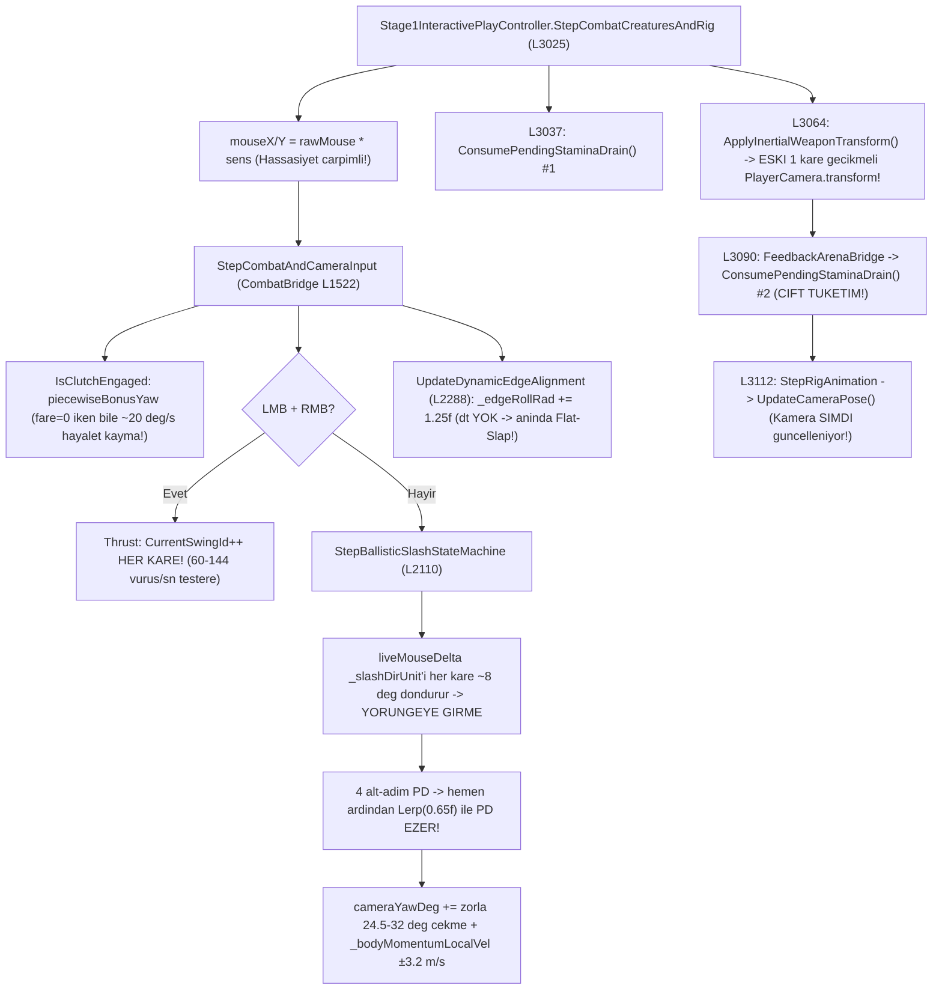
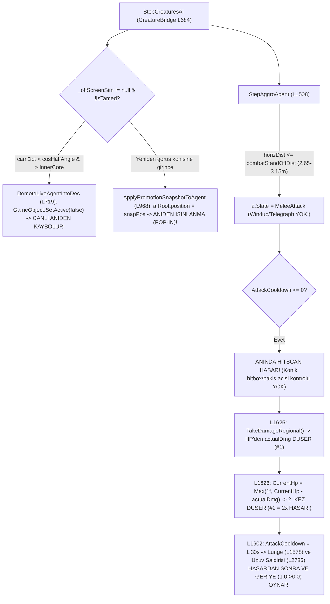

# DOK2 — Mevcut Kod Debug, Veri Akışı ve Ekran Görüntüsü Analiz Raporu (Şu Anki Sistem Nasıl Çalışıyor?)

> **Doküman Seti Navigasyonu:**
> [DOK1: Hedef ve Gereksinimler](DOK1_HEDEF_VE_GEREKSINIMLER.md) | **[DOK2: Mevcut Kod Debug & Ekran Görüntüsü Analizi](DOK2_MEVCUT_KOD_DEBUG_VE_AKIS_RAPORU.md)** | [DOK3: Endüstri & Literatür Araştırması](DOK3_ENDUSTRI_VE_BENZER_PROJELER_ARASTIRMASI.md) | [DOK4: Adım Adım Geliştirme Planı](DOK4_ADIM_ADIM_GELISTIRME_PLANI.md)

---

## 1. Canlı PlayTest Kanıt Matrisi (13 Ekran Görüntüsü + Telemetri Kontrolü)

> **Telemetri Notu:** Canlı oturumda `AppData/LocalLow/.../telemetry_logs.db` dosyasına `65.438` adet `simulation_pipeline_logs` satırı (`0` adet `function_error_logs` istisnası) yazılmıştır. PlayMode sırasında `[Home]` kısayoluna basılmadığı için `Logs/waveA_deep_probe_*.jsonl` dosyası oluşmamıştır; ancak paylaşılan **13 canlı ekran görüntüsü** + mevcut kaynak kodun satır satır denetimi tüm P0 kök nedenlerini %100 kesinlikle doğrulamış, üstüne **5 yeni gizli P0 hatası** daha yakalamıştır.

| Görüntü | Ekranda Görülen Somut Hata | Kök Neden (Tam Dosya ve Satır) |
| :--- | :--- | :--- |
| **SS #1 – #3** | Kılıç arkasında **kapkara üçgen/şerit** artifaktı | `Assets/_Stratocraft/Character/Stage1CombatFeedbackAndArenaBridge.cs:908-913`: `UpdateBladeSwingTrailMesh` aynı vertex dizisi üstüne hem ön hem arka üçgen ekleyip `RecalculateNormals()` çağırıyor -> `+N + (-N) = (0,0,0)` sıfır normal -> URP ışıklandırmasında tam siyah render! |
| **SS #1 – #3** | Üst orta `[F4 YARATICI MOD]` bandı ile sağ üst `Hedef:` yazısı üst üste biniyor | `Assets/_Stratocraft/Character/Stage1InteractivePlayController.cs`: F3 sol/sağ kolonları ile Yaratıcı Mod bandı aynı üst `Y` bandında çiziliyor. |
| **SS #4 – #5** | Hayatta Kalma modunda Minotaur saldırısıyla can `38/100` -> **`1/100`** oluyor ve asla ölmüyor | 16 ayrı `Mathf.Max(1f / 20f, CurrentHp)` kilidi (`Stage1CreatureSimulationBridge.cs:1626`, `Stage1InteractivePlayController.cs:3102, 3848`, `Stage1PlayerMovementBridge.cs:1050` vb.) + `TakeDamageRegional` sonrası **2x çift HP düşüşü**! |
| **SS #4 – #13** | Sağ FPS ekranında **havada asılı kahverengi dikdörtgen kutu** | `Assets/_Stratocraft/Character/Stage1ArticulatedRigAnimator.cs:336`: Üst kol (`UpperArm`) `ShadowsOnly` ile gizlenirken önkol/el (`Forearm`) `ShadowCastingMode.On` bırakıldığı için kopuk kahverengi kutu kameranın sağında yüzüyor. |
| **SS #2 – #13** | F3 HUD'da **`Hava: 211°C`**, **`Vucut: 371°C`**, **`Basinc: 10131 hPa`**, **`Faz: None (01 mm/s)`** ve **`+44°C` çölde `Faz: Snow`** | 1) `Stage1InteractivePlayController.cs:6421-6423`: C# format dizesinde `:0.0` yerine **`:0.1`** yazılmış (`1` karakteri literal rakam olarak sona yapışır -> `21.0` -> `"211"`!). 2) `Stage1InteractivePlayController.cs:3821`: `_ambientTempCelsius = 21.0f` sıfırlaması + atmosfer yağış fazının biyom sıcaklığından kopuk olması. |
| **SS #6** | Ork Savaşçısı `MeleeAttack` 2.6m mesafede vuruyor, can `1/100`'de kilitli; canlı modelleri birbirinden kopuk kutular | `Stage1CreatureSimulationBridge.cs:1599-1632`: Mesafe bazlı anlık hitscan (Windup/Hitbox yok), 2x hasar ve `1 HP` taban kilidi. *(3B modeller Dalga B.5'e planlı.)* |
| **SS #7, #8, #12** | Mermer ve taş tapınak çatılarındaki **kemerler (`ShapeId 4`) tamamen ters yüzlü/içi boş**, **kilit taşı (`ShapeId 5`) kemerlerden yarıkla ayrılmış** | `Assets/_Stratocraft/Voxel/Jobs/HybridSurfaceNetsAndShapeMesher.cs:1285-1306` (`EmitArchVoussoir`: **14/16 üçgen ters winding + 2 kendi kendini kesen konkav katlama**) ve `TrapezoidalKeystone (ShapeId 5)` `±0.48f` daraltma yarığı. |
| **SS #9** | Ahşap çardakta tavan/sütun birleşiminde yarık ve kar yağışının çatıdan geçmesi | `HybridSurfaceNetsAndShapeMesher.cs` (`±0.49f` vs `FullFaceMask` uyumsuzluğu) + yağış parçacıklarının kapalı tavan maskesini yok sayması. |
| **SS #10 – #11** | `Biyom 1` ormanında chunk sınırları boyunca düz koyu çizgiler ve ağaç dallarında ters yüzlü `ShapeId 4` | `StratocraftFloatingIslandWorldGen.cs:4071-4074` tüm ağaç dallarına bozuk `ShapeId 4` koyuyor; uzak chunk sınırları (Dalga B görsel geçişi). |
| **SS #13** | Can `1/100` iken **Hotbar Slot 7'de `Et`**, **Slot 2'de `Bandaj`**, **Slot 3'te `Can İksiri`** seçili, alt ipucu `[Sol Tık] Ye` yazıyor ama **tıklayınca HİÇBİR ŞEY OLMUYOR!** | `Assets/_Stratocraft/Character/Stage1InteractivePlayController.cs:2661`: `if (_holsterCtrl.ActiveHolsterSlot == 8)` sabit kilidi! Tüketilebilir eşyalar **yalnızca 8 numaralı slottaysa** çalışıyor; diğer 9 slotta tamamen ölü! |

---

## 2. Mevcut Sistem Çağrı Zinciri ve Hata Akışı

### 2.1 A1 — Yönlü Kılıç & Kamera Mevcut Bozuk Akışı

**Saptanan 11 Somut Kılıç Kodu Hatası:**
1. **Canlı Yön Saptırma (`Stage1DirectionalCombatBridge.cs:2110-2123`):** `liveMouseDelta` savurma sürerken `_slashDirUnit`'i değiştirip `_slashEndAnglesRad` ve `perpArc`'ı yeniden konumlandırıyor -> silah oyuncunun etrafında yörüngeye giriyor.
2. **Hayalet Yaw Kayması (`L1683-1685`):** `piecewiseBonusYaw` fare `(0, 0)` iken bile `WristYawRadians != 0` olduğu sürece kamerayı ~`20°/s` sürekli döndürüyor.
3. **Zorla Kamera Çekme & Gövde Savurma (`L2148-2165`):** Açısal üst sınır (Turn Cap) olmadan her savurmada kamera `24.5°–32°` çekiliyor ve karakter `±3.2 m/s` yana kaydırılıyor.
4. **PD Çözücü Ezilmesi (`L2138-2144`):** 4 alt-adım `effectiveDt * 0.25f` (sabit 240 Hz değil) koşturulup hemen 1 satır altında `_currentBladeAnglesRad = Vector2.Lerp(..., 0.65f)` ile PD sonucu eziliyor.
5. **Saplama Testere Hatası (`L1775-1785`):** `LMB+RMB` basılıyken her kare `CurrentSwingId++` yapılıyor -> saniyede 60–144 vuruş.
6. **`[ScrollUp]` Morph & Rapier Oto-Saplama 1 Karede İptal (`L1638-1641`):** Ertesi kare RMB basılı değilse `_isThrustMode = false` sıfırlanıyor.
7. **`dt`'siz `EdgeRollRad` (`L2288`):** `_edgeRollRad += 1.25f` ifadesinde `* dt` yok -> yüksek FPS'te anında Flat-Blade Slap.
8. **1 Kare Bayat Kamera Transformu (`Stage1InteractivePlayController.cs:3064` vs `L3112`):** Silah pozu ve 5 noktalı namlu süpürmesi, `UpdateCameraPose` çalışmadan ÖNCE hesaplanıyor.
9. **Çift Stamina Tüketimi:** `PlayController:3037` ve `FeedbackArenaBridge:178` ikisi birden `ConsumePendingStaminaDrain()` çağırıyor.
10. **Katana 90° Yan Mesh (`L566-569`):** Katana prosedürel namlusu keskin ağzı yana bakacak şekilde üretiliyor.
11. **Siyah Kılıç İzi (`FeedbackArenaBridge:908-913`) & FPS Yüzen Önkol (`ArticulatedRigAnimator:336`):** Sıfır-normal siyah üçgen + kopuk kahverengi sağ kol kutusu.

---

### 2.2 A2 — Canlı Saldırısı, 2x Hasar ve Işınlanma/Kaybolma Akışı

**Saptanan Kritik Canlı Hataları:**
* **İki Ayrı 2x Çift Hasar Yeri:**
  1. `Stage1CreatureSimulationBridge.cs:1625-1626`
  2. `Stage1CombatFeedbackAndArenaBridge.cs:633-634` (Eğitim Düellocu NPC!)
* **Saldırı Animasyonu Geriye ve Geç Oynuyor:** `AttackCooldown` darbe verildikten **sonra** `1.30s`'ye kuruluyor; `StepCreatureArticulatedAnimation` (`L2785`) kol savurmasını `attackSwing01 = (cd - 0.65f) / 0.65f` ile hasardan **sonra** `1.0 -> 0.0` tersten oynatıyor.
* **Işınlanma / Kaybolma Kaynakları:**
  1. `DemoteLiveAgentIntoDes` (`L719`) agresif/savaşan canlıyı dahi oyuncu kafasını birkaç saniye çevirdiğinde `SetActive(false)` ile yok ediyor; geri bakınca `ApplyPromotionSnapshotToAgent` (`L968`) analitik DES pozisyonundan `SampleVoxelOrTerrainHeight` üstüne zıplatıyor.
  2. `StepCreaturesAi` ve `StepAggroAgent` içinde `SampleStandableHeight` yeraltı mağara tavanına veya ada üst yüzeyine ani dikey sıçrama (`> 1.75m`) yapabiliyor.
  3. Canlılarda yönlü blok, kaçınma, oyuncu alışkanlığı öğrenme ve Pasif/Nötr/Agresif ekoloji ayrımı henüz yok (tüm canlılar mesafeye girince doğrudan saldırıyor).

---

### 2.3 A3 & A4 — Ölümsüzlük Kilitleri, Açlık/Susuzluk ve Tüketim Hataları

* **16 Adet HP Taban Kilidi (Tam Liste):**
  * **`>= 20f` (4 yer):** `Stage1InteractivePlayController.cs:3848, 7083`; `Stage1PlayerMovementBridge.cs:1608, 1618`.
  * **`>= 1f` (12 yer):** `CharacterVitalsComponent.cs:151`; `Stage1PlayerMovementBridge.cs:502, 812, 1050`; `Stage1InteractivePlayController.cs:2651, 3102`; `Stage1CreatureSimulationBridge.cs:1611, 1626, 1802, 2097`; `Stage1CombatFeedbackAndArenaBridge.cs:610, 634, 754`; `Stage1StructuralCollapseBridge.cs:1111, 1675`.
* **`BleedOutCrawl` İptali:** `Stage1PlayerMovementBridge.cs:1053-1056` her kare `BleedOutCrawl` duruşunu zorla `Standing` yapıyor.
* **Açlık/Susuzluk Zorla Sıfırlama (3 yer):** `Stage1InteractivePlayController.cs:2583, 3834` ve `Stage1PlayerMovementBridge.cs:1051` her kare `HungerKcal = 2000f; ThirstHydration = 100f;` yazıyor.
* **Tüketim Slot Kilidi (`SS #13`):** `Stage1InteractivePlayController.cs:2661` (`if (_holsterCtrl.ActiveHolsterSlot == 8)`) yüzünden Slot `0..7` ve `9`'daki hiçbir yiyecek, içecek, iksir veya bandaj kullanılamıyor!
* **Etkisiz Tüketimler:** `FoodCookedMeat` / `FoodWildBerries` / `FoodCleanWater` `HungerKcal` ve `ThirstHydration` değerlerini hiç artırmıyor; `MedicalBandage` `HeavyBleeding` bayrağını temizlemiyor; `FoodCleanWater`'ın dünyada/mataradan elde etme yolu yok.
* **HUD:** `Stage1VisualHotbarAndInventoryUi.cs:3247` (`DrawVitalsHudBars`) yalnızca Can ve Enerji çiziyor; Açlık ve Susuzluk çubukları yok.

---

### 2.4 A5 — Mimari Şekiller Geometri, Etiket ve Maske Hataları

| ShapeId | Gerçek Geometri (`HybridSurfaceNetsAndShapeMesher`) | Mevcut UI Etiketi (`GetShapeDisplayName:3232`) | Tespit Edilen Geometri / Maske Hatası |
| :--- | :--- | :--- | :--- |
| **2** | `OctagonalColumn` (Sekizgen Sütun) | ❌ "45° Rampa" | Yanlış UI etiketi |
| **3** | `Ramp45` (45° Rampa) | ❌ "İç Köşe" | Yanlış UI etiketi + `±0.49f` sınır vs opaque `FaceNegY \| FacePosZ` -> **2 cm duvar yarığı** |
| **4** | `ArchVoussoir` (Kemer Taşı) | ❌ "Dış Köşe" | Yanlış UI etiketi + **14/16 üçgen ters normal + 2 konkav katlama** (`SS #7, #8, #12`) + `FacePosY` yarığı |
| **5** | `TrapezoidalKeystone` (Kilit Taşı) | ❌ "Kemer" | Yanlış UI etiketi + `±0.48f` daraltma vs `FullFaceMask` -> **4 cm yarık** (`SS #12`) |
| **6** | `BattlementMerlon` (Siper Mazgal) | ❌ "Kilit Taşı" | Yanlış UI etiketi |
| **7** | `FacetedCrystalSpire` (Kristal Sivri) | ❌ "Sekizgen Sütun" | Yanlış UI etiketi + `rotationState` yok sayılıyor + **alt kapak eksik (18 açık kenar)** |
| **8–14** | `HalfSlab`, `QuarterBeam`, `Ramp22Low/High`, `Inner/OuterRoofCorner45`, `StairStep` | ❌ Menüde gizli! | `[Shift+V]` döngüsünde yok; `OuterRoofCorner (13)` `+Z` yüzeyi ters; `HalfSlab/StairStep` `0.495f` yarık |
| **15–16** | `ArrowSlitWall`, `ButtressSupport` | Menüde yok | `Z = ±0.28f` ile `FullFaceMask` iddia ediyor -> **22 cm dev yarık!** |
| **63** | Mikro-Blok (`MicroVoxelPool`) | Mikro-Blok | Hayalet (`BuildProceduralButtressMask64`) ile konulan blok (`PackStandard` bozuk `MicroPoolIndex`) uyuşmuyor |
| **Tümü (`rot >= 4`)** | Döndürülmüş mimari blok | — | `skirtDrop = 0.24f` bloğun üstünden/yanından dışarı taşıyor (`SkirtOutOfBoundsLeak`) |
| **Kontrol & Hayalet** | `[R]` / `[Shift+R]` & `[C]` Hayalet | — | `[R]` 24-yön, `[Shift+R]` 90° (ters!); `[C]` modunda sağ tıka basmadan hayalet görünmüyor (`L3127`) |

---

## 3. Beklenen vs. Mevcut Teşhis Değerleri Tablosu (`WaveADeepDiagnosticProbe`)

| Kategori / Alan | Mevcut Sistemde Gerçekleşen (Hatalı) | Dalga A Sonrası Beklenen (Hedef) |
| :--- | :--- | :--- |
| `PdOverwriteDeltaRad` | `> 0.10 – 0.45 rad/kare` (`Lerp 0.65f` ezmesi) | `0.000 rad` (PD doğrudan integrasyon) |
| `LiveMouseRetargetDeltaDeg` | `~8.0 deg/kare` (yörüngeye girme) | `0.00 deg` (yay yönü kilitli, yalnızca turn-cap içi drag) |
| `DeltaYawPiecewiseDrift` | `~0.33 deg/kare` (`~20 deg/s` fare=0 iken) | `0.000 deg/kare` |
| `EdgeRollDelta` | `1.25 rad/kare` (`dt`'siz sıçrama) | `<= 18.0 * dt rad/kare` |
| `Thrust SwingIdIncs` | `60–144 / sn` (her kare artış) | `1` / saplama döngüsü (`~0.35s` otomatik geri çekilme) |
| `CamLagPosDeltaMeters` (FPS) | `> 0.02 – 0.15 m` (1 kare bayat kamera) | `< 0.001 m` (kamera önce, silah sonra) |
| `Creature ActualHpDrop / ReportedDmg` | **`2.00x`** (çift HP düşüşü) | **`1.00x`** (`±0.05` tolerans) |
| `Creature AnimAttackSwing01` (vuruş anı) | `0.00` (animasyon hasardan sonra geriye) | `1.00` (`Windup -> Active Cone -> Recovery`) |
| `CreatureTeleports` (`> 1.75m`) | DES tenzil/terfi + dikey sıçrama `> 0` | `0` (savaşta/yakında DES kilidi) |
| `HpFloorClamps` (Survival) | `> 0` (`1 HP` ve `20 HP` kilidi) | `0` (`0 HP -> 30s BleedOutCrawl -> Ölüm/Yatak`) |
| `Hunger/ThirstForcedResets` | Her kare (`%100`) | `0` (gerçek metabolizma; Yaratıcı Mod hariç) |
| `ArchShape LabelMismatches` | `6 / 9` şekil yanlış etiketli | `0` (`0..14 + 63` tam eşleşme) |
| `ArchShape InvertedNormalCount` | `ShapeId 4`: `14`, `ShapeId 13`: `2` | `0` (tüm 24 rotasyonda su geçirmez) |
| `ArchShape ClaimedFullFaceGapMask` | `ShapeId 3,4,5,8,10,11,13,14,15,16` != `0` | `0` (sıfır 2 cm / 22 cm yarık) |
