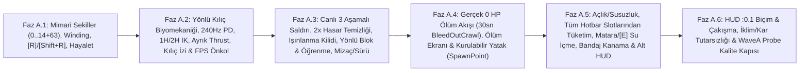

# DOK4 — Dalga A (P0) Adım Adım Geliştirme ve Doğrulama Planı (Nasıl Geliştireceğiz?)

> **Doküman Seti Navigasyonu:**
> [DOK1: Hedef ve Gereksinimler](DOK1_HEDEF_VE_GEREKSINIMLER.md) | [DOK2: Mevcut Kod Debug & Ekran Görüntüsü Analizi](DOK2_MEVCUT_KOD_DEBUG_VE_AKIS_RAPORU.md) | [DOK3: Endüstri & Literatür Araştırması](DOK3_ENDUSTRI_VE_BENZER_PROJELER_ARASTIRMASI.md) | **[DOK4: Adım Adım Geliştirme Planı](DOK4_ADIM_ADIM_GELISTIRME_PLANI.md)**

---

## 1. Uygulama Fazları ve Bağımlılık Diyagramı

Her alt faz bağımsız derlenebilir, saf C# birim testleriyle (`.NET 10`) doğrulanabilir ve mevcut sistemleri bozmadan kademeli olarak inşa edilir:

---

## 2. Faz Faz Teknik Geliştirme Detayı

### Faz A.1 — Mimari Şekiller (`0..14 + 63`), Su Geçirmez Winding, Rotasyon ve Hayalet (`DOK1 WP-A5`)
* **Değişecek Dosyalar:**
  * `Assets/_Stratocraft/Voxel/Jobs/HybridSurfaceNetsAndShapeMesher.cs`
  * `Assets/_Stratocraft/Voxel/Data/ArchitecturalShapeCatalog.cs`
  * `Assets/_Stratocraft/Character/Stage1MatterCrystalAndMiningController.cs`
* **Yapılacaklar:**
  1. **`EmitArchVoussoir` (`ShapeId 4, 18, 55..58`) Yeniden Yazımı:** Konkav boşluğu içbükey olmayan konveks kemer dilimleri (4 parçalı kapalı kemer yay bloğu) olarak dışa dönük winding ile yeniden yaz (`InvertedNormalCount == 0`, `OpenBoundaryEdgeCount == 0`, üst yüz tam `±0.50f` -> `FacePosY` sıfır yarık).
  2. **`EmitRoofCorner` (`ShapeId 13, 39..42`) & `EmitSlopedRamp` (`ShapeId 3, 10, 11`):** `+Z` ters üçgenini düzelt; tüm dış kenarları `±0.49f` yerine tam `±0.50f` değerine kilitle.
  3. **`EmitFacetedCrystalCluster` (`ShapeId 7`):** Tüm köşeleri `RotateArchitecturalPoint(p, rotationState)` ile döndür ve kapalı alt taban kapağı (bottom cap) ekle.
  4. **`HalfSlab (8)`, `StairStep (14)`, `TrapezoidalKeystone (5)`, `ArrowSlitWall (15)`, `ButtressSupport (16)`:** Tam yüz kapamayan şekillerde `ArchitecturalShapeCatalog.FullFaceLut` maskesini kesin gerçek kapalı yüzlerle eşitle; tam kapayanlarda `0.495f -> 0.50f` yap.
  5. **Döndürülmüş Etek Koruması:** `ExtendFoundationSkirt` yalnızca `rotationState < 4` (taban `-Y` yönünde) iken uygulansın.
  6. **Etiket, Menü ve Tuşlar (`Stage1MatterCrystalAndMiningController.cs`):**
     * `ShapeWheelCycle` dizisini `{ 0, 1, 2, 3, 4, 5, 6, 7, 8, 9, 10, 11, 12, 13, 14, 63 }` olarak genişlet.
     * `GetShapeDisplayName` içindeki tüm etiketleri (`0..14 + 63`) kanonik katalog isimleriyle birebir eşleştir.
     * `[R]` = Yatay `90°` Yaw (`0..3`), `[Shift+R]` = 24-Yönlü 3B SO(3) (`0..23`) olarak takas et.
     * `[C]` Kristal açık ve mimari şekil seçiliyken sağ tıka basmadan da **hayalet önizlemeyi sürekli göster**.
     * `ShapeId 63` yerleştirme ve hayaletini aynı geçerli mikro-voksel havuz şablonuna bağla.
* **Eklenecek Birim Testler (`Tests/StandaloneCoreTests/`):**
  * Tüm `ShapeId ∈ {1..16}` × tüm `rot ∈ {0..23}` (384 kombinasyon) için otomatik su-geçirmezlik testi: `InvertedNormalCount == 0`, `OpenBoundaryEdgeCount == 0`, `ClaimedFullFaceGapMask == 0`, `SkirtOutOfBoundsLeak == false`.

---

### Faz A.2 — Gerçekçi Yönlü Kılıç Biyomekaniği, 240 Hz PD, 1H/2H IK, Ayrık Saplama & Görsel Onarımlar (`DOK1 WP-A1`)
* **Yeni Saf C# Modül:** `Assets/_Stratocraft/Character/MeleeBiomechanicsSolver.cs`
  * `ComputeEffectiveInertia(weaponMassKg, bladeLenM, stance1H2H, playerStance, horizSpeedMps, isAirborne)` -> durma/yürüme/koşma/zıplama/eğilme + 1H/2H + silah ağırlığına göre gerçek atalet ve savurma torku.
  * `StepFixed240HzPd(ref angle, ref omega, targetAngle, inertia, kp, kd, dt, ref accumulator)` -> sabit `1/240s` yarı-örtük Euler integrasyonu (`Lerp` ezmesi sıfır).
  * `EvaluateCappedCameraAndFootPull(slashDir, weaponMassKg, progress01, ref cumulativePullDeg, out yawPull, out pitchPull, out footMomentumLocal)` -> ağır silahta doğal ayak/kamera çekmesi + sert kümülatif açı üst sınırı (`<= 8°` hafif, `<= 14°` ağır).
  * `StepDiscreteThrustCycle(...)` -> tek `SwingId`, `0.12s` ileri hamle + `0.23s` otomatik geri çekilme (`~0.35s` toplam).
* **Değişecek Dosyalar:**
  * `Assets/_Stratocraft/Character/Stage1DirectionalCombatBridge.cs`
  * `Assets/_Stratocraft/Character/Stage1InteractivePlayController.cs`
  * `Assets/_Stratocraft/Character/Stage1CombatFeedbackAndArenaBridge.cs`
  * `Assets/_Stratocraft/Character/Stage1ArticulatedRigAnimator.cs`
* **Yapılacaklar:**
  1. `liveMouseDelta` ile `_slashDirUnit` yeniden hedeflemesini kaldır; savurma yönü başlangıçta kilitlenir, sınırlı drag/accel yalnızca zamanlama eğrisi üzerinde uygulanır.
  2. `piecewiseBonusYaw` hayalet kamera kaymasını kaldır (`rawMouse == 0` iken kamera dönüşü tam `0.000°/kare`).
  3. `_edgeRollRad += 1.25f` ifadesini `* dt` ile zaman-bağımsız yap (`12.0f * dt`).
  4. `ScrollUp` Morph ve `LMB+RMB` saplamasını ayrık `BallisticSlashPhase.ActiveThrust` / `RetractThrust` döngüsüne bağla (`CurrentSwingId++` yalnızca saplama başlarken 1 kez!).
  5. **1 Kare Kamera Gecikmesi Düzeltmesi (`Stage1InteractivePlayController.cs`):** `UpdateCameraPose` çağrısını `ApplyInertialWeaponTransform` ve `EvaluateSweptBladeCombat`'tan **önce** al.
  6. **Çift Stamina Tüketimi Düzeltmesi:** Stamina tüketimini tek kaynakta (`Stage1InteractivePlayController`) topla; `FeedbackArenaBridge`'deki ikinci `ConsumePendingStaminaDrain` kaldırılsın.
  7. **Anatomik 1H/2H Kol & Kabza Kinematiği (`Stage1ArticulatedRigAnimator.cs`):** Omuz–dirsek–bilek 2-kemik analitik IK ile kabza tutuşunu hem 1H hem 2H duruşta karaktere bağla; **FPS boş elde havada yüzen kahverengi sağ önkol kutusunu (`L336`) düzelt**.
  8. **Siyah Kılıç İzi (`Stage1CombatFeedbackAndArenaBridge.cs:908-913`):** Ön ve arka şerit yüzlerini ayrık vertex normalleriyle (`+N` ve `-N`) ör ve parlak unlit/vertex-color materyal kullan; Katana meshinin 90° dönüşünü düzelt (`L566-569`).
* **Eklenecek Birim Testler:** 240 Hz PD yakınsama testi (`PdOverwriteDelta == 0`), hayalet yaw sıfır testi, kümülatif kamera çekme sınırı testi, tek-`SwingId` saplama testi, `dt`-bağımsız `EdgeRoll` testi.

---

### Faz A.3 — 3 Aşamalı Adaptif Canlı AI, 2x Hasar Temizliği, Işınlanma Kilidi & Mizaç/Sürü (`DOK1 WP-A2`)
* **Yeni Saf C# Modüller:**
  * `Assets/_Stratocraft/CreaturesAI/Data/CreatureCombatAiProfile.cs`: 21 canlı + 13 boss için **Mizaç** (`Passive`, `Neutral`, `Aggressive`), **Sosyal Yapı** (`Solo`, `Pack`), **Saldırı Repertuarı** (Overhead, Underhand, Left, Right, DualSwipe, Lunge — her biri için `WindupSec`, `ActiveSec`, `RecoverySec`, `ReachM`, `HalfConeDeg`, `DamageMult`, `CanBeParried`) ve **Blok/Kaçınma Yeteneği** tablosu.
  * `Assets/_Stratocraft/CreaturesAI/Systems/CreaturePatternMemory.cs`: Sabit 10 elemanlı struct halka tampon (`0 B GC`) — oyuncunun son saldırı yönlerini tutar, `RingDifficultyCalculator` mesafe halkasına göre canlının yönlü blok ve kaçınma olasılığını adaptif olarak artırır.
* **Değişecek Dosyalar:**
  * `Assets/_Stratocraft/Character/Stage1CreatureSimulationBridge.cs`
  * `Assets/_Stratocraft/Character/Stage1CombatFeedbackAndArenaBridge.cs`
* **Yapılacaklar:**
  1. **2x Çift Hasar Temizliği:** `Stage1CreatureSimulationBridge.cs:1626` ve `Stage1CombatFeedbackAndArenaBridge.cs:634`'teki fazladan `playerVitals.CurrentHp -= actualDmg` satırlarını sil (`TakeDamageRegional` zaten düşüyor!).
  2. **3 Aşamalı Gerçek Saldırı FSM:** `CreatureAiState`'e `AttackWindup`, `AttackActive`, `AttackRecovery`, `DirectionalBlock`, `EvadeDodge` ekle.
     * `AttackWindup` (`0.45–0.75s`): Saldırı yönüne göre kol/kafa/silah geriye çekilir; hasar yok; son `0.18s`'de yön kilitlenir.
     * `AttackActive` (`0.14s`): İleri koni + mesafe kontrolü (`dist <= reach && angle <= halfCone`). Oyuncu kaçtıysa **ıska (`Whiff`)**; `RMB` blokluysa **%100 blok + Riposte**!
     * `AttackRecovery` (`0.45–0.70s`): Toparlanma penceresi.
     * `StepCreatureArticulatedAnimation`: İleri doğru (`0.0 -> 1.0`) windup ve vuruş animasyonu oynatır.
  3. **Canlı Yönlü Blok, Kaçınma & Öğrenme:** Oyuncu vurduğunda canlının aktif blok yönüyle eşleşirse kıvılcım + geri sekme (karşı yön açıksa tam isabet!). Canlı her oyuncu saldırısını `CreaturePatternMemory`'ye işler ve bir sonraki blok/dodge kararında tekrarlanan yönü önceliklendirir.
  4. **Pasif / Nötr / Agresif + Sürü/Tekil Ekoloji:**
     * Pasif canlılar otlar/dolaşır, tehditte kaçar.
     * Nötr canlılar vurulmadan saldırmaz; vurulunca (veya sürü üyesi vurulunca) aggro alır.
     * Sürü (`Pack`) canlıları yan kanat kuşatması ve sürü alarmı yapar; tekil (`Solo`) avcılar birebir takip/pusu yapar.
  5. **Işınlanma / Kaybolma Onarımı:**
     * `horizDist < 48f` veya canlı savaş/takip/kaçış halindeyse (`AggroChase`, `Attack*`, `Flee`, `DirectionalBlock`, `EvadeDodge`) `DemoteLiveAgentIntoDes` **KESİNLİKLE ENGELLENİR**.
     * `PromoteFromDes` yalnızca hedef chunk yüklüyken çalışır ve `SampleStandableHeight` dikey sıçramasını `|newY - curY| <= 2.2m` (uçanlar hariç) ile doğrular; canlı rastgele yok olmaz veya ışınlanmaz.
* **Eklenecek Birim Testler:** 2x hasar regresyon testi (`ActualHpDrop == ReportedActualDamage`), 3 aşamalı saldırı whiff/parry testi, `CreaturePatternMemory` öğrenme artış testi, mesafe halkası ölçekleme testi, DES savaş koruma kilidi testi.

---

### Faz A.4 — Gerçek `0 HP` Ölüm Akışı (`30 sn BleedOutCrawl`) ve Kurulabilir Yatak (`SpawnPoint`) (`DOK1 WP-A3`)
* **Yeni Saf C# Modül:** `Assets/_Stratocraft/Character/Systems/BedSpawnPointService.cs`
  * `SetSpawnPoint(int wx, int wy, int wz)`, `ResolveRespawnPosition(Func<int,int,int,uint> voxelReader, Vector3 worldOrigin, out bool usedBed, out string message)` -> yatağın hâlâ `MaterialIdCatalog.BedBlock` olduğunu ve üstünde `2` boş blok bulunduğunu doğrular; kırıldıysa `worldOrigin`'e düşer.
* **Değişecek Dosyalar:**
  * `Assets/_Stratocraft/Core/Constants/MaterialIdCatalog.cs` & `Assets/_Stratocraft/Inventory/Data/InventoryItemKind.cs` (`BedBlock` / `CraftableBed` tanımı + basit tarif: Ahşap + Yün/Lif/Post + Yaratıcı katalogda erişilebilir).
  * `Assets/_Stratocraft/Core/Data/CharacterVitalsComponent.cs` (`L151`: `>= 0.0f` izni; non-lethal eğitim parametresi ile Düellocu `1 HP`'de kalır).
  * `Assets/_Stratocraft/Character/Stage1PlayerMovementBridge.cs`, `Stage1InteractivePlayController.cs`, `Stage1CreatureSimulationBridge.cs`, `Stage1CombatFeedbackAndArenaBridge.cs`, `Stage1StructuralCollapseBridge.cs` (16 HP taban kilidinin Hayatta Kalma modunda kaldırılması).
  * `Assets/_Stratocraft/Character/Stage1VisualHotbarAndInventoryUi.cs` (30 sn `BleedOutCrawl` kırmızı nabız banner'ı + "[Bandaj Kullan] veya [R] Pes Et" + tam Ölüm Ekranı & "Yatakta Doğ / Başlangıçta Doğ" butonu).
* **Yapılacaklar:**
  1. `CurrentHp <= 0f` -> `CharacterStance.BleedOutCrawl`, `BleedOutTimerSeconds = 30.0f` geri sayımı başlar (yavaş sürünme hareketi aktif, saldırı kapalı).
  2. Bu 30 sn içinde `MedicalBandage` kullanılırsa: `HeavyBleeding` temizlenir, `CurrentHp = 25f`, `Stance = Standing`!
  3. `[R]` basılırsa veya sayaç `0` olursa -> `IsDead == true`, Ölüm Ekranı açılır.
  4. Doğma butonuna basınca `BedSpawnPointService.ResolveRespawnPosition` çağrılır; yatak sağlamsa yatak yanında, kırıldıysa başlangıçta `100 HP / %100 Stamina / %80 Tokluk / %80 Su` ile doğar.
  5. Yatak dünyaya koyulup `[E]` ile etkileşime geçildiğinde `BedSpawnPointService` kaydeder (kalıcı bölge kaydıyla da uyumlu).
* **Eklenecek Birim Testler:** `0 HP -> 30s BleedOutCrawl -> Bandaj Kurtarma` testi, `BleedOut -> IsDead` testi, Yatak sağlam vs. kırık respawn fallback testi, Düellocu non-lethal `1 HP` koruma testi.

---

### Faz A.5 — Aktif Açlık/Susuzluk, Tüm Hotbar Slotlarından Tüketim, Su İçme & Alt HUD (`DOK1 WP-A4`)
* **Değişecek Dosyalar:**
  * `Assets/_Stratocraft/Character/Systems/ThermalAndBiologySystem.cs` (dengeli metabolizma katsayıları: ~35 dk açlık, ~22 dk susuzluk)
  * `Assets/_Stratocraft/Character/Stage1InteractivePlayController.cs`
  * `Assets/_Stratocraft/Character/Stage1PlayerMovementBridge.cs`
  * `Assets/_Stratocraft/Character/Stage1VisualHotbarAndInventoryUi.cs`
* **Yapılacaklar:**
  1. 3 yerdeki `HungerKcal = 2000f; ThirstHydration = 100f;` zorla sıfırlamasını kaldır (yalnızca `[F4]` Yaratıcı Modda `%100` tut).
  2. **`StepConsumablesAndArmor` (`Stage1InteractivePlayController.cs:2661`) Slot Kilidini Kaldır:** `ActiveHolsterSlot == 8` şartı yerine **aktif seçili hotbar slotunun `Kind`'ına bak**! Slot `0..9` hangisinde olursa olsun elinde tüketilebilir (`FoodCookedMeat`, `FoodWildBerries`, `FoodCleanWater`, `PotionHealth`, `PotionStamina`, `MedicalBandage`) veya su dolu `ToolFluidFlask` varsa sol/sağ tıkla çalışsın!
  3. Besin/su/bandaj etkilerini tamamla:
     * `FoodCookedMeat`: `+35 HP, +40 EP, +650 kcal, +0.8°C`
     * `FoodWildBerries`: `+12 HP, +20 EP, +180 kcal, +8% Su`
     * `FoodCleanWater`: `+35% Su, +20 EP, -0.5°C`
     * Su dolu `ToolFluidFlask` (Sağ Tık / `[E]` içme modu): `+30% Su, +15 EP` (mataradan 1 yudum azaltır)
     * Tatlı su vokseline (`FluidType.Water`) bakıp `[E]` basma (elinde kap yoksa): `+25% Su` (`1.5s` bekleme süresi)
     * `MedicalBandage`: `+25 HP` + `HeavyBleeding` bitini temizler + `BleedOutCrawl`'dan ayağa kaldırır!
  4. **Kompakt Alt HUD Barları (`DrawVitalsHudBars`):** Mevcut `CAN` ve `ENERJİ` barlarının hemen üstüne ince, okunaklı **Amber `TOK %`** ve **Mavi `SU %`** çubukları ekle (`%20` altı kırmızı/sarı uyarı).
* **Eklenecek Birim Testler:** 35 dk açlık / 22 dk susuzluk düşüş hızı testi, `FoodCookedMeat / Berries / Water / Bandage` etki testleri, `HeavyBleeding` temizlenme testi.

---

### Faz A.6 — Ekran Görüntüsü HUD/İklim Düzeltmeleri ve Kalite Kapısı (`DOK1 WP-A6`)
* **Değişecek Dosyalar:**
  * `Assets/_Stratocraft/Character/Stage1InteractivePlayController.cs`
* **Yapılacaklar:**
  1. Tüm `:0.1` C# biçim dizelerini `:0.0` olarak düzelt (`211°C -> 21.0°C`, `371°C -> 37.0°C`, `10131 hPa -> 1013.0 hPa`).
  2. Üst orta `[F4 YARATICI MOD]` bandı ile sağ üst F3 hedef bloğunun çakışmaması için yerleşim koordinatlarını ayır.
  3. Biyom baz sıcaklığının (`-26°C` Buzul, `+44°C` Kızıl Kumtaşı Kanyonu) `_ambientTempCelsius` ve yağış fazına (`Snow` yalnızca `<= 1.5°C` iken!) doğru bağlandığını doğrula (`+44°C` çölde kar yağışı son bulur).
* **Zorunlu Kalite Kapısı & Canlı Doğrulama:**
  1. `powershell -ExecutionPolicy Bypass -File scripts/quality-gate.ps1 -Phase 4` (tüm C++20, Python, `.NET 10` ~260+ test, VRAM `< 16 MB`, `HardcodedPathHits == 0`, Unity 6 `0 Error / 0 Warning`).
  2. Canlı PlayMode'da **`[Home]`** ile `WaveADeepDiagnosticProbe` kaydı alıp `DOK2` Bölüm 3'teki hedef tablodaki tüm metriklerin `0` anomali verdiğini doğrulama.
  3. `docs/test-raporlari/dalga-a-raporu.md` ve `DURUM_VE_DEVIR.md` güncelleme.
