# FAZ 1 — MEKANİK 02: C++20 SIMD Dünya Üretimi, Dikey Katmanlar (`-105m..+150m`), 6 Eş-Merkezli Zorluk Halkası (`0..18.000m`), 14 Rezonans-Bağışık Cevher, Katenary Mağaralar, 4 Mevsim, `.sregion` 4+1 Katmanlı Kayıt, Canlı Chunk Streaming ve `Chunk-Snapped Floating Origin`

- **Belge Durumu:** Kıdemli Oyun Motoru ve Matematiksel Simülasyon Mimari Denetim & Nihai Çözüm Raporu
- **Hedef Motor ve Donanım Kısıtları:** `Unity 6000.6.7f1` | Hibrit DOTS (`Unity.Entities`) + C# Burst SIMD | C++20 `StratocraftNative.dll` (`AVX2`, `Clang 23 / MSVC`) | `URP 17 Forward+` | `< 2.5 GB` Oyun RAM | `< 16 MB` Doku VRAM (`3.132 MB` fiili) | `>= 60 FPS` (`<= 15.0 ms/kare`, `0 Byte/kare` GC)
- **Kanonik Otorite Belgeleri:**
  1. [STRATOCRAFT_ EVRENSEL OYUN TASARIM VE MANTIK ANAYASASI (GAME LOGIC BIBLE) (2).md](file:///D:/Oyunum/oyun/STRATOCRAFT_%20EVRENSEL%20OYUN%20TASARIM%20VE%20MANTIK%20ANAYASASI%20(GAME%20LOGIC%20BIBLE)%20(2).md) (*v7.0 — Mutlak Birincil Otorite*)
  2. [STRATOCRAFT_ARKA_PLAN_MATEMATIKSEL_SIMULASYON_VE_VOXEL_ALGORITMALARI_RAPORU.md](file:///D:/Oyunum/oyun/STRATOCRAFT_ARKA_PLAN_MATEMATIKSEL_SIMULASYON_VE_VOXEL_ALGORITMALARI_RAPORU.md) (*Mutlak Matematiksel Otorite*)
  3. [STRATOCRAFT_GELISTIRICI_DOKUMANI.md](file:///D:/Oyunum/oyun/STRATOCRAFT_GELISTIRICI_DOKUMANI.md) ve [DURUM_VE_DEVIR.md](file:///D:/Oyunum/oyun/DURUM_VE_DEVIR.md) (*Yardımcı Geliştirici Belgeleri — Anayasa ile çeliştiği noktalarda Anayasa geçerlidir*)

---

## 1. Mekanik Tasarım Vizyonu ve Anayasa'daki (`GAME LOGIC BIBLE`) Asıl Çalışma Mantığı

### 1.1. Tasarım Özü: Küpsüz ("Non-Cubic") Yaşayan Gezegen ve İki Boyutlu İlerleme Eksenleri
Stratocraft'ın dünya üretimi ve akış (streaming) mimarisi, klasik küp tabanlı (*Minecraft* benzeri basamaklı blok) dünyaları **kesin olarak reddeder** ([GAME LOGIC BIBLE Bölüm 1.1 & 2.1](file:///D:/Oyunum/oyun/STRATOCRAFT_%20EVRENSEL%20OYUN%20TASARIM%20VE%20MANTIK%20ANAYASASI%20(GAME%20LOGIC%20BIBLE)%20(2).md#L15-L45)). Oyuncu dünyaya adım attığında tepeler, vadiler, falezler, mağara kubbeleri ve doğal destek sütunları **7-bit Sürekli İşaretli Mesafe Alanı (`7-bit Quantized SDF / Density: 0..127`, izoyüzey eşiği `64`)** üzerinden *Low-Poly Smooth / Faceted Surface Nets* (*Deep Rock Galactic* ve *Astroneer* estetiği) ile kesintisiz organik yüzeyler olarak örülür. Buna karşın oyuncunun inşa ettiği kaleler, kemerler, surlar (`62` parametrik mimari şekil + `32` yönelim) ve `0.25m` (`4×4×4 = 64` alt-hücre) hassasiyetinde yonttuğu mikro-bloklar (`ShapeID = 63`) aynı `32-bit VoxelCell` verisi içinde keskin mimari geometriyle bir arada yaşar.

Bu hibrit fiziksel dünyanın tüm oynanış döngüsü **iki ortogonal ilerleme ekseni** üzerine kuruludur:
1. **Yatay Risk/Ödül Ekseni (`r ∈ [0m, 18.000m]`):** Merkezdeki (`(0,0)`) güvenli tapınak bölgesinden dışarıya doğru genişleyen **6 Eş-Merkezli Zorluk Halkası (`Halka 0..5`)**, ardından fizik kurallarının büküldüğü **Abisal Sınır Bölgesi (`15.000m – 18.000m`)** ve mutlak ölüm sınırı olan **Boyutsal Kırılma (`18.000m`)**. Oyuncu merkezden uzaklaştıkça biyom iklimi sertleşir, yüzey ve yeraltı cevherlerinin kademesi (`Tier 1 → Tier 5`) yükselir, yaratıkların zeka/can/zırh çarpanları artar ve Abisal Sınır'dan doğup merkeze doğru `10.000m` boyunca yürüyen **Felaket Titanları** ile karşılaşma olasılığı büyür.
2. **Dikey Jeolojik Katmanlaşma Ekseni (`Y ∈ [-105m, +150m]` / Zirvelerde `+300m`):** Deniz seviyesi (`worldY = 0m`) referans alınarak yukarıda dağ zirveleri ve uçan adacıklar, aşağıda ise sığ mağaralar ve **Antik Zindanlar (`0m .. -40m`)**, yüksek basınçlı derin cevher damarları (`-40m .. -80m`), tüm gezegenin altını kesintisiz kaplayan **Kaynayan Yeraltı Lav Denizi (`-80m .. -100m`)** ve hiçbir kazma ya da vakum ışınının delemediği **Kırılamaz Manto (`-105m`)** yer alır.

### 1.2. Madde Kristali (`C`) Vakum Ekonomisi ile 14 Rezonans-Bağışık Cevherin Ayrımı
Anayasa Bölüm `2.2.A.1` ve `10.1` ([GAME LOGIC BIBLE L199-L238](file:///D:/Oyunum/oyun/STRATOCRAFT_%20EVRENSEL%20OYUN%20TASARIM%20VE%20MANTIK%20ANAYASASI%20(GAME%20LOGIC%20BIBLE)%20(2).md#L199-L238), [L2488-L2545](file:///D:/Oyunum/oyun/STRATOCRAFT_%20EVRENSEL%20OYUN%20TASARIM%20VE%20MANTIK%20ANAYASASI%20(GAME%20LOGIC%20BIBLE)%20(2).md#L2488-L2545)), dünya üretiminde üretilen her vokselin **köken durumunu (`BlockOriginState = 0` Doğal, `1` Oyuncu Yapısı, `2` Antik Zindan)** ve **malzeme sınıfını** doğrudan ekonomi ve savaş mekaniğine bağlar:
* **11 Doğal Yığın Kütle (`IS_ITEM_BLOCK = 0`, Sertlik Kademesi `1..5`):** `1. Toprak`, `2. Ham Taş`, `3. Kum`, `4. Kil`, `5. Kar/Buz`, `6. Çakıl`, `7. Kireçtaşı`, `8. Bazalt`, `9. Mermer`, `10. Granit`, `11. Doğal Obsidyen`. Bu doğal kütleler `BlockOriginState == 0` olduğunda ve oyuncunun **Madde Kristali (`C` tuşu)** sertlik kademesi yettiğinde vakum ışınıyla saniyeler içinde eritilip kristalin `264-byte` sabit noktalı (`Q8`) kütle deposuna çekilebilir; oyuncu sağ tıkla bu kütleyi geri koyduğunda blok yine **`BlockOriginState = 0`** olarak yerleşir (böylece kristalden anında "anti-kuşatma kalesi" basılması engellenir; düşman kristali veya yaratıklar doğal kütleyi hızla aşındırabilir).
* **14 Yeraltı Metal Cevheri + Yakıt/Mücevher Damarları (`IS_ITEM_BLOCK = 1`, `ERR_ORE_RESONANCE_IMMUNE`):**
  Dünya üreticisinin yeraltı katmanlarına ve zorluk halkalarına yerleştirdiği **14 Metal Cevheri**:
  1. **Bakır (`Copper`)** — Halka 1+, Sığ/Orta Damarlar
  2. **Kalay (`Tin`)** — Halka 1+, Sığ/Orta Damarlar (Bakır ile Bronz alaşımı)
  3. **Demir (`Iron`)** — Halka 2+, Orta Damarlar
  4. **Boksit / Alüminyum (`Bauxite / Aluminum`)** — Halka 2+, Hafif Mekanik/Planör Alaşımı
  5. **Gümüş (`Silver`)** — Halka 3+, Termal/Mistik İletken
  6. **Altın (`Gold`)** — Halka 3+, Yüksek İletkenlik ve Rün Yaldızı
  7. **Titanyum (`Titanium`)** — Halka 3+, **Zorunlu Derinlik `Y < -40m`**
  8. **Mithril** — Halka 4+, Yüksek Büyü/Hafiflik Rezonansı
  9. **Orichalcum** — Halka 4+, Ağır Zırh ve Batarya Çekirdeği
  10. **Cehennem Demiri (`Hellish Iron`)** — Halka 4+, Lav Denizi Tavanı (`-70m .. -80m`) ve Volkanik Kuşak
  11. **İlahi Metal (`Divine Metal`)** — Halka 5+, Yüksek Rakım / Kutsal Damarlar
  12. **Astral Cevheri (`Astral Ore`)** — Halka 5+, Zirveler ve Göksel Krater Damarları
  13. **Adamantite** — Halka 5+, Derin Manto Üstü (`-65m .. -80m`) Ultra Sert Cevher
  14. **Hiçlik Metali (`Void Metal`)** — Halka 5 Dış Sınırı & `15.000m – 18.000m` Abisal Anomali Kuşağı

  Bunlara ek olarak yakıt ve mücevher yatakları (`Kömür`, `Kükürt`, `Kaya Tuzu`, `Kuvars`, `Safir`, `Zümrüt`, `Elmas`, `Buzul Kristali`, `Yıldırım Taşı`, `Yakut [Y < -45m]`, `Kızıl Elmas [Y < -50m]`) yüksek içsel kristal rezonansa sahiptir. Oyuncu Madde Kristali'ni bu bloklara tuttuğunda vakum kapısı $G_{\text{vac}}(x) = 0$ döner, ışın geri seker ve **`ERR_ORE_RESONANCE_IMMUNE`** uyarısı verilir; oyuncu cevherin etrafındaki kayayı vakumla temizleyebilir ancak cevheri fiziksel kazma (`Pickaxe Tier 1..5`) ile kırıp fiziksel `3B Kumaş Çantasına (I)` yüklemek ve maden vagonu/binekle üsse taşımak zorundadır.

### 1.3. Yatay Coğrafya: 6 Eş-Merkezli Halka (`0..15.000m`), Abisal Sınır (`15.000..18.000m`) ve Boyutsal Kırılma (`18.000m`)
Anayasa Bölüm `2.3`, `2.4` ve `2.7.E` ([GAME LOGIC BIBLE L240-L280](file:///D:/Oyunum/oyun/STRATOCRAFT_%20EVRENSEL%20OYUN%20TASARIM%20VE%20MANTIK%20ANAYASASI%20(GAME%20LOGIC%20BIBLE)%20(2).md#L240-L280), [L495-L520](file:///D:/Oyunum/oyun/STRATOCRAFT_%20EVRENSEL%20OYUN%20TASARIM%20VE%20MANTIK%20ANAYASASI%20(GAME%20LOGIC%20BIBLE)%20(2).md#L495-L520)) uyarınca dünya yarıçapı merkez `(0, 0)` noktasından itibaren yatay düzlemde $r = \sqrt{x^2 + z^2}$ Öklid mesafesiyle kesin olarak şu kuşaklara ayrılır:

| Kuşak / Halka | Yarıçap Aralığı ($r$) | Tehdit & Zorluk Seviyesi | Baskın Jeomorfoloji & İklim | Cevher, Mücevher ve Özel Dünya Kuralları |
| :--- | :---: | :---: | :--- | :--- |
| **Halka 0 (Merkez Tapınak)** | `0m – 200m` | **Seviye 0 (Güvenli Bölge)** | Ilıman Çayır, Antik Merkez Meydanı | Yapı yıkımı ve PvP kapalı; başlangıç taş/toprak/ağaç, cevher damarı yok. |
| **Halka 1** | `200m – 1.000m` | **Seviye 1** | Yaprak Döken Ormanlar, Yumuşak Tepeler | `Bakır`, `Kalay`, `Kömür`, `Kaya Tuzu`, `Kil`. Klan kurma ve ilk sığınak kuşağı. |
| **Halka 2** | `1.000m – 3.000m` | **Seviye 2** | Bozkırlar, Kireçtaşı Kanyonları, Bataklık | `Demir`, `Boksit/Alüminyum`, `Kükürt`, `Kuvars`. Tier-1 Antik Zindanlar (`Y ∈ [-38,-12]`). |
| **Halka 3** | `3.000m – 5.000m` | **Seviye 3** | Sarp Granit Dağları, Buzul Vadileri | `Gümüş`, `Altın`, `Titanyum (Y < -40m)`, `Safir`, `Zümrüt`, `Buzul Kristali`. |
| **Halka 4** | `5.000m – 10.000m` | **Seviye 4** | Bazalt/Volkanik Çoraklık, Fırtına Platoları | `Mithril`, `Orichalcum`, `Cehennem Demiri`, `Elmas`, `Yıldırım Taşı`, `Yakut (Y < -45m)`. |
| **Halka 5** | `10.000m – 15.000m` | **Seviye 5** | Parçalanmış Kıtalar, Göksel Krater Zirveleri | `İlahi Metal`, `Astral Cevheri`, `Adamantite`, `Kızıl Elmas (Y < -50m)`. Titan yürüyüş hattı. |
| **Abisal Sınır (Abyssal Border)** | `15.000m – 18.000m` | **Anomali Kuşağı (Lv 5+)** | Kırık Uçan Adalar (`Floatstone`), Hiçlik Sisleri | `Hiçlik Metali (Void Metal)`, `Voidstone`. Salınımlı yerçekimi $\mathbf{g}_{\text{local}}(r,t)$, $10\times$ Void doğma hızı, Felaket Titanı doğuş yarığı. |
| **Boyutsal Kırılma (Rift)** | `r >= 18.000m` | **Mutlak Ölüm Sınırı** | Gerçeklik Yırtılması / Sonsuz Uçurum | Görünmez duvar yoktur; sınırı geçen varlık boyutsal yırtılma ile anında ölümcül hasar alır. |

### 1.4. Dikey Jeoloji (`-105m .. +150m`), 3 Adımlı Katenary Mağaralar, `%5` Antik Zindanlar ve 4 Mevsim
1. **Dikey Eksen ve Kesintisiz Lav Denizi (`GAME LOGIC BIBLE 2.3`):**
   * `Y ∈ [0m, +150m]` *(dağ zirvelerinde ve Abisal uçan adalarda `+300m`'ye kadar genişleyebilir; temel `256` voksel yüksekliğindeki aktif sütun `worldY ∈ [-105m, +150m]` aralığını `1.0m` tam çözünürlükle kapsar)*: Biyom yüzeyi, nehir yatakları, dağ sırtları, uçan `Floatstone` kütleleri.
   * `Y ∈ [-40m, 0m]`: Birincil katenary mağara ağları, yeraltı su göletleri ve `64×64m` makro hücre başına **`%5` olasılıkla** (`SplitMix64` deterministik tohumlamayla) yerleşen **Antik Zindanlar (`Y ∈ [-38m, -12m]`, `MaterialID = 240 + Tier`, `BlockOriginState = 2`)**. Antik zindanların kapı mühürleri açıldıktan sonra **`48 gerçek saat`** boyunca aktif kalır, ardından içeride oyuncu yoksa yenilenip tekrar mühürlenir. Zindan duvarları vakumlanamaz ve yalnızca `Q_craft >= 0.92` + `TRAIT_DUNGEON_BREAKER` özellikli yüksek kademe balyoz/kazma veya kuşatma patlayıcısıyla aşındırılabilir.
   * `Y ∈ [-80m, -40m]`: Yüksek basınçlı tektonik derinlik; `Titanyum (< -40m)`, `Yakut (< -45m)`, `Kızıl Elmas (< -50m)` ve `Adamantite` damarları.
   * `Y ∈ [-100m, -80m]`: **Kesintisiz Kaynayan Yeraltı Lav Denizi (`Continuous Boiling Lava Sea`)**. Haritanın tamamında `-80m` kotunun altında galeriler dev bir magma okyanusuna açılır (`FluidCell16: LavaVolume = 255`). Üstten su akiferi delinirse `V_su >= 128 && V_lav >= 128` stokiyometrik tepkimesiyle **Doğal Obsidyen (`OriginState = 0`)** kabuğu oluşur.
   * `Y ∈ [-105m, -100m]` ve `Y <= -105m`: **Kırılamaz Manto (`Unbreakable Mantle`)** ve altında mutlak Hiçlik.
2. **Fizik Kısıtlı 3 Adımlı Mağara Üretimi (`GAME LOGIC BIBLE 2.6.D` & `2.7.C`):**
   Stratocraft'ta İki Aşamalı Domino yıkım fiziği doğal kayalar için de aktif olduğundan, klasik Perlin solucanı (*Perlin worm*) ile rastgele oyulan düz tavanlı mağaralar dünya açılır açılmaz kendi ağırlığıyla çöker ve CPU'yu kilitler. Bunu önlemek için Anayasa 3 adımlı jeomekanik üretim şart koşar:
   * **Adım 1 — Katenary Kubbe SDF (`Catenary Dome`):** Mağara tavanları düz değil, öz-ağırlık altında çekme gerilmesini sıfırlayıp yükü yan duvarlara saf basınç kemeri olarak aktaran ters katenary eğrisi ($y = H - a(\cosh(r/a)-1)$) profiliyle oyulur.
   * **Adım 2 — Doğal Destek Sütunları (`Stalagnate Pillars`):** Mağara açıklığı **`12m – 15m`** kritik kemerlenme sınırını aştığında, Voronoi hücresel düğümlerinde tabandan tavana uzanan doğal kaya sütunları (*stalagnates*) otomatik bırakılır. Bu sütunlar statik süs değildir: Yaratık yapay zekası (`TARGET_SUPPORT_PILLARS`) veya oyuncu patlayıcıyla bu sütunu kırdığında destek mesafesi $d_{\text{sup}}$ fırlar ve **Terzaghi Gevşeme Kubbesi (`Terzaghi Loosening Dome`)** formülüyle mağara tavanı fiziksel moloz (`Rubble`) olarak çöker!
   * **Adım 3 — Üretim Anı Ön-Oturma (`Generation-Time Pre-Settling < 0.2 ms`):** Chunk C++20 SIMD tarafında üretildiği anda, oyuncu chunk'ı görmeden önce hızlı bir hücresel taramayla üç eksenli kuşatması olmayan veya tavanda tek başına asılı kalan gevşek vokseller (`floating artifacts`) silinir veya tabana moloz olarak düşürülür; böylece yeni yüklenen chunk **`%100` statik dengede (`IsSettled = true`, `%0` boşta fizik CPU yükü)** doğar.
3. **Zaman Ölçeği, 4 Mevsim ve Kanlı Ay (`GAME LOGIC BIBLE 2.5`):**
   * **`1 Oyun Günü = 1 Gerçek Saat = 3.600 saniye`** (`40 dakika Gündüz [2.400 sn] + 20 dakika Gece [1.200 sn]`).
   * **`1 Mevsim = 24 Oyun Günü = 24 Gerçek Saat`** (tam 4 mevsimlik yıl döngüsü = `96 gerçek saat = 4 gerçek gün`):
     * **İlkbahar (`Spring`):** Baz sıcaklık ofseti **`+2°C`**, sık yağmur (karakter ıslaklığı $W \to 1$, soğuma hızı $3\times$ artar, tarım büyüme bonusu).
     * **Yaz (`Summer`):** Baz sıcaklık ofseti **`+14°C`**, kuraklık ve volkanik kuşaklarda aşırı ısınma / hipertermi riski.
     * **Sonbahar (`Autumn`):** Baz sıcaklık ofseti **`-2°C`**, yoğun sis ve rüzgar (planör ve balistik ok sapması).
     * **Kış (`Winter`):** Baz sıcaklık ofseti **`-18°C`**, kar fırtınası, açık su yüzeylerinin donması ve hipotermi tehlikesi.
   * **Kanlı Ay (`Blood Moon`):** Her **`3. oyun gecesinde`** (`3 gerçek saatte bir`, `20 dakikalık` gece boyunca) gökyüzü kızıla döner ve oyuncunun bulunduğu halka seviyesine göre organize kuşatma dalgaları tetiklenir.

### 1.5. `ZoneTile` (`512×512m`), 5-Katmanlı SSD Korumalı `.sregion` Kayıt ve `Chunk-Snapped Floating Origin`
* **`ZoneTile` Mekansal Sharding (`GAME LOGIC BIBLE 1.5.6.B.1`):** Dünya yatayda `32 × 32 = 1.024` adet `16×16m` chunk içeren **`512m × 512m` `ZoneTile`** bölgelerine ayrılır. Çok çekirdekli Burst/C++ simülasyonunda komşu bölgelerin birbirini kilitlememesi (*lock-free determinism*) için `ZoneTile`'lar **4 Renkli Dama Tahtası (`Red-Black-Green-Yellow Checkerboard`)** sırasıyla paralel güncellenir ve her sınırda `2 Voxel Ghost Halo Buffer` okunur.
* **5-Katmanlı SSD Korumalı Kayıt (`GAME LOGIC BIBLE 1.5.6.B.2` & `MATEMATIKSEL RAPOR 6`):**
  1. **Katman 1 — RAM Palet Sıkıştırması (`0-bit / 4-bit Palette`):** Tamamen hava veya tamamen homojen manto/taş olan `16×16×16` (`4.096` voksel) alt-chunk'lar (`SubChunk`) RAM'de dizi tahsis etmez (**`0-bit/voxel`**, tek bir `uint32` sabit değer tutar!). Az sayıda malzeme içeren alt-chunk'lar `4-bit` yerel palet kullanır.
  2. **Katman 2 — Prosedürel Tohum Farkı (`Procedural Seed-Delta`):** Hiç kazılmamış (`IsPristine == true`) chunk'lar diske **hiç yazılmaz (`0 Byte`)**. Kazılmış chunk'larda ise ham vokseller değil, deterministik C++20 SIMD tohum çıktısına göre yalnızca değişen voksellerin farkı (`XOR / Sparse Diff` + varsa `MicroVoxelPool4096` dilimleri) serileştirilir.
  3. **Katman 3 — Dikey Eksen `Y-Axis RLE` + `LZ4 / Zstd` + `4 KiB` Sektör İndeksi:** Dikey sütunlar boyunca aynı olan vokseller (`hava → toprak → taş → lav → manto`) `Y-Axis Run-Length Encoding` ile sıkıştırılır, ardından canlı akışta `LZ4`, bölge dosyasında (`r.X.Z.sregion`) `Zstd` + `XXH64` sağlama toplamıyla `4 KiB` hizalı sektörlere yazılır (`16 KB` alt-chunk $\to$ ortalama `300 – 800 Byte`).
  4. **Katman 4 — `60 Saniye Write-Behind` Kirli Tampon:** Her kazma darbesinde SSD'ye yazmak (SSD TBW ömrünü tüketmek ve kare takılması yaratmak) yasaktır; kirli chunk'lar bellekte birikir ve **60 saniyede bir** (veya bölge bellekten boşaltılırken) arka plan I/O iş parçacığında tek sıralı (`sequential`) toplu yazımla diske aktarılır.
  5. **Katman 5 — `14 Gerçek Gün` Bakirleşme / Çürüme (`Pristine Chunk Decay`):** İçinde klan sancağı/koruması (`Territory Totem`) bulunmayan ve **`14 gerçek gün` (`336 gerçek saat`)** boyunca hiçbir oyuncunun ziyaret etmediği terk edilmiş maden tünelleri/chunk deltaları bölge dosyasından budanarak doğal prosedürel haline (`0 Byte`) döner; böylece yıllarca açık kalan sunucularda bile kayıt boyutu şişmez ve maden yatakları doğal olarak yenilenir.
* **`Chunk-Snapped Floating Origin` + `Camera-Relative / Macro-Phase` Render (`GAME LOGIC BIBLE 1.5.6.B.3`):** `18.000m` sınırında IEEE-754 `float32` koordinatları ~`2 mm` kuantizasyon hatasına (`jitter`) uğradığı için, yerel fizik/sahne koordinatları oyuncu hareket ettikçe tam chunk katları (`K × 16m` veya `K × 32m`) halinde kaydırılarak `0m` merkezine yakın tutulur (`256m` fizik penceresinde **`15.26 µm`** hassasiyet) ve bu kaydırma sırasında hiçbir chunk mesh'i yeniden üretilmez (**`0` mesh rebuild**) ve UV'siz Biplanar shader dokularında tek bir piksel bile kayma (`UV swimming`) oluşmaz.

---

### 1.6. Dokümanlar Arası Çelişki Tespiti ve Kanonik Çözüm Kararı Tablosu

Denetim sırasında birincil otorite olan **`GAME LOGIC BIBLE v7.0`** ve **`MATEMATİKSEL RAPOR`** ile yardımcı belge olan **`STRATOCRAFT_GELISTIRICI_DOKUMANI.md`** (ve mevcut kod sabitleri) arasında bu mekaniği doğrudan etkileyen **8 kritik teknik çelişki** tespit edilmiştir. Sistem talimatları gereği tüm çelişkilerde **`GAME LOGIC BIBLE v7.0` + `MATEMATİKSEL RAPOR`** mutlak otorite olarak karara bağlanmıştır:

| # | Çelişki Konusu | `GAME LOGIC BIBLE v7.0` & `MATEMATİKSEL RAPOR` (**MUTLAK OTORİTE — UYGULANACAK KARAR**) | `STRATOCRAFT_GELISTIRICI_DOKUMANI.md` / Kod İçindeki Çelişen İfade | Mühendislik Etki Analizi |
| :-: | :--- | :--- | :--- | :--- |
| **1** | **Dünya Yarıçapı ve 6 Halka Sınırları** | **Halka 0:** `0–200m`, **H1:** `200–1.000m`, **H2:** `1.000–3.000m`, **H3:** `3.000–5.000m`, **H4:** `5.000–10.000m`, **H5:** `10.000–15.000m`, **Abisal Sınır:** `15.000–18.000m`, **Boyutsal Kırılma:** `18.000m` ([Bible 2.3, 2.4, 2.7.E](file:///D:/Oyunum/oyun/STRATOCRAFT_%20EVRENSEL%20OYUN%20TASARIM%20VE%20MANTIK%20ANAYASASI%20(GAME%20LOGIC%20BIBLE)%20(2).md#L242-L275)). | Bölüm `5.2.1` ([L3053](file:///D:/Oyunum/oyun/STRATOCRAFT_GELISTIRICI_DOKUMANI.md#L3053)) ve `F-42` ([L505](file:///D:/Oyunum/oyun/STRATOCRAFT_GELISTIRICI_DOKUMANI.md#L505)) dünyayı `0–3.000m` + `3.000–3.600m` olarak küçültürken; Bölüm `4.13.4` ([L1691](file:///D:/Oyunum/oyun/STRATOCRAFT_GELISTIRICI_DOKUMANI.md#L1691)) `Ring3 = 6000f` ve `Ring5 = 18000f` yazıp Titan doğuşunu `3000–3600m` (Halka 3'ün ortası!) bırakmıştır. | `3.000m` ölçeği Titanların `10.000m` yürüyüşünü ve Floating Origin gereksinimini anlamsızlaştırır. Kanonik `200 / 1000 / 3000 / 5000 / 10000 / 15000 / 18000m` sınırları tüm C++ ve C# dosyalarında tekilleştirilecektir. |
| **2** | **32-Bit `VoxelCell` Bit Şeması** | `[8b MatID (0..7) \| 7b Density/MicroLow (8..14) \| 6b ShapeID (15..20) \| 5b Rot/MicroHigh (21..25) \| 2b OriginState (26..27) \| 4b Damage (28..31)]` ([Bible 2.7.A](file:///D:/Oyunum/oyun/STRATOCRAFT_%20EVRENSEL%20OYUN%20TASARIM%20VE%20MANTIK%20ANAYASASI%20(GAME%20LOGIC%20BIBLE)%20(2).md#L361-L385), [MatRapor 5.1](file:///D:/Oyunum/oyun/STRATOCRAFT_ARKA_PLAN_MATEMATIKSEL_SIMULASYON_VE_VOXEL_ALGORITMALARI_RAPORU.md#L177-L195)). | Geliştirici Dokümanı `4.6.1` Anayasa ile uyumluyken, `5.2.3 Adım 1` ([L3065](file:///D:/Oyunum/oyun/STRATOCRAFT_GELISTIRICI_DOKUMANI.md#L3065)) `[8b MatID \| 6b Dmg \| 4b Temp \| 2b Origin \| 12b Micro]` şeklinde `ShapeID` ve `Density` içermeyen eski bir şema yazmaktadır. | `Density` ve `ShapeID` olmadan Smooth Surface Nets ve 62 mimari şekil çalışamaz. Kanonik Anayasa `2.7.A` şeması korunacaktır. |
| **3** | **14 Yeraltı Cevheri Listesi** | **14 Metal Cevheri:** `1.Bakır, 2.Kalay, 3.Demir, 4.Boksit/Alüminyum, 5.Gümüş, 6.Altın, 7.Titanyum, 8.Mithril, 9.Orichalcum, 10.Cehennem Demiri, 11.İlahi Metal, 12.Astral Cevheri, 13.Adamantite, 14.Hiçlik Metali` + ayrı yakıt/mücevher damarları ([Bible 2.2.A.1 & 10.1](file:///D:/Oyunum/oyun/STRATOCRAFT_%20EVRENSEL%20OYUN%20TASARIM%20VE%20MANTIK%20ANAYASASI%20(GAME%20LOGIC%20BIBLE)%20(2).md#L2512-L2545)). | Geliştirici Dokümanı `F-04` ve `4.13.4` doğru listeyi verirken, `5.2.3 Adım 2` ([L3068](file:///D:/Oyunum/oyun/STRATOCRAFT_GELISTIRICI_DOKUMANI.md#L3068)) `Kalay, Boksit, Orichalcum, Astral, Hiçlik Metali` cevherlerini silip yerine `Kömür, Kurşun/Kuvars, Kükürt, Zümrüt/Yakut, Karanlık Madde` (Boss ganimeti!) karıştırmıştır. | Bronz (`Bakır+Kalay`) ve planör/mekanik (`Boksit`) üretim ağaçları kırılır. 14 metal cevheri + 11 mücevher/yakıt damarı Anayasa `10.1`'e göre tam üretilecektir (Karanlık Madde yeraltında doğmaz, yalnızca Felaket Boss'undan düşer!). |
| **4** | **`MaterialID` Numaralandırma Tablosu** | `0=Hava`, `1..11=Doğal Kütleler` (`1=Toprak, 2=Ham Taş ... 11/14=Doğal Obsidyen`), Cevherler, Mimari Yapılar ve `240..255 = Antik Zindan Taşı (240 + Tier)` ([Bible 2.7.A, 2.7.F, 10.1](file:///D:/Oyunum/oyun/STRATOCRAFT_%20EVRENSEL%20OYUN%20TASARIM%20VE%20MANTIK%20ANAYASASI%20(GAME%20LOGIC%20BIBLE)%20(2).md#L522-L545)). | Kodda **3 farklı tablo** var: Bible örnekleri (`1=Toprak, 2=Taş, 240+Tier=Zindan`), [MaterialIdCatalog.cs](file:///D:/Oyunum/oyun/Assets/_Stratocraft/Core/Constants/MaterialIdCatalog.cs#L14-L103) (`1=Stone, 6=Obsidian, 30..43=Ores, 90=Dungeon`) ve [SceneBuilder.cs](file:///D:/Oyunum/oyun/Assets/_Stratocraft/Editor/StratocraftStage1SceneBuilder.cs#L303-L334) (`1=Bazalt, 8=Obsidyen, 9=Su, 10=Magma`). | C++ DLL, C# simülasyon, Python LUT fırıncısı ve UberShader aynı ID'yi farklı malzeme sanmaktadır. Tekil kanonik `MaterialCatalog` (`240..245` Zindan dahil) ortak başlık/JSON'dan üretilecektir. |
| **5** | **Dikey Eksen (`-105m..+150m`) vs Dizi İndeksi (`0..255`)** | Deniz seviyesi `worldY = 0m`; Manto `Y <= -105m`, Lav Denizi `[-100m, -80m]`, Derin Cevherler `[-80m, -40m]`, Mağara/Zindan `[-40m, 0m]`, Yüzey/Dağ `[0m, +150m]` ([Bible 2.3](file:///D:/Oyunum/oyun/STRATOCRAFT_%20EVRENSEL%20OYUN%20TASARIM%20VE%20MANTIK%20ANAYASASI%20(GAME%20LOGIC%20BIBLE)%20(2).md#L252-L265), [MatRapor 1.2.A](file:///D:/Oyunum/oyun/STRATOCRAFT_ARKA_PLAN_MATEMATIKSEL_SIMULASYON_VE_VOXEL_ALGORITMALARI_RAPORU.md#L30-L45)). | [simd_world_noise.cpp](file:///D:/Oyunum/oyun/NativePlugins/StratocraftNative/src/simd_world_noise.cpp#L23) `kSeaLevelY = 64` ve `y = 0..255` işaretsiz indeks kullanmakta; deniz altında sadece `64m` bıraktığı için `-80..-105m` katmanları fiziksel olarak sığmamaktadır. | `Y_WORLD_MIN = -105` (veya `16m` sub-chunk hizalı **`Y_WORLD_MIN = -112`**, `worldY ∈ [-112m, +143m]`, Deniz Seviyesi `worldY = 0 ↔ arrayY = 112`, Manto `worldY <= -105 ↔ arrayY <= 7`) ile tüm negatif katmanlar `256` voksele tam hizalanacaktır. |
| **6** | **Floating Origin Eşiği (`256m` vs `±4.096m`) ve Adımı (`16m` vs `32m`)** | Fizik motoru hassasiyeti (`15 µm`) için **`256m` (`16 Chunk`)** eşiğinde `Chunk-Snapped Floating Origin` + görsel tarafta `Camera-Relative / Macro-Phase` render ([Bible 1.5.6.B.3](file:///D:/Oyunum/oyun/STRATOCRAFT_%20EVRENSEL%20OYUN%20TASARIM%20VE%20MANTIK%20ANAYASASI%20(GAME%20LOGIC%20BIBLE)%20(2).md#L181-L184)). | Geliştirici Dokümanı `F-03`, `F-07` ve `4.13.5` ([L1720](file:///D:/Oyunum/oyun/STRATOCRAFT_GELISTIRICI_DOKUMANI.md#L1720)) çift eşik (`±256m` fizik + `±4.096m` görsel `K * 32m` kaydırma) tanımlamıştır. | `4.096m`'de `float32` adımı `0.49 mm`'ye çıkar. DOTS `LocalTransform` kök kaydırması `< 0.05 ms` sürdüğü ve `0` mesh rebuild gerektirdiği için **`±256m` eşiğinde `K × 32m` (`2 Chunk`, tüm Biplanar doku periyotlarının tam katı!)** birleşik kaydırma hem Anayasa'nın `15.26 µm` şartını hem de `32m` doku fazı şartını aynı anda sağlar! |
| **7** | **`Pristine Chunk Decay` Süresi (`14 Gerçek Gün` vs `14 Oyun Günü`)** | Terk edilmiş sahipsiz chunk'ların sıfırlanma süresi **`14 gerçek gün`** (`336 gerçek saat`) olarak belirlenmiştir ([Bible 1.5.6.B L179](file:///D:/Oyunum/oyun/STRATOCRAFT_%20EVRENSEL%20OYUN%20TASARIM%20VE%20MANTIK%20ANAYASASI%20(GAME%20LOGIC%20BIBLE)%20(2).md#L179) & [2.6.A L300](file:///D:/Oyunum/oyun/STRATOCRAFT_%20EVRENSEL%20OYUN%20TASARIM%20VE%20MANTIK%20ANAYASASI%20(GAME%20LOGIC%20BIBLE)%20(2).md#L300)). | Geliştirici Dokümanı `F-08` ([L454](file:///D:/Oyunum/oyun/STRATOCRAFT_GELISTIRICI_DOKUMANI.md#L454)) ve [StratocraftConstants.cs L102](file:///D:/Oyunum/oyun/Assets/_Stratocraft/Core/Constants/StratocraftConstants.cs#L102) yanlışlıkla `PristineChunkPruneInGameDays = 14` (**`14 oyun günü = 14 gerçek saat`!**) yazmıştır. | `14 gerçek saat` olması durumunda akşam oyundan çıkan oyuncunun ertesi gün maden tüneli silinir! Kesinlikle **`14 Gerçek Gün` (`1.209.600 saniye` Unix UTC)** uygulanacaktır. |
| **8** | **Mevsim Süresi & Gündüz/Gece Döngüsü** | `1 Oyun Günü = 3.600 sn` (`40 dk Gündüz + 20 dk Gece`), `1 Mevsim = 24 Oyun Günü = 24 Gerçek Saat`, Kanlı Ay `her 3. gece` ([Bible 2.5 L282-L295](file:///D:/Oyunum/oyun/STRATOCRAFT_%20EVRENSEL%20OYUN%20TASARIM%20VE%20MANTIK%20ANAYASASI%20(GAME%20LOGIC%20BIBLE)%20(2).md#L282-L295)). | [SeasonAndWeatherSystem.cs](file:///D:/Oyunum/oyun/Assets/_Stratocraft/WorldGen/SeasonAndWeatherSystem.cs#L15-L16) `SecondsPerInGameDay = 1200.0` (`20 dk`) ve `DaysPerSeason = 7` (`2.33 saat`) olarak kodlanmıştır. | Kod sabitleri Anayasa'daki `3.600 sn/gün` ve `24 gün/mevsim` değerlerine çekilecektir. |

*(Not: Bölge dosya uzantısı Anayasa'da `.scregion`, Geliştirici Dokümanı ve görev tanımında `.sregion` olarak geçmektedir; dosya yöneticisinde kanonik yazım `.sregion` olarak korunup okuma sırasında geriye dönük `.scregion` takma adı desteklenecektir).*

---

## 2. Anayasa ve Matematiksel Rapordaki Formüller, Bit/Byte Şemaları ve Algoritmalar

### 2.1. 32-Bit `VoxelCell` Bit Şeması, `7-Bit Quantized SDF` ve Vakum Kapısı $G_{\text{vac}}(x)$
Her `1.0m³` voksel hücresi bellekte tam **32-bit (`uint32_t`)** işaretsiz tam sayı olarak paketlenir ([GAME LOGIC BIBLE 2.7.A](file:///D:/Oyunum/oyun/STRATOCRAFT_%20EVRENSEL%20OYUN%20TASARIM%20VE%20MANTIK%20ANAYASASI%20(GAME%20LOGIC%20BIBLE)%20(2).md#L361-L398), [MATEMATİKSEL RAPOR 5.1](file:///D:/Oyunum/oyun/STRATOCRAFT_ARKA_PLAN_MATEMATIKSEL_SIMULASYON_VE_VOXEL_ALGORITMALARI_RAPORU.md#L177-L198)):

$$V_{32} = \underbrace{\text{MatID}}_{8\text{ bit } [0..7]} \;\Big|\; \underbrace{(\rho_{\text{sdf}} \;\text{veya}\; I_{\text{micro}}[0..6])}_{7\text{ bit } [8..14]} \;\Big|\; \underbrace{\text{ShapeID}}_{6\text{ bit } [15..20]} \;\Big|\; \underbrace{(\text{Rot}_{32} \;\text{veya}\; I_{\text{micro}}[7..11])}_{5\text{ bit } [21..25]} \;\Big|\; \underbrace{\text{OriginState}}_{2\text{ bit } [26..27]} \;\Big|\; \underbrace{\text{Damage}_{16}}_{4\text{ bit } [28..31]}$$

Bit alanlarının modül-bağımlı (polymorphic) anlamı:
* **`ShapeID == 0` (Doğal Organik Arazi — Kanal 1 Surface Nets):**
  * `Bits [8..14]` ($\rho \in \{0, 1, \dots, 127\}$): Sürekli 3B İşaretli Mesafe Alanının (`Signed Distance Field` — $d_{\text{sdf}}(\mathbf{p})$, negatif = katı içi, pozitif = hava dışı, dar bant yarıçapı $\delta_{\text{band}} = 2.0\text{ m}$) 7-bit kuantize yoğunluk karşılığıdır:
    $$\rho(\mathbf{p}) = \operatorname{round}\!\left( \operatorname{ clamp }\!\left( 0.5 - \frac{d_{\text{sdf}}(\mathbf{p})}{2\,\delta_{\text{band}}},\; 0.0,\; 1.0 \right) \times 127.0 \right), \qquad \rho_{\text{iso}} = 64 \iff d_{\text{sdf}}(\mathbf{p}) = 0$$
    Burada $\rho = 0$ tam hava ($d_{\text{sdf}} \ge +\delta_{\text{band}}$), $\rho = 64$ tam yüzey sınırı ($d_{\text{sdf}} = 0$), $\rho = 127$ tam dolu kaya çekirdeğidir ($d_{\text{sdf}} \le -\delta_{\text{band}}$).
* **`ShapeID ∈ [1..62]` (Parametrik Mimari Şekiller — Kanal 2B):** `Bits [21..25]` `24` ortogonal küp rotasyonu + `8` ek eksen/köşe varyantını (`0..31`) kodlar; `Bits [8..14]` doluluk/alt-varyant ağırlığıdır.
* **`ShapeID == 63` (`0.25m` Yontulmuş Mikro-Voxel — Kanal 2A):** `Bits [8..14]` (alt 7 bit) ile `Bits [21..25]` (üst 5 bit) birleşerek `16×16×16` alt-chunk başına tahsis edilen `MicroVoxelPool4096` içindeki **12-bit havuz indeksini** oluşturur:
  $$I_{\text{micro}} = \left(\frac{V_{32} \gg 8}{1} \mathrel{\&} \text{0x7F}\right) \;\Big|\; \left(\left((V_{32} \gg 21) \mathrel{\&} \text{0x1F}\right) \ll 7\right) \in [0, 4095]$$
  Her havuz girdisi $4 \times 4 \times 4 = 64$ adet `0.25m³` mikro-hücreyi tek bir **`uint64_t` bitmask** (`8 Byte`) olarak saklar.
* **`OriginState` (`Bits [26..27]`):** `0` = `Natural` (Doğal Dünya / Kristal Dolgusu), `1` = `PlayerBuilt` (İnsan Yapımı Yapı Bloğu), `2` = `AncientDungeon` (Antik Zindan Mühürlü Taşı), `3` = `AtomicLocked` (CAS Etkileşim Kilidi).

**Madde Kristali 5'li Vakum Kapısı Denklemi (`GAME LOGIC BIBLE 2.7.A`):**
Bir $\mathbf{x} = (x, y, z)$ dünya vokselinin $L_{\text{crys}} \in \{1..5\}$ kademeli Madde Kristali ile vakumlanabilmesi için ikili kapı fonksiyonu:

$$G_{\text{vac}}(\mathbf{x}) = \mathbb{I}\!\left(\text{OriginState}(\mathbf{x}) = 0\right) \cdot \mathbb{I}\!\left(\text{MatID}(\mathbf{x}) \notin \mathcal{M}_{\text{immune}}\right) \cdot \mathbb{I}\!\left(H_{\text{hard}}(\text{MatID}(\mathbf{x})) \le L_{\text{crys}}\right) \cdot \mathbb{I}\!\left(y_{\text{world}} > -105\right) \cdot \mathbb{I}\!\left(\neg \text{ClanShield}(\mathbf{x})\right)$$

Burada $\mathcal{M}_{\text{immune}}$ kümesi **14 Metal Cevheri + 11 Yakıt/Mücevher Damarı + Karanlık Madde + Antik Zindan Taşları (`240..255`)** birleşimidir. $\text{MatID}(\mathbf{x}) \in \mathcal{M}_{\text{immune}}$ ise $G_{\text{vac}}(\mathbf{x}) = 0$ olur ve sistem `ERR_ORE_RESONANCE_IMMUNE` döndürür. Kısmi hasar görmüş (`Damage > 0`) doğal bir vokseli vakumlayıp tam canla geri koyma istismarını (*repair exploit*) önlemek için kristale aktarılan `Q8` sabit nokta kütle miktarı:

$$\Delta M_{Q8}(\mathbf{x}) = \left\lfloor 256 \cdot \frac{\rho(\mathbf{x})}{127} \cdot \left(1 - \frac{\text{Damage}(\mathbf{x})}{16}\right) \right\rfloor$$

---

### 2.2. `16×16×16` Sub-Chunk Hizalı Dikey Haritalama (`[-112m .. +143m]`) ve 3B Jeolojik SDF Denklemi
Bir chunk sütunu yatayda $16 \times 16\text{ m}$, dikeyde $16$ adet `16×16×16` (`4.096` voksel = `16 KB`) **`SubChunk`** diliminden oluşan toplam $256\text{ m}$ yüksekliğe sahiptir. Hem Anayasa'daki negatif derinlik katmanlarını (`-105m` Manto, `-100..-80m` Lav Denizi, `-50m` Kızıl Elmas, `-40m` Titanyum, `-38..-12m` Zindan, `0m` Deniz Seviyesi, `+143m` Dağ Zirveleri) eksiksiz kapsamak hem de `worldY = 0` deniz seviyesini **tam bir `16m` SubChunk sınırına** (`SubChunk 7` tabanı!) oturtmak için kanonik dikey dönüşüm:

$$Y_{\text{base}} = -112\text{ m}, \qquad y_{\text{arr}} = y_{\text{world}} - Y_{\text{base}} = y_{\text{world}} + 112 \in [0, 255]$$

$$s_{\text{sub}} = \left\lfloor \frac{y_{\text{arr}}}{16} \right\rfloor = y_{\text{arr}} \gg 4 \in [0, 15], \qquad y_{\text{local}} = y_{\text{arr}} \mathrel{\&} 15 \in [0, 15]$$

*(Not: Abisal Sınır'daki `+144m..+300m` yüksek uçan adalar için `ChunkCoord` dikey bileşeni `cy ∈ {0, 1}` olarak ikinci bir `256m` dikey dilimle `[+144m..+399m]` aralığına doğal olarak genişler; `Multi-Span ChunkNavColumn` zaten `-128m..+384m` = `512m` aralığını `0.5m` adımla desteklemektedir: [MATEMATİKSEL RAPOR 1.2.A](file:///D:/Oyunum/oyun/STRATOCRAFT_ARKA_PLAN_MATEMATIKSEL_SIMULASYON_VE_VOXEL_ALGORITMALARI_RAPORU.md#L30-L50)).*

Bu haritalama altında her `SubChunk` diliminin jeolojik rolü:
* `s = 0` (`worldY ∈ [-112, -97]`): `[-112, -105]` Kırılamaz Manto (`MatID = Mantle`), `[-104, -97]` Lav Denizi Alt Tabanı.
* `s = 1` (`worldY ∈ [-96, -81]`): **Kesintisiz Kaynayan Lav Denizi** (`worldY ∈ [-100, -80]`, `FluidCell16.Lava = 255`).
* `s = 2..4` (`worldY ∈ [-80, -33]`): Derin Tektonik Galeriler (`Titanyum < -40`, `Yakut < -45`, `Kızıl Elmas < -50`, `Adamantite`).
* `s = 5..6` (`worldY ∈ [-32, -1]`): Üst Katenary Mağaralar, Yeraltı Akiferleri ve **`%5` Antik Zindan Kuşağı (`[-38, -12]`)**.
* `s = 7..15` (`worldY ∈ [0, +143]`): `worldY = 0` Deniz Seviyesi, Biyom Yüzeyi, Kanyonlar, Falezler ve Dağ Zirveleri (`homojen hava olan üst SubChunk'lar Katman-1 Palette ile 0 Byte kaplar!`).

**3B Sürekli Arazi İşaretli Mesafe Fonksiyonu ($d_{\text{terrain}}$):**
Sadece 2B yükseklik haritası $H_{2D}(x,z)$ kullanmak dikey falez çıkıntılarını (*overhangs*), doğal kemerleri ve Abisal uçan adaları üretemeyeceği için, 2B kıtasal/erozyon spline yüksekliği ile 3B sıkıştırma (*3D density squeezing*) birleştirilir:

$$H_{\text{surf}}(x, z) = S_{\text{cont}}\!\left(N_{\text{fbm2D}}(x, z)\right) + A_{\text{ring}}(r) \cdot N_{\text{ridged2D}}(x, z)$$

$$d_{\text{base}}(x, y, z) = \left(y - H_{\text{surf}}(x, z)\right) - W_{\text{overhang}}(r, y) \cdot N_{\text{fbm3D}}(\mathbf{p} + \mathbf{W}_{\text{warp}}(\mathbf{p}))$$

Burada $d_{\text{base}} < 0$ katı kaya/toprak içini, $d_{\text{base}} > 0$ açık havayı temsil eder; $W_{\text{overhang}}(r, y)$ Halka 3–5 dağlarında ve kanyonlarda 3B çıkıntı genliğini kontrol eder.

---

### 2.3. 6 Eş-Merkezli Halka, `15.000–18.000m` Yerçekimi Anomalisi ve `18.000m` Boyutsal Kırılma Matematiği
Yatay radyal mesafe $r = \sqrt{x^2 + z^2}$ için kanonik Halka İndeksi fonksiyonu $R_{\text{ring}}(r)$:

$$R_{\text{ring}}(r) = \begin{cases} 0, & 0 \le r < 200 \quad (\text{Güvenli Merkez}) \\ 1, & 200 \le r < 1\,000 \\ 2, & 1\,000 \le r < 3\,000 \\ 3, & 3\,000 \le r < 5\,000 \\ 4, & 5\,000 \le r < 10\,000 \\ 5, & 10\,000 \le r < 15\,000 \\ 6, & 15\,000 \le r < 18\,000 \quad (\text{Abisal Anomali Kuşağı}) \\ 7, & r \ge 18\,000 \quad (\text{Boyutsal Kırılma / Mutlak Ölüm}) \end{cases}$$

**Abisal Sınır Anomali Denklemleri (`15.000m <= r < 18.000m` — [GAME LOGIC BIBLE 2.7.E](file:///D:/Oyunum/oyun/STRATOCRAFT_%20EVRENSEL%20OYUN%20TASARIM%20VE%20MANTIK%20ANAYASASI%20(GAME%20LOGIC%20BIBLE)%20(2).md#L495-L520)):**
Normalize sınır derinliği $\xi(r)$:

$$\xi(r) = \operatorname{clamp}\!\left(\frac{r - 15\,000}{18\,000 - 15\,000},\; 0,\; 1\right) = \operatorname{clamp}\!\left(\frac{r - 15\,000}{3\,000},\; 0,\; 1\right)$$

1. **Salınımlı Yerel Yerçekimi Vektörü ($\mathbf{g}_{\text{local}}$):**
   $$\mathbf{g}_{\text{local}}(r, t) = -g_0 \left(1 - 0.65\,\xi(r) + 0.25\,\xi(r)\sin(\omega_g t + \phi(\mathbf{x}))\right)\hat{\mathbf{y}} + 1.8\,\xi^2(r)\,\mathbf{n}_{\text{curl}}(\mathbf{x}, t)$$
   $r = 15.000\text{ m}$'de ($\xi = 0$) standart $\mathbf{g} = -9.81\hat{\mathbf{y}}\text{ m/s}^2$ iken, $18.000\text{ m}$'ye yaklaştıkça ($\xi \to 1$) etkin yerçekimi `%10 .. %60` arasında dalgalanır ve yanal hiçlik türbülansı eklenir.
2. **Parabolik Void Yaratık / Titan Doğma Yoğunluğu ($\lambda_{\text{void}}$):**
   $$\lambda_{\text{void}}(r) = \lambda_0 \left(1 + 9\,\xi^2(r)\right)$$
   (`15.000m`'de $\lambda_0$, `18.000m` sınırında tam $10\,\lambda_0$).
3. **Boyutsal Kırılma Ölüm Hasarı (`r >= 18.000m`):**
   $$D_{\text{rift}}(r, \Delta t) = \mathbb{I}(r \ge 18\,000) \cdot \left( D_{\text{lethal\_instant}} + \gamma_{\text{void}} (r - 18\,000)^2 \Delta t \right) \implies \text{Anında Ölüm (`INSTANT_FATAL_RIFT`)}$$

---

### 2.4. 14 Rezonans-Bağışık Cevher ve Mücevher Damarlarının 3B Jeolojik Dağılım Matematiği
Rastgele tekil voksel serpiştirmek (*white-noise salt-and-pepper*) yerine, gerçekçi maden damarları (*elongated 3D veins / lodes*) üretmek için her cevher türü $k \in \{1..25\}$ üç bileşenli bir olasılık yoğunluk alanıyla tanımlanır:
1. **Halka Kapısı ($G_{\text{ring},k}$):** $\mathbb{I}(r_{\min,k} \le r \le r_{\max,k})$.
2. **Üçgensel / Gaussian Derinlik Zarflaması ($W_{y,k}$):** Cevherin en zengin olduğu pik derinlik $y_{\text{peak},k}$ etrafında (`Titanyum: y < -40, peak = -60`; `Yakut: y < -45, peak = -65`; `Kızıl Elmas: y < -50, peak = -72`; `Cehennem Demiri: [-80, -68]` lav tavanı; `Astral: [+90, +140]` yüksek zirveler):
   $$W_{y,k}(y) = \mathbb{I}(y_{\min,k} \le y \le y_{\max,k}) \cdot \exp\!\left(-\frac{(y - y_{\text{peak},k})^2}{2\,\sigma_{y,k}^2}\right)$$
3. **3B Sırtlı Damar Tüpü (3D Dual-Ridged Vein Intersection):** İki ortogonal 3B Simplex gürültüsünün sıfır-kesişim tüpü (*zero-crossing filament*, *Minecraft 1.18+ Noodle/Ore Vein* prensibi) kesintisiz takip edilebilir maden damarları üretir:
   $$V_{\text{vein},k}(\mathbf{p}) = 1.0 - \sqrt{ \left(N_{3D}^{(A)}(\mathbf{p}\cdot f_k + \mathbf{s}_{k,1})\right)^2 + \left(N_{3D}^{(B)}(\mathbf{p}\cdot f_k + \mathbf{s}_{k,2})\right)^2 }$$
   Kayalık hacim içinde ($d_{\text{final}}(\mathbf{p}) < -0.5\text{ m}$):
   $$V_{\text{vein},k}(\mathbf{p}) \cdot W_{y,k}(y) > \tau_k \implies \text{MatID}(\mathbf{p}) = \text{OreID}_k$$

---

### 2.5. 3B Döner Katenary Kubbe SDF'si, Voronoi `Stalagnate` Sütunları ve Terzaghi Gevşeme Kubbesi
1. **Ters Katenary Kubbe SDF'si (`Catenary Dome SDF` — Sıfır Çekme Gerilmesi):**
   Yarı-açıklığı $R$ ve tepe yüksekliği $H_{\text{crown}}$ olan bir mağara odasının tavan yüzeyi:
   $$y_{\text{roof}}(r_{\text{xz}}) = y_{\text{floor}} + H_{\text{crown}} - a \left(\cosh\!\left(\frac{r_{\text{xz}}}{a}\right) - 1\right), \qquad r_{\text{xz}} = \sqrt{(x - x_c)^2 + (z - z_c)^2}$$
   Burada $a$ katenary şekil parametresi $H_{\text{crown}} = a(\cosh(R/a) - 1)$ sınır koşulunu sağlar. Tavan örtük fonksiyonu $f_{\text{roof}}(\mathbf{p}) = y - y_{\text{roof}}(r_{\text{xz}})$ için 1. derece Öklid mesafe normalizasyonu yapıldığında hiperbolik özdeşlik $1 + \sinh^2(u) \equiv \cosh^2(u)$ sayesinde **karekök tamamen sadeleşir**:
   $$|\nabla f_{\text{roof}}| = \sqrt{\left(\frac{\partial f_{\text{roof}}}{\partial r_{\text{xz}}}\right)^2 + \left(\frac{\partial f_{\text{roof}}}{\partial y}\right)^2} = \sqrt{\sinh^2\!\left(\frac{r_{\text{xz}}}{a}\right) + 1} \equiv \cosh\!\left(\frac{r_{\text{xz}}}{a}\right)$$
   $$d_{\text{dome}}(\mathbf{p}) = \max\!\left(\frac{y - y_{\text{roof}}(r_{\text{xz}})}{\cosh(r_{\text{xz}} / a)},\; y_{\text{floor}}(\mathbf{p}) - y\right)$$
   ($d_{\text{dome}} < 0$ mağara içi hava boşluğu, $d_{\text{dome}} > 0$ sağlam kemer kayasıdır).

2. **Geniş Açıklıklarda (`2R > 12..15m`) Voronoi (`Worley F1`) Kum Saati `Stalagnate` Sütun Denklemi:**
   Dünya $(x,z)$ düzlemi $S_{\text{cell}} = 12.0\text{ m}$'lik 2B Voronoi hücrelerine bölünür. Hücre merkezleri $\mathbf{c}_{i,k} = (i + 0.2 + 0.6\,h_x,\; k + 0.2 + 0.6\,h_z)\,S_{\text{cell}}$ noktasında mağara açıklığı duvardan $d_{\text{wall}}(\mathbf{c}_{i,k}) > 6.0\text{ m}$ (toplam açıklık $>12\text{ m}$) ve $H_{\text{cave}} \in [3\text{ m}, 45\text{ m}]$ ise, normalize dikey konum $u = \frac{2(y - y_{\text{floor}})}{H_{\text{cave}}} - 1 \in [-1, +1]$ için kum saati yarıçaplı sütun SDF'si:
   $$r_{\text{pillar}}(u) = R_{\text{waist}} + (R_{\text{base}} - R_{\text{waist}})\,u^4, \qquad d_{\text{pillar}}(\mathbf{p}) = \|\mathbf{p}_{\text{xz}} - \mathbf{c}_{i,k}\|_2 - r_{\text{pillar}}(u) + \beta\,N_{3D}(\mathbf{p})$$
   Sütun mağara boşluğuna $k_{\text{arch}} = 2.5\text{ m}$ kemer yuvarlatma yarıçaplı **Polinomiyal `opSmoothSubtraction`** ile kaynaştırılır:
   $$h = \operatorname{clamp}\!\left(\frac{1}{2} - \frac{d_{\text{cave}} + d_{\text{pillar}}}{2\,k_{\text{arch}}},\; 0,\; 1\right), \qquad d_{\text{cave\_supported}} = \operatorname{lerp}(d_{\text{cave}}, -d_{\text{pillar}}, h) + k_{\text{arch}}\,h(1 - h)$$
   Böylece sütunun tavana birleştiği her noktada 360° doğal katenary tonoz ayağı oluşur.

3. **Üç Eksenli Kuşatma (`Triaxial Confinement`) ve Terzaghi Gevşeme Kubbesi Göçüğü ([GAME LOGIC BIBLE 2.7.C](file:///D:/Oyunum/oyun/STRATOCRAFT_%20EVRENSEL%20OYUN%20TASARIM%20VE%20MANTIK%20ANAYASASI%20(GAME%20LOGIC%20BIBLE)%20(2).md#L430-L475), [MATEMATİKSEL RAPOR 5.3](file:///D:/Oyunum/oyun/STRATOCRAFT_ARKA_PLAN_MATEMATIKSEL_SIMULASYON_VE_VOXEL_ALGORITMALARI_RAPORU.md#L205-L220)):**
   * Derin yeraltında her kayayı Manto'ya (`y <= -105m`) kadar Dijkstra ile taramamak için, dört yatay komşusu da (`+X, -X, +Z, -Z`) dolu sağlam kaya olan doğal vokseller ($N_{\text{lat}}(\mathbf{x}) == 4$) **Üç Eksenli Kuşatma Çapası (`Triaxial Anchor`, $d_{\text{sup}} = 0$)** kabul edilir.
   * Bir mağara sütunu kırıldığında tavan voksellerinin jeodezik destek mesafesi $d_{\text{sup}}$ artar; malzeme konsol limitini aşan tavan bölgesinde tüm dağın bir anda çökmesi yerine **Terzaghi Gevşeme Kubbesi** yüksekliği $H_{\text{dome}}$ kadar kaya koparak moloz (`Rubble`) olarak düşer ve yeni bir doğal basınç kubbesi oluşturarak kendi kendini dengeler:
     $$H_{\text{dome}}(\mathbf{x}) = \min\!\left(H_{\text{overburden}}(\mathbf{x}),\; \left\lceil 1.25 \cdot d_{\text{sup}}(\mathbf{x}) \right\rceil\right)$$

---

### 2.6. `SplitMix64` `%5` Antik Zindan Tohumlama ve Zindan Kırma Denklemi ($D_{\text{dungeon}}$)
Anayasa Bölüm `2.7.F` ([GAME LOGIC BIBLE L522-L550](file:///D:/Oyunum/oyun/STRATOCRAFT_%20EVRENSEL%20OYUN%20TASARIM%20VE%20MANTIK%20ANAYASASI%20(GAME%20LOGIC%20BIBLE)%20(2).md#L522-L550)) uyarınca dünya yatayda $64 \times 64\text{ m}$ (`4 × 4` chunk) makro-hücrelere $(M_x, M_z) = (\lfloor x / 64 \rfloor, \lfloor z / 64 \rfloor)$ ayrılır (`r >= 1.000m`, yani Halka 2 ve üzeri):

$$H_{64} = \operatorname{SplitMix64}\!\left(\text{WorldSeed} \oplus (M_x \cdot \text{0x9E3779B97F4A7C15}) \oplus (M_z \cdot \text{0xBF58476D1CE4E5B9})\right)$$

$$\text{HasDungeon}(M_x, M_z) \iff (r_{\text{macro}} \ge 1\,000\text{ m}) \;\land\; \left((H_{64} \bmod 100) < 5\right)$$

Zindan doğrulanan makro-hücrede taban kotu $y_{\text{dungeon}} = -38 + ((H_{64} \gg 8) \bmod 27) \in [-38\text{ m}, -12\text{ m}]$ aralığına yerleştirilir; duvar vokselleri `ShapeID = 1..62`, `OriginState = 2 (AncientDungeon)` ve `MatID = 240 + Tier` (`Tier ∈ {1..5}` halka seviyesine göre `241..245`) ile mühürlenir.

**Zindan Duvarı Hasar Denklemi (`GAME LOGIC BIBLE 2.7.F`):**
Sıradan kazmalarla zindan duvarı delinerek boss odasına kestirme girilmesini (*cheese*) engellemek için vuruş başına etkin yapısal hasar:

$$D_{\text{dungeon}} = D_{\text{base}} \cdot \mathbb{I}\!\left(T_{\text{tool}} \ge T_{\text{dungeon}}\right) \cdot \mathbb{I}\!\left(Q_{\text{craft}} \ge 0.92 \;\lor\; \text{HasTrait}(\text{TRAIT\_DUNGEON\_BREAKER})\right) \cdot \eta_{\text{siege}}$$

Ayrıca zindan içi Boss can ölçeklemesinde solo oyuncuların ezilmemesi için parti büyüklüğü $N_{\text{party}} \ge 1$ fonksiyonu tek kişide **`1.30x` tavanını** aşamaz:
$$M_{\text{boss\_hp}}(N_{\text{party}}) = \begin{cases} \min(1.30,\; 1.0 + 0.30\,\kappa_{\text{ring}}), & N_{\text{party}} = 1 \\ 1.30 + 0.65\,(N_{\text{party}} - 1)^{0.85}, & N_{\text{party}} \ge 2 \end{cases}$$

---

### 2.7. Zaman, 4 Mevsim Sıcaklık Fonksiyonu ve `FixedQ20_12` Sabit Nokta Matematiği
* **Zaman ve Mevsim Denklemleri (`GAME LOGIC BIBLE 2.5`):**
  Dünya başlangıcından geçen toplam simülasyon süresi $t_{\text{sec}}$ (saniye) için:
  $$t_{\text{day}} = \frac{t_{\text{sec}} \bmod 3\,600}{3\,600} \in [0, 1), \qquad \text{IsNight}(t_{\text{day}}) \iff t_{\text{day}} \ge \frac{2\,400}{3\,600} = \frac{2}{3}$$
  $$D_{\text{index}} = \left\lfloor \frac{t_{\text{sec}}}{3\,600} \right\rfloor, \qquad S_{\text{season}} = \left\lfloor \frac{D_{\text{index}}}{24} \right\rfloor \bmod 4 \in \{0:\text{İlkbahar}, 1:\text{Yaz}, 2:\text{Sonbahar}, 3:\text{Kış}\}$$
  $$\text{IsBloodMoon}(t_{\text{sec}}) \iff \text{IsNight}(t_{\text{day}}) \;\land\; \left((D_{\text{index}} + 1) \bmod 3 == 0\right)$$
  Çevre sıcaklığı $T_{\text{env}}(\mathbf{x}, t)$ (`3.5.B` Termal ODE girdisi):
  $$T_{\text{env}}(\mathbf{x}, t) = T_{\text{biome}}(r) + \Delta T_{\text{season}}(S_{\text{season}}) + \Delta T_{\text{diurnal}}(t_{\text{day}}) - 0.065\,\max(0, y) + \Delta T_{\text{depth}}(y)$$
  Burada $\Delta T_{\text{season}} \in \{+2^\circ\text{C}, +14^\circ\text{C}, -2^\circ\text{C}, -18^\circ\text{C}\}$ ve yeraltında $y < -40\text{ m}$ altında Lav Denizi'ne (`-80m`) yaklaştıkça jeotermal gradyan $\Delta T_{\text{depth}}(y) = +0.95\,|y + 40|^\circ\text{C}$ eklenir.
* **`FixedQ20_12` Sabit Nokta Aritmetiği ([MATEMATİKSEL RAPOR 1.2](file:///D:/Oyunum/oyun/STRATOCRAFT_ARKA_PLAN_MATEMATIKSEL_SIMULASYON_VE_VOXEL_ALGORITMALARI_RAPORU.md#L20-L35)):**
  İşaretli 32-bit tam sayı (`int32_t`) üzerinde `20` tam sayı biti (`[-524.288m, +524.287m]` — `±18.000m` dünyayı $29\times$ payla kapsar!) ve `12` kesir biti ($\Delta_{\text{res}} = 2^{-12}\text{ m} = \mathbf{0.24414\text{ mm}}$):
  $$x_{Q20.12} = \operatorname{round}(x_{\text{metre}} \cdot 4\,096), \qquad x \otimes_{Q} y = \operatorname{int32}\!\left(\frac{\operatorname{int64}(x) \cdot \operatorname{int64}(y)}{4\,096}\right)$$

---

### 2.8. `.sregion` 4+1 Katmanlı Sıkıştırma Matematiği ve `Multi-Span ChunkNavColumn`
Bir `ZoneTile` / Bölge dosyası (`r.RX.RZ.sregion`) $32 \times 32 = 1\,024$ adet chunk ($512\text{ m} \times 512\text{ m}$) kapsar:
1. **Ham Bellek Karşılığı (`SubChunk 16³` vs `Tam Sütun 16×256×16`):**
   * Tek `16×16×16` (`4.096` voksel) `SubChunk`: $4\,096 \times 4\text{ B} = \mathbf{16\,384\text{ B}}$ (`16 KiB`) + sıvı katmanı varsa `8 KiB`.
   * Tam `16×256×16` sütun (16 `SubChunk`): $256\text{ KiB}$ voksel + $128\text{ KiB}$ sıvı = $384\text{ KiB}$.
2. **Katman 1 (`RAM Palette`):** Bir `16×256×16` sütundaki 16 `SubChunk`'tan ortalama 7–9 tanesi tamamen hava (`y > H_surf`) veya tamamen katı kaya/mantodur. Homojen `SubChunk` **`0-bit/voxel`** (`IsUniform = true`, `UniformVoxel = uint32`) ile temsil edildiğinden aktif chunk başına gerçek RAM tüketimi **`384 KiB` yerine `~96 – 144 KiB`** seviyesine iner!
3. **Katman 2 (`Procedural Seed-Delta`):**
   $$\Delta V[i] = V_{\text{current}}[i] \oplus V_{\text{procedural\_simd}}[i], \qquad \forall i \in [0, 4095]$$
   Hiç değiştirilmemiş `SubChunk`'ta $\forall i,\; \Delta V[i] = 0 \implies \text{Disk Boyutu} = \mathbf{0\text{ Byte}}$.
4. **Katman 3 (`ZXY Y-Axis RLE` + `Zstd / LZ4`):** Bellek dizilimi `idx = y + 16 * (x + 16 * z)` (`Y` en iç ardışık eksen) seçildiğinde sıfır deltaları ve dikey katmanlar maksimum koşu uzunluğuna (*run-length*) ulaşır:
   $$16\,\text{KiB (SubChunk)} \xrightarrow{\text{Seed-Delta + Y-RLE}} 0.6..2.4\,\text{KiB} \xrightarrow{\text{Zstd (Level 1 + Dict)}} \mathbf{300..800\text{ Byte}}$$
5. **`Multi-Span ChunkNavColumn` ([MATEMATİKSEL RAPOR 1.2.A](file:///D:/Oyunum/oyun/STRATOCRAFT_ARKA_PLAN_MATEMATIKSEL_SIMULASYON_VE_VOXEL_ALGORITMALARI_RAPORU.md#L30-L55)):**
   Görüş alanı dışı (`Tier-1/Tier-2`) yaratıkların çok katlı mağaralarda ve köprülerde yürüyebilmesi için her `(x, z)` sütununda en fazla 4 yürünebilir katman tutan `4-Byte NavSpan` (`uint16 FloorHalfMeters [0..1023 -> -128m..+384m]`, `uint8 HeadroomHalfMeters`, `uint8 HazardAndFlags`):
   $$\text{Boyut}_{\text{NavChunk}} = 16 \times 16 \times (4 \times 4\text{ B} + 1\text{ B count}) + \text{Header} \approx \mathbf{1.89\text{ KB / chunk}}$$

---

### 2.9. IEEE-754 `float32` ULP Hassasiyet İspatı ve `Chunk-Snapped Floating Origin` Denklemi
IEEE-754 `binary32` (`1` işaret, `8` üs, `23` mantissa biti) formatında $|x| \in [2^E, 2^{E+1})$ koordinatındaki ardışık iki temsil edilebilir sayı arasındaki boşluk ($\text{ULP}$):

$$\operatorname{ULP}(x) = 2^{\lfloor \log_2 |x| \rfloor - 23}$$

* **Floating Origin Olmadan `18.000m` Sınırında ($18\,000 \in [2^{14}, 2^{15}) = [16\,384, 32\,768)$):**
  $$\operatorname{ULP}(18\,000) = 2^{14 - 23} = 2^{-9}\text{ m} = \mathbf{0.001953125\text{ m}} \approx \mathbf{1.953\text{ mm}}$$
  $120\text{ FPS}$'te yavaş yürüyen veya nişan alan bir kameranın kare başına hareketi `1–3 mm` olduğundan, `1.953 mm` adım aralığı gözle görülür **kamera/silah titremesi (`vertex jitter`)**, PhysX kapsül çarpışma sapması ve Biplanar `ddx/ddy` türev kırılması üretir.
* **`256m` Eşiğinde `K × 32m` `Chunk-Snapped Floating Origin` İle ($|x_{\text{local}}| < 256 \implies E \le 7$):**
  $$\operatorname{ULP}(255.9) = 2^{7 - 23} = 2^{-16}\text{ m} = \mathbf{0.00001525878\text{ m}} \approx \mathbf{15.26\,\mu\text{m}}$$
  Hassasiyet tam **`128 kat`** artarak Anayasa Bölüm `1.5.6.B.3`'teki **`15 mikrometre`** şartını birebir kanıtlar!

**Tam Doku Periyotlu (`K × 32m`) Kaydırma ve Sıfır `UV Swimming` Denklemi:**
Oyuncunun yerel sahne pozisyonu $\mathbf{P}_{\text{local}}$ için $\max(|P_{\text{local},x}|, |P_{\text{local},z}|) \ge 256.0\text{ m}$ olduğunda:

$$\mathbf{\Delta}_{32} = \operatorname{trunc}\!\left(\frac{\mathbf{P}_{\text{local},xz}}{32.0}\right) \times 32.0\text{ m}, \qquad \mathbf{O}_{\text{world\_int64}} \leftarrow \mathbf{O}_{\text{world\_int64}} + \operatorname{int64}(\mathbf{\Delta}_{32})$$

$$\forall e \in \mathcal{E}_{\text{root}}:\quad \mathbf{T}_{\text{local}}(e) \leftarrow \mathbf{T}_{\text{local}}(e) - \mathbf{\Delta}_{32}$$

Biplanar shader'daki tüm mikro-detay dokularının tekrarlama periyodu $T_{\text{tex}} \in \{1\text{ m}, 2\text{ m}, 4\text{ m}, 8\text{ m}, 16\text{ m}, 32\text{ m}\}$ seçildiğinde $\frac{\mathbf{\Delta}_{32}}{T_{\text{tex}}} \in \mathbb{Z}^2$ tam sayı olduğu için donanım `Repeat` örnekleyicisinde:

$$\operatorname{frac}\!\left(\frac{\mathbf{p}_{\text{WS}} - \mathbf{\Delta}_{32}}{T_{\text{tex}}}\right) \equiv \operatorname{frac}\!\left(\frac{\mathbf{p}_{\text{WS}}}{T_{\text{tex}}}\right)$$

Böylece kaydırma anında **mesh yeniden üretimi `0`** ve **doku faz kayması `0.000 bit`** olur! ($T_{\text{macro}} = 512\text{ m}$ gibi büyük makro gürültü katmanları içinse shader'a `18.000f` değil, CPU'da `int64` modulo alınmış küçük `_FloatingOriginMacroPhase = (O_world_int64 % 512)` vektörü gönderilir).

---

## 3. Mevcut Kod Tabanı Denetimi (Ne Tamamlandı, Ne Yarım Kaldı, Ne Hatalı / Sahneye Bağlı Değil?)

Aşağıdaki denetim, `NativePlugins/StratocraftNative/`, `Assets/_Stratocraft/`, `Assets/Tests/` dizinlerindeki ilgili tüm kaynak dosyaların satır satır okunmasıyla çıkarılmıştır.

### 3.1. Dosya Bazlı Tam Denetim Matrisi

| Dosya Yolu | Mevcut Durum | Çalışan Kısım | Eksik, Hatalı veya Sahneye Bağlı Olmayan Kısımlar (Satır Kanıtlarıyla) |
| :--- | :---: | :--- | :--- |
| [CMakeLists.txt](file:///D:/Oyunum/oyun/NativePlugins/StratocraftNative/CMakeLists.txt#L1-L135) | **Yarım (`%55`)** | C++20, `-mavx2 -mfma`, `LZ4 v1.10.0`, `Zstd v1.5.6`, `xxHash v0.8.2`, `SQLite 3.53.0` ve `GTest` derleniyor. | `Auburn/FastNoise2` **hiç eklenmemiş**! Ayrıca `-ffast-math` / FMA açık olduğu için AVX2 olan PC ile AVX2 olmayan/farklı FMA yuvarlamalı CPU arasında `Seed-Delta` determinizm garantisi (`STRICT_FP`) yok. |
| [simd_world_noise.h](file:///D:/Oyunum/oyun/NativePlugins/StratocraftNative/include/simd_world_noise.h#L1-L40) & [simd_world_noise.cpp](file:///D:/Oyunum/oyun/NativePlugins/StratocraftNative/src/simd_world_noise.cpp#L1-L390) | **Hatalı / Eksik (`%30`)** | P/Invoke üzerinden `16×256×16` (`65.536` `uint32`) diziyi `OriginState=0` ile dolduruyor; 8'li AVX2 2D value noise çalışıyor. | **1)** `L58`: Tüm katı bloklara sabit `Density = 127` (`127u << 8`) yazıyor; sürekli `7-bit SDF` gradyanı **yok** (Surface Nets eğimli yüzey üretemez!).<br>**2)** `L23, L338-L351`: `kSeaLevelY = 64`, `y = 0` tek kat Bedrock; `-105m` Manto, `-80..-100m` Lav Denizi ve negatif Y koordinatları **yok**.<br>**3)** `L355-L367`: Katenary kubbe, Voronoi `Stalagnate` sütunu ve `Pre-Settling` **hiç yok** (`Hash3D(wx>>3, y>>2, wz>>3)` ile rastgele düz tavanlı `8×4×8` kutular siliniyor!).<br>**4)** `L33-L46`: 14 metal cevherinden **`Boksit (33)` ve `Astral (41)` eksik** (12 metal + Kömür var; Kızıl Elmas `Y<-50`, Yakut `Y<-45`, Kükürt, Kuvars vb. yok).<br>**5)** `L146-L154`: Halka 3 sınırı `5000m` yerine `6000m`; `15.000–18.000m` Abisal Sınır ve `18.000m` Kırılma yok.<br>**6)** `L134-L141`: `#else` skaler fallback dalı AVX2 dalından **tamamen farklı matematik** (`wx >> 4` bloklu hash) çalıştırıyor! |
| [region_codec.h](file:///D:/Oyunum/oyun/NativePlugins/StratocraftNative/include/region_codec.h#L1-L48) & [region_codec.cpp](file:///D:/Oyunum/oyun/NativePlugins/StratocraftNative/src/region_codec.cpp#L1-L141) | **Tamam (`%85`)** | `24-Byte` `SC_REGN_MAGIC` başlığı, `XXH64` bozulma tespiti, ham `LZ4` ve `Zstd` sıkıştırma/açma P/Invoke fonksiyonları temiz çalışıyor. | Sadece tekil ham byte tamponu sıkıştırıyor; içinde `4 KiB` 1024-chunk sektör tablosu, `Seed-Delta XOR`, `Y-Axis RLE` veya `32 KB Zstd Pre-trained Dictionary` desteği yok. |
| [StratocraftNativeBindings.cs](file:///D:/Oyunum/oyun/Assets/_Stratocraft/Core/NativeBridge/StratocraftNativeBindings.cs#L1-L165) | **Tamam (`%90`)** | `fixed` pointer üzerinden sıfır-kopya P/Invoke bağlantıları çalışıyor. | Yalnızca managed `uint[]` / `byte[]` kabul ediyor; Burst `NativeArray<uint>` / `void*` doğrudan aşırı yüklemesi (*overload*) ve sıvı katmanı (`FluidCell16*`) çıktısı eksik (`simd_world_noise` Lav Denizi ürettiğinde sıvı dizisini de doldurmalıdır). |
| [FixedPointQ20_12.cs](file:///D:/Oyunum/oyun/Assets/_Stratocraft/Core/Math/FixedPointQ20_12.cs#L1-L95) | **Tamam (`%95`)** | `Q20.12` (`Scale = 4096`, `0.244 mm` çözünürlük, `int64` taşmasız çarpma/bölme) doğru kodlanmış. | Dünya üretim, streaming veya karakter/AI sistemlerinin hiçbirinde fiilen çağrılmıyor. |
| [StratocraftConstants.cs](file:///D:/Oyunum/oyun/Assets/_Stratocraft/Core/Constants/StratocraftConstants.cs#L1-L115) & [MaterialIdCatalog.cs](file:///D:/Oyunum/oyun/Assets/_Stratocraft/Core/Constants/MaterialIdCatalog.cs#L1-L115) | **Çelişkili (`%45`)** | Sabit yapıları derli toplu. | **1)** `StratocraftConstants.cs L38-L45`: `Ring3_Radius = 6000f` (Anayasa: `5000f`), `Ring5_OuterRadius = 18000f` (Anayasa: Halka 5 `15000f`, Abisal Sınır `15000..18000f`), `DisasterTitanSpawnRadiusMin/Max = 3000..3600f` (Halka 3'ün içi!).<br>**2)** `L102`: `PristineChunkPruneInGameDays = 14` (`14 gerçek saat` hatası; Anayasa: `14 gerçek gün`).<br>**3)** `MaterialIdCatalog.cs L95-L102`: `IsVacuumImmuneResonanceOreOrGem` içinde `id >= 30 && id <= 43 \|\| id >= 45 && id <= 49` yazıldığı için **`Coal = 44` boşlukta unutulmuş (`false` dönüyor, Kömür vakumlanabiliyor!)** ve Zindan taşları `240..255` yerine tekil `90` tanımlanmış. |
| [RegionFileStore.cs](file:///D:/Oyunum/oyun/Assets/_Stratocraft/Core/Persistence/RegionFileStore.cs#L1-L388) | **Yarım / Darboğaz (`%35`)** | Zstd + XXH64 P/Invoke çağırıyor, bozuk dosyayı `.corrupt_<ticks>.bak` olarak karantinaya alıyor, birim testten geçiyor. | **1) Katman 1 Yok:** RAM Palette (`0-bit/4-bit`) yok.<br>**2) Katman 2 Yok (`Seed-Delta` Yok):** Tek bir blok bile kazılsa tüm `65.536` `uint32` + `65.536` `ushort` = **`393.216 Byte` ham diziyi** serileştiriyor ve **`MicroVoxelPool4096` verisini tamamen kaybediyor (kaydetmiyor!)**.<br>**3) Katman 3 Yok:** `Y-Axis RLE` yok ve `4 KiB` sektör tablosu yok! Tek bir chunk okumak için `File.ReadAllBytes` ile **tüm bölge dosyasını (`1024` chunk)** belleğe okuyup açıyor (`LOH GC` patlaması!).<br>**4) Katman 4 Yok:** `60 sn Write-Behind` zamanlayıcısı yok; her `SaveDirtyChunksBatchAsync` çağrısında tüm bölgeyi baştan sıkıştırıp diske senkron (`File.WriteAllBytes` `Task.FromResult` içinde!) yazıyor.<br>**5) Bellek Sızıntısı:** `_chunkCache` sözlüğü yüklenen chunk'ları asla RAM'den tahliye etmiyor (*eviction yok*). |
| [RingDifficultyCalculator.cs](file:///D:/Oyunum/oyun/Assets/_Stratocraft/WorldGen/RingDifficultyCalculator.cs#L1-L30) | **Hatalı / Bağsız (`%20`)** | Basit mesafe hesabı var. | `L12`: `floor(dist / 2048f) + 1` ile sabit `2.048m` adımlar kullanıyor! **Halka 0 (`0–200m` Güvenli Bölge) hiç yok**, Anayasa yarıçaplarıyla (`200, 1000, 3000, 5000, 10000, 15000, 18000`) ve `simd_world_noise.cpp` ile tamamen uyumsuz! Sahnede çağrılmıyor. |
| [OreDistributionTable.cs](file:///D:/Oyunum/oyun/Assets/_Stratocraft/WorldGen/OreDistributionTable.cs#L1-L70) | **Stub / Bağsız (`%15`)** | Struct tanımı mevcut. | `L31-L39`: 14 cevher yerine **sadece 6 cevher** tanımlı, Y aralıkları pozitif dizi indeksli (`8..120`), hiçbir dosya tarafından çağrılmıyor. |
| [SeasonAndWeatherSystem.cs](file:///D:/Oyunum/oyun/Assets/_Stratocraft/WorldGen/SeasonAndWeatherSystem.cs#L1-L51) | **Çelişkili / Bağsız (`%25`)** | Mevsim enum'u var. | `L15-L16`: `SecondsPerInGameDay = 1200.0` (Anayasa: `3600.0`), `DaysPerSeason = 7` (Anayasa: `24`), sıcaklık ofsetleri yanlış, `40dk/20dk` gece-gündüz, yağmur/ıslaklık ve `her 3. gece` Kanlı Ay mantığı yok; DOTS `ISystem` değil ve sahnede çalışmıyor. |
| [DungeonGeneratorSystem.cs](file:///D:/Oyunum/oyun/Assets/_Stratocraft/WorldGen/DungeonGeneratorSystem.cs#L1-L65) | **Stub / Bağsız (`%20`)** | Solo `1.30x` Boss HP tavan matematiği doğru. | Sadece 5 alanlı soyut `DungeonBlueprint` döndürüyor; `SplitMix64` `64×64m` `%5` yerleşim, `Y ∈ [-38, -12]` kazıma, 4 odalı DAG voksel damgalama (`MatID = 240 + Tier`, `OriginState = 2`) ve `48 saat` mühür döngüsü **hiç yok**. |
| [ChunkStreamingSystem.cs](file:///D:/Oyunum/oyun/Assets/_Stratocraft/Voxel/Systems/ChunkStreamingSystem.cs#L1-L120) | **Yarım / Bağsız (`%25`)** | Daire yarıçaplı (`LoadRadiusChunks = 4`) yükleme/boşaltma listesi çıkarıp `GenerateChunkSimd` çağırabiliyor. | **1) `_persistence` Hiç Kullanılmıyor!** `L20-L31`: Constructor'da alınan `_persistence` alanı dosya boyunca **tek bir satırda bile çağrılmıyor** (ne diskten kayıtlı chunk okuyor ne de boşaltılan kirli chunk'ı kaydediyor!).<br>**2) Ağır LOH GC ve Ana İzlek Blokajı:** Her yeni chunk'ta `new VoxelChunkComponent` (`new uint[65536]` = `262 KB` + `new ushort[65536]` = `131 KB` $\implies$ **`393 KB` Large Object Heap GC tahsisi!**) yapıyor, havuzlama (*pooling*) yok ve C++ üretimini ana izlekte senkron çalıştırıyor.<br>**3) Görsel/Fizik Bağlantısı Yok:** Üretilen chunk için ne `Pre-Settling`, ne `HybridSurfaceNetsAndShapeMesher`, ne de `MeshFilter`/`MeshCollider` oluşturuyor; canlı sahnede hiç çağrılmıyor. |
| [ChunkSnappedFloatingOriginSystem.cs](file:///D:/Oyunum/oyun/Assets/_Stratocraft/Voxel/Systems/ChunkSnappedFloatingOriginSystem.cs#L1-L105) | **Bağsız Logic (`%35`)** | `±256m` fizik ve `±4096m` görsel `K*32m` kaydırma matematiğini hesaplıyor. | Yalnızca C# `VoxelChunkComponent.VisualWorldPosition` tuple alanını güncelliyor! Sahnedeki hiçbir Unity `Transform`, DOTS `LocalTransform`, karakter, yaratık, partikül veya shader global faz değişkenini (`_FloatingOriginMacroPhase`) **kaydırmıyor** ve sahnede bağlı değil. |
| [StratocraftUberShader.hlsl](file:///D:/Oyunum/oyun/Assets/_Stratocraft/Rendering/Shaders/StratocraftUberShader.hlsl#L69-L145) | **Kısmi (`%75`)** | MatCap, `T^4` kara cisim ışıması ve 2-Tap Biplanar fonksiyonları yazılmış. | `SampleBiplanarMicroDetail(float3 posWS, ...)` doğrudan ham `posWS` kullanıyor; makro ölçekli gürültü/damar (`Noise3D`) okumaları için `_FloatingOriginMacroPhase` sarmalaması eklenmemiş ve sahnede aktif SRP olmadığı için devre dışı. |
| [StratocraftStage1SceneBuilder.cs](file:///D:/Oyunum/oyun/Assets/_Stratocraft/Editor/StratocraftStage1SceneBuilder.cs#L55-L345) & [Stage1InteractivePlayController.cs](file:///D:/Oyunum/oyun/Assets/_Stratocraft/Character/Stage1InteractivePlayController.cs#L190-L410) | **İzole Vitrin (`%15`)** | Editörde `4×4` chunk (`64×64m`) küçük bir ada üretip kazma/koyma testi yaptırıyor. | **Asıl Kök Neden:** Canlı sahne C++20 `GenerateChunkSimd`, `ChunkStreamingSystem`, `RegionFileStore`, `ChunkSnappedFloatingOriginSystem` ve `SeasonAndWeatherSystem` sınıflarının **hiçbirini kullanmıyor!** Editör zamanında `Mathf.Sin/Cos` (`SampleIslandTopSurfaceY`) ile sabit `16` adet statik chunk pişiriyor; oyuncu `±22m` dışına yürüdüğünde dünya bitiyor! |

### 3.2. Canlı Sahnenin (`Stage1`) Neden C++ SIMD Dünya Üretimine Bağlanmadığının Kök Neden Teşhisi
Kod tabanı incelendiğinde [StratocraftStage1SceneBuilder.cs](file:///D:/Oyunum/oyun/Assets/_Stratocraft/Editor/StratocraftStage1SceneBuilder.cs) yazarının C++ DLL'i (`GenerateChunkSimd`) bilerek devre dışı bırakıp `Mathf.Sin/Cos` ile elle `4×4` chunk ada yazdığı görülmektedir. Bunun **3 somut teknik nedeni** vardır:
1. [simd_world_noise.cpp](file:///D:/Oyunum/oyun/NativePlugins/StratocraftNative/src/simd_world_noise.cpp#L58) tüm katı voksellere sabit `Density = 127` ve havaya `0` yazdığı için, C++ çıktısı `HybridSurfaceNetsAndShapeMesher`'a verildiğinde pürüzsüz eğimli tepeler yerine merdiven basamaklı teraslar çıkmaktadır (`SceneBuilder` ise `L275-L295` satırlarında C# içinde elle `clamp((surfaceY - y) * 38f + 64f, 0, 127)` sürekli yoğunluk gradyanı üretmiştir!).
2. `HybridSurfaceNetsAndShapeMesher` komşu chunk'lardan `+1/+2` voksel taşma payı (`Apron / Halo`) okumadığı için çoklu chunk akışında her `16m`'de bir `~2m` genişliğinde haç şeklinde yarıklar oluşmaktadır.
3. `ChunkStreamingSystem` senkron ana izlekte çalıştığı ve her chunk'ta `393 KB` managed dizi + `Stage1InteractivePlayController` her remesh'te `new Mesh()` tahsis ettiği için `9×9 = 81` veya `17×17 = 289` chunk canlı akıtıldığında kare süresi `15 ms` bütçesini patlatıp ağır GC takılmaları üretmektedir.

---

## 4. Matematiksel ve Algoritmik Yeterlilik Kararı (`YETERLİ Mİ?` Mühendislik Hükmü ve Darboğaz Analizi)

Hedef üretim ortamı olan **`Unity 6000.6.7f1` + Hibrit DOTS + C# Burst SIMD + C++20 AVX2 + URP 17 Forward+** ve mutlak donanım bütçeleri (**`< 2.5 GB` Oyun RAM**, **`< 16 MB` Doku VRAM**, **`>= 60 FPS` / `<= 15.0 ms` kare süresi**, **`0 Byte/kare` GC**) karşısında mühendislik hükmümüz iki katmanlıdır:

> [!IMPORTANT]
> ### MÜHENDİSLİK HÜKMÜ (`KARAR`)
> 1. **Anayasa (`GAME LOGIC BIBLE v7.0`) ve `MATEMATİKSEL RAPOR` Tasarım Matematiği:** **`KOŞULLU YETERLİ (%85 Yeterli — 3 Analitik Tamamlama Şartıyla Üretime Uygun)`**.
>    Anayasa'nın `32-bit VoxelCell` bit şeması, `16×16×16` SubChunk + `0-bit/4-bit Palette` bellek modeli, `512×512m ZoneTile` 4 renkli dama tahtası paralelliği, `Seed-Delta + Y-Axis RLE + LZ4/Zstd + 60s Write-Behind + 14 Gerçek Gün Decay` 5-katmanlı SSD mimarisi, `SplitMix64` zindan tohumlaması, Terzaghi kubbe göçüğü ve `256m` `Chunk-Snapped Floating Origin` matematiği endüstri standartlarının üstünde, son derece sağlam bir teorik temeldir. **Ancak** Anayasa'da doğrudan koda dökülebilmesi için açık bırakılmış **3 matematiksel boşluk** vardır ve bunlar Bölüm 5–6'daki araştırmayla kapatılmak zorundadır:
>    * *(Açık A)* C++ SIMD üreticisinin ikili `0/127` yerine Surface Nets dikişlerini kırmayacak **dar-bant 7-bit Sürekli SDF kuantizasyonu (`δ_band = 2.0m`, `IsoLevel = 64`)** ve `3D Overhang + Lav Denizi (-80..-100m)` birleşim denklemi,
>    * *(Açık B)* Mağaralarda düz tavanları yok eden **karekök-sadeleşmeli 3B Döner Katenary Kubbe SDF'si (`sdCatenaryDome`)** ile chunk sınırlarında komşu senkronizasyonu gerektirmeyen **2B Jittered Voronoi (`Worley F1`) + `opSmoothSubtraction` Doğal Sütun (`Stalagnate`)** denklemi,
>    * *(Açık C)* `Procedural Seed-Delta` kaydının farklı işlemcilerde (**Sabah İş PC ↔ Akşam Ev PC**, Intel AVX2 vs AMD Zen AVX2/FMA) tek bit bile sapmaması için **`FASTNOISE2_STRICT_FP=ON` (IEEE-754 FMA-kapalı strict SIMD)** zorunluluğu ve `.sregion` dosyasının `O(1)` rastgele erişimli **`4 KiB` Sektör Tablosu (`1024 × 4B`) + `MicroVoxelPool4096` seyrek serileştirme** şeması.
> 2. **Mevcut Kod Tabanı Uygulaması (`simd_world_noise.cpp`, `RegionFileStore.cs`, `ChunkStreamingSystem.cs`):** **`KESİNLİKLE YETERSİZ (ÜRETİME ÇIKAMAZ — 6 KRİTİK DARBOĞAZ MEVCUT)`**.
>    Mevcut kod tabanı birim testleri geçmek üzere yazılmış senkron/managed prototiplerden ibarettir; `18.000m` ölçekli canlı sahneye bağlandığı anda aşağıdaki 6 matematiksel darboğaz nedeniyle RAM, GC, CPU ve SSD bütçelerini ihlal eder.

---

### 4.1. Altı Kritik Darboğazın Nicel (Quantitative) Mühendislik Hesabı

#### Darboğaz 1 — Aktif Chunk RAM Patlaması (`Katman 1 Palette` Olmadan `< 2.5 GB` Bütçesinin Aşılması)
* **Mevcut Kod ([VoxelChunkComponent.cs](file:///D:/Oyunum/oyun/Assets/_Stratocraft/Voxel/Data/VoxelChunkComponent.cs#L15-L30)):** Her `16×256×16` sütun koşulsuz olarak `uint[65536]` (`262.144 B`) + `ushort[65536]` (`131.072 B`) = **`393.216 Byte` (`384 KiB`)** ham dizi + C# nesne başlıkları ve mesh tamponlarıyla chunk başına ~`520 KiB` tüketir.
* **Görüş Mesafesi Hesabı:** Oyuncu etrafında orta-uzak görüş yarıçapı `R_view = 24 Chunk` (`384m` yarıçap $\implies 49 \times 49 \approx 1.810$ dairesel aktif chunk) açıldığında:
  $$\text{RAM}_{\text{mevcut}} = 1\,810 \times 520\,\text{KiB} \approx \mathbf{919\,\text{MB}} \quad (\text{Sadece tek oyuncu ham voksel dizisi!})$$
  Buna komşu mesh vertex/index tamponları, PhysX `MeshCollider` BVH ağaçları (`~250–400 MB`), `RegionFileStore._chunkCache` tahliyesiz önbelleği ve DOTS yaratık/envanter belleği eklendiğinde toplam RAM **`2.8 – 3.4 GB`** seviyesine fırlayarak **`< 2.5 GB` mutlak sınırı aşar!**
* **`16³ SubChunk` + `0-bit Uniform Palette` Çözümüyle:** Bir sütundaki 16 `SubChunk`'ın ortalama `9` adedi homojen hava (`y > H_surf`) veya homojen manto/kayadır (`0 Byte` veri dizisi, yalnızca `4 Byte` `UniformValue`); sıvı dizisi (`8 KiB/SubChunk`) ise yalnızca içinde su veya `-80..-100m` Lav Denizi bulunan ortalama `2.5` `SubChunk` için tahsis edilir:
  $$\text{RAM}_{\text{yeni}} = 1\,810 \times \left(7 \times 16\,\text{KiB} + 2.5 \times 8\,\text{KiB} + 1.89\,\text{KiB NavSpan}\right) \approx \mathbf{238\,\text{MB}} \quad (\mathbf{\%74\text{ RAM Tasarrufu!}})$$

#### Darboğaz 2 — Large Object Heap (`LOH`) GC Duraksamaları (`0 Byte/kare` Kuralının İhlali)
* **Mevcut Kod ([ChunkStreamingSystem.cs](file:///D:/Oyunum/oyun/Assets/_Stratocraft/Voxel/Systems/ChunkStreamingSystem.cs#L75-L106)):** `.NET / Unity Mono & IL2CPP` bellek yöneticisinde `85.000 Byte` üzerindeki her `new uint[65536]` (`262.144 B`) ve `new ushort[65536]` (`131.072 B`) tahsisi doğrudan **Large Object Heap (`LOH`)** bölgesine düşer.
* Oyuncu `7 m/sn` koşarken veya planörle `16 m/sn` uçarken her saniye `17..35` yeni chunk sınırına girer:
  $$\text{GC}_{\text{alloc}} = 35 \times 393\,\text{KiB/sn} \approx \mathbf{13.4\,\text{MB/saniye LOH Tahsisi!}}$$
  Bu durum her birkaç saniyede bir sıkıştırılamayan LOH parçalanması ve **`18 – 45 ms` tam kare donması (`GC.Collect` spike)** yaratır.
* **Çözüm:** Tüm `SubChunk` (`4.096 × uint32 = 16 KiB`) ve `FluidSubChunk` (`4.096 × uint16 = 8 KiB`) dilimleri oyun açılışında tek seferde ayrılan **`NativeArray` Slab Havuzundan (`VoxelSubChunkSlabPool`, `Allocator.Persistent`)** `O(1)` serbest liste (`free-list index`) ile alınıp iade edilecektir (**`0 Byte/kare` GC**).

#### Darboğaz 3 — `.sregion` Tam Dosya Okuma/Yazma (`O(N)` Disk ve Bellek Patlaması)
* **Mevcut Kod ([RegionFileStore.cs](file:///D:/Oyunum/oyun/Assets/_Stratocraft/Core/Persistence/RegionFileStore.cs#L150-L280)):** `1.024` chunk tutan bir `.sregion` dosyasında **sektör indeks tablosu yoktur**; tüm bölge tek bir `Zstd` bloğu olarak sıkıştırılmıştır ve `Seed-Delta` kullanmadığı için değiştirilen her chunk `393.216 B` ham veri yazar.
* Bir bölgedeki `250` chunk'ta ufak kazılar yapıldığında sıkıştırılmamış bölge tamponu $250 \times 393\,\text{KiB} \approx \mathbf{96\,\text{MB}}$ olur! Tek bir chunk yüklemek için bile `File.ReadAllBytes` + `96 MB` Zstd açma işlemi çalışır (`~65 ms` takılma), kaydetmede ise tüm `96 MB` baştan sıkıştırılıp diske yazılır (SSD yazma yükseltmesi — *Write Amplification Factor > 200x*).
* **Çözüm:** `8 KiB` sabit başlık (`1024 × 4B` `4 KiB` sektör ofset/boyut tablosu + `1024 × 4B` UTC dakika zaman damgası) + `Procedural Seed-Delta` + `ZXY Y-RLE` + `Zstd Dictionary` ile chunk başına disk kaydı **`300 – 800 Byte`** (`1 adet 4 KiB sektör`) seviyesine iner; tek chunk okumak `RandomAccess.ReadAsync` ile sadece **`4 KiB` (`< 0.08 ms`)** sürer!

#### Darboğaz 4 — Ana İzlek (Main Thread) Senkron Üretim ve Meshleme
* **Mevcut Kod:** `ChunkStreamingSystem.UpdateStreaming` ana izlekte senkron `for` döngüsüyle `GenerateChunkSimd` çağırır. Tek karede `15` yeni chunk üretilip meshlendiğinde: $15 \times (0.8\text{ ms SIMD} + 1.4\text{ ms Managed SurfaceNets} + 1.2\text{ ms PhysX BakeMesh}) \approx \mathbf{51\text{ ms}}$ ana izlek blokajı oluşur (`60 FPS` = `16.6 ms` bütçesinin $3\times$ üstü!).
* **Çözüm:** Arka plan iş parçacığı hattı: C++20 SIMD Üretim + `Pre-Settling` (`IJobParallelFor` / Native Worker) $\to$ `+1/+2 Halo` Padded Burst `HybridSurfaceNetsAndShapeMesher` (`Mesh.AllocateWritableMeshData`) $\to$ arka plan `Physics.BakeMesh(meshId, false)` $\to$ Ana izlekte kare başına bütçeli (`<= 0.8 ms/kare`, en fazla `4` hazır chunk/kare) `Mesh.ApplyAndDisposeWritableMeshData` ataması.

#### Darboğaz 5 — Cross-CPU `Seed-Delta` Bozulma Riski (`FMA / Fast-Math` Farkı)
* **Kritik Bulgu:** `Seed-Delta` (`delta = current ^ procedural`) mimarisinde oyuncu **Sabah İş PC**'de (ör. Intel Core i7 AVX2) bir chunk'ta tek bir tünel kazıp `.sregion` dosyasını kaydettikten sonra **Akşam Ev PC**'de (ör. farklı mikro-mimarili CPU veya skaler/SSE dalı) aynı `.sregion` dosyasını açtığında, eğer C++ üreticisi `procedural` baz chunk'ı son bitinde `1e-7` farklı kayan nokta yuvarlamasıyla üretirse `delta ^ procedural_ev_pc` işlemi tünel dışındaki binlerce dokunulmamış vokselde **hayalet çatlaklar ve bozuk bloklar** üretir!
* **Çözüm:** `StratocraftNative` içindeki dünya üretim derleme birimi (`simd_world_noise.cpp` + `FastNoise2`) kesinlikle **`FASTNOISE2_STRICT_FP=ON`** (`-ffp-contract=off`, `/fp:precise`, yaklaşık `rsqrt` kapalı) ile derlenecek ve skaler yedek dal AVX2 dalıyla **bit-birebir aynı IEEE-754 işlem ağacını** çalıştıracaktır.

#### Darboğaz 6 — `< 16 MB` Doku VRAM Bütçesi Uyumu
* Faz 0 ölçümünde küresel paylaşımlı dokular (`256×16 MaterialLUT`, `1024×1024 16x MatCap`, `256×256×32 MicroDetail Array`, `64³ Noise3D`) toplam **`3.132 MB`** VRAM tüketmektedir ([ADR-001](file:///D:/Oyunum/oyun/docs/kararlar/ADR-001-unity6-dots-burst-ve-cpp20-secimi.md#L30)).
* Bu mekanikte eklenen `14` cevher, `11` doğal kütle, `11` mücevher/yakıt ve `241..245` antik zindan taşlarının tamamı **yeni hiçbir 2K/4K UV kaplaması eklemeden**, doğrudan mevcut `256×16` `MaterialLUT` satırlarını ve `Color32 (R=MatID, G=Temp, B=Sharpness, A=AO)` köşe verisini kullanır. Dolayısıyla doku VRAM tüketimi `18.000m` açık dünyada dahi **`3.132 MB < 16.000 MB` (`%19.5`)** olarak sabit kalır (`%100 UYUMLU`).

---

## 5. İnternet Araştırması: Benzer Oyunlar ve Açık Kaynak Projelerin Algoritma/Teknoloji Analizi

Araştırma alt ajanımız (`voxel_worldgen_researcher`) ve doğrudan teknik spesifikasyon taramalarımızla **Minecraft (1.18+ / 1.20.5+)**, **Deep Rock Galactic**, **7 Days to Die**, **Astroneer**, **Veloren**, **Auburn/FastNoise2** ve **Zylann/godot_voxel** projelerinin gerçek üretim mimarileri incelenmiştir.

### 5.1. İncelenen Oyunların ve Açık Kaynak Motorların Somut Algoritmaları

#### 1. *Minecraft 1.18+ (Caves & Cliffs)* ve *1.20.5+ Anvil (`.mca`)* Mimarisi
* **3B `DensityFunction` Spline + `Cheese / Spaghetti / Noodle` + `Pillar Noise` + `Aquifer`:**
  Minecraft 1.18 öncesi 2B yükseklik haritası + solucan kazıyıcı (*worm carver*) sistemini terk ederek **Noise Router** tabanlı tam 3B yoğunluk fonksiyonuna geçmiştir (`continentalness`, `erosion`, `peaks_and_valleys` kübik spline'ları 3B sıkıştırma faktörüyle birleşerek falez çıkıntıları oluşturur). Yeraltında geniş galeriler yüksek genlikli 3B **`Cheese` gürültüsüyle**, uzun bağlantı tünelleri iki dik 3B gürültünün sıfır-kesişimi olan **`Spaghetti` / `Noodle` ($N_A^2 + N_B^2 < \epsilon^2$) damarlarıyla** açılır; geniş `Cheese` mağaralarının ortasında tavanı görsel ve yapısal olarak taşıyan ayrı bir **`Pillar` (sütun) yoğunluk alanı** bırakılır ve `-54` kotunun altındaki tüm boşluklar küresel **Lav Akiferi (`Lava Sea`)** ile doldurulur.
* **Anvil (`.mca`) `8 KiB` Sektör Başlığı ve `PalettedContainer` (`0-bit / 4-bit`):**
  Her bölge dosyası `32×32 = 1.024` chunk tutar ve başında iki adet `4.096 Byte` tablo bulunur: `Location Table` (`3-byte` `4 KiB` sektör başlangıç ofseti + `1-byte` sektör sayısı) ve `Timestamp Table` (`1024 × uint32`). Her `16×16×16` (`4.096` blok) dikey `Section` bir `PalettedContainer` kullanır: tek blok türü varsa **`0 bits-per-block` (Single-Value Palette)** ile `4.096` voksel için dizi tahsis edilmez; `2..16` tür varsa `4-bit` indeksler `256` adet `uint64` içine kelime sınırı taşmadan (*non-spanning*) paketlenir. Minecraft `1.20.5` sürümüyle birlikte otomatik kaydetme takılmalarını önlemek için `.mca` sektörlerine `LZ4` sıkıştırma tipi (`compression_type = 4`) resmi olarak eklenmiştir.
  * *Doğrulanmış Kaynaklar:* [Minecraft Wiki — Anvil File Format](https://minecraft.wiki/w/Anvil_file_format), [Minecraft Wiki — Region File Format](https://minecraft.wiki/w/Region_file_format), [Minecraft Wiki — Chunk Format (`PalettedContainer`)](https://minecraft.wiki/w/Chunk_format).

#### 2. *Deep Rock Galactic* (Ghost Ship Games — CSG + 3D SDF Mağara ve `Stalagnate` Mimarisi)
* **"Dizideki İnciler" (*Pearls on a String*) CSG Oda/Tünel Grafı + 3B SDF Pertürbasyonu:**
  DRG mağaraları saf gürültüyle rastgele oymak yerine önce soyut 3B uzayda kemerli/kubbeli oda zarflarını (*Room Capsules*) ve bunları bağlayan spline tünellerini **CSG Boolean Union / Subtraction** ile birleştirir, ardından duvarlara *Domain-Warped 3D SDF Noise* ekleyerek fasetli doğal kaya kırıkları üretir.
* **Tabandan Tavana Destek Sütunları (`Stalagnates`) ve Deterministik CSG Replay Kaydı:**
  Geniş odaların hacmi ikincil geçişte taranarak tabandan tavana uzanan doğal sütunlar (*floor-to-ceiling pillars*), dikit/sarkıtlar ve mineral damarları yerleştirilir. Ağ ve kayıt tarafında tüm 3B grid'i göndermek yerine seed üzerine uygulanan **CSG çıkarma/ekleme olay günlüğü (*CSG Carve Replay Stack*)** saklanır; bu yaklaşım Stratocraft'ın `Procedural Seed-Delta` felsefesinin doğrudan ticari karşılığıdır.
  * *Doğrulanmış Kaynak:* [Deep Rock Galactic Technical Biome & Cave Architecture](https://deeprockgalactic.wiki.gg/wiki/Biomes).

#### 3. *7 Days to Die* (The Fun Pimps — Unity Smooth `sbyte` + Mimari `BlockValue` Hibrit Voxel & `.7rg`)
* **Aynı Chunk İçinde Smooth SDF (`int8_t`) + Mimari Şekil (`uint32_t`) Hibriti:**
  Unity motoru üzerinde çalışan 7DTD, doğal arazi ile insan yapımı blokları aynı `16×256×16` chunk'ta birleştiren en yakın endüstri referansıdır: doğal arazi `-128..+127` (`sbyte`, `0` = izoyüzey) yoğunlukla *Marching Cubes / Transvoxel* üzerinden pürüzsüz örülürken, insan yapımı yapılar `BlockValue` (`16-bit type/shape + 5-bit 24+8 rotation + 11-bit meta`) ile keskin mimari mesh olarak çizilir ve birleşim sınırında boşluk kalmaması için yoğunluk düğümleri blok yüzeyine kıstırılır (*density pinning* / etek gömme).
* **Yapısal Bütünlük (`SI`) Mağara Göçüğü ve `.7rg` Bölge Dosyası:**
  Temel kayaya dikey kolonla bağlı bloklar tam destek alır; yatay konsol kütlesi $\sum M_i > S_{\max}$ sınırını aştığında mağara tavanı fiziksel göçük olarak kopar. Kayıt tarafında Anvil türevi `4 KiB` sektör hizalı **`r.X.Z.7rg` (`RegionFile`)** formatını kullanır.
  * *Doğrulanmış Kaynaklar:* [Eric Lengyel — Transvoxel Algorithm](https://transvoxel.org/), [7DTD `.7rg` Region Format Parser (`josefaidt/7dtd-map`)](https://github.com/josefaidt/7dtd-map).

#### 4. *Astroneer* (System Era Softworks — "Terrain 2.0" `8-Bit Quantized SDF` & Delta Kayıt)
* **Dar-Bant Kuantize 3B SDF ve Oyun Hamuru (*Play-Doh*) CSG Fırçası:**
  Astroneer gezegen hacmini dar-bant `8-bit Quantized SDF` + biyom/malzeme ID'si olarak saklar; kazma ve doldurma araçları analitik küre SDF'si ile arazi SDF'si arasında `SmoothMin / SmoothMax` çalıştırır (Stratocraft Madde Kristali `C` tuşu için birebir hedef davranış). Kayıt dosyasında yalnızca oyuncunun değiştirdiği octree yapraklarının SDF deltaları saklanır.
  * *Doğrulanmış Kaynak:* [Astroneer Terrain 2.0 & Deform Tool Reference](https://astroneer.wiki.gg/wiki/Terrain_Tool).

#### 5. *`Zylann/godot_voxel`* ve *`Veloren`* Açık Kaynak Motorları (Doğrudan C++/Rust Kaynak Kod Bulguları)
* **`Zylann/godot_voxel` (`MIT` Lisansı):**
  * **`ZXY` Bellek Sıralaması (`i = y + size.y * (x + size.x * z)`):** `Y` eksenini bellekte en iç ardışık eksen yaparak hem dikey güneş ışığı/navigasyon taramasını L1 önbellek çizgisinde (`++i`) tutar hem de **`Y-Axis RLE`** sıkıştırma oranını maksimize eder.
  * **`COMPRESSION_UNIFORM` (`0-bit` Heap Tahsissiz Union):** `Channel` struct'ı içinde `uint8_t* data` ile `uint64_t defval` aynı `union`'ı paylaşır; alt-chunk homojen hava veya taş ise heap'ten **0 Byte** ayrılır!
  * **`Region Format v3 (.vxr)` & Sıralı Async Write-Behind:** `uint32_t` sektör girdisi `AAAB` düzenindedir (`24-bit first_sector_index` + `8-bit sector_count`). `VoxelDataBlock` üzerinde `_edited` (diske yazılması şart mı?) ve `_modified` (son kayıttan beri kirli mi?) bayrakları ayrı tutulur; kirli bloklar arka plan I/O kuyruğunda `(lod, region_coord)` anahtarına göre `std::sort` ile sıralanıp aynı bölge dosyası tek `FileAccess` tutamacıyla ardışık yazılır ve LRU açık dosya önbelleği (`_max_open_regions = 8`) kullanılır.
  * *Doğrulanmış Kaynaklar:* [godot_voxel Region Format v3 Spec](https://voxel-tools.readthedocs.io/en/latest/specs/region_format_v3/), [godot_voxel Block Format v4 Spec](https://voxel-tools.readthedocs.io/en/latest/specs/block_format_v4/), [voxel_buffer.h (`ZXY` & `COMPRESSION_UNIFORM`)](https://raw.githubusercontent.com/Zylann/godot_voxel/master/storage/voxel_buffer.h), [voxel_constants.h (`QUANTIZED_SDF_8_BITS_SCALE`)](https://raw.githubusercontent.com/Zylann/godot_voxel/master/constants/voxel_constants.h), [voxel_data_block.h (`_edited` vs `_modified`)](https://raw.githubusercontent.com/Zylann/godot_voxel/master/storage/voxel_data_block.h).
* **`Veloren` (`GPLv3` Mimari Analiz — `Chonk` & `4×4×4` Frekans Tablosu):**
  * Klasik RLE'nin rastgele okumayı $O(N)$'e düşürmesini ve Octree'nin pointer-chasing önbellek kaybını çözmek için her sütunda alt (`below = Mantle/Stone`) ve üst (`above = Air`) homojen sınırları budar; aktif alt-chunk'ları `4×4×4` gruplara bölüp `256-byte` (`4 CPU cache line`) sabit grup indeks tablosuyla $O(1)$ rastgele erişim sağlar.
  * *Doğrulanmış Kaynaklar:* [Joshua Barretto — Veloren Chonk Architecture](https://jsbarretto.com/post/veloren), [Veloren `chunk.rs`](https://raw.githubusercontent.com/veloren/veloren/master/common/src/volumes/chunk.rs).

#### 6. *`Auburn/FastNoise2`*, *`Zstd / LZ4`* ve *Unity 6 DOTS/URP Büyük Dünya Hassasiyeti*
* **`Auburn/FastNoise2` (`MIT` Lisansı):**
  * Tüm gürültü operatör ağacını (`Simplex + Ridged + DomainWarp + Cellular`) ara RAM tamponu kullanmadan `AVX2` (`__m256`, 8 float/döngü) yazmaçları içinde kaynaştırır (**3D OpenSimplex AVX2: `268.44 Milyon nokta/sn`**, skaler kütüphanelerden **`7.3x` daha hızlı**; `65.536` voksellik tek katman `~0.24 ms`).
  * **Kritik Bulgu 1:** `-DFASTNOISE2_STRICT_FP=ON` derleme bayrağı `/fp:fast` ve FMA tek-yuvarlama farklarını kapatarak farklı CPU'lar arasında **%100 bit-exact determinizm** sağlar (`Seed-Delta` kaydı için hayati!).
  * **Kritik Bulgu 2:** Resmi doküman MSVC SIMD derleyici hatalarına karşı Windows'ta **Clang / ClangCL** önermektedir — Stratocraft'ta Faz 0 [`ADR-001`](file:///D:/Oyunum/oyun/docs/kararlar/ADR-001-unity6-dots-burst-ve-cpp20-secimi.md#L23) ile halihazırda kurulu olan taşınabilir **`Tools/bin/llvm-mingw` (`Clang 23 C++20`)** bu öneriyle kusursuz örtüşmektedir!
  * *Doğrulanmış Kaynaklar:* [Auburn/FastNoise2 README & Benchmarks](https://raw.githubusercontent.com/Auburn/FastNoise2/master/README.md), [FastNoise2 Continuous Benchmarks](https://auburn.github.io/fastnoise2benchmarking/), [FastNoise2 `src/CMakeLists.txt` (`FASTNOISE2_STRICT_FP`)](https://raw.githubusercontent.com/Auburn/FastNoise2/master/src/CMakeLists.txt).
* **`Zstd` vs `LZ4` + `32 KB Pre-trained Dictionary`:**
  * `LZ4 v1.10.0` `~4.500 MB/s` açma hızıyla ağ/canlı paket akışı için (`16 KB` açma `~3.5 µs`), `Zstd v1.5.6+` (`Level 1` + önceden eğitilmiş `32 KB` voksel sözlüğü `ZSTD_CDict/DDict`) ise `Seed-Delta + Y-RLE` sonrası `1..4 KB`'lık küçük chunk kayıtlarında Zlib'den **`5x` hızlı sıkıştırma, `4x` hızlı açma ve `%35+` daha küçük `.sregion` boyutu** sağlar.
  * *Doğrulanmış Kaynaklar:* [facebook/zstd Official Benchmarks & Small Data Dictionary](https://raw.githubusercontent.com/facebook/zstd/dev/README.md), [lz4/lz4 Official Benchmarks](https://raw.githubusercontent.com/lz4/lz4/dev/README.md).
* **Unity 6 (`6000.x`) Floating Origin, `Physics.SyncTransforms` ve Inigo Quilez Biplanar Mapping:**
  * URP 17'de `SHADEROPTIONS_CAMERA_RELATIVE_RENDERING` varsayılan kapalıdır ve tek başına açılsa bile PhysX/DOTS fizik motorunu ve world-space Biplanar doku koordinatlarını `18.000m`'deki `1.953 mm` ULP titremesinden kurtaramaz. Çözüm; DOTS kök varlıklarını (`WithNone<Parent>`) `±256m` eşiğinde `K × 32m` tam adımlarla kaydırmak (`< 0.05 ms`), PhysX senkronizasyonunu `FixedUpdate` sınırına hizalayıp ekstra `Physics.SyncTransforms()` çağrısından kaçınmak ve Inigo Quilez'in `SAMPLE_TEXTURE2D_GRAD` tabanlı 2-okumalı Biplanar fonksiyonunu `32m` tam bölenli doku periyotlarıyla (`+ _FloatingOriginMacroPhase`) beslemektir.
  * *Doğrulanmış Kaynaklar:* [Unity 6 `Physics.SyncTransforms` Docs](https://docs.unity3d.com/6000.0/Documentation/ScriptReference/Physics.SyncTransforms.html), [Unity Entities 1.3 `LocalTransform` Concepts](https://docs.unity3d.com/Packages/com.unity.entities@1.3/manual/transforms-concepts.html), [Unity Core RP `SpaceTransforms.hlsl`](https://raw.githubusercontent.com/Unity-Technologies/Graphics/master/Packages/com.unity.render-pipelines.core/ShaderLibrary/SpaceTransforms.hlsl), [Inigo Quilez — Biplanar Mapping](https://iquilezles.org/articles/biplanar/), [Inigo Quilez — 3D SDF & Smooth Boolean Functions](https://iquilezles.org/articles/distfunctions/).

---

### 5.2. Karşılaştırmalı Teknoloji ve Mimari Sentez Tablosu

| Mimari Kriter | Minecraft (1.18+ / 1.20.5) | Deep Rock Galactic | 7 Days to Die | Astroneer | `Zylann/godot_voxel` | **Stratocraft Nihai Mimari (Sentez)** |
| :--- | :--- | :--- | :--- | :--- | :--- | :--- |
| **Voksel & Yüzey Temsili** | Saf Küp (`BlockState` ID) | Düşük Poligonlu Fasetli 3D SDF/CSG | Hibrit: `sbyte` Smooth SDF + `BlockValue` Şekil | Dar-Bant `8-bit` Sürekli 3D SDF | `8/16-bit` SDF + Blok Kanalı (`VoxelBuffer`) | **Tek `32-bit VoxelCell` içinde `7-bit SDF` (`Shape=0`) + `62` Mimari Şekil + `4096` Mikro-Blok (`Shape=63`)** |
| **Prosedürel Gürültü & Hız** | Java Çoklu-İzlek 3D `DensityFunction` Spline | UE4 C++ CSG Oda Grafı + 3D Noise | C# / Native 2D Height + Mağara Tüpleri | C++ 3D Gezegensel SDF + Biyom Grafı | C++ `FastNoise2` SIMD / GPU Compute | **C++20 `FastNoise2` AVX2 (`STRICT_FP=ON`, `< 0.85 ms / 16×256×16 sütun`)** |
| **Mağara Tavan & Sütun Fiziği** | `Cheese/Spaghetti` + Görsel `Pillar Noise` (Çökme yok) | Kemerli CSG Odalar + `Stalagnate` Sütunlar (Çökme yok) | Tüp Mağara + `SI` Kütle/Konsol Tavan Göçüğü | Küresel SDF Mağara + Görsel Sütunlar (Çökme yok) | Saf 3D SDF (Yapısal fizik yok) | **Karekök-Sadeleşmeli Katenary Kubbe SDF + `>12m` Voronoi `Stalagnate` Sütun + Terzaghi Göçüğü + `<0.2ms` Pre-Settling** |
| **RAM Sıkıştırması** | `16³ Section` `0-bit / 4..8-bit` `PalettedContainer` | Sıkıştırılmış Octree/Grid + CSG Yığını | Alt-chunk tek-değer budaması + ham diziler | Hiyerarşik Sparse Voxel Octree (SVO) | `ZXY` `Channel` Union `COMPRESSION_UNIFORM` (`0-bit`) | **`16³ SubChunk` Slab Havuzu (`0 B` GC) + `0-bit Uniform` (`%74` RAM tasarrufu) + `4-bit` Yerel Palet** |
| **Disk / Region Kayıt Formatı** | `.mca` (`8 KiB` `4KB`-Sector Header + Zlib/LZ4 Tam Chunk) | Seed + Deterministik CSG Replay Log | `.7rg` (`8 KiB` `4KB`-Sector Header + LZ4/Zlib) | Seed + Değişen Octree Yaprak SDF Deltası | `.vxr` (`AAAB` 24b Sector Header + `ZXY` LZ4/Zstd + Async Batch) | **`.sregion v2`: `12 KiB` (`4KB`-Sector + UTC + Flags) + `Seed-Delta XOR` + `ZXY Y-RLE` + `Zstd 32KB Dict` + `60s Write-Behind` + `14 Gerçek Gün Decay`** |
| **Büyük Dünya Hassasiyeti** | Tam sayı blok + Kamera-göreli chunk matrisi | Görev alanı sınırlı (`< 1 km`), sorun yok | Bölgesel chunk ofsetleme (`World-to-Local`) | Gezegen-merkezli yerel çerçeve | Kayar pencere `VoxelLodTerrain` | **`±256m` Eşiğinde `K × 32m` `Chunk-Snapped Floating Origin` (`15.26 µm` ULP, `0` mesh rebuild, `0` UV swimming)** |

---

## 6. Stratocraft İçin Uygulanabilir Nihai Çözüm Mimarisi (Birebir Kodlanacak Dosya, Struct, Burst Job ve Algoritma Planı)

Bu bölüm, mevcut kod tabanındaki tüm eksikleri ve darboğazları ortadan kaldırarak `Unity 6000.6.7f1` üzerinde `< 2.5 GB RAM`, `< 16 MB VRAM`, `>= 60 FPS` ve `0 Byte/kare GC` hedefleriyle doğrudan kodlanacak nihai üretim mimarisini tanımlar.

### 6.1. Uçtan Uca Asenkron Dünya Üretim, Streaming, Kayıt ve Floating Origin Akış Şeması

```mermaid
flowchart TD
    Player["Oyuncu / Kamera Hareketi\n(int64 Küresel Koordinat + Yerel [-256m..+256m] Sahne Konumu)"]
    FO["ChunkSnappedFloatingOriginSystem (DOTS ISystem)\n|P_local.xz| >= 256m ise Delta = trunc(P/32)*32m\nRoot LocalTransform -= Delta (< 0.05 ms, 0 Mesh Rebuild)\nShader _FloatingOriginMacroPhase = (OriginInt64 % 512)"]
    Stream["ChunkStreamingSystem (DOTS ISystem)\nDairesel Aktif Pencere +Spiral Öncelik Kuyruğu\nVoxelSubChunkSlabPool (Allocator.Persistent, 0 B GC)"]
    RegCheck{"r.RX.RZ.sregion v2\nSectorTable[idx] != 0 mu?\n(& Decay < 14 Gerçek Gün)"}
    DiskRead["Async RandomAccess.ReadAsync (4 KiB Sektör)\nXXH64 Doğrulama + Zstd (32KB Dict) Açma\nY-Axis RLE Çözme -> DeltaBuffer"]
    SimdGen["C++20 StratocraftNative.dll (Worker Thread)\nsc_generate_chunk_column_v2 (FastNoise2 AVX2 STRICT_FP=ON)\n1) Y ∈ [-112..+143] 7-Bit Sürekli SDF + 3D Overhang\n2) Katenary Kubbe SDF + >12m Voronoi Stalagnate Sütun\n3) 14 Metal + 11 Mücevher 3D Damar + -80..-100m Lav Denizi\n4) SplitMix64 %5 Antik Zindan + <0.2ms Pre-Settling + NavSpan"]
    XorMerge["Seed-Delta Birleştirme\nV_current = V_procedural ^ DeltaBuffer\n+ MicroVoxelPool4096 Seyrek Girdileri"]
    UniformCompress["Katman-1 SubChunk Sıkıştırma\nHomojen Hava/Manto Dilimleri -> 0-Bit Uniform (Slab İade)"]
    Mesher["Burst Padded HybridSurfaceNetsAndShapeMesherJob\n18x18x18 (+1/+2 Halo Apron) -> Sıfır Çatlaklı 3B MeshData\n+ Worker Thread Physics.BakeMesh"]
    MainApply["Ana İzlek Bütçeli Uygulama (<= 0.8 ms/kare, Max 4 Chunk)\nMesh.ApplyAndDisposeWritableMeshData"]
    WriteBehind["60 Sn Write-Behind Async Bölge Yazıcısı\nEdited && Dirty Chunk'lar -> Procedural XOR + ZXY Y-RLE\nBölgeye Göre Grupla -> Tek FileHandle Sıralı 4KiB Sektör Yazımı"]

    Player --> FO --> Stream --> RegCheck
    RegCheck -- "Evet (Kazılmış Chunk)" --> DiskRead --> SimdGen --> XorMerge --> UniformCompress
    RegCheck -- "Hayır (Bakir Chunk = %95+)" --> SimdGen --> UniformCompress
    UniformCompress --> Mesher --> MainApply
    MainApply -. "Oyuncu Kazı / İnşa Yaptığında (DirtyFlag)" .-> WriteBehind
```



---

### 6.2. Adım 1 — Kanonik Tekil `MaterialID`, Dikey Eksen ve Halka Sabitleri Sözleşmesi

C++, C#, Python LUT fırıncısı (`bake_material_lut.py`) ve HLSL (`StratocraftUberShader.hlsl`) arasındaki 3 farklı ID ve halka karmaşasını bitirmek için aşağıdaki tablo **tek doğruluk kaynağı** olarak sabitlenecektir:

* **Güncellenecek Dosyalar:**
  * `NativePlugins/StratocraftNative/include/stratocraft_world_constants.h` *(Yeni Ortak C++ Başlığı)*
  * [Assets/_Stratocraft/Core/Constants/StratocraftConstants.cs](file:///D:/Oyunum/oyun/Assets/_Stratocraft/Core/Constants/StratocraftConstants.cs)
  * [Assets/_Stratocraft/Core/Constants/MaterialIdCatalog.cs](file:///D:/Oyunum/oyun/Assets/_Stratocraft/Core/Constants/MaterialIdCatalog.cs)

```csharp
// Assets/_Stratocraft/Core/Constants/StratocraftConstants.cs — Kanonik Sabitler
public static class StratocraftWorldLayout
{
    // 1. Dikey Eksen: 16 SubChunk x 16m = 256m -> worldY in [-112m, +143m]
    public const int ChunkSizeXZ           = 16;
    public const int SubChunkSize          = 16;
    public const int SubChunksPerColumn    = 16;
    public const int ColumnHeightVoxels    = 256;
    public const int WorldYBaseOffset      = -112; // arrayY = worldY + 112 (SubChunk 7 tabanı = 0m Deniz Seviyesi!)
    public const int WorldYMaxBaseColumn   = 143;
    public const int MantleTopWorldY       = -105; // arrayY <= 7: Kırılamaz Manto (G_vac = 0, Kazma işlemez)
    public const int LavaSeaBottomWorldY   = -100; // arrayY = 12
    public const int LavaSeaTopWorldY      = -80;  // arrayY = 32 (Kesintisiz Kaynayan Lav Denizi)
    public const int RedDiamondMaxWorldY   = -50;  // Kızıl Elmas tavanı
    public const int RubyMaxWorldY         = -45;  // Yakut tavanı
    public const int TitaniumMaxWorldY     = -40;  // Titanyum tavanı
    public const int DungeonMinWorldY      = -38;  // %5 Antik Zindan tabanı
    public const int DungeonMaxWorldY      = -12;  // %5 Antik Zindan tavanı
    public const int SeaLevelWorldY        = 0;    // arrayY = 112

    // 2. Yatay 6 Eş-Merkezli Halka + Abisal Sınır + Boyutsal Kırılma (GAME LOGIC BIBLE 2.3 & 2.4)
    public const float Ring0_SafeRadius        = 200.0f;
    public const float Ring1_OuterRadius       = 1000.0f;
    public const float Ring2_OuterRadius       = 3000.0f;
    public const float Ring3_OuterRadius       = 5000.0f;  // 6000f hatası düzeltildi!
    public const float Ring4_OuterRadius       = 10000.0f;
    public const float Ring5_OuterRadius       = 15000.0f; // 18000f çakışması düzeltildi!
    public const float AbyssalBorderOuterRadius= 18000.0f; // 15.000 - 18.000m Yerçekimi Anomalisi & Titan Doğuş Kuşağı
    public const float DimensionalRiftRadius   = 18000.0f; // r >= 18.000m Anında Ölümcül Kırılma

    // 3. Zaman, 4 Mevsim ve Kayıt Sabitleri (GAME LOGIC BIBLE 1.5.6.B & 2.5)
    public const double SecondsPerInGameDay    = 3600.0;   // 40 dk Gündüz (2400s) + 20 dk Gece (1200s)
    public const double DaytimeDurationSeconds = 2400.0;
    public const int    InGameDaysPerSeason    = 24;       // 24 Oyun Günü = 24 Gerçek Saat
    public const int    BloodMoonNightInterval = 3;        // Her 3. gece (3 gerçek saatte bir)
    public const float  WriteBehindFlushSeconds= 60.0f;    // Katman 4: 60 sn kirli tampon biriktirme
    public const uint   PristineDecayRealMinutes = 14u * 24u * 60u; // Katman 5: 14 GERÇEK GÜN = 20.160 UTC dakika!

    // 4. Birleşik Chunk-Snapped Floating Origin (15.26 µm hassasiyet + 0 UV kayması)
    public const float  FloatingOriginThresholdMeters = 256.0f;
    public const int    FloatingOriginSnapStepMeters  = 32; // 2 Chunk (1, 2, 4, 8, 16, 32m Biplanar periyot tam katı!)
    public const long   MacroShaderWrapPeriodMeters   = 512L;
}
```

**Kanonik `MaterialIdCatalog` Düzeni (`Coal = 44` Vakum Bağışıklığı ve `240..245` Zindan Düzeltmesi):**
* `0`: `Air`
* `1..15` (**Doğal Kütleler — `OriginState = 0` iken Vakumlanabilir, Sertlik `1..5`**): `1=Dirt (H1)`, `2=RawStone (H2)`, `3=Sand (H1)`, `4=Clay (H1)`, `5=SnowIce (H1)`, `6=Gravel (H1)`, `7=Limestone (H2)`, `8=Basalt (H3)`, `9=Marble (H3)`, `10=Granite (H4)`, `11=NaturalObsidian (H5)`, `12=Floatstone (H4)`, `13=Voidstone (H5)`, `15=UnbreakableMantle (Kırılamaz, G_vac = 0)`.
* `30..43` (**14 Rezonans-Bağışık Metal Cevheri — `ERR_ORE_RESONANCE_IMMUNE`**): `30=Copper`, `31=Tin`, `32=Iron`, `33=BauxiteAluminum`, `34=Silver`, `35=Gold`, `36=Titanium`, `37=Mithril`, `38=Orichalcum`, `39=HellishIron`, `40=DivineMetal`, `41=AstralOre`, `42=Adamantite`, `43=VoidMetal`.
* `44..55` (**11 Yakıt/Mücevher Damarı + Karanlık Madde — `ERR_ORE_RESONANCE_IMMUNE`**): `44=Coal`, `45=Sulfur`, `46=RockSalt`, `47=Quartz`, `48=Sapphire`, `49=Emerald`, `50=Diamond`, `51=GlacierCrystal`, `52=LightningStone`, `53=Ruby`, `54=RedDiamond`, `55=DarkMatter (Sadece Boss Drop)`.
* `240..245` (**Antik Zindan Mühür Taşları — `OriginState = 2`, `G_vac = 0`**): `240 + Tier` (`Tier ∈ 1..5`).
* `IsVacuumImmuneResonanceOreOrGem(byte id)` fonksiyonu kesintisiz aralık olarak **`(id >= 30 && id <= 55) || id == 15 || id >= 240`** şeklinde düzeltilecektir (`Coal = 44` açığı tamamen kapatılır).

---

### 6.3. Adım 2 — C++20 `StratocraftNative.dll` (`FastNoise2 STRICT_FP` + `7-Bit SDF` + Katenary/Voronoi Mağaralar)

1. **`NativePlugins/StratocraftNative/CMakeLists.txt` Güncellemesi:**
   * `FetchContent_Declare(fastnoise2 GIT_REPOSITORY https://github.com/Auburn/FastNoise2.git GIT_TAG v0.10.0-alpha)` eklenecek; derleme seçeneklerinde **`set(FASTNOISE2_STRICT_FP ON CACHE BOOL "" FORCE)`**, `FASTNOISE2_TOOLS=OFF`, `FASTNOISE2_TESTS=OFF` ayarlanacaktır.
   * `simd_world_noise.cpp` hedefi için Clang 23 (`llvm-mingw`) altında `-mavx2 -ffp-contract=off -fno-fast-math`, MSVC altında `/arch:AVX2 /fp:precise` zorunlu kılınarak tüm işlemciler arasında **`%100` bit-exact `Seed-Delta` determinizmi** garanti altına alınacaktır.

2. **`NativePlugins/StratocraftNative/include/simd_world_noise.h` & `src/simd_world_noise.cpp` (`sc_generate_chunk_column_v2`):**
   * Bellek düzeni: `16` adet `16×16×16` `SubChunk` ardışık olarak ve her `SubChunk` içinde **`ZXY` (`idx = ly + 16 * (lx + 16 * lz)`)** sırasıyla yazılır (`Y` en iç SIMD/RLE eksenidir).

```cpp
// NativePlugins/StratocraftNative/include/simd_world_noise.h — Yeni Üretim İmzası
struct ScChunkGenResultSummary {
    uint16_t non_uniform_subchunk_mask; // Bit s=0 ise SubChunk[s] homojendir (uniform_values[s] geçerli)
    uint16_t fluid_active_subchunk_mask;// Bit s=1 ise SubChunk[s] su veya Lav Denizi içerir
    uint32_t uniform_subchunk_values[16];
    uint16_t nav_span_total_count;
    uint16_t flags;                     // Bit 0: Antik Zindan içerir, Bit 1: Abisal Anomali
};

STRATOCRAFT_API int32_t sc_generate_chunk_column_v2(
    uint64_t world_seed,
    int32_t  chunk_x,
    int32_t  chunk_z,
    uint32_t* out_voxels_65536,       // 16 SubChunk x 4096 uint32 (ZXY düzeni)
    uint16_t* out_fluids_65536,       // 16 SubChunk x 4096 FluidCell16 (Lav Denizi & Akiferler)
    uint32_t* out_nav_spans_1024,     // 16x16 sütun x 4 adet 4-Byte NavSpan (1.89 KB)
    ScChunkGenResultSummary* out_summary
) noexcept;
```

**`sc_generate_chunk_column_v2` İçindeki 6 Aşamalı AVX2 Algoritma Hattı:**
1. **Aşama 1 — Yatay Halka & 2B Kıtasal Spline Örneklemesi (`16×16` Tablo):**
   * Her `(lx, lz)` sütunu için $r = \sqrt{w_x^2 + w_z^2}$ ve kanonik $R_{\text{ring}}(r) \in \{0..7\}$ hesaplanır. `FastNoise2` `GenUniformGrid2D` ile kıtasal yükseklik $H_{\text{surf}}(w_x, w_z) \in [-8\text{ m}, +136\text{ m}]$ örneklenir (`Halka 0` merkez `0..200m` aralığında tapınak düzlüğü için yumuşak `smoothstep` düzleştirme uygulanır; `15.000..18.000m` Abisal Sınır'da zemin parçalanıp `+40..+135m` kotunda `Floatstone` uçan ada SDF kütleleri devreye girer).
2. **Aşama 2 — 3B Sürekli Arazi SDF'si (`δ_band = 2.0m` $\to$ `7-Bit Density 0..127`):**
   * Aktif bant içindeki `SubChunk`'larda `FastNoise2` `GenUniformGrid3D` ile 3B çıkıntı/erozyon gürültüsü üretilir:
     $d_{\text{terrain}}(\mathbf{p}) = (y_{\text{world}} - H_{\text{surf}}) - W_{\text{ring}}(r)\,N_{3D}(\mathbf{p})$.
3. **Aşama 3 — Karekök-Sadeleşmeli 3B Katenary Kubbe Mağaralar + `12m` Voronoi `Stalagnate` Sütunlar:**
   * $y_{\text{world}} \in [-98\text{ m}, H_{\text{surf}} - 4\text{ m}]$ aralığında mağara omurga alanı değerlendirilir. Tavan profili $d_{\text{dome}} = \max\!\left(\frac{y - y_{\text{roof}}(r_{\text{xz}})}{\cosh(r_{\text{xz}}/a)},\; y_{\text{floor}} - y\right)$ ile oyulur (**düz tavan üretimi matematiksel olarak imkansızdır**).
   * $S_{\text{cell}} = 12.0\text{ m}$ 2B Jittered Voronoi hücresinde açıklık duvardan $> 6.0\text{ m}$ (toplam açıklık $> 12\text{ m}$) ise kum saati yarıçaplı $r_{\text{pillar}}(u) = R_{\text{waist}} + (R_{\text{base}} - R_{\text{waist}})\,u^4$ doğal kaya sütunu `opSmoothSubtraction(d_pillar, d_dome, k = 2.5m)` ile tavana tonoz kemeriyle kaynaştırılır.
   * Birleşik SDF $d_{\text{final}} = \max(d_{\text{terrain}}, -d_{\text{cave\_supported}})$ değeri dar-bant formülüyle $\rho = \operatorname{round}(\operatorname{clamp}(0.5 - d_{\text{final}} / 4.0, 0, 1) \cdot 127)$ olarak **sürekli `0..127` yoğunluğa** dönüştürülür (`ShapeID = 0`, `OriginState = 0`).
4. **Aşama 4 — Dikey Jeolojik Katmanlar, Kesintisiz Lav Denizi (`-80..-100m`) ve 14 Metal + 11 Mücevher Damarı:**
   * `worldY <= -105m` (`arrayY <= 7`): Koşulsuz `MatID = 15 (UnbreakableMantle)`, `Density = 127`.
   * `worldY ∈ [-100m, -80m]` (`arrayY ∈ [12, 32]`): Mağara/galeri boşluğu (`ρ < 64`) olan her hücreye `out_fluids_65536` içinde **`FluidCell16(LavaType, Volume = 255)`** yazılır (**Kesintisiz Kaynayan Lav Denizi**).
   * Katı kaya (`ρ >= 64`) hücrelerinde derinlik tabakasına göre ana kaya (`Limestone / Basalt / Marble / Granite`) atanır; ardından halka kapısı $G_{\text{ring},k}$, derinlik zarfı (`Titanium < -40m`, `Ruby < -45m`, `RedDiamond < -50m`, `HellishIron ∈ [-80,-68m]`, `Astral > +90m`, `VoidMetal ∈ [15000, 18000m]`) ve 3B dual-ridged damar denklemi $V_{\text{vein},k}(\mathbf{p}) > \tau_k$ ile **14 Metal Cevheri (`30..43`) + 11 Yakıt/Mücevher (`44..54`)** eksiksiz yerleştirilir.
5. **Aşama 5 — `SplitMix64` `%5` Antik Zindan Damgalama (`64×64m` Makro-Hücre, `Y ∈ [-38, -12]`):**
   * `(Mx, Mz) = (chunk_x >> 2, chunk_z >> 2)` için `SplitMix64` hash `% 100 < 5` ve $r \ge 1.000\text{ m}$ ise 4 odalı deterministik zindan şablonunun `(chunk_x & 3, chunk_z & 3)` çeyreği `worldY ∈ [-38, -12]` kotuna `MatID = 240 + Tier`, `ShapeID = 1..18` (kemer/sütun/duvar), `OriginState = 2 (AncientDungeon)` olarak damgalanır.
6. **Aşama 6 — `< 0.2 ms` `Generation-Time Pre-Settling`, `Uniform` Özeti ve `NavSpan` Çıkarımı:**
   * Her `(lx, lz)` dikey `ZXY` şeridi tek SIMD geçişiyle aşağıdan yukarı taranır: `6` komşusu da hava olan tekil asılı katı damlacıklar silinir, desteksiz tek-voksel sarkıt uçları budanır ve aynı geçişte `Multi-Span ChunkNavColumn` (`4-Byte NavSpan`, en fazla 4 katman) ile `non_uniform_subchunk_mask` bitleri sıfır ek bellek okumasıyla doldurulur.

---

### 6.4. Adım 3 — `.sregion v2` `4 KiB` Sektör Tablolu, 5-Katmanlı Kayıt Formatı (`RegionFileStore.cs` Yeniden Yazımı)

Tam dosya okuma/yazma darboğazını bitirmek için `.sregion v2` (`r.<RegionX>.<RegionZ>.sregion`, `32×32 = 1.024` chunk = `512×512m ZoneTile`) aşağıdaki kesin ikili (binary) düzene kavuşturulacaktır:

| Sektör / Ofset | Boyut | İkili Alan Düzeni | Görevi |
| :--- | :---: | :--- | :--- |
| **`Sector 0`** (`0 .. 4095`) | `4.096 B` | `uint32_t SectorTable[1024]` (`idx = lx + 32 * lz`) | `Bits 8..31`: `FirstSectorIndex` (`3 .. 16.777.215`), `Bits 0..7`: `SectorCount` (`0` = Bakir/Diskte yok, `1..255` = `4 KiB` sektör adedi). |
| **`Sector 1`** (`4096 .. 8191`) | `4.096 B` | `uint32_t LastVisitedUtcMinutes[1024]` | Son oyuncu ziyareti/düzenlemesi (Unix UTC dakika). `NowUtcMin - LastVisited > 20.160` (`14 Gerçek Gün`) ve `ClanMask == 0` ise sektör geri kazanılır! |
| **`Sector 2`** (`8192 .. 12287`) | `4.096 B` | `Magic("SCRG2\0\0\0", 8B)` + `Version(2)` + `WorldSeed(8B)` + `RegionXZ(8B)` + `ClanProtectedBitmap(128B = 1024 bit)` + `FreeSectorAllocatorBitmap(3800B)` + `HeaderXXH64(8B)` | Atomik başlık doğrulaması, klan korumalı chunk muafiyeti ve dosya içi boş sektör tahsis haritası (*defragmentation-free reuse*). |
| **`Sector 3+`** (`12288+`) | `N × 4.096 B` | `[CompressedByteLen: 4B] [Codec: 1B (1=LZ4, 2=ZstdDict)] [EditedSubMask: 2B] [FluidSubMask: 2B] [MicroVoxelCount: 2B] [XXH64: 8B] [CompressedPayload...]` | **Payload İçeriği:** Yalnızca `EditedSubMask` biti `1` olan `SubChunk`'lar için `(V_cur ^ V_proc)` XOR dizisinin `ZXY Y-Axis RLE` çıktısı + değişen sıvı deltası + `[uint16 SubAndLocalIdx, uint64 MicroMask64]` mikro-blok çiftleri! |

* **`RegionFileStoreV2` Asenkron Çalışma Kuralları ([Assets/_Stratocraft/Core/Persistence/RegionFileStore.cs](file:///D:/Oyunum/oyun/Assets/_Stratocraft/Core/Persistence/RegionFileStore.cs)):**
  1. **LRU Açık Bölge Tutamacı (`MaxOpenRegions = 8`):** Her bölge için `File.OpenHandle(..., FileOptions.Asynchronous | FileOptions.RandomAccess)` açık tutulur ve `12 KiB` başlık bellekte önbelleklenir. Bakir chunk sorgusu (`SectorTable[idx] == 0`) disk I/O yapmadan **`O(1)` (`~5 nanosaniye`)** içinde döner!
  2. **Tekil Chunk Okuma (`RandomAccess.ReadAsync`):** Yalnızca ilgili chunk'ın `SectorCount × 4096` byte'lık dilimi (`tipik 4 KiB`) okunur; tüm bölge dosyası **asla** RAM'e yüklenmez (`0 B` LOH GC).
  3. **`60 Saniye Write-Behind` Kuyruğu:** Kazılan chunk'larda `IsEditedEver = true` ve `IsDirtySinceSave = true` bayrakları işaretlenir. `60 saniyede bir` arka plan görevi kirli chunk'ları `(RegionX, RegionZ)` anahtarına göre gruplar, C++ `sc_encode_chunk_seed_delta_zstd` fonksiyonuyla `Seed-Delta + Y-RLE + Zstd (32KB Dict)` paketine çevirir, `Sector 3+` boş sektörlerine yazar ve en son `Sector 0..2` başlığını `XXH64` ile tek seferde günceller.

---

### 6.5. Adım 4 — Sıfır-GC `VoxelSubChunkSlabPool`, Canlı `ChunkStreamingSystem`, `SeasonAndWeatherSystem` ve `ChunkSnappedFloatingOriginSystem`

1. **Sıfır-GC `VoxelSubChunkSlabPool` (`Assets/_Stratocraft/Voxel/Data/VoxelSubChunkSlabPool.cs` — Yeni Unmanaged Struct):**
   * `VoxelChunkComponent` içindeki managed `uint[65536]` ve `ushort[65536]` dizileri kaldırılacaktır.
   * Oyun başlangıcında sabit kapasiteli (ör. `12.288` aktif `SubChunk` dilimi = `192 MB` voksel + `4.096` sıvı dilimi = `32 MB` sıvı, toplam **`224 MB` sabit `Allocator.Persistent` slab**) ayrılır.
   * Her `ChunkColumnState` (`16` adet `SubChunkSlot` içerir):
     ```csharp
     public struct SubChunkSlot
     {
         public int  SlabIndex;        // -1 ise COMPRESSION_UNIFORM (0 Byte Slab tüketir!)
         public uint UniformVoxel;     // SlabIndex == -1 iken tüm 4096 vokselin ortak 32-bit değeri
         public int  FluidSlabIndex;   // -1 ise sıvı yok
         public int  MicroPoolHandle;  // -1 ise yontulmuş ShapeID=63 bloğu yok
     }
     ```
2. **Gerçek Asenkron `ChunkStreamingSystem` ([Assets/_Stratocraft/Voxel/Systems/ChunkStreamingSystem.cs](file:///D:/Oyunum/oyun/Assets/_Stratocraft/Voxel/Systems/ChunkStreamingSystem.cs)):**
   * Oyuncunun `(ChunkX, ChunkZ)` merkezinden itibaren spiral sırayla (`R_load = 16..24 Chunk`) eksik sütunları arka plan üretim kuyruğuna iter:
     1. Önce `RegionFileStoreV2.HasSavedDelta(cx, cz)` kontrol edilir (`O(1)` bellek tablosu).
     2. İşçi izlekte `sc_generate_chunk_column_v2` çalıştırılır; kayıtlı delta varsa `XOR` ile uygulanır, homojen dilimler `SlabIndex = -1` (`Uniform`) olarak sıkıştırılır.
     3. Dört yatay komşusu hazır olan sütunların `DirtySubChunkMask` dilimleri için `18×18×18` (`+1/+2 Halo Apron`) tamponu doldurulup `[BurstCompile] HybridSurfaceNetsAndShapeMesherJob` + arka plan `Physics.BakeMesh` çalıştırılır.
     4. Ana izlekte kare başına en fazla **`0.8 ms` (`<= 4` chunk/kare)** bütçeyle `MeshFilter.sharedMesh` ve `MeshCollider.sharedMesh` önceden havuzlanmış `Mesh` nesneleri üzerinde güncellenir (**`new Mesh()` çağrısı yasaktır, `0 Byte/kare` GC**).
     5. Görüş yarıçapından (`R_unload = R_load + 3` histerezis) çıkan chunk'lar `IsDirtySinceSave` ise `Write-Behind` kuyruğuna kopyalanır ve slab indeksleri `O(1)` serbest listeye iade edilir.
3. **`ChunkSnappedFloatingOriginSystem` ([Assets/_Stratocraft/Voxel/Systems/ChunkSnappedFloatingOriginSystem.cs](file:///D:/Oyunum/oyun/Assets/_Stratocraft/Voxel/Systems/ChunkSnappedFloatingOriginSystem.cs)) ve `StratocraftUberShader.hlsl` Bağlantısı:**
   * `FixedUpdate` adımının hemen başında `max(|playerLocalPos.x|, |playerLocalPos.z|) >= 256.0f` kontrol edilir.
   * Eşik aşıldığında $\Delta_{xz} = \operatorname{trunc}(\mathbf{P}_{\text{local},xz} / 32.0f) \times 32.0f$ hesaplanır:
     * `OriginWorldMetersInt64 += (long3)Delta` güncellenir.
     * Aktif chunk kök kapsayıcısı (`ChunkWorldRoot` veya DOTS `WithAll<LocalTransform>().WithNone<Parent>()` kök varlıkları), oyuncu KCC kapsülü, aktif `ParticleSystem` (`SimulationSpace.World`) parçacıkları ve kamera hedefi tek geçişte `-Delta` kadar kaydırılır (`< 0.05 ms`, `0` mesh rebuild, `FixedUpdate` başında yapıldığı için ekstra `Physics.SyncTransforms()` maliyeti sıfırdır).
     * Shader için `Vector3 macroPhase = new((float)(OriginInt64.x % 512L), 0f, (float)(OriginInt64.z % 512L))` değeri `Shader.SetGlobalVector("_FloatingOriginMacroPhase", macroPhase)` ile gönderilir; [StratocraftUberShader.hlsl](file:///D:/Oyunum/oyun/Assets/_Stratocraft/Rendering/Shaders/StratocraftUberShader.hlsl#L69-L115) içindeki `32m` tam bölenli Biplanar mikro-detay katmanları `0.000` faz farkıyla sabit kalırken, `Noise3D` makro Şam çeliği/mermer damar okumaları `posWS + _FloatingOriginMacroPhase.xyz` üzerinden kesintisiz akar.
4. **Kanonik Halka, Mevsim ve Abisal Anomali Sistemleri:**
   * [RingDifficultyCalculator.cs](file:///D:/Oyunum/oyun/Assets/_Stratocraft/WorldGen/RingDifficultyCalculator.cs): `StratocraftWorldLayout` yarıçaplarına (`0..200`, `200..1000`, `1000..3000`, `3000..5000`, `5000..10000`, `10000..15000`, `15000..18000`, `>=18000`) bağlanacak; `r ∈ [15000, 18000)` için $\mathbf{g}_{\text{local}}(r,t)$ ve $\lambda_{\text{void}}(r) = \lambda_0(1+9\xi^2)$, `r >= 18000` için anında ölümcül Boyutsal Kırılma (`INSTANT_FATAL_RIFT`) çıktısı üretecektir.
   * [SeasonAndWeatherSystem.cs](file:///D:/Oyunum/oyun/Assets/_Stratocraft/WorldGen/SeasonAndWeatherSystem.cs): Gerçek DOTS `ISystem` olarak `3.600 sn` gün (`2.400 sn` gündüz / `1.200 sn` gece), `24 gün` mevsim (`+2°C / +14°C / -2°C / -18°C`), her `3. gece` Kanlı Ay tetikleyicisi ve derinlik jeotermal sıcaklık gradyanını `WorldEnvironmentSingleton` bileşenine yazacaktır.

---

### 6.6. Adım 5 — Canlı Sahneye (`StratocraftStage1SceneBuilder` & `Stage1InteractivePlayController`) Bağlama ve Doğrulama Kriterleri

1. **[StratocraftStage1SceneBuilder.cs](file:///D:/Oyunum/oyun/Assets/_Stratocraft/Editor/StratocraftStage1SceneBuilder.cs) Değişikliği:**
   * Statik `4×4` chunk `SampleIslandTopSurfaceY` (`Mathf.Sin/Cos`) ada pişirme döngüsü ve sahte `ResolveFacetedDisplayColor` RGB boyaması tamamen kaldırılacaktır.
   * Sahneye yalnızca `WorldStreamingRuntimeHost` (`WorldSeed`, `LoadRadiusChunks = 16`, `.sregion` kayıt klasörü), URP 17 `StratocraftUberShader` materyali (`256×16` kanonik `MaterialLUT` bağlı) ve başlangıç noktası `Halka 1` girişine (`(x = 240m, z = 0m)` — hem `Halka 0` güvenli tapınağa hem de ilk Bakır/Kalay mağaralarına komşu!) konumlandırılmış oyuncu yerleştirilecektir.
2. **[Stage1InteractivePlayController.cs](file:///D:/Oyunum/oyun/Assets/_Stratocraft/Character/Stage1InteractivePlayController.cs) Değişikliği:**
   * Yerel `_worldChunks` statik sözlüğü ve `new Mesh()` sızıntılı `RebuildChunkMesh` metodu silinip kazma/Madde Kristali (`C`) CSG fırça değişiklikleri doğrudan `ChunkStreamingSystem.ModifyVoxelSphere(...)` kirli alt-chunk kuyruğuna yönlendirilecektir (sınır vokseli değiştiğinde komşu chunk da otomatik remesh kuyruğuna girer).
3. **Otomatik Kalite Kapısı (`Assets/Tests/`) Kabul Ölçütleri:**
   * **Cross-CPU Determinizm Testi:** AVX2 yolu ile skaler `STRICT_FP` yolunun `65.536` vokselde **`0` bit fark** (`XXH64` birebir eşit) ürettiğinin doğrulanması.
   * **Jeolojik Katman & 14 Cevher Testi:** `worldY <= -105m` Manto kırılamazlığı, `[-100, -80m]` Lav Denizi doluluğu, `Titanyum < -40m`, `Yakut < -45m`, `Kızıl Elmas < -50m`, `Boksit` + `Astral` dahil 14 metal ve `Coal = 44` dahil tüm yakıt/mücevherlerde `G_vac == 0` (`ERR_ORE_RESONANCE_IMMUNE`) döndüğünün doğrulanması.
   * **Katenary Mağara Ön-Oturma Testi:** Rastgele üretilen `100` mağaralı chunk yüklendiğinde boşta yıkım fiziği tetiklenmesinin **`0` çöken blok (`%100 IsSettled`)** çıkması; buna karşın Voronoi `Stalagnate` sütunu kırıldığında Terzaghi gevşeme kubbesi göçüğünün tetiklenmesi.
   * **`.sregion v2` Performans & `14 Gerçek Gün` Testi:** Tek voksel kazılmış chunk'ın `.sregion` kaydının `< 800 Byte` tutması, `MicroVoxelPool4096` yontmalarının kayıttan sonra birebir geri gelmesi, tek chunk disk okumasının `< 0.2 ms` ve `0 B` LOH GC ile tamamlanması, `20.161` UTC dakika sonra sahipsiz chunk'ın sıfırlanıp klan korumalı chunk'ın korunması.
   * **`18.000m` Floating Origin & Performans Testi:** Oyuncu `(0, 0)`'dan `(17.950m, 0)` Abisal Sınır'a ışınlanıp yürüdüğünde yerel sahne koordinatının `[-256m, +256m]` içinde (`<= 15.26 µm` ULP) kalması, kaydırma anında `0` mesh rebuild / `0` UV kayması oluşması, toplam RAM `< 2.5 GB`, doku VRAM `3.132 MB < 16 MB` ve kare süresinin `<= 15.0 ms` (`>= 60 FPS`, `0 B/kare` GC) kalması.
