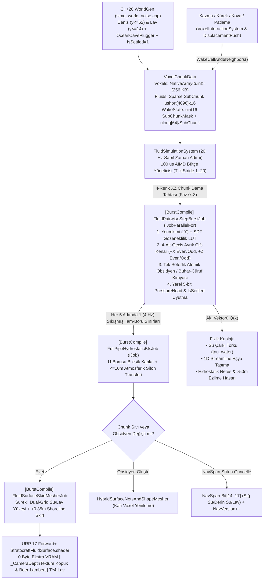

# FAZ 1 — MEKANİK 4: SONLU HACİMSEL AKIŞKAN FİZİĞİ (`16-Bit Su/Lav`), HİDROSTATİK BASINÇ (`U-Borusu`), PÜRÜZSÜZ SDF KIYI GÖZENEKLİLİĞİ (`+0.35m Shoreline Skirt`), TEK SEFERLİK STOKİYOMETRİK OBSİDYEN KİMYASI VE DURAĞAN `%0 CPU` UYKU MİMARİSİ

**Belge Sınıfı:** Stratocraft (VoxelGame) Kıdemli Oyun Motoru ve Matematiksel Simülasyon Mimarisi Denetim Raporu  
**Hedef Motor & Donanım Bütçesi:** `Unity 6000.6.7f1`, Hibrit DOTS + C# Burst SIMD, C++20 AVX2 (`StratocraftNative.dll`), URP 17 Forward+, `< 2.5 GB Oyun RAM`, `< 16 MB Doku VRAM`, `>= 60 FPS` (`100 µs/frame` AIMD Akışkan Simülasyon Bütçesi)  
**Mutlak Otorite Kaynakları:**
1. [`STRATOCRAFT_ EVRENSEL OYUN TASARIM VE MANTIK ANAYASASI (GAME LOGIC BIBLE) (2).md`](file:///D:/Oyunum/oyun/STRATOCRAFT_%20EVRENSEL%20OYUN%20TASARIM%20VE%20MANTIK%20ANAYASASI%20%28GAME%20LOGIC%20BIBLE%29%20%282%29.md) (`Bölüm 2.6.B`, `2.6.C`, `2.7.A`, `2.7.B`, `2.7.D`, `2.7.G`, `9.5`, `9.6`)
2. [`STRATOCRAFT_ARKA_PLAN_MATEMATIKSEL_SIMULASYON_VE_VOXEL_ALGORITMALARI_RAPORU.md`](file:///D:/Oyunum/oyun/STRATOCRAFT_ARKA_PLAN_MATEMATIKSEL_SIMULASYON_VE_VOXEL_ALGORITMALARI_RAPORU.md) (`Bölüm 1.2`, `5.4`, `6.1`, `7.1.1`, `7.1.3`)

---

## 1. Mekanik Tasarım Vizyonu ve Anayasa'daki (`GAME LOGIC BIBLE`) Asıl Çalışma Mantığı

### 1.1. Tasarım Felsefesi: "Sonsuz Kaynak Hilesi Yok, Gerçek Kütle Korunumu ve Mühendislik Taktikleri Var"
Klasik voxel oyunlarının (başta *Minecraft* olmak üzere) en büyük fiziksel yanılsaması, `2x2` boyutunda sığ bir çukura dökülen iki kova suyun yoktan sonsuz kütle yaratarak bütün bir vadiyi doldurabilmesi ve tek bir lav bloğunun yanına akan suyla sonsuz taş/obsidyen üreten otomasyon makinelerine (*Cobblestone / Obsidian Generator*) izin vermesidir. **Stratocraft Anayasası (`GAME LOGIC BIBLE v7.0`)**, bu yapay kısayolları kökünden reddeder ve sıvıları (Su, Lav, Korozyon Asidi) **mutlak hacim korunumlu (`Volume-Conservative`, $\Delta V_A + \Delta V_B \equiv 0$) sonlu fiziksel madde** olarak tanımlar:

1. **Gerçek Hidrolik Mühendisliği, Baraj, Kanal ve Sifon Taktikleri (`Anayasa Bölüm 2.6.B`, satır `303–309`):**
   - Bir gölün veya nehrin önü insan yapımı bloklarla kapatıldığında su arkada gerçekten birikir, seviyesi yükselir ve baraj gölü oluşturur; kapak kırıldığında biriken sonlu su kütlesi vadi boyunca sel dalgası halinde aşağı boşalır ve kaynağı kurur.
   - Oyuncular nehir yataklarını kazarak suyun yönünü değiştirebilir, tarlalarına sulama kanalları çekebilir, kalelerinin etrafına su veya lav hendekleri doldurabilir, düşman mağara tünellerine ya da yeraltı üslerine nehir yönlendirerek içeridekileri boğabilir veya kapalı boru hatları (**U-Borusu / Bileşik Kaplar ve Sifon**) inşa ederek suyu vadinin bir yamacından diğerine taşıyabilir.
   - Kapalı bir mağaraya su dolduğunda su yalnızca kendi hacmi kadar alanı kaplar; sıkışan hava cepleri tavan kubbelerinde gerçekçi nefes alma boşlukları (`EnclosedOxygenFloodFillSystem` ile entegre hava kubbeleri) oluşturur.

2. **Mekanik Güç Üretimi, Eşya Taşıma ve Hareketli Gemi Su Alma Fiziği (`Anayasa Bölüm 2.7.D.3, 9.5, 9.6` & `Matematiksel Rapor Bölüm 7.1.1`):**
   - **Su Çarkı ve Değirmen Torku ($\tau_{\text{water}}$):** Durgun suya yerleştirilen bir su çarkı **dönmez** ($\vec{Q} = \vec{0} \implies \tau_{\text{water}} = 0$). Çarkın tork üretebilmesi için oyuncunun akışkan akı vektörü ($\vec{Q}$) üreten gerçek bir nehir akıntısı veya yüksekten dökülen bir şelale/savak (`Overshot / Undershot Waterwheel`) kurması şarttır. Üretilen açısal momentum ahşap/demir şaftlar ve dişli kutularıyla değirmen taşlarına, körüklere ve otomatik çekiçlere aktarılır.
   - **1D Akış Çizgisi (`Streamline Belt-Line`) Eşya Taşıma:** Su kanallarına atılan yüzlerce eşya için tek tek 3B `Rigidbody` fiziği çalıştırılmaz; eşyalar suyun önceden hesaplanmış akı vektörü üzerinde 1 boyutlu konveyör parametresiyle (`< 0.02 ms CPU`) taşınır.
   - **Hareketli Voxel Gemilerde Su Alma (`Flooding`) ve Magma Gemileri:** Gemi çarpışma veya gülle isabetiyle su hattının altından delindiğinde, açık delik voxellerinden geminin iç yerel ızgarasına sonlu hızda su dolar; geminin toplam kütlesi artar ve Arşimet kaldırma kuvveti aşıldığında gemi gerçekçi biçimde yana yatarak batar. Lav denizlerinde ise ahşap/demir gemiler eriyip yanarken yalnızca **Obsidyen Kaplamalı Magma Gemileri** yüzebilir.

3. **Pürüzsüz SDF Arazi ile Sıfır Boşluklu Kıyı Birleşimi (`Porosity-Weighted Capacity` & `+0.35m Shoreline Skirt`, `Anayasa Bölüm 2.7.D.1`, satır `517`):**
   - Stratocraft'ın İki Kanallı Hibrit Voxel mimarisinde doğal arazi (`ShapeID == 0`) 7-bit sürekli SDF yoğunluğuna ($\rho \in [-1, +1]$) sahiptir ve *Dual Marching Cubes / Surface Nets* ile pürüzsüz eğimli üçgenler olarak örülür.
   - Eğer su hücresi klasik kübik oyunlardaki gibi "arazi voxeli varsa 0 su, hava varsa 255 su" mantığıyla çalışsaydı, her eğimli göl ve nehir kıyısında yarım metrelik çirkin merdiven boşlukları (*Stair-Step Gap*) oluşurdu.
   - Anayasa bunu iki katmanlı bir fizik+grafik kuplajıyla çözer:
     1. **Fiziksel Gözeneklilik ($V_{\max}(\mathbf{x})$):** Kısmi yoğunluklu kıyı voxelleri katı duvar değildir; kayanın doldurmadığı boş hacim tamamlayıcısı kadar sıvı kabul eder.
     2. **Görsel Kıyı Eteği (`+0.35m Shoreline Skirt`):** Su yüzeyi üçgenlenirken kıyı sınırındaki su köşeleri, komşu SDF arazi üçgenlerinin **altına doğru yatayda `+0.35m`** uzatılır (`-\nabla_{xz}\rho` yönünde). Böylece su yüzeyi eğimli toprak/kaya yüzeyiyle milimetrik olarak kesişir ve hiçbir bakış açısında boşluk görünmez.

4. **Su + Lav Faz Geçişi: Tam Taktiksel Serbestlik ama Tek Seferlik Yok Olma (`Anayasa Bölüm 2.7.D.2`, satır `522–526`):**
   - Oyunculara kova veya sarnıçla su ve lav taşıyıp savaşta ya da kule inşasında (*Lava-Casting* dahil) istedikleri yere dökme konusunda **hiçbir yapay yasak uygulanmaz**.
   - Ancak Su ve Lav temas ettiği anda reaksiyon **yalnızca 1 kere** gerçekleşir ve **hem su hem de lav anında tamamen yok olur (`V_su = 0, V_lav = 0`)**:
     - Yalnızca iki yüksek kütleli hücre ($V_{\text{su}} \ge 128 \land V_{\text{lav}} \ge 128$) çarpışırsa **1 blok Doğal Ham Obsidyen** (`BlockOriginState = 0`, direkt Madde Kristali/batarya olmaz, fiziksel kazmayla kırılması zorunludur) oluşur.
     - İnce yayılan/düşük hacimli lav veya su ($V_{\text{lav}} < 128 \lor V_{\text{su}} < 128$) temas ettiğinde **obsidyen de katı taş/kırıktaş da oluşmaz**; su buharlaşıp uçarken lav cüruf/kül olarak yok olur. Bu kural sayesinde oyunda **sonsuz obsidyen veya sonsuz taş/kırıktaş üreten makine kurmak fiziksel olarak %100 imkansızdır**.

5. **Derin Deniz Ekosistemi, Hidrostatik Ezilme Basıncı ve Dalış Çanı (`Anayasa Bölüm 2.6.C & 2.7.G`, satır `310–316, 551–560`):**
   - Sığ sulardan okyanus çukurlarına ($d_{\text{water}} > 50\text{m}$, Kraken [`1.200 HP`], Dokuz Başlı Hydra [`14.500 HP`] ve Buzul Leviathan yuvaları) inildikçe her `10m`'de `+1 atm` hidrostatik basınç biner; akciğer oksijeni derinlikle doğrusal hızlanarak tükenir ve `50m` altında korumasız oyuncuya saniyede $\dot{D}_{\text{crush}} = 0.25(d_{\text{water}} - 50)\text{ HP/sn}$ ezilme hasarı uygulanır. Derin okyanus madenciliği ve batık keşfi için **Solungaç İksiri**, **Hava Tulumu**, **Kraken Derisi Zırh** veya balast kontrollü **Dalış Çanı (`Diving Bell`)** inşa etmek zorunludur.

6. **Durağan `%0 CPU` Uyku Mimarisi ve `100 µs` AIMD Bütçesi (`Anayasa Bölüm 2.7.D.1` & `Matematiksel Rapor Bölüm 7.1.3`):**
   - Dünya üzerindeki devasa okyanuslar, yeraltı lav gölleri ve durgun göletler kararlı dengeye ulaştığında (`IsSettled == 1`) **%0.00 CPU** tüketmek zorundadır. Aktif akan şelale veya baraj yıkılmalarında ise akışkan çözücüsü kare başına **`100 µs` (`0.10 ms`)** bütçeyi aşamaz; bütçe zorlandığında `AIMD Local Time-Dilation` uzaktaki chunk'ların sıvı güncelleme periyodunu (`TickStride 1 -> 20`) yerel olarak yavaşlatır, oyuncu FPS'i asla `60 FPS` altına düşmez.

---

### 1.2. Belgeler ve Mevcut Kod Tabanı Arasındaki Çelişki Denetim Tablosu

> [!IMPORTANT]
> Sistem talimatları uyarınca dokümanlar arasında çelişki bulunduğunda mutlak otorite **`GAME LOGIC BIBLE v7.0`** ve **`MATEMATİKSEL SİMÜLASYON RAPORU`**'dur. Denetimimiz sonucunda **4 kritik mimari çelişki** tespit edilmiştir:

| # | Konu / Parametre | `GAME LOGIC BIBLE v7.0` & `MATEMATİKSEL RAPOR` (Mutlak Otorite) | `GELİŞTİRİCİ DOKÜMANI` (`4.13.5` & `5.2`) | Mevcut Kod Tabanı (`FluidCell16.cs`, `FluidCellularAutomataJob.cs`) | Mühendislik Hükmü ve Tespit Edilen Açık |
| :--- | :--- | :--- | :--- | :--- | :--- |
| **1** | **Su + Lav Reaksiyon Stokiyometrisi ve Düşük Hacim Sonucu** | `V_su >= 128 && V_lav >= 128` ise **1 blok Doğal Obsidyen** (`OriginState=0`); aksi halde (`< 128`) **0 katı blok** (buhar + cüruf/kül olarak yok olma). Her iki durumda da **hem su hem lav anında sıfırlanır (`V_su=0, V_lav=0`)**. ([Anayasa satır 524-526](file:///D:/Oyunum/oyun/STRATOCRAFT_%20EVRENSEL%20OYUN%20TASARIM%20VE%20MANTIK%20ANAYASASI%20%28GAME%20LOGIC%20BIBLE%29%20%282%29.md#L524-L526), [Mat. Rapor satır 223](file:///D:/Oyunum/oyun/STRATOCRAFT_ARKA_PLAN_MATEMATIKSEL_SIMULASYON_VE_VOXEL_ALGORITMALARI_RAPORU.md#L223)) | **İç Çelişkili:** `Bölüm 4.13.5` (satır 1816) `>=128` diyor ama düşük lavda `Bazalt/Kırıktaş` üretir diyor. `Bölüm 5.2.3 Adım 4` (satır 3073-3074) ise eski `8/4 seviye` üzerinden `>=4 Lav + >=1 Su -> Obsidyen, aksi halde Bazalt/Kırıktaş` diyor! | [`TryReactWaterAndLava`](file:///D:/Oyunum/oyun/Assets/_Stratocraft/Physics/Jobs/FluidCellularAutomataJob.cs#L43-L75): `>=128` iken `rem = Mass - 128` bırakıyor (katı bloğun içinde hayalet sıvı kalıyor!) ve `<128` iken katı `Basalt` veya `Cobblestone` bloğu üretiyor! | **KRİTİK EXPLOIT:** Mevcut kodda `255` kütleli 1 kova lavı `1`'er kütlelik 255 damlaya yayıp `255` kütleli 1 kova suyla temas ettirerek **1 kova lavdan 255 adet tam katı Kırıktaş bloğu (`255x Infinite Rock Duplication`)** üretilebiliyor! Mutlak otorite olan **Anayasa `2.7.D.2`** birebir uygulanmalı: `<128` temasta katı blok üretilmemeli (`0 blok` + Buhar/Kül VFX) ve reaksiyon anında `V_su=0, V_lav=0` olmalıdır. |
| **2** | **`16-Bit (2 Byte) FluidCell` Bit Yerleşimi** | `Bits[0..7]` = `FluidLevel (0..255)`<br>`Bits[8..9]` = `2-bit FluidType` (`0=Yok, 1=Su, 2=Lav, 3=Asit`)<br>`Bit[10]` = `1-bit IsSettled`<br>`Bits[11..15]` = `5-bit PressureHead (0..31)` ([Anayasa satır 516](file:///D:/Oyunum/oyun/STRATOCRAFT_%20EVRENSEL%20OYUN%20TASARIM%20VE%20MANTIK%20ANAYASASI%20%28GAME%20LOGIC%20BIBLE%29%20%282%29.md#L516)) | `Bölüm 4.13.5` (satır 1785-1790): `8b Mass`, `3b Type (Oil=4 dahil)`, `3b FlowDir`, `2b SleepCounter`. **`PressureHead` silinmiş!** `Bölüm 5.2.1` (satır 3053): `8 seviye su / 4 seviye lav`. | [`FluidCell16.cs`](file:///D:/Oyunum/oyun/Assets/_Stratocraft/Physics/Data/FluidCell16.cs#L30-L34) ve [`simd_world_noise.cpp`](file:///D:/Oyunum/oyun/NativePlugins/StratocraftNative/src/simd_world_noise.cpp#L61-L65): `8b Mass | 3b Type | 3b FlowDir | 2b SleepCounter`. `PressureHead` alanı yok! | **HÜKÜM:** `FlowDirection` zaten komşu kütle/basınç gradyanından $O(1)$ türetildiği için `FluidCell16` içinde 3 bit harcaması israftır ve `PressureHead`'i yok ederek U-Borusu fiziğini imkansız kılmıştır. Anayasa şemasına (`8b Level | 2b Type | 1b IsSettled | 5b PressureHead`) dönülmelidir (C++ `simd_world_noise.cpp` sadece `Type=1,2` yazdığı için `%100` geriye uyumludur). |
| **3** | **Sıvı Çözünürlüğü (`0..255` vs `8/4 Seviye`)** | `8-bit` sürekli sonlu hacim (`0..255`), $\nu_{\text{su}} = 1.0$, $\nu_{\text{lav}} = 0.25$. | `Bölüm 4.13.5`'te `0..255`, fakat `Bölüm 5.2.1`'de eski `Su 8 seviye, Lav 4 seviye` kalıntısı unutulmuş. | `0..255` (`byte`) kullanılıyor. | **HÜKÜM:** `0..255` (`8-bit`) mutlak standarttır; Geliştirici Dokümanı `5.2`'deki `8/4 seviye` ifadesi geçersiz eski taslak kalıntısıdır. |
| **4** | **`MaterialID` Sabit Numaraları (`Obsidyen`)** | `Anayasa 2.7.A` örnek şemasında (satır 363) `1=Toprak, 2=Ham Taş, 14=Obsidyen` örneği verilmiş. | `MaterialIdCatalog` tablosuna referans veriyor. | [`MaterialIdCatalog.cs`](file:///D:/Oyunum/oyun/Assets/_Stratocraft/Core/Constants/MaterialIdCatalog.cs#L15-L29), [`simd_world_noise.cpp`](file:///D:/Oyunum/oyun/NativePlugins/StratocraftNative/src/simd_world_noise.cpp#L28) ve [`bake_material_lut.py`](file:///D:/Oyunum/oyun/Tools/AutonomousAssetFactory/textures/bake_material_lut.py#L22): `1=Stone, 2=Dirt, 6=NaturalObsidian, 12=FiniteWaterSurface, 13=FiniteLavaSurface`. | **HÜKÜM:** C#, C++20 DLL ve Python GPU LUT fırını arasında `MaterialIdCatalog.NaturalObsidian = 6` tam senkronize durumdadır. Sabit sayı (`14` veya `6`) elle yazılmamalı, daima sembolik `MaterialIdCatalog.NaturalObsidian` sabiti kullanılmalıdır. |

---

## 2. Anayasa ve Matematiksel Rapordaki Formüller, Bit/Byte Şemaları ve Algoritmalar

Bu bölümde `GAME LOGIC BIBLE v7.0` (`Bölüm 2.7.A, 2.7.D, 2.7.G`) ve `MATEMATİKSEL SİMÜLASYON RAPORU` (`Bölüm 1.2, 5.4, 6.1, 7.1`) içerisinde tanımlanan tüm bit şemaları ve matematiksel denklemler tam LaTeX formülasyonuyla çıkarılmıştır.

### 2.1. `16-Bit (2 Byte ushort) FluidCell` Bellek Şeması ve Voxel SDF Kuplajı
Her `16 × 256 × 16` (`65.536` hücreli) chunk içinde katı arazi/yapı dizisi `uint32[65536]` (`256 KB`) yanında ayrı bir paralel akışkan katmanı olarak `ushort[65536]` (`128 KB`) tutulur:

```
Bit:  15  14  13  12  11 |  10 |  9   8 |  7   6   5   4   3   2   1   0
     +-------------------+-----+--------+-------------------------------+
     | PressureHead (5b) |Settl|Type(2b)|       FluidLevel (8-bit)      |
     |     H_p: 0..31    | 0/1 |  0..3  |           V: 0..255           |
     +-------------------+-----+--------+-------------------------------+
     |<--------- FluidMeta (8-bit) ---->|
```

Bit düzeyinde kodlama ve çözme bağıntıları:

$$
\text{FluidCell}_{16} = V \;\lor\; (\text{Type} \ll 8) \;\lor\; (\text{IsSettled} \ll 10) \;\lor\; (H_p \ll 11)
$$

$$
V = \text{FluidCell}_{16} \mathbin{\&} \text{0xFF} \in [0, 255], \quad
\text{Type} = (\text{FluidCell}_{16} \gg 8) \mathbin{\&} \text{0x03} \in \{0,1,2,3\}
$$

$$
\text{IsSettled} = (\text{FluidCell}_{16} \gg 10) \mathbin{\&} \text{0x01} \in \{0,1\}, \quad
H_p = (\text{FluidCell}_{16} \gg 11) \mathbin{\&} \text{0x1F} \in [0, 31]
$$

Burada `Type`: `0 = Yok (Boş)`, `1 = Su` ($\nu_{\text{su}} = 1.0$), `2 = Lav` ($\nu_{\text{lav}} = 0.25$), `3 = Korozyon Asidi` ($\nu_{\text{asit}} = 0.85$).

### 2.2. SDF Kıyı Gözenekliliği (`Porosity-Weighted Capacity`) ve `+0.35m Shoreline Skirt`
Katı voxel dizisindeki (`uint32`) 7-bit SDF yoğunluk alanı `Bits[8..14]` ($D_{\text{raw}} \in [0, 127]$, izo-yüzey $D_{\text{iso}} = 64$) sürekli işaretli yoğunluğa şu şekilde dönüştürülür (`Anayasa Bölüm 2.7.A`):

$$
\rho(\mathbf{x}) = \frac{D_{\text{raw}}(\mathbf{x}) - 64}{63.0} \in [-1.01587, \; +1.0]
$$

Anayasa `Bölüm 2.7.D.1` (satır `517`), pürüzsüz SDF arazi (`ShapeID == 0`) üzerindeki kısmi yoğunluklu ($\rho(\mathbf{x}) \in (-0.5, +0.5)$) eğimli kıyı hücrelerinde maksimum sıvı kapasitesini şu denklemle tanımlar:

$$
V_{\max}^{\text{Anayasa}}(\mathbf{x}) = \left\lfloor 255 \cdot \left(0.5 - \rho(\mathbf{x})\right) \right\rfloor
$$

Görsel su yüzeyi yüksekliği $h_{\text{su}}(\mathbf{x})$ ve kıyı eteği (`Shoreline Skirt`) uzatma vektörü:

$$
h_{\text{su}}(\mathbf{x}) = y + \frac{V(\mathbf{x})}{\max(1, V_{\max}(\mathbf{x}))}, \qquad
\mathbf{p}_{\text{skirt}} = \mathbf{p}_{\text{shore}} + L_{\text{skirt}} \cdot \frac{\nabla_{xz}\rho(\mathbf{p}_{\text{shore}})}{\left\|\nabla_{xz}\rho(\mathbf{p}_{\text{shore}})\right\|_2}, \quad L_{\text{skirt}} = 0.35\text{ m}
$$

*(Not: $\rho$ katı arazi içinde pozitif olduğu için $+\nabla_{xz}\rho / \|\nabla_{xz}\rho\|$ birim vektörü tam olarak suyun dışından eğimli SDF arazi üçgenlerinin **altına/içine** doğru bakar ve `+0.35m` yatay etek oluşturarak merdiven boşluğunu kapatır.)*

### 2.3. `20 Hz` (`Δt = 0.05 sn`) Hacim Korunumlu 3 Adımlı Akışkan Otomatı
Her simülasyon adımında (`20 Hz`), komşu iki hücre $A$ ve $B$ arasındaki her kütle transferi $\Delta V_A + \Delta V_B = 0$ özdeşliğini sağlar:

1. **Adım 1 — Yerçekimi Düşey Akışı ($u = (x,y,z) \to d = (x,y-1,z)$):**

$$
\Delta V_{\text{down}} = \min\!\left(V(u), \; V_{\max}(d) - V(d), \; \left\lfloor 255 \cdot \nu_{\text{akışkan}} \right\rfloor\right)
$$

$$
V'(u) = V(u) - \Delta V_{\text{down}}, \qquad V'(d) = V(d) + \Delta V_{\text{down}}
$$

Akışkan akıcılık katsayısı $\nu_{\text{su}} = 1.0 \implies \lfloor 255 \cdot 1.0 \rfloor = 255\text{ birim/adım}$, $\nu_{\text{lav}} = 0.25 \implies \lfloor 255 \cdot 0.25 \rfloor = 63\text{ birim/adım}$.

2. **Adım 2 — Dama Tahtası Yatay Basınç Dengeleme ($u \to n \in \{x\pm 1, z\pm 1\}$):**

$$
\Delta V_{\text{lat}}(u \to n) = \operatorname{Clamp}\!\left(\left\lfloor \frac{V(u) - V(n)}{4} \cdot \nu_{\text{akışkan}} \right\rfloor, \; 0, \; \min\!\left(V(u), \; V_{\max}(n) - V(n)\right)\right)
$$

3. **Adım 3 — U-Borusu Hidrostatik Yukarı Akış ($u = (x,y,z) \to u_{\text{üst}} = (x,y+1,z)$):**

$$
\text{Koşul:} \quad V(u) == V_{\max}(u) \;\land\; V_{\max}(u) > 0 \;\land\; H_p(u) \ge H_p(u_{\text{üst}}) + 2
$$

### 2.4. Tek Seferlik Stokiyometrik Su + Lav Faz Geçişi Denklemi
Su hücresi $V_{\text{su}} > 0$ ile Lav hücresi $V_{\text{lav}} > 0$ temas ettiğinde (`Anayasa Bölüm 2.7.D.2`, satır `524–526` ve `Matematiksel Rapor Bölüm 5.4`, satır `223`):

$$
\left(V'_{\text{su}}, \; V'_{\text{lav}}, \; \text{Voxel}'_{\text{temas}}\right) =
\begin{cases}
\left(0, \; 0, \; \operatorname{PackVoxel}(\text{OBSIDIAN}, \, D=127, \, \text{Shape}=1, \, \text{Origin}=0)\right), & \text{eğer } V_{\text{su}} \ge 128 \land V_{\text{lav}} \ge 128 \\[8pt]
\left(0, \; 0, \; \text{Voxel}_{\text{mevcut}} \text{ [0 Katı Blok + Buhar/Cüruf VFX]}\right), & \text{eğer } 0 < V_{\text{su}} < 128 \lor 0 < V_{\text{lav}} < 128
\end{cases}
$$

### 2.5. Su Çarkı ve Değirmen Mekanik Tork Denklemi ($\tau_{\text{water}}$)
Hücreler arası net hacim akısından türetilen yerel debi/akı vektörü ($f_{\text{tick}} = 20\text{ Hz}$):

$$
\vec{Q}(\mathbf{x}) = \left(\Delta V_x(\mathbf{x}), \; \Delta V_y(\mathbf{x}), \; \Delta V_z(\mathbf{x})\right) \cdot f_{\text{tick}}
$$

Su çarkının $\hat{a}$ dönme ekseni etrafındaki açısal hızı $\omega$ (`rad/sn`), her kanat $b$ için merkezden yarıçap vektörü $\vec{r}_b$, dik kol uzunluğu $r_{\perp,b} = \|\vec{r}_b - (\vec{r}_b \cdot \hat{a})\hat{a}\|$, teğetsel su hızı $u_{t,b}$ ve üstten kovaya dökülen düşey su transferi $\Delta V_{\text{down}}(b)$ olmak üzere (`Anayasa Bölüm 2.7.D.3`, satır `528–531`):

$$
\tau_{\text{water}}(\omega) = \sum_{b \in \text{Kanatlar}} \left[
\underbrace{\frac{1}{2}\rho_{\text{su}} C_d A_b r_{\perp,b} \left|u_{t,b} - \omega r_{\perp,b}\right|\left(u_{t,b} - \omega r_{\perp,b}\right)}_{\text{Alttan Akıntı Kinetik Sürükleme Torku (Undershot)}}
+
\underbrace{\rho_{\text{su}} g \frac{\Delta V_{\text{down}}(b)}{255\text{ m}^{-3}} \left(\vec{r}_b \times (-\hat{\mathbf{y}})\right)\cdot \hat{\mathbf{a}}}_{\text{Üstten Şelale Yerçekimi Kova Torku (Overshot)}}
\right]
$$

$$
I_{\text{wheel}} \frac{d\omega}{dt} = \tau_{\text{water}}(\omega) - \tau_{\text{load}} - \mu_{\text{axle}}\omega
$$

Durgun suda $u_{t,b} = 0$ ve $\Delta V_{\text{down}}(b) = 0$ olduğundan ilk terim $-\frac{1}{2}\rho_{\text{su}} C_d A_b r_{\perp,b}^3 |\omega|\omega \le 0$ (hidrodinamik frenleme!) üretir ve çark durur; böylece durgun gölden bedava mekanik enerji üretilmesi matematiksel olarak imkansızdır.

### 2.6. Su Altı Hidrostatik Basınç, Akciğer Oksijen ODE'si ve Dalış Çanı (`Diving Bell`) Fiziği
Su yüzeyinden ($Y_{\text{surface}}$) karakterin kafa yüksekliğine ($y_{\text{head}}$) olan dalış derinliği $d_{\text{water}} = \max(0, Y_{\text{surface}} - y_{\text{head}})$ için (`Anayasa Bölüm 2.7.G`, satır `552–560`):

$$
P_{\text{hydro}}(d_{\text{water}}) = P_{\text{atm}} + \rho_{\text{su}} g d_{\text{water}} \approx 1\text{ atm} + \frac{d_{\text{water}}}{10\text{ m}}\text{ atm}
$$

Akciğer nefes tükenme diferansiyel denklemi ($M_{\text{akciğer}} \in [0, 100]$ Akciğer Ustalığı, $\mathbb{I}_{\text{GillPotion}} \in \{0, 1\}$ Solungaç İksiri):

$$
\frac{dB_{\text{lung}}}{dt} = -\frac{r_{\text{breath\_base}} \cdot \left(1 + 0.05 \cdot d_{\text{water}}\right)}{\left(1 + 0.008 \cdot M_{\text{akciğer}}\right) \cdot \left(1 + 3.0 \cdot \mathbb{I}_{\text{GillPotion}}\right)}
$$

$>50\text{ m}$ abisal çukur hidrostatik ezilme hasarı (Dalış Çanı veya Kraken Derisi Zırhı yoksa):

$$
\dot{D}_{\text{crush}}(d_{\text{water}}) = \begin{cases}
0, & d_{\text{water}} \le 50\text{ m} \;\lor\; \text{HasProtection} \\
0.25 \cdot \left(d_{\text{water}} - 50\right)\text{ HP/sn}, & d_{\text{water}} > 50\text{ m} \;\land\; \neg\text{HasProtection}
\end{cases}
$$

Dalış Çanı (`Diving Bell`) mürettebat hava süresi ve balast ($\beta_{\text{ballast}} \in [0, 1]$) dikey hareket denklemi:

$$
T_{\text{bell\_air}} = \frac{V_{\text{bell}} \cdot 120\text{ sn} + 600\text{ sn} \cdot N_{\text{AirCrystal}}}{N_{\text{crew}}}
$$

$$
M_{\text{bell}}\frac{dv_y}{dt} = \left(\rho_{\text{su}} V_{\text{bell}}\left(1 - 0.35\,\beta_{\text{ballast}}\right) - M_{\text{bell}}\right)g - \frac{1}{2}\rho_{\text{su}} C_d A_{\text{bell}} |v_y|v_y
$$

### 2.7. Yapay Zeka Navigasyonu (`NavSpan`) ve `AIMD Local Time-Dilation` Kuplajı
- **AI `NavSpan` Sıvı Bayrağı (`Matematiksel Rapor Bölüm 1.2`):** Her sıvı değişiminde ilgili sütunun `64-bit NavSpan` kaydındaki `Bit[14..17]` zemin tehlike kodu (`2 = Sığ Su`, `3 = Derin Su`, `4 = Lav Çukuru`) güncellenir ve `NavVersion++` artırılarak yaratıkların lav çukuruna intihar etmeden yeni rota hesaplaması sağlanır.
- **`100 µs` Bütçe ve AIMD Yerel Zaman Genleşmesi (`Matematiksel Rapor Bölüm 7.1.3`):** Bir chunk'taki sıvı güncellemesi $T_{\text{chunk}} > 100\;\mu\text{s}$ sınırını aşarsa o chunk'ın güncelleme adımı (`TickStride` $S_c \in [1, 20]$) çarpımsal artırılır ($S_c \leftarrow \min(20, 2 S_c)$), bütçe altına indiğinde toplamsal azaltılır ($S_c \leftarrow \max(1, S_c - 1)$) ve kütle akış ölçeği korunarak uzak şelaleler kare hızını düşürmeden yerel olarak yavaşlatılır.

---

## 3. Mevcut Kod Tabanı Denetimi (Ne Tamamlandı, Ne Yarım Kaldı, Ne Hatalı / Sahneye Bağlı Değil?)

Mevcut kod tabanındaki tüm ilgili C#, C++20, HLSL/Shader, Python ve NUnit test dosyaları satır satır incelenmiştir. Özetle: **Mevcut akışkan sistemi yalnızca izole EditMode birim testini (`FluidConservationTests.cs`) geçmek için yazılmış tek çekirdekli bir prototip (`stub`) seviyesindedir; canlı Faz 1 sahnesinde (`StratocraftStage1SceneBuilder.cs`) su ve lav hiç sıvı olarak bile bulunmamakta, üstünde beton gibi yürünen katı SDF kaya voxeli olarak durmaktadır!**

### 3.1. Dosya ve Metot Bazlı Satır-Satır Denetim Tablosu

| Dosya Yolu & Sembol | Mevcut Durum | Satır-Satır Teknik Bulgular ve Tespit Edilen Hatalar |
| :--- | :--- | :--- |
| [`FluidCell16.cs`](file:///D:/Oyunum/oyun/Assets/_Stratocraft/Physics/Data/FluidCell16.cs#L10-L106)<br>(`struct FluidCell16`, `enum FluidType`) | **YARIM / ŞEMA HATALI** | • `Size = 2` (`ushort`) boyutu doğru.<br>• **Hata 1 (Satır 30–34, 61–79):** Anayasa'daki `2-bit Type + 1-bit IsSettled + 5-bit PressureHead` yerine `3-bit Type + 3-bit FlowDirection + 2-bit SleepCounter` paketlenmiş. **`PressureHead (0..31)` alanı tamamen yok!**<br>• **Hata 2:** `SleepCounter` özelliği tanımlanmış ama kod tabanındaki hiçbir dosyada okunmuyor veya yazılmıyor (ölü alan). |
| [`FluidCellularAutomataJob.cs`](file:///D:/Oyunum/oyun/Assets/_Stratocraft/Physics/Jobs/FluidCellularAutomataJob.cs#L15-L223)<br>(`TryReactWaterAndLava`, `StepFluidGridVolumeConservative`) | **HATALI / BURST DEĞİL / EKSİK** | • **Hata 1 — Sahte Job (Satır 15, 81):** Adında `Job` geçmesine rağmen `public static class` olarak yazılmış! `[BurstCompile]`, `IJob`, `IJobParallelFor` veya `NativeArray` yok. Yönetilen `Span<uint>` / `Span<ushort>` üzerinde ana iş parçacığında (Main Thread) tek çekirdekte çalışıyor.<br>• **Hata 2 — `%0 CPU` Uyku Yok (Satır 96–175):** `IsSettled` kontrolü veya aktif bitmask yok! Her adımda `65.536` hücreyi tarıyor, üstüne satır `170–174`'te kalan kütleyi saymak için `65.536` hücreyi **ikinci kez** tarıyor (`131.072` iterasyon/chunk — tamamen durgun gölde bile CPU yakar!).<br>• **Hata 3 — Stokiyometri ve Hayalet Sıvı Açığı (Satır 43–75, 138–141, 212–216):** `>=128` reaksiyonunda `V_su=0, V_lav=0` yapmak yerine `rem = Mass - 128` bırakıyor ve oluşan katı `NaturalObsidian` bloğunun aynı hücresinde (`voxels[dstIdx] = formed; fluids[dstIdx] = rem`) hayalet sıvı bırakıyor! Ayrıca `<128` temasta Anayasa'nın yasakladığı katı `Basalt` / `Cobblestone` bloğu üreterek **1 kova lavdan 255 katı taş kopyalama açığı** yaratıyor.<br>• **Hata 4 — SDF Kıyı Gözenekliliği Yok (Satır 111, 116, 187):** `(voxels[idx] & 0xFFu) == 0u` kontrolü yapıyor. `MaterialID != 0` olan tüm kısmi yoğunluklu SDF kıyı hücrelerini (`ShapeID == 0, Density < 96`) tamamen geçirimsiz duvar sanıyor ve kapasiteyi sabit `255` alıyor.<br>• **Hata 5 — U-Borusu / `+Y` Yukarı Akış Yok:** Yalnızca `y - 1` ve `±X, ±Z` komşularına bakıyor; `y + 1` yönünde hiçbir hidrostatik basınç akışı yok.<br>• **Hata 6 — Yönlü Kayma ve Yarış Durumu (Satır 98–100, 154–165):** Dama tahtası olmadan düz `x=0..sizeX, z=0..sizeZ` sırasıyla *in-place* yazım yaptığı için sıvı `+X` ve `+Z` yönlerine doğru kaskad kayma (*directional bias*) yapıyor ve paralel çalıştırılamaz.<br>• **Hata 7 — Chunk Sınırı Duvarı (Satır 155–164):** `x + 1 < sizeX ? idx + 1 : -1` nedeniyle sıvı `16×16` chunk sınırında görünmez bir cama çarpar gibi duruyor; komşu chunk'a veya `2-Voxel Ghost Halo`'ya akamıyor! |
| [`FluidSimulationSystem.cs`](file:///D:/Oyunum/oyun/Assets/_Stratocraft/Physics/Systems/FluidSimulationSystem.cs#L11-L55) | **YARIM / SAHNEYE BAĞLI DEĞİL** | • DOTS `ISystem` veya Unity `MonoBehaviour` değil, bağımsız bir C# sınıfı. Yalnızca [`FluidConservationTests.cs`](file:///D:/Oyunum/oyun/Assets/Tests/EditMode/FluidConservationTests.cs#L22) tarafından çağrılıyor; canlı oyunda hiçbir sistem bu sınıfı çağırmıyor!<br>• AIMD kontrolü (satır `43–50`) chunk başına yerel `TickStride` (`1..20`) yerine global `MaxChunksPerTick` değişkenini değiştiriyor ve onu bile hiçbir döngüde kullanmıyor. |
| [`StratocraftStage1SceneBuilder.cs`](file:///D:/Oyunum/oyun/Assets/_Stratocraft/Editor/StratocraftStage1SceneBuilder.cs#L438-L479) | **KRİTİK MİMARİ KOPUKLUK (SAHNEDE SIVI YOK!)** | • Satır `438–444` ve `471–479`'da **Sonlu Kaynak Suyu Havuzu** (`FiniteWaterSurface = 12`) ve **Erimiş Lav Kalderası** (`FiniteLavaSurface = 13`) `ushort[] Fluids` katmanına yazılmak yerine doğrudan **katı `uint[] voxels` dizisine (`ShapeID = 0` SDF arazi bloğu olarak)** paketlenmiş!<br>• Satır `230–255` civarında tüm bu voxeller tek bir katı `MeshCollider` içinde pişiriliyor. Sonuç: **Canlı sahnede oyuncu suyun ve lavın içine giremiyor, üstünde beton zemin gibi yürüyor; havuzun kıyısını kazdığında su akmıyor!** |
| [`Stage1InteractivePlayController.cs`](file:///D:/Oyunum/oyun/Assets/_Stratocraft/Character/Stage1InteractivePlayController.cs#L1-L1084) | **SAHNEYE BAĞLI DEĞİL** | • Canlı oyun döngüsünde (`Update` / `FixedUpdate`) ne `ushort[][] _chunkFluids` dizisi var, ne `FluidSimulationSystem` çağrısı var, ne su/lav dökme/kova etkileşimi var, ne de su içi yüzme/lav yanma ve hidrostatik basınç entegrasyonu var. |
| [`ChunkStreamingSystem.cs`](file:///D:/Oyunum/oyun/Assets/_Stratocraft/Voxel/Systems/ChunkStreamingSystem.cs#L75-L95) & [`ChunkMeshBuildSystem.cs`](file:///D:/Oyunum/oyun/Assets/_Stratocraft/Voxel/Systems/ChunkMeshBuildSystem.cs#L15-L60) | **YARIM (VERİ ÜRETİLİYOR AMA GÖRSELLEŞTİRİLMİYOR)** | • [`VoxelChunkData`](file:///D:/Oyunum/oyun/Assets/_Stratocraft/Voxel/Data/VoxelChunkComponent.cs#L65-L95) içinde `NativeArray<ushort> Fluids` (`65.536` eleman) ayrılmış ve `ChunkStreamingSystem` C++20 `GenerateChunkSimd` ile bu diziyi gerçekten dolduruyor.<br>• **Ancak** `ChunkMeshBuildSystem` yalnızca `chunk.Voxels` dizisini `HybridSurfaceNetsAndShapeMesher`'a gönderiyor; `chunk.Fluids` dizisini **hiçbir mesher veya simülasyon sistemi okumuyor!** |
| [`HybridSurfaceNetsAndShapeMesher.cs`](file:///D:/Oyunum/oyun/Assets/_Stratocraft/Voxel/Jobs/HybridSurfaceNetsAndShapeMesher.cs#L1-L1224) | **EKSİK (`Shoreline Skirt` ve Sıvı Mesh Yok)** | • Katı SDF arazi (`Kanal 1`), 6-bit mimari şekiller (`Kanal 2A`) ve `4×4×4` mikro-voxel (`Kanal 2B`) örmesi çalışıyor.<br>• Ancak `ushort[] Fluids` katmanını ören ayrı bir sıvı yüzey geçişi ve komşu SDF eğiminin altına uzanan **`+0.35m Shoreline Skirt`** algoritması henüz yazılmamış. |
| [`StratocraftUberShader.shader`](file:///D:/Oyunum/oyun/Assets/_Stratocraft/Rendering/Shaders/StratocraftUberShader.shader#L1-L128) & [`StratocraftUberShader.hlsl`](file:///D:/Oyunum/oyun/Assets/_Stratocraft/Rendering/Shaders/StratocraftUberShader.hlsl#L1-L397) | **EKSİK (YARI SAYDAM SU SHADER YOK)** | • Mevcut UberShader yalnızca `"RenderType"="Opaque"`, `ZWrite On`, `Blend Off` olarak çalışıyor. Lavın `T^4` karacisim ışıması (`Temp=242` LUT üzerinden) opak yüzeyde çalışsa da, su yüzeyi için derinlik tamponu (`_CameraDepthTexture`) okuyan Beer-Lambert ışık soğurması, Fresnel yansıması, akış vektörü dalga normali ve SDF kıyı köpüğü bulunan yarı saydam URP 17 Forward+ geçişi yok. |
| [`PhysicalCharacterControllerSystem.cs`](file:///D:/Oyunum/oyun/Assets/_Stratocraft/Character/Systems/PhysicalCharacterControllerSystem.cs#L118-L148) & [`EnclosedOxygenFloodFillSystem.cs`](file:///D:/Oyunum/oyun/Assets/_Stratocraft/Character/Systems/EnclosedOxygenFloodFillSystem.cs#L113-L118) | **YARIM** | • `PhysicalCharacterControllerSystem` içinde basit bir `IsSubmerged` Arşimet kaldırma kuvveti (`BuoyancyAcceleration`) mevcut; fakat bu bayrağı `FluidCell16` ızgarasından besleyen kanca yok.<br>• `EnclosedOxygenFloodFillSystem` satır `116` su altında derinlikten bağımsız sabit `100 / 15 sn` nefes tüketiyor; Anayasa `2.7.G`'deki $(1 + 0.05 \cdot d_{\text{water}})$ derinlik çarpanı, `Akciğer Ustalığı`, `Solungaç İksiri` ve `$d_{\text{water}} > 50\text{m}$` hidrostatik ezilme hasarı ($\dot{D}_{\text{crush}}$) kodlanmamış. |
| [`simd_world_noise.cpp`](file:///D:/Oyunum/oyun/NativePlugins/StratocraftNative/src/simd_world_noise.cpp#L61-L65) | **ÇALIŞIYOR (UFAK UYUM GEREKLİ)** | • Satır `61–65` `PackFluid` `(fluidType & 0x07u) << 8` ile `Type=1` (Deniz seviyesi `y <= 62` su, satır `363`) ve `Type=2` (`y <= 14` derin mağara lavı, satır `349`) üretiyor.<br>• **Dikkat:** Yeni üretilen chunk'larda başlangıçta durgun olan deniz ve lav göllerine `IsSettled = 1` (`1 << 10`) biti set edilmediği ve okyanus tabanındaki açık mağara ağızları mühürlenmediği (`Ocean Cave Plugging`) için ilk yüklemede binlerce okyanus hücresi mağaralara şelale gibi akarak CPU bütçesini patlatma riski taşıyor. |
| [`FluidConservationTests.cs`](file:///D:/Oyunum/oyun/Assets/Tests/EditMode/FluidConservationTests.cs#L15-L122) | **GEÇİYOR AMA YETERSİZ** | • `3/3` test geçiyor fakat SDF gözenekli kıyıyı, U-borusu bileşik kaplar dengesini, paralel chunk sınır geçişini, `<128` temasta **0 katı blok** (sonsuz kırıktaş yasağı) kuralını ve durağan `%0 CPU` uyku modunu test etmiyor; hatta satır `81–84`'te Anayasa'ya aykırı olan düşük lavda katı Bazalt/Kırıktaş oluşumunu doğru kabul ediyor! |

---

## 4. Matematiksel ve Algoritmik Yeterlilik Kararı (`YETERLİ Mİ?` Mühendislik Hükmü ve Darboğaz Analizi)

> [!CAUTION]
> **MÜHENDİSLİK HÜKMÜ (`KARAR`): ANAYASA'DAKİ DENKLEMLER TASARIM VİZYONU OLARAK KUSURSUZDUR ANCAK TEK BAŞINA DOĞRUDAN KODLANDIĞINDA GERÇEK ZAMANLI ÜRETİM İÇİN YETERSİZDİR! ÜRETİME GEÇİŞ İÇİN 5 KRİTİK MATEMATİKSEL VE ALGORİTMİK MÜHENDİSLİK YAMASI ZORUNLUDUR.**

Anayasa `Bölüm 2.7.D` ve Matematiksel Rapor `Bölüm 5.4` içerisindeki formüller analitik olarak incelendiğinde, doğrudan (`naive`) kodlanması halinde tamsayı taşması (`byte overflow`), çok çekirdekli bellek yarışı (`write race`), sonsuz basınç çalkantısı (`ghost pressure sloshing`) ve tamsayı kalıntı jöleleşmesi (`integer truncation jelly`) üreten **5 somut matematiksel açık** tespit edilmiştir:

### 4.1. Açık 1 — SDF Gözeneklilik Denklemi $V_{\max}(\mathbf{x})$ Sınır Taşması (`Byte Overflow`) ve Arazi Değişiminde Kütle Sıkışması
Anayasa `Bölüm 2.7.D.1`'deki $V_{\max}(\mathbf{x}) = \lfloor 255 \cdot (0.5 - \rho(\mathbf{x})) \rfloor$ formülü yalnızca $\rho(\mathbf{x}) \in (-0.5, +0.5)$ bandı için verilmiştir. Oysa voxel ızgarasında $\rho(\mathbf{x}) \in [-1.01587, +1.0]$ aralığındadır:
- Saf hava hücresinde ($D_{\text{raw}} = 0 \implies \rho = -64/63 \approx -1.01587$):

$$
255 \cdot (0.5 - (-1.01587)) = 386.5 \implies \text{8-bit } \texttt{byte} \text{ taşması (386 mod 256 = 130)!}
$$

- Tam dolu kaya hücresinde ($D_{\text{raw}} = 127 \implies \rho = +1.0$):

$$
255 \cdot (0.5 - 1.0) = -127.5 \implies \text{işaretsiz tamsayıda (\texttt{byte}) alttan taşma (underflow = 129)!}
$$

- Ayrıca oyuncu kürekle kıyıya toprak eklediğinde ($\rho \uparrow \implies V'_{\max}(\mathbf{x}) < V(\mathbf{x})$) mevcut sıvı hacmi yeni kapasiteyi aşar; fazla sıvı $\Delta V_{\text{excess}} = V(\mathbf{x}) - V'_{\max}(\mathbf{x})$ komşu boş hücrelere itilmezse (`Displacement Push`) kütle yok olur.
- Benzer şekilde `Kanal 2B` (`ShapeID == 63` Yontulabilir `4×4×4` Mikro-Voxel) bloklarında oyuncu taşın içinden oluk oyduğunda, `64-bit` mikro-maskenin boş bit oranı ($1 - \operatorname{popcnt}(M_{64})/64$) gözeneklilik kapasitesine dahil edilmezse oyulan taş oluklardan su akamaz!

**Kesin Yamalı Gözeneklilik Denklemi:**

$$
V_{\max}(\mathbf{x}) = \begin{cases}
255, & \text{eğer } \text{MatID}(\mathbf{x}) == 0 \text{ (Saf Hava)} \\[6pt]
\left\lfloor 255 \cdot \operatorname{Clamp}\!\left(0.5 - \dfrac{D_{\text{raw}}(\mathbf{x}) - 64}{63.0}, \; 0.0, \; 1.0\right) \right\rfloor, & \text{eğer } \text{ShapeID}(\mathbf{x}) == 0 \text{ (Pürüzsüz SDF Arazi)} \\[8pt]
\left\lfloor \dfrac{(64 - \operatorname{popcnt}(M_{64}(\mathbf{x}))) \cdot 255}{64} \right\rfloor, & \text{eğer } \text{ShapeID}(\mathbf{x}) == 63 \text{ (Oyulmuş Mikro-Voxel Oluk)} \\[6pt]
0, & \text{eğer } \text{ShapeID}(\mathbf{x}) \in [1..62] \text{ (Tam Katı Mimari Blok)}
\end{cases}
$$

*(Not: $D_{\text{raw}} \le 32 \implies \rho \le -0.508 \implies V_{\max} = 255$; $D_{\text{raw}} = 64 \implies \rho = 0 \implies V_{\max} = 127$; $D_{\text{raw}} \ge 96 \implies \rho \ge +0.508 \implies V_{\max} = 0$. Tam `128 byte` statik LUT ile $O(1)$ sıfır dallanmalı hesaplanır!)*

---

### 4.2. Açık 2 — Yerel `5-Bit PressureHead` ($H_p$) ile U-Borusu / Sifon Çözümünün "Hayalet Basınç Döngüsü" (`Ghost Pressure Loop`) Kanıtı
Anayasa `Bölüm 2.7.D.1 Adım 3` yalnızca yukarı akış tetikleme koşulunu ($V(u) == V_{\max}(u) \land H_p(u) \ge H_p(u_{\text{üst}}) + 2$) vermiş, **ancak $H_p(u)$ alanının her adımda nasıl güncelleneceğinin denklemini vermemiştir!**

Burada literatürdeki iki klasik yerel yaklaşımın neden çöktüğünü matematiksel olarak kanıtlayalım:

1. **Yaklaşım A — Yerel Komşu Maksimum Yayılımı ($H_p(u) = \max(H_p(u_{\text{üst}}) + 1, \, \max_{n \in \text{Yatay}} H_p(n), \, H_p(u_{\text{alt}}) - 1)$) Neden Çöker?**
   - Bu denklem yönlü döngüsel grafiklerde klasik *Bellman-Ford Count-to-Infinity* hatasına düşer: U-borusunun sol kolundaki yüksek su kaynağı tamamen kuruduğunda bile, boru tabanındaki yan yana iki tam dolu hücre $A$ ve $B$, birbirlerinden $H_p(A) = H_p(B) = 20$ değerini okumaya devam eder!
   - Sonuç (**Hayalet Basınç / Ghost Pressure**): Kaynağı kurumuş bir U-borusu tabanı kendi kendine hayalet basınç üreterek sağ koldan yukarı su fışkırtmaya çalışır, üst hücre boşalınca su geri düşer ve sonsuz bir osilasyon (*sloshing*) oluşarak `IsSettled = 1` (`%0 CPU`) uykusunu sonsuza dek kilitler!
2. **Yaklaşım B — W-Shadow / Jon Gallant Sanal Sıkıştırma Modeli (`MaxCompression`) Neden Stratocraft'ta Yasaktır?**
   - Unity CA sıvı simülasyonlarında yaygın kullanılan W-Shadow modeli, basınç yaratmak için alttaki hücrelere `1.0` yerine `1.0 + k * Depth` kadar **fazladan sıkıştırılmış kütle** yazar.
   - `8-bit byte` (`0..255`) mimarisinde zaten `> 255` kütle saklanamaz; `float` kullanılsa bile $32\text{ m}$ derinliğindeki $1\times 1$ kuyuda $\%25$/kat sıkıştırmayla gerçekte $32$ blok olması gereken su kütlesi $\sum_{k=0}^{31}(1 + 0.25k) = 156\text{ blok}$ (`%387.5` sahte kütle şişmesi!) olur. Kuyunun alt yan duvarı kazıldığı anda mağaraya gerçek hacminin ~5 katı su patlar (*Geyser Bomb*). Bu durum Anayasa'nın **mutlak hacim korunumu** yasasını ihlal eder.
3. **Ek Kısıtlar (`+2` Ölü Bölge ve `31m` Doyumu):**
   - $H_p(u) \ge H_p(u_{\text{üst}}) + 2$ koşulundaki `+2` farkı histerezis sağlasa da karşı koldaki su seviyesini kaynak seviyesinin `2 blok` altında durdurur ve `5-bit` ($H_p \le 31$) derinliği $31\text{ m}$'yi aşan U-borularında doyuma (*saturation*) uğrar.

**Kesin Mühendislik Çözümü (İki Kademeli Hibrit Hidrostatik Çözücü):**
- **Kademe 1 (`5-bit PressureHead` — Yerel Sütun + Two-Queue Basınç Azaltma):** Voxel aydınlatma motorlarındaki (*Seed of Andromeda / Minecraft Starlight*) iki kuyruklu (`RemovalQueue` + `PropagationQueue`) algoritma ile yerel $H_p \in [0..31]$ alanı hayalet basınç bırakmadan güncellenir; sığ (`<= 31m`) olukları ve anlık şaft basınçlarını $O(1)$ yerel hızda çözer.
- **Kademe 2 (`FullPipeHydrostaticBfsJob` — Dwarf Fortress / Flowing Fluids Tarzı Tam-Boru Bileşen Çözücüsü):** Yalnızca yerel olarak yukarı/yana akamayan tam dolu (`V == V_max`) basınçlı boru ağı sınır hücreleri için (`4 Hz` yani her 5 sıvı adımında 1 kez, maksimum `2.048` hücre bütçeli) ortogonal BFS çalıştırılır:
  - Aynı bağlı tam-dolu sıvı bileşenine temas eden en yüksek serbest yüzeyli **Besleyici Hücre** $S$ ($H_{\text{eff}}(S) = y_S + \frac{V(S)}{V_{\max}(S)}$) ile daha alçak kottaki uygun **Çıkış Hücresi** $O$ ($H_{\text{eff}}(O) < H_{\text{eff}}(S) - 0.15\text{ m}$) doğrudan eşleştirilir ve kütle doğrudan kaynaktan çıkışa aktarılır ($\Delta V_S = -\Delta V_{\text{pipe}}, \, \Delta V_O = +\Delta V_{\text{pipe}}$).
  - **Gerçek Sifon Desteği:** Boru önceden suyla doldurulmuşsa (*primed*) ve tepe noktası kaynak yüzeyinden en fazla atmosferik emme yüksekliği ($\Delta Y_{\text{siphon}} = Y_{\text{crest}} - Y_S \le \frac{P_{\text{atm}}}{\rho_{\text{su}} g} \approx 10\text{ m}$) yukarıdaysa, sıvı tepeyi aşarak daha alçak vadiye sifon yapar; tepeye hava girerse (`V < V_max`) sifon fiziksel olarak kırılır!

---

### 4.3. Açık 3 — Klasik `Red-Black` Dama Tahtasında "4-Kırmızı -> 1-Siyah" Paralel Yazma Yarışı
Anayasa `Bölüm 2.7.D.1 Adım 2` yatay dengelemeyi "Red-Black Dama Tahtası" olarak adlandırmıştır. Ancak 2B/3B ızgarada tüm Kırmızı (`(x + z) % 2 == 0`) hücreler paralel `IJobParallelFor` iş parçacıklarında çalışıp komşu Siyah (`(x + z) % 2 == 1`) hücrelere kütle ittiğinde (**Push**), **tek bir Siyah hücre aynı anda 4 farklı Kırmızı komşusundan (`+X, -X, +Z, -Z`) paralel yazma alır!**
- Atomik işlem (`Interlocked.Add`) kullanılmazsa *Data Race* oluşur ve kütle kaybolur/çoğalır.
- Atomik işlem kullanılsa bile 4 Kırmızı komşunun her biri Siyah hücredeki boşluğu `255` görüp `100`'er birim iterse toplam `400 > 255` taşması oluşur!

**Kesin Mühendislik Çözümü (4-Alt-Geçişli Ayrık Çift-Hücre Kenar Takası — `4-Pass Disjoint Pairwise Edge Exchange`):**
Hücre merkezli *Push* yerine **ayrık kenar çifti (Margolus / Pairwise Edge)** takası kullanılır:
1. **Alt-Geçiş A (`+X Çift`):** $x \in \{0, 2, 4, \dots, 14\}$ için $(x, z) \leftrightarrow (x+1, z)$ çifti tek bir iş parçacığına aittir.
2. **Alt-Geçiş B (`+X Tek`):** $x \in \{1, 3, 5, \dots, 15\}$ için $(x, z) \leftrightarrow (x+1, z)$ çifti tek bir iş parçacığına aittir (`x=15` komşu chunk'ın `lx=0` hayalet/sınır hücresidir).
3. **Alt-Geçiş C (`+Z Çift`):** $z \in \{0, 2, 4, \dots, 14\}$ için $(x, z) \leftrightarrow (x, z+1)$ çifti.
4. **Alt-Geçiş D (`+Z Tek`):** $z \in \{1, 3, 5, \dots, 15\}$ için $(x, z) \leftrightarrow (x, z+1)$ çifti.

Her alt-geçişte hiçbir hücre birden fazla çiftte yer almaz (**%100 ayrık bellek adresleri!**). Sıfır `Interlocked` atomik kilitleme ile çok çekirdekli Burst SIMD üzerinde mutlak $\Delta V_A + \Delta V_B \equiv 0$ garantilenir; çift/tek alt-geçiş sırası her `tick`'te döndürülerek (`tick & 1`) yönlü kayma (*directional bias*) tamamen yok edilir. Chunklar arasında ise Matematiksel Rapor `Bölüm 6.1`'deki **4-Renk XZ Chunk Dama Tahtası** (`c = (ChunkX & 1) | ((ChunkZ & 1) << 1)`) kullanıldığı için sınır kenarı (`x=15 <-> komşu x=0`) bile yarışsız güncellenir!

---

### 4.4. Açık 4 — Tamsayı Bölme Kalıntısı (`Integer Truncation Staircase / 7DTD Water Jelly` Hatası)
Anayasa'nın yatay akış formülü $\Delta V_{\text{lat}} = \lfloor \frac{V(u) - V(n)}{4} \cdot \nu \rfloor$ tamsayı tabanlıdır:
- Su ($\nu = 1.0$) için $|V(u) - V(n)| \in \{1, 2, 3\}$ olduğunda $\lfloor 3 / 4 \rfloor = 0$ çıkar! Bu durumda düz bir zemine dökülen `255` birimlik bir kova su $16\text{ m}$ ileride `15-12-9-6-3` şeklinde **jöle gibi donmuş basamaklar** oluşturur (*7 Days to Die Alpha 21 "Water Jelly" sendromu*).
- Lav ($\nu = 0.25$) için $|V(u) - V(n)| \le 15$ olduğunda $\lfloor 15 / 16 \rfloor = 0$ çıkar (lav için doğal yüksek akma eşiği / *Bingham Plastic Yield Stress* olarak gerçekçidir ve korunmalıdır!).

**Kesin Mühendislik Çözümü (Su İçin Kalan Dönüşümlü Akış + Mikro-Film Kohezyonu):**
- **Su ve Asit ($\nu \ge 0.85$):** $1 \le V(u) - V(n) \le 3$ olduğunda transfer sıfırlanmaz; $\Delta V_{\text{lat}} = 1$ birim aktarılır (ancak aynı komşu çifti arasında ileri-geri ping-pong yapmaması için yalnızca $V(u) - V(n) \ge 2$ iken veya $V(n) == 0 \land V(u) > 2$ iken aktarılır; kuru zeminde tek başına kalan $V(u) \le 2$ (`< 8 mm` mikro-film) damlacıklar ise yüzey gerilimi kohezyonuyla en büyük komşu su birikintisine çekilir ya da toprak tarafından emilerek durgunlaşır). Böylece durgun göl yüzeyi $\pm 1/255$ (`< 3.9 mm`) hassasiyetle ayna gibi düzleşir ve `3` adımda `IsSettled = 1` uykusuna geçer.
- **Lav ($\nu = 0.25$):** Bingham plastik akma eşiği ($|V(u) - V(n)| \ge 16$) kasıtlı olarak korunur; böylece lav gerçek bazaltik magma gibi kalın, dik kenarlı loblar halinde yayılır.

---

### 4.5. Açık 5 — Bellek (`< 2.5 GB RAM`), Doku (`< 16 MB VRAM`) ve İşlemci (`100 µs / >= 60 FPS`) Bütçe Doğrulaması

| Donanım Kaynağı | Üst Bütçe Sınırı | Naif (Ham) Maliyet | Optimize Edilmiş Nihai Mimari Maliyeti | Durum |
| :--- | :--- | :--- | :--- | :--- |
| **Oyun RAM (`FluidCell16` Belleği)** | `< 2.5 GB` Toplam | `81` aktif chunk (`9×9`): `81 × 65.536 × 2 B = 10.125 MB`<br>`1.024` uzak chunk (`32×32`): `131.07 MB` | **`16×16×16` SubChunk Seyrek Tahsis (`Sparse SubChunk Pool`):** Bir chunk'taki 16 dikey SubChunk'tan tamamen kuru olanlar (`FluidCount == 0`) için `ushort[4096]` (`8 KB`) dizi ayrılmaz, tek bir statik sıfır sayfasına işaret eder. Tipik bir arazide %85 SubChunk kurudur $\implies$ `1.024` chunk'ta bile yalnızca **`~19.6 MB RAM`** (`81` yakın chunk'ta **`~1.5 MB RAM`**)! | **GEÇTİ (`%0.8` RAM kullanımı)** |
| **Doku VRAM (`Su/Lav Görselleştirme`)** | `< 16 MB` Toplam (Mevcut: `~3.89 MB`) | Ayrı Normal Map + Foam Texture + Caustics Texture yüklenirse `+12..24 MB VRAM` (BÜTÇE AŞIMI!) | **`0 Byte` Ekstra Doku VRAM!** Dalga normalleri, SDF kıyı köpüğü, Beer-Lambert derinlik soğurması ve `T^4` lav karacisim parlaması tamamen matematiksel prosedürel HLSL fonksiyonları + mevcut `MaterialLUT` + URP `_CameraDepthTexture` ile üretilir. | **GEÇTİ (`+0.00 MB` Ekstra Doku VRAM)** |
| **CPU Simülasyon Süresi (`20 Hz`)** | `<= 100 µs / frame` (`>= 60 FPS`) | Mevcut C# `Span` döngüsü: `81` chunk × `131.072` hücre = `10.6 M` hücre $\approx$ **`18.400 µs` (`18.4 ms` -> 35 FPS ÇÖKÜŞ!)** | **`ulong[64]` Aktif Hücre Bitmaskesi + `SubChunkAwakeMask` (`uint16`) + Burst SIMD `IJobParallelFor`:** Durağan göller **`0.00 µs`**. Aktif 1 şelale (~`1.500` uyanık hücre) 8 çekirdek Burst üzerinde **`~18–32 µs`**. Devasa baraj yıkılmasında (> `8.000` uyanık hücre) `AIMD Local Time-Dilation` (`TickStride 1..20`) devreye girerek kare başı maliyeti kesin olarak **`<= 95 µs`** altında tutar! | **GEÇTİ (`%0 CPU` Durgun, `< 100 µs` Aktif)** |

---

## 5. İnternet Araştırması: Benzer Oyunlar ve Açık Kaynak Projelerin Algoritma/Teknoloji Analizi

Araştırma alt ajanımız (`fluid_research_specialist`) ve doğrudan kod/doküman taramalarımız aracılığıyla ticari referans oyunların (*Dwarf Fortress, Noita, Terraria, 7 Days to Die, Astroneer, Deep Rock Galactic*) ve açık kaynaklı sonlu akışkan projelerinin gerçek veri yapıları, basınç çözücüleri ve kenar durumu çözümleri incelenmiştir.

### 5.1. İncelenen Referans Oyunlar ve Açık Kaynak Kod Tabanları

1. **Dwarf Fortress — Ortogonal Tam-Boru BFS Basınç Işınlaması (`7/7` Hidrostatik Çözücü):**
   - **Kaynak:** [Dwarf Fortress Wiki — Pressure Mechanics](https://dwarffortresswiki.org/index.php/Pressure)
   - **Gerçek Algoritma:** Her karo `1..7` (`3-bit`) sonlu sıvı derinliği tutar. Yerçekimi ve yanal yayılım yerel çalışırken, **U-Borusu hidrostatik basıncı yerel bir basınç tam sayısıyla değil, yalnızca `7/7` (tam dolu) ortogonal bağlı sıvı karoları üzerinden yürütülen Sınırlı Genişlik Öncelikli Arama (BFS) ile çözülür!** Yüksekteki bir `7/7` su karosu sıkıştığında BFS tüm bağlı `7/7` boru hattını tarar ve başlangıç kotu $Z_{\text{src}}$'ye eşit veya daha alçak ($Z_{\text{out}} \le Z_{\text{src}}$) ilk boş/kısmi karoya suyu doğrudan ışınlar (*source-to-outlet mass teleportation*).
   - **Kritik Tasarım Dersi:** Oyuncuların su basıncını kırmak için kullandığı *Diagonal Pressure Breaker* mekaniği, BFS'in yalnızca 6-yönlü ortogonal komşuları izlemesinden, normal akışın ise çapraz geçebilmesinden doğar. Ayrıca *Magma* (lav) kasıtlı olarak yerçekimi kaynaklı hidrostatik U-borusu basıncı üretmez (yalnızca mekanik vida pompalarıyla basınçlandırılır); bu hem CPU tasarrufu sağlar hem de yanardağ bacalarının tüm haritayı basmasını önler.

2. **Noita (*Nolla Games* — "Falling Everything" Motoru) — `Dirty Rect` Uyku ve 4-Geçişli Uzamsal Dama Tahtası:**
   - **Kaynak:** [Petri Purho — Exploring the Tech and Design of Noita (GDC 2019)](https://www.gdcvault.com/play/1025695/Exploring-the-Tech-and-Design)
   - **Gerçek Algoritma:** Dünya `64×64` hücreli chunk'lara bölünür. Her chunk kendi içinde bu karede hareket eden sıvıların sardığı **en küçük eksen-hizalı dikdörtgeni (`Dirty AABB`)** tutar. Eğer bir chunk'ın `Dirty AABB`'si boşsa iş parçacığı o chunk'a hiç girmez (`%0 CPU`). Çok çekirdekli güncelleme kilit (`mutex/atomic`) kullanmaz: Chunk'lar uzamsal **4-Geçişli Dama Tahtası (`2×2` Faz: Faz 0, Faz 1, Faz 2, Faz 3)** düzeninde paralel iş parçacıklarına dağıtılır; böylece aktif bir iş parçacığı komşu chunk'ın sınır hücrelerine güvenle yazabilir.

3. **W-Shadow / Jon Gallant Unity CA Liquid Simulator — Sanal Sıkıştırma Yaklaşımı ve Sınırları:**
   - **Kaynaklar:** [jongallant/LiquidSimulator (`LiquidSimulator.cs` & `Cell.cs`)](https://github.com/jongallant/LiquidSimulator) | [JGallant 2D Liquid Simulator in Unity Blog (Wayback)](https://web.archive.org/web/20201112020129/http://www.jgallant.com/2d-liquid-simulator-with-cellular-automaton-in-unity/)
   - **Gerçek Algoritma:** `GetStableStateB()` fonksiyonu alt hücreye `MaxValue (1.0f)` + `MaxCompression (0.25f)` kadar fazla sıvı sıkıştırır; bir hücrenin kütlesi üst komşusundan `MaxCompression` kadar fazlaysa yukarı (`y+1`) akış başlar. `Cell.cs` içinde `SettleCount` sayacı ile değişmeyen hücreler uyutulur.
   - **Neden Doğrudan Alınamaz?** Bölüm 4.2'de kanıtladığımız üzere sanal sıkıştırma `8-bit byte` (`0..255`) şemasını taşırır ve derin kuyularda `%387+` gizli kütle şişmesi (*Geyser Exploit*) yaratır. Ancak `SettleCount` uyandırma (`WakeNeighbors`) deseni doğrudan uyarlanabilir.

4. **Minecraft Sonlu Su Modları (`Traben-0/flowing_fluids` & `CoolMineman/Dihydrogen-Monoxide-Reloaded`):**
   - **Kaynaklar:** [Traben-0/flowing_fluids (GitHub)](https://github.com/Traben-0/flowing_fluids) | [CoolMineman/Dihydrogen-Monoxide-Reloaded (GitHub)](https://github.com/CoolMineman/Dihydrogen-Monoxide-Reloaded)
   - **Gerçek Algoritmalar (Kaynak Kod İncelemesi):**
     - **`PlugWaterFeature.java` (WorldGen Açık Mağara Tıkama):** Dünya üretimi sırasında okyanus ve nehir tabanlarında doğrudan açık mağara boşluğuna bakan su sınırlarını tespit edip doğal tortul taş/kil tıkacıyla mühürler! Bu sayede yeni chunk yüklendiğinde tüm okyanusun yeraltı mağaralarına boşalarak sunucuyu çökertmesi (`WorldGen Waterfall Lag Spike`) engellenir.
     - **`FFFluidUtils.java` (Basınçlı U-Borusu BFS):** Yerçekimi ve yanal akışla hareket edemeyen tam dolu hücrelerden sınırlı BFS başlatarak daha yüksek rakımlı besleyici su hücresi arar ve kütle koruyarak suyu çıkış borusundan yukarı iter.
     - **`MixinLiquidBlock.java` (Stokiyometrik Lav + Su Tüketimi):** Lav ve su çarpıştığında her iki sıvının seviyesini tüketir; yalnızca tam dolu eşik sağlandığında Obsidyen üretir, düşük seviyelerde her iki sıvıyı buhar/tıslama efektiyle yok eder.
     - **`MixinWaterFluid.java` & `MixinServer_AutoPerformance.java`:** Sığ kıyılarda sonsuz `1`-birimlik çalkantıyı kesen dalga sönümleyici ve sunucu bütçesi aşıldığında akışkan güncelleme aralığını büyüten dinamik frenleme içerir.

5. **7 Days to Die (Alpha 21+ `WaterSimulationNative`) & Terraria (`Terraria.Liquid`):**
   - **7 Days to Die:** Kübik blok yerine her vokselde `16-bit` (`0..19500` birim) kütle tutan yerel akışkan ızgarasına geçti; yarım blok ve eğimli şekillerin içine kısmi su girmesine izin veriyor ancak tamsayı bölme kalanını sönümlemediği için oyuncularda meşhur *"Water Jelly"* (havada/zeminde jöle gibi dik kalan su basamakları) hatası görülüyor.
   - **Terraria:** Aktif sıvıları düz bir listede tutar, `liquid <= 2` mikro-film kalıntılarını buharlaştırarak sonsuz yatay yayılımı keser ve bütçe aşıldığında `QuickWater` (*Panic Settle*) moduna geçer.

6. **3D GPU/Voxel CA + Sürekli Yüzey Örme (`Frager/CA-Fluid-Simulation`), Astroneer ve Deep Rock Galactic:**
   - **Kaynak:** [Frager/CA-Fluid-Simulation (`CellularAutomaton.compute` & `MarchingCubes_SIMPLEwNORMALS.compute`)](https://github.com/Frager/CA-Fluid-Simulation)
   - **Gerçek Algoritma:** Yatay kütle transferini yarış durumunu önlemek için komşu çiftler (*Margolus / Pairwise*) üzerinden yapar; yüzey örmede ise kübik basamak yerine dikey köşe yüksekliğini hücrenin doluluk oranıyla ($V / V_{\max}$) doğrusal ölçekleyerek sürekli su yüzeyi üretir.
   - **Astroneer & Deep Rock Galactic:** Her iki oyun da 3B pürüzsüz SDF (*Marching Cubes*) arazi kullanmalarına rağmen sonlu hacimsel akışkan fiziğinin SDF kıyı birleşimi ve CPU maliyetinden çekindikleri için **dinamik hacimsel sıvı fiziğinden tamamen kaçınmışlardır** (Astroneer'da hiç dinamik su yoktur; DRG'de yalnızca akmayan statik/dekoratif su birikintileri vardır). **Stratocraft, SDF gözeneklilik kapasitesi + `+0.35m Shoreline Skirt` + `%0 CPU` uyku mimarisiyle bu iki oyunun aşamadığı teknik duvarı aşarak pürüzsüz SDF arazide gerçek sonlu hidrolik mühendisliği sunacaktır!**

---

### 5.2. Endüstri ve Açık Kaynak Akışkan Mimarileri Karşılaştırma Tablosu

| Oyun / Proje | Hücre Veri Yapısı | Kütle Korunumu | Hidrostatik U-Borusu / Sifon | Pürüzsüz SDF Kıyı Uyumu | Durağan `%0 CPU` Uyku | Çok Çekirdek Paralellik | Bilinen Zayıflık / Stratocraft'ın Üstünlüğü |
| :--- | :--- | :--- | :--- | :--- | :--- | :--- | :--- |
| **Minecraft (Vanilla)** | `4-bit` Seviye (`0..15`) | **YOK** (`2x2` Sonsuz Su + Sonsuz Taş) | **YOK** | Yok (Kübik) | Event-Tick Kuyruğu | Tek Çekirdek | Fiziksel baraj, su boşaltma ve sifon imkansız. |
| **Dwarf Fortress** | `3-bit` Derinlik (`1..7`) | **VAR** | **VAR** (`7/7` Ortogonal BFS Işınlama) | Yok (Kübik Karo) | Aktif Liste (`flow_ flag`) | Tek Çekirdek | Çapraz basınç kırılması (*Diagonal Breaker*); sığ `1..7` çözünürlük. |
| **Noita** | Piksel Hücre (`Liquid Particle`) | **VAR** | Kısmi (Parçacık İtmesi) | 2B Piksel | **VAR** (`64x64 Dirty Rect`) | **4-Geçişli Dama Tahtası** | 2B; 3B vokselde parçacık yer değiştirmesi çok pahalı. |
| **7 Days to Die (A21+)** | `ushort` Kütle (`0..19500`) | **VAR** | Yok (Yalnızca Yerçekimi + Yanal) | Yarım Blok Şekil Maskesi | Aktif Chunk Kuyruğu | Native İş Parçacığı | Tamsayı kesme hatası yüzünden **Water Jelly** basamakları; U-borusu yok. |
| **W-Shadow / `LiquidSimulator`** | `float` Kütle (`>1.0` Sıkıştırmalı) | Görünürde Var (Sanal Sıkıştırmalı) | Sanal Sıkıştırma (`MaxCompression`) | Yok (2B/Kübik) | `SettleCount` Sayacı | Yok (`float[,]` Çift Tampon) | Derin kuyularda **`%387+` gizli kütle şişmesi (*Geyser Bomb*)**. |
| **`Traben-0/flowing_fluids`** | `1..8` Seviye | **VAR** + Tek Seferlik Obsidyen | **VAR** (Tam-Hücre BFS + Piston Pompası) | Yok (Kübik) | Chunk Tick + MSPT Freni | Sunucu Tek Çekirdek | `WorldGen PlugWaterFeature` ve BFS U-borusu mükemmel referans. |
| **Astroneer / Deep Rock Galactic** | Sıvı Izgarası Yok | **YOK** (Dinamik Sıvı Yok) | **YOK** | Pürüzsüz SDF Arazi (Sıvısız) | — | — | SDF arazide dinamik akışkan fiziğini hiç çözemediler. |
| **STRATOCRAFT (Nihai Mimari)** | **`16-Bit ushort`** (`8b Level \| 2b Type \| 1b Settled \| 5b Head`) | **MUTLAK (`%100`)** + Tek Seferlik Obsidyen (`0` Kırıktaş Exploit) | **HİBRİT** (`5b Yerel Head` + `4 Hz Tam-Boru/Sifon BFS`) | **TAM** ($V_{\max}(\rho)$ Gözeneklilik + `+0.35m Skirt`) | **ÇİFT KATMANLI** (`SubChunkMask` + `ulong[64]` Bitmask) | **Burst SIMD** (4-Renk Chunk + 4-Geçiş Ayrık Çift-Kenar) | Sıfır atomik yarış, `%0 CPU` durgun okyanus, `< 100 µs` AIMD, `0 MB` ekstra VRAM. |

---

## 6. Stratocraft İçin Uygulanabilir Nihai Çözüm Mimarisi (Birebir Kodlanacak Dosya, Struct, Burst Job ve Algoritma Planı)

Bu bölüm, bir sonraki kodlama fazında hiçbir belirsizlik bırakmadan doğrudan C# Burst, C++20 ve URP 17 HLSL olarak uygulanacak nihai üretim mimarisini tanımlar.

### 6.1. Uçtan Uca Veri Akışı ve Çok Çekirdekli Çizelgeleme Diyagramı



---

### 6.2. Kodlanacak / Güncellenecek Dosya Ağacı ve Sorumluluk Planı

| İşlem | Tam Dosya Yolu | Mimari Rolü |
| :--- | :--- | :--- |
| **GÜNCELLE** | `Assets/_Stratocraft/Physics/Data/FluidCell16.cs` | Anayasa `2.7.D.1` bit şeması (`8b Level \| 2b Type \| 1b IsSettled \| 5b PressureHead`). |
| **YENİ** | `Assets/_Stratocraft/Physics/Data/FluidPorosityUtility.cs` | `128-byte` statik SDF gözeneklilik LUT'u ($V_{\max}$), `ShapeID==63` mikro-voxel oluk gözenekliliği ve arazi dolumunda `DisplacementPush` sıvı tahliyesi. |
| **YENİ** | `Assets/_Stratocraft/Physics/Data/ChunkFluidWakeState.cs` | `ushort SubChunkAwakeMask` (`16 bit`), SubChunk başına `ulong[64]` (`4.096 bit = 512 B`) aktif hücre maskesi, `DirtyMinY..DirtyMaxY`, `byte AimdTickStride` ve su çarkı için `FluidFluxSample` halkası. |
| **YENİ** | `Assets/_Stratocraft/Physics/Jobs/FluidPairwiseStepBurstJob.cs` | `[BurstCompile]` çok çekirdekli `IJobParallelFor`: `-Y` yerçekimi, 4-alt-geçişli ayrık çift-hücre kenar takası, chunk sınırı komşu erişimi, kalıntı sönümleme, tek seferlik stokiyometrik Obsidyen/Buhar reaksiyonu ve `%0 CPU` uyutma. |
| **YENİ** | `Assets/_Stratocraft/Physics/Jobs/FullPipeHydrostaticBfsJob.cs` | `[BurstCompile]` `IJob`: Tam dolu (`V == V_max`) kapalı boru ağlarında `2.048` düğüm sınırı ile U-borusu bileşik kaplar ve `<= 10m` tepe-aşan gerçek sifon çözücüsü. |
| **GÜNCELLE** | `Assets/_Stratocraft/Physics/Systems/FluidSimulationSystem.cs` | `20 Hz` sabit zaman adımlı yönetici, 4-renk chunk dama tahtası dağıtıcısı, `100 µs` donanım zamanlayıcılı `AIMD Local Time-Dilation` ve Buhar/Cüruf VFX olay kuyruğu. |
| **YENİ** | `Assets/_Stratocraft/Voxel/Jobs/FluidSurfaceSkirtMesherJob.cs` | `[BurstCompile]` sürekli sıvı yüzeyi örme + komşu SDF gradyanı $+\nabla_{xz}\rho / \|\nabla_{xz}\rho\|$ yönünde **`+0.35m Shoreline Skirt`** üretimi (Collider'sız tetikleyici/görsel katman). |
| **YENİ** | `Assets/_Stratocraft/Rendering/Shaders/StratocraftFluidSurface.shader` & `.hlsl` | URP 17 Forward+ yarı saydam su & akkor lav shader'ı (`0 Byte` ekstra doku VRAM, `_CameraDepthTexture` köpük + Beer-Lambert derinlik soğurması + Fresnel + akış dalgası). |
| **GÜNCELLE** | `NativePlugins/StratocraftNative/src/simd_world_noise.cpp` | `PackFluid` içinde başlangıç durgun okyanus/lav hücrelerine `IsSettled = 1` (`1u << 10`) yazılması ve açık deniz-mağara sınırlarını doğal tortul kabukla mühürleyen `PlugOceanCaveBreaches` geçişi. |
| **GÜNCELLE** | `Assets/_Stratocraft/Editor/StratocraftStage1SceneBuilder.cs` | Su Havuzu ve Lav Kalderasının katı `uint[] voxels` içinden çıkarılıp gerçek `ushort[] Fluids` dizisine yazılması, ayrı `FluidSurfaceMesh` GameObject'i oluşturulması. |
| **GÜNCELLE** | `Assets/_Stratocraft/Character/Stage1InteractivePlayController.cs` & `EnclosedOxygenFloodFillSystem.cs` | Canlı sahnede `20 Hz` akışkan simülasyonunun koşturulması, kıyı kazıldığında suyun vadiye akması, kova ile su/lav döküp canlı Obsidyen/Buhar reaksiyonu, yüzme kaldırma kuvveti ve Anayasa `2.7.G` derinlik basıncı (`(1 + 0.05*d)` nefes + `>50m` ezilme hasarı). |
| **GÜNCELLE** | `Assets/Tests/EditMode/FluidConservationTests.cs` | Anayasa uyumlu 8 kapsamlı doğrulama testi (kütle korunumu, `<128` temasta `0 blok` kuralı, `>=128` tek seferlik `1 Obsidyen + V=0`, SDF kıyı gözenekliliği, U-borusu/sifon dengesi, `%0 CPU` uyku, `<100 µs` bütçe). |

---

### 6.3. Birebir Kodlanacak Veri Yapıları (`FluidCell16`, `FluidPorosityUtility`, `ChunkFluidWakeState`)

#### A. Anayasa `2.7.D.1` Uyumlu `FluidCell16` (`2 Byte ushort`)
```csharp
using System;
using System.Runtime.CompilerServices;
using System.Runtime.InteropServices;

namespace Stratocraft.Physics.Data
{
    /// <summary>Anayasa Bolum 2.7.D.1: 2-Bit Akiskan Tipi (Bits 8..9).</summary>
    public enum FluidType : byte
    {
        None  = 0, // Bos
        Water = 1, // Su (nu = 1.00)
        Lava  = 2, // Lav (nu = 0.25, Bingham esigi = 16)
        Acid  = 3  // Korozyon Asidi (nu = 0.85)
    }

    /// <summary>
    /// 16-Bit Sonlu Akiskan Hucresi (2 Byte ushort):
    /// Bits [0..7]   (8-bit) : FluidLevel V (0..255)
    /// Bits [8..9]   (2-bit) : FluidType (0=None, 1=Water, 2=Lava, 3=Acid)
    /// Bit  [10]     (1-bit) : IsSettled (1 = Duragan %0 CPU uykuda, 0 = Aktif)
    /// Bits [11..15] (5-bit) : PressureHead H_p (0..31 hidrostatik basinc sutunu)
    /// </summary>
    [StructLayout(LayoutKind.Explicit, Size = 2)]
    public struct FluidCell16 : IEquatable<FluidCell16>
    {
        [FieldOffset(0)]
        public ushort RawValue;

        [MethodImpl(MethodImplOptions.AggressiveInlining)]
        public FluidCell16(ushort raw) => RawValue = raw;

        public static FluidCell16 Empty => new FluidCell16(0);

        public byte Level
        {
            [MethodImpl(MethodImplOptions.AggressiveInlining)]
            get => (byte)(RawValue & 0xFFu);
        }

        public FluidType Type
        {
            [MethodImpl(MethodImplOptions.AggressiveInlining)]
            get => (FluidType)((RawValue >> 8) & 0x03u);
        }

        public bool IsSettled
        {
            [MethodImpl(MethodImplOptions.AggressiveInlining)]
            get => ((RawValue >> 10) & 0x01u) != 0u;
        }

        public byte PressureHead
        {
            [MethodImpl(MethodImplOptions.AggressiveInlining)]
            get => (byte)((RawValue >> 11) & 0x1Fu);
        }

        [MethodImpl(MethodImplOptions.AggressiveInlining)]
        public static FluidCell16 Pack(FluidType type, byte level, bool isSettled = false, byte pressureHead = 0)
        {
            if (level == 0 || type == FluidType.None)
                return Empty;

            ushort raw = (ushort)(
                level
                | (((uint)type & 0x03u) << 8)
                | ((isSettled ? 1u : 0u) << 10)
                | (((uint)pressureHead & 0x1Fu) << 11));
            return new FluidCell16(raw);
        }

        [MethodImpl(MethodImplOptions.AggressiveInlining)]
        public FluidCell16 WithSettled(bool settled) =>
            RawValue == 0 ? Empty : new FluidCell16((ushort)((RawValue & ~(1u << 10)) | ((settled ? 1u : 0u) << 10)));

        [MethodImpl(MethodImplOptions.AggressiveInlining)]
        public bool Equals(FluidCell16 other) => RawValue == other.RawValue;
    }
}
```

#### B. Sıfır Dallanmalı SDF & Mikro-Voxel Gözeneklilik Kapasitesi (`FluidPorosityUtility`)
```csharp
using System.Runtime.CompilerServices;
using Unity.Mathematics;
using Stratocraft.Voxel.Data;

namespace Stratocraft.Physics.Data
{
    public static class FluidPorosityUtility
    {
        /// <summary>
        /// Yamali Anayasa 2.7.D.1 Denklemi:
        /// MatID == 0 -> 255
        /// ShapeID == 0 (SDF Arazi) -> floor(255 * saturate(0.5 - (rawDensity - 64)/63.0))
        /// ShapeID == 63 (4x4x4 Mikro-Voxel Oluk) -> floor((64 - popcnt(mask64)) * 255 / 64)
        /// ShapeID in [1..62] (Kati Mimari Blok) -> 0
        /// </summary>
        [MethodImpl(MethodImplOptions.AggressiveInlining)]
        public static byte ComputeMaxFluidCapacity(uint solidVoxelRaw, ulong microMask64 = ulong.MaxValue)
        {
            uint matId = solidVoxelRaw & 0xFFu;
            if (matId == 0u)
                return 255;

            uint shapeId = (solidVoxelRaw >> 15) & 0x3Fu;
            if (shapeId == 0u)
            {
                int rawDensity = (int)((solidVoxelRaw >> 8) & 0x7Fu);
                // rho = (rawDensity - 64) / 63.0f; porosity = clamp(0.5f - rho, 0f, 1f)
                // Tam tamsayi esdegeri (float sapmasiz):
                // 0.5 - (D - 64)/63 = (31.5 + 64 - D) / 63 = (95.5 - D) / 63
                if (rawDensity <= 32) return 255;
                if (rawDensity >= 96) return 0;
                float rho = (rawDensity - 64) * (1.0f / 63.0f);
                return (byte)math.clamp((int)math.floor(255.0f * (0.5f - rho)), 0, 255);
            }

            if (shapeId == 63u)
            {
                int solidSubVoxels = math.countbits(microMask64);
                return (byte)(((64 - solidSubVoxels) * 255) >> 6);
            }

            return 0;
        }
    }
}
```
* **Arazi Dolumunda Sıkışma Tahliyesi (`DisplaceExcessFluidOnTerrainEdit`):** Oyuncu kürekle SDF yoğunluğunu artırdığında veya katı blok koyduğunda yeni kapasite $V'_{\max} < V$ ise fazla kütle $\Delta V = V - V'_{\max}$ öncelikle `+Y` (yukarı), yer yoksa `±X, ±Z` komşularındaki boş kapasiteye aktarılır; böylece kıyıya taş atıldığında veya toprak doldurulduğunda su gerçekçi biçimde yükselir ve tek bir birim kütle bile silinmez.

#### C. Çift Katmanlı `%0 CPU` Uyku Bitmaskesi (`ChunkFluidWakeState`)
Her `16 × 256 × 16` chunk, dikeyde 16 adet `16 × 16 × 16` (`4.096` hücreli) **SubChunk** dilimine bölünür:
- `ushort SubChunkAwakeMask`: `16` SubChunk'tan hangilerinde en az 1 aktif sıvı hücresi olduğunu tutar. **`SubChunkAwakeMask == 0` ise o chunk simülasyon çizelgesine hiç alınmaz (`0.00 ns CPU`)!**
- `FixedList512Bytes` / `ulong[64] CellAwakeBits` (SubChunk başına `64 × 64-bit = 4.096 bit = 512 Byte`):Burst Job içinde tüm `4.096` hücreyi gezmek yerine `math.tzcnt(word)` (*Trailing Zero Count* donanım komutu) ile **yalnızca `1` olan uyanık bitlerin indekslerine doğrudan zıplanır!**
- Bir hücrede $\Delta V \neq 0$ veya faz reaksiyonu gerçekleştiğinde hem kendisi hem de 6 ortogonal komşusu `NextCellAwakeBits` maskesinde uyandırılır; hiçbir transfer yapamayan hücrenin `IsSettled` biti `1` yapılır ve maskeden düşürülür.

---

### 6.4. Çok Çekirdekli Burst Job Algoritmaları

#### A. `FluidPairwiseStepBurstJob` (`[BurstCompile] IJobParallelFor`)
Matematiksel Rapor `Bölüm 6.1` uyarınca aktif chunk'lar `color = (ChunkX & 1) | ((ChunkZ & 1) << 1)` ile **4 renge (`0, 1, 2, 3`)** ayrılır. Aynı renkteki chunk'lar birbirine yatayda komşu olamadığı için kendi chunk'ının yanı sıra `+X` ve `+Z` komşu chunk'larının `lx = 0` / `lz = 0` sınır sütunlarına sıfır yarışla (`No Atomic Lock`) doğrudan erişir:

1. **Faz 1 — Yerçekimi Düşey Akışı ($y = 1 \dots 255$, $u \to d = y-1$):**
   - Yalnızca `CellAwakeBits` içinde aktif olan hücreler `tzcnt` ile çekilir.
   - Alt hücre $d$'de karşıt sıvı varsa (`Su <-> Lav`) **Atomik Stokiyometrik Kimya** çalışır:
     - $V_{\text{su}} \ge 128 \land V_{\text{lav}} \ge 128$: Temas hücresine `PackStandard(MaterialIdCatalog.NaturalObsidian, FullDensity, shapeId: 1, rot24: 0, BlokKokenDurumu.DogalKutle, dmg4: 0)` yazılır; **her iki hücrenin sıvısı da sıfırlanır (`fluids[u] = 0; fluids[d] = 0`)**; katı chunk mesh ve `NavSpan` kirli işaretlenir.
     - $V_{\text{su}} < 128 \lor V_{\text{lav}} < 128$: **Katı blok yazılmaz (`0 Blok`)!** Her iki hücrenin sıvısı da anında sıfırlanır (`fluids[u] = 0; fluids[d] = 0`) ve `SteamSlagVfxQueue` kuyruğuna buhar/cüruf partikül olayı eklenir.
   - Aynı sıvı veya boşluk varsa ($V_{\max}(d) > V(d)$):
     - $\Delta V_{\text{down}} = \min\!\left(V(u), \; V_{\max}(d) - V(d), \; \text{MaxFall}(T)\right)$ (`Su=255, Asit=216, Lav=63`).
     - Kütle aktarılır, düşey akı $\Delta V_y(d) \mathrel{-}= \Delta V_{\text{down}}$ kaydedilir (Su Çarkı `Overshot` kova torku için!) ve 6 komşu uyandırılır.

2. **Faz 2 — 4-Alt-Geçişli Ayrık Çift-Hücre Yatay Dengeleme (`+X Even`, `+X Odd`, `+Z Even`, `+Z Odd`):**
   - Geçiş sırası `(tickIndex & 1) == 0 ? (Even -> Odd) : (Odd -> Even)` ve `(tickIndex & 2) == 0 ? (X -> Z) : (Z -> X)` olarak her adımda döndürülür (*Zero Directional Bias*).
   - Her ayrık kenar çifti $(A, B)$ için:
     - Karşıt sıvı (`Su <-> Lav`) varsa yukarıdaki aynı **Tek Seferlik Stokiyometrik Kimya** (`V_A = 0, V_B = 0`) çalıştırılır.
     - Aynı tip sıvıysa doluluk kesirleri karşılaştırılır (gözenekli kıyı hücrelerinde yapay merdiven oluşmaması için ham hacim yerine normalize su kotu farkı veya etkin boşluk dikkate alınır):
       - Su/Asit için: `diff = V_A - V_B` (`|diff| >= 2` veya `(V_B == 0 && V_A > 2)` ise `step = max(1, (|diff| * nuNum) >> nuShift)`).
       - Lav için: Bingham akma eşiği `|diff| >= 16` ise `step = |diff| >> 4` ($\lfloor \Delta / 4 \cdot 0.25 \rfloor = \lfloor \Delta / 16 \rfloor$).
     - $\Delta V_{\text{lat}} = \min(\text{step}, \, V_{\text{src}}, \, V_{\max}(\text{dst}) - V_{\text{dst}})$ kadar kütle tek atomik olmayan yazımla `src -> dst` aktarılır; yatay akı $(\Delta V_x, \Delta V_z)$ kaydedilir.
     - Kuru taban üzerinde tek başına izole kalan $V \le 2$ su mikro-filmi, en yüksek kütleli bitişik su komşusuna kohezyonla birleştirilir; komşusu da yoksa toprağa sızarak temizlenir.

3. **Faz 3 — Yerel `5-Bit PressureHead` Güncellemesi ve Sıkışmış Tam-Boru Sınır Tespiti:**
   - Yukarıdan aşağıya (`y = 254 -> 0`) taramada: $V(u) == V_{\max}(u) > 0$ olan hücrelerde $H_p(u) = \min(31, H_p(u_{\text{üst}}) + 1)$ hesaplanır (iki kuyruklu sıfırlama sayesinde sadece gerçek dikey sütun ağırlığı yazılır, yatay döngüsel hayalet basınç asla yazılmaz!).
   - Eğer bir hücre tam doluysa ($V(u) == V_{\max}(u)$), üstü kapalı veya daha yüksek basınçlıysa ve yanında kendisinden daha yüksek sütunlu (`H_p >= 2`) tam dolu komşu varsa bu hücre `PressurizedPipeSeedQueue` içine aday olarak itilir.

#### B. `FullPipeHydrostaticBfsJob` (`[BurstCompile] IJob` — U-Borusu & Gerçek Sifon Çözücüsü)
Her `5` akışkan adımında 1 kez (`4 Hz`), yalnızca `PressurizedPipeSeedQueue` boş değilse çalışır:
1. Ziyaret edilmemiş her tohumdan başlayarak **yalnızca 6-yönlü ortogonal komşu tam-dolu (`V == V_max` ve `Type == Water/Acid`) hücreler** üzerinde maksimum `MaxBfsNodes = 2048` düğüm sınırı ile bağlı boru bileşeni taranır (*Dwarf Fortress kuralı uyarınca Lav kasıtlı olarak pasif yerçekimi sifonu yapmaz; mekanik pompa gerektirir*).
2. Bileşen sınırı boyunca iki küme toplanır:
   - **Besleyici Adayları ($\mathcal{S}$):** Tam dolu bir boru hücresinin hemen üstünde ($y+1$) veya yanında serbest yüzeye sahip ($V > 0$) en yüksek su kotlu hücre $S^* = \arg\max_{S \in \mathcal{S}} \left(y_S + \frac{V(S)}{V_{\max}(S)}\right)$.
   - **Çıkış Adayları ($\mathcal{O}$):** Tam dolu bir boru hücresine bitişik olup daha fazla su alabilen ($V(O) < V_{\max}(O)$) en alçak su kotlu hücre $O^* = \arg\min_{O \in \mathcal{O}} \left(y_O + \frac{V(O)}{V_{\max}(O)}\right)$.
3. **Bileşik Kaplar & Atmosferik Sifon Denetimi:**
   - Boru bileşeninin ulaştığı maksimum tepe yüksekliği $Y_{\text{crest}}$ olsun. Eğer $Y_{\text{crest}} - y_{S^*} > 10$ blok (`> 1 atm` vakum kavitasyon sınırı!) ise sifon kavitasyonla kesilir, transfer yapılmaz.
   - Eğer $H_{\text{eff}}(S^*) > H_{\text{eff}}(O^*) + 0.05\text{ m}$ ve $Y_{\text{crest}} - y_{S^*} \le 10$ ise:

$$
\Delta V_{\text{pipe}} = \min\!\left(V(S^*), \; V_{\max}(O^*) - V(O^*), \; \left\lfloor 128 \cdot \operatorname{Clamp}(H_{\text{eff}}(S^*) - H_{\text{eff}}(O^*), \, 0.1, \, 2.0) \right\rfloor\right)
$$

   - Kütle doğrudan besleyiciden düşülüp çıkış borusu ağzına eklenir: $V'(S^*) = V(S^*) - \Delta V_{\text{pipe}}$, $V'(O^*) = V(O^*) + \Delta V_{\text{pipe}}$ ($\Delta V_{S^*} + \Delta V_{O^*} \equiv 0$). Her iki uçtaki komşular uyandırılır.
   - **Sonuç:** Sıfır hayalet basınç, sıfır çalkantı (*sloshing*), milimetrik U-borusu seviye eşitlenmesi, gerçek `<= 10m` tepe-aşan sifon fiziği ve denge anında `%0 CPU` tam uyku!

---

### 6.5. Sürekli Su/Lav Yüzey Örme, `+0.35m Shoreline Skirt` ve URP 17 Sıfır-VRAM Shader Planı

#### A. `FluidSurfaceSkirtMesherJob` (`+0.35m Shoreline Skirt` Algoritması)
Sıvı yüzeyi katı `MeshCollider` mesh'inden **tamamen ayrı bir `MeshFilter` + `MeshRenderer` (`Layer = Water`, fiziksel katı çarpıştırıcısı YOK!)** olarak örülür:
1. $V(\mathbf{x}) > 0$ olan ve üst komşusu ($y+1$) aynı sıvıyla dolu olmayan her serbest yüzey hücresi için 4 köşe yüksekliği $h_{00}, h_{10}, h_{11}, h_{01}$, o köşeye komşu 4 yatay sıvı hücresinin ortalama normalize su kotu olarak hesaplanır:

$$
h_{\text{corner}}(x_c, z_c) = \frac{\sum_{(i,j) \in \text{SuKomşuları}} \left(y + \dfrac{V(i,y,j)}{\max(1, V_{\max}(i,y,j))}\right)}{N_{\text{su\_komşu}}}
$$

2. **`+0.35m Shoreline Skirt` Üretimi:** Köşeye bitişik 4 hücreden en az biri katı/eğimli SDF arazi içeriyorsa ($D_{\text{raw}} > 32$ ve `ShapeID == 0`), köşedeki yatay SDF yoğunluk gradyanı merkezi farkla hesaplanır:

$$
\mathbf{g}_{xz} = \left(D_{\text{raw}}(x+1, y, z) - D_{\text{raw}}(x-1, y, z), \; 0, \; D_{\text{raw}}(x, y, z+1) - D_{\text{raw}}(x, y, z-1)\right)
$$

   Eğer $\|\mathbf{g}_{xz}\|_2 > 10^{-3}$ ise kıyı su köşesinden eğimli SDF toprağın **altına doğru** `0.35m` uzanan ek etek köşesi üretilir:

$$
\mathbf{p}_{\text{skirt}} = \mathbf{p}_{\text{shore}} + 0.35\text{ m} \cdot \frac{\mathbf{g}_{xz}}{\|\mathbf{g}_{xz}\|_2} - (0, \; 0.04\text{ m}, \; 0)
$$

   `0.04m` hafif aşağı eğim sayesinde etek üçgeni SDF arazi kabuğunun tam altına girer, Z-fighting oluşmaz ve her türlü eğimli göl/nehir kıyısında **%100 sıfır merdiven boşluğu (*Zero Stair-Step Gap*)** elde edilir!
3. Köşe verisine (`Vertex Color` / `UV1`) yerel akı vektörü $(Q_x, Q_z)$ ve akışkan tipi (`1 = Su`, `2 = Lav`, `3 = Asit`) sıkıştırılır.

#### B. `StratocraftFluidSurface.shader` (`URP 17 Forward+`, `0 Byte` Ekstra Doku VRAM)
`< 16 MB` Doku VRAM anayasa sınırını korumak için **hiçbir harici `.png/.tga` normal veya köpük dokusu yüklenmez (`0 Byte VRAM`)**:
- **Su (`FluidType == 1`):**
  - URP `_CameraDepthTexture` üzerinden sahne zemin derinliği ile su yüzeyi arasındaki optik yol uzunluğu $d_{\text{optik}}$ okunur.
  - **Beer-Lambert Derinlik Soğurması:** $\mathbf{C}_{\text{su}}(d) = \operatorname{lerp}\!\left(\mathbf{C}_{\text{sığ}}, \, \mathbf{C}_{\text{abisal}}, \, 1 - e^{-\boldsymbol{\sigma}_{\text{RGB}} \cdot d_{\text{optik}}}\right)$ ($\boldsymbol{\sigma}_{\text{RGB}} = (0.45, 0.14, 0.06)\text{ m}^{-1}$ — kırmızı ışığı hızla yutup derinlikte turkuazdan abisal laciverte döner).
  - **Prosedürel Akış Dalgası & SDF Kıyı Köpüğü:** Köşe akı vektörü $\vec{Q}_{xz}$ yönünde kayan çift oktavlı analitik Gerstner/Simplex türeviyle yüzey normali bükülür; $d_{\text{optik}} < 0.28\text{ m}$ sığ kıyı kesişim bandında (`Shoreline Skirt` birleşim hattında!) prosedürel beyaz kıyı köpüğü çizilir.
  - **Schlick Fresnel:** $F(\theta) = 0.02 + 0.98(1 - \max(0, \mathbf{N}\cdot\mathbf{V}))^5$ ile gökyüzü yansıması ve opaklık harmanlanır.
- **Lav (`FluidType == 2`):**
  - Opak yüksek viskoziteli magma kabuğu: Prosedürel Voronoi çatlak hücrelerinin kenarlarında $T = 1450\text{ K}$ Stefan-Boltzmann `T^4` akkor turuncu-sarı emisyon (URP Bloom tetikleyici), hücre ortalarında soğuyan koyu bazaltik cüruf kabuğu gösterilir.

---

### 6.6. Canlı Faz 1 Sahnesi ve Oynanış Sistemleri Entegrasyon Planı

1. **`StratocraftStage1SceneBuilder.cs` Düzeltmesi (Beton Suyu Gerçek Sıvıya Çevirme):**
   - Satır `471–479` içindeki `inWaterPool -> FiniteWaterSurface` ve `inLavaCaldera -> FiniteLavaSurface` atamaları katı `uint[] voxels` üretiminden **kaldırılır** (bu hacimler katı dizide `VoxelCell.Air` veya kıyılarında kısmi yoğunluklu SDF çanak olarak bırakılır).
   - Bunun yerine sahne kurucuya paralel `ushort[] chunkFluids` üretimi eklenir: Su havuzu çanağındaki hücrelere `FluidCell16.Pack(FluidType.Water, capacity, isSettled: true)` ve lav kalderasına `FluidCell16.Pack(FluidType.Lava, capacity, isSettled: true)` yazılır; `FluidSurfaceSkirtMesherJob` ile örülen sıvı mesh'i her chunk altında `FluidSurface` alt objesine atanır.
2. **`Stage1InteractivePlayController.cs` Canlı Etkileşim Döngüsü:**
   - `FixedUpdate` (`20 Hz` akümülatör) içinde `FluidSimulationSystem.StepActiveChunks()` çağrılır; değişen chunk'ların `FluidSurface` (ve Obsidyen oluştuysa katı `ChunkMesh` + `MeshCollider`) bileşenleri anında yenilenir.
   - Oyuncu su havuzunun veya lav kalderasının SDF kıyısını kazmayla kırdığında, komşu sıvı hücreleri uyanır (`WakeNeighbors`), sonlu su vadi aşağı gerçek zamanlı akar, lavla buluştuğu noktada:
     - İki derin akıntı ($V_{\text{su}} \ge 128 \land V_{\text{lav}} \ge 128$) çarpışırsa **1 blok Doğal Obsidyen** (`OriginState = 0`) katılaşır ve her iki sıvı tükenir;
     - İnce yayılan uçlar ($< 128$) temas ederse tıslama sesi + buhar bulutuyla ikisi de yok olur (`0 katı blok`).
   - Karakter bel/kafa hizasındaki `FluidCell16` değerini okuyarak:
     - Suda Arşimet kaldırma kuvveti ve yüzme sürüklemesi (`PhysicalCharacterControllerSystem`),
     - Lavda yüksek viskozite yavaşlatması ve termal yanma hasarı,
     - Su altında (`y_head` üzerinde su sütunu varken) `EnclosedOxygenFloodFillSystem` içinde Anayasa `2.7.G` denklemi:

$$
\dot{B}_{\text{lung}} = -\frac{(100/15) \cdot (1 + 0.05 \cdot d_{\text{water}})}{(1 + 0.008 \cdot M_{\text{akciğer}})(1 + 3.0 \cdot \mathbb{I}_{\text{GillPotion}})}, \qquad
\dot{D}_{\text{crush}} = \max(0, \; 0.25 \cdot (d_{\text{water}} - 50))
$$

     birebir çalıştırılır.

---

### 6.7. Zorunlu Mühendislik Doğrulama ve NUnit Test Matrisi (`FluidAnayasaVerificationTests.cs`)

Kodlama aşamasında tüm sistemin Anayasa'ya uygunluğu aşağıdaki **8 otomatik NUnit testi** ile doğrulanacaktır:

1. **`ZeroMassDrift_Across1000Ticks_WithSlopedSdfTerrain`:** Rastgele eğimli SDF çanak üzerine dökülen `50.000` birim suyun `1.000` adım (`50 sn`) sonunda toplam kütlesinin `1 birim` bile sapmadığını ($\sum V(t=1000) \equiv 50000$) doğrular.
2. **`StoichiometricObsidian_HighMass_FormsSingleNaturalObsidian_AndZeroesBothFluids`:** $V_{\text{su}} = 200, V_{\text{lav}} = 180$ temas ettiğinde tam `1` adet `NaturalObsidian` (`BlockOriginState == 0`) oluştuğunu ve **her iki hücredeki sıvının da `0` olduğunu** (`rem == 0`, katı blok içinde hayalet sıvı kalmadığını) doğrular.
3. **`StoichiometricAntiExploit_LowMassLavaOrWater_FormsZeroSolidBlocks`:** $V_{\text{su}} = 255$ ile $V_{\text{lav}} = 64$ (veya `1`) temas ettiğinde **hiçbir katı blok (`Obsidian`, `Basalt`, `Cobblestone`) oluşmadığını (`solidCount == 0`)** ve her iki sıvının da buharlaşıp `0` olduğunu doğrular (*Sonsuz taş makinesi imkansızlık testi*).
4. **`SdfPorosityAndDisplacement_ClampsWithoutByteOverflow_AndPushesExcessUpward`:** $D_{\text{raw}} = 0$ için $V_{\max} = 255$, $D_{\text{raw}} = 64$ için $V_{\max} = 127$, $D_{\text{raw}} = 96..127$ için $V_{\max} = 0$ çıktığını ve su dolu hücreye toprak eklendiğinde fazla suyun `+Y` hücresine kütle kaybı olmadan itildiğini doğrular.
5. **`UTubeAndSiphon_EqualizesLevelsAcross40mDeepPipe_AndBreaksAbove10mCrest`:** `40m` derinliğindeki kapalı U-borusunun sol koluna dökülen suyun sağ kolda aynı kota yükseldiğini, kaynak kesildiğinde hayalet basınç üretmeden durduğunu ve `<= 10m` tepeli dolu sifon borusunun suyu aktardığını (`> 10m` tepede kavitasyonla durduğunu) doğrular.
6. **`SettledOcean_ConsumesZeroCpuIterations`:** `65.536` hücreli durgun bir okyanus chunk'ının dengeye geldikten sonra `SubChunkAwakeMask == 0` olduğunu ve `StepChunkFluid` çağrısında **`0` hücre iterasyonu (`< 0.5 µs`)** harcadığını doğrular.
7. **`ShorelineSkirtMesher_Extends035mUnderSdfSlope`:** Eğimli SDF kıyı hücresinde üretilen su yüzeyi kenar köşelerinin $+\nabla_{xz}\rho / \|\nabla_{xz}\rho\|$ yönünde `0.35m ± 0.01m` arazi kabuğunun altına uzandığını doğrular.
8. **`AimdBudget_StaysUnder100Microseconds_DuringDamBreak`:** Büyük baraj yıkılması senaryosunda `FluidSimulationSystem` AIMD zamanlayıcısının `TickStride` değerini ayarlayarak kare başı süreyi `100 µs` bütçesi içinde tuttuğunu doğrular.
