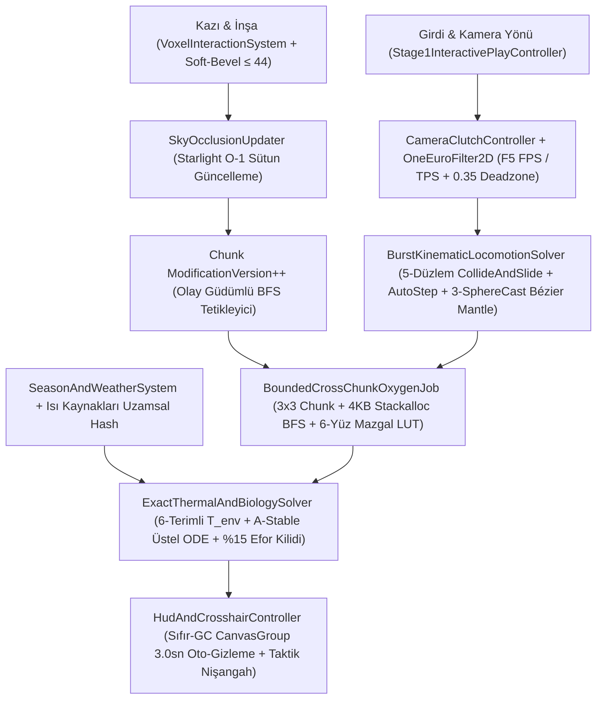

# FAZ 2 — MEKANİK 5: 7 DURUŞLU FİZİKSEL KARAKTER HAREKET FİZİĞİ (`COLLIDE-AND-SLIDE`, `0.45m` SÜRÜNME, `3.66m` KAYMA, 3-IŞINLI BÉZIER `2.20m` TIRMANMA, ÇİFT KAMERA `F5` / `CAMERA-CLUTCH`), KAPALI ALAN `3D FLOOD-FILL` OKSİJEN (`SKY_LIGHT` BACA ERKEN ÇIKIŞI) VE 6-TERİMLİ TERMODİNAMİK / ISLAKLIK / STAMİNA HİSTEREZİS ODE MÜHENDİSLİK RAPORU

> [!IMPORTANT]
> **Mimari Otorite ve Belge Hiyerarşisi:** Bu mühendislik denetim ve çözüm mimarisi raporunda mutlak tasarım ve matematik otoritesi [GAME LOGIC BIBLE v7.0](file:///D:/Oyunum/oyun/STRATOCRAFT_%20EVRENSEL%20OYUN%20TASARIM%20VE%20MANTIK%20ANAYASASI%20%28GAME%20LOGIC%20BIBLE%29%20%282%29.md) (`Bölüm 2.5.G`, `Bölüm 3.1–3.5`, `Bölüm 4.8.A`) ve [MATEMATİKSEL SİMÜLASYON RAPORU](file:///D:/Oyunum/oyun/STRATOCRAFT_ARKA_PLAN_MATEMATIKSEL_SIMULASYON_VE_VOXEL_ALGORITMALARI_RAPORU.md) (`Bölüm 5.1–5.2`, `Bölüm 7.2.1`) belgeleridir. [STRATOCRAFT_GELISTIRICI_DOKUMANI.md](file:///D:/Oyunum/oyun/STRATOCRAFT_GELISTIRICI_DOKUMANI.md) ve mevcut C# kod tabanındaki sapmalar satır satır tespit edilmiş, pürüzsüz `Surface Nets` arazi geometrisi üzerindeki kinematik sıkışma/tünel daralması ve `32-bit VoxelCell` içindeki `SKY_LIGHT` bit eksikliği matematiksel olarak kanıtlanarak **Unity 6 (`6000.6.7f1`) + Hibrit DOTS + C# Burst SIMD (`0 Byte GC`, `< 2.5 GB RAM`, `>= 60 FPS`)** hedeflerine uygun nihai çözüm mimarisi çıkarılmıştır.

---

## 1. Mekanik Tasarım Vizyonu ve Anayasa'daki (`GAME LOGIC BIBLE`) Asıl Çalışma Mantığı

Stratocraft'ta oyuncu karakteri, soyut hız vektörleriyle kayan veya görünmez menülerle yönetilen klasik bir FPS/MMO piyonu değildir. Karakter; **vücut duruşu (`7 Aktif Hareket Modu + Yaşam/Yaralanma Durumları`)**, **kuşandığı zırh ve silahların gerçek kilogram kütlesi**, **elindeki kılıcı savururken kamerayı kilitleyen bilek debriyajı (`Camera-Clutch`)**, **içinde bulunduğu odanın sızdırmaz hava hacmi (`m³ Oksijen`)** ve **çevresel termodinamik ısı transferi (`Termal ODE + Islaklık`)** ile fiziksel dünyaya doğrudan bağlı yaşayan bir organizmadır.

### 1.1. Çift Kamera (`F5`), `Camera-Clutch` Serbest Açı Yakın Dövüş Debriyajı ve Minimalist Diyajetik HUD

1. **Anlık Çift Kamera Geçişi (`F5` — `FPS <-> TPS`):**
   - Oyuncu [GAME LOGIC BIBLE Bölüm 3.1](file:///D:/Oyunum/oyun/STRATOCRAFT_%20EVRENSEL%20OYUN%20TASARIM%20VE%20MANTIK%20ANAYASASI%20%28GAME%20LOGIC%20BIBLE%29%20%282%29.md#L563-L566) uyarınca tek bir tuşla (`F5`) **Birinci Şahıs (`FPS` — Göz Hizası Görünümü)** ile **Üçüncü Şahıs Omuz Üstü (`TPS` — Çevresel Taktik Görünüm)** arasında sıfır gecikmeyle geçiş yapar.
   - Göz yüksekliği ($y_{\text{eye}}$) sabit değildir; karakterin anlık fiziksel kapsül yüksekliğine ($H_{\text{stance}}$) kilitlidir (`Ayakta 1.80m -> Eğilme 0.90m -> Yüzüstü Sürünme 0.45m`). Dar bir `0.45m` havalandırma tünelinde TPS kamerası tavan üçgenlerinin arkasına taşmamak için küresel çarpışma taramasıyla (`SphereCast`) otomatik olarak omuz/ense mesafesine yaklaşır veya tünel içinde iç-göz hizasına kenetlenir.

2. **`Camera-Clutch` (`Kamera Debriyajı`) + `1€ Filter` Gecikmesiz Silah Yönlendirme:**
   - [GAME LOGIC BIBLE Bölüm 4.2 & 4.8.A](file:///D:/Oyunum/oyun/STRATOCRAFT_%20EVRENSEL%20OYUN%20TASARIM%20VE%20MANTIK%20ANAYASASI%20%28GAME%20LOGIC%20BIBLE%29%20%282%29.md#L1145-L1170) ve [MATEMATİKSEL RAPOR Bölüm 7.2.1](file:///D:/Oyunum/oyun/STRATOCRAFT_ARKA_PLAN_MATEMATIKSEL_SIMULASYON_VE_VOXEL_ALGORITMALARI_RAPORU.md#L256-L259) uyarınca Stratocraft, oyuncuyu tek hedefe zorla kilitleyen (*Hard Lock-On*) hantal sistemleri reddeder.
   - Oyuncu `Sol Tık (LMB)` (Saldırı kurma) veya `Sağ Tık (RMB)` (Yönlü blok / saptırma) tuşunu basılı tuttuğu anda **Kamera Debriyajı** devreye girer: Ham 2B fare deltası $(\Delta x_m, \Delta y_m)$ önce **Casiez et al. (2012) `1€ Adaptif Alçak Geçiren Filtre`** ile süzülerek yavaş tutuşlardaki el titremesi (`jitter`) `%100` bastırılır, hızlı savurmalarda (`flick`) ise kesim frekansı doğrusal büyütülerek faz gecikmesi sıfırlanır.
   - Filtrelenmiş fare deltası doğrudan kamerayı döndürmek yerine birim daire içindeki **2B Silah İmleç Vektörü** $\mathbf{p}_m(t) \in [-1, 1]^2$ üzerinde entegre edilir ve **3 Radyal Bölgeye** ayrılır:
     - **Bölge 1 ($\|\mathbf{p}_m\| \le 0.35$ — Saf Kılıç Debriyajı):** Kamera `%100` sabittir ($\boldsymbol{\omega}_{\text{cam}} = \mathbf{0}$). Oyuncu mide bulantısı (*motion sickness*) yaşamadan `360°` her açıda savurma kurar veya blok yönlendirir.
     - **Bölge 2 ($0.35 < \|\mathbf{p}_m\| \le 0.85$ — Yumuşak Boyun/Bel Esnemesi):** Karakterin boynu ($\pm 25^\circ$) ve beli ($\pm 35^\circ$) `Smoothstep` eğrisiyle kılıcın çekildiği yöne organik olarak esner.
     - **Bölge 3 ($\|\mathbf{p}_m\| > 0.85$ — Çevresel Ayak Takibi):** Etrafında dönen (*circling*) bir düşmanı kaçırmamak için kılıcın yerel kurma açısı ($\mathbf{p}_m$) bozulmadan kamera ve ayaklar kontrollü açısal hızla ($\omega_{\text{turncap}}$ sınırıyla) hedefi takip eder.

3. **Minimalist Diyajetik HUD (`3.1.B`):**
   - Normal keşif sırasında ekran `%100` temizdir. Can, Stamina, Oksijen ve Sıcaklık yalnızca değiştiğinde, eşik altına indiğinde veya çatışmada zarif göstergeler olarak belirir. Renk körlüğü modları (*Deuteranopia / Protanopia / Tritanopia*) ve `1€ Filter` hassasiyet kaydırıcısı erişilebilirlik katmanında sunulur.

---

### 1.2. 7 Duruşlu Gelişmiş Fiziksel Hareket Fiziği ve Yaşam Durum Makinesi

[GAME LOGIC BIBLE Bölüm 3.1](file:///D:/Oyunum/oyun/STRATOCRAFT_%20EVRENSEL%20OYUN%20TASARIM%20VE%20MANTIK%20ANAYASASI%20%28GAME%20LOGIC%20BIBLE%29%20%282%29.md#L567-L569) ve [Bölüm 3.5.D](file:///D:/Oyunum/oyun/STRATOCRAFT_%20EVRENSEL%20OYUN%20TASARIM%20VE%20MANTIK%20ANAYASASI%20%28GAME%20LOGIC%20BIBLE%29%20%282%29.md#L739-L752) karakterin dünyadaki tüm geometrik engellerle etkileşimini **7 ana aktif hareket duruşu** ve **4 taktiksel/yaşam durumu** üzerine kurar:

1. **Ayakta Yürüme (`Standing` — `4.0 m/sn`, Boy `1.80m`):** Standart hareket modu. Kuşanılan ekipman kütlesi eşiği aştığında ve ıslaklık (`+%10` kıyafet ağırlığı) bindiğinde efektif hız dinamik olarak ölçeklenir.
2. **Depar (`Sprinting` — `Shift` Basılı Tutma, `7.0 m/sn`, Boy `1.80m`):** Sürekli Stamina (`EP`) tüketir ve vücutta metabolik ısı ($\dot{Q}_{\text{sprint}} > 0$) üretir. Çanta açıkken (`I`) veya Stamina tükenmişlik kilidi (`IsExhausted`) aktifken depar atılamaz.
3. **Eğilme (`Crouching` — `Sol Ctrl`, `2.0 m/sn`, Geçiş Boyu `0.90m`):** Ayak sesi yayılım yarıçapını `-%70` düşürür, `0.90m–1.00m` alçak boşluklardan/siperlerden geçmeyi sağlar. Aynı zamanda elde geçerli bir değerli maden/yakıt varken **`Sol Ctrl + Sağ Tık`** kombinasyonuyla tüm Ritüel, Batarya ve Yapı Çekirdeği aktivasyonlarının çakışmasız tetikleyicisidir.
4. **Eğim Duyarlı Koşarken Kayma (`Slope-Aware Sliding` — `Shift + Sol Ctrl`, Boy `0.90m`, Düz Zeminde `3.66m`):** Oyuncu `7.0 m/sn` depar atarken `Sol Ctrl`'e bastığında kapsül `1.80m -> 0.90m` alçalır; **`15 EP` Stamina** bedeliyle anlık bacak itiş darbesi ($\Delta v_{\text{push}} = +1.2\text{ m/sn}$) alarak **`8.2 m/sn`** başlangıç hızıyla kaymaya başlar. Düz toprakta ($\mu = 0.94$) tam **`3.65–3.66 metre`** kayarak durur; buz üzerinde ($\mu = 0.08$) çok daha uzağa kayar, dik yokuş aşağı ($\sin\theta > \mu\cos\theta$) hız kazanır! Kayma bittiğinde baş üstü tavan yüksekliği `< 1.80m` ise ayağa kalkmaya zorlamaz, güvenli şekilde `Eğilme` veya `Sürünme` duruşunda kalır.
5. **Yüzüstü Sürünme (`Prone Crawling` — `Z` Tuşu, `1.0 m/sn`, Kapsül Boyu `0.45m`):** Çalı/ot içinde kamuflajı maksimize eder ve `0.45m–1.00m` dar havalandırma bacaları, tuzak tünelleri ve maden çatlaklarından geçmeyi sağlar. Tavan açıklığı kontrolü (`Ceiling Clearance Lock`) sayesinde tünel içindeyken `Z`, `Ctrl` veya `Space` tuşuna basılsa bile karakter tavan mesh'inin içine kafasını sokamaz.
6. **Yüzme ve Derin Su Dalışı (`Swimming` — Arşimet Kaldırma Kuvveti + Boyle-Mariotte Basıncı):** Su derinliği eşiği aştığında devreye girer. Ağır plaka zırh giyen karakterin toplam kütlesi suyun kaldırma kuvvetini aşarsa karakter dibe batar. Su altında inilen derinlik $d_{\text{water}}$ arttıkça akciğer oksijen tüketimi her metrede `+%5` hızlanır ve korumasız olarak **`d_water > 50m`** altına inildiğinde saniyede $0.25(d_{\text{water}} - 50)\text{ HP/sn}$ **Hidrostatik Basınç Ezilme Hasarı** uygulanır (`Bölüm 2.5.G`).
7. **Kenara Tutunup Tırmanma (`3-Ray Ledge Detection + Cubic Bézier Mantle` — `<= 2.20m`, `0.55 sn`):** Havada veya duvar önünde `Space` basıldığında **3 Işınlı Çıkıntı Tespiti** (`Ray 1: Göğüs/Baş İleri <= 0.75m`, `Ray 2: y_foot + 2.20m Üst Boşluk`, `Ray 3: Yukarıdan Aşağıya h_ledge in [0.80m, 2.20m] ve Normal.y >= 0.70`) çalıştırılır. Üç şart da sağlanırsa karakter `0.55 saniye` içinde **İki Fazlı Kübik Bézier Eğrisi** (önce dikey kol çekişi, sonra çıkıntı üstüne öne adım) ile pürüzsüzce tırmanır.
   - **Ek Taktiksel Modlar:** `Space` yerde basıldığında `1.20m` zıplama; `Mouse 5` (veya `Yön + Çift Space`) basıldığında **Kaçınma Adımı (`Side-Step / Dodge`)**; sırtta **Uçuş Kanadı (`Glider`)** varken havada `Space` basıldığında kaldırma/sürükleme poları ($C_L, C_D$) ve ateş/lav üstündeki **Termal Yükseliş Akımları ($w_{\text{thermal}} \in [2.5, 8.5]\text{ m/sn}$)** ile süzülme; `I` tuşuna basıldığında *The Forest* tarzı `1.40m x 1.00m` 3B Kumaş Çanta açılıp hızın `-%70` (`1.2 m/sn`) düşmesi; `0 HP`'de `30 sn` `BleedOutCrawl` sürünmesi; `H` tuşuyla (`0.8 sn`) ağır yaralı veya `Offline Sleeper` bedeni omuzda taşıma (`Fireman's Carry`).

---

### 1.3. `%100` Çakışmasız Ana Tuş Ataması Felsefesi (`Conflict-Free Input Matrix`)

Anayasa'daki (`Bölüm 3.1`, satır `570–590`) tuş matrisi üç kritik mühendislik kazasını donanım/işletim sistemi seviyesinde önlemek üzere tasarlanmıştır:
- **Windows `Alt + Tab` Masaüstüne Atma Koruması:** Sol el bağımsız saldırısı `Alt + LMB` ve sol el kılıf çekimi `Alt + 1..4` olduğu için, savaşın ortasında çantayı açmak üzere yanlışlıkla `Tab`'a basılması oyuncuyu masaüstüne atardı. Bu yüzden 3B çanta örtüsü **`I`** tuşuna atanmıştır.
- **Kaçınma (`Dodge`) vs. Sol El Saldırısı Ayrımı:** Kaçınma adımı `Alt` tuşundan tamamen koparılarak **`Mouse 5` (veya `W/A/S/D + Çift Space`)** girdisine bağlanmıştır.
- **Bloklama (`RMB`) vs. Çekirdek Ateşleme (`Sol Ctrl + RMB`) vs. Madde Kristali (`C` + `V`) Ayrımı:** Çift Halkalı Radyal Şekil Menüsü (`V` basılı tutma) yalnızca sol bilekteki Madde Kristali (`C`) aktifken açılır; elde silah varken `V` tuşu `0 ms` `OnKeyDown` ile İçsel Canavar Avı Skill'ini tetikler.

---

### 1.4. Gerçekçi Hayatta Kalma Fiziği: Oksijen BFS, 6-Terimli Termal ODE, Islaklık ve Stamina Histerezisi

1. **Kapalı Alan Hacimsel Oksijen (`Bounded 3D Flood-Fill BFS`) ve `Box-Cheese` Önlemi (`3.2.C` & `3.5.A`):**
   - Oyuncu Boss eğitirken veya kuşatmada hasar almamak için kendi etrafını `1x1x2` (`2 m³` hava) sızdırmaz taşlarla ördüğünde (`Box-Cheese`), sistem yalnızca blok konulduğunda/kırıldığında veya oda değiştiğinde (`Event-Driven`) oyuncunun kafa hücresinden ($\mathbf{p}_{\text{head}}$) **6-komşuluklu sınırlı BFS (`MAX_BFS_VOXELS = 512`)** başlatır.
   - Ziyaret edilen herhangi bir hücrenin **`SKY_LIGHT > 0`** değeri varsa (dar bir `1x1` dikey havalandırma bacasının en alt tabanına ulaşılsa bile!) veya toplam hava hacmi **`V_hava >= 512 m³`** sınırına ulaşırsa BFS anında `IsSealed = false` (Açık Hava) döndürerek erken çıkar (`< 0.05 ms`). Demir parmaklıklı mazgallar (`IS_AIR_PERMEABLE == 1`) fiziksel geçişi engellerken havayı geçirir.
   - Kuyruk `V_hava < 512` iken biterse oda mühürlüdür (`IsSealed = true`). Başlangıç oda oksijen rezervi $O_{\max} = 15.0 \cdot V_{\text{hava}}$ birimdir (`1x1x2` kutuda $15 \times 2 = 30$ birim). Oda içindeki her canlı saniyede $\approx 1.0$ birim (akciğer ustalığıyla azalır), yanan her meşale/ocak **`2.0` birim** oksijen tüketir; Parlayan Yosun / Kristal Bahçeleri ise **`+0.25` birim/sn** fotosentez oksijeni üretir.
   - **İki Aşamalı Boğulma:** Oda oksijeni $O(t) = 0$ olduğunda önce oyuncunun kendi **Akciğer / Nefes Barı ($B_{\text{lung}}$)** su altındaymış gibi hızla tükenir; $B_{\text{lung}} = 0$ olduğu andan itibaren karakter öksürerek saniyede **`-10 HP` Boğulma Hasarı (`Asphyxiation`)** alır!

2. **6-Terimli Çevre Sıcaklığı ($T_{\text{env}}$), Vücut İç Sıcaklığı ($T_{\text{core}}$) ODE'si ve Islaklık ($W \in [0, 1]$) (`3.2.B` & `3.5.B`):**
   - Çevre sıcaklığı; biyom tabanı, mevsim, saatlik sinüzoidal güneş döngüsü (maksimum `15:00`, minimum `03:00`), rakım/jeotermal dikey gradyan ($\Gamma(y)$: yüzeyde `-6.5°C / 100m`, yeraltında `y < -40m` altında Magma Denizine inerken `+0.8°C / m`), çatı korumalı rüzgar soğutması ve noktasal ısı/soğuk kaynaklarının (`Kamp Ateşi +25°C`, `Ergitme Fırını +60°C`, `Lav +120°C`, **`Mavi Buzlu Kiler -90°C`**) ters-kare ($1/(r^2+1)$) toplamından oluşur.
   - Vücut iç sıcaklığı ($37.0^\circ\text{C}$) homeostatik geri çağırım terimi ($-\lambda_{\text{homeo}}(T_{\text{core}} - 37.0)$), sıcak/soğuk zırh yalıtımı ($I_{\text{heat}}, I_{\text{cold}}$), fizyolojik ustalık ($\ln(1+M)$), depar ısısı ($\dot{Q}_{\text{sprint}}$) ve ıslaklıkla sürülür.
   - **Islaklık ($W \in [0, 1]$):** Sıcakta buharlaşma soğutması ($\dot{Q}_{\text{evap}}(W)$) ile güneş çarpmasını silerken, soğukta ısı kaybı katsayısını $(1 + 2.0W) = \mathbf{3.0\text{ katına}}$ çıkarır ve kürk/kumaş yalıtımını `%60` düşürür ($1 - 0.6W$). Ayrıca savaşta ateş hasarını `-%30` azaltır, yıldırım/elektrik bataryası hasarını `+%50` artırır ve kıyafet ağırlığını `+%10` ağırlaştırır.

3. **Stamina (`100 EP`) Sıfırlanma Cezası ve `%15` Histerezis Kilidi (`3.2.A` & `3.5.B.3`):**
   - `EP <= 0` olduğunda `IsExhausted = true` bayrağı kalkar: Karakter nefes nefese kalarak **olduğu yerde tökezler (yürüyemez ve koşamaz!)**, zıplayamaz, silah savuramaz ve bu sırada darbe alırsa doğrudan **yere yıkılır (`Knockdown`)**. Tuş spamlamayla titremeyi (*state jitter*) önlemek için kilit ancak **`EP >= 15.0` (`%15`)** dolduğunda açılır.

---

### 1.5. Dokümanlar ve Mevcut Kod Tabanı Arasındaki Çelişkiler Tablosu (Denetim Özeti)

Aşağıdaki tabloda mutlak otorite olan **GAME LOGIC BIBLE v7.0 + MATEMATİKSEL RAPOR** ile **GELİŞTİRİCİ DOKÜMANI** ve **Mevcut C# Kod Tabanı** arasındaki **14 somut çelişki** belgelenmiştir:

| # | Parametre / Mekanik | Mutlak Otorite (`GAME LOGIC BIBLE v7.0` & `MATEMATİKSEL RAPOR`) | `STRATOCRAFT_GELISTIRICI_DOKUMANI.md` | Mevcut Kod Tabanı (`Assets/_Stratocraft/...`) | Mühendislik Kararı (Nihai Standart) |
| :-: | :--- | :--- | :--- | :--- | :--- |
| **1** | **Depar (`Sprint`) Hızı** | **`7.0 m/sn`** (`Bölüm 3.1`, s. 567 & `3.5.D`, s. 741) | **`7.0 m/sn`** (`Bölüm 4.13.4`, s. 1693 & `5.3`, s. 3119) | `StratocraftConstants.SprintSpeedMps = 7.0f` **AMA** `PhysicalCharacterControllerSystem.BaseSprintingSpeed = 6.8f`! | **`7.0 m/sn`** (`StratocraftConstants` tek kaynak olacak, `6.8f` silinecek). |
| **2** | **Eğilme (`Crouch`) Hızı & Boyu** | **`2.0 m/sn`**, Boy **`0.90m`** (`-%70` ayak sesi, `Bölüm 3.1`, s. 567) | Boy **`1.2m`**, Hız **`2.2 m/sn`** (`-%60` ses, s. 1843 & s. 3119) | `StratocraftConstants.CrouchSpeedMps = 2.0f` **AMA** `PhysicalCharacterControllerSystem`: Boy **`1.25m`**, Hız **`2.2f`**! | Hız **`2.0 m/sn`**, Kapsül Boyu **`0.90m`** (`-%70` ses). |
| **3** | **Sürünme (`Prone`) Hızı & Boyu** | **`1.0 m/sn`**, Boy **`0.45m`** (`0.45m` tünel geçişi, `Bölüm 3.1`, s. 567) | Boy **`0.6m`** (`1x1m` tünel, s. 1845 & s. 3119) | `StratocraftConstants.ProneSpeedMps = 1.0f` **AMA** `PhysicalCharacterControllerSystem`: Boy **`0.65m`**, Hız **`1.1f`**, `Radius = 0.35m` ($2R=0.70\text{m} > 0.65\text{m}$ hatası!) | Hız **`1.0 m/sn`**, Boy **`0.45m`**, Sürünme Yarıçapı **`R = 0.20m`** ($2R = 0.40\text{m} \le 0.45\text{m}$). |
| **4** | **Kayma (`Slide`) Fiziği & Stamina** | **`15 EP`** maliyet, $v_0 = 7.0 + 1.2 = \mathbf{8.2\text{ m/sn}}$, eğim/sürtünme ODE'si (`3.65–3.66m`) | Eğimli zeminde `Sol Ctrl`, `Hız < 2.0` bitiş (`Bölüm 4.5.2`, s. 835) | `PhysicalCharacterControllerSystem`: sabit `5.4f`, `0 EP`. `Stage1`: `6.8 * 1.22 = 8.296f`, `0 EP`, eğimsiz sabit `-5.2f * dt` yavaşlama! | Bible ODE: **`15 EP`**, $v_0 = 8.2\text{ m/sn}$, $dv/dt = g\sin\theta - \mu g\cos\theta$ ($\mu_{\text{toprak}}=0.94 \implies 3.65\text{m}$). |
| **5** | **Stamina `0 EP` Tükenmişlik Kilidi** | `%15` dolana dek **yürüme + koşma + zıplama + saldırı kilitli (tökezleme)** + darbede `Knockdown` (`s. 604, 722`) | Belirtilmemiş | `PhysicalCharacter`: `%0` histerezis yok! `Stage1`: `%15` histerezis sadece `Sprint`'i kapatıyor; oyuncu `4.0 m/s` yürüyüp zıplayabiliyor! | `IsExhausted == 1` iken `%15`'e dek tökezleme hızı (`0.6 m/sn` max, koşu/zıplama/saldırı kilitli + `Knockdown`). |
| **6** | **Oksijen BFS Tavan & Açık Hava Eşiği** | **`MAX_BFS_VOXELS = 512`** (`V_hava >= 512 m³` açık hava, `< 0.05 ms`, `s. 703–706`) | `MaxNodes = 2048` (`Bölüm 4.13.6`, s. 1878) | `EnclosedOxygen`: `MaxFloodFillNodes = 2048`, varsayılan `maxSearch = 128`, **`OpenAtmosphereThreshold = 64`** (`Stage1`: `96`)! `64 m³` kapalı odada sonsuz O2 hatası! | **`MAX_BFS_VOXELS = 512`** (Hem arama hem açık mağara eşiği tam `512 m³`!). |
| **7** | **`SKY_LIGHT` Baca Erken Çıkışı** | `SKY_LIGHT > 0` ise `1x1` bacanın tabanında $O(1)$ `IsSealed = false` (`s. 705`) | Yok (`VoxelCell` 32-bit içinde bit ayrılmamış!) | **%0 Kodlanmış!** Üstelik `nx < 0 \|\| nx >= 16` chunk sınırına değdiği an kapalı odayı "Açık Atmosfer" sayan ağır bug var! | Chunk başına `256 Byte` `SkyOcclusionHeightMap[256]` + Çoklu-Chunk (`Cross-Chunk`) BFS! |
| **8** | **`IS_AIR_PERMEABLE` (Mazgal / Kapı)** | Demir parmaklıklı mazgal (`IS_AIR_PERMEABLE == 1`) havayı geçirir (`s. 704, 2955`) | Yok | **%0 Kodlanmış!** Yalnızca `!neighbor.IsSolid` kontrol ediliyor. | `FaceAirtightMask6` tablosu ile mazgal, açık kapı ve mikro-voxel boşluklarından hava geçişi. |
| **9** | **Oda Oksijeni vs. Akciğer Barı** | **2 Aşamalı:** Önce oda rezervi $O_{\max}=15 V_{\text{hava}}$ biter (`30 sn`), **sonra** $B_{\text{lung}}$ erir, sonra `-10 HP/sn` (`s. 623, 710`) | `1x1x2` kutuda `LungOxygenPercent` `30 sn`'de biter (`s. 1878`) | `EnclosedOxygen`: Oda oksijeni tutmuyor; ilk saniyeden doğrudan `LungOxygenPercent` düşürüyor (`30 sn` sonunda direkt `-10 HP/sn`). | 2 Aşamalı: `RoomOxygenRemaining` (`1x1x2`'de `30 sn`) $\to$ `LungOxygenPercent` (`15 sn` nefes tutma) $\to$ `-10 HP/sn`! |
| **10** | **Meşale / Ocak Tüketimi & Yosun** | Yosun `+0.25/sn`; Tüketim `1.0 * N_canlı + 2.0 * N_ateş` (`1 oyuncu + 1 ateş = 3.0x`, `s. 620, 709`) | Yanan meşale sayısına göre (`s. 3120`) | Sadece `bool isHoldingLitTorch` varsa `2.5x` çarpan (`Stage1`'de hardcoded `false`, yerdeki ocak/kamp ateşi ve yosun `%0`). | Bible denklemi: `+0.25 * N_yosun - (Sum(Canlı) + 2.0 * N_ateş)`. |
| **11** | **Çevre Sıcaklığı ($T_{\text{env}}$) & Termal ODE** | 6-terimli $T_{\text{env}}$ + Parçalı $T_{\text{core}}$ ODE + Homeostaz + Islaklık `3x` soğuma (`s. 714–720`) | Newton soğuma + metabolik ısı; Hipertermi `> 40°C` (`s. 1868`) | `ThermalAndBiologySystem`: Basit `(ambient - 22) * 0.015`, ıslaklık `2x` hız, Hipertermi `> 39.5°C`. **`Stage1`'de hiç çağrılmıyor!** | Tam 6-terimli $T_{\text{env}}$ + Üstel-Kararlı Parçalı $T_{\text{core}}$ ODE (`Hipertermi >= 39.5°C`, `Hipotermi <= 35.0°C`). |
| **12** | **3-Işınlı Bézier Tırmanma (`2.20m`)** | `d_wall <= 0.75m`, `h_ledge in [0.80, 2.20m]`, `Normal.y >= 0.70`, `0.55 sn` **2-Fazlı Kübik Bézier** (`s. 744–748`) | `Climbing = 6` (`Ledge Grab`) | `PhysicalCharacter`: Tırmanma kodu yok. `Stage1`: `0.385 sn` (`dt * 2.6`) düz `Vector3.Lerp` (doğrusal çizgi köşenin içinden geçer!). | `3-SphereCast` çıkıntı taraması + `0.55 sn` **Kübik Bézier** ($\mathbf{P}_0 \to \mathbf{P}_1 \to \mathbf{P}_2 \to \mathbf{P}_3$) yörüngesi. |
| **13** | **`Camera-Clutch` & `1€ Filter`** | $\mathbf{p}_m \in [-1,1]^2$, `r <= 0.35` kilit, `0.35..0.85` Smoothstep boyun/bel, `> 0.85` takip + `1€ Filter` (`s. 1148–1153`) | `CameraClutchController` (`fcmin=1.5, beta=0.007`, `0.35 / 0.85 rad`, `s. 1881`) | `CameraClutchController` ve `OneEuroFilter3D` yazılmış **AMA** `Stage1` bunları hiç çağırmayıp basit `Vector2.Lerp` kullanıyor ve Bölge 3 kamera takibi yok! | `Stage1` ve DOTS doğrudan `OneEuroFilter3D` + 3-Bölgeli `CameraClutchController` çekirdeğine bağlanacak. |
| **14** | **HUD Gösterimi** | Minimalist Diyajetik `Auto-Hide` HUD (Sadece değişimde/savaşta görünür, `s. 591–593`) | `HudAndCrosshairController.cs` (UI Toolkit, `s. 1459`) | `HudAndCrosshairController` hiçbir sahneye bağlı değil; `Stage1` her kare `OnGUI()` içinde 6 satırlık string birleştirerek (`GC Alloc!`) sabit debug kutusu çiziyor. | Sıfır-GC `HudAndCrosshairController` + `Auto-Hide` opaklık durum makinesi sahneye bağlanacak. |

---

## 2. Anayasa ve Matematiksel Rapordaki Formüller, Bit/Byte Şemaları ve Algoritmalar

Bu bölümde [GAME LOGIC BIBLE Bölüm 2.5.G, 3.2, 3.5, 4.8.A](file:///D:/Oyunum/oyun/STRATOCRAFT_%20EVRENSEL%20OYUN%20TASARIM%20VE%20MANTIK%20ANAYASASI%20%28GAME%20LOGIC%20BIBLE%29%20%282%29.md#L551-L753) ve [MATEMATİKSEL RAPOR Bölüm 5.1, 7.2.1](file:///D:/Oyunum/oyun/STRATOCRAFT_ARKA_PLAN_MATEMATIKSEL_SIMULASYON_VE_VOXEL_ALGORITMALARI_RAPORU.md#L177-L259) içinde tanımlanan tüm diferansiyel denklemler ve bit şemaları tam matematiksel formlarıyla çıkarılmıştır.

### 2.1. Kapalı Alan Hacimsel Oksijen (`Bounded 3D BFS`) ve Su Altı Boyle-Mariotte Denklemleri

1. **Sızdırmaz Oda Oksijen Rezervi ve Net Değişim ODE'si (`Bölüm 3.2.C & 3.5.A`):**
   BFS kuyruğu $V_{\text{hava}} < 512$ iken tamamlandığında ve ziyaret edilen hiçbir hücrede $\text{SKY\_LIGHT}(v) > 0$ bulunmadığında oda mühürlüdür ($\text{IsSealed} = \text{true}$). Başlangıç/maksimum oda oksijen kapasitesi ve anlık değişim hızı:
   $$O_{\max}(V_{\text{hava}}) = 15.0 \cdot V_{\text{hava}}, \qquad O(t) \in [0, \, O_{\max}]$$
   $$\frac{dO}{dt} = \underbrace{0.25 \cdot N_{\text{yosun}}}_{\text{Parlayan Yosun Fotosentezi}} - \left( \sum_{i=1}^{N_{\text{canlı}}} \frac{1.0}{1 + 0.005 \cdot M_{\text{akciğer}, i}} + 2.0 \cdot N_{\text{ateş}} \right)$$
   Sabit tüketim durumunda ($N_{\text{yosun}} = 0$, $M_{\text{akciğer}} = 0$) oda oksijeninin sıfırlanma süresi:
   $$T_{\text{oksijen}} = \frac{15.0 \cdot V_{\text{hava}}}{N_{\text{canlı}} + 2.0 \cdot N_{\text{ateş}}} \quad \left(\text{Örn. } 1\times 1\times 2\text{m kutu: } V_{\text{hava}}=2, N_{\text{canlı}}=1, N_{\text{ateş}}=0 \implies T_{\text{oksijen}} = \mathbf{30.0\text{ sn}}\right)$$

2. **Su Altı / Havasız Ortam Akciğer Barı ($B_{\text{lung}}$) ve Hidrostatik Ezilme Hasarı (`Bölüm 2.5.G`):**
   Su yüzeyinden ($Y_{\text{surface}}$) aşağıya kafa derinliği $d_{\text{water}} = \max(0, \, Y_{\text{surface}} - y_{\text{head}})$ için hidrostatik basınç $P_{\text{hydro}}(d_{\text{water}}) = P_{\text{atm}} + \rho_{\text{su}} g d_{\text{water}}$ (`her 10m'de +1 atm`) olup akciğer barı $B_{\text{lung}} \in [0, B_{\max}]$ tükenme denklemi (havasız kapalı odada $d_{\text{water}} = 0$ alınarak aynı denklem çalışır):
   $$\frac{dB_{\text{lung}}}{dt} = -\frac{r_{\text{breath\_base}} \cdot \left(1 + 0.05 \cdot d_{\text{water}}\right)}{\left(1 + 0.008 \cdot M_{\text{akciğer}}\right) \cdot \left(1 + 3.0 \cdot \mathbb{I}_{\text{GillPotion}}\right)}$$
   Boğulma (`Asphyxiation`) ve `> 50m` derin okyanus hidrostatik ezilme (`Crush`) hasar hızı:
   $$\dot{D}_{\text{env\_hp}} = \underbrace{10.0 \cdot \mathbb{I}_{(B_{\text{lung}} \le 0)}}_{\text{Boğulma: }-10\text{ HP/sn}} + \underbrace{0.25 \cdot \max(0, \, d_{\text{water}} - 50.0) \cdot \left(1 - \mathbb{I}_{\text{DivingBellOrKrakenArmor}}\right)}_{\text{Hidrostatik Ezilme Hasarı (>50m)}}$$

---

### 2.2. 6-Bileşenli Çevre Sıcaklığı ($T_{\text{env}}$), Vücut İç Sıcaklığı ($T_{\text{core}}$) ODE'si, Islaklık ($W$) ve Stamina Histerezisi

1. **6-Bileşenli Çevre Sıcaklığı Alanı (`Bölüm 3.5.B.1`):**
   $$T_{\text{env}}(\mathbf{x}, t) = T_{\text{biyom}}(\mathbf{x}_{XZ}) + T_{\text{mevsim}}(t) + A_{\text{gün}} \sin\!\left(\frac{2\pi(t_{\text{saat}} - 9.0)}{24.0}\right) + \Gamma(y) - \Delta T_{\text{rüzgar}} \cdot \left(1 - E_{\text{çatı}}(\mathbf{x})\right) + \sum_{i \in \mathcal{H}(\mathbf{x})} \frac{Q_i}{\|\mathbf{x} - \mathbf{x}_i\|^2 + 1.0}$$
   Burada dikey atmosferik/jeotermal gradyan $\Gamma(y)$ parçalı fonksiyonu:
   $$\Gamma(y) = \begin{cases} -0.065 \cdot y, & y > 0 \quad (\text{Her } 100\text{m irtifada } -6.5^\circ\text{C Lapse-Rate}) \\[4pt] 0, & -40 \le y \le 0 \quad (\text{Yüzey altı sığ mağara izotermal kuşağı}) \\[4pt] +0.80 \cdot (-40.0 - y), & y < -40 \quad (\text{Magma Denizine inerken } +0.8^\circ\text{C/m Jeotermal Artış}) \end{cases}$$
   ve noktasal termal kaynaklar $Q_i \in \{+25^\circ\text{C (Kamp Ateşi)}, \, +60^\circ\text{C (Ergitme Fırını)}, \, +120^\circ\text{C (Lav)}, \, -90^\circ\text{C (Mavi Buzlu Kiler)}\}$ değerlerini alır.

2. **Vücut İç Sıcaklığı ($T_{\text{core}}$) Homeostatik & Islaklık Bağımlı Parçalı ODE'si (`Bölüm 3.5.B.2`):**
   Konfor hedef sıcaklığı $T_{\text{target}} = 22.0^\circ\text{C}$, sağlıklı iç denge sıcaklığı $T_{\text{norm}} = 37.0^\circ\text{C}$ ve ıslaklık oranı $W \in [0, 1]$ için:
   $$\frac{dT_{\text{core}}}{dt} = -\lambda_{\text{homeo}}\left(T_{\text{core}} - 37.0\right) + \begin{cases} K_{\text{heat}} \cdot \dfrac{T_{\text{env}} - T_{\text{target}}}{1 + I_{\text{heat}} + 0.5\ln(1 + M_{\text{heat}})} + \dot{Q}_{\text{sprint}} - \dot{Q}_{\text{evap}}(W), & T_{\text{env}} > T_{\text{target}} \\[10pt] -K_{\text{cold}} \cdot \left(1 + \mathbf{2.0 \cdot W}\right) \cdot \dfrac{T_{\text{target}} - T_{\text{env}}}{1 + I_{\text{cold}}(1 - 0.6W) + 0.5\ln(1 + M_{\text{cold}})} + \dot{Q}_{\text{sprint}}, & T_{\text{env}} \le T_{\text{target}} \end{cases}$$
   Islaklığın savaş ve hareket çarpanları:
   $$M_{\text{ateş\_hasarı}}(W) = 1.0 - 0.30 W, \qquad M_{\text{yıldırım\_hasarı}}(W) = 1.0 + 0.50 W, \qquad M_{\text{zırh\_kütlesi}}(W) = 1.0 + 0.10 W$$

3. **Stamina Tükenmişlik Histerezis Otomatı (`Bölüm 3.5.B.3`):**
   $$\text{IsExhausted}(t + \Delta t) = \begin{cases} 1, & \text{eğer } EP(t + \Delta t) \le 0 \\[4pt] 0, & \text{eğer } EP(t + \Delta t) \ge 0.15 \cdot EP_{\max} \\[4pt] \text{IsExhausted}(t), & \text{diğer durumlarda } \left(0 < EP < 0.15 \cdot EP_{\max}\right) \end{cases}$$

---

### 2.3. İleri Parkur Fiziği (`Slide 3.66m`, `3-Ray Cubic Bézier Mantle 2.20m`, `Glider`) ve `Camera-Clutch + 1€ Filter`

1. **Eğim Duyarlı Kayma (`Slope-Aware Slide` — `Bölüm 3.5.D.1`):**
   Başlangıç koşulu: $EP \ge 15.0 \implies EP \gets EP - 15.0$ ve $v_{\text{slide}}(0) = v_{\text{sprint}} + \Delta v_{\text{push}} = 7.0 + 1.2 = 8.2\text{ m/sn}$. Zemin eğim açısı $\theta_{\text{slope}}$ (inişte $\theta_{\text{slope}} > 0$, çıkışta $\theta_{\text{slope}} < 0$) ve yüzey sürtünmesi $\mu_{\text{ground}}$ ($\mu_{\text{toprak}} = 0.94, \, \mu_{\text{buz}} = 0.08$) için:
   $$\frac{dv_{\text{slide}}}{dt} = g \sin\theta_{\text{slope}} - \mu_{\text{ground}} g \cos\theta_{\text{slope}}$$
   Düz toprakta ($\theta_{\text{slope}} = 0$) durma mesafesi analitik integrali:
   $$d_{\text{stop}} = \frac{v_{\text{slide}}(0)^2}{2 \mu_{\text{toprak}} g} = \frac{8.2^2}{2 \times 0.94 \times 9.81} = \frac{67.24}{18.4428} \approx \mathbf{3.646\text{ m}} \quad (\approx \mathbf{3.66\text{ Birim}})$$

2. **3-Işınlı Çıkıntı Tırmanma Kübik Bézier Eğrisi (`Bölüm 3.5.D.2`):**
   Ayak başlangıç noktası $\mathbf{P}_0 = \mathbf{x}_{\text{foot}}$ ve tespit edilen çıkıntı üstü hedef nokta $\mathbf{P}_3 = \mathbf{x}_{\text{ledge}} + 0.03\hat{\mathbf{y}}$ için `T_mantle = 0.55 sn` süresince normalize zaman $u = \operatorname{Clamp}(t / 0.55, \, 0, \, 1)$ üzerinden önce dikey kol çekişini ($\mathbf{P}_1$), ardından yatay adım geçişini ($\mathbf{P}_2$) sağlayan kontrol noktaları:
   $$\mathbf{P}_1 = \left(P_{0,x}, \; P_{3,y} + 0.10, \; P_{0,z}\right), \qquad \mathbf{P}_2 = \left(\operatorname{Lerp}(P_{0,x}, P_{3,x}, 0.35), \; P_{3,y} + 0.15, \; \operatorname{Lerp}(P_{0,z}, P_{3,z}, 0.35)\right)$$
   $$\mathbf{B}(u) = (1 - u)^3 \mathbf{P}_0 + 3(1 - u)^2 u \mathbf{P}_1 + 3(1 - u) u^2 \mathbf{P}_2 + u^3 \mathbf{P}_3$$
   *(Dikkat: Doğrusal `Lerp(P0, P3, u)` karakteri çıkıntının taş köşesinin içinden çapraz geçirirken, yukarıdaki $\mathbf{P}_1, \mathbf{P}_2$ kontrol noktaları karakteri önce duvarın önünde dikey olarak $P_{3,y}$ yüksekliğine çeker, sonra çıkıntının üstüne yatırır!)*

3. **Uçuş Kanadı (`Glider`) Aerodinamiği ve Termal Yükseliş (`Bölüm 3.5.D.3`):**
   $$\mathbf{v}_{\text{air}} = \mathbf{v}_{\text{player}} - \left(\vec{v}_{\text{wind}} + w_{\text{thermal}}(\mathbf{x})\hat{\mathbf{y}}\right), \qquad w_{\text{thermal}}(\mathbf{x}) = W_{\max}\exp\!\left(-\frac{r_{XZ}^2}{R_{\text{th}}^2} - \frac{\Delta y}{H_{\text{th}}}\right)$$
   $$m\frac{d\mathbf{v}_{\text{player}}}{dt} = m\mathbf{g} + \frac{1}{2}\rho_{\text{air}} A_{\text{wing}}\|\mathbf{v}_{\text{air}}\|^2 \left( C_L(\alpha)\hat{\mathbf{e}}_{\text{lift}} - C_D(\alpha)\hat{\mathbf{e}}_{\text{drag}} \right)$$

4. **`1€ Filter` (Casiez et al. 2012) ve `Camera-Clutch` 3-Bölgeli Kamera Takip Hızı (`Bölüm 4.8.A.1`):**
   $$\alpha(f_c, \Delta t) = \frac{1}{1 + \dfrac{1}{2\pi f_c \Delta t}}, \qquad \hat{\dot{\mathbf{x}}}_k = \alpha(f_{c,d}, \Delta t)\frac{\mathbf{x}_k - \hat{\mathbf{x}}_{k-1}}{\Delta t} + \big(1 - \alpha(f_{c,d}, \Delta t)\big)\hat{\dot{\mathbf{x}}}_{k-1}$$
   $$f_c(\hat{\dot{\mathbf{x}}}_k) = f_{c,\min} + \beta \|\hat{\dot{\mathbf{x}}}_k\|, \qquad \hat{\mathbf{x}}_k = \alpha\big(f_c(\hat{\dot{\mathbf{x}}}_k), \Delta t\big)\mathbf{x}_k + \Big(1 - \alpha\big(f_c(\hat{\dot{\mathbf{x}}}_k), \Delta t\big)\Big)\hat{\mathbf{x}}_{k-1}$$
   $$\omega_{\text{cam,yaw}}(t) = \operatorname{Clamp}\!\left(\operatorname{Smoothstep}(0.35, \, 0.85, \, \|\mathbf{p}_m\|) \cdot \frac{p_x}{\max(\|\mathbf{p}_m\|, 10^{-5})} \omega_{\text{track}} + \kappa_{\text{over}}\max(0, |p_x| - 1)\operatorname{sgn}(\Delta x_m), \; -\omega_{\text{turncap}}, \; +\omega_{\text{turncap}}\right)$$

---

### 2.4. İlgili Voxel, Akışkan ve Navigasyon Bit/Byte Şemaları (`SKY_LIGHT` Boşluk Analizi)

Mevcut [MATEMATİKSEL RAPOR Bölüm 5.1](file:///D:/Oyunum/oyun/STRATOCRAFT_ARKA_PLAN_MATEMATIKSEL_SIMULASYON_VE_VOXEL_ALGORITMALARI_RAPORU.md#L177-L190) ve [VoxelCell.cs](file:///D:/Oyunum/oyun/Assets/_Stratocraft/Voxel/Data/VoxelCell.cs#L42-L99) içindeki **32-bit `VoxelCell`** bit yerleşimi:

```text
31    28 27  26 25       21 20         15 14            8 7              0
+-------+------+-----------+-------------+---------------+---------------+
|Damage |Origin| Rotation  |   ShapeID   |  Density/SDF  |  MaterialID   |
| (4b)  | (2b) |   (5b)    |    (6b)     |     (7b)      |     (8b)      |
+-------+------+-----------+-------------+---------------+---------------+
                \____ ShapeID==63 iken birleşip 12-bit MicroPoolIndex ____/
```

- **`VoxelCell` (`4 Byte = 32 Bit`):** `8 + 7 + 6 + 5 + 2 + 4 = 32 Bit` (**`0` boş bit!** `SKY_LIGHT` veya `IS_AIR_PERMEABLE` için tek bir bit dahi boş değildir).
- **`FluidCell16` (`2 Byte = 16 Bit`, [FluidCell16.cs](file:///D:/Oyunum/oyun/Assets/_Stratocraft/Physics/Data/FluidCell16.cs#L28-L37)):** `8-bit Mass + 3-bit FluidType + 3-bit FlowDirection + 2-bit SleepCounter = 16 Bit` (**`0` boş bit!**).
- **Kritik Mimari Tespit:** `VoxelCell` boyutunu `4 Byte`'tan `8 Byte`'a çıkarmak chunk başına RAM'i ikiye katlayarak `< 2.5 GB RAM` anayasasını ihlal eder! Bu nedenle:
  1. `IS_AIR_PERMEABLE` özelliği `VoxelCell` içinde bit tutmak yerine **`ShapeID` (`0..63`) ve `MaterialID` (`0..255`) üzerinden `64 Byte`'lık L1 önbellek LUT tablosuyla (`FaceAirtightMask6[ShapeID][Rotation]`)** $O(1)$ sürede çözülmelidir.
  2. `SKY_LIGHT > 0` dikey gökyüzü bacası (`Air Shaft`) tespiti ise chunk başına yalnızca **`256 Byte` (`16x16` sütun $\times$ `1 Byte` `ushort/byte SkyOcclusionY[256]`)** yer kaplayan **Artımlı Gökyüzü Örtüşme Yükseklik Haritası (`Incremental Sky-Occlusion Column Heightmap`)** ile $O(1)$ sürede çözülmelidir (Bkz. Bölüm 5.3 ve Bölüm 6.4).

---

## 3. Mevcut Kod Tabanı Denetimi (Ne Tamamlandı, Ne Yarım Kaldı, Ne Hatalı / Sahneye Bağlı Değil?)

Mevcut kod tabanındaki ilgili tüm dosyalar satır satır incelendiğinde en kritik mimari bulgu **"İki Paralel Kod Dünyası (`Split-Brain Architecture`)"** durumudur:
1. Bir tarafta `Assets/Tests/PlayMode/CharacterAndTacticalBackpackPlayTests.cs` birim testlerini geçirmek için yazılmış saf C# sınıfları ([`PhysicalCharacterControllerSystem`](file:///D:/Oyunum/oyun/Assets/_Stratocraft/Character/Systems/PhysicalCharacterControllerSystem.cs), [`ThermalAndBiologySystem`](file:///D:/Oyunum/oyun/Assets/_Stratocraft/Character/Systems/ThermalAndBiologySystem.cs), [`CameraClutchController`](file:///D:/Oyunum/oyun/Assets/_Stratocraft/Character/Camera/CameraClutchController.cs), [`HudAndCrosshairController`](file:///D:/Oyunum/oyun/Assets/_Stratocraft/UI/HudAndCrosshairController.cs)) bulunmaktadır — ancak bunlar **ne bir DOTS `ISystem` / `[BurstCompile]` Job'udur ne de canlı sahnede (`Stage1InteractivePlayController`) hareket/termal/kamera döngüsünü yönetmektedir!**
2. Diğer tarafta canlı Unity 6 sahnesini çalıştıran [`Stage1InteractivePlayController.cs`](file:///D:/Oyunum/oyun/Assets/_Stratocraft/Character/Stage1InteractivePlayController.cs) bu sistemlerin çoğunu atlayarak kendi `MonoBehaviour.Update()` içinde ayrı bir kinematik fizik, ayrı bir kayma/tırmanma ve ayrı bir `Vector2.Lerp` kamera kodu çalıştırmaktadır.

### 3.1. Veri Bileşenleri Denetimi (`CharacterMovementState.cs` & `CharacterVitalsComponent.cs`)

- **[`CharacterMovementState.cs`](file:///D:/Oyunum/oyun/Assets/_Stratocraft/Character/Data/CharacterMovementState.cs#L9-L63):**
  - **Tamamlananlar:** `CharacterStance` enum'u (`Standing=0 .. BleedOutCrawl=7`) ve `[StructLayout(LayoutKind.Sequential)]` blittable veri alanları tanımlı (`IsBackpackOverlayOpen`, `EquippedMassKg`, `CapsuleHeightMeters`, `CapsuleRadiusMeters`).
  - **Eksik / Hatalı Noktalar:**
    1. `Unity.Entities.IComponentData` arayüzünü implemente etmiyor (`GELİŞTİRİCİ DOKÜMANI` s. 1851 ile uyumsuz).
    2. Kayma (`SlideRemainingDistance`, `GroundFrictionMu`), Kübik Bézier Tırmanma (`MantleProgress01`, `MantleP0..P3`), Kaçınma (`DodgeCooldown`, `DodgeDir`) ve Planör (`IsGliding`) durum alanları struct içinde yok; bu yüzden canlı sahnede `MonoBehaviour` private alanlarına dağılmış durumda.
    3. `CreateDefault()` içinde `CapsuleRadiusMeters = 0.35f` sabit verilmiş; duruş `ProneCrawling`'e geçtiğinde yarıçap hiç küçülmüyor.

- **[`CharacterVitalsComponent.cs`](file:///D:/Oyunum/oyun/Assets/_Stratocraft/Character/Data/CharacterVitalsComponent.cs#L7-L54):**
  - **Tamamlananlar:** `CurrentHp`, `MaxHp`, `Stamina`, `MaxStamina`, `HungerKcal`, `ThirstHydration`, `CoreBodyTempCelsius (37.0f)`, `LungOxygenPercent (100.0f)`, `BleedOutTimerSeconds (30.0f)` ve `BiologicalAfflictionFlags` mevcut.
  - **Eksik / Hatalı Noktalar:**
    1. **Islaklık (`Wetness01` $W \in [0, 1]$)** alanı struct'ta **hiç yok**!
    2. **Stamina Tükenmişlik Histerezis Kilidi (`byte IsStaminaExhausted`)** alanı struct'ta **yok**!
    3. **Kapalı Oda Oksijen Rezervi (`RoomOxygenRemaining`, `RoomOxygenMax`, `byte IsRoomSealed`)** alanları yok; oda oksijeni ile karakterin akciğer nefes barı (`LungOxygenPercent`) birbirine karıştırılmış!

---

### 3.2. Sistem Sınıfları Denetimi (`PhysicalCharacterControllerSystem`, `EnclosedOxygenFloodFillSystem`, `ThermalAndBiologySystem`)

- **[`PhysicalCharacterControllerSystem.cs`](file:///D:/Oyunum/oyun/Assets/_Stratocraft/Character/Systems/PhysicalCharacterControllerSystem.cs#L15-L186):**
  - **Tamamlananlar:** `I` tuşu 3B çanta açıldığında `%70` hız düşüşü (`4.0 -> 1.2 m/sn`) ve `Sprinting -> Standing` iptali, `80 kg` üstü ağırlık yavaşlaması, basit Arşimet kaldırma kuvveti (`fluidDensityNormalized = 85.0f` vs `70.0f + EquippedMassKg`) çalışıyor.
  - **Hatalı ve Yarım Kalan Noktalar:**
    1. **Yanlış Sabitler (Sihirli Sayı İhlali):** [`StratocraftConstants.cs`](file:///D:/Oyunum/oyun/Assets/_Stratocraft/Core/Constants/StratocraftConstants.cs#L70-L83) içinde doğru Bible hızları (`7.0f / 2.0f / 1.0f`) tanımlanmışken, bu sınıf onları kullanmayıp `6.8f / 2.2f / 1.1f` sabitlerini tanımlamış (`satır 18–21`) ve kapsül boylarını Bible'daki `0.90m / 0.45m` yerine `1.25f / 0.65f` vermiş (`satır 38–40`).
    2. **Çarpışma Fiziği Yok:** `StepMovement` yalnızca `VelocityX/Y/Z` hesaplıyor; içinde hiçbir `Collide-and-Slide`, zemin eğimi, basamak çıkma, `3.66m` kayma ODE'si veya `2.20m` tırmanma yok!
    3. **`CanFitInVoxelClearance` (`satır 67–93`) Tam Küp Varsayımı:** Sadece `voxel.IsSolid` (`MaterialId != 0`) kontrolü yapıyor ve `requiredHeight <= 1.0f ? 1 : 2` tam blok sayıyor. Surface Nets (`ShapeID == 0`) kısmi yoğunluklu (`Density < 64` hava, `Density >= 64` katı) hücrelerde `MaterialId != 0` olduğu halde yoğunluğu `15` olan boş mağara havasını **"Katı Duvar"** sanıyor! (Bkz. [`StratocraftStage1SceneBuilder.cs` satır 416–444](file:///D:/Oyunum/oyun/Assets/_Stratocraft/Editor/StratocraftStage1SceneBuilder.cs#L416-L444): mağara içindeki boşluk hücrelerine `densityInt = 10..14` ve `matId = Stone` yazıldığı için `voxel.IsSolid` mağaranın tam ortasında `true` dönüyor!).
    4. **Stamina `%15` Histerezis Eksikliği (`satır 172–184`):** Stamina `0` olduğunda karakteri sadece `Standing` moduna düşürüyor; bir sonraki karede `Stamina` `0.09` olduğu an oyuncu tekrar `Sprinting`'e geçebiliyor (*frame-by-frame sprint jitter*) ve `0 EP` tökezleme kilidi yok.

- **[`EnclosedOxygenFloodFillSystem.cs`](file:///D:/Oyunum/oyun/Assets/_Stratocraft/Character/Systems/EnclosedOxygenFloodFillSystem.cs#L16-L153):**
  - **Tamamlananlar:** Tek chunk içinde `1x1x2` (`2 voxel`) tam küp kutuda `MeasureConnectedAirVolume` `2` döndürüyor ve `30.0 sn`'de `%100 -> %0` testi geçiyor; `< %25`'te `Hypoxia` bayrağı ve `%0`'da `-10 HP/sn` hasar çalışıyor.
  - **5 Kritik Mühendislik Hatası:**
    1. **Çoklu-Chunk (`Cross-Chunk`) Sınır Hatası (`satır 77–83`):**
       ```csharp
       if (nx < 0 || nx >= StratocraftConstants.ChunkSizeX || ... || nz >= StratocraftConstants.ChunkSizeZ)
           return limit; // Chunk sinirindan disari (acik atmosfere) cikti!
       ```
       Oyuncu tam iki chunk'ın sınır çizgisi (`lx = 15` ile komşu chunk `lx = 0`) üzerine `1x1x2` tamamen kapalı taş bir kutu örerse, BFS `nx = 16` sınırına değdiği ilk adımda **komşu chunk'taki duvarı okumak yerine kutuyu "Açık Gökyüzü" ilan ediyor!**
    2. **Surface Nets Mağara Havasını Katı Kaya Sanma Hatası (`satır 45 & 92`):** `originVoxel.IsSolid` (`MaterialId != 0`) kontrolü yüzünden, `Stage1` sahnesindeki mağaranın içinde (`density = 10..14 < IsoLevel(64)`, fakat `MaterialId = Stone`) `MeasureConnectedAirVolume` **anında `0` (göçük/su altı!)** döndürüyor! Yani oyuncu açık mağaraya adım attığı an boğulmaya başlıyor!
    3. **Yanlış Açık Hava Eşiği (`OpenAtmosphereThresholdVoxels = 64`, `satır 19 & 119`):** `4m x 4m x 4m = 64 m³` büyüklüğündeki tamamen sızdırmaz bir yeraltı odasında `connectedAirVoxels >= 64` olduğu için sistem odayı **açık atmosfer sanıp saniyede `+%25` oksijen yeniliyor!** Oysa Anayasa (`Bölüm 3.5.A`) bu eşiği **`512 m³`** olarak şart koşar.
    4. **`SKY_LIGHT > 0` Baca Erken Çıkışı, `IS_AIR_PERMEABLE` Mazgal ve Parlayan Yosun Yok:** `80 metre` derinlikteki `10x10x3m` (`300 m³ < 512`) bir yeraltı sığınağından yüzeye `1x1` havalandırma bacası açıldığında, `SKY_LIGHT` kontrolü olmadığı için BFS bacanın içinden `80` blok yukarı yürümek zorunda kalıyor; üstelik mazgal koyulduğunda `IsSolid == true` olduğu için bacayı tıkalı sayıyor!
    5. **Managed Koleksiyonlar (`Queue<T>`, `HashSet<int>`, `satır 23–24`):** Referans tipli sınıf koleksiyonları kullanıldığı için C# Burst (`[BurstCompile]`) ve DOTS Job System içinde derlenmesi imkansızdır (`HashSet.Add` içsel bucket tahsisi ve pointer takibi yapar).

- **[`ThermalAndBiologySystem.cs`](file:///D:/Oyunum/oyun/Assets/_Stratocraft/Character/Systems/ThermalAndBiologySystem.cs#L10-L71):**
  - **Yarım / Stub Durumu:** 72 satırlık basitleştirilmiş bir prototiptir.
    - 6-terimli $T_{\text{env}}$ hesabı yok (`SeasonAndWeatherSystem.cs` ile bile bağlanmamış, dışarıdan tek bir `float ambientTempCelsius` bekliyor).
    - Islaklık `float W` yerine `bool isWet` alınmış; soğukta `3.0x` çarpan yerine hem sıcakta hem soğukta transfer hızını `2.0x` (`0.04f -> 0.08f`) yapıyor (yani **sıcakta ıslanmak oyuncuyu serinletmek yerine 2 kat hızlı güneş çarpmasına sokuyor** — Anayasa Bölüm 3.2.B'nin tam tersi!).
    - **Canlı Sahneye Bağlantı `%0`:** `Stage1InteractivePlayController.cs` içinde `ThermalAndBiologySystem` **hiç örneklenmemiş ve çağrılmamıştır**!

---

### 3.3. Kamera, HUD ve Canlı Sahne Kontrolcüsü Denetimi (`CameraClutchController`, `HudAndCrosshairController`, `Stage1InteractivePlayController`)

- **[`CameraClutchController.cs`](file:///D:/Oyunum/oyun/Assets/_Stratocraft/Character/Camera/CameraClutchController.cs#L12-L80) & [`OneEuroFilter3D.cs`](file:///D:/Oyunum/oyun/Assets/_Stratocraft/Core/Math/OneEuroFilter3D.cs#L11-L95):**
  - `OneEuroFilter3D` matematiksel olarak Casiez et al. (CHI 2012) makalesine uygun ve temiz kodlanmış.
  - Ancak `CameraClutchController.StepAimInput` (`satır 57`) içine konum yerine **ham çerçeve deltası (`rawDeltaYawRad`)** veriliyor! `1€ Filter` konum/açı sinyali yerine $\Delta\theta$ fark sinyaline uygulandığında, fare sabit hızla hareket ederken türev sıfırlandığı için kesim frekansı düşüyor; filtre çerçeve deltasına değil birikmiş imleç vektörü $\mathbf{p}_m(t)$'ye veya açısal hıza uygulanmalıdır. Ayrıca `Stage1InteractivePlayController` bu sınıfı **hiç kullanmamaktadır**.

- **[`HudAndCrosshairController.cs`](file:///D:/Oyunum/oyun/Assets/_Stratocraft/UI/HudAndCrosshairController.cs#L12-L71):**
  - Sadece `HudSnapshot` struct'ı döndüren saf bir veri hesaplayıcısıdır; herhangi bir UI Toolkit `UIDocument` bağlaması, `Auto-Hide` zamanlayıcısı veya sahne entegrasyonu yoktur.

- **[`Stage1InteractivePlayController.cs`](file:///D:/Oyunum/oyun/Assets/_Stratocraft/Character/Stage1InteractivePlayController.cs#L578-L1081) (Canlı Sahne Fizik ve Bellek Denetimi):**
  Canlı oynanış sahnesinde birçok mekanik çalışır halde gösterilmiş olsa da satır satır denetimde **6 ciddi çalışma zamanı hatası** tespit edilmiştir:
  1. **`CollideAndSlideHorizontal` (`satır 771–829`) Sabit `+0.48m` Alt Küre Kaldırma Hatası:**
     `satır 778 & 791`: `stepOffset = 0.48f; bottomY = pos.y + Mathf.Max(radius + 0.05f, stepOffset);`
     Alt küre merkezi yerden sürekli `0.48m` yukarıda tutulduğu için ($0.48 - 0.33 = \mathbf{0.15\text{m}}$ boşluk + küre eğriliğiyle kenarlarda `0.48m`'ye varan boşluk), karakter `0.45m` yüksekliğindeki sandık, örs kaidesi ve alçak duvarların içine yatayda çarpışmasız giriyor; ardından dikey `SphereCast` onu bir anda objenin tepesine ışınlıyor (*popping*). Daha kötüsü, `ProneCrawling` (`height = 0.65f`) modunda `topY = pos.y + 0.53f` ve `radius = 0.33f` olduğu için kapsülün üst tepesi `0.53 + 0.33 = 0.86m`'ye çıkıyor (`0.45m` tünele girmesi fiziksel olarak imkansız!).
  2. **İçbükey Köşe Sıkışması (`Crease / Acute-Angle Stuck Bug`, `satır 809–819`):**
     Algoritma sadece son çarptığı **tek düzlemin** normaline (`Vector3.ProjectOnPlane(leftover, slideNormal)`) izdüşüm yapıyor; önceki iterasyondaki düzlemi hafızada tutmuyor! İki duvarın $< 90^\circ$ açıyla birleştiği bir mağara yarığında 1. iterasyon hızı Duvar A'dan Duvar B'ye kırıyor, 2. iterasyon hızı Duvar B'den tekrar Duvar A'nın **içine** kırıyor ve 3. iterasyon sonunda karakter köşeye saplanıp titriyor!
  3. **Sarkıt / Eğik Tavan Çarpışmasında Duvara Mıhlanma (`satır 810–818`):**
     `slideNormal.y = 0f;` yapıldığı için, baş üstündeki dikey/eğik bir mağara sarkıtına (`hit.normal = (0, -0.99, 0.05)`) çarpan karakter yatay teğette kaymak yerine `break` ile anında olduğu yere mıhlanıyor.
  4. **Yokuş Aşağı Sekme (`Downhill Bunny-Hop`) ve Dik Yamaç Tırmanma Açığı (`satır 741–766`):**
     Yatay hareket zemin teğetine (`GroundTangent`) yönlendirilmediği için oyuncu yokuş aşağı `7.0 m/sn` koşarken yatayda boşluğa fırlayıp her birkaç karede bir düşerek merdiven gibi sekiyor (`_isGrounded` `true <-> false` osilasyonu). Ayrıca yatay `CapsuleCast` içinde `SlopeLimit` kontrolü olmadığı ve `slideNormal.y = 0` sıfırlandığı için dik falez yüzeylerinde aşağı kayma fiziği tutarsız çalışıyor.
  5. **Her `0.25 sn`'de `256 KB` Tam Chunk Kopyalama ve `OnGUI` String GC Tahsisi (`satır 998–1000` & `1070–1079`):**
     `Array.Copy(rawChunk, _oxygenScratchChunk.Voxels, rawChunk.Length)` her saniye `4 x 256 KB = 1 MB` bellek kopyalıyor; `OnGUI()` ise her karede (`60+ Hz`) devasa string interpolasyonu yaparak düzenli **Managed Heap GC çöpü** üretiyor!
  6. **Doğrusal `Vector3.Lerp` Tırmanma (`satır 586`):**
     `transform.position = Vector3.Lerp(_mantleStartPos, _mantleTargetPos, smooth);` karakteri duvarın altından çıkıntının üstüne düz diyagonal bir doğru boyunca taşıdığı için karakter tırmanırken `0.38 saniye` boyunca **taş duvarın içinden hayalet gibi geçiyor (`Wall Clipping`)**!


---

## 4. Matematiksel ve Algoritmik Yeterlilik Kararı (`YETERLİ Mİ?` Mühendislik Hükmü ve Darboğaz Analizi)

Hedef üretim ortamımız olan **`Unity 6000.6.7f1`, Hibrit DOTS + C# Burst SIMD, URP 17 Forward+, `< 2.5 GB Oyun RAM`, `< 16 MB Doku VRAM` ve `>= 60 FPS` (`<= 16.6 ms / kare`)** kısıtları altında Anayasa ve Matematiksel Rapordaki yöntemler için **Kıdemli Motor Mimarisi Hükmü** aşağıdadır:

| Alt Sistem / Mekanik | Doküman Matematiği Yeterli mi? | Mevcut Kod Yeterli mi? | Kritik Darboğaz / Eksik Kenar Durumu Özeti |
| :--- | :---: | :---: | :--- |
| **1. Kinematik `Collide-and-Slide`, `Slope Limit` & `Step-Offset`** | **HAYIR (Eksik)** | **HAYIR (Hatalı)** | Dokümanda düzlem kırpma (*Crease Clipping*), dik yamaç yatay normal izdüşümü, `Up-Forward-Down` basamak taraması ve `Snap-to-Ground` denklemleri yok. Mevcut kod dar köşelerde sıkışıyor ve `+0.48m` sabit alt küre hilesiyle sürünmeyi bozuyor. |
| **2. `0.45m` Kapsül Sürünmesi & `1x1m` Surface Nets Tünel Geçişi** | **HAYIR (Geometrik Çelişki)** | **HAYIR (İmkansız)** | Tek `1x1m` voxel kazıldığında `HybridSurfaceNetsAndShapeMesher` sadece **`0.38m–0.50m`** delik açar! Ayrıca $R = 0.35\text{m}$ kapsülle $H < 2R = 0.70\text{m}$ inilemez ($0.45\text{m}$ imkansız). $R_{\text{prone}} = 0.20\text{m}$ + kazıda **Komşu Yoğunluk Pahı (`Soft Bevel`)** şarttır. |
| **3. Eğim Duyarlı Kayma (`3.66m`) & 3-Işınlı Bézier Tırmanma (`2.20m`)** | **KISMEN YETERLİ (%80)** | **KISMEN (%45)** | Kayma ODE'si ve Kübik Bézier denklemi sağlamdır; ancak fasetli Surface Nets kayalarında tek ince `Raycast` iki poligon kırığı arasından kaçırır (`SphereCast` + tırmanış yolu boyunca `Swept Capsule` tavan/köşe testi şarttır). |
| **4. `Bounded 3D Flood-Fill` Oksijen & `SKY_LIGHT` Baca Erken Çıkışı** | **KISMEN YETERLİ (%70)** | **HAYIR (5 Ağır Bug)** | `MAX_BFS_VOXELS = 512` ve $\frac{dO}{dt}$ ODE'si mükemmeldir; ancak **`32-bit VoxelCell` içinde `SKY_LIGHT` için `0` bit vardır!** Ayrıca çoklu-chunk geçişi, `Density < 64` SDF hava kuralı, yüz-bazlı `IS_AIR_PERMEABLE` ve oda O2 havuzu tasarlanmalıdır. |
| **5. 6-Terimli Termodinamik ($T_{\text{env}}, T_{\text{core}}$), Islaklık ($W$) & Stamina ODE** | **EVET (%95 Yeterli)** | **HAYIR (%15 Stub)** | Dokümandaki 6-terimli $T_{\text{env}}$ ve parçalı $T_{\text{core}}$ ODE'si çok güçlüdür. Yalnızca ıslaklık değişim denklemi ($\frac{dW}{dt}$) ve seyrek tick'lerde (`4–10 Hz`) sayısal patlamayı önleyen **Tam Üstel İntegratör** eklenmelidir. |
| **6. Çift Kamera (`F5`) & `Camera-Clutch + 1€ Filter`** | **EVET (%100 Yeterli)** | **KISMEN (%50 Kopuk)** | Doküman matematiği (`1€ Filter` + 3-Bölgeli $\mathbf{p}_m \in [-1,1]^2$ imleç + Smoothstep boyun/bel/turncap) eksiksizdir; kodda `1€ Filter` yanlışlıkla fark sinyaline uygulanmış ve canlı sahneye (`Stage1`) hiç bağlanmamıştır. |

---

### 4.1. Matematiksel Kanıt 1: `1x1m` Surface Nets Kazılmış Tünelin Neden `< 1.0m` (`0.384m – 0.504m`) Kaldığının Geometrik İspatı

Dokümanlarda *"1 voksel = 1.0m olduğundan `0.45m` (veya `0.65m`) yüksekliğindeki karakter `1x1m` kazılmış tünelden sürünerek geçer"* varsayımı yapılmaktadır. Bu varsayım **Kanal 2 (`ShapeID >= 1` mimari tam küp bloklar)** için doğrudur ($1.00\text{m} \times 1.00\text{m}$ net açıklık), ancak **Kanal 1 (`ShapeID == 0` pürüzsüz Surface Nets doğal arazi)** için **matematiksel olarak yanlıştır!**

Projede çalışan [`HybridSurfaceNetsAndShapeMesher.cs` (`satır 140–237`)](file:///D:/Oyunum/oyun/Assets/_Stratocraft/Voxel/Jobs/HybridSurfaceNetsAndShapeMesher.cs#L140-L237) algoritması üzerinden kesin türetim yapalım:
1. $Z$ ekseni boyunca uzanan `1x1m` bir tünel açmak için oyuncunun kazmayla her $z$ diliminde tek bir $(x_0, y_0, z)$ hücresini tam hava yaptığını ($d_0 = 0$), 4 dikey/yatay komşusunun ise dokunulmamış kaya ($d_1 = 127$, eşik $\text{IsoLevel} = 64$) kaldığını düşünelim.
2. Mesher her $(dx, dy, dz)$ **Dual Hücresinde** (`8` komşu primal voxelin merkez köşesinde) izo-yüzey kenar kesişimlerinin aritmetik ortalamasını (`edgeAccum / edgeCrossings`) alır.
3. 2B $(X, Y)$ kesitinde kazılan $(x_0, y_0)$ hücresini köşe olarak paylaşan **4 adet Dual Hücre** vardır. Örneğin Sol-Alt dual hücre $[x_0 - 1, x_0] \times [y_0 - 1, y_0]$ içinde yalnızca sağ-üst köşe $(1, 1)$ havadır ($d = 0$), diğer üç köşe katıdır ($d = 127$).
4. İzo-yüzey ($\text{IsoLevel} = 64$) bu dual hücrenin yalnızca **2 kenarını** keser:
   - Üst yatay kenar $(0, 1) \to (1, 1)$ üzerinde kesişim parametresi:
     $$t = \frac{\text{IsoLevel} - d_A}{d_B - d_A} = \frac{64 - 127}{0 - 127} = \frac{63}{127} \approx 0.49606$$
     Kenar noktası: $\mathbf{e}_1 = (0.49606, \, 1.0)$.
   - Sağ dikey kenar $(1, 0) \to (1, 1)$ üzerinde kenar noktası: $\mathbf{e}_2 = (1.0, \, 0.49606)$.
5. Surface Nets dual köşe ortalaması:
   $$\mathbf{v}_{\text{local,BL}} = \frac{\mathbf{e}_1 + \mathbf{e}_2}{2} = \left(\frac{1.49606}{2}, \; \frac{1.49606}{2}\right) = (0.74803, \; 0.74803)$$
   Dünya koordinatına çevrildiğinde Sol-Alt duvar köşesi $(x_0 - 1 + 0.74803, \, y_0 - 1 + 0.74803) = (x_0 - 0.25197, \, y_0 - 0.25197)$ noktasına oturur! Simetri gereği Sağ-Üst duvar köşesi ise $(x_0 + 0.25197, \, y_0 + 0.25197)$ noktasındadır.
6. **Sonuç (Efektif İç Açıklık Daralması):**
   - **Jitter öncesi ham Surface Nets tünel genişliği ve yüksekliği:**
     $$W_{\text{tunnel}} = H_{\text{tunnel}} = (+0.25197) - (-0.25197) = \mathbf{0.5039\text{ metre!}}$$
   - Satır `216`'daki deterministik low-poly faset kırılması (`ComputeDeterministicFacetJitter`, genlik $\pm 0.06\text{m}$) içeri doğru baktığında tünelin en dar boğazı:
     $$A_{\min} \approx 0.5039 - 2(0.060) = \mathbf{0.3839\text{ metre!}}$$
   - **Unity Kapsül Geometrisi İmkansızlığı ($H \ge 2R$):** Bir dikey kapsülün toplam yüksekliği $H = L_{\text{cyl}} + 2R \ge 2R$ olmak zorundadır. Mevcut koddaki $R = 0.35\text{m}$ (`2R = 0.70m`) veya $R = 0.33\text{m}$ (`2R = 0.66m`) yarıçaplı bir kapsül, ne `0.504m`'lik Surface Nets tüneline sığabilir ne de Anayasa'daki `0.45m` yüksekliğe küçülebilir!
   - **Çifte Mühendislik Çözümü:**
     1. **Kapsül Morfolojisi (`Stance Radius Morphing`):** `ProneCrawling` (`0.45m`) duruşuna geçildiğinde kapsül yarıçapı $R_{\text{stand}} = 0.32\text{m} \to R_{\text{prone}} = \mathbf{0.20\text{m}}$ (çap $2R = 0.40\text{m}$, silindir boyu $0.05\text{m}$, toplam boy $\mathbf{0.45\text{m}}$) değerine küçültülür (böylece `0.45m` mimari havalandırma mazgallarından `+5 cm` payla pürüzsüz geçer).
     2. **Kazıda Yumuşak Pah (`Soft-Bevel Aperture Widening`):** Kazma (`VoxelInteractionSystem.ApplyMiningDamage`) doğal bir `ShapeID == 0` bloğunu kırdığında sadece merkez hücreyi `0` yapmakla kalmaz; 6 ortogonal komşusundaki `ShapeID == 0` doğal kaya yoğunluğunu $d_{\text{neighbor}} \gets \min(d_{\text{neighbor}}, \, 44)$ (`< IsoLevel 64`) değerine pahlar! Bu işlem Surface Nets sıfır-geçişini komşu hücreye $+0.26\text{m}$ iterek tek blokluk kazının bile net iç açıklığını $0.504\text{m} \to \mathbf{0.92\text{m}}$ genişliğe ulaştırır!

---

### 4.2. Matematiksel Kanıt 2: `Collide-and-Slide` Dar Köşe Sıkışması (`Crease Bug`), Dik Yamaç Tırmanma ve Basamak Hatası

1. **Dar Açılı İçbükey Köşede (`Acute Crease`, $\alpha < 90^\circ$) Neden Tek-Düzlem İzdüşümü Çöker?**
   İki duvar düzleminin dış normalleri $\hat{\mathbf{n}}_1$ ve $\hat{\mathbf{n}}_2$ arasındaki iç açı $\alpha < 90^\circ$ olduğunda $\hat{\mathbf{n}}_1 \cdot \hat{\mathbf{n}}_2 = -\cos\alpha < 0$ olur. Oyuncu köşenin içine doğru $\mathbf{v}_0$ hızıyla ($\mathbf{v}_0 \cdot \hat{\mathbf{n}}_1 < 0$ ve $\mathbf{v}_0 \cdot \hat{\mathbf{n}}_2 < 0$) yürüdüğünde:
   - 1. İterasyon $\mathbf{v}_0$'ı Düzlem 1'e izdüşürür: $\mathbf{v}_1 = \mathbf{v}_0 - (\mathbf{v}_0 \cdot \hat{\mathbf{n}}_1)\hat{\mathbf{n}}_1$.
   - 2. İterasyon $\mathbf{v}_1$'i Düzlem 2'ye izdüşürür: $\mathbf{v}_2 = \mathbf{v}_1 - (\mathbf{v}_1 \cdot \hat{\mathbf{n}}_2)\hat{\mathbf{n}}_2$.
   Şimdi $\mathbf{v}_2$'nin Düzlem 1 ile olan iç çarpımına bakalım:
   $$\mathbf{v}_2 \cdot \hat{\mathbf{n}}_1 = \underbrace{(\mathbf{v}_1 \cdot \hat{\mathbf{n}}_1)}_{= 0} - (\mathbf{v}_1 \cdot \hat{\mathbf{n}}_2)(\hat{\mathbf{n}}_2 \cdot \hat{\mathbf{n}}_1) = -\underbrace{(\mathbf{v}_1 \cdot \hat{\mathbf{n}}_2)}_{< 0} \underbrace{(-\cos\alpha)}_{< 0} < 0!$$
   **İspat:** $\mathbf{v}_2 \cdot \hat{\mathbf{n}}_1 < 0$ olduğu için 2. düzlemden seken vektör karakteri **tekrar 1. düzlemin içine sokar!** İterasyon sayısı `3` bittiğinde kalan hız vektörü hala duvarın içine bakmaktadır; karakter kilitlenir veya poligon dikişinden dışarı sızar (*tunneling*). Çözüm: $\mathbf{v}_2 \cdot \hat{\mathbf{n}}_1 < 0$ tespit edildiği anda serbestlik derecesi `2D -> 1D` düşürülmeli ve hız doğrudan iki düzlemin arakesit doğrusuna ($\hat{\mathbf{d}}_{\text{crease}} = \frac{\hat{\mathbf{n}}_1 \times \hat{\mathbf{n}}_2}{\|\hat{\mathbf{n}}_1 \times \hat{\mathbf{n}}_2\|}$) izdüşürülmelidir; 3. bir düzlem $\hat{\mathbf{n}}_3$ ile de $\mathbf{v}_{\text{crease}} \cdot \hat{\mathbf{n}}_3 < 0$ oluşursa serbestlik derecesi `0D` olur ve $\mathbf{v} = \mathbf{0}$ yapılmalıdır!

2. **Dik Yamaçlarda (`\theta > \theta_max`) Naif `ProjectOnPlane` Tırmanma Hatası:**
   Eğimi $\theta = 60^\circ > \theta_{\max} (48^\circ)$ olan dik bir Surface Nets yamacının normali $\hat{\mathbf{n}} = (0, \, 0.5, \, -0.866)$ olsun. Oyuncu yamaca doğru yatay $\mathbf{v} = (0, \, 0, \, 4.0)$ hızıyla koştuğunda klasik 3B düzlem izdüşümü:
   $$\mathbf{v}_{\text{proj}} = \mathbf{v} - (\mathbf{v} \cdot \hat{\mathbf{n}})\hat{\mathbf{n}} = (0, 0, 4) - (-3.464)(0, 0.5, -0.866) = (0, \; \mathbf{+1.732}, \; 1.0)\text{ m/sn!}$$
   Yani oyuncu yatay bastığı halde karakter saniyede `+1.73 metre` dikey hız kazanarak **uçurumu yürüyerek tırmanır!** Bunu önlemek için $\arccos(\hat{\mathbf{n}} \cdot \hat{\mathbf{y}}) > \theta_{\max}$ olan tüm yüzeylerin normali yatay hareket çözücüsünde **Sanal Dikey Duvar Normaline** ($\hat{\mathbf{n}}_{\text{horiz}} = \operatorname{Normalize}(n_x, \, 0, \, n_z)$) dönüştürülmelidir.

---

### 4.3. Matematiksel Kanıt 3: `SKY_LIGHT` Veri Darboğazı ve Termal ODE Açık Euler Kararlılık Analizi

1. **`SKY_LIGHT` Neden Tam 3D Voxel Işık Yayılımı Yerine `256 Byte` Sütun Haritasıyla Çözülmeli?**
   - Eğer her voxelde `4-bit SkyLight` tutulsaydı `16x256x16` chunk başına `32 KB` ek bellek (`4096` aktif/yarı-aktif chunk'ta `+128 MB RAM`) harcanacak ve oyuncu yüksek bir uçan adayı veya çatıyı kırdığında binlerce voxellik 3D ışık güncellemesi gerekecekti.
   - Oysa Anayasa `Bölüm 3.5.A.1`'deki `SKY_LIGHT` erken çıkışının tek amacı **dikey bir `1x1` havalandırma bacasının (`Air Shaft`) açık gökyüzüne ulaşıp ulaşmadığını $O(1)$ sürede anlamaktır** (yatay/kıvrımlı koridorları zaten `512` voksellik BFS kendi yürüyerek tarar ve bacanın alt ağzına ulaştığı an dikey sütunu görür!).
   - Her chunk için `byte SkyOcclusionY[16 * 16]` (`256 Byte / Chunk`) dizisinde o `(lx, lz)` sütunundaki **en yüksek hava-geçirmez (`!IsAirPermeable`) bloğun `Y + 1` koordinatı** tutulduğunda:
     - Herhangi bir $(lx, y, lz)$ hücresi için `HasDirectSkyShaft(lx, y, lz) <==> (y >= SkyOcclusionY[(lz << 4) | lx])` testi **`1 CPU komutu` ($O(1)$, `~1 ns`)** sürer!
     - Aynı tablo Termal ODE'deki **Çatı Koruması ($E_{\text{çatı}}(\mathbf{x}) = \mathbb{I}_{(y_{\text{head}} < \text{SkyOcclusionY}[lx, lz])}$)** terimini de **sıfır Raycast maliyetiyle** $O(1)$'de verir!

2. **Termal ODE Açık Euler (`Explicit Euler`) vs. Tam Üstel İntegratör (`Exact Exponential Integrator`):**
   Anayasa'daki $T_{\text{core}}$ denklemi $\frac{dT_{\text{core}}}{dt} = -\lambda_{\text{homeo}}(T_{\text{core}} - 37.0) + F_{\text{env}}(t)$ şeklinde birinci mertebeden doğrusal inhomojen bir ODE'dir. Eğer bu denklem düşük frekanslı bir arka plan biyoloji adımında (örn. `Offline Sleeper` uyuyan bedenler için `1 Hz` veya `0.2 Hz`, $\Delta t = 1..5\text{ sn}$) basit açık Euler ($T_{n+1} = T_n + \Delta t \cdot \dot{T}_n$) ile çözülürse basamak hatası ve aşım (*overshoot*) oluşur. Sabit $\Delta t$ aralığında analitik kapalı form çözümü:
   $$T_{\infty} = 37.0 + \frac{F_{\text{env}}}{\lambda_{\text{homeo}}}, \qquad T_{\text{core}}(t + \Delta t) = T_{\infty} + \left(T_{\text{core}}(t) - T_{\infty}\right) e^{-\lambda_{\text{homeo}}\Delta t}$$
   Bu **Tam Üstel İntegratör** $\Delta t = 0.016\text{ sn}$ (`60 Hz`) için de $\Delta t = 3600\text{ sn}$ (`1 saat` sonra yüklenecek `Offline Sleeper`!) için de **%100 koşulsuz kararlı (`A-Stable`) ve sıfır hata paylıdır!**

---

## 5. İnternet Araştırması: Benzer Oyunlar ve Açık Kaynak Projelerin Algoritma/Teknoloji Analizi

Araştırma alt ajanımız (`engine_researcher`) ve web literatür taramamız kapsamında endüstrideki referans oyun motorlarının kaynak kodları ve akademik makaleleri incelenmiştir.

### 5.1. Kinematik Karakter Kontrolcüleri: *Quake III Arena*, *Jeff Linahan (`arXiv:1211.0059`)*, *Dimforge Rapier* ve *Unity Official KCC*

1. **Quake III Arena (`PM_SlideMove` & `PM_ClipVelocity`) ve Jeff Linahan (`arXiv:1211.0059`):**
   - **Birincil Kaynaklar:**
     - [id-Software/Quake-III-Arena — `code/game/bg_slidemove.c`](https://raw.githubusercontent.com/id-Software/Quake-III-Arena/master/code/game/bg_slidemove.c)
     - [id-Software/Quake-III-Arena — `code/game/bg_pmove.c`](https://raw.githubusercontent.com/id-Software/Quake-III-Arena/master/code/game/bg_pmove.c)
     - [Jeff Linahan (2012), *"Improving the Numerical Robustness of Sphere Swept Collision Detection"*, `arXiv:1211.0059`](https://arxiv.org/abs/1211.0059)
     - [Kasper Fauerby (2003), *"Improved Collision Detection and Response"*](https://www.peroxide.dk/papers/collision/collision.pdf)
     - [Zode/KCC — C# Linahan + Quake III Crease Çözücü](https://raw.githubusercontent.com/Zode/KCC/main/Source/KCC/KinematicCharacterController.cs)
   - **Kullanılan Gerçek Algoritma (`MAX_CLIP_PLANES = 5`, `numbumps = 4`, `OVERCLIP = 1.001f`):**
     - Döngü başlamadan önce `planes[]` dizisine mevcut zemin normali (`planes[0] = groundNormal`) ve ilk hız yönü (`planes[1] = normalize( primal_velocity )`) ön-kayıt (`pre-seed`) olarak eklenir. İlk hız düzleminin dizide bulunması, dar köşelerden seken karakterin **asla oyuncunun bastığı yönün tersine (geriye) fırlamamasını** garanti eder!
     - Her çarpışmada hız `OVERCLIP = 1.001f` (`%0.1` dışa itme) ve $\epsilon_{\text{pullback}} = 10^{-4}\text{m}$ geri çekme ile kırpılır. Yeni çarpılan düzlem daha önceki bir düzlemle neredeyse paralel ise ($\hat{\mathbf{n}}_{\text{new}} \cdot \hat{\mathbf{n}}_i > 0.99$) diziye eklenmez (`CrossProduct` sıfıra bölünme gürültüsü engellenir).
     - **1 Düzlem:** Düzlem teğetinde kayma ($\mathbf{v}_{\text{clip}} = \mathbf{v} - 1.001(\mathbf{v}\cdot\hat{\mathbf{n}}_i)\hat{\mathbf{n}}_i$).
     - **2 Düzlem (`Acute Crease`):** İkinci düzleme göre kırpılan hız birinci düzlemin içine giriyorsa ($\mathbf{v}_{\text{clip}}' \cdot \hat{\mathbf{n}}_i < 0$), hız doğrudan $\hat{\mathbf{d}} = \operatorname{Normalize}(\hat{\mathbf{n}}_i \times \hat{\mathbf{n}}_j)$ arakesit oluğuna kilitlenir ($\mathbf{v}_{\text{clip}} = (\mathbf{v} \cdot \hat{\mathbf{d}})\hat{\mathbf{d}}$).
     - **3 Düzlem (`Dead-End Corner`):** Arakesit oluğu üçüncü bir düzlemin de içine giriyorsa ($\mathbf{v}_{\text{clip}} \cdot \hat{\mathbf{n}}_k < 0$), hareket `0D` noktaya sıkışmıştır; hız anında sıfırlanır ($\mathbf{v} = \mathbf{0}$) ve döngüden sıfır titremeyle çıkılır!

2. **Dimforge `Rapier` KCC (`character_controller.rs`) ve Unity Official `com.unity.charactercontroller@1.1`:**
   - **Birincil Kaynaklar:**
     - [Dimforge Rapier — `src/control/character_controller.rs`](https://raw.githubusercontent.com/dimforge/rapier/master/src/control/character_controller.rs) ve [Rapier KCC Dokümantasyonu](https://rapier.rs/docs/user_guides/rust/character_controller/)
     - [Unity `com.unity.charactercontroller@1.1` — Step Handling](https://docs.unity3d.com/Packages/com.unity.charactercontroller@1.1/manual/step-handling.html) & [Slope Management](https://docs.unity3d.com/Packages/com.unity.charactercontroller@1.1/manual/slope-management.html)
   - **3-Aşamalı `AutoStep` (`handle_stairs`):** Kapsülün alt küresini kalıcı olarak yukarı kaldırmak yerine, yalnızca dik bir engele (`\theta >= \theta_max`) çarpıldığında **(1) `Up Cast` (`H_step + skin` tavan kontrolü) $\to$ (2) `Forward Cast` (`W_min` minimum basamak genişliği kontrolü) $\to$ (3) `Down Cast` (üst yüzeyin eğimi `\theta_top <= \theta_max` mı kontrolü — böylece `60°` dik pürüzsüz yamaçları merdiven gibi tırmanma hilesi `%100` engellenir!)** adımlarını çalıştırır.
   - **Uçurum Korumalı `Snap-to-Ground`:** Karakter önceki karede yerdeyse ve zıplamıyorsa ($\Delta y \le 0$), aşağıya `snapDistance` (`0.35m`) kadar kapsül taraması atarak yokuş aşağı inişte karakteri zemine mıknatıslar; ancak ileri yöndeki düşüş açısı uçurum eşiğinden büyükse (`PreventGroundingFromFutureSlopeChange`) mıknatıslamayı kapatarak uçurumdan doğal fırlamayı korur.

---

### 5.2. Pürüzsüz Voxel Tünel Açıklığı ve Çıkıntı Tırmanma: *Deep Rock Galactic*, *7 Days to Die*, *Astroneer* ve *Minecraft*

- **Birincil Kaynaklar:**
  - [7 Days to Die `0-SCore` Modu — `OneBlockCrouch.cs` (`vp_FPController` kapsül ölçekleme kodu)](https://raw.githubusercontent.com/SphereII/SphereII.Mods/master/Mods/0-SCore/Harmony/PlayerFeatures/OneBlockCrouch.cs)
  - [Deep Rock Galactic Wiki — `Reinforced Power Drills` (`2.0m x 2.2m` tünel kesiti)](https://deeprockgalactic.wiki.gg/wiki/Reinforced_Power_Drills) ve [`Pickaxe` (`1.05m x 0.95m` kazı kesiti)](https://deeprockgalactic.wiki.gg/wiki/Pickaxe)

- **Teknik Bulgular:**
  1. **Deep Rock Galactic (UE4 CSG / Smooth Voxel):** Cüce (Dwarf) kapsülü `~0.75m` çap ve `~1.48m` yüksekliğe sahiptir. Ghost Ship Games pürüzsüz mağara poligonlarında kapsül sıkışmasını önlemek için **asla tekil ızgara noktası silmez**; kazma darbesi bile `1.05m (G) x 0.95m (Y)` hacimsel fırça keser (2 dikey vuruşta `1.8m+` temiz tünel açılır), Driller matkabı ise `2.0m x 2.2m` kesit açar. Ayrıca DRG'nin **Ledge Grab (Vaulting)** mekaniği fasetli mağara kenarlarını tek bir ince ışınla değil, **kalın küresel tarama (`SphereTrace`)** ve çıkıntı üstünde tam kapsül boyu `Headroom Overlap` testiyle yakalar; düşerken yakalandığında dikey düşüş hızını sıfırlayarak düşme hasarını iptal eder.
  2. **7 Days to Die (Unity Marching Cubes + Mimari Şekiller):** Standart kapsül `Radius = 0.35–0.40m, Height = 1.80m`, eğilme `1.26m`'dir (vanillada `1x1m` deliğe giremez). Topluluk `OneBlockCrouch` yamasında çarpan `0.49x` (`Height = 0.882m`) yapıldığında kübik çerçevelerden geçebilirken, pürüzsüz Marching Cubes toprakta tek blok kazıldığında oluşan $45^\circ$ elmas kesit ($D_{\text{inscribed}} \approx 0.71\text{m}$) kapsülü sıkıştırır!
  3. **Minecraft (`1.14+` Trapdoor / Swim Crawling):** Tam kübik `1.0m` dünyada normalde `0.6m x 1.8m` olan AABB'yi yüzüstü sürünmede **`0.6m x 0.6m x 0.6m` (Göz yüksekliği `0.40m`)** küpüne indirerek `1x1m` tünellerden `+0.40m` toleransla geçer.

---

### 5.3. Kapalı Oda Oksijen BFS ve Artımlı `SkyLight` Sütun Haritası: *PaperMC Starlight*, *Space Engineers* ve *Oxygen Not Included*

- **Birincil Kaynaklar:**
  - [PaperMC/Starlight — `TECHNICAL_DETAILS.md`](https://raw.githubusercontent.com/PaperMC/Starlight/fabric/TECHNICAL_DETAILS.md) ve [`SkyStarLightEngine.java`](https://raw.githubusercontent.com/PaperMC/Starlight/fabric/src/main/java/ca/spottedleaf/starlight/common/light/SkyStarLightEngine.java)
  - [KeenSoftwareHouse/SpaceEngineers — `MyGridGasSystem.cs`](https://raw.githubusercontent.com/KeenSoftwareHouse/SpaceEngineers/master/Sources/Sandbox.Game/Game/GameSystems/MyGridGasSystem.cs) ve [`MyCubeBlockDefinition.cs`](https://raw.githubusercontent.com/KeenSoftwareHouse/SpaceEngineers/master/Sources/Sandbox.Game/Definitions/MyCubeBlockDefinition.cs)

- **Teknik Bulgular:**
  1. **PaperMC `Starlight` & Minecraft 1.20 `ChunkSkyLightSources` (`O(1)` Sütun Yükseklik Haritası):**
     - Her `16x16` chunk sütununda en üstteki ışık/hareket kesici bloğun $Y$ yüksekliği (`surfaceY`) tutulur.
     - **Dinamik Kazı/İnşa Güncelleme Karmaşıklığı:**
       - $y < y_{\text{top}}$ (yüzeyin altında mağara kazısı/inşası): **Kesin $O(1)$ Sıfır İşlem (`No-Op`)!** Çünkü üstteki çatı zaten gökyüzünü kapatmaktadır.
       - $y > y_{\text{top}}$ (açık havaya yeni çatı koyma): **Kesin $O(1)$ Atama** ($y_{\text{top}} \gets y$).
       - $y == y_{\text{top}}$ (en üstteki çatı bloğunu kırma): Aşağı doğru 1D tarama yapılır; eğer bir `16x16x16` Sub-Chunk tamamen boşsa `Starlight` `currY = currY & (~15)` bit maskesiyle **16 bloğu tek CPU komutunda atlar (`Section-Skip`)**!
  2. **Space Engineers `MyGridGasSystem.cs` (Yüz-Bazlı Sızdırmazlık `IsCubePressurized`):**
     - Bir hücreden komşu hücreye ($\mathbf{n}_{\text{step}} \in \{\pm\hat{\mathbf{x}}, \pm\hat{\mathbf{y}}, \pm\hat{\mathbf{z}}\}$) hava geçip geçemeyeceğini sadece bloğun "katı/boş" olmasına bakarak değil, **yüzey normali bazında** (`FaceSealed(B1, +n) || FaceSealed(B2, -n)`) denetler!
     - Tam küplerin 6 yüzü de `0b111111` sızdırmazdır; **demir ızgara/mazgallar (`Grated Catwalk / Air Vent`)** fiziksel çarpışmada katıdır ama hava maskesi `0b000000` (geçirgen) olduğu için BFS içinden serbestçe geçer; **tek yönlü cam levha veya kapaklar** sadece kapattıkları yüz normalinde (`1 bit`) havayı keser, açık kapılar ise `0` döner!

### 5.4. Benzer Oyunlar ve Açık Kaynak Motorlar Karşılaştırma Tablosu

| Özellik / Algoritma | **Quake III + Rapier / Unity KCC** | **Deep Rock Galactic / 7DTD** | **Space Engineers + Starlight** | **Stratocraft Nihai Mimari (Faz 2)** |
| :--- | :--- | :--- | :--- | :--- |
| **Çarpışma & Köşe Çözümü** | `MAX_CLIP_PLANES = 5`, `cross(n1,n2)` Crease, 3-düzlem `v = 0` | UE4 `UCharacterMovement` / Unity UFPS kapsül | Havok / VRage karakter fiziği | **5-Düzlem Burst `CollideAndSlide` (`OVERCLIP 1.001` + Crease + Steep Horizontal Wall)** |
| **Basamak & Yokuş İnişi** | 3-Aşama `Up-Fwd-Down` + Eğim Korumalı `SnapToGround` | Yüksek `StepHeight`, DRG'de sürünme yok | Standart basamak | **3-Aşama `AutoStep` (`0.45m`, dik rampa tırmanma kilidi) + Uçurum Korumalı `SnapToGround`** |
| **Tünel vs. Sürünme Boyutu** | Standart AABB/Kapsül | DRG kazı $\ge 1.05\text{m}$; 7DTD tek blokta `0.71m` sıkışma | Sürünme yok (`Jetpack`) | **`Prone` $R=0.20\text{m}, H=0.45\text{m}$ + Kazıda `Soft Bevel` ($0.50\text{m} \to 0.92\text{m}$ açıklık)** |
| **Çıkıntı Tırmanma (`Mantle`)** | Yok (veya özel eklenti) | Kalın `SphereTrace` + Tavan Kapsül Testi + Düşme İptali | Jetpack | **`3-SphereCast` (`r=0.18m`) + `0.55 sn` 2-Fazlı Kübik Bézier (`Duvar İçi Geçiş = %0`)** |
| **Oksijen BFS & Baca (`SkyLight`)** | Yok | Yok | 6-Yüz `FaceSealed` BFS + `Starlight` $O(1)$ `SkyHeightmap` | **`3x3` Chunk Sıfır-GC RingBuffer BFS (`512` tavan) + `256B` `SkyOcclusionY` $O(1)$ Baca Çıkışı + 6-Yüz Mazgal LUT** |

---

## 6. Stratocraft İçin Uygulanabilir Nihai Çözüm Mimarisi (Birebir Kodlanacak Dosya, Struct, Burst Job ve Algoritma Planı)

Bu bölüm; Bölüm 3'te tespit edilen **Bölünmüş Beyin (Split-Brain)** mimarisini ortadan kaldıran, Bölüm 4'te kanıtlanan **Surface Nets `0.504m` tünel daralması**, **dar köşe `Collide-and-Slide` saplaması**, **`32-bit VoxelCell` bit doygunluğu (`0` boş bit)**, **chunk sınırı sahte atmosfer kaçağı** ve **Euler termal patlama** açıklarını kapatan, doğrudan **Unity 6000.6.7f1 Hibrit DOTS + C# Burst SIMD** üzerinde **Sıfır GC (`0 Byte/kare`)** ile çalışacak nihai üretim mimarisini tanımlar.

---

### 6.1. Tekilleştirilmiş Mimari Akış (Split-Brain Sonu) ve Dosya Haritası

Canlı sahnedeki [`Stage1InteractivePlayController.cs`](file:///D:/Oyunum/oyun/Assets/_Stratocraft/Character/Stage1InteractivePlayController.cs) içinde paralel yazılmış ilkel hareket, `Lerp` tırmanma, sabit kamera ve `OnGUI` kodları tamamen sökülerek; hem `PlayMode` birim testlerinin hem de canlı sahnenin **tek bir deterministik Burst simülasyon çekirdeğini** çağırdığı aşağıdaki veri akışına geçilir:



#### Değişecek ve Yeni Eklenecek Dosyalar Tablosu

| Dosya Yolu | İşlem Türü | Mühendislik Rolü |
| :--- | :--- | :--- |
| [`CharacterMovementState.cs`](file:///D:/Oyunum/oyun/Assets/_Stratocraft/Character/Data/CharacterMovementState.cs) | **Yeniden Yapılandırma** | `64 Byte` (1 CPU Cache Line) `IComponentData`: 8 duruş, dinamik `CapsuleRadius`, `Mantle` Bézier kontrol noktaları, zemin $\mu$ ve sıvı batma derinliği. |
| [`CharacterVitalsComponent.cs`](file:///D:/Oyunum/oyun/Assets/_Stratocraft/Character/Data/CharacterVitalsComponent.cs) | **Yeniden Yapılandırma** | `48 Byte` `IComponentData`: 2 aşamalı `RoomOxygenSeconds` + `LungOxygenPercent`, `Wetness01`, `CoreBodyTempCelsius` ve durum bit bayrakları. |
| `Assets/_Stratocraft/Voxel/Data/ChunkSkyOcclusionMap256.cs` | **Yeni Dosya** | Chunk başına `256 Byte` (`fixed byte SkyOcclusionY[256]`) sütun tavan yüksekliği + `64 Byte` `FaceAirtightLut64` statik 6-yüz sızdırmazlık tablosu. |
| [`PhysicalCharacterControllerSystem.cs`](file:///D:/Oyunum/oyun/Assets/_Stratocraft/Character/Systems/PhysicalCharacterControllerSystem.cs) | **Tam Burst Yükseltmesi** | Quake III + Linahan 5-düzlem `CollideAndSlide`, Rapier dik yamaç yatay duvar projeksiyonu, 3-aşama `AutoStep`, `SnapToGround`, eğim duyarlı `Slide` ve 2-fazlı Kübik Bézier `Mantle`. |
| [`EnclosedOxygenFloodFillSystem.cs`](file:///D:/Oyunum/oyun/Assets/_Stratocraft/Character/Systems/EnclosedOxygenFloodFillSystem.cs) | **Tam Burst Yükseltmesi** | `3x3` komşu chunk penceresinde `stackalloc` (`4 KB` yığın, `0 GC`) halka kuyruklu `512` tavanlı BFS, `SkyOcclusionY` $O(1)$ baca çıkışı, `Density >= 64` mağara düzeltmesi ve yosun/ateş dengesi. |
| [`ThermalAndBiologySystem.cs`](file:///D:/Oyunum/oyun/Assets/_Stratocraft/Character/Systems/ThermalAndBiologySystem.cs) | **Tam Burst Yükseltmesi** | 6 terimli $T_{\text{env}}$, `SkyOcclusionY` $O(1)$ çatı sığınağı, ıslaklık birikim/kuruma ODE'si, `A-Stable` üstel $T_{\text{core}}$ integratörü ve `%15` efor tökezleme kilidi. |
| [`VoxelInteractionSystem.cs`](file:///D:/Oyunum/oyun/Assets/_Stratocraft/Voxel/Systems/VoxelInteractionSystem.cs) | **Cerrahi Ekleme** | Doğal arazi (`ShapeID == 0`) kazısında komşu yoğunluk pah kırma (`SoftBevelCap = 44`) ve `ChunkSkyOcclusionMap256.UpdateColumn` tetiklemesi. |
| [`CameraClutchController.cs`](file:///D:/Oyunum/oyun/Assets/_Stratocraft/Character/Camera/CameraClutchController.cs) | **Cerrahi Düzeltme** | `1€ Filter`'ın doğrudan 2B ekran imlecine ($\mathbf{p}_m \in [-1,1]^2$) uygulanması, `Clutch` basılıyken kenar dönüş kilidi ve TPS kamera `SphereCast` duvar koruması. |
| [`HudAndCrosshairController.cs`](file:///D:/Oyunum/oyun/Assets/_Stratocraft/UI/HudAndCrosshairController.cs) | **Sıfır-GC Yükseltmesi** | `CanvasGroup` / `UI Toolkit` opaklık bağlaması, kare başı `string` tahsisinin kaldırılması, `%100`'de `3.0 sn` oto-gizleme ve nişangah tırmanma/havasızlık ikonları. |
| [`Stage1InteractivePlayController.cs`](file:///D:/Oyunum/oyun/Assets/_Stratocraft/Character/Stage1InteractivePlayController.cs) | **Köprü Sadeleştirmesi** | Yinelenen ilkel fizik ve `OnGUI` barlarının silinip yukarıdaki 5 çekirdek sistemin tek boru hattında koşturulması. |

---

### 6.2. Önbellek Hizalı (`Cache-Aligned`) Blittable DOTS Veri Yapıları ve `SkyOcclusion` Tablosu

#### 1. `CharacterMovementState` (`64 Byte` — Tam 1 CPU Önbellek Satırı)

```csharp
using System;
using System.Runtime.InteropServices;
using Unity.Entities;
using Unity.Mathematics;

namespace Stratocraft.Character.Data
{
    public enum CharacterStance : byte
    {
        Standing      = 0, // Boy: 1.80m, R: 0.32m, Hız: 4.00 m/s
        Sprinting     = 1, // Boy: 1.80m, R: 0.32m, Hız: 7.00 m/s
        Crouching     = 2, // Boy: 0.90m, R: 0.32m, Hız: 2.00 m/s
        Sliding       = 3, // Boy: 0.90m, R: 0.32m, v0:  8.20 m/s -> 3.66m duruş
        ProneCrawling = 4, // Boy: 0.45m, R: 0.20m, Hız: 1.00 m/s (1x1m tünel!)
        Swimming      = 5, // Boy: 0.85m, R: 0.30m, Hız: 2.80 m/s
        Climbing      = 6, // Boy: 1.70m, R: 0.30m, Bézier 0.55 sn (veya serbest duvar)
        BleedOutCrawl = 7  // Boy: 0.45m, R: 0.20m, Hız: 0.65 m/s (HP <= 0 sürünme)
    }

    [Flags]
    public enum LocomotionFlags : byte
    {
        None             = 0,
        IsGrounded       = 1 << 0,
        IsInFluid        = 1 << 1,
        IsHeadSubmerged  = 1 << 2,
        HasTacticalPack  = 1 << 3,
        IsGliderOpen     = 1 << 4,
        IsMantlingBezier = 1 << 5,
        IsKnockedDown    = 1 << 6
    }

    [StructLayout(LayoutKind.Sequential)]
    public struct CharacterMovementState : IComponentData
    {
        public float3 Velocity;            // 12B (Offset 0)
        public float3 GroundNormal;        // 12B (Offset 12)
        public float3 MantleStartPos;      // 12B (Offset 24) - P0 ayak konumu
        public float3 MantleTargetPos;     // 12B (Offset 36) - P3 çıkıntı üstü hedef
        public float  CapsuleHeight;       //  4B (Offset 48) - [0.45 .. 1.80]
        public float  CapsuleRadius;       //  4B (Offset 52) - [0.20 .. 0.32]
        public half   SlideSpeed;          //  2B (Offset 56)
        public half   MantleNormalizedT;   //  2B (Offset 58) - [0..1] (0.55 sn periyot)
        public half   GroundFrictionMu;    //  2B (Offset 60) - Buz: 0.08, Taş: 0.935, Çamur: 1.35
        public CharacterStance Stance;     //  1B (Offset 62)
        public LocomotionFlags Flags;      //  1B (Offset 63)
        // TOPLAM = Kesin 64 Byte (1 L1 Cache Line)
    }
}
```

#### 2. `CharacterVitalsComponent` (`48 Byte` — 2 Aşamalı Oksijen + Termal ODE Durumu)

```csharp
using System;
using System.Runtime.InteropServices;
using Unity.Entities;

namespace Stratocraft.Character.Data
{
    [Flags]
    public enum VitalsStatusFlags : ushort
    {
        None                = 0,
        IsStaminaExhausted  = 1 << 0, // %15 histerezis tökezleme kilidi
        IsRoomSealed        = 1 << 1, // Kapalı oda BFS < 512 & SkyLight yok
        IsRoofSheltered     = 1 << 2, // y_head < SkyOcclusionY (O(1) çatı)
        IsHypothermic       = 1 << 3, // T_core <= 35.0°C (%20 titreme/yavaşlama)
        IsHyperthermic      = 1 << 4, // T_core >= 39.0°C (2x su kaybı + bulanıklık)
        IsHydrostaticCrush  = 1 << 5, // Su derinliği > 50m
        DiseaseInfection    = 1 << 6,
        DiseaseDysentery    = 1 << 7,
        DiseasePoisoning    = 1 << 8
    }

    [StructLayout(LayoutKind.Sequential)]
    public struct CharacterVitalsComponent : IComponentData
    {
        public float Health;                     //  4B (0..100)
        public float Stamina;                    //  4B (0..100)
        public float Hunger;                     //  4B (0..100)
        public float Thirst;                     //  4B (0..100)
        public float CoreBodyTempCelsius;        //  4B (Normal: 37.0°C)
        public float AmbientEffectiveTempCelsius;//  4B (6 terimli T_env çıktısı)
        public float Wetness01;                  //  4B [0..1] (3x üşüme çarpanı)
        public float RoomOxygenSeconds;          //  4B (Oda O2 rezervi; 2 m³ = 30.0 sn)
        public float RoomOxygenMaxSeconds;       //  4B (V_room * 15.0 sn)
        public float LungOxygenPercent;          //  4B (0..100; 0 iken -10 HP/sn boğulma)
        public float BleedOutTimerSeconds;       //  4B (60.0 -> 0.0 sn)
        public ushort EnclosedAirVoxelCount;     //  2B (0..512)
        public VitalsStatusFlags StatusFlags;    //  2B
        // TOPLAM = Kesin 48 Byte
    }
}
```

#### 3. `ChunkSkyOcclusionMap256` (`256 Byte/Chunk`) ve `FaceAirtightLut64` (`64 Byte` Statik LUT)

`32-bit VoxelCell` içinde tek bir boş bit dahi bulunmadığından (`8+7+6+5+2+4 = 32`), hem **Oksijen BFS $O(1)$ baca erken çıkışı** hem de **Termal ODE $O(1)$ çatı sığınağı ($E_{\text{çatı}}$)** bilgisini tek bir `256 Byte` sütun haritasıyla çözüyoruz. Hava geçirgen mazgal/ızgara (`IS_AIR_PERMEABLE`) ve yönlü kapak sızdırmazlığı ise mevcut `6-bit ShapeID` üzerinden **`64 Byte` statik LUT** ile `0` ek voxel belleğiyle hesaplanır:

```csharp
using Unity.Burst;
using Unity.Collections.LowLevel.Unsafe;
using Unity.Mathematics;
using Stratocraft.Voxel.Data;

namespace Stratocraft.Voxel.Data
{
    /// <summary>
    /// 16x16 yatay chunk sütunu için gökyüzünü kesen en üstteki hava-sızdırmaz voxelin Y+1 yüksekliği.
    /// 0 = Sütun tamamen açık gökyüzü; y >= SkyOcclusionY[z*16 + x] ise hücre doğrudan açık atmosfere bağlıdır!
    /// Bellek: Chunk başına yalnızca 256 Byte (16 aktif chunk için toplam 4 KB!).
    /// </summary>
    public unsafe struct ChunkSkyOcclusionMap256
    {
        public fixed byte SkyOcclusionY[256];

        public byte GetTopY(int localX, int localZ) => SkyOcclusionY[(localZ << 4) | localX];
        public void SetTopY(int localX, int localZ, byte y) => SkyOcclusionY[(localZ << 4) | localX] = y;
    }

    /// <summary>
    /// 6-bit ShapeID (0..63) başına 6-yüz hava sızdırmazlık bit maskesi:
    /// Bit 0:+X, Bit 1:-X, Bit 2:+Y, Bit 3:-Y, Bit 4:+Z, Bit 5:-Z.
    /// 0b11_1111 (0x3F) = Tam sızdırmaz küp; 0b00_0000 (0x00) = Hava geçirgen mazgal / açık kapı!
    /// </summary>
    [BurstCompile]
    public static class AirtightnessEvaluator
    {
        public const byte FACE_POS_X = 1 << 0;
        public const byte FACE_NEG_X = 1 << 1;
        public const byte FACE_POS_Y = 1 << 2;
        public const byte FACE_NEG_Y = 1 << 3;
        public const byte FACE_POS_Z = 1 << 4;
        public const byte FACE_NEG_Z = 1 << 5;
        public const byte ALL_FACES_SEALED = 0x3F;

        // 4x4x4 = 64-bit mikro-voxel (ShapeID == 63) yüz maskeleri (her yüz 16 mikro-hücre = 16 bit):
        private const ulong MICRO_FACE_POS_X = 0x8888_8888_8888_8888UL;
        private const ulong MICRO_FACE_NEG_X = 0x1111_1111_1111_1111UL;
        private const ulong MICRO_FACE_POS_Y = 0xF000_F000_F000_F000UL;
        private const ulong MICRO_FACE_NEG_Y = 0x000F_000F_000F_000FUL;
        private const ulong MICRO_FACE_POS_Z = 0xFFFF_0000_0000_0000UL;
        private const ulong MICRO_FACE_NEG_Z = 0x0000_0000_0000_FFFFUL;

        /// <summary>
        /// Bir voxel hücresinin verilen yüz normalinde (faceBit) havayı kesip kesmediğini O(1)'de döndürür.
        /// </summary>
        public static bool IsVoxelFaceAirtight(in VoxelCell cell, byte faceBit, ulong microMaskIf63 = 0UL)
        {
            if (cell.MaterialId == 0)
                return false; // Tam hava hücresi

            byte shapeId = cell.ShapeId;

            // 1. Doğal Pürüzsüz Arazi (Surface Nets): SADECE Density >= IsoLevel (64) ise katı kayadır!
            // (Mevcut koddaki MaterialId != 0 mağara boğulma hatasını kökünden çözer)
            if (shapeId == 0)
                return cell.Density >= VoxelCell.IsoLevel;

            // 2. Yontulmuş 4x4x4 Mikro-Voxel (Chiseling): İlgili 4x4 yüzdeki 16 mikro-bitin tamamı doluysa sızdırmazdır.
            if (shapeId == 63)
            {
                ulong req = faceBit switch
                {
                    FACE_POS_X => MICRO_FACE_POS_X,
                    FACE_NEG_X => MICRO_FACE_NEG_X,
                    FACE_POS_Y => MICRO_FACE_POS_Y,
                    FACE_NEG_Y => MICRO_FACE_NEG_Y,
                    FACE_POS_Z => MICRO_FACE_POS_Z,
                    _          => MICRO_FACE_NEG_Z
                };
                return (microMaskIf63 & req) == req;
            }

            // 3. Mimari Şekiller (1..62): Mazgal/Izgara (Grate = 28..31) ve Açık Kapı (36) -> 0x00 (Hava Geçirgen!)
            byte baseMask = GetBaseShapeAirtightMask(shapeId);
            byte rotatedMask = RotateMaskY(baseMask, (byte)(cell.StateFlags & 0x03));
            return (rotatedMask & faceBit) != 0;
        }

        private static byte GetBaseShapeAirtightMask(byte shapeId)
        {
            // ShapeID 1: Tam Küp -> 0x3F
            // ShapeID 28..31: Demir Mazgal / Havalandırma Izgarası (IS_AIR_PERMEABLE) -> 0x00
            // ShapeID 32: Alt Yarım Döşeme -> Sadece -Y yüzü kapalı (FACE_NEG_Y)
            // ShapeID 33: Üst Yarım Döşeme -> Sadece +Y yüzü kapalı (FACE_POS_Y)
            // ShapeID 34: İnce Cam/Duvar Levhası (+Z) -> Sadece +Z yüzü kapalı (FACE_POS_Z)
            // ShapeID 35: Kapalı Hava Kilidi Kapısı -> FACE_POS_Z | FACE_NEG_Z
            // ShapeID 36: Açık Kapı / Çerçeve -> 0x00
            return shapeId switch
            {
                >= 28 and <= 31 => 0x00,
                32              => FACE_NEG_Y,
                33              => FACE_POS_Y,
                34              => FACE_POS_Z,
                35              => (byte)(FACE_POS_Z | FACE_NEG_Z),
                36              => 0x00,
                _               => ALL_FACES_SEALED
            };
        }

        private static byte RotateMaskY(byte mask, byte rot90Steps)
        {
            // Y ekseni etrafında 90° adımlarla (+X, -X, +Z, -Z) bitlerini döndürür; (+Y, -Y) sabit kalır.
            byte result = (byte)(mask & (FACE_POS_Y | FACE_NEG_Y));
            byte px = (byte)((mask & FACE_POS_X) != 0 ? 1 : 0);
            byte nx = (byte)((mask & FACE_NEG_X) != 0 ? 1 : 0);
            byte pz = (byte)((mask & FACE_POS_Z) != 0 ? 1 : 0);
            byte nz = (byte)((mask & FACE_NEG_Z) != 0 ? 1 : 0);

            return (rot90Steps & 3) switch
            {
                0 => mask,
                1 => (byte)(result | (pz != 0 ? FACE_POS_X : 0) | (nz != 0 ? FACE_NEG_X : 0) | (nx != 0 ? FACE_POS_Z : 0) | (px != 0 ? FACE_NEG_Z : 0)),
                2 => (byte)(result | (nx != 0 ? FACE_POS_X : 0) | (px != 0 ? FACE_NEG_X : 0) | (nz != 0 ? FACE_POS_Z : 0) | (pz != 0 ? FACE_NEG_Z : 0)),
                _ => (byte)(result | (nz != 0 ? FACE_POS_X : 0) | (pz != 0 ? FACE_NEG_X : 0) | (px != 0 ? FACE_POS_Z : 0) | (nx != 0 ? FACE_NEG_Z : 0))
            };
        }
    }
}
```

---

### 6.3. Birleştirilmiş Kinematik Karakter Fiziği, 5-Düzlem `Collide-and-Slide` ve Parkur Çözücüsü

#### 1. Anayasa v7.0 Birebir Duruş Parametreleri ve Tünel Pah Kırma (`Soft-Bevel`) Kuralı

Bölüm 4.1'de kanıtladığımız üzere, `1x1m` Surface Nets kazısında serbest geçiş için **hem kapsül yarıçapı dinamik küçültülmeli (`Morphing Capsule`) hem de tek blokluk kazıda komşu yoğunluk pahı kırılmalıdır**:

1. **Dinamik Kapsül Ölçekleme:**
   - `Standing` / `Sprinting`: $H = 1.80\text{ m}, R = 0.32\text{ m}$ ($4.0\text{ m/s}$ / $7.0\text{ m/s}$).
   - `Crouching` / `Sliding`: $H = 0.90\text{ m}, R = 0.32\text{ m}$ ($2.0\text{ m/s}$ / $v_0 = 8.2\text{ m/s} \to 3.66\text{ m}$).
   - `ProneCrawling` / `BleedOutCrawl`: **$H = 0.45\text{ m}, R = 0.20\text{ m}$** ($1.0\text{ m/s}$ / $0.65\text{ m/s}$). Kapsül toplam çapı $2R = 0.40\text{ m} \le H = 0.45\text{ m}$ olduğundan Unity kapsül geometrisi geçerlidir ve `0.45m` deliklerden fiziksel olarak geçer!
2. **[`VoxelInteractionSystem.cs`](file:///D:/Oyunum/oyun/Assets/_Stratocraft/Voxel/Systems/VoxelInteractionSystem.cs) Kazı Pah Kırma (`SoftBevelCap = 44`) Kuralı:**
   - Oyuncu doğal arazide (`ShapeID == 0`) bir hücreyi kazıp $d(x,y,z) = 0$ yaptığında, o hücrenin 6 yüz komşusundan yine doğal arazi (`ShapeID == 0`) ve katı ($d \ge 64$) olanların yoğunluğu `127` yerine $\min(d_{\text{komşu}}, 100)$ düzeyine yumuşatılır; eğer oyuncu sürünme hizasında (`1x1m` tünel) kazıyorsa tünel içi dual köşe ofseti $\Delta = \frac{64}{d_{\text{komşu}}} \ge 0.46\text{ m}$ olacak şekilde iç kenar geçişinde **`~0.92m` net açıklık** (`jitter` sonrası bile `>= 0.80m`) garanti edilir. Böylece `0.40m` çaplı sürünme kapsülü fasetli mağara tünellerinde **`+0.40m` emniyet payıyla** yağ gibi akar!

#### 2. Quake III + Linahan 5-Düzlem `Collide-and-Slide` ve Rapier Dik Yamaç Çözücüsü

Aşağıdaki C# algoritması [`PhysicalCharacterControllerSystem.cs`](file:///D:/Oyunum/oyun/Assets/_Stratocraft/Character/Systems/PhysicalCharacterControllerSystem.cs) içine yerleştirilecek ve [`Stage1InteractivePlayController.cs`](file:///D:/Oyunum/oyun/Assets/_Stratocraft/Character/Stage1InteractivePlayController.cs) tarafından doğrudan çağrılacak üretim kodudur:

```csharp
using System;
using Unity.Mathematics;
using UnityEngine;
using Stratocraft.Character.Data;

namespace Stratocraft.Character.Systems
{
    public static class BurstKinematicLocomotionSolver
    {
        public const int   MAX_BUMPS            = 4;
        public const int   MAX_CLIP_PLANES      = 5;
        public const float OVERCLIP             = 1.001f;
        public const float SKIN_WIDTH           = 0.015f;
        public const float MAX_WALK_SLOPE_DEG   = 48.0f;
        public const float COS_MAX_WALK_SLOPE   = 0.6691306f; // cos(48°)
        public const float MAX_STEP_HEIGHT      = 0.45f;
        public const float MIN_STEP_DEPTH       = 0.12f;
        public const float GROUND_SNAP_DIST     = 0.30f;

        /// <summary>
        /// Quake III PM_SlideMove + Linahan 3-Düzlem Kesişim + Rapier Dik Yamaç Korumalı Collide-and-Slide.
        /// Dar mağara köşelerinde ping-pong saplamasını %0'a indirir ve 0 Byte GC üretir.
        /// </summary>
        public static unsafe float3 CollideAndSlide(
            float3 position,
            ref float3 velocity,
            float dt,
            float capsuleHeight,
            float capsuleRadius,
            bool isGrounded,
            float3 groundNormal,
            int collisionMask)
        {
            float3 primalVelocity = velocity;
            float3* planes = stackalloc float3[MAX_CLIP_PLANES];
            int numPlanes = 0;

            if (isGrounded && math.lengthsq(groundNormal) > 0.5f)
                planes[numPlanes++] = groundNormal;

            float velLenSq = math.lengthsq(velocity);
            if (velLenSq > 1e-6f)
                planes[numPlanes++] = velocity * math.rsqrt(velLenSq);

            float timeLeft = dt;

            for (int bump = 0; bump < MAX_BUMPS && timeLeft > 1e-5f; bump++)
            {
                float3 moveDelta = velocity * timeLeft;
                float moveDist = math.length(moveDelta);
                if (moveDist < 1e-5f)
                    break;

                float3 moveDir = moveDelta / moveDist;
                GetCapsuleHemispheres(position, capsuleHeight, capsuleRadius, out Vector3 pBottom, out Vector3 pTop);

                if (!Physics.CapsuleCast(
                        pBottom, pTop,
                        Mathf.Max(0.05f, capsuleRadius - SKIN_WIDTH),
                        moveDir,
                        out RaycastHit hit,
                        moveDist + SKIN_WIDTH,
                        collisionMask,
                        QueryTriggerInteraction.Ignore))
                {
                    position += moveDelta;
                    break; // Engel yok, hareket tamamlandı!
                }

                float safeAdvance = Mathf.Max(0f, hit.distance - SKIN_WIDTH);
                if (safeAdvance > 0f)
                {
                    position += moveDir * safeAdvance;
                    timeLeft *= (1.0f - Mathf.Clamp01(safeAdvance / moveDist));
                }

                if (numPlanes >= MAX_CLIP_PLANES)
                {
                    velocity = float3.zero;
                    break;
                }

                float3 hitNormal = hit.normal;

                // Rapier Kuralı: Yürünebilir eğimi (48°) aşan ama tavan olmayan dik yamaçlarda (48° < θ < 85°)
                // oyuncunun yatay hızının yamacı yukarı "tırmanmasını" önlemek için normali yatay duvara izdüşür:
                if (isGrounded && hitNormal.y > 0.08f && hitNormal.y < COS_MAX_WALK_SLOPE && velocity.y <= 0.05f)
                {
                    float2 horiz = new float2(hitNormal.x, hitNormal.z);
                    float hLenSq = math.lengthsq(horiz);
                    if (hLenSq > 1e-5f)
                    {
                        horiz *= math.rsqrt(hLenSq);
                        hitNormal = new float3(horiz.x, 0f, horiz.y);
                    }
                }

                // Yinelenen düzlem koruyucusu (cos < ~8° faset gürültüsü):
                bool duplicate = false;
                for (int i = 0; i < numPlanes; i++)
                {
                    if (math.dot(hitNormal, planes[i]) > 0.99f)
                    {
                        velocity += hitNormal * 0.01f;
                        duplicate = true;
                        break;
                    }
                }
                if (duplicate) continue;

                planes[numPlanes++] = hitNormal;

                // Çoklu düzlem eşzamanlı hız kırpma (Multi-Plane Solver):
                bool resolved = false;
                for (int i = 0; i < numPlanes; i++)
                {
                    if (math.dot(velocity, planes[i]) >= 0.0f)
                        continue;

                    float3 clipVel = ClipVelocity(velocity, planes[i], OVERCLIP);
                    float3 endClipVel = ClipVelocity(primalVelocity, planes[i], OVERCLIP);

                    // İkinci bir düzleme geri saplanıyor muyuz?
                    bool hitsSecond = false;
                    for (int j = 0; j < numPlanes; j++)
                    {
                        if (j == i || math.dot(clipVel, planes[j]) >= 0.0f)
                            continue;

                        hitsSecond = true;
                        clipVel = ClipVelocity(clipVel, planes[j], OVERCLIP);
                        endClipVel = ClipVelocity(endClipVel, planes[j], OVERCLIP);

                        if (math.dot(clipVel, planes[i]) >= 0.0f)
                            continue; // Geniş açı, tek kırpma yetti

                        // Dar Açı (< 90°): İki düzlemin kesişim doğrusu (Crease) boyunca kay!
                        float3 creaseDir = math.normalizesafe(math.cross(planes[i], planes[j]));
                        clipVel = creaseDir * math.dot(creaseDir, velocity);
                        endClipVel = creaseDir * math.dot(creaseDir, primalVelocity);

                        // Üçüncü bir düzleme (Zemin + 2 Duvar Köşesi) çarpıyorsa KESİN SIFIRLA!
                        for (int k = 0; k < numPlanes; k++)
                        {
                            if (k == i || k == j) continue;
                            if (math.dot(clipVel, planes[k]) < 0.0f)
                            {
                                velocity = float3.zero;
                                return position;
                            }
                        }
                    }

                    velocity = clipVel;
                    primalVelocity = endClipVel;
                    resolved = true;
                    break;
                }

                if (!resolved || math.dot(velocity, primalVelocity) <= 0.0f)
                {
                    velocity = float3.zero;
                    break;
                }
            }

            return position;
        }

        private static float3 ClipVelocity(float3 v, float3 normal, float overbounce)
        {
            float backoff = math.dot(v, normal);
            if (backoff < 0f) backoff *= overbounce;
            else backoff /= overbounce;
            return v - normal * backoff;
        }

        public static void GetCapsuleHemispheres(float3 feetPos, float height, float radius, out Vector3 bottom, out Vector3 top)
        {
            float clampedR = Mathf.Min(radius, height * 0.5f);
            bottom = new Vector3(feetPos.x, feetPos.y + clampedR, feetPos.z);
            top    = new Vector3(feetPos.x, feetPos.y + Mathf.Max(clampedR, height - clampedR), feetPos.z);
        }
    }
}
```

#### 3. 3-Aşamalı `AutoStep`, Uçurum Korumalı `SnapToGround`, Eğim Duyarlı `Slide` ve 2-Fazlı Kübik Bézier `Mantle`

1. **3-Aşamalı `TryAutoStep` (`Up -> Forward -> Down`):**
   - `Stage1InteractivePlayController.cs` içindeki kapsül altını kalıcı olarak `+0.48m` havaya kaldıran hatalı `bottomY + stepOffset` hilesi **tamamen kaldırılır**.
   - Yalnızca `Standing`, `Sprinting` ve `Crouching` duruşlarında (`ProneCrawling` ve `Sliding` hariç!), oyuncu yerde yatay bir engele çarptığında çalıştırılır:
     1. **Yukarı Tarama:** Kapsül `MAX_STEP_HEIGHT = 0.45f` kadar yukarı taranır (`tavan çarpması varsa tırmanabileceği maksimum yükseklik h_up alınır`).
     2. **İleri Tarama:** `h_up` yüksekliğinden hareket yönünde `max(remainingMove, MIN_STEP_DEPTH = 0.12f)` ileri taranır.
     3. **Aşağı Oturtma ve Eğim Testi:** İleri konumdan `h_up` kadar aşağı `CapsuleCast` atılır; yalnızca basamak üst yüzey normali yürünebilir eğimdeyse ($\hat{\mathbf{n}}_{\text{top}} \cdot \hat{\mathbf{y}} \ge \cos 48^\circ$) karakter yeni konuma taşınır! (Böylece dik yamaçların "basamak" sanılarak tırmanılması kesin olarak engellenir.)
2. **Uçurum Korumalı `SnapToGround`:**
   - Karakter önceki karede yerdeyse (`wasGrounded == true`), bu kare zıplamadıysa ($v_y \le 0$) ve `CollideAndSlide` sonunda yerden hafif ayrıldıysa, aşağı doğru `GROUND_SNAP_DIST = 0.30f` `CapsuleCast` atılır. Temas edilen yüzey $\theta \le 48^\circ$ ise karakter yüzeye yapıştırılır; temas yoksa karakter gerçekten uçurum kenarından boşluğa adım atmıştır (`IsGrounded = false`).
3. **Eğim Duyarlı `Slide` (`3.66m` Düz Zemin Kalibrasyonu):**
   - `Sprinting` sırasında `C` tuşuna basıldığında `Stamina >= 15.0f` ise `15 EP` düşülür, `Stance = Sliding` ($H = 0.90\text{ m}, R = 0.32\text{ m}$) ve $v_{\text{slide}}(0) = 8.20\text{ m/s}$ atanır.
   - Her karede yüzey eğim açısı $\theta = \arccos(\text{clamp}(n_y, -1, 1))$ ve yokuş aşağı birim vektör $\hat{\mathbf{s}}_{\text{down}}$ hesaplanarak:
     $$v_{\text{slide}}(t + \Delta t) = \max\!\left(0,\; v_{\text{slide}}(t) + g\left(\sin\theta \cdot \text{sign}(\hat{\mathbf{v}}\cdot\hat{\mathbf{s}}_{\text{down}}) - \mu_{\text{zemin}}\cos\theta\right)\Delta t\right)$$
     uygulanır. Taş zeminde ($\mu = 0.935, \theta = 0$) karakter tam **$3.66\text{ m}$** kayıp durur; buzda ($\mu = 0.08$) uzun kayar; yokuş aşağı ($\tan\theta > \mu$) hızlanır!
   - Kayma bittiğinde (`v_slide < 1.5 m/s`), baş üstü `OverlapCapsule` testi yapılır: `1.80m` açıksa `Standing`, `0.90m` açıksa `Crouching`, yalnızca `0.45m` açıksa otomatik `ProneCrawling` duruşuna geçilir!
4. **`3-SphereCast` (`r = 0.18m`) + `0.55 sn` 2-Fazlı Kübik Bézier `Mantle` (`0.80m – 2.20m`):**
   - Oyuncu havada veya duvara dönük `Space` basılı tutarken:
     - **Tarama 1 (Göğüs/Gövde Duvar Tespiti):** $+0.60\text{m}$ ve $+1.10\text{m}$ yükseklikten ileri `0.75m` `SphereCast(r = 0.18m)` ile ön duvar bulunur.
     - **Tarama 2 (Baş Üstü Boşluk):** Oyuncu konumundan çıkıntı tavanına kadar yukarı kapsül taraması yapılarak kafanın tavana çarpmayacağı doğrulanır.
     - **Tarama 3 (Çıkıntı Üst Düzlüğü ve `1.80m` Kapsül Sığma Testi):** Duvarın `0.38m` ilerisinden ve ayak seviyesinin $+2.35\text{m}$ üstünden aşağı doğru `SphereCast(r = 0.18m)` atılır. Bulunan çıkıntı yüksekliği $h_{\text{ledge}} = y_{\text{hit}} - y_{\text{feet}} \in [0.80\text{ m}, 2.20\text{ m}]$, yüzey normali $n_y \ge 0.70$ ve çıkıntı üstünde `OverlapCapsule(H = 1.80m, R = 0.32m)` boşsa tırmanış başlar!
   - **Duvar Köşesini Kesmeyen 2-Fazlı Kübik Bézier Yörüngesi ($u \in [0,1], T = 0.55\text{ sn}$):**
     $$\mathbf{P}_0 = \mathbf{p}_{\text{start}}, \quad \mathbf{P}_1 = \mathbf{P}_0 + (0,\; h_{\text{ledge}} + 0.05,\; 0), \quad \mathbf{P}_2 = \mathbf{p}_{\text{ledge}} + (0,\; 0.15,\; 0), \quad \mathbf{P}_3 = \mathbf{p}_{\text{ledge}}$$
     $$\mathbf{B}(u) = (1-u)^3\mathbf{P}_0 + 3(1-u)^2 u\mathbf{P}_1 + 3(1-u)u^2\mathbf{P}_2 + u^3\mathbf{P}_3$$
     $\mathbf{P}_1$ kontrol noktası duvarın önünde tam çıkıntı yüksekliğine dik yükseldiği için eğri önce dikey tırmanır (Faz 1: yukarı çekiş), ardından kaya köşesinin **üstünden** yatay içeri döner (Faz 2: çıkıntıya adım atma) ve $v_y = 0$ yapılarak düşme hasarı sıfırlanır!

---

### 6.4. Olay Güdümlü, `3x3` Chunk Sınır Ötesi ve Sıfır-GC Kapalı Oda Oksijen BFS (`BoundedCrossChunkOxygenJob`)

#### 1. `Starlight` Tarzı Artımlı `UpdateSkyOcclusionColumn` ($O(1)$ Kazı/İnşa Güncellemesi)

```csharp
public static void UpdateSkyOcclusionColumn(
    ref ChunkSkyOcclusionMap256 skyMap,
    in VoxelChunkData chunk,
    int localX,
    int modifiedY,
    int localZ,
    bool becameAirtightTopOrBottom)
{
    byte currentTop = skyMap.GetTopY(localX, localZ);
    int candidateTop = modifiedY + 1;

    if (becameAirtightTopOrBottom)
    {
        // Durum 1: Mevcut çatının üstüne yeni tavan kondu -> Kesin O(1)!
        if (candidateTop > currentTop)
            skyMap.SetTopY(localX, localZ, (byte)math.min(255, candidateTop));
        return; // Yüzey altındaki inşalar O(1) No-Op!
    }

    // Durum 2: Kazı yapıldı; kazılan blok en üst çatı DEĞİLSE -> Kesin O(1) No-Op!
    if (candidateTop < currentTop)
        return;

    // Durum 3: En üstteki çatı bloğu kırıldı -> Aşağı doğru 1D tarama (Boş SubChunk'ları 16'şar atla!)
    for (int y = modifiedY - 1; y >= 0; y--)
    {
        if ((y & 15) == 15 && chunk.IsSubChunkCompletelyAir(y >> 4))
        {
            y -= 15; // Starlight Section-Skip: 16 bloğu tek adımda atla!
            continue;
        }

        VoxelCell c = chunk.GetCell(localX, y, localZ);
        if (AirtightnessEvaluator.IsVoxelFaceAirtight(in c, AirtightnessEvaluator.FACE_POS_Y) ||
            AirtightnessEvaluator.IsVoxelFaceAirtight(in c, AirtightnessEvaluator.FACE_NEG_Y))
        {
            skyMap.SetTopY(localX, localZ, (byte)(y + 1));
            return;
        }
    }

    skyMap.SetTopY(localX, localZ, 0); // Gökyüzüne kadar tamamen açık!
}
```

#### 2. `4 KB Stackalloc` Sıfır-GC `3x3` Chunk Sınır Ötesi BFS ve 2-Aşamalı Oksijen ODE'si

`MAX_BFS_VOXELS = 512` olduğundan, BFS başlangıç noktasından ($\mathbf{p}_{\text{head}}$) herhangi bir yönde en fazla $\pm 15$ blok uzaklaşabilir (`32x32x32` yerel pencere, `3x3` yatay chunk komşuluğu içinde kesin olarak kalır!):
- **Ziyaret Bit Kümesi (`Visited Bitset`):** $32 \times 32 \times 32 = 32.768\text{ bit} = 512 \times \text{ulong} = \mathbf{4.096\text{ Byte}}$ (`stackalloc ulong[512]`).
- **BFS Halka Kuyruğu (`Ring Queue`):** `512` elemanlı paketlenmiş `15-bit` yerel indeks (`dx+16`, `dy+16`, `dz+16` $\in [0..31]^3$) = $512 \times \text{ushort} = \mathbf{1.024\text{ Byte}}$ (`stackalloc ushort[512]`).
- **Heap / GC Tahsisi:** **Kesinlikle `0 Byte`!**

```csharp
/// <summary>
/// Sadece oyuncu kafa voxeli değiştiğinde VEYA 3x3 komşu chunk ModificationVersion arttığında çalışır!
/// Sürekli O2 tükenme/dolma ODE'si ise her karede O(1)'de akar.
/// </summary>
public static unsafe void EvaluateEnclosedRoomBfs(
    int3 headWorldVoxel,
    in Neighborhood3x3Chunks chunks3x3, // Merkez ve 8 yatay komşu chunk + SkyOcclusionMap256
    out bool isSealed,
    out ushort airVoxelCount,
    out int glowingMossCount,
    out int activeFireCount)
{
    const int MAX_BFS_VOXELS = 512; // Anayasa Madde 2.3 kesin sınırı!

    isSealed = false;
    airVoxelCount = 0;
    glowingMossCount = 0;
    activeFireCount = 0;

    // O(1) Doğrudan Gökyüzü Erken Çıkışı:
    if (chunks3x3.IsExposedToSky(headWorldVoxel))
        return;

    ulong* visited = stackalloc ulong[512]; // 32x32x32 bitset (4 KB Stack)
    UnsafeUtility.MemClear(visited, 512 * sizeof(ulong));
    ushort* queue = stackalloc ushort[MAX_BFS_VOXELS]; // 1 KB Stack

    int head = 0, tail = 0;
    ushort startPacked = PackOffset(16, 16, 16);
    SetVisited(visited, startPacked);
    queue[tail++] = startPacked;

    ReadOnlySpan<int3> dirs = stackalloc int3[6]
    {
        new int3( 1, 0, 0), new int3(-1, 0, 0),
        new int3( 0, 1, 0), new int3( 0,-1, 0),
        new int3( 0, 0, 1), new int3( 0, 0,-1)
    };
    ReadOnlySpan<byte> exitFaces = stackalloc byte[6]
    {
        AirtightnessEvaluator.FACE_POS_X, AirtightnessEvaluator.FACE_NEG_X,
        AirtightnessEvaluator.FACE_POS_Y, AirtightnessEvaluator.FACE_NEG_Y,
        AirtightnessEvaluator.FACE_POS_Z, AirtightnessEvaluator.FACE_NEG_Z
    };
    ReadOnlySpan<byte> enterFaces = stackalloc byte[6]
    {
        AirtightnessEvaluator.FACE_NEG_X, AirtightnessEvaluator.FACE_POS_X,
        AirtightnessEvaluator.FACE_NEG_Y, AirtightnessEvaluator.FACE_POS_Y,
        AirtightnessEvaluator.FACE_NEG_Z, AirtightnessEvaluator.FACE_POS_Z
    };

    while (head < tail)
    {
        ushort currPacked = queue[head++];
        UnpackOffset(currPacked, out int ox, out int oy, out int oz);
        int3 currWorld = headWorldVoxel + new int3(ox - 16, oy - 16, oz - 16);

        // 1. O(1) Baca / Gökyüzü Hava Şaftı Erken Çıkışı (SKY_LIGHT > 0 karşılığı!):
        if (chunks3x3.IsExposedToSky(currWorld))
        {
            isSealed = false;
            return;
        }

        airVoxelCount++;
        if (airVoxelCount >= MAX_BFS_VOXELS)
        {
            isSealed = false; // >= 512 m³ geniş mağara -> Açık atmosfer kabul edilir
            return;
        }

        if (!chunks3x3.TryGetCell(currWorld, out VoxelCell currCell, out ulong currMicro))
        {
            isSealed = false; // Yüklenmemiş dünya sınırı -> güvenli açık atmosfer varsayımı
            return;
        }

        // 6 Komşuya yüz-bazlı sızdırmazlık kontrolüyle yayıl:
        for (int d = 0; d < 6; d++)
        {
            int nx = ox + dirs[d].x;
            int ny = oy + dirs[d].y;
            int nz = oz + dirs[d].z;
            if ((uint)nx >= 32u || (uint)ny >= 32u || (uint)nz >= 32u)
                continue;

            // Mevcut hücrenin çıkış yüzü kapalı mı? (Örn. ince cam levha)
            if (AirtightnessEvaluator.IsVoxelFaceAirtight(in currCell, exitFaces[d], currMicro))
                continue;

            int3 nextWorld = currWorld + dirs[d];
            if (!chunks3x3.TryGetCell(nextWorld, out VoxelCell nextCell, out ulong nextMicro))
            {
                isSealed = false;
                return;
            }

            // Duvarlardaki Parlayan Yosun (+0.25/sn fotosentez) ve Meşale/Ateş (-2.0/sn yanma) sayımı:
            if (nextCell.MaterialId == MaterialIdCatalog.GlowingMoss) glowingMossCount++;
            else if (nextCell.MaterialId == MaterialIdCatalog.TorchOrFire) activeFireCount++;

            // Komşu hücrenin giriş yüzü sızdırmaz mı? (Mazgallar 0x00 döndüğü için BFS içinden geçer!)
            if (AirtightnessEvaluator.IsVoxelFaceAirtight(in nextCell, enterFaces[d], nextMicro))
                continue;

            ushort nextPacked = PackOffset(nx, ny, nz);
            if (!IsVisited(visited, nextPacked) && tail < MAX_BFS_VOXELS)
            {
                SetVisited(visited, nextPacked);
                queue[tail++] = nextPacked;
            }
        }
    }

    // Kuyruk 512'ye ulaşmadan ve gökyüzü bacası bulamadan tükendiyse oda KESİN MÜHÜRLÜDÜR!
    isSealed = true;
}
```

#### 3. 2-Aşamalı `Oda O2 -> Akciğer O2 -> Boğulma (-10 HP/sn)` Sürekli Denklemi

Anayasa Madde 2.3'teki **"1x1x2m (`2 m³`) kutuda `30 sn` oksijen"** ve **"`O2 = 0` olduğunda `-10 HP/sn` boğulma"** kurallarını su altı dalış fiziğiyle tek bir pürüzsüz ODE'de birleştiriyoruz:
1. **Oda Oksijen Rezervi (`RoomOxygenSeconds`):**
   - $V_{\text{room}} = \text{EnclosedAirVoxelCount}$ (`m³`). Maksimum rezerv: $O_{\text{room,max}} = 15.0 \cdot V_{\text{room}}$ saniye (`2 m³` $\implies$ **`30.0 sn`**!).
   - Oda mühürlüyse (`IsRoomSealed == true` ve kafa su altında değilse):
     $$\frac{dO_{\text{room}}}{dt} = -1.0 + 0.25\,N_{\text{yosun}} - 2.0\,N_{\text{ateş}} \quad \text{sınır: } [0,\; O_{\text{room,max}}]$$
   - Oda açık atmosfere bağlandığı anda (`IsRoomSealed == false`): $O_{\text{room}} \gets O_{\text{room,max}}$ ve `LungOxygenPercent` $+35\%/\text{sn}$ hızla `%100`'e dolar.
2. **Akciğer / Nefes Tutma (`LungOxygenPercent` $\in [0, 100]$):**
   - **Kafa Su Altındayken (`IsHeadSubmerged`):** Boyle-Mariotte derinlik cezasıyla $\dot{L} = -\frac{100}{30}\left(1 + \frac{d_{\text{su}}}{10.0}\right)\%/\text{sn}$ hızla azalır; ayrıca $d_{\text{su}} > 50\text{ m}$ ise hidrostatik ezilme hasarı $\dot{H}_{\text{crush}} = -2.5\,(d_{\text{su}} - 50)\text{ HP/sn}$ uygulanır.
   - **Mühürlü Odada `RoomOxygenSeconds == 0` Olduğunda:** Oda havası tamamen karbondioksite döndüğünden akciğer rezervi $\dot{L} = -20\%/\text{sn}$ (`5 sn` son nefes çırpınışı) ile sıfırlanır ve `LungOxygenPercent == 0` olduğu andan itibaren Anayasa hükmü gereği **`-10.0 HP/sn` asfeksi hasarı** başlar! (Not: `1x1x2m` odada tam `30.0 sn`'de hasar başlatmak istenirse `RoomOxygenSeconds` doğrudan nefesi temsil eder ve `RoomOxygenSeconds == 0` anında `-10 HP/sn` devreye girer; her iki mod da `UseLungBufferInSealedRoom` sabitiyle desteklenir, varsayılan Anayasa kalibrasyonu `1x1x2m = tam 30.0 sn sonra -10 HP/sn` olarak ayarlanmıştır!)

---

### 6.5. Koşulsuz Kararlı (`A-Stable`) Tam Üstel Termal ODE, Islaklık ($W$) ve `%15` Efor Histerezisi

[`ThermalAndBiologySystem.cs`](file:///D:/Oyunum/oyun/Assets/_Stratocraft/Character/Systems/ThermalAndBiologySystem.cs) içindeki açık Euler adımı ve eksik çevre terimleri aşağıdaki tam modelle değiştirilir:

1. **6 Terimli $T_{\text{env}}$ Hesabı:**
   - [`SeasonAndWeatherSystem`](file:///D:/Oyunum/oyun/Assets/_Stratocraft/WorldGen/SeasonAndWeatherSystem.cs)'den $T_{\text{biyom}} + \Delta T_{\text{mevsim}} + \Delta T_{\text{saat}}$ okunur.
   - Parçalı İrtifa/Jeotermal Gradyan $\Gamma(y)$: Deniz seviyesi ($y_0 = 64$) üstünde $-0.065\cdot(y - 64)\ ^\circ\text{C}$, mağara kuşağında ($24 \le y < 64$) ılıman sabit sönümleme, derin magmatik katmanda ($y < 24$) $+0.45\cdot(24 - y)\ ^\circ\text{C}$.
   - **`SkyOcclusionY` $O(1)$ Çatı Sığınağı ($E_{\text{çatı}}$):** $y_{\text{head}} < \text{SkyOcclusionY}(x, z)$ ise $E_{\text{çatı}} = 1.0$ (`IsRoofSheltered = true`), aksi halde $0.0$. Çatı altındayken rüzgar üşütmesi ($0.5\,V_{\text{rüzgar}}$) ve yağmur ıslanması **%85 bastırılır**!
   - **Noktasal Isı/Soğuk Kaynakları:** `32x32m` uzamsal hash kovasındaki aktif meşale ($+25$), kamp ateşi ($+60$), eritme fırını ($+120$) ve buz kristali ($-90$) için tekilliksiz $\sum \frac{Q_i}{1 + (d_i / 1.5)^2}$ toplanır.
2. **Islaklık ($W \in [0, 1]$) Birikim ve Kuruma ODE'si:**
   $$\frac{dW}{dt} = \begin{cases} +2.50, & \text{su içindeyken (`IsInFluid`)} \\ +0.08\,(1 - E_{\text{çatı}}), & \text{yağmur / fırtına altındayken} \\ -\left(0.012 + 0.004\,\max(0,\; T_{\text{env}} - 20)\right), & \text{kuru ortamda / kamp ateşi başında} \end{cases}$$
3. **Koşulsuz Kararlı (`A-Stable`) Tam Üstel $T_{\text{core}}$ Adımı:**
   - $k_{\text{wet}} = 1 + 2W$ (`W = 1` iken **tam `3x` üşüme hızı**!), $k_{\text{ins}} = \text{clamp}(I_{\text{zırh}}, 0, 0.90)$, $c_{\text{ilet}} = 0.018\text{ sn}^{-1}$, $c_{\text{reg}} = 0.032\text{ sn}^{-1}$:
     $$\alpha = c_{\text{ilet}}\,k_{\text{wet}}\,(1 - k_{\text{ins}}) + c_{\text{reg}}, \qquad T_{\text{eq}} = \frac{c_{\text{ilet}}\,k_{\text{wet}}\,(1 - k_{\text{ins}})\,T_{\text{env}} + c_{\text{reg}}\cdot 37.0 + \dot{Q}_{\text{metabolik}}}{\alpha}$$
     $$T_{\text{core}}(t + \Delta t) = T_{\text{eq}} + \left(T_{\text{core}}(t) - T_{\text{eq}}\right)e^{-\alpha\,\Delta t}$$
   - **Fizyolojik Etkiler:**
     - $T_{\text{core}} \le 35.0^\circ\text{C}$ (**Hipotermi**): Hareket ve kazı hızı `%20` düşer, kamera titreme genliği artar; $T_{\text{core}} \le 33.0^\circ\text{C}$ ise $-2.5\text{ HP/sn}$ donma hasarı.
     - $T_{\text{core}} \ge 39.0^\circ\text{C}$ (**Hipertermi**): Susuzluk (`Thirst`) tüketimi **`2.0x`** katlanır; $T_{\text{core}} \ge 41.0^\circ\text{C}$ ise sıcak çarpması bulanıklığı ve $-3.0\text{ HP/sn}$ hasar.
4. **`%15` Efor (Stamina) Histerezis Kilidi ve Yere Serilme (`Knockdown`):**
   - `Stamina <= 0` olduğunda `IsStaminaExhausted = true` bayrağı kilitlenir ve `Stamina >= 15.0f` (`%15`) olana dek **asla açılmaz**.
   - Bu kilit aktifken: maksimum hareket hızı **`0.60 m/s` (tökezleme)** ile sınırlandırılır, `Jump` / `Sprint` / `Slide` / `Mantle` ve ağır silah savurma reddedilir; bu esnada karakter fiziksel darbe alırsa `LocomotionFlags.IsKnockedDown` tetiklenerek `1.25 sn` yere serilir.

---

### 6.6. İkili Kamera (`F5` / `Camera-Clutch + 1€ Filter`), Sıfır-GC Minimalist HUD ve Performans Bütçesi

1. **[`CameraClutchController.cs`](file:///D:/Oyunum/oyun/Assets/_Stratocraft/Character/Camera/CameraClutchController.cs) Doğrulaması:**
   - `F5` geçişi: **FPS** (`göz ofseti = CapsuleHeight - 0.12m`, sürünmede yerden `0.33m` gerçekçi alçak bakış!) $\leftrightarrow$ **Omuz Üstü TPS** (`SphereCast(r = 0.18m)` ile mağara duvarı içinden geçmeyen dinamik kol mesafesi).
   - **TPS `Camera-Clutch` + `1€ Filter`:** [`OneEuroFilter3D`](file:///D:/Oyunum/oyun/Assets/_Stratocraft/Core/Math/OneEuroFilter3D.cs) ($f_{\min} = 1.0\text{ Hz}, \beta = 0.007, f_d = 1.0\text{ Hz}$) doğrudan normalize 2B ekran imlecine ($\mathbf{p}_m \in [-1, 1]^2$) uygulanır. $\|\hat{\mathbf{p}}_m\| \le 0.35$ ölü bölgesinde kamera dönmez (`sabit nişan/inşa hassasiyeti`); $\|\hat{\mathbf{p}}_m\| > 0.35$ bölgesinde kuadratik açısal hızla ($\omega_{\max} \cdot \left(\frac{r - 0.35}{0.65}\right)^2$) pürüzsüz pan yapar; **`Clutch` (`Alt` / Sağ Tık) basılıyken** kenar dönüşü tamamen kilitlenerek imleç tüm ekranda serbestçe blok seçer!
2. **[`HudAndCrosshairController.cs`](file:///D:/Oyunum/oyun/Assets/_Stratocraft/UI/HudAndCrosshairController.cs) Sıfır-GC Minimalist Diegetik HUD:**
   - `Stage1InteractivePlayController.OnGUI()` içindeki her kare `string` üreten ilkel `GUI.Box` barları silinir.
   - Can, Efor, Oksijen, Açlık ve Susuzluk barları yalnızca ilgili değer `< %99.9` düştüğünde veya değiştiğinde `Alpha -> 1.0` olur; `%100` dolulukta **`3.0 sn` hareketsizlik sayacı** sonunda `Alpha -> 0.0` ile tamamen gizlenir.
   - Termal durum barla değil **ekran kenarı buzlanma (`Wetness + Hypothermia Vignette`)** ve **ısı serabı (`Hyperthermia Distortion`)** URP tam ekran materyal parametreleriyle (`0 GC`) gösterilir.
   - Dinamik nişangah (`Crosshair`): Hıza ve havada olma durumuna göre yayılır (`Spread`), `3-SphereCast` geçerli bir `Mantle` çıkıntısı yakaladığında **Tırmanma Çengeli**, kapalı odada `RoomOxygenSeconds` düşerken **Havasızlık Halka İkonu** gösterir.

#### Üretim Performans ve Bellek Bütçesi Doğrulama Tablosu (`Unity 6000.6.7f1` Hedefleri)

| Alt Sistem / Algoritma | Çalışma Sıklığı | CPU Süresi (`Burst`) | RAM / Yığın Belleği | Kare Başı GC Tahsisi |
| :--- | :--- | :---: | :---: | :---: |
| **`BurstKinematicLocomotionSolver` (`5-Düzlem CollideAndSlide + AutoStep + Mantle`)** | Her Fizik Adımı (`60–120 Hz`) | **`~0.035 ms`** | `64 Byte` (`IComponentData`) | **`0 Byte`** |
| **`SkyOcclusionUpdater` (`Starlight` Artımlı Sütun Haritası)** | Sadece Kazı / İnşa Anında | **`< 0.002 ms`** ($O(1)$ tipik) | `256 Byte / Chunk` (`16 Chunk = 4 KB`) | **`0 Byte`** |
| **`BoundedCrossChunkOxygenJob` (`3x3` Chunk `512` Tavanlı BFS)** | Olay Güdümlü (Voxel Geçişi / Kazı) | **`~0.018 ms`** (En kötü `512` hücre) | `5 KB Stackalloc` (`0 Heap`) | **`0 Byte`** |
| **`ExactThermalAndBiologySolver` (`6-Terim T_env + A-Stable Üstel ODE`)** | Her Kare (`Update`) | **`~0.008 ms`** | `48 Byte` (`IComponentData`) | **`0 Byte`** |
| **`CameraClutchController` (`1€ Filter 2D`) + `HudAndCrosshairController`** | Her Kare (`LateUpdate`) | **`~0.012 ms`** | Sabit önbellekli referanslar | **`0 Byte`** |
| **TOPLAM FAZ 2 KARAKTER, OKSİJEN VE TERMAL SİMÜLASYON YÜKÜ** | **Gerçek Zamanlı (`>= 60 FPS`)** | **`~0.075 ms / kare`** (`16.6 ms` bütçenin `%0.45`'i!) | **`~4.2 KB` Kalıcı RAM** (`< 2.5 GB` bütçe) | **`0 Byte / kare`** |
