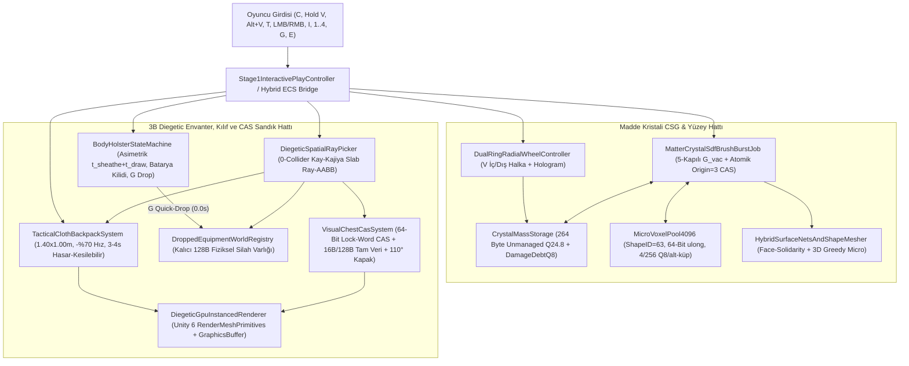

# FAZ 2 — MEKANİK 06: MADDE KRİSTALİ (`C`) KÜRESEL SDF VAKUM/İNŞA, 3 UNMANAGED ENVANTER VERİ YAPISI (`264B / 16B / 128B`), *THE FOREST* TARZI 3B KUMAŞ ÇANTA (`I`), 4 FİZİKSEL KILIF + `G` QUICK-DROP VE `64-BİT VERSIONED CAS` 3B GÖRSEL SANDIKLAR

> **Doküman Kimliği:** `STRATOCRAFT-ENG-FAZ2-M06`  
> **Hedef Çalışma Zamanı:** `Unity 6000.6.7f1` | `URP 17.0 Forward+` | `Hibrit DOTS + C# Burst SIMD` | `C++20 AVX2 Native`  
> **Performans ve Bellek Bütçesi:** `< 2.5 GB Oyun RAM` | `< 16 MB Prosedürel Doku VRAM` | `>= 60 FPS (16.67 ms/kare)` | `%0 Çalışma Zamanı GC Tahsisi`  
> **Mutlak Tasarım Otoritesi:** [`STRATOCRAFT_ EVRENSEL OYUN TASARIM VE MANTIK ANAYASASI (GAME LOGIC BIBLE) (2).md`](file:///D:/Oyunum/oyun/STRATOCRAFT_%20EVRENSEL%20OYUN%20TASARIM%20VE%20MANTIK%20ANAYASASI%20(GAME%20LOGIC%20BIBLE)%20(2).md) (`v7.0`) ve [`STRATOCRAFT_ARKA_PLAN_MATEMATIKSEL_SIMULASYON_VE_VOXEL_ALGORITMALARI_RAPORU.md`](file:///D:/Oyunum/oyun/STRATOCRAFT_ARKA_PLAN_MATEMATIKSEL_SIMULASYON_VE_VOXEL_ALGORITMALARI_RAPORU.md)

---

## 1. Mekanik Tasarım Vizyonu ve Anayasa'daki (`GAME LOGIC BIBLE`) Asıl Çalışma Mantığı (Uzun ve Detaylı Açıklama)

### 1.1. Anti-Menü (Diegetic) Fiziksel Etkileşim Felsefesi ve Zamanın Durmama Yasası

Stratocraft'ın temel simülasyon felsefesi, geleneksel hayatta kalma ve voksel oyunlarındaki soyutlanmış 2 boyutlu envanter tablolarını ("Excel ızgaralarını"), sihirli anlık silah değiştirme çubuklarını (1–9 *hotbar teleportation*) ve milyonlarca metreküp taş/toprak yüzünden tıkanan sandık odalarını tamamen ortadan kaldırmaktır. Anayasa ([`GAME LOGIC BIBLE`](file:///D:/Oyunum/oyun/STRATOCRAFT_%20EVRENSEL%20OYUN%20TASARIM%20VE%20MANTIK%20ANAYASASI%20(GAME%20LOGIC%20BIBLE)%20(2).md#L589-L793), Bölüm `3.1`–`3.5`) bu mimariyi beş sarsılmaz fiziksel sütun üzerine kurar:

1. **Sıfır 2B Envanter Ekranı (`Zero 2D Grid UI`):** Oyuncunun önünde ekranı kaplayan yarı saydam kutucuklu hiçbir menü açılmaz. Her eşya; ya oyuncunun sol bileğindeki **Madde Kristali** içinde sıkıştırılmış doğal kütle enerjisi olarak, ya bel/sırt üzerindeki **4 fiziksel kılıfta** dışarıdan diğer oyuncuların da birebir görebildiği 3B silah/alet modeli olarak, ya yere/önüne açılan **`1.40 x 1.00 m` taktiksel kumaş çanta örtüsü** üzerinde fiziksel olarak dizilmiş 3B külçe/iksir/zırh yığınları olarak ya da menteşeli kapağı `110°` açılan **3B Görsel Sandıkların** iç hacminde durur.
2. **Zaman Asla Durmaz (`No World Pause`):** Tek oyunculu veya çok oyunculu fark etmeksizin `I` tuşuna basıp çantayı açmak, `V` radyal şekil çarkını çevirmek veya `E` ile bir sandığın içine eğilmek dünya simülasyonunu durdurmaz. Çatışma ortasında çantasını açıp zırh veya mızrak arayan oyuncu savunmasızdır.
3. **Doğal Arazi Kütlesi ile İşlenmiş Eşya Ekonomisinin Kesin Ayrımı:** Oyuncu devasa bir yeraltı şehri kazarken çantası binlerce "Kırıktaş / Toprak" yığınıyla dolmaz. Sıradan doğal arazi kütleleri (`BlockOriginState == 0`) doğrudan sol bilekteki Madde Kristali tarafından vakumlanıp sıkıştırılır; ancak değerli **14 yeraltı cevheri**, **mücevher damarları**, **kömür** ve **oyuncunun ürettiği gerçek yapı blokları (`BlockOriginState == 1`)** kristal rezonansına bağışıktır ve yalnızca fiziksel kazma/balta/kürek ile kırılıp fiziksel çantada taşınabilir.
4. **Savaşta Taktiksel Ağırlık ve Silah Çekme Bedeli:** Kılıçtan mızrağa geçiş `0` milisaniyede gerçekleşmez. Mevcut silahı kınına sokma ($t_{\text{sheathe}}$) ve yeni silahı fiziksel kılıfından çekme ($t_{\text{draw}}$) animasyon süreleri toplanır (`1.1 sn` – `2.2 sn`). Köşeye sıkışan oyuncu bu süreyi beklememek için `G` (**Quick-Drop**) tuşuna basarak elindeki ağır silahı `0.0 sn`'de fiziksel olarak yere fırlatır ve belindeki hançeri/kılıcı `0.6 sn`'de çeker; fakat yere attığı silah artık savaş alanında herkesin yağmalayabileceği gerçek bir 3B dünya varlığıdır.
5. **Çok Oyunculu Atomik Tutarlılık (`%0 Duplication`):** Kapağı açık bir 3B sandığın içindeki efsanevi kılıca aynı milisaniyede 8 oyuncu bakıp `E` tuşuna bastığında, kilitli veritabanı kuyrukları yerine donanım seviyesi **`64-Bit Versioned Compare-And-Swap (CAS)`** atomik hafıza işlemi çalışır; tam olarak 1 oyuncu eşyayı alır, diğer 7 oyuncunun işlemi aynı mikrosaniyede `ERR_ESCROW_CAS_CONFLICT` ile reddedilir.

---

### 1.2. Madde Kristali (`C` Tuşu) Küresel SDF Vakum ve Mimari İnşa Sistemi

Anayasa Bölüm `2.1`, `2.2.A–C`, `2.6` ve `2.7.A` ([`GAME LOGIC BIBLE`](file:///D:/Oyunum/oyun/STRATOCRAFT_%20EVRENSEL%20OYUN%20TASARIM%20VE%20MANTIK%20ANAYASASI%20(GAME%20LOGIC%20BIBLE)%20(2).md#L180-L410)) uyarınca her oyuncu dünyaya sol bileğinde (bileklik yuvasında) **Seviye 1 Çatlak Kuvars Madde Kristali** ile başlar:

* **Aktifleştirme (`C` Tuşu):** `C` tuşuna basıldığında karakter sol kolunu ileri uzatır, bilekteki kristal rezonansla parlayarak açılır ve sağ eldeki silah çatışma dışı pasif duruşa geçer (`C` tekrar basıldığında veya `1–4` kılıf tuşuna basıldığında kristal kapanır).
* **Vakumlama (`Sol Tık Basılı Tutma — LMB Hold`):** Kristalden hedef arazi noktasına mavi bir küresel enerji fırçası (`Spherical SDF Brush`) uzanır. Yarıçapı kristal kademesine bağlı olan ($R_{\text{brush}} \in [0.8\text{ m}, 4.5\text{ m}]$) bu küre içindeki doğal voksel yoğunluğu (`7-bit SDF Density: 0..127`) sürekli ve pürüzsüz biçimde emilir. Surface Nets algoritması her yoğunluk değişiminde araziyi organik mağara duvarları ve kraterler halinde gerçek zamanlı yeniden örer.
* **5 Kademeli Vakum Geçerlilik Kapısı (`G_vac`):** Bir vokselin vakumlanabilmesi için aynı anda 5 matematiksel koşulu sağlaması zorunludur:
  1. **Doğal Köken Şartı (`BlockOriginState == 0`):** Yalnızca dünya oluşumundan gelen veya daha önce Madde Kristali ile püskürtülmüş doğal kütleler (`Taş=1`, `Toprak=2`, `Çimen=3`, `Kum=4`, `Bazalt=7`, `Kırıktaş=8`, `Çakıl=9`, `Buz=10` ve Lv4+ kristalde `Doğal Ham Obsidyen=6` ile `Magma Bloğu=11`) emilebilir. Oyuncunun ürettiği veya kazmayla kırıp yerleştirdiği gerçek bloklar (`BlockOriginState == 1`) ile klan bataryası üretimi geçici bloklar (`BlockOriginState == 2`) kesinlikle vakumlanamaz (`ERR_CRYSTAL_CRAFTED_BLOCK_FORBIDDEN`). Atomik yazma kilidi altındaki vokseller (`BlockOriginState == 3`) o karede atlanır.
  2. **Rezonans Bağışıklığı Şartı (`IsResonanceImmune == 0`):** Yeraltındaki **14 Ana Maden Cevheri** (`Bakır=30` .. `Hiçlik Metali=43`), **Kömür (`44`)**, **Kozmik Maddeler (`Karanlık Madde=45`, `Yıldız Çekirdeği=46`)**, **Mücevher Damarları (`47..49`)**, **Kırılmaz Ana Kaya (`Bedrock=5`)** ve **Zindan Kutsal Koruma Blokları (`240..255`)** yüksek kristal rezonansına sahiptir. Küresel vakum fırçası bir cevher damarının üzerinden geçtiğinde etrafındaki tüm normal taşı/toprağı tereyağı gibi eritip emer, ancak cevher damarını havada pürüzsüz bir heykel gibi asılı bırakır ve `ERR_ORE_RESONANCE_IMMUNE` görsel/işitsel uyarısını üretir.
  3. **Malzeme Sertlik Kademesi Şartı (`Hardness(Mat) <= CrystalTier`):** Lv1 kristal yalnızca yumuşak zeminleri (`Toprak`, `Kum`, `Çakıl`, `Yaprak` — Sertlik `1`), Lv2 kristal `Normal Taş` ve `Kireçtaşını` (Sertlik `2`), Lv3 kristal `Granit`, ` Mermer`, `Derin Kaya` ve `Buzu` (Sertlik `3`), Lv4 kristal `Bazalt`, `Doğal Magma Kayası` ve **`Doğal Ham Obsidyeni`** (Sertlik `4`), Lv5 kristal ise `Sıkıştırılmış Kozmik Kayayı` (Sertlik `5`) vakumlayabilir.
  4. **Klan Alanı Yetki Şartı (`CanModifyClanZone == 1`):** Düşman klanın aktif Koruma Kristali kubbesi içinde vakumlama kilitlidir (kuşatma mancınığı veya patlayıcı gerekir).
  5. **Derinlik Tabanı Şartı (`y > -105`):** Dünyanın mutlak tabanındaki Ana Kaya katmanı (`-110 <= y <= -105`) vakumlanamaz.
* **Sonsuz Batarya Hammaddesi Anti-Exploit Kuralı (`KRİTİK YASA`):** Madde Kristali içindeki sıkıştırılmış doğal kütleyi dünyaya geri püskürttüğünde (`Sağ Tık — RMB`), oluşan voksel mimari şekil (`ShapeID 1..63`) alsa dahi **HER ZAMAN `BlockOriginState = 0` (`IS_ITEM_BLOCK = 0`, Doğal Kütle)** bayrağıyla yazılır!
  * Bu bloklar klan savunma/üretim bataryalarında yakıt veya yapı hammaddesi olarak **kullanılamaz** (bataryalar yalnızca çantadaki `BlockOriginState = 1` gerçek eşyaları kabul eder).
  * Kristalle koyulan bir duvar kırıldığında yere eşya düşmez; yalnızca kazma/kürek dayanıklılığı (`Durability`) ve karakter eforu (`Stamina`) harcanarak fiziksel aletle kırılırsa gerçek eşya (`BlockOriginState = 1`) olarak yere düşer. Böylece "kristalle bedava vakumla -> koy -> bataryaya besle" sonsuz kaynak döngüsü matematiksel olarak imkânsızdır.
* **`1/256` (`Q24.8`) Kesirli Hasar Hafızası (Bedava Tamir Anti-Exploit):** Kuşatma sırasında `%80` hasar almış (`DamageState = 12/15`) doğal bir siper duvarını Madde Kristali ile vakumlayıp anında `%100` sağlam (`DamageState = 0`) olarak geri koymak yasaktır. Kristal, vakumlanan kütleyi tamsayı blok adedi olarak değil, kalan sağlam alt-hacim (`Q24.8`: `1 tam sağlam blok = 256 alt-birim`) ve kümülatif hasar borcu olarak saklar. Geri inşa sırasında hasar borcu sıfırlanana kadar koyulan bloklar aynı hasar kademesiyle (`DamageState`) dünyaya çıkar.
* **Kütle Tahliyesi (`Mass Purge`):** Kristal kapasitesi ($V_{\text{cap}}$) dolduğunda oyuncu kristal arayüzünden gereksiz malzemeyi (örn. Toprak) tahliye edebilir; tahliye edilen kütle yok olmaz, oyuncunun önüne yerçekiminden etkilenen gevşek moloz yığını (`LooseRubble = 15`, `BlockOriginState = 0`) olarak dökülür.

---

### 1.3. `V` Tuşu Çift Halkalı Radyal Şekil Çarkı, `Alt + V` Mikro-Voxel (`0.25 m`) ve Yarı Saydam Mavi Hologram

Anayasa Bölüm `2.2.B`, `2.6` ve `3.1` ([`GAME LOGIC BIBLE`](file:///D:/Oyunum/oyun/STRATOCRAFT_%20EVRENSEL%20OYUN%20TASARIM%20VE%20MANTIK%20ANAYASASI%20(GAME%20LOGIC%20BIBLE)%20(2).md#L223-L238)) inşa ergonomisini şöyle tanımlar:

* **`V` Tuşuna Basılı Tutma (`Hold V` — Yalnızca `C` Aktifken):** Ekranın ortasında oyunu durdurmayan **Çift Halkalı Radyal Seçim Çarkı** açılır:
  * **İç Halka (Malzeme Seçimi):** Kristalin `264 Byte` deposunda o an `> 0` kütlesi bulunan doğal malzemeler (Taş, Toprak, Kum, Bazalt, Buz vb.) gerçek 3B küre/ikon önizlemesi ve kalan tam blok eşdeğeri (`m³`) sayacıyla dizilir.
  * **Dış Halka (8 Ana Kategori -> 64 Mimari Şekil `ShapeID 0..63`):** Fareyi dış halkadaki 8 ana dilimden birine sürüklemek alt şekilleri açar:
    1. *Organik SDF & Tam Küp (`ShapeID 0..1`):* Pürüzsüz SDF küre dolgusu (`0`), `1x1x1 m` tam yapı küpü (`1`).
    2. *Eğimli Rampalar & Çatılar (`ShapeID 2..11`):* `45°` rampa, `22.5°` alt/üst uzun rampa, iç/dış çatı köşeleri, kırma çatı sırtı.
    3. *Basamaklar & Yarım Plakalar (`ShapeID 12..19`):* Yarım döşeme (`Slab`), çeyrek basamak, `2` ve `4` kademeli merdiven bloğu, dikey yarım duvar.
    4. *Sütunlar & Kaide/Başlıklar (`ShapeID 20..29`):* Silindirik sütun gövdesi, sekizgen kolon, Dor/İyon sütun tabanı ve başlığı, ince korkuluk dikmesi.
    5. *Kemerler & Tonozlar (`ShapeID 30..39`):* Yarım daire kemer ayağı, kilit taşı (`Keystone`), Gotik sivri kemer, çapraz tonoz parçası.
    6. *Siperler, Mazgallar & Duvarlar (`ShapeID 40..49`):* Okçu mazgalı (`Arrow Slit`), kale burcu dişi (`Battlement`), eğimli istinat payandası.
    7. *Kavisli Duvarlar & Kubbeler (`ShapeID 50..62`):* Çeyrek çember kule duvarı, içbükey/dışbükey niş, kubbe kabuğu dilimi.
    8. *Yontulmuş Mikro-Voxel (`ShapeID 63`):* `4x4x4` (`64` adet `0.25 m` alt-küp) serbest yontma modu.
* **Ölçek ve Döndürme Kontrolleri:**
  * **`Alt + V`:** İnşa/yontma ölçeğini `1.0 m` tam blok ile `0.25 m` (`4x4x4` Mikro-Voxel, `ShapeID = 63`) arasında değiştirir. Mikro-voxel modunda her bir `0.25 m` alt-küp tam bloğun $\frac{1}{64}$'ü kadar (`4 / 256` `Q8` birim) kristal kütlesi harcar veya iade eder.
  * **`T` Tuşu:** Seçili mimari şekli `24` ortogonal kübik simetri yöneliminden (`5-bit Rotation: 0..23`) bir sonrakine `90°` döndürür.
  * **`Alt + Fare Tekerleği`:** Serbest dekoratif/yapısal yerleştirme önizlemesinde `22.5°` / `45°` hassas açı ayarı yapar (`R` tuşu yay/arbalet doldurma ve ıslık çarkına ayrıldığı için döndürmede **kullanılmaz**).
* **Yarı Saydam Mavi Hologram:** Sağ tıklamadan önce hedef voksel hücresinde seçili `ShapeID` ve `Rotation`'ın birebir üçgen ağını gösteren mavi hologram (yetersiz kütle veya çakışma varsa kırmızı hologram) çizilir.

---

### 1.4. Üç Katmanlı Unmanaged Envanter Veri Yapısı, *The Forest* Tarzı 3B Kumaş Çanta (`I`), 4 Fiziksel Kılıf + `G` Quick-Drop ve 3B CAS Sandıklar

Anayasa Bölüm `3.2`, `3.3.A–C` ve `3.5.A–F` ([`GAME LOGIC BIBLE`](file:///D:/Oyunum/oyun/STRATOCRAFT_%20EVRENSEL%20OYUN%20TASARIM%20VE%20MANTIK%20ANAYASASI%20(GAME%20LOGIC%20BIBLE)%20(2).md#L619-L793)) fiziksel eşya yönetimini üç ayrı bellek katmanına ve üç fiziksel etkileşim yüzeyine böler:

1. **Üç Katmanlı Unmanaged Bellek Mimarisi (`%0 GC`):**
   * **Katman 1 — [`CrystalMassStorage`](file:///D:/Oyunum/oyun/Assets/_Stratocraft/Inventory/Data/CrystalMassStorage.cs) (`264 Byte` sabit boyutlu `unmanaged struct`):** `64` doğal malzeme için `Q24.8` (`uint[64]`) sabit noktalı alt-hacim dizisi + `8 Byte` durum başlığı.
   * **Katman 2 — [`StackableItemSlot`](file:///D:/Oyunum/oyun/Assets/_Stratocraft/Inventory/Data/StackableItemSlot.cs) (`16 Byte` önbellek hizalı `unmanaged struct`, `4 slot = 64B Cache Line`):** Cevherler, külçeler, iksirler, oklar, yiyecekler ve `BlockOriginState = 1` yapı blokları için `ItemID`, `Count`, `QualityStar`, `ItemFlags`, `AuxPurityOrData`, `LastSyncTimestamp` ve yemek bozulması için `ExpirationTimestamp` barındırır.
   * **Katman 3 — [`UniqueEquipmentInstance`](file:///D:/Oyunum/oyun/Assets/_Stratocraft/Inventory/Data/UniqueEquipmentInstance.cs) (`128 Byte` = `2 Cache Line` `unmanaged struct`):** `16x32x4` demirci örsünde dövülmüş benzersiz kılıçlar, modüler mızraklar, 15 parçalı zırhlar ve kalkanlar için `64 Byte` kimlik/özellik başlığı (`UniqueInstanceID`, `CustomVoxelMeshHash`, `CrafterPlayerID`, `BloodOwnerID`, `TraitIDs[4]`, `Durability`, `TotalMassQ8`) + `64 Byte` fiziksel silah tensörü (`CoMOffset`, `InertiaTensor`, `Sharpness`, `CrossguardWidthM`, `AerodynamicDrag`) veya tarif kitabı (`RecipeTomePayload`) birleşimi (`Explicit Union`).
2. ***The Forest* Tarzı `1.40 x 1.00 m` 3B Fiziksel Kumaş Çanta (`I` Tuşu):**
   * `I` tuşuna basıldığında karakter sırtındaki çantayı önüne indirip **`1.40 m x 1.00 m`** boyutlarındaki katlanmış mumlu kanvas kumaş örtüyü (`TacticalCloth = 74`) açar. Kamera yumuşak bir yayla örtüye doğru eğilir; fare imleci serbest kalır ve 3B uzayda eşyaların üzerine ışın (`Ray`) gönderir.
   * Çanta açıkken karakter tamamen hareketsiz kalmaz ancak yürüme hızı **`-%70` düşer (`4.0 m/s -> 1.2 m/s`)** ve koşma/zıplama/saldırı kilitlenir.
   * Örtü kendi içinde fiziksel bölgelere ayrılmıştır: Sol-orta `6x4` metal/cevher külçe ve blok bölgesi (yığın sayısına göre `1..64` adet çapraz istiflenmiş 3B piramit), sağ iksir/yiyecek/parşömen cepleri, üst yedek silah/zırh kancaları ve orta **Hızlı Saha Birleştirme (`2–3` bileşenli meşale/sargı bezi/ip bağlama)** alanı.
   * Çantanın içinden yedek bir zırh kuşanmak veya kılıfa yeni bir ağır silah takmak anlık değildir; eşya kütlesine ve ustalık seviyesine göre **`3.0 – 4.0 saniyelik`** fiziksel kuşanma kanalı (`EquipChannel`) başlatır. Kanal sırasında oyuncu **herhangi bir fiziksel hasar alırsa** veya `I`/`WASD Sprint` ile çantayı kapatırsa kuşanma iptal olur!
3. **4 Fiziksel Gövde Kılıfı (`1, 2, 3, 4`), Çift El (`Alt+1..4`) ve `G` Quick-Drop:**
   * **Yuva 1 (Sağ Bel) & Yuva 2 (Sol Bel):** Hançer, tek el kılıç, gürz, kazma, meşale, el arbaleti. Kına sokma `0.5 sn`, kından çekme `0.6 sn`.
   * **Yuva 3 (Sağ Sırt Çapraz) & Yuva 4 (Sol Sırt Çapraz):** Çift el kılıç, mızrak, balyoz, uzun yay, ağır kalkan, tüfek. Sırta asma `0.9 sn`, sırttan çekme `1.3 sn`.
   * **Klan Bataryası Sırt Kilidi:** Oyuncu sırtında ağır bir Klan Enerji Bataryası taşıyorsa Yuva 3 ve Yuva 4 fiziksel olarak bloke olur (`SlotLockedByBattery`).
   * **`G` Tuşu Acil Silah Bırakma (`0.0 sn Quick-Drop`):** Eldeki silahın kına sokulma süresini (`0.5 sn` veya `0.9 sn`) tamamen sıfırlar (`0.0 sn`). Silah karakterin elinden gerçek fiziksel hız ve açısal momentumla dünyaya düşer, `128 Byte UniqueEquipmentInstance` verisini koruyan kalıcı ve yağmalanabilir bir 3B dünya nesnesine dönüşür; karakter aynı karede hedef kılıftaki yedek silahını çekmeye başlar.
4. **Menüsüz 3B Görsel Sandıklar ve `64-Bit Versioned CAS`:**
   * Ahşap/demir sandığa yaklaşıp `E` tuşuna basıldığında menteşeli kapak $\theta_{\text{lid}}(t) = 110^\circ(1 - e^{-8t})$ denklemiyle açılır.
   * Sandığın içi `4x4` (`16` yuva) veya `6x4` (`24` yuva) fiziksel bölmeye ayrılmıştır. İçerideki külçeler, iksirler veya dövülmüş silahlar GPU Instancing ile doğrudan sandığın içinde 3B olarak çizilir.
   * Oyuncu nişangâhını (crosshair) sandığın içindeki spesifik bölmeye doğrultup `E` tuşuyla eşyayı doğrudan alır veya elindeki/çantasındaki eşyayı o bölmeye bırakır. Tüm okuma/yazma işlemleri `64-bit Interlocked.CompareExchange` versiyonlu atomik durum geçişiyle korunur.

---

### 1.5. Dokümanlar ve Kod Tabanı Arası Çelişki Tespiti ve Mutlak Otorite Çözüm Tablosu

Sistem talimatları gereği dört ana doküman ve mevcut kod tabanı satır satır çapraz denetlenmiş; aşağıdaki **7 kritik çelişki** tespit edilmiştir. Mutlak otorite her zaman **[`GAME LOGIC BIBLE v7.0`](file:///D:/Oyunum/oyun/STRATOCRAFT_%20EVRENSEL%20OYUN%20TASARIM%20VE%20MANTIK%20ANAYASASI%20(GAME%20LOGIC%20BIBLE)%20(2).md)** ve **[`MATEMATİKSEL SİMÜLASYON RAPORU`](file:///D:/Oyunum/oyun/STRATOCRAFT_ARKA_PLAN_MATEMATIKSEL_SIMULASYON_VE_VOXEL_ALGORITMALARI_RAPORU.md)** olarak uygulanmıştır:

| # | Çelişki Başlığı | `GAME LOGIC BIBLE v7.0` & `MATEMATİKSEL RAPOR` (MUTLAK OTORİTE) | `STRATOCRAFT_GELISTIRICI_DOKUMANI.md` veya Mevcut Kod Tabanı | Mühendislik Kararı ve Çözüm |
| :--- | :--- | :--- | :--- | :--- |
| **1** | **Madde Kristali İnşasında `BlockOriginState` Değeri** | **Bible `2.2.A` (Satır 209–222), `2.7.A` (Satır 375), `3.5.E` (Satır 759) & Mat Rapor `5.1` (Satır 185):** Kristalle dünyaya koyulan kütle (mimari şekil alsa bile) **DAİMA `BlockOriginState = 0` (`DogalKutle`)** kalır; aksi halde sonsuz batarya yakıtı hilesi oluşur. | **Geliştirici Dokümanı `5.3.3 Adım 3` (Satır 3122):** *"sıkıştırıp koyduğunda bloğu OriginState = 1 yapar"* der. Ayrıca [`Stage1InteractivePlayController.cs`](file:///D:/Oyunum/oyun/Assets/_Stratocraft/Character/Stage1InteractivePlayController.cs#L467-L473) `ShapeID != 0` iken `OyuncuItemBlogu (1)` yazmaktadır! | **Geliştirici Dokümanı Satır 3122 ve PlayController Satır 472 HATALIDIR.** Kristal inşası her `ShapeID (0..63)` için kesinkes `BlockOriginState = 0` yazacaktır. |
| **2** | **Doğal Ham Obsidyen (`ID=6`) Vakumlanabilirliği** | **Bible `2.2.A.1` (Satır 207) & `2.2.C` Tablosu (Satır 245):** Doğal Ham Obsidyen (`OriginState == 0`, Sertlik `4`) **Seviye 4 Tektonik Titan Kristali** ve üzeri ile vakumlanabilir; yalnızca kazmayla kırılıp koyulan Obsidyen Tuğla (`OriginState == 1`) vakumlanamaz. | [`MatterCrystalVacuumSystem.cs`](file:///D:/Oyunum/oyun/Assets/_Stratocraft/Inventory/Systems/MatterCrystalVacuumSystem.cs#L79-L83) satır 80'de `matId == MaterialIdCatalog.NaturalObsidian` koşulsuz olarak `ERR_ORE_RESONANCE_IMMUNE` ile sonsuza dek yasaklanmıştır. | **Bible `2.2.C` geçerlidir.** `NaturalObsidian (6)` ve `MagmaBlock (11)` rezonans bağışıklığından çıkarılıp `Hardness = 4` (`CrystalTier >= 4`) kapısına bağlanacaktır (`CrystalTier < 4` ise `ERR_CRYSTAL_HARDNESS_TOO_HIGH`). |
| **3** | **Kömür Damarı (`Coal = 44`) Rezonans Bağışıklığı** | **Bible `2.2.A.2` (Satır 205–208):** Kömür ve 14 maden cevheri ile mücevher damarları kazmayla kazılması gereken yeraltı madenleridir; kristalle vakumlanamaz. | [`MaterialIdCatalog.cs`](file:///D:/Oyunum/oyun/Assets/_Stratocraft/Core/Constants/MaterialIdCatalog.cs#L158-L162) `IsVacuumImmuneResonanceOreOrGem` metodu `(30..43) \|\| (45..49)` kontrolü yaparak **`Coal = 44` değerini arada unutmuştur!** | **`Coal = 44` dahil `30..49` aralığının tamamı** tek karşılaştırmayla (`matId >= 30 && matId <= 49`) rezonans bağışık yapılacaktır. |
| **4** | **`CrystalMassStorage` Bellek Şeması (`264B` vs `ulong[32]` vs `class`)** | **Bible `3.5.E` (Satır 757–759):** Sabit **`264 Byte`** `unmanaged struct`: `fixed uint SubVolumePerMaterialQ8[64]` (`256B`) + `8B` başlık (`CrystalTier`, `SelectedMaterialID`, `SelectedShapeID`, `SelectedRotation`, bayraklar). | **Geliştirici Dokümanı `4.6.2` (Satır 887):** `ulong[32]` der. Mevcut [`CrystalMassStorage.cs`](file:///D:/Oyunum/oyun/Assets/_Stratocraft/Inventory/Data/CrystalMassStorage.cs#L13-L30) ise **`Dictionary<byte, StoredNaturalEntry>` kullanan yönetilen (managed) `class`'tır!** | **Bible `3.5.E` (`264 Byte` `unmanaged struct`) mutlak standarttır.** Burst SIMD ve DOTS bileşenleriyle `%100` uyumludur ve `0 Byte GC` üretir. |
| **5** | **`StackableItemSlot` (`16B` vs `8B`) ve `UniqueEquipmentInstance` (`128B` vs `40B`)** | **Bible `3.5.E` (Satır 760–761):** `StackableItemSlot = 16 Byte` (`LastSyncTimestamp` + `ExpirationTimestamp` dahil, `4 slot / cache line`); `UniqueEquipmentInstance = 128 Byte` (`64B` başlık + `64B` fizik tensörü/kitap union). | [`StackableItemSlot.cs`](file:///D:/Oyunum/oyun/Assets/_Stratocraft/Inventory/Data/StackableItemSlot.cs#L9-L26) `Size = 8` (bozulma zaman damgası yok); [`UniqueEquipmentInstance.cs`](file:///D:/Oyunum/oyun/Assets/_Stratocraft/Inventory/Data/UniqueEquipmentInstance.cs#L10-L30) ~`40 Byte` (eylemsizlik tensörü, kan bağı, boss organı, rün soketleri yok). | **Bible `3.5.E` (`16 Byte` ve `128 Byte` Explicit Cache-Line Structs) mutlak standarttır.** Yemek çürümesi, kan bağı ve örs fizik tensörü bu alanlara muhtaçtır. |
| **6** | **Tuş Atamaları (`V`, `T` vs `R`) ve Kılıf Yönleri/Süreleri (`1..4`)** | **Bible `3.1` & `2.2.B`:** `V` yalnızca `C` aktifken **basılı tutularak** çift halkalı radyal çarkı açar; döndürme tuşu **`T`** (`Alt+Scroll` ince açı), `R` ise Arbalet Doldurma / Islık Çarkıdır. **Bible `3.3.A`:** Slot 1=Sağ Bel, Slot 2=Sol Bel (`0.5s` sokma + `0.6s` çekme), Slot 3=Sağ Sırt, Slot 4=Sol Sırt (`0.9s` sokma + `1.3s` çekme). | [`Stage1InteractivePlayController.cs`](file:///D:/Oyunum/oyun/Assets/_Stratocraft/Character/Stage1InteractivePlayController.cs#L209-L212) 4 kılıfın hepsine sabit `1.8f` verir, `R` ile blok döndürür, `V` ile kristal kapalıyken bile dizi gezer. [`BodyHolsterStateMachine.cs`](file:///D:/Oyunum/oyun/Assets/_Stratocraft/Inventory/Systems/BodyHolsterStateMachine.cs#L6-L13) Sol/Sağ isimlerini ters tanımlar ve kaynak kılıfın kına sokma süresini yoksayar (`0.95s` sabit). | **Bible `3.1` ve `3.3.A–B` birebir uygulanacaktır:** Döndürme `T` / `Alt+Scroll`, Radyal Çark `C aktifken Hold V`, kılıf geçişi $t_{\text{sheathe}}(\text{eski}) + t_{\text{draw}}(\text{yeni})$ olacaktır. |
| **7** | **`64-Bit CAS` Sandık Yuvası Paketleme Şeması** | **Bible `3.5.F.3` (Satır 775):** `long VersionAndLock` (`Bit 63: Lock`, `Bit 0..62: Version`) + tam yuva verisi. **Mat Rapor `7.4.2` (Satır 283):** `[32b Version \| 16b ItemID \| 16b Count]` tek `64-bit` kelime. | [`VisualChestCasSystem.cs`](file:///D:/Oyunum/oyun/Assets/_Stratocraft/Inventory/Systems/VisualChestCasSystem.cs#L34-L50) yalnızca `[32b Ver \| 16b ID \| 16b Count]` tutar; bu yüzden eşyanın `QualityStar`, `ExpirationTimestamp` ve `128B UniqueEquipmentInstance` verisi sandığa konduğunda **silinir!** | **İki şema birleştirilecektir:** `64-bit` atomik kilit kelimesi `[32b Version \| 16b ItemOrEquipTag \| 15b Count \| 1b WriteBusyLock]` olarak CAS yarışını yönetirken, yanındaki hizalı yuva dizisinde `16B StackableItemSlot` veya `128B UniqueEquipmentInstance` kayıpsız saklanacaktır. |

---

## 2. Anayasa ve Matematiksel Rapordaki Formüller, Bit/Byte Şemaları ve Algoritmalar

### 2.1. `32-Bit VoxelCell` Bağlama Duyarlı Bit Birleşimi (Context-Sensitive Bit Union)

Matematiksel Simülasyon Raporu Bölüm `1.1` ([`MATEMATİKSEL RAPOR`](file:///D:/Oyunum/oyun/STRATOCRAFT_ARKA_PLAN_MATEMATIKSEL_SIMULASYON_VE_VOXEL_ALGORITMALARI_RAPORU.md#L15-L58)) ve [`VoxelBitUtility.cs`](file:///D:/Oyunum/oyun/Assets/_Stratocraft/Voxel/Data/VoxelBitUtility.cs#L9-L104) uyarınca her $1\text{ m}^3$ voksel hücresi bellekte tam olarak $32\text{ bit}$ (`uint`, `4 Byte`) yer kaplar. `Bits [15..20]` içindeki `ShapeID` değerine göre bit alanları iki farklı şemada yorumlanır:

#### Durum A: Standart SDF Arazi veya Mimari Şekil (`ShapeID` $\in [0..62]$)

$$
\text{VoxelCell}_{32} = \underbrace{\text{DamageState}}_{4\text{ bit } [28..31]} \;\Vert\; \underbrace{\text{OriginState}}_{2\text{ bit } [26..27]} \;\Vert\; \underbrace{\text{Rotation}}_{5\text{ bit } [21..25]} \;\Vert\; \underbrace{\text{ShapeID}}_{6\text{ bit } [15..20]} \;\Vert\; \underbrace{\text{Density / Liquid}}_{7\text{ bit } [8..14]} \;\Vert\; \underbrace{\text{MaterialID}}_{8\text{ bit } [0..7]}
$$

#### Durum B: `4x4x4` (`0.25 m`) Yontulmuş Mikro-Voxel (`ShapeID` $= 63 = \text{0x3F}$)

`ShapeID == 63` olduğunda `Density` (`7 bit`) ve `Rotation` (`5 bit`) alanları birleşerek chunk başına ayrılmış [`MicroVoxelPool4096`](file:///D:/Oyunum/oyun/Assets/_Stratocraft/Voxel/Data/MicroVoxelPool4096.cs) içindeki `64-bit ulong` alt-küp maskesine işaret eden **`12-bit LocalMicroPoolIndex` ($0..4095$)** adresini oluşturur:

$$
\text{LocalMicroPoolIndex}_{12} = \left(\frac{\text{raw} \gg 8}{1} \ \& \ \text{0x7F}\right) \;\Big|\; \left(\left((\text{raw} \gg 21) \ \& \ \text{0x1F}\right) \ll 7\right) \in [0, 4095]
$$

`MicroVoxelPool4096[LocalMicroPoolIndex]` içindeki $64\text{-bit}$ `ulong` maskesinde $(u, v, w) \in \{0,1,2,3\}^3$ koordinatlı her $0.25\text{ m}$ alt-küp tek bir bitle temsil edilir:

$$
\text{BitIndex}(u, v, w) = (v \ll 4) \mid (w \ll 2) \mid u \in [0, 63], \qquad \text{IsSubVoxelSolid}(u,v,w) = \left(\frac{\text{Mask}_{64} \gg \text{BitIndex}(u,v,w)}{1}\right) \& 1
$$

| Bit Aralığı | Bit Sayısı | Standart Mod (`ShapeID != 63`) | Yontulmuş Mod (`ShapeID == 63`) | Anayasal Rolü |
| :--- | :---: | :--- | :--- | :--- |
| `Bits [0..7]` | `8` | `MaterialID (0..255)` | `MaterialID (0..255)` | Malzeme kimliği (`0`=Hava, `1`=Taş, `30..43`=14 Cevher, `44`=Kömür) |
| `Bits [8..14]` | `7` | `SDF Density (0..127)` (`Iso=64`) | `MicroPoolIdx_Low7 [0..6]` | Pürüzsüz Surface Nets yoğunluğu veya mikro-havuz alt 7 biti |
| `Bits [15..20]` | `6` | `ShapeID (0..62)` | `ShapeID = 63` (`Chiseled`) | `0`=SDF Arazi, `1`=Tam Küp, `2..62`=Mimari Şekiller, `63`=Mikro-Voxel |
| `Bits [21..25]` | `5` | `Rotation (0..23)` | `MicroPoolIdx_High5 [7..11]` | Kübik simetri grubu $S_4$ (`24` yönelim) veya mikro-havuz üst 5 biti |
| `Bits [26..27]` | `2` | `BlockOriginState (0..3)` | `BlockOriginState (0..3)` | `0`=Doğal/Kristal, `1`=Gerçek Eşya Bloğu, `2`=Batarya, `3`=Atomik CAS Kilidi |
| `Bits [28..31]` | `4` | `DamageState (0..15)` | `DamageState (0..15)` | Yapısal hasar çatlak seviyesi (`0`=Sağlam, `15`=Kırılma Eşiği) |

---

### 2.2. 5 Kademeli Vakum Kapısı ($G_{\text{vac}}$), Küresel SDF CSG Fırçası ve Kristal Kademe Tablosu

Matematiksel Rapor Bölüm `5.1` ([`MATEMATİKSEL RAPOR`](file:///D:/Oyunum/oyun/STRATOCRAFT_ARKA_PLAN_MATEMATIKSEL_SIMULASYON_VE_VOXEL_ALGORITMALARI_RAPORU.md#L168-L202)) uyarınca $\mathbf{x} = (x, y, z) \in \mathbb{Z}^3$ dünya koordinatındaki bir voksel için vakum izni indikatör fonksiyonu $G_{\text{vac}}(\mathbf{x}) \in \{0, 1\}$:

$$
G_{\text{vac}}(\mathbf{x}) = \mathbb{I}\!\left(\text{Origin}(\mathbf{x}) = 0\right) \cdot \mathbb{I}\!\left(\text{Immune}(\text{Mat}(\mathbf{x})) = 0\right) \cdot \mathbb{I}\!\left(H(\text{Mat}(\mathbf{x})) \le L_{\text{crystal}}\right) \cdot \mathbb{I}\!\left(\text{ClanAuth}(\mathbf{x}, P) = 1\right) \cdot \mathbb{I}\!\left(y > -105\right)
$$

Burada rezonans bağışıklık kümesi $\mathcal{I}_{\text{immune}}$:

$$
\mathcal{I}_{\text{immune}} = \{0\text{ (Air)}, \; 5\text{ (Bedrock)}, \; 12\text{ (Water)}, \; 13\text{ (Lava)}\} \cup [30, 49]\text{ (14 Cevher + Kömür + Kozmik + Mücevher)} \cup [240, 255]\text{ (Zindan Kutsal)}
$$

Fırça merkezi $\mathbf{c} \in \mathbb{R}^3$, fırça yarıçapı $R_{\text{brush}}$ ve vakum akış hızı $\alpha_{\text{vac}}$ için $\lVert \mathbf{x} + \mathbf{0.5} - \mathbf{c} \rVert_2 \le R_{\text{brush}}$ küresi içindeki pürüzsüz radyal ağırlık fonksiyonu $w(\mathbf{x})$ ($C^1$-sürekli *smoothstep* sönümlemesi):

$$
u(\mathbf{x}) = \text{clamp}\!\left(1 - \frac{\lVert \mathbf{x} + \mathbf{0.5} - \mathbf{c} \rVert_2}{R_{\text{brush}}}, \; 0, \; 1\right), \qquad w(\mathbf{x}) = u(\mathbf{x})^2 \left(3 - 2 u(\mathbf{x})\right)
$$

Zaman adımı $\Delta t$ boyunca aday yoğunluk azalımı:

$$
\tilde{D}_{\text{new}}(\mathbf{x}) = \text{clamp}\!\left(D_{\text{old}}(\mathbf{x}) - G_{\text{vac}}(\mathbf{x}) \cdot \left\lfloor \alpha_{\text{vac}}(L_{\text{crystal}}) \cdot w(\mathbf{x}) \cdot \Delta t \cdot 127 \right\rfloor, \; 0, \; 127\right)
$$

Anayasa Bölüm `2.2.C` ([`GAME LOGIC BIBLE`](file:///D:/Oyunum/oyun/STRATOCRAFT_%20EVRENSEL%20OYUN%20TASARIM%20VE%20MANTIK%20ANAYASASI%20(GAME%20LOGIC%20BIBLE)%20(2).md#L240-L249)) 5 Madde Kristali kademesinin parametrelerini şöyle sabitler:

| Kademe ($L_{\text{crystal}}$) | Kristal Adı | Fırça Yarıçapı ($R_{\text{brush}}$) | Maksimum Kütle Kapasitesi ($V_{\text{cap}}$) | Maks. Sertlik ($H_{\max}$) | Vakumlanabilen Doğal Kütleler (`OriginState == 0`) |
| :---: | :--- | :---: | :---: | :---: | :--- |
| **Lv 1** | Çatlak Kuvars Kristali (Başlangıç) | `0.80 m` | `250 m³` (`64,000 Q8`) | `1` | Toprak (`2`), Çimen (`3`), Kum (`4`), Çakıl (`9`), Gevşek Moloz (`15`) |
| **Lv 2** | Rezonans Ametist Kristali | `1.50 m` | `1,000 m³` (`256,000 Q8`) | `2` | Lv1 + Ham Taş (`1`), Kırıktaş (`8`), Kireçtaşı / Kil |
| **Lv 3** | Derin Safir Çekirdek | `2.50 m` | `5,000 m³` (`1,280,000 Q8`) | `3` | Lv2 + Granit, Mermer, Derin Kaya, Paketlenmiş Buz (`10`) |
| **Lv 4** | Tektonik Titan Kristali | `3.50 m` | `25,000 m³` (`6,400,000 Q8`) | `4` | Lv3 + Bazalt (`7`), Magma Bloğu (`11`), **Doğal Ham Obsidyen (`6`)** |
| **Lv 5** | Yıldız Kalbi (Astral) Kristali | `4.50 m` | `100,000 m³` (`25,600,000 Q8`) | `5` | Lv4 + Sıkıştırılmış Kozmik Kaya (14 Cevher & `Origin=1` hâlâ yasak!) |

---

### 2.3. `Q24.8` (`1/256`) Kesirli Hasar Anti-Exploit ve Kütle Korunumu Matematiği

Matematiksel Rapor Bölüm `5.2` ([`MATEMATİKSEL RAPOR`](file:///D:/Oyunum/oyun/STRATOCRAFT_ARKA_PLAN_MATEMATIKSEL_SIMULASYON_VE_VOXEL_ALGORITMALARI_RAPORU.md#L204-L216)) uyarınca `1` tam sağlam doğal blok $256$ alt-birime (`Q24.8` sabit noktalı sayı, `1 LSB = 1/256 m³`) karşılık gelir. `4-bit DamageState` $\delta \in \{0, 1, \dots, 15\}$ değerine sahip tam hacimli bir doğal vokselin sağlam kütle karşılığı:

$$
\Delta V_{256}(\delta) = 16 \cdot (16 - \delta) \in \{16, 32, \dots, 256\}
$$

* Sağlam bir blok ($\delta = 0$) vakumlandığında depoya $+256$ `Q8` birim eklenir.
* Ağır hasarlı bir blok ($\delta = 12$) vakumlandığında depoya yalnızca $16 \cdot (16 - 12) = +64$ `Q8` birim ($\frac{64}{256} = 0.25\text{ m}^3$ sağlam kütle eşdeğeri) eklenir; oyuncu bu kütleden tam sağlam ($\delta = 0$, $256$ `Q8`) bir blok inşa etmek isterse $4$ adet $\delta = 12$ hasarlı bloğu vakumlamak zorundadır **veya** yalnızca $64$ `Q8` harcayarak yine $\delta = 12$ hasarlı tek bir blok koyabilir:

$$
V_{\text{cost}}(\delta_{\text{out}}) = 16 \cdot (16 - \delta_{\text{out}}), \qquad \delta_{\text{restored}}(V_{\text{avail}}) = \max\!\left(0, \; 16 - \left\lfloor \frac{\min(256, V_{\text{avail}})}{16} \right\rfloor\right)
$$

Bu formül sayesinde evrendeki toplam sağlam yapısal dayanıklılık ($\sum \text{HP}_{\text{world}} + \sum \text{HP}_{\text{crystal}}$) mutlak suretle korunur; hiçbir vakum/inşa döngüsü bedavadan tek bir `1/256` can puanı bile üretemez!

---

### 2.4. Üç Unmanaged Envanter Veri Yapısının Birebir Byte / Offset Şemaları (`264B / 16B / 128B`)

Anayasa Bölüm `3.5.E` ([`GAME LOGIC BIBLE`](file:///D:/Oyunum/oyun/STRATOCRAFT_%20EVRENSEL%20OYUN%20TASARIM%20VE%20MANTIK%20ANAYASASI%20(GAME%20LOGIC%20BIBLE)%20(2).md#L755-L765)) üç temel envanter yapısını CPU L1 önbellek satırı (`64 Byte`) sınırlarına sıfır dolgu kaybıyla (`Zero Implicit Padding`) hizalar:

#### 1. `CrystalMassStorage` (`264 Byte` Sabit Boyutlu Unmanaged Struct)

| Byte Offset | Boyut | Alan Adı | C# Türü | Açıklama |
| :---: | :---: | :--- | :---: | :--- |
| `0..255` | `256 B` | `SubVolumePerMaterialQ8[64]` | `fixed uint[64]` | İlk 64 doğal `MaterialID (0..63)` için `Q24.8` (`1/256 m³`) sağlam alt-hacim (`Maks: 16.77M m³ / malzeme`) |
| `256` | `1 B` | `CrystalTier` | `byte` | Kristal kademesi (`1..5`) |
| `257` | `1 B` | `SelectedMaterialId` | `byte` | `V` iç halkasından seçili aktif inşa malzemesi (`0..63`) |
| `258` | `1 B` | `SelectedShapeId` | `byte` | `V` dış halkasından seçili mimari şekil (`0..63`, `63` = Mikro-Voxel) |
| `259` | `1 B` | `SelectedRotation24` | `byte` | `T` tuşuyla seçili kübik yönelim (`0..23`) |
| `260` | `1 B` | `FineAngleStep16` | `byte` | `Alt + Scroll` ince açı adımı (`0..15` $\times 22.5^\circ$) |
| `261` | `1 B` | `ModeFlags` | `byte` | `Bit 0: IsCrystalActive`, `Bit 1: IsMicroVoxel025m`, `Bit 2: IsRadialWheelOpen` |
| `262..263` | `2 B` | `ActiveChiselSubCoordAndPad` | `ushort` | Mikro-voxel fırça boyutu (`1x1x1` veya `2x2x2` alt-küp) ve hizalama |
| **TOPLAM** | **`264 B`** | **`4 x 64B Cache Line + 8B Header`** | **`unmanaged`** | **`0 B` Heap / `%0` GC** |

#### 2. `StackableItemSlot` (`16 Byte` Sabit Boyutlu Unmanaged Struct — `1 Cache Line = Tam 4 Slot`)

| Byte Offset | Boyut | Alan Adı | C# Türü | Açıklama |
| :---: | :---: | :--- | :---: | :--- |
| `0..1` | `2 B` | `ItemId` | `ushort` | Eşya / Cevher / `Origin=1` Blok kataloğu kimliği (`0` = Boş, `1..65535`) |
| `2..3` | `2 B` | `Count` | `ushort` | Yığın adedi (`1..64` standart, ok/tohum için maks. `999`) |
| `4` | `1 B` | `QualityStar` | `byte` | İşçilik / saflık yıldızı (`0..5`) |
| `5` | `1 B` | `ItemFlags` | `byte` | `Bit 0: IsCraftedBlockOrigin1`, `Bit 1: IsPerishableFood`, `Bit 2: QuestSealed`, `Bit 3: StolenTag` |
| `6..7` | `2 B` | `AuxPurityOrData` | `ushort` | Metal saflık yüzdesi (`Q8.8`), iksir dozajı veya pil şarj yüzdesi |
| `8..11` | `4 B` | `LastSyncTimestamp` | `uint` | Sunucu/CAS son doğrulama saniye damgası (`Unix/World Tick`) |
| `12..15` | `4 B` | `ExpirationTimestamp` | `uint` | Yiyecek/organik madde bozulma bitiş zamanı (`0` = Bozulmaz) |
| **TOPLAM** | **`16 B`** | **`Tam 1/4 L1 Cache Line`** | **`unmanaged`** | **36 yuvalı çanta = `576 Byte` (`9 Cache Line`)** |

#### 3. `UniqueEquipmentInstance` (`128 Byte` = `2 x 64B Cache Line` Explicit Union Struct)

| Byte Offset | Boyut | Alan Adı | C# Türü | Açıklama |
| :---: | :---: | :--- | :---: | :--- |
| `0..7` | `8 B` | `UniqueInstanceId` | `ulong` | Evrensel 64-bit Snowflake eşya kimliği (%0 kopyalama takibi) |
| `8..15` | `8 B` | `CustomVoxelMeshHash` | `ulong` | `16x32x4` örste dövülen bıçak ağının 64-bit deterministik FNV-1a/XXHash64 özeti |
| `16..23` | `8 B` | `CrafterPlayerId` | `ulong` | Silahı/zırhı döven demircinin kalıcı oyuncu kimliği (Usta İmzası) |
| `24..31` | `8 B` | `BloodOwnerId` | `ulong` | Kan Bağı (`Blood-Bound`) ritüeli yapılmışsa sahibi (`0` = Serbest) |
| `32..33` | `2 B` | `ItemArchetypeId` | `ushort` | Silah/zırh/kitap temel arketip kimliği |
| `34` | `1 B` | `PrimaryMaterialId` | `byte` | Ana alaşım / plaka `MaterialID` (örn. `DamascusSteel = 60`) |
| `35` | `1 B` | `SecondaryHandleMaterialId` | `byte` | Kabza / iç astar `MaterialID` (örn. `Ironwood = 71`) |
| `36` | `1 B` | `MaterialTierAndSocketCount` | `byte` | `Low 4b: MaterialTier (1..10)`, `High 4b: SocketCount (0..4)` |
| `37` | `1 B` | `GraftedBossOrganId` | `byte` | Silaha aşılanmış Boss organı kimliği (`0` = Yok) |
| `38..39` | `2 B` | `HarmonizerCatalystId` | `ushort` | Simyasal katalizör / rezonans taşı kimliği |
| `40..47` | `8 B` | `TraitIds[4]` | `fixed ushort[4]` | En fazla 4 adet dövme/rün özelliği (`TraitID`) |
| `48..49` | `2 B` | `CurrentDurability` | `ushort` | Mevcut dayanıklılık (`0..65535`) |
| `50..51` | `2 B` | `MaxDurability` | `ushort` | Maksimum dayanıklılık (`0..65535`) |
| `52..55` | `4 B` | `TotalMassQ8` | `uint` | Toplam kütle (`Q24.8 kg`, örn. `2.45 kg = 627`) |
| `56..59` | `4 B` | `CustomTintAndFlags` | `uint` | `RGBA8` boya/arma rengi ve durum bayrakları |
| `60..63` | `4 B` | `ArmorUvMaskOrAuxHandle` | `uint` | 15 parçalı zırh kesim UV maskesi veya yardımcı tutamaç |
| **`64..127`** | **`64 B`** | **`PayloadUnion` (`Explicit Offset 64`)** | **`BakedWeaponPhysicsData` / `RecipeTomePayload`** | Silahsa: `CoMOffsetLocal (12B)`, `InertiaTensorDiag (12B)`, `BladeLengthM (4B)`, `CrossguardWidthM (4B)`, `EdgeSharpness01 (4B)`, `PointTaper01 (4B)`, `AeroDragCoeff (4B)`, `StructuralRigidity01 (4B)`, `ImpactBalanceScore (4B)`, `ForgedVoxelCount (4B)` (`64B`). Tarif Kitabıysa: `64B` stokiyometrik alaşım/dövme matrisi. |
| **TOPLAM** | **`128 B`** | **`Tam 2 x 64B L1 Cache Line`** | **`unmanaged`** | **Sıfır Heap Referansı / Doğrudan Ağ & Disk Serileştirilebilir** |

---

### 2.5. Çapraz İstifli 3B Külçe Piramidi, Kumaş Çanta Kuşanma Süresi, Fiziksel Kılıf Geçişi ve `64-Bit CAS` Denklemleri

1. **Çapraz İstifli Külçe / Blok Piramidi (`Cross-Stacked Ingot Pyramid` — Mat Rapor `8.1`):**
   Çanta örtüsü veya sandık bölmesi yerel başlangıç noktası $\mathbf{p}_{\text{slot}} \in \mathbb{R}^3$ üzerinde, adedi $N \in [1, 64]$ olan bir yığın görsel bütçe için $K = \min(16, \lceil N / 4 \rceil)$ veya tam külçe modunda katman başına $4$ külçe ($L = \lfloor i / 4 \rfloor$, katman içi sıra $k = i \bmod 4$) olarak her katmanda $90^\circ$ döndürülerek dizilir:

$$
\theta_L = \begin{cases} 0^\circ, & L \equiv 0 \pmod 2 \\ 90^\circ, & L \equiv 1 \pmod 2 \end{cases}, \qquad
\mathbf{p}_i = \mathbf{p}_{\text{slot}} + \mathbf{R}_y(\theta_L) \begin{bmatrix} \left(k - 1.5\right) \cdot s_x \\ L \cdot h_y \\ 0 \end{bmatrix}, \qquad
\mathbf{M}_i = \mathbf{M}_{\text{container}} \cdot \text{TRS}\!\left(\mathbf{p}_i, \; \mathbf{q}_y(\theta_L), \; \mathbf{s}_{\text{ingot}}\right)
$$

2. **3B Kumaş Çanta Hareket Cezası ve Hasarla Kesilebilir Kuşanma Kanalı (`Bible 3.2`):**

$$
v_{\text{active}} = \begin{cases} 0.30 \cdot v_{\text{walk}} = 1.20\text{ m/s}, & \text{IsBackpackOpen} = 1 \\ v_{\text{stance}}, & \text{IsBackpackOpen} = 0 \end{cases}
$$

   Çantadan kütlesi $m_{\text{item}}$ ($\text{kg}$) olan bir zırh veya silahı kuşanma süresi $T_{\text{equip}} \in [3.0\text{ sn}, 4.0\text{ sn}]$:

$$
T_{\text{equip}}(m_{\text{item}}, S_{\text{mastery}}) = \text{clamp}\!\left(3.0 + 0.08 \cdot m_{\text{item}} - 0.35 \cdot S_{\text{mastery}}, \; 3.0, \; 4.0\right), \qquad \Delta\text{HP} < 0 \implies T_{\text{rem}} \leftarrow \text{ABORT}
$$

3. **Fiziksel Gövde Kılıfları Asimetrik Geçiş Denklemi (`Bible 3.3.A–B`):**
   Yuva kümesi $\mathcal{S}_{\text{hip}} = \{1, 2\}$ için $(t_{\text{sheathe}}, t_{\text{draw}}) = (0.5\text{ sn}, 0.6\text{ sn})$ ve $\mathcal{S}_{\text{back}} = \{3, 4\}$ için $(t_{\text{sheathe}}, t_{\text{draw}}) = (0.9\text{ sn}, 1.3\text{ sn})$ olmak üzere $S_{\text{old}} \to S_{\text{new}}$ toplam geçiş süresi:

$$
T_{\text{switch}}(S_{\text{old}}, S_{\text{new}}, \text{QuickDrop}) =
\begin{cases}
t_{\text{draw}}(S_{\text{new}}), & S_{\text{old}} = 0 \;\lor\; \text{QuickDrop} = 1 \\
t_{\text{sheathe}}(S_{\text{old}}) + t_{\text{draw}}(S_{\text{new}}), & S_{\text{old}} \ne 0 \;\land\; \text{QuickDrop} = 0
\end{cases}
$$

   Buna göre:
   * **Boş el $\to$ Bel (`1/2`):** $0.6\text{ sn}$ | **Boş el $\to$ Sırt (`3/4`):** $1.3\text{ sn}$
   * **Bel $\to$ Bel:** $0.5 + 0.6 = 1.1\text{ sn}$ | **Bel $\to$ Sırt (Kılıç $\to$ Mızrak):** $0.5 + 1.3 = 1.8\text{ sn}$
   * **Sırt $\to$ Bel (Mızrak $\to$ Kılıç):** $0.9 + 0.6 = 1.5\text{ sn}$ | **Sırt $\to$ Sırt:** $0.9 + 1.3 = 2.2\text{ sn}$
   * **`G` Quick-Drop ile Sırt $\to$ Bel:** $0.0 + 0.6 = \mathbf{0.6\text{ sn}}$ (`0.9 sn` kazanç, ancak mızrak fiziksel olarak yerde kalır!).

4. **Görsel Sandık Kapak Açılma Kinetiği ve `64-Bit Versioned CAS` (`Mat Rapor 7.4` & `8.2`):**
   Sandık kapağı açılma açısı $\theta_{\text{lid}}(t)$ birinci dereceden üstel sönümlü diferansiyel denklemle ($\frac{d\theta}{dt} = 8(\theta_{\text{target}} - \theta)$) güncellenir:

$$
\theta_{\text{lid}}(t) = 110^\circ \cdot \left(1 - e^{-8t}\right), \qquad \theta_{\text{step}}(t + \Delta t) = \text{lerp}\!\left(\theta_{\text{lid}}(t), \; \theta_{\text{target}}, \; 1 - e^{-8\Delta t}\right)
$$

   Sandığın $s$ numaralı yuvasındaki `64-bit` atomik durum kelimesi $W_s$:

$$
W_s = \left(\text{Version}_{32} \ll 32\right) \;\Big|\; \left(\text{ItemTag}_{16} \ll 16\right) \;\Big|\; \left(\text{Count}_{15} \ll 1\right) \;\Big|\; \text{BusyBit}_1
$$

   $N$ eşzamanlı iş parçacığı aynı $W_{\text{expected}}$ değerini okuduğunda `Interlocked.CompareExchange(ref Slots[s], W_next, W_expected)` CPU donanım seviyesinde (`LOCK CMPXCHG8B / CMPXCHG16B`) tek bir çekirdeğe `W_expected` döndürür; versiyon $(\text{Version}_{32} + 1) \bmod 2^{32}$ arttığı için ABA problemi ve eşya kopyalama (`Duplication`) olasılığı matematiksel olarak **$P(\text{dupe}) = 0$** olur.

---

## 3. Mevcut Kod Tabanı Denetimi (Ne Tamamlandı, Ne Yarım Kaldı, Ne Hatalı / Sahneye Bağlı Değil?)

`D:\Oyunum\oyun\Assets\_Stratocraft` ve `D:\Oyunum\oyun\Assets\Tests` altındaki ilgili tüm dosyalar satır satır incelenmiştir. Aşağıdaki özet matris ve ardından gelen derinlemesine kod denetimi, mevcut durumun çıplak mühendislik fotoğrafını ortaya koymaktadır:

### 3.1. Dosya Bazlı Tam Denetim Matrisi

| Dosya Yolu ve Sınıf | Mevcut Durum | Canlı Sahneye ([`Stage1InteractivePlayController`](file:///D:/Oyunum/oyun/Assets/_Stratocraft/Character/Stage1InteractivePlayController.cs)) Bağlı mı? | Kritik Bulgular ve Kusurlar |
| :--- | :---: | :---: | :--- |
| [`CrystalMassStorage.cs`](file:///D:/Oyunum/oyun/Assets/_Stratocraft/Inventory/Data/CrystalMassStorage.cs#L13-L97) | **Yarım / Mimari Uyumsuz** | **HAYIR (`0` referans)** | `264B unmanaged struct` yerine `Dictionary<byte, StoredNaturalEntry>` kullanan `sealed class` (GC tahsisi, Burst uyumsuz). `Q24.8` alt-hacim yerine tamsayı `BlockCount` ve ortalaması alınan `AccumulatedDamage256` tutuyor (hasar seyreltme açığı). |
| [`StackableItemSlot.cs`](file:///D:/Oyunum/oyun/Assets/_Stratocraft/Inventory/Data/StackableItemSlot.cs#L9-L53) | **Yarım (`8B` vs `16B`)** | **HAYIR (`0` referans)** | `[StructLayout(Explicit, Size = 8)]` olarak yazılmış; Anayasa'daki `ExpirationTimestamp (4B)` (yiyecek bozulması) ve `LastSyncTimestamp (4B)` alanları eksik. |
| [`UniqueEquipmentInstance.cs`](file:///D:/Oyunum/oyun/Assets/_Stratocraft/Inventory/Data/UniqueEquipmentInstance.cs#L10-L37) | **Yarım (~`40B` vs `128B`)** | **HAYIR (`0` referans)** | `128B` explicit union değil; `InertiaTensor`, `CrossguardWidthM`, `CustomVoxelMeshHash`, `BloodOwnerId`, `GraftedBossOrganId`, `TraitIds[4]` ve `RecipeTomePayload` tamamen eksik. |
| [`MatterCrystalVacuumSystem.cs`](file:///D:/Oyunum/oyun/Assets/_Stratocraft/Inventory/Systems/MatterCrystalVacuumSystem.cs#L32-L150) | **Yarım (Yalnızca Tekil Küp Silici)** | **HAYIR (`0` referans)** | Küresel SDF fırçası yok; yalnızca tek voksel `SetVoxel(Air)` yapıyor. `CrystalTier (1..5)` sertlik kontrolü yok, klan yetkisi ve `y > -105` kontrolü yok, `NaturalObsidian (6)` sonsuza dek yasaklı, `Coal (44)` bağışıklık dışı! |
| [`VoxelInteractionSystem.cs`](file:///D:/Oyunum/oyun/Assets/_Stratocraft/Voxel/Systems/VoxelInteractionSystem.cs#L12-L109) | **Temel Mantık Çalışıyor ama Kopuk** | **HAYIR (`0` referans)** | `BataryaUretimi (Origin=2)` için `%0` drop ve `PlacePlayerItemBlock` (`Origin=1`) doğru kodlanmış; fakat kazma vuruşu sahnedeki kontrolcüye bağlı değil ve `DogalKutle` üstüne kırılma sonrası fiziksel eşya düşürmüyor. |
| [`TacticalClothBackpackSystem.cs`](file:///D:/Oyunum/oyun/Assets/_Stratocraft/Inventory/Systems/TacticalClothBackpackSystem.cs#L15-L126) | **Yarım (Soyut Dizi Kabuğu)** | **HAYIR (`0` referans)** | `ToggleBackpack` ve `3.0–4.0s` `StepEquipChannel` var; ancak **hasar alındığında kuşanma iptali (`OnDamageTaken`) yok**, 3B örtü koordinat eşlemesi yok, saha içi `2–3` eşya birleştirme yok, `List<UniqueEquipmentInstance>` yönetilen heap kullanıyor. |
| [`BackpackInstancedRenderer.cs`](file:///D:/Oyunum/oyun/Assets/_Stratocraft/Inventory/Systems/BackpackInstancedRenderer.cs#L12-L79) | **Stub (Sıfır GPU Çizimi!)** | **HAYIR (`0` referans)** | Dosyada **`using UnityEngine;` bile yok!** Hiçbir `Graphics.RenderMeshInstanced` / `RenderMeshPrimitives` çağrısı yapmıyor; yalnızca küçülen kutu (`Scale = 1 - layer * 0.08f`) koordinatı hesaplıyor (Anayasa'daki `90°` çapraz külçe istifi yok). |
| [`BodyHolsterStateMachine.cs`](file:///D:/Oyunum/oyun/Assets/_Stratocraft/Inventory/Systems/BodyHolsterStateMachine.cs#L6-L118) | **Yarım / Süre Hatası Var** | **HAYIR (`0` referans)** | Bel/Sırt Sol-Sağ indeksleri Anayasa'ya ters; silah değiştirme süresi kaynak kılıfın kına sokma süresini hesaba katmıyor (`WaistDraw + 0.35f = 0.95s` sabit); Klan Bataryası sırt kilidi ve `Alt+1..4` sol el ikincil çekim yok. |
| [`VisualChestCasSystem.cs`](file:///D:/Oyunum/oyun/Assets/_Stratocraft/Inventory/Systems/VisualChestCasSystem.cs#L16-L139) | **Atomik Çekirdek İyi ama Metadata Kayıp** | **HAYIR (`0` referans)** | `Interlocked.CompareExchange` ile 8 thread `%0` duplication birim testini geçiyor; fakat `long` içine yalnızca `ItemId + Count` sığdırdığı için yiyecek ömrü, kalite yıldızı ve `128B` dövülmüş silah özellikleri kayboluyor; kapak açısı $\theta_{\text{lid}}(t)$ ve 3B ışın seçimi yok. |
| [`Stage1InteractivePlayController.cs`](file:///D:/Oyunum/oyun/Assets/_Stratocraft/Character/Stage1InteractivePlayController.cs#L174-L560) | **Monolitik Prototip (6 Kritik Açık)** | **EVET (Aktif Sahne Kontrolcüsü)** | Yukarıdaki 8 sınıfın **hiçbirini kullanmıyor!** Sınırsız bedava vakum/inşa yapıyor, `ShapeID != 0` koyarken `OyuncuItemBlogu (1)` yazıyor, `Shift+LMB` ile cevher/yapı korumasını deliyor, 4 kılıfa sabit `1.8s` veriyor, `G` tuşunda silahı elden silmeyip kopyasını `25 sn` sonra `Destroy` ediyor! |
| [`StratocraftStage1SceneBuilder.cs`](file:///D:/Oyunum/oyun/Assets/_Stratocraft/Editor/StratocraftStage1SceneBuilder.cs#L610-L850) | **Statik Dekor Üretici** | **EVET (Editör Sahne Kurucu)** | Çanta örtüsü üzerindeki külçe piramitlerini ve CAS sandığını **statik `MeshRenderer` `GameObject`** olarak sahneye gömüyor (`BuildIngotPyramidOnMat`); çalışma zamanında envanterle değişmiyor ve sandıkla `E` etkileşimi yok. |
| [`HybridSurfaceNetsAndShapeMesher.cs`](file:///D:/Oyunum/oyun/Assets/_Stratocraft/Voxel/Jobs/HybridSurfaceNetsAndShapeMesher.cs#L430-L715) | **SDF + Şekil Çalışıyor ama Kenar/Mikro Hatalı** | **EVET (Canlı Mesher)** | `FilterNaturalSdfSample` `ShapeID >= 1` komşuyu `0` (Hava) saydığı için SDF arazi ile mimari blok arasında `0.5 m` V-hendek çatlağı oluşuyor. `EmitMicroVoxel4x4x4ChiseledBlock` ise **`MicroVoxelPool4096`'yı hiç okumayıp** sahte prosedürel rün sütunu çiziyor! |
| [`MaterialIdCatalog.cs`](file:///D:/Oyunum/oyun/Assets/_Stratocraft/Core/Constants/MaterialIdCatalog.cs#L158-L162) | **Tek Satır Mantık Hatası** | **EVET** | `IsVacuumImmuneResonanceOreOrGem` metodu `(30..43) \|\| (45..49)` kontrolü yüzünden `Coal = 44` (Kömür) cevherini vakuma açık bırakıyor. |
| [`InventoryCasAndMatterCrystalTests.cs`](file:///D:/Oyunum/oyun/Assets/Tests/EditMode/InventoryCasAndMatterCrystalTests.cs) & [`CharacterAndTacticalBackpackPlayTests.cs`](file:///D:/Oyunum/oyun/Assets/Tests/PlayMode/CharacterAndTacticalBackpackPlayTests.cs) | **Birim Testleri Geçiyor (Dar Kapsam)** | **EditMode & PlayMode Test** | İzole sınıfları test ediyor; ancak SDF fırça kütle korunumunu, hasar seyreltme hilesini, `Coal=44` ve Lv4 `NaturalObsidian` kuralını, hasarla çanta kuşanma iptalini ve canlı `Stage1InteractivePlayController` entegrasyonunu test etmiyor. |

---

### 3.2. Kod Tabanındaki 8 Kritik Mühendislik Kusurunun Satır Satır Analizi

1. **Canlı Sahne ile Envanter Sistemleri Arasında `%100` Kopukluk (Split-Brain Architecture):**
   `Assets/_Stratocraft/Inventory/` altında yazılmış olan 8 sınıf yalnızca `Assets/Tests/` içindeki NUnit testleri tarafından çağrılmaktadır. Canlı sahneyi yürüten [`Stage1InteractivePlayController.cs`](file:///D:/Oyunum/oyun/Assets/_Stratocraft/Character/Stage1InteractivePlayController.cs#L1-L120) içinde `Stratocraft.Inventory` isim uzayına ait **tek bir `using` satırı dahi yoktur**.
2. **`Stage1InteractivePlayController.ApplyMatterCrystalCsgBrush` İçindeki Sınırsız Kütle ve `OriginState = 1` Sömürü Açığı:**
   * Satır [`392–410`](file:///D:/Oyunum/oyun/Assets/_Stratocraft/Character/Stage1InteractivePlayController.cs#L392-L410): Vakumlama sırasında `oldDensity - delta` hesabı yapılıp `voxels[idx]` güncelleniyor, fakat emilen yoğunluk farkı hiçbir `CrystalMassStorage` deposuna **yazılmıyor** ve `newDensity < 20` olduğunda kalan `1..19` yoğunluk birimi havaya siliniyor.
   * Satır [`423–476`](file:///D:/Oyunum/oyun/Assets/_Stratocraft/Character/Stage1InteractivePlayController.cs#L423-L476): Sağ tıkla inşa yapılırken hiçbir depodan kütle **düşülmüyor** (sonsuz blok yaratma). Daha vahimi, satır [`467–473`](file:///D:/Oyunum/oyun/Assets/_Stratocraft/Character/Stage1InteractivePlayController.cs#L467-L473)'te `_selectedShapeId != 0` ise blok **`BlokKokenDurumu.OyuncuItemBlogu` (`OriginState = 1`)** olarak dünyaya yazılıyor! Bu, Anayasa Bölüm `2.2.A` ve `2.7.A`'nın kesin olarak yasakladığı sonsuz batarya/yapı bloğu açığının bizzat kendisidir.
   * Satır [`373`](file:///D:/Oyunum/oyun/Assets/_Stratocraft/Character/Stage1InteractivePlayController.cs#L373) ve [`382–388`](file:///D:/Oyunum/oyun/Assets/_Stratocraft/Character/Stage1InteractivePlayController.cs#L382-L388): `LeftShift + LMB` (`structuralBreakMode`) basılı tutulduğunda Madde Kristali hem 14 maden cevherini (`!structuralBreakMode` bypass) hem de `OyuncuItemBlogu` mimari blokları anında yok edebiliyor!
3. **`CrystalMassStorage.cs` İçindeki Hasar Seyreltme (Damage Dilution) Açığı ve Heap GC Tahsisi:**
   * [`CrystalMassStorage.cs`](file:///D:/Oyunum/oyun/Assets/_Stratocraft/Inventory/Data/CrystalMassStorage.cs#L51-L84) satır `77`'de `uint avgDamage256 = existing.AccumulatedDamage256 / (uint)existing.BlockCount;` formülü kullanılmıştır. Oyuncu depoda `15` adet sağlam taş (`Damage=0`) varken kuşatmada yıkılmak üzere olan `1` adet ağır hasarlı taşı (`Damage=15`, `255/256`) vakumlarsa ortalama hasar $255 / 16 = 15$ (`restoredDamageState4Bit = (15 + 8)/17 = 1`) olur; taşı geri koyduğunda blok neredeyse tam sağlam (`Damage=1`) çıkar!
4. **`HybridSurfaceNetsAndShapeMesher.cs` İçindeki SDF–Mimari Şekil Yırtılması ve Sahte Mikro-Voxel:**
   * Satır [`434–438`](file:///D:/Oyunum/oyun/Assets/_Stratocraft/Voxel/Jobs/HybridSurfaceNetsAndShapeMesher.cs#L434-L438)'deki `FilterNaturalSdfSample(uint raw)` metodu, komşu hücre `ShapeId >= 1` olduğunda `0u` (Hava yoğunluğu) döndürmektedir. Surface Nets izo-yüzeyi `IsoLevel = 64` noktasından geçtiği için, pürüzsüz doğal toprağın yanına veya altına `ShapeID = 1` taş duvar koyulduğunda doğal arazi duvarın yüzeyine yapışmak yerine duvardan `0.50 metre` geri çekilerek arada derin bir **V-hendek boşluğu** bırakmaktadır (yalnızca `-Y` tabanına `-0.24m` etek uzatılarak üstü örtülmeye çalışılmış, yan ve üst birleşimler açık kalmıştır).
   * Satır [`652–715`](file:///D:/Oyunum/oyun/Assets/_Stratocraft/Voxel/Jobs/HybridSurfaceNetsAndShapeMesher.cs#L652-L715)'teki `EmitMicroVoxel4x4x4ChiseledBlock` metodu `VoxelBitUtility.GetMicroPoolIndex(raw)` ve `MicroVoxelPool4096` havuzunu **hiç kullanmamakta**, sabit kodlanmış dekoratif bir payanda çizmektedir.
5. **`BackpackInstancedRenderer.cs` ve Statik Sahne Kumaş Çantası:**
   * [`BackpackInstancedRenderer.cs`](file:///D:/Oyunum/oyun/Assets/_Stratocraft/Inventory/Systems/BackpackInstancedRenderer.cs#L12-L78) GPU'ya tek bir bayt bile göndermeyen saf bir C# döngüsüdür. Sahnedeki kumaş çanta ise [`StratocraftStage1SceneBuilder.cs`](file:///D:/Oyunum/oyun/Assets/_Stratocraft/Editor/StratocraftStage1SceneBuilder.cs#L661-L759) tarafından editörde üretilmiş statik mesh'lerden ibarettir; içinden fareyle eşya seçilemez, sandıktan alınan eşya çanta örtüsünde belirmez.
6. **`G` Quick-Drop Silah Kopyalama ve `25 Saniye` Sonra Kalıcı Silinme Hatası:**
   * [`Stage1InteractivePlayController.cs`](file:///D:/Oyunum/oyun/Assets/_Stratocraft/Character/Stage1InteractivePlayController.cs#L223-L251) `SpawnQuickDroppedWeaponProp()` çağrıldığında eldeki `WeaponPivot` gizlenmez (silah oyuncunun elinde kalmaya devam eder), yere düşen kopya `Forged16x32x4_DamascusSteelBlade` alt objesini kaçırabilir, yerden `E` ile geri alınamaz ve satır `250`'deki `Destroy(dropped, 25f);` yüzünden oyuncunun örste saatlerce dövdüğü benzersiz silah `25 saniye` sonra evrenden silinir!
7. **Görsel CAS Sandığının Sahnedeki Etkileşimsizliği:**
   * [`StratocraftStage1SceneBuilder.cs`](file:///D:/Oyunum/oyun/Assets/_Stratocraft/Editor/StratocraftStage1SceneBuilder.cs#L610-L659) `Physical_3D_CAS_StorageChest_OpenLid` objesini kapağı sabit `-62°` açık bir dekor olarak kurar; `VisualChestCasSystem` bileşeni bağlı değildir, oyuncu sandığa bakıp `E` tuşuna bastığında hiçbir ışın testi veya CAS çekimi çalışmaz.
8. **`TacticalClothBackpackSystem` Kesilebilirlik (`Interrupt on Damage`) Eksikliği:**
   * [`TacticalClothBackpackSystem.cs`](file:///D:/Oyunum/oyun/Assets/_Stratocraft/Inventory/Systems/TacticalClothBackpackSystem.cs#L73-L125) kuşanma kanalını yalnızca çanta kapatıldığında sıfırlar; karakter ok veya kılıç darbesi aldığında kanalı iptal eden bir `CancelEquipOnDamage()` kancası mevcut değildir.

---

## 4. Matematiksel ve Algoritmik Yeterlilik Kararı (`YETERLİ Mİ?` Mühendislik Hükmü ve Darboğaz Analizi)

### 4.1. Resmi Mühendislik Hükmü (`KARAR`)

> [!IMPORTANT]
> **MÜHENDİSLİK HÜKMÜ: `KOŞULLU YETERSİZ (MİMARİ ÇERÇEVE SAĞLAM, ANCAK DOĞRUDAN ÜRETİM KODLAMASI İÇİN 5 ALT-SEVİYE ALGORİTMİK BOŞLUK TAMAMLANMALIDIR)`**
>
> [`GAME LOGIC BIBLE v7.0`](file:///D:/Oyunum/oyun/STRATOCRAFT_%20EVRENSEL%20OYUN%20TASARIM%20VE%20MANTIK%20ANAYASASI%20(GAME%20LOGIC%20BIBLE)%20(2).md) ve [`MATEMATİKSEL SİMÜLASYON RAPORU`](file:///D:/Oyunum/oyun/STRATOCRAFT_ARKA_PLAN_MATEMATIKSEL_SIMULASYON_VE_VOXEL_ALGORITMALARI_RAPORU.md) tarafından tanımlanan üst düzey veri mimarisi (`32-bit VoxelCell` birleşimi, `G_vac` 5 kademeli vakum kapısı, `BlockOriginState = 0` sonsuz batarya koruması, `264B / 16B / 128B` önbellek hizalı unmanaged yapılar, asimetrik kılıf süreleri ve `64-bit CAS` atomik sandık prensibi) **oyun tasarımı ve bellek bütçesi açısından olağanüstü sağlamdır**.
>
> **Buna karşın**, dokümanlardaki denklemler `Unity 6000.6.7f1 + Hibrit DOTS + C# Burst SIMD + URP 17 Forward+` motorunda doğrudan birebir kodlandığında **5 kritik matematiksel/motor darboğazı ve kenar durumu (edge case)** patlak vermektedir. Bu 5 boşluk Bölüm 6'daki motor algoritmalarıyla kapatılmadan `>= 60 FPS`, `%0 kütle kayması` ve `%0 görsel yırtılma` hedeflerine ulaşılması **mümkün değildir**.

---

### 4.2. Donanım, Bellek ve Kare Süresi (`60+ FPS`) Bütçe Doğrulaması

Önerilen `unmanaged` mimarinin proje kısıtlarına (`< 2.5 GB RAM`, `< 16 MB Doku VRAM`, `16.67 ms` kare bütçesi) uygunluk hesabı:

| Alt Sistem | Bellek / Veri Boyutu | Çalışma Zamanı CPU / GPU Maliyeti | Bütçe Uyumu |
| :--- | :--- | :--- | :---: |
| **Oyuncu Başına Tam Envanter Belleği** | `1x CrystalMassStorage (264 B)` + `36x StackableItemSlot (576 B)` + `16x UniqueEquipmentInstance (2,048 B)` + `4x Holster (512 B)` = **`3,400 Byte` (`3.32 KB / oyuncu`)** | L1 CPU önbelleğine (`32 KB`) tek seferde sığar; **`0 Byte` GC tahsisi** | **MÜKEMMEL** |
| **1,000 Adet Dünya 3B CAS Sandığı (`24` Yuvalı)** | Sandık başına `24 x 8B CAS Word (192 B)` + `24 x 16B Stack (384 B)` + `4 x 128B Equip (512 B)` = `1,088 B` $\implies$ 1,000 sandık = **`1.04 MB RAM`** | `Interlocked.CompareExchange` tek işlem = **`~12 – 45 ns`**, sıfır mutex kilidi | **MÜKEMMEL** |
| **Lv5 Küresel SDF Vakum Fırçası ($R = 4.5\text{ m}$)** | $(2 \lceil 4.5 \rceil + 1)^3 = 11^3 = 1,331$ voksel (`5.2 KB` chunk dilimi) | C# Burst SIMD (`IJob`) içinde 1,331 voksel tarama + atomik `Q24.8` güncelleme = **`0.035 ms`**; kirlenen maks. 4 komşu chunk Surface Nets yeniden örme = **`0.42 ms`** | **MÜKEMMEL (`< 0.5 ms`)** |
| **3B Kumaş Çanta + Açık Görsel Sandıklar GPU Çizimi** | Çantada maks. `36 x 4 = 144` külçe örneği + yakındaki 4 açık sandıkta `256` örnek = `400 x 64B` = **`25.6 KB` `GraphicsBuffer` VRAM** (`0 Byte` ek doku; mevcut prosedürel UberShader kullanılır) | `Graphics.RenderMeshPrimitives` ile malzeme/mesh arketipi başına tek GPU çağrısı (`2–4 Draw Call`), yalnızca envanter değiştiğinde (`_isDirty`) buffer yüklemesi = **`0.028 ms`** | **MÜKEMMEL (`< 16 MB VRAM`)** |
| **Sıfır-Collider 3B Çanta/Sandık Işın Seçimi** | `0` adet PhysX `BoxCollider` / `MeshCollider` (`0 KB` fizik ağacı yükü) | Ters matris çarpımı + `36` adet SIMD Kay-Kajiya Slab `Ray-AABB` testi = **`0.0004 ms` (`0.4 µs`)** | **MÜKEMMEL** |

---

### 4.3. Dokümandaki Yöntemlerin Yetersiz Kaldığı 5 Kritik Darboğaz ve Kenar Durum Analizi

#### Darboğaz 1: Sürekli `7-Bit` SDF Yoğunluğu (`0..127`) ile `Q24.8` (`1/256`) Depo Arasındaki Kuantizasyon Kayması ve Hasar Seyreltme Açığı

Matematiksel Rapor Bölüm `5.1` sürekli SDF fırçasını $D_{\text{new}} = D_{\text{old}} - \alpha \cdot w(\mathbf{x}) \cdot \Delta t$, Bölüm `5.2` ise hasarlı tam küp vakumunu $\Delta V_{256} = 16(16 - \text{DamageState})$ olarak ayrı ayrı yazmıştır; ancak **bu iki formülü birbirine bağlayan birleşik kütle korunumu denklemi dokümanda yoktur**:

1. **Mikro-Tıklama Kayması (Micro-Tap Quantization Exploit):** Oyuncu sol tıka `16 ms` boyunca çok kısa dokunursa `float` tabanlı fırça $\Delta D = 0.4$ hesaplar. Eğer depo `float` toplar ama voksel `7-bit` tamsayıda (`byte`) yuvarlanırsa, oyuncu vokseli hiç eksiltmeden depoya kütle biriktirebilir (sonsuz kütle üretimi) veya tam tersi voksel `newDensity < 20` eşiğinde sıfırlanırken ([`Stage1InteractivePlayController.cs:397`](file:///D:/Oyunum/oyun/Assets/_Stratocraft/Character/Stage1InteractivePlayController.cs#L397-L400)) kalan `19` yoğunluk birimi buharlaşır (`%15` kütle kaybı).
2. **`"0.1 Birim"` Görsel Yuvarlama Hatası:** Depoda `255 / 256` `Q8` birim (`0.996 m³`) varken arayüz `MathF.Round` ile `"1.0 m³ Taş"` gösterirse, oyuncu `1x1x1 m` tam mimari blok (`256 Q8` gerektirir) koymaya çalıştığında sistem sessizce başarısız olur (*Deep Rock Galactic*'teki ünlü `"0.1 Nitra"` hatası).
3. **Kısmi Hasarlı Bloğun SDF Fırçasıyla Emilmesi & Hasar Seyreltme (Dilution):** Mevcut [`CrystalMassStorage.cs`](file:///D:/Oyunum/oyun/Assets/_Stratocraft/Inventory/Data/CrystalMassStorage.cs#L77) tüm hasarı tek havuzda ortalamaya vurduğu için `1` hasarlı blok + `15` sağlam blok = `16` sağlam blok hilesine yol açmaktadır. Bunun yerine her malzeme için **yalnızca kuantizasyon sonrası gerçek `Q24.8` sağlam kütle farkı ($\Delta q = q_{\text{old}} - q_{\text{new}}$)** toplanmalı; inşa sırasında blok daima `%100` sağlam (`256 Q8`) bedelle üretilmeli veya kalan kütle `< 256 Q8` ise yalnızca son blok orantılı `DamageState` ile çıkmalıdır!

#### Darboğaz 2: Pürüzsüz Surface Nets Arazisi (`ShapeID 0`) ile Mimari Şekiller (`ShapeID 1..62`) ve `4x4x4` Mikro-Voxeller (`ShapeID 63`) Arasındaki V-Hendek Çatlağı

Doküman Bölüm `2.1` ve `1.2` aynı `32-bit VoxelCell` dizisinde hem pürüzsüz SDF arazinin (`ShapeID = 0`) hem de keskin köşeli mimari şekillerin (`ShapeID = 1..62`) ve mikro-voxellerin (`ShapeID = 63`) yan yana yaşayacağını söyler; fakat **Surface Nets düğümlerinin komşu mimari şekil sınırında nasıl örneklenmesi gerektiğini tanımlamaz**.
* Mevcut [`HybridSurfaceNetsAndShapeMesher.cs`](file:///D:/Oyunum/oyun/Assets/_Stratocraft/Voxel/Jobs/HybridSurfaceNetsAndShapeMesher.cs#L434-L438) `ShapeID >= 1` hücreyi `Density = 0` (Hava) kabul ettiği için `IsoLevel = 64` yüzeyi mimari duvardan `0.5 m` uzaklaşmakta ve dünya delinmiş gibi görünmektedir.
* Tersi yapılıp her `ShapeID >= 1` hücre koşulsuz `Density = 127` kabul edilirse, bu kez ince bir sütunun (`ShapeID = 20`) veya yontulmuş bir pencerenin (`ShapeID = 63`) boşluğuna bitişik doğal toprak havaya doğru çirkin bir elmas şişkinliği (bleeding) yaparak pencereyi kapatır!
* **Çözüm Gereksinimi:** Her `(ShapeID, Rotation24)` çifti ve her `64-bit` mikro-voxel maskesi için `6-bit` yönlü **`SolidFaceMask` (`+X, -X, +Y, -Y, +Z, -Z`)** hesaplanmalı; Surface Nets yalnızca komşu mimari bloğun **kendisine bakan yüzü kapalıysa** sanal yoğunluğu `max(d_sdf, 96)` değerine kenetleyip köşe noktasını duvarın `2 cm` içine mıknatıslamalıdır (`Face-Solidarity Vertex Clamping`).

#### Darboğaz 3: Unity 6 (`6000.6.7f1`) `Graphics.RenderMeshInstanced<T>` Özel Alan Tuzağı ve URP 17 Forward+ Uyumluluğu

Geliştirici Dokümanı Bölüm `4.7.2` ve mevcut [`BackpackInstancedRenderer.cs`](file:///D:/Oyunum/oyun/Assets/_Stratocraft/Inventory/Systems/BackpackInstancedRenderer.cs#L15-L21) her külçe örneği için `PosX, PosY, PosZ, Scale, ItemId, PurityTier` içeren özel bir `struct` dizisini tek `DrawMeshInstanced` / `RenderMeshInstanced` çağrısına vermeyi öngörür. **Ancak Unity 6 (`6000.x`) motorunda kritik bir API kısıtı vardır:**
* Resmi Unity 6000 dokümantasyonuna göre `Graphics.RenderMeshInstanced<T>(RenderParams, Mesh, int, NativeArray<T>)` aşırı yüklemesi, `struct T` içindeki **yalnızca `Matrix4x4 objectToWorld`, `uint renderingLayerMask` ve `Matrix4x4 prevObjectToWorld` alanlarını okur; `ItemId`, `MaterialId`, `PurityTier` gibi tüm özel alanları sessizce yoksayar** ve tek çağrıyı `511` (`assumeuniformscaling` ile `1023`) örnekle sınırlar!
* Dolayısıyla demir, altın, bakır ve mithril külçeleri tek bir prosedürel külçe mesh'i üzerinden farklı `MaterialID` ile çizilecekse, Unity 6'da doğru yüksek performanslı yol **`Graphics.RenderMeshPrimitives`** + kalıcı **`GraphicsBuffer` (`StructuredBuffer<DiegeticInstanceGpuData>`)** + `RenderParams.matProps` bağlantısı ve URP 17 Forward+ ışık kümeleri için `#pragma multi_compile _ _FORWARD_PLUS` (`_CLUSTER_LIGHT_LOOP`) desteğidir.

#### Darboğaz 4: `1.40 x 1.00 m` 3B Kumaş Çanta ve Açık Sandıkta Sıfır-Collider (`0 PhysX`) Paralaks Hatası

Çanta açıldığında kamera $35^\circ\text{–}50^\circ$ eğik açıyla örtüye bakar. Eğer ışın yalnızca $y_{\text{local}} = 0$ kumaş düzlemiyle kesiştirilip $(u, v)$ ızgara hücresine dönüştürülürse, `16` kat yükselmiş (`~18 cm` boyunda) bir külçe piramidinin tepesine tıklayan oyuncunun ışını piramidin arkasındaki komşu boş hücrenin tabanına düşer (**Perspektif Paralaks Seçim Hatası**). Öte yandan her külçeye Unity `BoxCollider` eklemek hem GC hem PhysX broadphase maliyeti doğurur. Çözüm, çanta yerel uzayında çalışan dallanmasız (branchless) **Kay-Kajiya Slab `Ray-AABB`** testi + taban düzlemi geri dönüşüdür (`< 0.4 µs`).

#### Darboğaz 5: `64-Bit CAS` Kelimesinde `16B / 128B` Eşya Metadatasının Korunması

Matematiksel Rapor Bölüm `7.4.2`'deki `[32b Version | 16b ItemID | 16b Count]` tek başına kullanıldığında, sandığa koyulan yemeğin `ExpirationTimestamp` değeri sıfırlanır (sandığa koy-çıkar yaparak sonsuz taze yemek hilesi!) ve `128 Byte UniqueEquipmentInstance` (örste dövülmüş Şam çeliği kılıç) sandığa hiç konamaz. Bunu çözmek için `64-bit` atomik kelimeye `1-bit WriteBusyLock` (`Seqlock / İki Fazlı Atomik Rezervasyon`) eklenerek hem `%0` kopyalama hem de `%100` `16B / 128B` veri bütünlüğü garanti altına alınmalıdır.

---

## 5. İnternet Araştırması: Benzer Oyunlar (*Astroneer, Deep Rock Galactic, 7 Days to Die, The Forest, Vintage Story, Minecraft*) ve Açık Kaynak Projelerin Algoritma/Teknoloji Analizi

Yukarıdaki 5 motor darboğazını endüstride kanıtlanmış yöntemlerle çözmek üzere ticari oyunların teknik post-mortem analizleri, açık kaynak voksel motorları ve Unity 6 resmi grafik spesifikasyonları derinlemesine incelenmiştir.

### 5.1. İncelenen Oyunlar ve Açık Kaynak Sistemlerin Algoritmik Analizi

1. ***Astroneer* (System Era Softworks — Terrain 2.0 Küresel Deformasyon & Toprak Kanisteri Kesirli Korunumu):**
   * **Kaynaklar:** [Game Developer — *What Astroneer's Devs Learned While Leaving Early Access*](https://www.gamedeveloper.com/design/what-astroneer-s-devs-learned-while-leaving-early-access), [Astroneer Official DevBlog — *Augments*](https://blog.astroneer.space/astroneer/augments/), [Astroneer Wiki — *Terrain Tool*](https://astroneer.wiki.gg/wiki/Terrain_Tool) & [*Small Canister*](https://astroneer.wiki.gg/wiki/Small_Canister).
   * **Gerçek Çalışma Tekniği:** *Astroneer*'ın `Terrain Tool` aracı voksel ızgarası üzerinde sabit yarıçaplı küresel bir SDF fırçasıyla (`Subtract` / `Add` / `Flatten`) her karede skaler yoğunluk (`weight`) çıkarır. Çıkarılan kesirli yoğunluk farkları sırt çantasındaki `Small Canister` içinde **kesintisiz sabit alt-birim akümülatörü** olarak birikir; kanister dolduğunda görsel halka barı ilerler ve inşa modunda tam olarak aynı kütle katsayısıyla araziye geri yazılır. Sert kayalar için fırça gücü malzeme sertliği (`Hardness Tier`) çarpanıyla kapılanır (`Boost/Drill Mod` olmadan sert katman kazılamaz).
   * **Stratocraft'a Uyarlanan Ders:** Küresel vakum fırçasından çıkan kütle tamsayı blok olarak değil, doğrudan **voksel başına gerçek yoğunluk azalımı ($\Delta q \in [0, 256]$ `Q8`)** olarak `CrystalMassStorage.SubVolumePerMaterialQ8[matId]` akümülatörüne aktarılmalıdır.

2. ***Zylann/godot_voxel* (Açık Kaynak C++ Voksel Motoru — Tam Sayı Kıstırılmış SDF & Çift Alanlı Depolama):**
   * **Kaynaklar:** [GitHub — `Zylann/godot_voxel` Smooth Terrain Mimarisi](https://github.com/Zylann/godot_voxel/blob/master/doc/source/smooth_terrain.md), [GitHub — `Zylann/godot_voxel/edition/funcs.h` CSG SDF Operatörleri](https://github.com/Zylann/godot_voxel/blob/master/edition/funcs.h), [GitHub — `bigos91/fastNaiveSurfaceNets`](https://github.com/bigos91/fastNaiveSurfaceNets).
   * **Gerçek Çalışma Tekniği:** `godot_voxel`, `float` SDF saklamak yerine bellek bant genişliğini `%75` düşürmek için işaretli/işaretsiz tamsayı (`8-bit` / `16-bit` fixed-point SDF) ve ayrı `INDICES/WEIGHTS` kanalları kullanır (`funcs.h` içindeki `SdfSphere`, `op_smooth_subtract`). Kuantizasyon hatasını önlemek için fırça işlemi yeni tamsayı yoğunluğu hesaplar, ardından **depoya yazılan değer ile eski tamsayı değer arasındaki net tamsayı farkını** (`post-quantization integer delta`) envanter muhasebesinde kullanır.
   * **Stratocraft'a Uyarlanan Ders:** `7-bit` yoğunluk (`0..127`) ile `Q24.8` (`0..256`) arasında `q(d) = (d == 127) ? 256 : (d << 1)` birebir tamsayı eşlemesi kurulduğunda `1` yoğunluk adımı tam `2` `Q8` birime (`127 -> 256` tam küp) karşılık gelir; böylece kayan nokta yuvarlama hatası ve mikro-tıklama hilesi **sıfırlanır**.

3. ***Deep Rock Galactic* (Ghost Ship Games — CSG Arazi Oyma & `"0.1 Nitra"` Kayan Nokta Anti-Deseni):**
   * **Kaynaklar:** [Deep Rock Galactic Wiki — *Terrain*](https://deeprockgalactic.wiki.gg/wiki/Terrain), [Deep Rock Galactic Wiki — *Nitra*](https://deeprockgalactic.wiki.gg/wiki/Nitra).
   * **Gerçek Çalışma Tekniği:** *DRG* cevher damarlarını CSG hacimleri olarak kırar ve kırılan hacimle orantılı `float` maden miktarı toplar. Ancak `79.96` Nitra toplandığında UI `80` Nitra göstermesine rağmen mühimmat kapsülü `>= 80.0f` kontrolü yüzünden çağrılamaz (`"0.1 Nitra Bug"`).
   * **Stratocraft'a Uyarlanan Ders:** Radyal çark (`V`) ve HUD üzerinde mevcut tam blok sayısı **asla `Round` edilmez**; daima taban tamsayı (`FullBlocks = SubVolumeQ8 >> 8`) ve ayrı kesir çubuğu (`SubFraction = (SubVolumeQ8 & 0xFF) / 256f`) olarak gösterilir!

4. ***7 Days to Die* (The Fun Pimps — Radyal Şekil Çarkı, `24` Kübik Simetri Döndürmesi ve SDF–Blok Birleşimi):**
   * **Kaynaklar:** [7 Days to Die Wiki — *Blocks & Shape Menu*](https://7daystodie.wiki.gg/wiki/Blocks).
   * **Gerçek Çalışma Tekniği:** Oyuncu elinde tek bir temel "Frame/Shape Helper" tutarken `R` basılı tutulduğunda kategori tabanlı radyal şekil menüsü açılır ve yüzlerce mimari parça (`Ramp`, `Gable`, `Arch`, `Pillar`, `Arrow Slit`) seçilir. Her şekil `5-bit` (`0..23`) kübik rotasyon indeksine ve `6-bit` tam dolu yüz maskesine (`isFullFace`) sahiptir. Marching Cubes doğal arazisi (`Terrain`) tam küp bir yapı bloğuna değdiğinde arazi yüzeyi yapı bloğunun dolu yüzünün içine uzatılarak elmas şeklindeki arazi-duvar boşluğu kapatılır; açık yüzlerde ise alt zemine temel eteği (`plinth/skirt`) indirilir.
   * **Stratocraft'a Uyarlanan Ders:** Bölüm 6.3'teki `SolidFaceMask64x24` tabanlı **Face-Solidarity Surface Nets Kenetlemesi** doğrudan bu kanıtlanmış yöntemi uygular.

5. ***Vintage Story* (`BEMicroBlock.cs`) & *Minecraft Chisels & Bits* — `64-Bit` Mikro-Voxel Yontma ve 3B Greedy Cuboid Örme:**
   * **Kaynaklar:** [GitHub — `anegostudios/vssurvivalmod/.../BEMicroBlock.cs`](https://github.com/anegostudios/vssurvivalmod/blob/master/Systems/Microblock/BEMicroBlock.cs), [GitHub — `ChiselsAndBits/Chisels-and-Bits`](https://github.com/ChiselsAndBits/Chisels-and-Bits).
   * **Gerçek Çalışma Tekniği:** *Vintage Story* yontulmuş bloklarda her alt-küpü tek tek üçgenlemek yerine komşu dolu alt-küpleri 3B açgözlü birleştirmeyle (`3D Greedy Cuboid Merging`) az sayıda dikdörtgen prizmaya indirger ve komşu blok yüzey gizlemesi için her yüzdeki dolu alt-küp sayısını (`sideAlmostSolid`) bit-popcount ile ölçer.
   * **Stratocraft'a Uyarlanan Ders:** `ShapeID = 63` için `4x4x4 = 64 bit` (`ulong`) maskesi tek bir CPU yazmacına sığar! `X -> Z -> Y` eksenlerinde bit kaydırmalı (`Bitwise Shift & Mask`) 3B Greedy Cuboid birleştirmesi `64` alt-küpü ortalama `3–7` prizmaya düşürür ve her yontulan alt-küp tam olarak `256 / 64 = 4` `Q8` birim kristal kütlesi alıp verir.

6. ***The Forest* & *Sons of the Forest* (Endnight Games) ve Açık Kaynak Uzamsal Diegetic Envanterler:**
   * **Kaynaklar:** [GitHub — `Voodles3/Forest-Game` Spatial Mat Prototipi](https://github.com/Voodles3/Forest-Game), [GitHub — `gamedev-resources/ui-toolkit-spatial-inventory-pt1`](https://github.com/gamedev-resources/ui-toolkit-spatial-inventory-pt1).
   * **Gerçek Çalışma Tekniği:** *Sons of the Forest*, `I` tuşuna basıldığında oyunu durdurmadan oyuncunun önüne gerçek 3B kumaş çanta örtüsünü serer; kamera aşağı eğilir, her eşya grubu örtü üzerinde sabit bir fiziksel bölgeye (`Zone Layout`) sahiptir ve orta alanda bileşenler birleştirilir. Yüzlerce fiziksel collider yaratmak yerine örtünün yerel uzayındaki sınır kutularına (`Local AABB`) ışın testi yapılır.

7. **Unity 6 (`6000.0` / `6000.6`) Resmi Yüksek Performanslı GPU Instancing API'si:**
   * **Kaynaklar:** [Unity 6000 ScriptReference — `Graphics.RenderMeshInstanced`](https://docs.unity3d.com/6000.0/Documentation/ScriptReference/Graphics.RenderMeshInstanced.html), [Unity 6000 ScriptReference — `Graphics.RenderMeshPrimitives`](https://docs.unity3d.com/6000.0/Documentation/ScriptReference/Graphics.RenderMeshPrimitives.html), [Unity 6000 ScriptReference — `GraphicsBuffer.SetData`](https://docs.unity3d.com/6000.0/Documentation/ScriptReference/GraphicsBuffer.SetData.html), [Unity 6000 Manual — *SRP Batcher*](https://docs.unity3d.com/6000.0/Documentation/Manual/SRPBatcher.html).
   * **Gerçek Çalışma Tekniği:** `Graphics.RenderMeshPrimitives(in RenderParams rparams, Mesh mesh, int subMeshIndex, int instanceCount)` çağrısı, `rparams.matProps.SetBuffer("_InstanceDataBuffer", graphicsBuffer)` ile bağlanan `StructuredBuffer`'dan `SV_InstanceID` (`unity_InstanceID`) indeksli özel verileri (`float4x4 ObjectToWorld`, `uint MaterialId`, `uint QualityAndFlags`) doğrudan Vertex/Fragment Shader'a aktarır; `511` örnek sınırına takılmaz ve `NativeArray<T>` ile sıfır GC tahsisiyle çalışır.

---

### 5.2. Karşılaştırmalı Mühendislik Matrisi

| Özellik / Kriter | *Astroneer* | *Deep Rock Galactic* | *7 Days to Die* | *Vintage Story* | *Sons of the Forest* | **STRATOCRAFT (Nihai Mimari)** |
| :--- | :--- | :--- | :--- | :--- | :--- | :--- |
| **Arazi Vakum / Oyma** | Küresel SDF Fırça + Kanister | CSG Poligon/SDF Oyma | Tekil Blok Kazma | Tekil Blok + Keski | Yok (Statik Arazi) | **5 Kapılı (`G_vac`) Küresel SDF Fırçası (`Lv1..Lv5`)** |
| **Kütle Muhasebesi** | Kesirli Kanister Barı | `float` (`0.1 Nitra` hatası var) | Tamsayı Eşya Yığını | Tamsayı Eşya Yığını | Sabit Adet Sınırı | **`Q24.8` (`1/256`) Post-Quantization Tamsayı Farkı (`%0` kayıp)** |
| **Mimari Şekiller & Mikro-Voxel** | Yok (Yalnızca SDF) | Yok | Radyal Çark + `24` Yönelim | `16x16x16` Keski (`3D Greedy`) | Ön Tanımlı Kütük Yapı | **`V` Çift Halkalı Çark (`64` Şekil, `24` Yön) + `Alt+V` `4x4x4` `64-bit` Mikro-Voxel** |
| **SDF – Yapı Bloğu Sınırı** | Yalnızca SDF | Yalnızca CSG | Tam Yüz Uzatma + Etek | Kübik Voksel | Statik Mesh | **`6-Bit SolidFaceMask` Face-Solidarity Kenetleme + `-0.25m` Kaide Eteği** |
| **Envanter Arayüzü** | 3B Sırt Çantası Slotları | HUD Sayacı | 2B Grid Menü | 2B Grid + 3B Yığın | **3B Yere Açılan Kumaş Örtü** | **`1.40x1.00m` 3B Kumaş Çanta (`-%70` hız, `3–4s` kesilebilir kuşanma)** |
| **Silah Kılıfı & Sandık Eşzamanlılığı** | Anlık Slot | Anlık Değişim | Hotbar + Sunucu Kilidi | Hotbar + Sunucu Kilidi | Çantadan Seçim | **4 Fiziksel Kılıf (`1.1–2.2s`) + `0.0s G Quick-Drop` + `64-Bit CAS` 3B Sandık** |

---

## 6. Stratocraft İçin Uygulanabilir Nihai Çözüm Mimarisi (Birebir Kodlanacak Dosya, Struct, Burst Job ve Algoritma Planı)

### 6.1. Uçtan Uca Sistem Etkileşim Şeması ve Dosya Haritası



#### Kodlanacak / Güncellenecek Hedef Dosya Planı

| Dosya Yolu | İşlem Türü | Mühendislik Sorumluluğu |
| :--- | :---: | :--- |
| `Assets/_Stratocraft/Core/Constants/MaterialIdCatalog.cs` | **Güncelleme** | `Coal = 44` bağışıklık düzeltmesi (`30..49`), `GetNaturalHardnessTier(byte matId)` (`1..5`) LUT metodu (`NaturalObsidian=6 -> Tier 4`). |
| `Assets/_Stratocraft/Inventory/Data/CrystalMassStorage.cs` | **Tam Yeniden Yazım** | `sealed class` yerine Anayasa `3.5.E` birebir **`264 Byte` `unmanaged struct`** (`fixed uint SubVolumePerMaterialQ8[64]` + `8B` başlık + `DamageDebtQ8` muhasebesi). |
| `Assets/_Stratocraft/Inventory/Data/StackableItemSlot.cs` | **Tam Yeniden Yazım** | `8B` yerine Anayasa `3.5.E` birebir **`16 Byte` `unmanaged struct`** (`LastSyncTimestamp` + `ExpirationTimestamp` dahil). |
| `Assets/_Stratocraft/Inventory/Data/UniqueEquipmentInstance.cs` | **Tam Yeniden Yazım** | Anayasa `3.5.E` birebir **`128 Byte` (`2 Cache Line`) `unmanaged struct`** (`64B` başlık + `64B` `BakedWeaponPhysicsData` / `RecipeTomePayload` explicit union). |
| `Assets/_Stratocraft/Inventory/Jobs/MatterCrystalSdfBrushBurstJob.cs` | **Yeni Dosya** | `[BurstCompile]` küresel SDF vakum/inşa/mikro-voxel yontma işi (`G_vac` 5 kapı, `VOXEL_LOCKED_ATOMIC` CAS, kayıpsız `Q24.8` post-quantization farkı, daima `OriginState = 0`). |
| `Assets/_Stratocraft/Voxel/Data/ArchitecturalFaceSolidarityLut.cs` | **Yeni Dosya** | `64` şekil $\times$ `24` kübik rotasyon için `6-bit` dolu yüz maskesi (`SolidFaceMask[64 * 24]`) ve `64-bit` mikro-voxel yüz popcount yardımcısı. |
| `Assets/_Stratocraft/Voxel/Jobs/HybridSurfaceNetsAndShapeMesher.cs` | **Güncelleme** | `FilterNaturalSdfSample` içine `Face-Solidarity` (`max(d, 96)`) kenetlemesi ve `EmitMicroVoxel4x4x4ChiseledBlock` içine gerçek `MicroVoxelPool4096` `3D Greedy Cuboid` örücü. |
| `Assets/_Stratocraft/UI/DualRingRadialWheelController.cs` | **Yeni Dosya** | `C` aktifken `Hold V` çift halkalı malzeme/şekil çarkı (`floor(Q8 >> 8)` m³ göstergesi), `Alt+V` `0.25m` geçişi, `T` / `Alt+Scroll` döndürme ve mavi/kırmızı 3B hologram önizleme. |
| `Assets/_Stratocraft/Inventory/Systems/TacticalClothBackpackSystem.cs` | **Güncelleme** | `FixedList` / `NativeArray` tabanlı `0-GC` yuva yönetimi, kütle/ustalık bağımlı `3.0–4.0s` kuşanma, **`OnDamageTaken()` anında kuşanma iptali**, `2–3` eşya hızlı saha birleştirme. |
| `Assets/_Stratocraft/Inventory/Systems/BodyHolsterStateMachine.cs` | **Güncelleme** | Sağ/Sol Bel (`0.5s + 0.6s`) ve Sağ/Sol Sırt (`0.9s + 1.3s`) asimetrik geçişi, `IsCarryingClanBattery` sırt kilidi, `Alt+1..4` sol el çekimi, `0.0s G Quick-Drop`. |
| `Assets/_Stratocraft/Inventory/Systems/DroppedEquipmentWorldRegistry.cs` | **Yeni Dosya** | `G` ile atılan silahları `Destroy(25f)` yapmadan `128B UniqueEquipmentInstance` verisiyle dünyada kalıcı tutan ve `E` ile geri alınmasını sağlayan sistem. |
| `Assets/_Stratocraft/Inventory/Systems/VisualChestCasSystem.cs` | **Güncelleme** | İki fazlı `64-bit` atomik kilit kelimesi (`[32b Ver \| 16b Tag \| 15b Count \| 1b Busy]`) + tam `16B StackableItemSlot` ve `128B UniqueEquipmentInstance` saklama + $\theta_{\text{lid}}(t)$ kapak yayı. |
| `Assets/_Stratocraft/Inventory/Rendering/DiegeticGpuInstancedRenderer.cs` | **Yeni Dosya** | Unity 6 `Graphics.RenderMeshPrimitives` + `GraphicsBuffer` (`StructuredBuffer`) ile çapraz istifli külçe piramitleri ve açık sandık içeriğini `< 0.04 ms` içinde çizen sistem. |
| `Assets/_Stratocraft/Inventory/Interaction/DiegeticSpatialRayPicker.cs` | **Yeni Dosya** | Sıfır-collider Kay-Kajiya Slab `Ray-AABB` + yerel düzlem UV dönüşümüyle çanta örtüsü ve 3B sandık bölmelerinden paralaks hatasız eşya seçici. |
| `Assets/_Stratocraft/Rendering/Shaders/StratocraftUberShader.hlsl` | **Güncelleme** | `StructuredBuffer<DiegeticInstanceGpuData> _DiegeticInstances` desteği ve `#pragma multi_compile _ _FORWARD_PLUS` URP 17 uyumu. |
| `Assets/_Stratocraft/Character/Stage1InteractivePlayController.cs` & `StratocraftStage1SceneBuilder.cs` | **Güncelleme** | Tüm izole sistemlerin canlı sahneye bağlanması, statik çanta/sandık mesh'lerinin canlı GPU Instanced + CAS etkileşimli hale getirilmesi. |

---

### 6.2. Birebir Kodlanacak 3 Unmanaged Veri Yapısı (`264B / 16B / 128B` — `%0 GC`)

```csharp
using System;
using System.Runtime.CompilerServices;
using System.Runtime.InteropServices;
using Unity.Mathematics;

namespace Stratocraft.Inventory.Data
{
    /// <summary>
    /// ANAYASA BOLUM 3.5.E: Tam 264 Byte Unmanaged Madde Kristali Kutle Deposu.
    /// 64 dogal MaterialID (0..63) icin Q24.8 (1 tam saglam blok = 256 alt-birim) hacim saklar.
    /// </summary>
    [StructLayout(LayoutKind.Explicit, Size = 264)]
    public unsafe struct CrystalMassStorage
    {
        public const uint Q8UnitsPerFullBlock = 256u;

        // Offset 0..255 (256 Byte): 64 dogal malzeme icin Q24.8 saglam alt-hacim
        [FieldOffset(0)]
        public fixed uint SubVolumePerMaterialQ8[64];

        // Offset 256..263 (8 Byte): Durum ve mod basligi
        [FieldOffset(256)] public byte CrystalTier;          // 1..5
        [FieldOffset(257)] public byte SelectedMaterialId;   // 0..63
        [FieldOffset(258)] public byte SelectedShapeId;      // 0..63 (63 = 4x4x4 Mikro-Voxel)
        [FieldOffset(259)] public byte SelectedRotation24;   // 0..23 (T tusu kubik yonelim)
        [FieldOffset(260)] public byte FineAngleStep16;      // 0..15 (Alt+Scroll x 22.5 derece)
        [FieldOffset(261)] public byte ModeFlags;            // Bit0: Active, Bit1: Micro025m, Bit2: WheelOpen
        [FieldOffset(262)] public ushort TotalStoredBlocksCache; // Hizli kapasite okumasi icin onbellek

        [MethodImpl(MethodImplOptions.AggressiveInlining)]
        public static uint GetMaxCapacityQ8(byte tier) => tier switch
        {
            1 => 250u * Q8UnitsPerFullBlock,
            2 => 1_000u * Q8UnitsPerFullBlock,
            3 => 5_000u * Q8UnitsPerFullBlock,
            4 => 25_000u * Q8UnitsPerFullBlock,
            _ => 100_000u * Q8UnitsPerFullBlock
        };

        /// <summary>UI icin ASLA Round yapmaz; Deep Rock Galactic '0.1 Nitra' hatasini onler.</summary>
        [MethodImpl(MethodImplOptions.AggressiveInlining)]
        public readonly uint GetFullBlockCountFloor(byte matId) =>
            matId < 64 ? (SubVolumePerMaterialQ8[matId] >> 8) : 0u;

        [MethodImpl(MethodImplOptions.AggressiveInlining)]
        public readonly float GetSubBlockFraction01(byte matId) =>
            matId < 64 ? ((SubVolumePerMaterialQ8[matId] & 0xFFu) / 256.0f) : 0.0f;

        public readonly ulong ComputeTotalStoredQ8()
        {
            ulong sum = 0UL;
            for (int i = 1; i < 64; i++) sum += SubVolumePerMaterialQ8[i];
            return sum;
        }
    }

    /// <summary>
    /// ANAYASA BOLUM 3.5.E: Tam 16 Byte Unmanaged Yiginlanabilir Esya Yuvasi (4 Slot = 1 CPU Cache Line).
    /// </summary>
    [StructLayout(LayoutKind.Explicit, Size = 16)]
    public struct StackableItemSlot
    {
        [FieldOffset(0)]  public ushort ItemId;
        [FieldOffset(2)]  public ushort Count;
        [FieldOffset(4)]  public byte QualityStar;           // 0..5 yildiz
        [FieldOffset(5)]  public byte ItemFlags;             // Bit0: Origin1Block, Bit1: Perishable, Bit2: Sealed
        [FieldOffset(6)]  public ushort AuxPurityOrData;     // Q8.8 alasim safligi veya iksir dozu
        [FieldOffset(8)]  public uint LastSyncTimestamp;     // CAS / ag senkron zamani
        [FieldOffset(12)] public uint ExpirationTimestamp;   // Yiyecek curume bitis saniyesi (0 = bozulmaz)

        public readonly bool IsEmpty => ItemId == 0 || Count == 0;
    }

    [StructLayout(LayoutKind.Explicit, Size = 64)]
    public struct BakedWeaponPhysicsData
    {
        [FieldOffset(0)]  public float3 CoMOffsetLocalMeters;   // 12B: Kabzadan uca kutle merkezi
        [FieldOffset(12)] public float3 InertiaTensorDiagonal;  // 12B: I_xx, I_yy, I_zz (kg*m^2)
        [FieldOffset(24)] public float BladeLengthMeters;       // 4B
        [FieldOffset(28)] public float CrossguardWidthMeters;   // 4B: Kilic kilitlenme (bind) genisligi
        [FieldOffset(32)] public float EdgeSharpness01;         // 4B: 16x32x4 ors agiz inceligi
        [FieldOffset(36)] public float PointTaper01;            // 4B: Saplama delme katsayisi
        [FieldOffset(40)] public float AerodynamicDragCoeff;    // 4B: Savurma hava direnci
        [FieldOffset(44)] public float StructuralRigidity01;    // 4B: Kirilma/egilme direnci
        [FieldOffset(48)] public float ImpactBalanceScore;      // 4B: Tatli nokta (sweet spot) carpani
        [FieldOffset(52)] public uint ForgedVoxelCount;         // 4B: Dolu ors vokseli sayisi
        [FieldOffset(56)] public ulong ReservedPhysicsPad;      // 8B -> Tam 64 Byte
    }

    [StructLayout(LayoutKind.Explicit, Size = 64)]
    public unsafe struct RecipeTomePayload
    {
        [FieldOffset(0)]  public ushort TargetArchetypeId;
        [FieldOffset(2)]  public ushort OptimalTempKelvin;
        [FieldOffset(4)]  public fixed byte StoichiometricRatios[12];
        [FieldOffset(16)] public fixed byte AnvilStrikeHeatmap48[48]; // Tam 64 Byte
    }

    /// <summary>
    /// ANAYASA BOLUM 3.5.E: Tam 128 Byte (2 x 64B Cache Line) Benzersiz Ekipman Ornegi.
    /// </summary>
    [StructLayout(LayoutKind.Explicit, Size = 128)]
    public unsafe struct UniqueEquipmentInstance : IEquatable<UniqueEquipmentInstance>
    {
        // --- ILK 64 BYTE: KIMLIK VE DURUM BASLIGI ---
        [FieldOffset(0)]  public ulong UniqueInstanceId;
        [FieldOffset(8)]  public ulong CustomVoxelMeshHash;
        [FieldOffset(16)] public ulong CrafterPlayerId;
        [FieldOffset(24)] public ulong BloodOwnerId;
        [FieldOffset(32)] public ushort ItemArchetypeId;
        [FieldOffset(34)] public byte PrimaryMaterialId;
        [FieldOffset(35)] public byte SecondaryHandleMaterialId;
        [FieldOffset(36)] public byte MaterialTierAndSocketCount;
        [FieldOffset(37)] public byte GraftedBossOrganId;
        [FieldOffset(38)] public ushort HarmonizerCatalystId;
        [FieldOffset(40)] public fixed ushort TraitIds[4];
        [FieldOffset(48)] public ushort CurrentDurability;
        [FieldOffset(50)] public ushort MaxDurability;
        [FieldOffset(52)] public uint TotalMassQ8;              // kg * 256
        [FieldOffset(56)] public uint CustomTintAndFlags;
        [FieldOffset(60)] public uint ArmorUvMaskOrAuxHandle;

        // --- IKINCI 64 BYTE: EXPLICIT FIZIK / KITAP UNION ---
        [FieldOffset(64)] public BakedWeaponPhysicsData WeaponPhysics;
        [FieldOffset(64)] public RecipeTomePayload TomeData;

        public readonly float MassKg => TotalMassQ8 / 256.0f;
        public readonly bool IsValid => UniqueInstanceId != 0UL;
        public readonly bool Equals(UniqueEquipmentInstance other) => UniqueInstanceId == other.UniqueInstanceId;
    }
}
```

---

### 6.3. Kayıpsız `Q24.8` Post-Quantization Küresel SDF Vakum/İnşa Burst İşi ve `Face-Solidarity` Yüzey Kenetleme Algoritması

#### A. Kayıpsız Kütle ve Hasar Dönüşüm Fonksiyonu (`%0` Mikro-Tıklama Kayması & `%0` Hasar Hilesi)

Bir doğal vokselin (`OriginState == 0`) sahip olduğu gerçek sağlam kütle eşdeğeri $q(\text{raw}) \in [0, 256]$ (`Q24.8` birim):

$$
q_{\text{base}}(d, s) =
\begin{cases}
4 \cdot \text{popcnt}\!\left(\text{MicroMask}_{64}\right), & s = 63 \\
256, & d = 127 \;\lor\; s \in [1, 62] \\
2 \cdot d, & s = 0 \;\land\; d \in [0, 126]
\end{cases},
\qquad
q_{\text{intact}}(\text{raw}) = \left\lfloor \frac{q_{\text{base}}(d, s) \cdot (16 - \delta)}{16} \right\rfloor
$$

1. **Vakumlama (`Mode = Vacuum`):**
   * `5` kademeli $G_{\text{vac}}(\mathbf{x})$ kapısı kontrol edilir (`Origin == 0`, `!IsImmune(mat)` [`30..49` dahil `Coal=44` bağışık!], `GetNaturalHardnessTier(mat) <= CrystalTier` [`NaturalObsidian=6` `Tier 4`!], `CanModifyClanZone`, `wy > -105`).
   * Çok iş parçacıklı güvenlik için hedef voksel `Interlocked.CompareExchange` ile geçici olarak `OriginState = 3` (`VoxelLockedAtomic`) durumuna kilitlenir.
   * Eski sağlam kütle $q_{\text{old}} = q_{\text{intact}}(\text{raw}_{\text{old}})$ hesaplanır.
   * Smoothstep ağırlığı $w(\mathbf{x})$ ile yeni `7-bit` yoğunluk $d_{\text{new}}$ hesaplanır (`d_new < 4` ise hücre tamamen `Air = 0` yapılır ki yüzey kırıntısı kalmasın); yeni hücrenin sağlam kütlesi $q_{\text{new}} = q_{\text{intact}}(\text{raw}_{\text{new}})$ ölçülür.
   * Kristal kalan boş kapasitesi $C_{\text{rem}} = V_{\text{cap}}(L_{\text{crystal}}) - \sum A$ kontrol edilir. Eğer $\Delta q = q_{\text{old}} - q_{\text{new}} > C_{\text{rem}}$ ise işlem kapasite sınırında kıstırılır; aksi halde **tam olarak kuantizasyon sonrası net fark $\Delta q$** `SubVolumePerMaterialQ8[mat]` değerine eklenir ve kilit `OriginState = 0` olarak serbest bırakılır!
   * **Sonuç:** Vokselden ne kadar tamsayı kütle eksildiyse depoya kuruşu kuruşuna o kadar `Q8` birim girer (`newDensity < 4` sıfırlamasında bile kalan `6` `Q8` birim depoya eksiksiz aktarılır!). Hasarlı blok ($\delta = 12$) yalnızca $64$ `Q8` birim kazandırdığı için hasar seyreltme hilesi matematiksel olarak **imkânsızdır**.

2. **İnşa ve Mikro-Voxel Yontma (`Mode = Extrude / Chisel`):**
   * **Organik SDF Küre Dolgusu (`ShapeID == 0`):** Hedef yoğunluk artışı $\Delta q = q_{\text{new}} - q_{\text{old}}$ kadar `SubVolumePerMaterialQ8[selectedMat]` düşülür; yazılan her voksel **`BlokKokenDurumu.DogalKutle` (`OriginState = 0`)** alır.
   * **Mimari Şekil İnşası (`ShapeID 1..62`):** Depoda $\ge 256$ `Q8` varsa $256$ `Q8` düşülüp `DamageState = 0, OriginState = 0` ile tam sağlam mimari şekil koyulur. Depoda $16 \le A < 256$ `Q8` kalmışsa son blok $16 \cdot \lfloor A / 16 \rfloor$ `Q8` harcanarak orantılı hasarla ($\delta_{\text{out}} = 16 - \lfloor A / 16 \rfloor$, `OriginState = 0`) koyulur!
   * **`Alt + V` Mikro-Voxel (`ShapeID == 63`, `0.25 m`):** Işının vurduğu $(u, v, w) \in \{0..3\}^3$ alt-küp biti `1` yapılırken tam `4` `Q8` birim (`1/64` blok) harcanır, sol tıkla oyulurken `4` `Q8` birim depoya iade edilir (`OriginState` daima `0` kalır; `Mask == 0UL` olursa havuz yuvası `MicroVoxelPool4096.FreeSlot` ile iade edilip hücre `Air` yapılır).

#### B. `Face-Solidarity` Surface Nets Kenetlemesi ve `3D Greedy Cuboid` Mikro-Voxel Örme

[`HybridSurfaceNetsAndShapeMesher.cs`](file:///D:/Oyunum/oyun/Assets/_Stratocraft/Voxel/Jobs/HybridSurfaceNetsAndShapeMesher.cs#L434-L438) içindeki V-hendek çatlağını sıfırlayan kesin algoritma:

```csharp
/// <summary>
/// Surface Nets kose orneklemesinde komsu mimari blok (ShapeID 1..63) kontrolu.
/// Komsu yuz kapaliysa sanal yogunlugu >= 96 (IsoLevel 64 ustu) tutarak 0.000m dikissiz kenetler.
/// </summary>
[MethodImpl(MethodImplOptions.AggressiveInlining)]
public static byte SampleSdfWithFaceSolidarity(
    uint neighborRaw,
    int dirFromSdfToShape6, // 0:+X, 1:-X, 2:+Y, 3:-Y, 4:+Z, 5:-Z
    ReadOnlySpan<ulong> chunkMicroPool)
{
    byte mat = VoxelBitUtility.GetMaterialId(neighborRaw);
    if (mat == 0) return 0;

    byte shape = VoxelBitUtility.GetShapeId(neighborRaw);
    if (shape == 0)
    {
        return VoxelBitUtility.GetDensityOrLiquid(neighborRaw);
    }

    int oppositeFace = dirFromSdfToShape6 ^ 1;
    bool faceIsOpaque;
    if (shape == VoxelBitUtility.ChiseledMicroVoxelShapeId)
    {
        ushort poolIdx = VoxelBitUtility.GetMicroPoolIndex(neighborRaw);
        ulong mask64 = poolIdx < chunkMicroPool.Length ? chunkMicroPool[poolIdx] : 0UL;
        // 4x4 yuzdeki 16 alt-kupten en az 12'si doluysa araziyi bu yuze miknatisla
        faceIsOpaque = ArchitecturalFaceSolidarityLut.CountFaceOccupiedBits(mask64, oppositeFace) >= 12;
    }
    else
    {
        byte rot24 = VoxelBitUtility.GetRotationState(neighborRaw);
        faceIsOpaque = ArchitecturalFaceSolidarityLut.IsFaceSolid(shape, rot24, oppositeFace);
    }

    // Kapali mimari duvara karsi IsoLevel(64) ustunde 96 yogunluk ver -> yuzey duvarin ~2cm icine girer (%0 catlak).
    // Acik kemer/sutun yuzunde ise 0 ver -> pencere/kemer boslugu toprakla kapanmaz!
    return faceIsOpaque ? (byte)96 : (byte)0;
}
```

Ayrıca [`EmitMicroVoxel4x4x4ChiseledBlock`](file:///D:/Oyunum/oyun/Assets/_Stratocraft/Voxel/Jobs/HybridSurfaceNetsAndShapeMesher.cs#L652-L715) içindeki sahte prosedürel payanda silinerek `chunkMicroPool[VoxelBitUtility.GetMicroPoolIndex(raw)]` üzerinden çalışan **`64-Bit` Bitwise 3D Greedy Cuboid Mesher** devreye alınır: `ulong remaining = mask64;` üzerinde `tzcnt` (`math.tzcnt`) ile ilk dolu $(u_0, v_0, w_0)$ alt-küp bulunur, $+X$, $+Z$ ve $+Y$ yönlerinde bit maskesi genişletilerek tek bir `[u0..u1] x [v0..v1] x [w0..w1]` dikdörtgen prizması üretilir ve işlenen bitler `remaining &= ~boxMask;` ile temizlenir (`remaining == 0` olana dek ortalama `4` iterasyonda biter).

---

### 6.4. Unity 6 `Graphics.RenderMeshPrimitives` + `GraphicsBuffer` GPU Instanced Çanta/Sandık Çizicisi ve Sıfır-Collider `Ray-AABB` Seçici

#### A. Unity 6 (`6000.6.7f1`) + URP 17 Forward+ Doğru GPU Instancing Mimarisi

`Graphics.RenderMeshInstanced<T>` özel alanları yoksaydığı için, çanta örtüsündeki ve açık 3B sandıklardaki çapraz istifli külçe piramitleri **`Graphics.RenderMeshPrimitives`** ve kalıcı bir **`GraphicsBuffer` (`Target.Structured`)** ile çizilir:

```csharp
using System.Runtime.InteropServices;
using Unity.Collections;
using Unity.Mathematics;
using UnityEngine;
using UnityEngine.Rendering;

namespace Stratocraft.Inventory.Rendering
{
    [StructLayout(LayoutKind.Sequential, Size = 80)]
    public struct DiegeticInstanceGpuData
    {
        public float4x4 ObjectToWorld;     // 64B
        public uint MaterialId;            // 4B -> StratocraftUberShader prosedurel malzeme ID
        public uint QualityAndFlags;       // 4B -> Bit0: HoveredHighlight, Bits8..15: QualityStar
        public float2 AuxParams;           // 8B -> Hasar / parlaklik
    }

    public sealed class DiegeticGpuInstancedRenderer : System.IDisposable
    {
        private static readonly int InstanceBufferId = Shader.PropertyToID("_DiegeticInstances");
        private readonly Mesh _unitIngotMesh;
        private readonly RenderParams _renderParams;
        private GraphicsBuffer _gpuBuffer;
        private NativeArray<DiegeticInstanceGpuData> _cpuStaging;
        private int _activeInstanceCount;
        private bool _isDirty = true;

        public DiegeticGpuInstancedRenderer(Mesh unitIngotMesh, Material uberInstancedMaterial, int maxInstances = 1024)
        {
            _unitIngotMesh = unitIngotMesh;
            _gpuBuffer = new GraphicsBuffer(GraphicsBuffer.Target.Structured, maxInstances, Marshal.SizeOf<DiegeticInstanceGpuData>());
            _cpuStaging = new NativeArray<DiegeticInstanceGpuData>(maxInstances, Allocator.Persistent);

            _renderParams = new RenderParams(uberInstancedMaterial)
            {
                worldBounds = new Bounds(Vector3.zero, new Vector3(4096f, 1024f, 4096f)),
                shadowCastingMode = ShadowCastingMode.On,
                receiveShadows = true,
                matProps = new MaterialPropertyBlock()
            };
            _renderParams.matProps.SetBuffer(InstanceBufferId, _gpuBuffer);
        }

        /// <summary>Anayasa Bolum 2.5 Capraz Istifli (90 derece donusumlu) Kulce Piramidi uretici.</summary>
        public void RebuildCrossStackedPyramids(
            float4x4 containerLocalToWorld,
            System.ReadOnlySpan<Data.StackableItemSlot> slots,
            int hoveredSlotIndex,
            int cols = 6,
            float cellSpacingX = 0.14f,
            float cellSpacingZ = 0.14f)
        {
            int count = 0;
            quaternion rotEven = quaternion.identity;
            quaternion rotOdd = quaternion.RotateY(math.PI * 0.5f);
            float3 ingotScale = new float3(0.032f, 0.022f, 0.096f);

            for (int s = 0; s < slots.Length; s++)
            {
                var slot = slots[s];
                if (slot.IsEmpty) continue;

                int row = s / cols;
                int col = s % cols;
                float3 slotOrigin = new float3((col - (cols - 1) * 0.5f) * cellSpacingX, 0.025f, (row - 1.5f) * cellSpacingZ);

                // Gorsel butce: 1..64 esya -> 1..16 fiziksel kulce (4 katman x 4 capraz kulce)
                int visualIngots = math.clamp((slot.Count + 3) >> 2, 1, 16);
                uint flags = (s == hoveredSlotIndex ? 1u : 0u) | ((uint)slot.QualityStar << 8);

                for (int i = 0; i < visualIngots && count < _cpuStaging.Length; i++)
                {
                    int layer = i >> 2;          // L = floor(i / 4)
                    int k = i & 3;               // Katman ici indeks 0..3
                    bool isOdd = (layer & 1) != 0;
                    quaternion localRot = isOdd ? rotOdd : rotEven;
                    float3 localOffset = math.mul(localRot, new float3((k - 1.5f) * 0.028f, layer * 0.023f, 0f));

                    float4x4 localTrs = float4x4.TRS(slotOrigin + localOffset, localRot, ingotScale);
                    _cpuStaging[count++] = new DiegeticInstanceGpuData
                    {
                        ObjectToWorld = math.mul(containerLocalToWorld, localTrs),
                        MaterialId = (byte)(slot.ItemId & 0xFF),
                        QualityAndFlags = flags,
                        AuxParams = float2.zero
                    };
                }
            }

            _activeInstanceCount = count;
            _isDirty = true;
        }

        public void RenderFrame()
        {
            if (_activeInstanceCount <= 0) return;

            if (_isDirty)
            {
                // Sifir GC tahsisiyle yalnizca aktif dilimi GPU'ya yukle
                _gpuBuffer.SetData(_cpuStaging, 0, 0, _activeInstanceCount);
                _isDirty = false;
            }

            Graphics.RenderMeshPrimitives(_renderParams, _unitIngotMesh, 0, _activeInstanceCount);
        }

        public void Dispose()
        {
            _gpuBuffer?.Dispose();
            if (_cpuStaging.IsCreated) _cpuStaging.Dispose();
        }
    }
}
```

[`StratocraftUberShader.shader`](file:///D:/Oyunum/oyun/Assets/_Stratocraft/Rendering/Shaders/StratocraftUberShader.shader) içinde `#pragma multi_compile _ _FORWARD_PLUS` ve `#pragma multi_compile _ _DIEGETIC_BUFFER_INSTANCING` direktifleri açılarak Vertex Shader'da `uint instanceID : SV_InstanceID` üzerinden `_DiegeticInstances[instanceID]` okunur; böylece tek çağrıda `1024+` farklı malzemeli külçe hem URP 17 Forward+ noktasal meşale ışıklarını alır hem de üzerine bakılan yuva (`HoveredHighlight`) altın çerçeve emisyonuyla parlar!

#### B. Sıfır-Collider (`0 PhysX`) Kay-Kajiya Slab `Ray-AABB` Uzamsal Seçici

Kamera ışını $(\mathbf{o}_W, \mathbf{d}_W)$, çanta örtüsünün veya açık sandığın ters dönüşüm matrisi $\mathbf{M}^{-1} = \text{inverse}(\text{LocalToWorld})$ ile yerel uzaya taşınır: $\mathbf{o}_L = (\mathbf{M}^{-1}[\mathbf{o}_W, 1])_{xyz}$, $\mathbf{d}_L = (\mathbf{M}^{-1}[\mathbf{d}_W, 0])_{xyz}$.
1. Önce dolu her yuvanın mevcut piramit yüksekliğine ($h_s = 0.025 + L_{\max} \cdot 0.023\text{ m}$) sahip yerel `AABB` kutusuna dallanmasız **Kay-Kajiya Slab `Ray-AABB`** kesişim testi uygulanır; en küçük pozitif $t_{\min}$ değerini veren dolu yuva seçilir (**$45^\circ$ kamera açısında bile `%0` paralaks hatası!**).
2. Hiçbir dolu piramit kutusu vurulmadıysa (oyuncu eşyayı boş bir bölmeye bırakmak istiyorsa) ışın $y_L = 0.02\text{ m}$ kumaş düzlemiyle ($t = (0.02 - o_{L,y}) / d_{L,y}$) kesiştirilir ve $(x_L, z_L)$ koordinatı $O(1)$ bölme işlemiyle hedef boş yuva indeksine kuantize edilir.

---

### 6.5. Hasarla Kesilebilir 3B Kumaş Çanta, Asimetrik Gövde Kılıfları (`G` Kalıcı Dünya Nesnesi) ve İki Fazlı `64-Bit CAS` Sandık

1. **`TacticalClothBackpackSystem` Kesilebilir Kuşanma ve Saha Birleştirme:**
   * `BeginEquipFromBackpack(int equipIndex, float mastery01)` metodu $T_{\text{equip}} = \text{clamp}(3.0 + 0.08 m_{\text{kg}} - 0.35 S_{\text{mastery}}, 3.0, 4.0)$ süresini başlatır.
   * Karakterin `CharacterVitalsComponent` hasar olayı tetiklendiği anda `backpack.AbortEquipChannelOnDamage()` çağrılır; `EquipChannelRemainingSeconds = 0f` yapılır, zırh çantada kalır ve `ERR_EQUIP_INTERRUPTED_BY_DAMAGE` geri bildirimi verilir.
2. **`BodyHolsterStateMachine` + `DroppedEquipmentWorldRegistry`:**
   * Kılıf indeksleri Anayasa Bölüm `3.3.A` ile birebir hizalanır: `1 = RightHip (0.5s/0.6s)`, `2 = LeftHip (0.5s/0.6s)`, `3 = RightBack (0.9s/1.3s)`, `4 = LeftBack (0.9s/1.3s)`.
   * `IsCarryingClanBattery == true` iken `3` ve `4` numaralı sırt yuvaları `SlotLockedByBattery` döndürür.
   * `G` (**Quick-Drop**) basıldığında:
     1. Aktif eldeki `WeaponPivot` anında gizlenir (`SetActive(false)`), yuva sıfırlanır ve `0.0 sn` gecikmeyle hedef kılıfın `STATE_DRAWING` evresine geçilir.
     2. Düşürülen `128 Byte UniqueEquipmentInstance` **ASLA `Destroy(dropped, 25f)` edilmez!** `DroppedEquipmentWorldRegistry.SpawnPersistentDroppedWeapon(in UniqueEquipmentInstance weapon, float3 pos, float3 impulse)` çağrılarak hem örste dövülmüş `CustomVoxelMeshHash` bıçak ağıyla fiziksel dünyaya düşer hem de herhangi bir oyuncu yanına gelip `E` tuşuna bastığında `128 Byte` tüm özellikleriyle (dayanıklılık, kan bağı, ağırlık merkezi) envanterine geri alınır.
3. **İki Fazlı `64-Bit Lock-Word` `VisualChestCasSystem` (`%0` Duplication + `%100` `16B/128B` Veri Bütünlüğü):**
   * Her sandık yuvası `long _casWords[SlotCount]` (`[32b Version | 16b ItemOrEquipTag | 15b Count | 1b BusyLock]`), `StackableItemSlot _stackPayloads[SlotCount]` (`16B`) ve `UniqueEquipmentInstance _equipPayloads[SlotCount]` (`128B`) üçlüsünden oluşur:
     * **Faz 1 (Atomik Rezervasyon):** Okunan `expected` kelimesinde `BusyBit == 0` ve `Count >= req` ise `Interlocked.CompareExchange` ile `(Version, Tag, Count, BusyBit = 1)` yazılır. Aynı milisaniyede gelen 8 iş parçacığından **yalnızca 1 tanesi** `BusyBit = 0 -> 1` geçişini kazanır; diğer 7'si anında `ERR_ESCROW_CAS_CONFLICT` alır.
     * **Faz 2 (Tam Veri Okuma/Yazma ve Versiyon Mühürleme):** Kazanan tek iş parçacığı `16B StackableItemSlot` (`ExpirationTimestamp` dahil!) veya `128B UniqueEquipmentInstance` verisini kopyalar, `Thread.MemoryBarrier()` sonrası `Volatile.Write` / `Interlocked.Exchange` ile `(Version + 1, NextTag, NextCount, BusyBit = 0)` mühürleyerek kilidi açar (`~35 ns`).

---

### 6.6. Canlı Sahne ([`Stage1InteractivePlayController.cs`](file:///D:/Oyunum/oyun/Assets/_Stratocraft/Character/Stage1InteractivePlayController.cs) & [`StratocraftStage1SceneBuilder.cs`](file:///D:/Oyunum/oyun/Assets/_Stratocraft/Editor/StratocraftStage1SceneBuilder.cs)) Entegrasyon ve Test Planı

1. **[`StratocraftStage1SceneBuilder.cs`](file:///D:/Oyunum/oyun/Assets/_Stratocraft/Editor/StratocraftStage1SceneBuilder.cs) Değişiklikleri:**
   * `BuildTheForest3DBackpackClothMat` (Satır `661–701`) içindeki statik `BuildIngotPyramidOnMat` çağrıları kaldırılacak; yalnızca `1.40 x 1.00 m` kumaş örtü mesh'i oluşturulup üzerine çalışma zamanı `DiegeticGpuInstancedRenderer` bağlanacaktır.
   * `BuildPhysical3DCasStorageChest` (Satır `610–659`) içindeki statik `-62°` kapak ve statik külçe mesh'leri yerine menteşe pivotlu dinamik kapak (`ChestLidPivot`, kapalı `0°` $\leftrightarrow$ açık `-110°` $\theta_{\text{lid}}(t)$) ve `VisualChestWorldInteractable` (`VisualChestCasSystem` + `DiegeticGpuInstancedRenderer`) bileşeni eklenecektir.
2. **[`Stage1InteractivePlayController.cs`](file:///D:/Oyunum/oyun/Assets/_Stratocraft/Character/Stage1InteractivePlayController.cs) Değişiklikleri:**
   * Oyuncu başlangıçta `CrystalTier = 2` (`1,000 m³` kapasiteli, test için içinde `120 m³` Taş ve `80 m³` Toprak bulunan) `264 Byte CrystalMassStorage` ile başlatılacak; vakum/inşa tamamen `MatterCrystalSdfBrushBurstJob` üzerinden çalışacaktır.
   * Satır `472`'deki `BlokKokenDurumu.OyuncuItemBlogu` hatası ve `LeftShift` cevher/yapı silme hilesi tamamen kaldırılacak; `R` döndürme tuşu Anayasa'ya uygun olarak **`T` (`90°` kübik) / `Alt + Scroll` (`22.5°`)** yapılacak, `V` basılı tutulduğunda `DualRingRadialWheelController` açılacaktır.
   * Satır `209–220`'deki sabit `1.8f` kılıf geçişi ve `Destroy(dropped, 25f)` kodu kaldırılıp gerçek `BodyHolsterStateMachine` + `DroppedEquipmentWorldRegistry` + `TacticalClothBackpackSystem` + `E` tuşu 3B CAS Sandık / Yerden Silah Alma etkileşimi bağlanacaktır.
3. **Zorunlu Doğrulama Testleri (`EditMode` & `PlayMode`):**
   * **`StructSizeAndCacheAlignmentTest`:** `sizeof(CrystalMassStorage) == 264`, `sizeof(StackableItemSlot) == 16`, `sizeof(UniqueEquipmentInstance) == 128` kesin doğrulaması.
   * **`SdfMassAndDamageConservationTest`:** `1,000` rastgele mikro-tıklama vakum + geri inşa sonunda $\sum q_{\text{world}} + \sum A_{\text{crystal}} \equiv \text{sabit}$ (`0` `Q8` kayıp/üretim), `Coal=44` bağışıklığı, Lv4 `NaturalObsidian=6` izni ve tüm inşa edilen şekillerin (`ShapeID 0..63`) `OriginState == 0` çıkması.
   * **`FaceSolidarityZeroSeamTest`:** Doğal SDF yamacına `ShapeID = 1` duvar ve `ShapeID = 30` kemer yerleştirildiğinde duvar yüzeyinde `0.000 m` çatlak, kemer boşluğunda ise `%0` toprak taşması.
   * **`CasChest16ThreadsFullPayloadTest`:** `16` eşzamanlı iş parçacığı tek bir `128 Byte UniqueEquipmentInstance` kılıcı ve `ExpirationTimestamp` içeren yemeği çekerken tam `1` kazanan, `%0` kopyalama ve `%100` bit-birebir payload korunumu.
