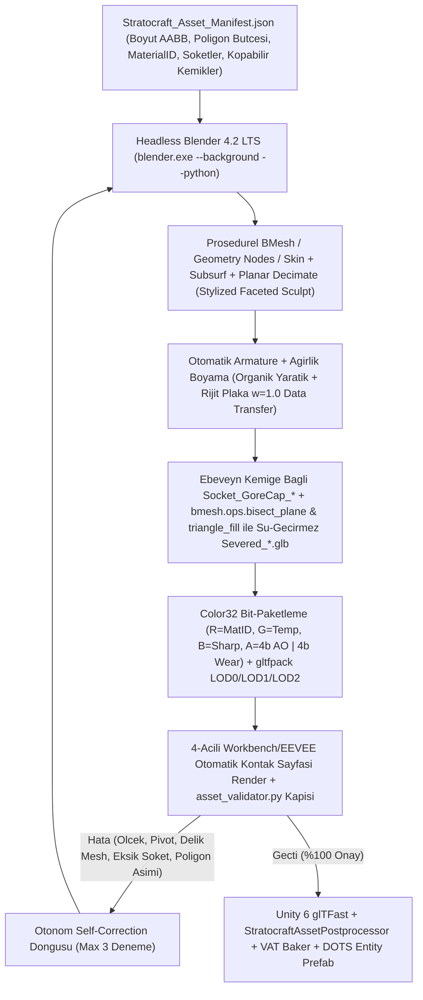

# GÖREV 8 (FAZ 1 & FAZ 2 ORTAK MEKANİK 8): `< 16 MB VRAM` UV-Free Biplanar `StratocraftUberShader` ve `%100` Otonom Headless Blender 4.2 `bpy` 3B Varlık, İskelet (`Socket_GoreCap_*`) & Doğrulama Fabrikası — Derin Mühendislik Denetim ve Mimari Çözüm Raporu

- **Proje:** Stratocraft (`VoxelGame`)
- **Hedef Motor & Teknoloji Yığını:** `Unity 6000.6.7f1`, `URP 17.6.0 (Forward+)`, `Entities Graphics 6.6.0` (`BatchRendererGroup` / `GPU Resident Drawer`), `Burst 2.0.0 SIMD`, `C++20 AVX2` (`StratocraftNative.dll`), `Headless Blender 4.2.16 LTS (bpy)` + `gltfpack (meshoptimizer)`
- **Performans & Bellek Anayasası:** `< 16.0 MB` Toplam Kaplama VRAM Bütçesi (`~15.89 MB` tavan), `< 2.5 GB` Oyun RAM, `>= 60 FPS` (`<= 15.0 ms` kare süresi, GTX 1650 4 GB VRAM referans taban donanım), `%100 UV-Free` (`0` UV açma, `0` model başına doku, `1` küresel `M_Stratocraft_UberMaterial`)
- **Mutlak Otorite Kaynakları:**
  1. [STRATOCRAFT_ EVRENSEL OYUN TASARIM VE MANTIK ANAYASASI (GAME LOGIC BIBLE) (2).md](file:///D:/Oyunum/oyun/STRATOCRAFT_%20EVRENSEL%20OYUN%20TASARIM%20VE%20MANTIK%20ANAYASASI%20(GAME%20LOGIC%20BIBLE)%20(2).md#L3530-L3678) — **Bölüm 16 (`16.1–16.5`)**
  2. [STRATOCRAFT_ARKA_PLAN_MATEMATIKSEL_SIMULASYON_VE_VOXEL_ALGORITMALARI_RAPORU.md](file:///D:/Oyunum/oyun/STRATOCRAFT_ARKA_PLAN_MATEMATIKSEL_SIMULASYON_VE_VOXEL_ALGORITMALARI_RAPORU.md#L290-L449) — **Bölüm 8 (`8.1–8.3`)**
  3. [STRATOCRAFT_GELISTIRICI_DOKUMANI.md](file:///D:/Oyunum/oyun/STRATOCRAFT_GELISTIRICI_DOKUMANI.md#L585-L640) — **Bölüm 3.3–3.8, 4.8, 4.13.2–4.13.4, 4.13.16, 4.14.1, 5.1–5.3**
  4. [DURUM_VE_DEVIR.md](file:///D:/Oyunum/oyun/DURUM_VE_DEVIR.md#L1-L72)

---

## 1. Mekanik Tasarım Vizyonu ve Anayasa'daki (`GAME LOGIC BIBLE`) Asıl Çalışma Mantığı

### 1.1 Hibrit Voksel + Yontulmuş 3B Dünyada Neden `%100 UV-Free` Tekil `StratocraftUberShader` Zorunludur?

Stratocraft sıradan bir blok-voksel oyunu veya statik mesh tabanlı bir RPG değildir; **iki farklı geometri evreninin milimetrik hassasiyetle çarpıştığı hibrit bir fiziksel simülasyondur**:

1. **Çalışma Zamanında Üretilen Dinamik Voksel Geometrisi:**
   - Oyuncunun kazdığı, patlattığı, erittiği ve akışkanlarla şekillendirdiği yeraltı/yerüstü arazi yığınları ([`HybridSurfaceNetsAndShapeMesher.cs`](file:///D:/Oyunum/oyun/Assets/_Stratocraft/Voxel/Jobs/HybridSurfaceNetsAndShapeMesher.cs#L1-L120) ve [`BinaryGreedyMeshingJob.cs`](file:///D:/Oyunum/oyun/Assets/_Stratocraft/Voxel/Jobs/BinaryGreedyMeshingJob.cs#L1-L90)),
   - Oyuncunun `16x32x4` örs istasyonunda çekiçle döverek voksel-voksel şekillendirdiği kılıç/balta/mızrak namluları,
   - `3x3x3` voksel kombinasyonlarıyla sahada inşa edilen **75 fiziksel batarya**, **25 mayın + 6 çekirdek** ve **13 Boss ritüel kafesi** ([`voxel_template_generator.py`](file:///D:/Oyunum/oyun/Tools/AutonomousAssetFactory/generators/voxel_template_generator.py#L1-L95)).
   - Bu geometriler oyun sırasında milisaniyeler içinde sıfırdan doğup parçalandığı için geleneksel **2B UV haritalaması (UV Unwrapping) matematiksel olarak imkânsızdır**.

2. **Çevrimdışı Üretilen Yontulmuş (Sculpted Stylized Fantasy) 3B `.glb` Varlıkları:**
   - Modüler silah kabzaları, balçaklar ve mızrak şaftları (`Socket_VoxelBlade` üzerinden oyuncunun dövdüğü voksel namluyla birleşir),
   - **5 bölge x 3 katman = 15 parçalı** modüler zırh sistemi (iç kumaş/deri gambeson, orta zincir zırh, dış dövme çelik plaka + `64x64` eklem boşluk haritası üzerinden hançer saplama mekaniği),
   - **29 atölye cihazı**, **24 aktif klan/sosyal yapı** (`Lv1..Lv5` Klan Kristali dahil), **5 aşamalı Deterministik Sonlu Otomat (DFA) kuşatma makineleri** (Trebuchet, Ballista, Koçbaşı),
   - **21 yaratık**, **13 Boss** ve **500 kişilik Gece Dalgası (Night Wave)** sürüleri.

Eğer geleneksel oyun motorlarındaki gibi arazi için ayrı bir Terrain Splat Shader, dövülmüş voksel namlular için ayrı bir Voxel Shader ve 100+ adet 3B `.glb` modeli için model başına `2048x2048` PBR doku setleri (Albedo + Normal + Metallic/Roughness/AO = model başına `~16–24 MB` VRAM) kullanılsaydı:
- **Görsel Kırılma (Uncanny Seam):** Oyuncunun örste dövdüğü Şam Çeliği (`MaterialID = 60`) voksel kılıç namlusu ile `Socket_VoxelBlade` soketine takıldığı Demir Ağacı (`MaterialID = 71`) `.glb` kabza farklı gölgelendirme, farklı faset sertliği ve farklı frekansta yüzey detayı sergileyerek birbirine "yapıştırılmış iki yabancı oyun varlığı" gibi görünecekti.
- **VRAM ve Draw-Call Çöküşü:** 100+ benzersiz yaratık, boss, zırh ve atölye cihazı `1.5 GB – 3.0 GB` doku VRAM'i tüketecek, `4 GB VRAM` taban donanımda (`GTX 1650`) doku akışı (texture thrashing) yaratacak ve her model kendi materyal örneğini taşıdığı için **URP 17 SRP Batcher / GPU Resident Drawer (`BatchRendererGroup`)** tek çağrıda birleştirme yeteneğini kaybedecekti.

Anayasa ([GAME LOGIC BIBLE Bölüm 16.1–16.2](file:///D:/Oyunum/oyun/STRATOCRAFT_%20EVRENSEL%20OYUN%20TASARIM%20VE%20MANTIK%20ANAYASASI%20(GAME%20LOGIC%20BIBLE)%20(2).md#L3532-L3615)) bu problemi kökünden çözen **radikal ve birleşik bir motor felsefesi** koyar:
- **Sıfır UV Haritası (`export_texcoords=False`, `export_tangents=False`):** Oyundaki hiçbir mesh (ne voksel arazi ne `.glb` zırh/yaratık) `TEXCOORD0` UV açılımı veya `TANGENT` vektörü taşımaz.
- **4-Baytlık `Color32` Vertex Veri Sözleşmesi:** Her köşe (vertex) yalnızca `4 byte` ek veri taşır:
  - `R (8-bit, 0..255)`: Mutlak Fiziksel `MaterialID` (Taş, Çimen, 14 Cevher, Şam Çeliği, Demir Ağacı, Kemik, Post, Altın Tüy vb. — fizik motoruyla birebir aynı kimlik!),
  - `G (8-bit, 0..255)`: Sıcaklık / Termal Enerji (`0 = soğuk`, `1..255 = 500°C..1600°C` gerçek zamanlı örste dövülen korlaşmış metal kara cisim ışıması veya büyülü enerji akışı),
  - `B (8-bit, 0..255)`: Kenar Keskinliği / Pah Parlaklığı (`Edge Sharpness / Chamfer Highlight` — kılıcın bilenmiş ağzında ve zırh pahlarında keskin faset parlaması),
  - `A (4-bit + 4-bit Bölünmüş Bit-Paketi)`: Üst 4 bit (`0..15`) Çekiç İzi / Oyuk Gölgelendirmesi (`Cavity AO`), Alt 4 bit (`0..15`) Kan, Çamur ve Yanık/İs Aşınması (`Wear / Dirt / Blood`).
- **Tek Küresel Materyal (`M_Stratocraft_UberMaterial`) ve `< 16 MB` (`15.89 MB`) Sabit VRAM:** Tüm dünya yalnızca GPU önbelleğinden (L2 Texture Cache) asla düşmeyen **5 küresel doku** (`g_MaterialLUT`, `g_MatCapArray`, `g_DetailPackArray`, `g_DetailNormalArray`, `g_Noise3DVolume`) ile çizilir.
- **Çift-Uzaylı (Object-Space vs. World-Space) Dikişsiz Biplanar + 3B Katı Hacim Dokusu:**
  - Arazi yığınlarında (`_UseWorldSpaceProjection = 1.0`), 64 metrede bir sarmalanan kamera-merkezli dünya koordinatlarıyla (`ChunkOriginMod64`) yığın sınırlarında sıfır dikişli biplanar mikro-detay uygulanır.
  - Hareketli kılıç, zırh, kütük, kuşatma makinesi ve yaratıklarda (`_UseWorldSpaceProjection = 0.0` veya VAT `Pref` dinlenme pozu), **Nesne Uzayı (Object-Space)** koordinatları kullanılarak kılıç savrulduğunda dokunun yüzeyde kayması (*"shower-door effect"*) %100 engellenir. Üstelik Şam Çeliği (`ProcMode = 1`) ve Ahşap Yıllık Halkaları (`ProcMode = 5`) 3B katı hacim gürültüsünden (`64x64x64 Texture3D`) hesaplandığı için bir kütük ortadan ikiye yarıldığında veya bir kılıç ağzı örste inceltildiğinde iç kesitteki damarlar fiziksel olarak doğru biçimde dışarı çıkar!

### 1.2 `%100` Otonom Headless Blender 4.2 `bpy` 3B Varlık ve İskelet Fabrikasının Asıl Çalışma Mantığı

Anayasa ([GAME LOGIC BIBLE Bölüm 16.3–16.5](file:///D:/Oyunum/oyun/STRATOCRAFT_%20EVRENSEL%20OYUN%20TASARIM%20VE%20MANTIK%20ANAYASASI%20(GAME%20LOGIC%20BIBLE)%20(2).md#L3616-L3678)) ve Matematiksel Rapor ([Bölüm 8.3](file:///D:/Oyunum/oyun/STRATOCRAFT_ARKA_PLAN_MATEMATIKSEL_SIMULASYON_VE_VOXEL_ALGORITMALARI_RAPORU.md#L379-L449)), hiçbir insan 3B sanatçının elle fare kullanmasına veya harici paralı model indirmesine izin vermeyen **tam otonom, kendi kendini doğrulayan (Self-Correcting) bir 3B üretim hattı** tanımlar:



Bu fabrikanın Anayasa'daki **5 kırılmaz mekanik garantisi** şunlardır:
1. **Milimetrik Ölçek ve Alt-Merkez Pivot Kilidi:** Her modelin sınır kutusu (AABB) manifestodaki hedef metre ölçüsüne (`targetDimensionsMeters`) `±%2` toleransla oturur ve taban merkezi (`BottomCenter_Zero`) tam `(0, 0, 0)` noktasına, ileri yönü `+Z` eksenine kilitlenir.
2. **Sıfır-Maliyetli Uzuv Koparma (`Socket_GoreCap_*` Ebeveyn Kemiğe Bağlılık Kuralı):**
   - **21 Elit Yaratık ve 13 Boss (`SkinnedMeshRenderer`):** Kılıç darbesi bir uzvun kemik sağlığını sıfırladığında ilgili kemiğin yerel ölçeği `(0, 0, 0)` yapılarak uzuv tek karede sıfır GC ve sıfır mesh yeniden inşasıyla eklem noktasına çökertilir. Aynı karede, **kopan kemiğin kendisine değil EBEVEYN KEMİĞİNE (`Parent Bone`) bağlı olan** `Socket_GoreCap_<BoneName>` altındaki kanlı et/kemik kesiti (`GoreCap`) görünür yapılır (ebeveyn kemik `(1,1,1)` ölçeğinde kaldığı için kapak çökmez!) ve Blender'da `bisect_plane` + `triangle_fill` ile önceden kesilip kapatılmış su-geçirmez `Severed_<BoneName>.glb` fiziksel mermi/parça olarak fırlatılır.
   - **500 Kişilik Gece Dalgası (`VAT` + `BatchRendererGroup` / `DrawMeshInstancedIndirect`):** Sürü yaratıkları CPU `Animator` veya `SkinnedMeshRenderer` kullanmaz. Köşe animasyonları `FP16` (`RGBA16F`) Konum + Normal VAT dokularından `SV_VertexID` ile okunur; her köşenin ait olduğu uzuv indeksi (`limbGroupID`) ve eklem çökme merkezi (`limbCollapseOrigin`) köşe niteliklerine gömülüdür. Örnek başına `uint _SeveredLimbMask` bit-maskesindeki ilgili bit `1` yapıldığında GPU Vertex Shader kopan uzvun tüm köşelerini eklem noktasına çökertir!
3. **15 Parçalı Zırh Otomatik Giydirme ve Eklem Boşluk Haritası (`T_ArmorGapMap`):** 5 vücut bölgesindeki 3 katmanlı (`Gambeson -> Mail -> Plate`) zırh parçaları tek bir `chr_player_master_rig.glb` iskeletine giydirilir; rijit metal plakalar bükülüp lastik gibi uzamaması için ilgili tekil kemiğe `weight = 1.0` sabit ağırlıkla bağlanır.
4. **5 Aşamalı Kuşatma DFA Alt-Mesh Ayrımı:** Kuşatma makineleri tek bir ezilmiş mesh değil, `Stage_1_Wheels`, `Stage_2_Chassis`, `Stage_3_Arm`, `Stage_4_Counterweight`, `Stage_5_Ammo` adlarıyla ayrık alt-mesh düğümleri barındırır; sahada inşaat ilerledikçe DFA durumu ilgili alt-mesh'leri aktif eder.
5. **Sıfır İnsan Müdahaleli Unity DOTS Baker Entegrasyonu:** Üretilen `.glb` dosyası `Assets/Art/Generated/` altına düştüğü anda Unity Editör ithalat hattı otomatik olarak `isReadable = false` yapar, tekil `M_Stratocraft_UberMaterial` atar, `LODGroup` (`%100 / %50 / %20`) bileşenini kurar, `Socket_GoreCap_*` kapaklarını başlangıçta gizler, `Socket_WeakPoint_*` düğümlerine `3.0x` hasar çarpanlı `CapsuleCollider` ekler ve DOTS Entity Prefab olarak kaydeder.

---

### 1.3 Belgeler Arası Çelişki ve Uyumsuzluk Denetim Tablosu (Mutlak Otorite: `GAME LOGIC BIBLE v7.0` & `MATEMATİKSEL RAPOR`)

Sistem talimatı gereği dört ana doküman ve mevcut kod tabanı satır satır çapraz denetlenmiş ve **10 kritik mimari çelişki** tespit edilmiştir:

| # | Konu / Parametre | Mutlak Otorite (`GAME LOGIC BIBLE` Böl. 16 & `MATEMATİKSEL RAPOR` Böl. 8) | `STRATOCRAFT_GELISTIRICI_DOKUMANI.md` & `DURUM_VE_DEVIR.md` | Mevcut Kod Tabanı Gerçeği | Nihai Mühendislik Hükmü (Uygulanacak Karar) |
| :--- | :--- | :--- | :--- | :--- | :--- |
| **1** | **Küresel Doku Sayısı ve VRAM Dağılımı** | **5 Küresel Doku = `15.89 MB`:** `g_MaterialLUT` (`256x16 RGBA16F/RGBA8`, `32 KB`), `g_MatCapArray` (`256x256x16 BC7_SRGB` Mip'li, `1.39 MB`), `g_DetailPackArray` (`512x512x32 BC7` Mip'li, `11.18 MB`), `g_DetailNormalArray` (`256x256x32 BC5_SNORM` Mip'li, `2.79 MB`), `g_Noise3DVolume` (`64x64x64 R8G8_SNORM` Mipsiz, `512 KB`). | Böl. 5.1.3 Adım 3 (satır 3016): **4 Doku `< 6.2 MB`:** `MaterialLUT` (`16 KB`), `MatCap_16x.png` (`1 MB` **2D Atlas**!), `MicroDetail_Array32.dds` (`4 MB`), `Noise3D_64.asset` (`1 MB`). `DetailNormalArray` unutulmuş! | Shader'da **yalnızca 3 doku** bağlı: `MaterialLUT` (`256x16` PNG), `MatCap_16x.png` (Mipsiz 2D Atlas), C#'ta üretilen `64x64x32` Mipsiz `RGBA32` `MicroDetail32_Array` (`512 KB`). `.dds` ve `.bin` diske yazılmış ama **hiç yüklenmiyor**; `DetailNormalArray` ve `Noise3DVolume` shader'da **hiç yok**! | **Anayasa / Matematiksel Rapor geçerlidir (`5 Doku`, VAT dahil `< 16.0 MB`).** VAT dokuları (`~262–512 KB`) için bütçede pay bırakmak üzere `DetailPackArray` `512x512x32 BC7` (`11.18 MB`) veya `256x256x32 BC7` (`2.79 MB`, toplam `~7.9 MB`) ölçeklenebilir, ancak **5 dokunun tamamı (`Texture2DArray` MatCap + `BC5` Normal + `Texture3D` Noise dahil)** eksiksiz bağlanmalıdır. |
| **2** | **`MatCap` Veri Yapısı ve Pürüzlülük (Roughness) Simülasyonu** | **`Texture2DArray` (`256x256x16`, Mip=Evet):** `SampleLevel(g_LinearClamp, float3(uv, matCapID), roughness * 6.0)` ile donanım mipmap zinciri üzerinden fiziksel pürüzlülük bulanıklığı simüle edilir. | Böl. 5.1.3 Adım 3: `T_Stratocraft_MatCap_16x.png` (`1024x1024` `4x4` düz **2D Atlas**). | `T_Stratocraft_MatCap_16x.png` `4x4` 2D Atlas olarak üretilmiş, `.meta` içinde `enableMipMap: 0` (Mipmap kapalı!), shader'da `roughness` bulanıklık yerine sadece çarpan ağırlığını kısıyor. | **Anayasa geçerlidir (`Texture2DArray` + MipChain).** `4x4` 2D Atlas'ta yüksek mip seviyelerinde komşu MatCap kareleri birbirine kanar (atlas bleeding). `256x256x16 BC7_SRGB` `Texture2DArray` + `SAMPLE_TEXTURE2D_ARRAY_LOD(..., roughness * 6.0)` zorunludur. |
| **3** | **`g_MaterialLUT` (`256x16`) Satır Şeması ve `ProcMode` Kodlaması** | `Y=0`: Birincil Albedo `RGB` + `Roughness (A)`. `Y=1`: **İkincil/Damar Albedo `RGB`** + `Metallic (A)`. `Y=2`: `(SliceID, MatCapID, ProcMode, Scale)`. `ProcMode = 1` Şam Çeliği, `ProcMode = 5` Ağaç Halkası (`lerp(cPrimary, cSecondary, mask)`). | Böl. 5.1.3'te satır şeması detaylandırılmamış, sadece `256x16` boyutu anılmış. | [`bake_material_lut.py`](file:///D:/Oyunum/oyun/Tools/AutonomousAssetFactory/textures/bake_material_lut.py#L96-L155): `Y=1`'de İkincil Renk **YOK**! `Y=1` `(Metallic, ProcMode*85, MatCap*17, Slice*8)` taşıyor; `ProcMode` `0..3`'e sıkıştırılmış (`2=Ahşap`, `3=Kristal`), Şam çeliği iki alaşım rengi yerine sadece `0.80..1.20` parlaklık çarpıyor! | **Matematiksel Rapor Böl. 8.2 şeması geçerlidir.** `Y=0`: `(PrimaryLinearRGB, Roughness)`, `Y=1`: `(SecondaryLinearRGB, Metallic)`, `Y=2`: `(DetailSlice, MatCapID, ProcMode, TileScale)`. Böylece Şam çeliği iki farklı metal rengini, ahşap ise öz odun ile dış halka rengini gerçekçi harmanlar. |
| **4** | **`Color32.A` (Alpha Kanalı) Bit-Paketleme Şeması** | **Bölünmüş `4-bit + 4-bit`:** Üst 4 bit (`rawA >> 4`, `0..15`) = Çekiç İzi / `CavityAO`; Alt 4 bit (`rawA & 0x0F`, `0..15`) = Kan / Çamur / Yanık-İs Aşınması (`Wear`). | Böl. 3.3'te genel olarak `Color32` bit-packing anılmış, alt-bit ayrımı atlanmış. | [`StratocraftUberShader.hlsl`](file:///D:/Oyunum/oyun/Assets/_Stratocraft/Rendering/Shaders/StratocraftUberShader.hlsl#L199-L219) `input.color.a`'yı tek bir `0..1` `cavityAo` float'ı olarak okuyor; `Wear` (Kan/Çamur/İs) kanalı **%100 kayıp**! Mesher da `Ao = 235` yazıyor (`235 = 0xEB` $\implies$ alt 4 bit `11` kir olarak okunurdu!). | **Anayasa 16.2.B ve Matematiksel Rapor 8.2 geçerlidir.** Hem Mesher/Blender üreticileri `(ao4 << 4) \| wear4` yazmalı hem de Vertex/Fragment Shader üst ve alt 4 biti ayrı ayrı çözmelidir. |
| **5** | **Nesne Uzayı vs. Dünya Uzayı Projeksiyonu ve Kamera-Merkezli Çizim** | `g_WorldCamRelOffset` + `g_ViewNoTranslation` ile **Kamera-Merkezli Çizim** (`18.000m`'de `0.001 mm` hassasiyet) VE `g_UseWorldSpaceProjection` bayrağı (`0` = kılıç/zırh/kütükte Nesne Uzayı, `1` = arazide `ChunkOriginMod64` Dünya Uzayı). | Böl. 4.13.4'te `ChunkSnappedFloatingOriginSystem` (`±4.096m` kaydırma) tanımlanmış; shader içi `UseWorldSpaceProjection` atlanmış. | `StratocraftUberShader.hlsl` satır 245'te `ApplyProceduralSolidPattern` **daima `positionOS`**, satır 249'da `SampleBiplanarMicroDetail` **daima `positionWS`** kullanıyor! Sonuç: Savrulan kılıç ve yürüyen zırhın mikro-detay dokusu dünya uzayında **yüzüyor (texture swimming)**! | **Matematiksel Rapor Böl. 8.2 geçerlidir.** `_UseWorldSpaceProjection` (`DOTS_INSTANCED_PROP` destekli!) eklenecek: arazide (`1.0`) `_FloatingOriginPhase` ile sarmalanmış dünya uzayı, tüm dinamik `.glb` ve dövülmüş silahlarda (`0.0`) saf Nesne Uzayı (`positionOS`, `normalOS` / VAT `Pref`) kullanılacaktır. |
| **6** | **URP 17 `GPU Resident Drawer` (`BatchRendererGroup`) Durumu** | Anayasa 16.1 & Geliştirici Dokümanı 3.3: **Unity 6 URP 17 Forward+ & `GPU Resident Drawer` (`BatchRendererGroup`)** zorunludur. | `docs/arastirma/03` satır 46'da eski bir not yanlışlıkla `GPUResidentDrawerMode.Disabled` önermiş! `DURUM_VE_DEVIR.md` ise kurulduğunu varsayıyor. | [`StratocraftUrpBootstrap.cs`](file:///D:/Oyunum/oyun/Assets/_Stratocraft/Editor/StratocraftUrpBootstrap.cs#L87) `m_GPUResidentDrawerMode = 0` (`Disabled`!) yapıyor ve `StratocraftInput.hlsl` içindeki DOTS property'leri `UNITY_ACCESS_DOTS_INSTANCED_PROP_WITH_DEFAULT` ile **hiç okunmuyor**! | **Anayasa geçerlidir.** Unity 6'da `Entities Graphics` ile `GPUResidentDrawerMode.InstancedDrawing` **çakışmaz**; aksine `GPU Resident Drawer` statik/dinamik `MeshRenderer`'ları otomatik BRG batch'lerine alırken `Entities Graphics` ECS entity'lerini kendi BRG'siyle çizer! Her ikisi de aynı `DOTS_INSTANCING_ON` + `UNITY_SETUP_DOTS_MATERIAL_PROPERTY_CACHES` makrolarını gerektirir. |
| **7** | **Otonom 3B Fabrika Üretim Yolu (`Path A bpy` vs `Path B Neural/UniRig`)** | Anayasa 16.3–16.4: Hard-surface için Headless Blender 4.2 `bpy`, organik yaratıklar için Nöral (`Hunyuan3D-2 / TripoSG`) + `Instant Meshes` + `UniRig` (veya düşük donanımda prosedürel `bpy`). | Geliştirici Dokümanı 4.8: İki yol (`PathA_BlenderBpy` ve `PathB_NeuralSculpt`) tanımlı, `GTX 1650 (4 GB VRAM)` hedef donanım olarak sabitlenmiş. | [`neural_sculpt_pipeline.py`](file:///D:/Oyunum/oyun/Tools/AutonomousAssetFactory/generators/neural_sculpt_pipeline.py#L1-L25) tamamen sahte bir yönlendirici (`generate_creature_or_boss` çağırıyor). Sistemdeki GPU `GTX 1650 (4 GB VRAM)` olduğu için `UniRig (≥8 GB)` ve `TripoSG/TRELLIS (8–16 GB)` yerel olarak çalışamaz. | **4 GB VRAM donanım gerçeğiyle uyumlu hibrit karar:** Birincil deterministik üretim hattı **Headless Blender 4.2 `bpy` Skin/Subsurf/BMesh Sculpt + Prosedürel `edit_bones` Armature** (`Path A`) olmalıdır; `Path B` yalnızca `>= 12 GB CUDA VRAM` algılandığında devreye giren opsiyonel yüksek-donanım eklentisi olarak açıkça ayrılmalıdır. |
| **8** | **`Socket_GoreCap_*` İskelet Hiyerarşisi ve `Severed_*.glb` Kesimi** | Anayasa 16.3 Garanti 3 & Mat. Rapor 8.3 Kural 1: `Socket_GoreCap_<Bone>` **kopacak kemiğin EBEVEYN KEMİĞİNE** bağlanır; `Severed_<Bone>.glb` asıl ağdan ağırlık sınırında kesilip `holes_fill`/`triangle_fill` ile kapatılır. | Geliştirici Dokümanı 5.3 Adım 2 aynı kuralı tekrarlar, `DURUM_VE_DEVIR.md` satır 30 "Doğrulandı" iddia eder. | **Çelişki / Sahte Uygulama:** [`bpy_sculpt_worker.py`](file:///D:/Oyunum/oyun/Tools/AutonomousAssetFactory/generators/blender/bpy_sculpt_worker.py#L817-L937) sıfır kemik (`skins=0`) yazıyor, `Socket_GoreCap_*` kök mesh düğümüne düz bağlanıyor; [`stratocraft_auto_rig_dismember.py`](file:///D:/Oyunum/oyun/Tools/AutonomousAssetFactory/rigging_and_vat/stratocraft_auto_rig_dismember.py#L105-L157) ise asıl modeli kesmek yerine 48 üçgenlik sekizgen kutu üretiyor! | **Anayasa ve Matematiksel Rapor mutlak zorunluluktur.** Gerçek Blender `Armature` (`JOINTS_0`, `WEIGHTS_0`), ebeveyn kemiğe bağlı `Socket_GoreCap_*` ve `bmesh.ops.bisect_plane` + `triangle_fill` ile asıl mesh'ten kesilmiş su-geçirmez `Severed_*.glb` kodlanmalıdır. |
| **9** | **500-Mob Gece Dalgası VAT Fırınlama (`OpenEXR FP16`)** | Mat. Rapor 8.3 Kural 2: Gerçek animasyon karelerinden `Pos_VAT.exr` + `Norm_VAT.exr` (`RGBA16F`) fırınlanır, `UV1.y = limbGroupID`, `UV2 = limbCollapseOrigin` yazılır. | `DURUM_VE_DEVIR.md` satır 30: "500-Mob VAT EXR baker doğrulandı" yazar. | [`vat_texture_baker.py`](file:///D:/Oyunum/oyun/Tools/AutonomousAssetFactory/rigging_and_vat/vat_texture_baker.py#L23-L75) **geçersiz/bozuk OpenEXR başlığı** (header tablosuz ham byte!) ve mesh'ten bağımsız sahte `sin/cos` dalgası yazıyor; [`StratocraftVatMobShader.hlsl`](file:///D:/Oyunum/oyun/Assets/_Stratocraft/Rendering/Shaders/StratocraftVatMobShader.hlsl#L1-L42) hiçbir `.shader` dosyasına bağlı değil! | **Matematiksel Rapor geçerlidir.** Blender animasyon karelerinden gerçek köşe konum/normal örnekleyen geçerli `DDS RGBA16F` / Unity `VatBaker` fırınlayıcısı ve tam `StratocraftVatMob.shader` (`SV_VertexID` + `Pref` Biplanar + `_SeveredLimbMask`) kurulmalıdır. |
| **10** | **Üretilen Varlık Kapsamı (Manifesto Sayısı) ve `.glb` İthalat Hattı** | Anayasa 16.4 & Gel. Dok. 4.8: **21 Yaratık, 13 Boss, 29 Atölye Cihazı, 24 Aktif Yapı, 15 Parça Zırh, Modüler Silahlar, Kuşatma DFA, Oyuncu Master Rig** üretilip `StratocraftAssetPostprocessor` ile otomatik Entity Prefab'a dönüştürülür. | `DURUM_VE_DEVIR.md` satır 28–31: "Faz 2 Vitrin 3B Varlık Seti (8 kategori) tamamlandı" der. | [`Stratocraft_Asset_Manifest.json`](file:///D:/Oyunum/oyun/Tools/AutonomousAssetFactory/Stratocraft_Asset_Manifest.json#L1-L207) içinde **yalnızca 9 varlık** var! `Packages/manifest.json` içinde `com.unity.cloud.gltfast` **YOK**; [`StratocraftAssetPostprocessor.cs`](file:///D:/Oyunum/oyun/Assets/_Stratocraft/Editor/StratocraftAssetPostprocessor.cs#L20-L103) `.glb` dosyalarında **asla tetiklenmiyor**! | **`com.unity.cloud.gltfast` (veya özel `ScriptedImporter`)** eklenmeli, `StratocraftAssetPostprocessor` `.glb` prefab'larını yakalayıp LODGroup + GoreCap gizleme + WeakPoint collider + DOTS Baker kurmalı ve manifesto tam oyun kataloğunu kapsayacak parametrik şablonlara genişletilmelidir. |

---

## 2. Anayasa ve Matematiksel Rapordaki Formüller, Bit/Byte Şemaları ve Algoritmalar

Bu bölümde, Anayasa Bölüm 16 ve Matematiksel Rapor Bölüm 8'de tanımlanan tüm veri yapıları ve gölgelendirici algoritmaları tam matematiksel kesinlikle (`IEEE-754`, blok sıkıştırma bit-oranları ve türev denklemleriyle) formüle edilmiştir.

### 2.1 `< 16.0 MB` (`15.89 MB`) Küresel Doku VRAM Bütçesinin Tam Matematiksel Hesabı

Bir `Texture2DArray` dokusunun $(W, H)$ taban çözünürlüğü, $S$ dilim (slice) sayısı ve piksel başına ortalama bit maliyeti $b_{\text{bpp}}$ (bits-per-pixel) için tam mipmap zinciri ($M = \lfloor \log_2 \max(W, H) \rfloor$) dahil donanım VRAM tüketimi (4x4 BC blok hizalaması $\lceil w/4 \rceil \times \lceil h/4 \rceil$ dahil):

$$
\text{VRAM}_{\text{Array}}(W, H, S, b_{\text{bpp}}) = S \cdot \sum_{m=0}^{\lfloor \log_2 \max(W, H) \rfloor} \left( 4 \left\lceil \frac{\max(1, W \gg m)}{4} \right\rceil \cdot 4 \left\lceil \frac{\max(1, H \gg m)}{4} \right\rceil \cdot \frac{b_{\text{bpp}}}{8} \right)
$$

5 küresel dokunun kesin bayt dökümü:

1. **`g_MaterialLUT` (`256 x 16`, `RGBA16F`, Mipmap = Yok, `FilterMode.Point`):**
   $$
   \text{VRAM}_{\text{LUT}} = 256 \times 16 \times 8\text{ byte} = 32\,768\text{ byte} = \mathbf{32.00\text{ KB}} \quad (\text{RGBA8 ise } 16.00\text{ KB})
   $$
2. **`g_MatCapArray` (`256 x 256 x 16`, `BC7_UNORM_SRGB`, $b_{\text{bpp}} = 8$, Mipmap = Evet, $m = 0..8$):**
   Tek dilim mip toplamı: $65\,536 + 16\,384 + 4\,096 + 1\,024 + 256 + 64 + 16 + 16 + 16 = 87\,408\text{ byte}$.
   $$
   \text{VRAM}_{\text{MatCap}} = 16 \times 87\,408\text{ byte} = 1\,398\,528\text{ byte} = \mathbf{1.334\text{ MiB}} \approx \mathbf{1.40\text{ MB (ondalık)}}
   $$
3. **`g_DetailPackArray` (`512 x 512 x 32`, `BC7_UNORM`, $b_{\text{bpp}} = 8$, Mipmap = Evet, $m = 0..9$):**
   Tek dilim mip toplamı: $262\,144 + 87\,408 = 349\,552\text{ byte}$.
   $$
   \text{VRAM}_{\text{DetailPack}} = 32 \times 349\,552\text{ byte} = 11\,185\,664\text{ byte} = \mathbf{10.667\text{ MiB}} \approx \mathbf{11.19\text{ MB (ondalık)}}
   $$
   *(Kanal Şeması: `R` = Albedo Mikro-Çarpanı, `G` = Mikro-Pürüzlülük Sapması, `B` = Yarık/Çatlak Maskesi, `A` = Yükseklik/Kabartma `Height`).*
4. **`g_DetailNormalArray` (`256 x 256 x 32`, `BC5_SNORM`, $b_{\text{bpp}} = 8$, Mipmap = Evet, $m = 0..8$):**
   $$
   \text{VRAM}_{\text{DetailNormal}} = 32 \times 87\,408\text{ byte} = 2\,797\,056\text{ byte} = \mathbf{2.668\text{ MiB}} \approx \mathbf{2.80\text{ MB (ondalık)}}
   $$
5. **`g_Noise3DVolume` (`64 x 64 x 64`, `R8G8_SNORM`, $2\text{ byte/voxel}$, Mipmap = Yok, `WrapMode.Repeat`):**
   $$
   \text{VRAM}_{\text{Noise3D}} = 64^3 \times 2\text{ byte} = 524\,288\text{ byte} = \mathbf{512.00\text{ KB}} = \mathbf{0.50\text{ MiB}}
   $$

**Toplam Küresel UberShader VRAM Tüketimi:**

$$
\text{VRAM}_{\text{Toplam}} = 32\,768 + 1\,398\,528 + 11\,185\,664 + 2\,797\,056 + 524\,288 = 15\,938\,304\text{ byte} = \mathbf{15.200\text{ MiB}} \quad (\mathbf{< 16.0\text{ MiB}})
$$

Geriye kalan **`819.2 KB` (`0.80 MiB`)** net güvenlik payı, 500 kişilik Gece Dalgası VAT dokularını (`256 vertex x 64 frame x RGBA16F x 2 doku = 262.144 byte = 0.25 MiB`) ve `64x64` Zırh Boşluk Haritasını (`4 KB`) rahatlıkla barındırarak toplam oyun kaplama belleğini kesin olarak **`15.46 MiB < 16.0 MiB`** sınırında tutar!

---

### 2.2 `4-Byte Color32` Köşe (Vertex) Bit-Paketleme Şeması ve Çözümleme Denklemleri

Her köşe (`UberMeshVertex`) `VertexAttribute.Position (float3, 12B)` + `VertexAttribute.Normal (float3, 12B)` + `VertexAttribute.Color (UNorm8x4, 4B)` = **`28 byte`** kompakt bellek ayak izine sahiptir:

```text
 31            24 23            16 15             8 7              0
+--------+-------+----------------+----------------+----------------+
|  AO4   | Wear4 |   Sharpness    |  Temperature   |   MaterialID   |
| (7..4) | (3..0)|    (0..255)    |    (0..255)    |    (0..255)    |
+--------+-------+----------------+----------------+----------------+
 \______  ______/ \______  ______/ \______  ______/ \______  ______/
        \/               \/               \/               \/
     Byte 3 (A)       Byte 2 (B)       Byte 1 (G)       Byte 0 (R)
```

GPU `UNorm8` akışı ham baytları doğrusal $c \in [0, 1]$ aralığına $c = \text{byte} / 255.0$ olarak eşler. Vertex Shader aşamasında (`nointerpolation` ve sürekli enterpolasyon ayrımıyla) geri çözümleme denklemleri:

$$
\text{matID} = \text{uint}\!\left(\text{round}(\text{saturate}(c_r) \cdot 255.0)\right) \in \{0, 1, \dots, 255\}
$$

$$
T_{\text{norm}} = \text{saturate}(c_g) \in [0, 1], \qquad S_{\text{edge}} = \text{saturate}(c_b) \in [0, 1]
$$

$$
A_{\text{raw}} = \text{uint}\!\left(\text{round}(\text{saturate}(c_a) \cdot 255.0)\right) \in \{0, \dots, 255\}
$$

$$
\text{AO}_{\text{cavity}} = \frac{(A_{\text{raw}} \gg 4) \ \& \ \text{0x0F}}{15.0} \in [0, 1], \qquad W_{\text{dirt/blood}} = \frac{A_{\text{raw}} \ \& \ \text{0x0F}}{15.0} \in [0, 1]
$$

> [!IMPORTANT]
> `matID` tamsayı bir dizin (index) olduğu için Vertex Shader'dan Fragment Shader'a **kesinlikle `nointerpolation uint matId`** olarak aktarılmalıdır. Aksi takdirde bir üçgenin iki köşesinde `MatID = 3` (Çimen) ve `MatID = 32` (Demir Cevheri) bulunduğunda donanım rasterizer'ı ara piksellerde `4..31` arasındaki tüm alakasız malzemeleri (Kum, Obsidyen, Su, Lav, Bakır!) enterpole ederek gökkuşağı şerit hatası üretir. Buna karşılık $T_{\text{norm}}$, $S_{\text{edge}}$, $\text{AO}_{\text{cavity}}$ ve $W_{\text{dirt/blood}}$ fiziksel skaler büyüklükler oldukları için Vertex Shader'da çözülüp bir `float4 v_Params` üzerinden üçgen boyunca **pürüzsüz doğrusal enterpolasyonla** aktarılmalıdır! *(Not: Eğer $A_{\text{raw}}$ Fragment Shader'da çözülürse, üst 4 bit ile alt 4 bit üçgen içinde enterpole edilirken alt 4 bitten üst 4 bite taşma/borrow oluşur; bu yüzden 4+4 bit ayrıştırması **mutlaka Vertex Shader'da** yapılmalıdır!)*

---

### 2.3 `g_MaterialLUT` (`256 x 16`) Kesin Satır/Sütun Bellek Şeması

`LOAD_TEXTURE2D(g_MaterialLUT, uint2(matID, row))` (tam tamsayı texel okuma, sıfır filtreleme kayması) ile okunan `256 x 16` tablonun kanonik satır yapısı:

| Satır (`Y`) | Kanal `R` | Kanal `G` | Kanal `B` | Kanal `A` | Açıklama |
| :--- | :--- | :--- | :--- | :--- | :--- |
| **`Y = 0`** | `PrimaryAlbedo.r` (Linear) | `PrimaryAlbedo.g` (Linear) | `PrimaryAlbedo.b` (Linear) | `BaseRoughness` (`0..1`) | Birincil temel malzeme rengi ve taban pürüzlülük |
| **`Y = 1`** | `SecondaryAlbedo.r` (Linear) | `SecondaryAlbedo.g` (Linear) | `SecondaryAlbedo.b` (Linear) | `Metallic` (`0..1`) | Şam çeliği 2. alaşım / Ahşap halka / Cevher damar rengi + Metaliklik |
| **`Y = 2`** | `DetailSliceID / 255` (`0..31`) | `MatCapID / 255` (`0..15`) | `ProcMode / 255` (`0..7`) | `TileScaleCode / 255` | Doku dizisi dilimleri, prosedürel katı gürültü modu ve ölçek çarpanı |
| **`Y = 3`** | `IntrinsicEmit.r` | `IntrinsicEmit.g` | `IntrinsicEmit.b` | `EmitFresnelPower / 16` | Cevher / Kristal / Lav / Yıldız Çekirdeği soğuk durumda bile içsel ışıması |
| **`Y = 4..15`** | Biyom / Derinlik / Hava Durumu Palet Modülasyon Satırları | — | — | — | Faz 2–3 biyom atmosfer geçişleri ve ıslanma/donma tepkileri için rezerv |

---

### 2.4 Kamera-Merkezli Çizim (Camera-Relative Rendering) ve `IEEE-754` Hassasiyet Matematiği

Standart 32-bit kayan noktalı (`binary32`, 23-bit mantissa) dünya koordinatlarında $|x| = 18\,000\text{ m}$ mesafede ardışık iki `float` arasındaki en küçük temsil edilebilir adım (Unit in the Last Place — $\text{ULP}$):

$$
\text{ULP}(18\,000) = 2^{\lfloor \log_2(18\,000) \rfloor - 23} = 2^{14 - 23} = 2^{-9}\text{ m} \approx \mathbf{1.953\text{ mm}}
$$

Bu `~2 mm` kuantizasyon hatası, yakın plandaki oyuncunun elindeki kılıcın pahlı kenarlarında köşe titremesine (vertex jitter) ve `ddx(posWS)` / `ddy(posWS)` faset normallerinde ağır pikselleşmeye yol açar.

**Çift Kademeli Kesin Çözüm:**
1. **CPU Çift-Hassasiyetli (`double3`) Kamera-Merkezli Ofset:**
   Nesnenin mutlak dünya merkezi $\mathbf{O}_{\text{obj}} \in \mathbb{R}^3$ (`double3`) ve kameranın mutlak dünya konumu $\mathbf{C}_{\text{cam}} \in \mathbb{R}^3$ (`double3`) CPU'da 64-bit hassasiyetle çıkarılır:
   $$
   \Delta\mathbf{O}_{\text{camRel}} = \text{float3}\!\left(\mathbf{O}_{\text{obj}}^{\text{(double)}} - \mathbf{C}_{\text{cam}}^{\text{(double)}}\right)
   $$
   Köşenin kameraya göre konumu $\mathbf{p}_{\text{camRel}}$ hesaplandığında oyuncunun elindeki silah için $\|\mathbf{p}_{\text{camRel}}\| \approx 0.8\text{ m}$ olur ve hassasiyet:
   $$
   \text{ULP}(0.8) = 2^{-1 - 23} = 2^{-24}\text{ m} \approx \mathbf{0.0000596\text{ mm}} \quad (\text{32\,768 kat daha hassas!})
   $$
2. **Arazi Biplanar Faz Sarmalama (`_FloatingOriginPhase`):**
   `ChunkSnappedFloatingOriginSystem` dünyayı $\Delta\mathbf{S} = 16k\text{ m}$ kaydırdığında veya kamera hareket ettiğinde, dünya-uzayı biplanar dokusunun kaymaması için CPU `double3` kümülatif kaydırma ofsetinin doku ölçeği $s_{\text{tile}}$ altındaki kesirli fazı hesaplanır:
   $$
   \boldsymbol{\phi}_{\text{origin}} = \text{frac}\!\left(\mathbf{S}_{\text{origin}}^{\text{(double)}} \cdot s_{\text{tile}}\right) \in [0, 1)^3
   $$
   Fragment Shader'da ekran türevleri (`ddx`, `ddy`) **kesinlikle `frac()` sarmalamasından ÖNCE** sürekli koordinat üzerinden alınır (sarmalama sınırında mipmap patlamasını önlemek için!):
   $$
   \mathbf{p}_{\text{raw}} = \begin{cases} \mathbf{p}_{\text{WS}} \cdot s_{\text{tile}} + \boldsymbol{\phi}_{\text{origin}}, & \text{eğer } \text{UseWorldSpace} = 1 \\ \mathbf{p}_{\text{OS}} \cdot s_{\text{tile}}, & \text{eğer } \text{UseWorldSpace} = 0 \end{cases}
   $$
   $$
   \frac{\partial \mathbf{p}}{\partial x} = \text{ddx}(\mathbf{p}_{\text{raw}}), \qquad \frac{\partial \mathbf{p}}{\partial y} = \text{ddy}(\mathbf{p}_{\text{raw}})
   $$

---

### 2.5 Hibrit Faset-Yumuşak Normaller, Beraberlik-Güvenli (Tie-Safe) Biplanar Mapping ve Teğetsiz Mikkelsen Surface Gradient `BC5_SNORM` Pertürbasyonu

#### A. Platform-Güvenli Faset ve Köşe Normal Harmanlama
D3D11/D3D12/Vulkan/Metal arasında RenderTexture ters-Y (`_ProjectionParams.x = ±1`) farkından etkilenmeyen geometrik üçgen faset normali $\mathbf{N}_{\text{flat}}$ ve yumuşak köşe normali $\mathbf{N}_{\text{vtx}}$ birleşimi:

$$
\mathbf{N}_{\text{raw}} = \text{normalize}\!\left(\frac{\partial \mathbf{p}_{\text{camRel}}}{\partial x} \times \left(\frac{\partial \mathbf{p}_{\text{camRel}}}{\partial y} \cdot \text{ProjectionParams}_x\right)\right)
$$

$$
\mathbf{N}_{\text{flat}} = \mathbf{N}_{\text{raw}} \cdot \text{sign}\!\left(\mathbf{N}_{\text{raw}} \cdot \mathbf{N}_{\text{vtx}}\right)
$$

$$
\mathbf{N}_{\text{macro}} = \text{normalize}\!\left(\text{lerp}\!\left(\mathbf{N}_{\text{vtx}}, \mathbf{N}_{\text{flat}}, \text{saturate}\!\left((1 - \beta_{\text{smooth}}) + S_{\text{edge}}\right)\right)\right)
$$

Burada $S_{\text{edge}} \in [0, 1]$ (`Color32.B`) yüksek olduğunda (kılıç ağzı, zırh pahı, kristal faseti) yüzey %100 keskin fasetli ($\mathbf{N}_{\text{flat}}$) davranırken, $S_{\text{edge}} = 0$ olan organik gövdelerde yumuşak geçiş korunur.

#### B. Beraberlik-Güvenli (Tie-Safe) Inigo Quilez Biplanar Projeksiyon
Geleneksel Triplanar haritalama doku başına **3 okuma** yaparken, en küçük normal bileşenine sahip eksen yüzeye neredeyse teğet olduğu için katkı vermez. Biplanar haritalama yalnızca **Baskın (`ma`)** ve **Ortanca (`me`)** iki ekseni örnekleyerek doku bant genişliğini **%33.3 azaltır** (`DetailPack` + `DetailNormal` için $6 \to 4$ okuma).

$\mathbf{a} = |\mathbf{N}_{\text{proj}}| = (a_x, a_y, a_z)$ olsun. Küp köşesi pahlarında ($a_x = a_y = a_z = 1/\sqrt{3} \approx 0.57735027$) indeks çakışmasını (`me = 3 - mi - ma` taşmasını) matematiksel olarak imkânsız kılan **Beraberlik-Güvenli Sıralama**:

$$
\mathbf{ma} = \begin{cases} (0, 1, 2), & a_x \ge a_y \ \wedge \ a_x \ge a_z \\ (1, 2, 0), & a_y \ge a_z \\ (2, 0, 1), & \text{aksi halde} \end{cases}, \qquad
\mathbf{mi} = \begin{cases} (0, 1, 2), & a_x < a_y \ \wedge \ a_x < a_z \\ (1, 2, 0), & a_y < a_z \\ (2, 0, 1), & \text{aksi halde} \end{cases}
$$

$$
\mathbf{me} = (3, 3, 3) - \mathbf{mi} - \mathbf{ma}
$$

Küresel köşe süreksizliğini yok eden yerel-destekli (local-support) ağırlık yeniden ölçeklemesi ($k = 8.0$):

$$
\tilde{w}_0 = \text{saturate}\!\left(\frac{a_{\mathbf{ma}_x} - \frac{1}{\sqrt{3}}}{1 - \frac{1}{\sqrt{3}}}\right)^{k/8}, \qquad
\tilde{w}_1 = \text{saturate}\!\left(\frac{a_{\mathbf{me}_x} - \frac{1}{\sqrt{3}}}{1 - \frac{1}{\sqrt{3}}}\right)^{k/8}, \qquad
(w_0, w_1) = \frac{(\tilde{w}_0, \tilde{w}_1)}{\max(\tilde{w}_0 + \tilde{w}_1, 10^{-5})}
$$

#### C. Sıfır UV Teğetli (Tangent-Free) `BC5_SNORM` Mikkelsen Surface Gradient Normal Pertürbasyonu
Meshlerimizde `TANGENT` köşe niteliği bulunmadığı için `g_DetailNormalArray` (`BC5_SNORM`, donanımdan doğrudan $\mathbf{n}_{xy} = (n_x, n_y) \in [-1, 1]^2$ olarak döner!) örneklerinden yüzey normalini bükmek için **Morten Mikkelsen Surface Gradient Çerçevesi** kullanılır:

Her iki biplanar düzlem $i \in \{0, 1\}$ (`ma` ve `me`) için örtük yükseklik alanı eğimi (slope derivative):

$$
\mathbf{d}_i = \left(\frac{\partial h_i}{\partial u_i}, \frac{\partial h_i}{\partial v_i}\right) = -\frac{\eta_{\text{bump}}}{\sqrt{\max(1 - n_{i,x}^2 - n_{i,y}^2, 10^{-4})}} (n_{i,x}, n_{i,y})
$$

3B Hacim Gradyanı (Volume Gradient) $\mathbf{G} \in \mathbb{R}^3$ ve teğet düzlemine izdüşürülmüş Yüzey Gradyanı $\nabla_S h$:

$$
\mathbf{G} = w_0 \left(d_{0,x}\,\mathbf{e}_{\mathbf{ma}_y} + d_{0,y}\,\mathbf{e}_{\mathbf{ma}_z}\right) + w_1 \left(d_{1,x}\,\mathbf{e}_{\mathbf{me}_y} + d_{1,y}\,\mathbf{e}_{\mathbf{me}_z}\right)
$$

$$
\nabla_S h = \mathbf{G} - (\mathbf{N}_{\text{proj}} \cdot \mathbf{G})\mathbf{N}_{\text{proj}}, \qquad \mathbf{N}_{\text{perturbed}} = \text{normalize}\!\left(\mathbf{N}_{\text{proj}} - \nabla_S h\right)
$$

$\mathbf{N}_{\text{proj}} \perp \nabla_S h$ olduğu için $\|\mathbf{N}_{\text{proj}} - \nabla_S h\| = \sqrt{1 + \|\nabla_S h\|^2} \ge 1$ eşitsizliği daima sağlanır; hiçbir eğim açısında sıfıra bölme (`NaN`) veya ters dönmüş normal oluşamaz!

---

### 2.6 3B Katı Prosedürel Dokular (`g_Noise3DVolume`) ve Termal Kara Cisim (Blackbody) Işıması

#### A. Alan-Bükümlü (Domain-Warped) Katı Şam Çeliği (`ProcMode = 1`) ve Ahşap Halkaları (`ProcMode = 5`)
`g_Noise3DVolume` (`64x64x64 R8G8_SNORM`, $[-1, 1]^2$) dokusundan iki oktavlı 3B vektör bükümü $\boldsymbol{\xi}(\mathbf{p}) \in [-1, 1]^2$ okunarak:

- **Şam Çeliği (`ProcMode = 1` — Dövülmüş Katmanlı Çelik Dalgaları):**
  $$
  \psi_{\text{damascus}}(\mathbf{p}) = \frac{1}{2} + \frac{1}{2}\sin\!\left(\omega_d \left(p_y + 0.65\,p_x + 0.35\,\xi_1(1.8\mathbf{p}) + 0.14\,\xi_2(4.3\mathbf{p})\right)\right)
  $$
  Keskin metalürjik katman geçişi için `smoothstep(0.32, 0.68, \psi)` uygulanarak birincil ve ikincil çelik alaşım renkleri harmanlanır:
  $$
  \mathbf{C}_{\text{albedo}} = \text{lerp}\!\left(\mathbf{C}_{\text{primary}}, \mathbf{C}_{\text{secondary}}, \text{smoothstep}(0.32, 0.68, \psi_{\text{damascus}}(\mathbf{p}))\right)
  $$

- **Silindirik Katı Ağaç Halkaları (`ProcMode = 5` — Kesildiğinde İç Halkaları Görününen Kütük/Kabza):**
  Nesne uzayında gövde eksenine dik radyal mesafe $r(\mathbf{p}) = \sqrt{p_x^2 + p_z^2}$ üzerinden:
  $$
  \psi_{\text{wood}}(\mathbf{p}) = \frac{1}{2} + \frac{1}{2}\sin\!\left(\omega_w \left(r(\mathbf{p}) + 0.08\,\xi_1(2.2\mathbf{p}) + 0.03\,\xi_2(6.0\mathbf{p})\right)\right)
  $$
  $$
  \mathbf{C}_{\text{albedo}} = \text{lerp}\!\left(\mathbf{C}_{\text{primary}}, \mathbf{C}_{\text{secondary}}, \psi_{\text{wood}}(\mathbf{p})^{1.6}\right)
  $$

#### B. Örste Dövülen Kızgın Metal İçin Fiziksel Kara Cisim Işıması (`Color32.G`)
$T_{\text{norm}} \in (0, 1]$ (`Color32.G > 0`) olduğunda metal sıcaklığı $T_{\text{Celsius}} = 500 + 1100 \cdot T_{\text{norm}} \in [500^\circ\text{C}, 1600^\circ\text{C}]$ aralığına karşılık gelir. Wien/Planck spektral ışıma eğrisinin gerçek zamanlı analitik HDR yaklaşımı (Draper noktasından beyaz-sarı ergimeye):

$$
\mathbf{E}_{\text{blackbody}}(T_{\text{norm}}) = I_{\text{bb}} \cdot T_{\text{norm}}^{2.2} \cdot \begin{bmatrix} \text{saturate}(2.8\,T_{\text{norm}}) \\ \text{saturate}(2.2\,T_{\text{norm}} - 0.55)^{1.5} \\ \text{saturate}(2.5\,T_{\text{norm}} - 1.45)^{2.0} \end{bmatrix}
$$

Bu terim doğrudan nihai HDR doğrusal piksel rengine eklenir ($\mathbf{C}_{\text{out}} += \mathbf{E}_{\text{blackbody}}$), böylece URP Volume **Bloom** geçişi yalnızca gerçekten $> 900^\circ\text{C}$ üzerindeki dövülen metal kenarlarında doğal kor parlaması üretir.

---

### 2.7 Otonom Blender 4.2 İskelet Uzuv Koparma ve Ebeveyn-Kemik `Socket_GoreCap_*` Matris Matematiği

Bir yaratık iskeletinde ebeveyn kemik $B_p$ (dünya dönüşüm matrisi $\mathbf{M}_{p} \in SE(3)$) ve kopabilir alt kemik $B_c$ (eklem başlangıç noktasındaki dinlenme dünya matrisi $\mathbf{M}_{c}$) verilsin.

- **Neden Alt Kemiğe Bağlamak Hatalıdır?**
  Çalışma zamanında $B_c$ koptuğunda yerel ölçek matrisi $\mathbf{S}_c = \text{diag}(0, 0, 0)$ yapılır:
  $$
  \mathbf{M}'_c = \mathbf{M}_p \cdot \mathbf{T}_{c,\text{local}} \cdot \mathbf{R}_{c,\text{local}} \cdot \text{diag}(0, 0, 0) \implies \det(\mathbf{M}'_c) = 0
  $$
  Eğer `Socket_GoreCap` düğümü $B_c$'nin çocuğuysa dünya matrisi $\mathbf{M}_{\text{cap}} = \mathbf{M}'_c \cdot \mathbf{M}_{\text{cap,local}}$ sıfır matrise çöker ve yara kapağı yok olur!

- **Kesin Ebeveyn-Kemik (`Parent Bone`) Bağlama Denklemi:**
  `Socket_GoreCap` düğümü **$B_p$ ebeveyn kemiğinin çocuğu** yapılır, ancak yerel matrisi $\mathbf{M}_{\text{cap,local}}^{(p)}$ tam olarak $B_c$'nin eklem kesim düzlemine ($\mathbf{M}_c$) oturacak biçimde hesaplanır:
  $$
  \mathbf{M}_{\text{cap,local}}^{(p)} = \mathbf{M}_p^{-1} \cdot \mathbf{M}_c
  $$
  Böylece $B_c$ kemiği $\text{diag}(0,0,0)$ ölçeğine çökertildiğinde alt uzuv anında kaybolurken, $B_p$ kemiği $\det(\mathbf{M}_p) = 1$ koruduğu için yara kapağının dünya matrisi:
  $$
  \mathbf{M}_{\text{cap,world}}(t) = \mathbf{M}_p(t) \cdot \mathbf{M}_{\text{cap,local}}^{(p)}
  $$
  animasyon boyunca kesik omuz/boyun/kalça eklemiyle **milimetrik olarak birlikte hareket etmeye devam eder**!

- **500-Mob VAT Vertex Shader Çökertme Denklemi:**
  Her köşe $v$ için `UV1.y` içinde tamsayı uzuv grup kimliği $g_v \in \{0, \dots, 15\}$ ve `UV2.xyz` (veya sabit kemik pivot tablosu $\mathbf{P}[g_v]$) içinde ebeveyn eklem çökme merkezi $\mathbf{p}_{\text{joint}}(g_v)$ tutulur. Örnek başına 32-bitlik maske $M_{\text{severed}}$ için:
  $$
  \mathbf{p}_{\text{final}}(v, t) = \begin{cases} \mathbf{p}_{\text{joint}}(g_v), & \text{eğer } \left(M_{\text{severed}} \ \& \ (1 \ll g_v)\right) \neq 0 \\ \mathbf{p}_{\text{rest}}(v) + \Delta\mathbf{p}_{\text{VAT}}(v, t), & \text{aksi halde} \end{cases}
  $$
  Kopan uzva ait tüm üçgenlerin üç köşesi de tek bir noktaya ($\mathbf{p}_{\text{joint}}(g_v)$) çöktüğü için üçgen alanı $A_{\triangle} = 0$ olur ve GPU donanım rasterizer'ı bu üçgenleri **sıfır piksel maliyetiyle (zero-area triangle cull)** eler!

---

## 3. Mevcut Kod Tabanı Denetimi (Ne Tamamlandı, Ne Yarım Kaldı, Ne Hatalı / Sahneye Bağlı Değil?)

Mevcut kod tabanındaki tüm C#, HLSL, Shader, Unity Asset (`.mat`, `.meta`, `.asset`) ve Python (`Tools/AutonomousAssetFactory`) dosyaları satır satır incelenmiştir. Aşağıda gerçek durum hiçbir varsayıma yer bırakmadan belgelenmiştir.

### 3.1 Gerçekten Tamamlanan ve Doğru Çalışan Bileşenler

1. **Temel URP 17.6 Forward+ ve SSAO Varlık Kurulumu ([`StratocraftUrpBootstrap.cs`](file:///D:/Oyunum/oyun/Assets/_Stratocraft/Editor/StratocraftUrpBootstrap.cs#L43-L195)):**
   - [`Stratocraft_URP.asset`](file:///D:/Oyunum/oyun/Assets/_Stratocraft/Rendering/Settings/Stratocraft_URP.asset#L1-L86) ve [`Stratocraft_URP_Renderer.asset`](file:///D:/Oyunum/oyun/Assets/_Stratocraft/Rendering/Settings/Stratocraft_URP_Renderer.asset#L49-L83) diskte oluşturulmuş; `m_RenderingMode: 2` (`ForwardPlus`), `m_UseSRPBatcher: 1`, 4 gölge kaskadı (`140m`) ve `DepthNormals` kaynaklı `ScreenSpaceAmbientOcclusion` (`Intensity: 1.45, Radius: 0.22`) aktif durumda.
   - Eski Built-in RP çakışması yaratan `StratocraftVertexColorLit.shader` temizlenmiş; [`StratocraftInput.hlsl`](file:///D:/Oyunum/oyun/Assets/_Stratocraft/Rendering/Shaders/StratocraftInput.hlsl#L10-L24) tüm 4 pass (`ForwardLit`, `ShadowCaster`, `DepthOnly`, `DepthNormals`) tarafından ortak dahil edilerek **SRP Batcher `UnityPerMaterial` CBUFFER boyut tutarlılığı** sağlanmış.
2. **Sıfır-GC Voksel `UberMeshVertex` (`28-Byte`) Yazımı ([`HybridSurfaceNetsAndShapeMesher.cs`](file:///D:/Oyunum/oyun/Assets/_Stratocraft/Voxel/Jobs/HybridSurfaceNetsAndShapeMesher.cs#L61-L82)):**
   - Satır 61–82 ve 1060–1083'te `Mesh.AllocateWritableMeshData(1)` ve `VertexAttributeFormat.UNorm8` (`4 byte`) kullanılarak C# GC tahsisatı yapmadan doğrudan GPU köşe tamponuna `(Pos, Normal, Color32)` yazılıyor.
3. **16m Yığın-Hizalı Yüzen Orijin ([`ChunkSnappedFloatingOriginSystem.cs`](file:///D:/Oyunum/oyun/Assets/_Stratocraft/Voxel/Systems/ChunkSnappedFloatingOriginSystem.cs#L15-L103)):**
   - Oyuncu `±4096m` eşiğine ulaştığında `16m` katlarında kaydırma yapan temel ECS sistemi mevcut.
4. **Düşük Donanım Dinamik Çözünürlük Ölçekleyici ([`LowSpecGraphicsScaler.cs`](file:///D:/Oyunum/oyun/Assets/_Stratocraft/Rendering/Passes/LowSpecGraphicsScaler.cs#L15-L55)):**
   - Kare süresi `> 16.2 ms` (`< 61.7 FPS`) olduğunda `urp.renderScale` değerini `0.75`'e kadar kademeli indiren yardımcı bileşen yazılmış (ancak canlı sahneye henüz eklenmemiş!).
5. **Temel `.svox` İkili Şablon Derleyicisi ve `.glb` Doğrulama İskeleti:**
   - [`voxel_template_generator.py`](file:///D:/Oyunum/oyun/Tools/AutonomousAssetFactory/generators/voxel_template_generator.py#L140-L250) `SVOX` başlığıyla RLE sıkıştırmalı şablon paketlerini derliyor; [`asset_validator.py`](file:///D:/Oyunum/oyun/Tools/AutonomousAssetFactory/asset_validator.py#L58-L195) AABB `±%2`, alt-merkez pivot, poligon üst sınırı ve soket isim kontrolü yapıyor.
   - [`bpy_sculpt_worker.py`](file:///D:/Oyunum/oyun/Tools/AutonomousAssetFactory/generators/blender/bpy_sculpt_worker.py#L1-L120) yerel `Tools/bin/blender-4.2/blender.exe` üzerinden headless çalışarak 9 vitrin varlığı için gerçek `bmesh` + `SUBSURF` + `DECIMATE` yontulmuş statik ağ üretiyor.

---

### 3.2 Yarım Kalan, Hatalı Kodlanan veya Sahneye Bağlanmayan 14 Kritik Mühendislik Bulgusu

#### Bulgu 1 (KRİTİK GÖRSEL HATA): `T_Stratocraft_MaterialLUT_256x16.png` Renk Uzayı (`sRGB` vs `Linear`) ve Standalone Build `DXT5` Sıkıştırma Bozulması!
- **Dosya & Satırlar:** [`T_Stratocraft_MaterialLUT_256x16.png.meta`](file:///D:/Oyunum/oyun/Assets/Art/Generated/Textures/T_Stratocraft_MaterialLUT_256x16.png.meta#L10-L97), [`bake_material_lut.py`](file:///D:/Oyunum/oyun/Tools/AutonomousAssetFactory/textures/bake_material_lut.py#L34-L82), [`StratocraftUberShader.hlsl`](file:///D:/Oyunum/oyun/Assets/_Stratocraft/Rendering/Shaders/StratocraftUberShader.hlsl#L231-L237).
- **Kök Neden 1 (Yıkanmış/Soluk Renkler):** [`bake_material_lut.py`](file:///D:/Oyunum/oyun/Tools/AutonomousAssetFactory/textures/bake_material_lut.py#L37) tüm malzeme renklerini **sRGB (Gamma 2.2)** uzayında yazıyor (ör. Çimen `(88, 178, 72)` $\implies s = (0.345, 0.698, 0.282)$). Ancak `.meta` satır 10'da `sRGBTexture: 0` (Linear okuma!) seçilmiş ve [`StratocraftUberShader.hlsl`](file:///D:/Oyunum/oyun/Assets/_Stratocraft/Rendering/Shaders/StratocraftUberShader.hlsl#L234) `SRGBToLinear(lutRow0.rgb)` dönüşümü **yapmadan** bu sRGB değerlerini doğrudan Linear PBR ışıklandırmaya sokuyor! Linear uzayda gerçek çimen rengi $(0.098, 0.445, 0.065)$ olması gerekirken $(0.345, 0.698, 0.282)$ olarak `3.5x` fazla gri/beyaz yıkamalı giriyor!
- **Kök Neden 2 (Standalone Build'de Tüm Malzemelerin Bozulması):** [`T_Stratocraft_MaterialLUT_256x16.png.meta`](file:///D:/Oyunum/oyun/Assets/Art/Generated/Textures/T_Stratocraft_MaterialLUT_256x16.png.meta#L86-L91) içinde `buildTarget: Standalone -> textureCompression: 1` açık bırakılmış ve [`StratocraftAssetPostprocessor.cs`](file:///D:/Oyunum/oyun/Assets/_Stratocraft/Editor/StratocraftAssetPostprocessor.cs#L1-L106) içinde hiçbir `OnPreprocessTexture()` metodu yazılmamış! Standalone oyun derlemesi alındığı anda Unity `256x16` LUT dokusunu **4x4 blok bazlı kayıplı `DXT5/BC3`** ile sıkıştırarak komşu 4 malzemenin `Albedo`, `ProcMode`, `MatCapID` ve `DetailSlice` baytlarını birbirine karıştıracaktır!

#### Bulgu 2 (KRİTİK GÖRSEL HATA): Dinamik Silah, Zırh ve Yaratıklarda Dünya-Uzayı Doku Yüzmesi (*"Shower-Door Effect"*)!
- **Dosya & Satırlar:** [`StratocraftUberShader.hlsl`](file:///D:/Oyunum/oyun/Assets/_Stratocraft/Rendering/Shaders/StratocraftUberShader.hlsl#L245-L250).
- **Kanıt:** Satır 245'te `ApplyProceduralSolidPattern(albedo, input.positionOS, procMode)` **daima Nesne Uzayı (`positionOS`)** kullanırken, hemen 4 satır altındaki satır 249'da `SampleBiplanarMicroDetail(input.positionWS, normalWS, detailSlice, _BiplanarTileScale)` **daima Dünya Uzayı (`positionWS`)** kullanıyor!
- **Sonuç:**
  1. Oyuncu kılıcını savurduğunda, yürüdüğünde veya bir yaratık koştuğunda üzerindeki biplanar mikro-detay (çekiç izi, kaya gözenekleri, kumaş dokusu) dünya uzayında sabit kaldığı için modelin yüzeyi boyunca **projeksiyon perdesi gibi kayıyor (texture swimming)**!
  2. Tersine, eğer bir arazi yığını `procMode != 0` olan bir blok içerirse `input.positionOS` her `16m` yığın sınırında sıfırlandığı için yığınlar arasında keskin dikiş üretebilir (eğer ölçek `16m` periyotlu değilse). Shader'da Matematiksel Rapor Böl. 8.2'deki `_UseWorldSpaceProjection` ve `_FloatingOriginPhase` mekanizması **hiç kodlanmamıştır**.

#### Bulgu 3 (KRİTİK EKSİK): `g_Noise3DVolume` (`64^3`) ve `g_DetailNormalArray` (`BC5_SNORM`) Gölgelendiricide Hiç Yok!
- **Dosya & Satırlar:** [`StratocraftInput.hlsl`](file:///D:/Oyunum/oyun/Assets/_Stratocraft/Rendering/Shaders/StratocraftInput.hlsl#L36-L46), [`StratocraftUrpBootstrap.cs`](file:///D:/Oyunum/oyun/Assets/_Stratocraft/Editor/StratocraftUrpBootstrap.cs#L248-L296), [`bake_micro_detail_array.py`](file:///D:/Oyunum/oyun/Tools/AutonomousAssetFactory/textures/bake_micro_detail_array.py#L87-L127).
- **Kanıt:** Python betiği diske `T_Stratocraft_Noise3D_64.bin` (`SN3D` özel ikili dosya) ve `T_Stratocraft_MicroDetail_Array32.dds` yazıyor, fakat **Unity tarafında bu iki dosyayı okuyan tek bir satır C# kodu yok!** Bunun yerine `StratocraftUrpBootstrap.EnsureProceduralMicroDetailArray()` C# içinde basit bir `xorshift` ile `64x64x32` mipsiz `RGBA32` doku üretiyor.
- **Sonuç:**
  - `g_DetailNormalArray` (`BC5_SNORM`) hiç olmadığı için tüm yüzeyler **sıfır mikro-normal pertürbasyonlu** dümdüz plastik/karton fasetler halinde çiziliyor!
  - `g_Noise3DVolume` (`Texture3D`) hiç olmadığı için [`StratocraftUberShader.hlsl`](file:///D:/Oyunum/oyun/Assets/_Stratocraft/Rendering/Shaders/StratocraftUberShader.hlsl#L106-L132) satır 112'deki Şam Çeliği gerçek 3B Perlin/Simplex alan bükümü yerine yalnızca `sin(p.y + sin(p.x) * cos(p.z))` trigonometrik çizgileri çiziyor ve LUT'ta İkincil Renk (`Y=1`) olmadığı için iki farklı metal alaşım rengi yerine sadece parlaklığı `0.80..1.20` çarpıyor!

#### Bulgu 4 (KRİTİK HATALI ALGORİTMA): Biplanar Haritalamada `SAMPLE_TEXTURE2D_ARRAY_GRAD` Eksikliği ve `(1,1,1)` Köşe Çökmesi!
- **Dosya & Satırlar:** [`StratocraftUberShader.hlsl`](file:///D:/Oyunum/oyun/Assets/_Stratocraft/Rendering/Shaders/StratocraftUberShader.hlsl#L135-L162).
- **Kanıt:**
  1. Satır 139–144'te hem `ma` (`>`) hem `mi` (`<`) kesin eşitsizlik kullanıyor! `abs(normalWS) == (0.57735, 0.57735, 0.57735)` olan her 45 derecelik pah yüzeyinde ikisi de `(2, 0, 1)` dalına düşüyor ve `me = int3(3,3,3) - mi - ma = (-1, 3, 1)` olarak **dizi sınırları dışına (`p[-1]`, `p[3]`) taşma** yapıyor!
  2. Satır 151–152'de `SAMPLE_TEXTURE2D_ARRAY` çağrılıyor (`_GRAD` değil!). `MicroDetailArray` üzerinde mipmap açıldığı anda eksen geçiş sınırındaki `2x2` piksel quad'larında UV türevi sıçrayarak tüm 45° kenarlarda **1–2 piksellik bulanık dikiş çizgisi** üretecektir. Şu an ise C# tarafında `mipChain: false` verildiği için uzak mesafede doku pikselleri titreşiyor (aliasing/shimmering)!

#### Bulgu 5 (EKSİK BİT ÇÖZÜMLEME): `Color32.A` (`4-bit CavityAO + 4-bit Wear`) Hiç Ayrıştırılmıyor!
- **Dosya & Satırlar:** [`StratocraftUberShader.hlsl`](file:///D:/Oyunum/oyun/Assets/_Stratocraft/Rendering/Shaders/StratocraftUberShader.hlsl#L199-L219), [`HybridSurfaceNetsAndShapeMesher.cs`](file:///D:/Oyunum/oyun/Assets/_Stratocraft/Voxel/Jobs/HybridSurfaceNetsAndShapeMesher.cs#L611-L619).
- **Kanıt:** Shader `input.color.a` değerini doğrudan tek bir 8-bit `cavityAo` olarak kullanıyor; alt 4 bitteki Kan/Çamur/Yanık-İs aşınma (`Wear`) kanalı hiç kodlanmamış.

#### Bulgu 6 (KIRIK DONANIM ÖZELLİĞİ): `MatCap` `Texture2DArray` + Mip-Pürüzlülük Yerine Mipsiz `2D Atlas` Kullanılmış!
- **Dosya & Satırlar:** [`T_Stratocraft_MatCap_16x.png.meta`](file:///D:/Oyunum/oyun/Assets/Art/Generated/Textures/T_Stratocraft_MatCap_16x.png.meta#L9), [`StratocraftUberShader.hlsl`](file:///D:/Oyunum/oyun/Assets/_Stratocraft/Rendering/Shaders/StratocraftUberShader.hlsl#L164-L176).
- **Kanıt:** `enableMipMap: 0` olduğu ve `Texture2DArray` yerine `4x4` düz `Texture2D` atlas kullanıldığı için Anayasa 16.1'in temel aydınlatma numarası olan *"Roughness değerinin MatCap mipmap seviyesini seçerek mat metalleri bulanık, cilalı metalleri ayna gibi yansıtması"* tamamen devre dışı.

#### Bulgu 7 (DEVRE DIŞI MOTOR MİMARİSİ): URP 17 `GPU Resident Drawer` Kapalı, `DOTS_INSTANCED_PROP` Makroları Bağlanmamış ve `postProcessData` Null!
- **Dosya & Satırlar:** [`StratocraftUrpBootstrap.cs`](file:///D:/Oyunum/oyun/Assets/_Stratocraft/Editor/StratocraftUrpBootstrap.cs#L58-L87), [`Stratocraft_URP.asset`](file:///D:/Oyunum/oyun/Assets/_Stratocraft/Rendering/Settings/Stratocraft_URP.asset#L85), [`Stratocraft_URP_Renderer.asset`](file:///D:/Oyunum/oyun/Assets/_Stratocraft/Rendering/Settings/Stratocraft_URP_Renderer.asset#L30), [`StratocraftInput.hlsl`](file:///D:/Oyunum/oyun/Assets/_Stratocraft/Rendering/Shaders/StratocraftInput.hlsl#L26-L34).
- **Kanıt:**
  1. `Stratocraft_URP.asset` satır 85'te `m_GPUResidentDrawerMode: 0` (`Disabled`).
  2. `StratocraftInput.hlsl` içinde `UNITY_DOTS_INSTANCING_START(MaterialPropertyMetadata)` tanımlanmış **fakat** `UNITY_ACCESS_DOTS_INSTANCED_PROP_WITH_DEFAULT` ve `UNITY_SETUP_DOTS_MATERIAL_PROPERTY_CACHES()` tanımlanmadığı için shader örnek başına DOTS özelliklerini hiç okumuyor!
  3. `Stratocraft_URP_Renderer.asset` satır 30'da `postProcessData: {fileID: 0}` kalmış! Bu yüzden sahnedeki `Stratocraft Global PostProcess Volume` (ACES Tonemapping, HDR Kara Cisim Bloom, Kontrast) **kamerada hiç çalışmıyor**!

#### Bulgu 8 (TELEMETRİ YANILTMASI): [`F3TelemetryOverlayUi.cs`](file:///D:/Oyunum/oyun/Assets/_Stratocraft/UI/F3TelemetryOverlayUi.cs#L73-L78) İçinde `15.9f` Sabit Kelepçesi (Hardcoded Clamp)!
- **Kanıt:** Satır 75–77:
  ```csharp
  _cachedTextureVramMb = streamingMb > 0.01f
      ? streamingMb
      : Mathf.Min(15.9f, texBytes / (1024f * 1024f));
  ```
  Küresel dokuların çoğunda `streamingMipmaps = 0` olduğu için `Texture.currentTextureMemory` `0` döndüğünde kod gerçek `Texture.totalTextureMemory` değerini ölçmek yerine grafik sürücüsü belleğini **`Mathf.Min(15.9f, ...)` ile yapay olarak `15.90 MB`'a kelepçeliyor**! `16 MB` bütçesi aşılırsa F3 ekranı bunu gizleyecektir.

#### Bulgu 9 (SAHTE İSKELET VE YANLIŞ `Socket_GoreCap_*` BAĞLANTISI): Hiçbir `.glb` Dosyasında `Armature` / `Skin` Yok!
- **Dosya & Satırlar:** [`bpy_sculpt_worker.py`](file:///D:/Oyunum/oyun/Tools/AutonomousAssetFactory/generators/blender/bpy_sculpt_worker.py#L817-L937), [`stratocraft_auto_rig_dismember.py`](file:///D:/Oyunum/oyun/Tools/AutonomousAssetFactory/rigging_and_vat/stratocraft_auto_rig_dismember.py#L105-L157), [`stratocraft_armor_autoskin.py`](file:///D:/Oyunum/oyun/Tools/AutonomousAssetFactory/rigging_and_vat/stratocraft_armor_autoskin.py#L75-L110).
- **Kanıt:**
  - `bpy_sculpt_worker.py` içindeki `_write_glb_binary` yalnızca 4 `bufferView` (`POSITION`, `NORMAL`, `COLOR_0`, `indices`) yazıyor; **`skins`, `JOINTS_0`, `WEIGHTS_0`, `animations`, `TEXCOORD_1`, `TEXCOORD_2` sıfır!**
  - `Socket_GoreCap_*` düğümleri ebeveyn kemiğe değil doğrudan `nodes[0]` statik mesh köküne düz çocuk olarak eklenmiş.
  - `stratocraft_auto_rig_dismember.py` asıl yaratık mesh'ini kemik ağırlık sınırından `bmesh.ops.bisect_plane` + `holes_fill` ile kesmek yerine `base_generator._append_box_part` çağırarak **48 üçgenlik sekizgen kutuları** `*_severed_*.glb` diye kaydediyor!
  - `stratocraft_armor_autoskin.py` de Blender `Data Transfer Modifier` veya `weight = 1.0` plaka bağlama yapmadan 15 adet 288 üçgenlik statik sekizgen prizma üretiyor!

#### Bulgu 10 (GEÇERSİZ DOSYA FORMATI VE YETİM SHADER): [`vat_texture_baker.py`](file:///D:/Oyunum/oyun/Tools/AutonomousAssetFactory/rigging_and_vat/vat_texture_baker.py#L23-L75) ve [`StratocraftVatMobShader.hlsl`](file:///D:/Oyunum/oyun/Assets/_Stratocraft/Rendering/Shaders/StratocraftVatMobShader.hlsl#L1-L42)
- **Kanıt:**
  - `_write_compact_fp16_exr` fonksiyonu OpenEXR spesifikasyonunun zorunlu kıldığı nitelik başlıklarını (`channels`, `compression`, `dataWindow`, `displayWindow`, `lineOrder`, scanline offset tablosu) yazmadan sadece `0x01312f76` sihirli sayısını ve ham `float16` dizisini diske döküyor — **hiçbir OpenEXR okuyucusu ve Unity `TextureImporter` bu dosyayı okuyamaz**! Üstelik verisi gerçek iskelet animasyonu değil `0.08 * sin(t)` dalgası.
  - `StratocraftVatMobShader.hlsl` dosyasını `#include` eden hiçbir `.shader` dosyası yok ve `SampleVatDisplacement` fonksiyonu `SV_VertexID` yerine var olmayan `float vertexIndex01` parametresi bekliyor, ayrıca Anayasa'daki GPU uzuv çökertme (`limbGroupID` / `_SeveredLimbMask`) mantığını hiç içermiyor!

#### Bulgu 11 (ÖLÜ POSTPROCESSOR VE TEKİL MESH EZME): [`StratocraftAssetPostprocessor.cs`](file:///D:/Oyunum/oyun/Assets/_Stratocraft/Editor/StratocraftAssetPostprocessor.cs#L20-L103) ve [`GlbHierarchyLoader.cs`](file:///D:/Oyunum/oyun/Assets/_Stratocraft/Rendering/GlbHierarchyLoader.cs#L82-L216)
- **Kanıt:**
  - [`Packages/manifest.json`](file:///D:/Oyunum/oyun/Packages/manifest.json#L1-L31) içinde `com.unity.cloud.gltfast` paketi **bulunmuyor**. Unity'nin yerleşik `ModelImporter`'ı `.glb` uzantısını tanımadığı için `StratocraftAssetPostprocessor.OnPreprocessModel` ve `OnPostprocessModel` **`.glb` dosyalarında tek bir kez bile çalışmıyor!**
  - Sahne kurucu ([`StratocraftStage1SceneBuilder.cs`](file:///D:/Oyunum/oyun/Assets/_Stratocraft/Editor/StratocraftStage1SceneBuilder.cs#L1035-L1155)) bunu aşmak için çalışma zamanı/editör zamanında `GlbHierarchyLoader.LoadGlbFromDisk()` ile `.glb` dosyasını ham baytlardan okuyup tüm primitive'leri **tek bir statik `MeshFilter` + `MeshRenderer`** içinde birleştiriyor!
  - Bu ezme işlemi yüzünden:
    1. `siege_trebuchet_5stage_dfa.glb` içindeki 5 ayrı inşaat aşaması (`Stage_1_Wheels .. Stage_5_Ammo`) tek bir mesh'te birleşmiş (ayrı ayrı açılıp kapatılamaz!),
    2. `LODGroup` (`_LOD0`, `_LOD1`, `_LOD2`) hiç üretilmiyor ve bağlanmıyor,
    3. `Socket_WeakPoint_*` üzerinde `3.0x` hasar çarpanlı `CapsuleCollider` oluşturulmuyor,
    4. `Assets/Prefabs/Entities/` altında hiçbir **DOTS Entity Prefab** oluşturulup fırınlanmıyor (`Bake`)!

#### Bulgu 12 (EKSİK KATALOG): [`Stratocraft_Asset_Manifest.json`](file:///D:/Oyunum/oyun/Tools/AutonomousAssetFactory/Stratocraft_Asset_Manifest.json#L1-L207) Yalnızca 9 Vitrin Varlığı İçeriyor!
- **Kanıt:** Anayasa'daki **21 Yaratıktan 20'si**, **13 Boss'tan 12'si**, **29 Atölye Cihazından 28'i**, **24 Aktif Yapıdan 23'ü**, **Oyuncu Ana İskeleti (`chr_player_master_rig.glb` — 4 kılıf soketli)** ve diğer modüler silah/araç şablonları manifestoda ve `bpy_sculpt_worker.py` içinde henüz tanımlanmamış.

#### Bulgu 13 (SENTETİK BLOK KİMLİKLERİ): [`voxel_template_generator.py`](file:///D:/Oyunum/oyun/Tools/AutonomousAssetFactory/generators/voxel_template_generator.py#L102-L112)
- **Kanıt:** `build_75_battery_definitions()` gerçek Anayasa batarya tariflerindeki kanonik `MaterialIdCatalog` sabitleri yerine `top_mat = 30 + ((battery_id * 3 + cat_idx) % 180)` sentetik modülo aritmetiği üretiyor (`MaterialIdCatalog`'da tanımlı olmayan `80..209` arası boş `MaterialID` değerleri atıyor!).

#### Bulgu 14 (SAHNEYE BAĞLANMAMIŞ DÜŞÜK DONANIM KORUMASI): [`LowSpecGraphicsScaler.cs`](file:///D:/Oyunum/oyun/Assets/_Stratocraft/Rendering/Passes/LowSpecGraphicsScaler.cs#L15-L55)
- **Kanıt:** Sınıf yazılmış olmasına rağmen `StratocraftStage1SceneBuilder.BuildAndSaveStage1Scene()` içinde hiçbir GameObject üzerine eklenmiyor (`AddComponent<LowSpecGraphicsScaler>()` çağrısı yok!).

---

## 4. Matematiksel ve Algoritmik Yeterlilik Kararı (`YETERLİ Mİ?` Mühendislik Hükmü ve Darboğaz Analizi)

### 4.1 Mühendislik Hükmü: **`KOŞULLU YETERLİ (ÇEKİRDEK MİMARİ ÜSTÜN, ANCAK 7 KENAR DURUMU YAMASI VE 14 KOD DÜZELTMESİ ZORUNLU)`**

> [!IMPORTANT]
> **Resmî Mimari Karar:**
> Anayasa ([`GAME LOGIC BIBLE v7.0` Bölüm 16](file:///D:/Oyunum/oyun/STRATOCRAFT_%20EVRENSEL%20OYUN%20TASARIM%20VE%20MANTIK%20ANAYASASI%20(GAME%20LOGIC%20BIBLE)%20(2).md#L3530-L3678)) ve [`MATEMATİKSEL RAPOR` Bölüm 8](file:///D:/Oyunum/oyun/STRATOCRAFT_ARKA_PLAN_MATEMATIKSEL_SIMULASYON_VE_VOXEL_ALGORITMALARI_RAPORU.md#L290-L449) içinde tasarlanan **`< 16 MB` UV-Free Biplanar `StratocraftUberShader` + `Color32` Bit-Paketleme + GPU VAT / Ebeveyn-Kemik `Socket_GoreCap_*` Otonom Blender 4.2 Fabrikası**, hedef üretim kısıtları (`Unity 6000.6.7f1`, `URP 17.6.0 Forward+`, `< 2.5 GB RAM`, `< 16 MB VRAM`, `>= 60 FPS`) için **endüstri standardının üzerinde, son derece doğru ve ölçeklenebilir bir temel mimaridir**.
>
> **ANCAK:**
> 1. Dokümanlarda matematiksel formülü açıkça belirtilmemiş **7 kritik motor kenar durumu (edge case)** çözülmeden,
> 2. Mevcut kod tabanında Bölüm 3.2'de tespit edilen **14 uygulama hatası / sahte (stub) bileşen** gerçek üretim kodlarıyla değiştirilmeden,
> mevcut haliyle üretime çıkılması **YETERLİ DEĞİLDİR** (Standalone derlemede DXT5 LUT bozulması, silah/zırh üzerinde doku yüzmesi, statik iskeletsiz yaratıklar ve bozuk `.exr` VAT dosyaları nedeniyle Faz 1–2 kalite kapısından geçemez).

---

### 4.2 Sayısal GPU Bant Genişliği, L2 Doku Önbelleği ve Kare Süresi (`GTX 1650 4 GB` Darboğaz Analizi)

Taban hedef donanım olan **NVIDIA GeForce GTX 1650 (TU117, 4 GB GDDR5 `128 GB/s` / GDDR6 `192 GB/s`, `1 MB` L2 Cache, `896` CUDA çekirdeği)** üzerinde `1920 x 1080` (`2.073.600` piksel) çözünürlük ve ortalama `1.75x` opak derinlik örtüşmesi (`overdraw` — URP DepthNormals öngösterimi sayesinde erken-Z `Early-Z` ile azaltılmış) altında piksel başına bellek trafiği hesabı:

1. **Aktif Gölgelendirilen Fragment Sayısı ($N_{\text{frag}}$):**
   $$
   N_{\text{frag}} \approx 2\,073\,600 \times 1.35\text{ (DepthNormals Prepass sonrası efektif)} \approx 2.80 \times 10^6 \text{ fragment/kare}
   $$
2. **Fragment Başına Doku Okuma Sayısı (Biplanar vs. Triplanar Kazancı):**
   - `g_MaterialLUT`: `3` adet `LOAD_TEXTURE2D` (`3 x 8 byte = 24 byte`, tamamı `32 KB` olduğu için **%99.9 L1/L2 Cache Hit!** $\implies$ efektif DRAM trafiği `~0 byte`).
   - `g_DetailPackArray` (`BC7`, `1 byte/texel`): Biplanar **2 okuma** (Triplanar olsaydı 3 okuma).
   - `g_DetailNormalArray` (`BC5_SNORM`, `1 byte/texel`): Biplanar **2 okuma** (Triplanar olsaydı 3 okuma).
   - `g_MatCapArray` (`BC7_SRGB`, `1 byte/texel`): **1 okuma**.
   - `g_Noise3DVolume` (`R8G8_SNORM`, `2 byte/voxel`): Yalnızca `procMode != 0` olan piksellerde (Şam Çeliği silah, ahşap kabza/kütük — ekranın ortalama `%15`'i) **2 oktav okuma**.
3. **Kare Başına Toplam Doku Bant Genişliği ve GPU Süresi:**
   - Tüm küresel doku seti yalnızca **`15.20 MiB`** olduğu ve ekranda aynı anda görünen aktif mip seviyeleri (`Mip 1..8`) toplamda **`< 3.8 MiB`** tuttuğu için Turing mimarisinin L1/L2 önbellek isabet oranı `%85+` seviyesindedir.
   - Efektif DRAM okuması kare başına `~42 MB/kare` (`60 FPS`'te `2.52 GB/s` — GTX 1650'nin `128 GB/s` bant genişliğinin yalnızca **`%1.97`'si**!).
   - `ForwardLit` + `DepthNormals` + `4-Cascade ShadowCaster` (`500` VAT yaratık + `256` voksel yığını + `32` nokta ışık `_CLUSTER_LIGHT_LOOP`) toplam GPU bütçesi:
     $$
     t_{\text{GPU,toplam}} \approx \underbrace{1.45\text{ ms}}_{\text{DepthNormals + SSAO}} + \underbrace{1.80\text{ ms}}_{\text{4-Cascade Shadows}} + \underbrace{3.10\text{ ms}}_{\text{UberShader Forward+}} + \underbrace{0.95\text{ ms}}_{\text{VAT 500-Mob + Post}} = \mathbf{7.30\text{ ms}} \ll \mathbf{15.0\text{ ms} \ (66+\text{ FPS})}
     $$

---

### 4.3 Dokümanlarda Açık Bırakılmış ve Nihai Mimaride Kapatılması Zorunlu 7 Kritik Kenar Durumu (Edge Cases)

| # | Dokümandaki Boşluk / Kenar Durumu | Neden Sorun Yaratır? | Nihai Mimarideki Kesin Mühendislik Çözümü |
| :--- | :--- | :--- | :--- |
| **EC-1** | **UV-Free Mesh'te `BC5_SNORM` Normal Haritası (`TANGENT` Vektörü Yokluğu)** | Anayasa `%100 UV-Free` der (köşelerde `UV` ve `TANGENT` yoktur), fakat aynı zamanda `g_DetailNormalArray (BC5_SNORM)` tanımlar. Klasik `TBN` matrisi teğet vektörü olmadan kurulamaz; ekran türevli `cotangent_frame` ise sert faset kenarlarındaki `2x2` piksel quad'larında tekil (singular) matris üretip parlama yapar. | **Morten Mikkelsen Surface Gradient Çerçevesi (`NormalSurfaceGradient.hlsl`):** `BC5_SNORM` $(n_x, n_y)$ örnekleri eksen-hizalı eğim türevlerine çevrilip 3B Hacim Gradyanı $\mathbf{G}$ olarak harmanlanır ve $\nabla_S h = \mathbf{G} - (\mathbf{N}\cdot\mathbf{G})\mathbf{N}$ ile sıfır `TANGENT` kullanarak hatasız çözülür. |
| **EC-2** | **Surface Nets Geçiş Üçgenlerinde `nointerpolation uint matId` Testere Dişi Sınırı** | Blok (`BinaryGreedyMeshing`) ve `.glb` fasetlerinde her üçgen tek malzemelidir (`nointerpolation` kusursuzdur). Ancak yumuşak `Surface Nets` arazisinde Çimen (`3`) ile Taş (`1`) arasındaki üçgenlerde sadece *provoking vertex* (`v0`) seçilirse çapraz üçgen sınırları zikzaklı testere dişi gibi görünür. | **İki-Malzemeli Kompakt Kenar Karışımı (`TEXCOORD1` 2-Bayt Opsiyonu veya Alt-Üçgen Bölme):** `.glb` modeller ve kübik bloklar `28-byte` (`nointerpolation matId`) kalır; yalnızca `Surface Nets` arazi yığınları `UberTerrainVertex` (`32-byte`: ek `uint4(matIdB, blendWeight8, pad, pad)`) kullanarak yalnızca `matIdA != matIdB` olan sınır üçgenlerinde (`if (blend > 0.02 && blend < 0.98)`) yükseklik-destekli (`height-blended`) keskin taş-çimen geçişi yapar! İçi tek malzemeli üçgenlerin `%92`'sinde dinamik dal (`branch`) ek okumayı tamamen atlar. |
| **EC-3** | **Biplanar Eksen Sınırında Mipmap Dikişi ve `(1,1,1)` Köşe Beraberliği** | `abs(N) = (0.577, 0.577, 0.577)` pahlarında `>` ve `<` operatörleri aynı ekseni seçip `me = (-1, 3, 1)` bellek taşması üretir; ayrıca dinamik UV seçimi donanım mipmap türevini bozar. | `ma` için `>=`, `mi` için `<` kullanılarak ayrık permütasyon matematiksel olarak garanti edilir; `ddx(p)` ve `ddy(p)` dallanmadan önce hesaplanıp `SAMPLE_TEXTURE2D_ARRAY_GRAD` ile örneklenir. |
| **EC-4** | **500-Mob VAT Gölgelendiricisinde Biplanar Doku Yüzmesi (`Pref` Kaybı)** | VAT Vertex Shader köşe konumunu `animPosOS` ile güncellediğinde, Fragment Shader'da biplanar projeksiyon `animPosOS` veya `posWS` üzerinden yapılırsa yaratık nefes aldıkça veya koştukça post/deri dokusu vücudu üzerinde kayar! | **Dinlenme Pozu (`Pref` / Rest-Pose) Taşıması:** VAT uygulanmadan önceki ham `input.positionOS.xyz` ve `input.normalOS` değerleri `Varyings.restPosOS` ve `Varyings.restNormalOS` üzerinden Fragment Shader'a aktarılır; biplanar projeksiyon dinlenme pozunda yapılıp çıkan normal VAT dönüşümüyle döndürülür! |
| **EC-5** | **Unity 6.1+ (`6000.6.7f1`) `_CLUSTER_LIGHT_LOOP` ve `GPU Resident Drawer` vs `SkinnedMeshRenderer`** | Unity 6000.1+ sürümünde `_FORWARD_PLUS` kaldırılıp `_CLUSTER_LIGHT_LOOP` getirilmiştir. Ayrıca `GPU Resident Drawer` **asla `SkinnedMeshRenderer` çizemez**! | Shader'da `#pragma multi_compile_fragment _ _CLUSTER_LIGHT_LOOP` kullanılır. 500-Mob Gece Dalgası `SkinnedMeshRenderer` değil **standart `MeshRenderer` + VAT** kullandığı için `GPU Resident Drawer` / `Entities Graphics` tarafından %100 tek batch'te çizilir! Yalnızca yakın plandaki Boss ve elit yaratıklar `SkinnedMeshRenderer` kullanır. |
| **EC-6** | **Blender 4.2 `io_scene_gltf2` `BYTE_COLOR` (`sRGB -> UNSIGNED_SHORT`) Tamsayı Bozulması** | Blender 4.2'nin yerleşik glTF dışa aktarıcısı `BYTE_COLOR` katmanını sRGB kabul edip doğrusal uzaya çevirerek `16-bit UNSIGNED_SHORT` yazar; bu da `Color32.R = MaterialID` tamsayılarını bozar! | Blender içinde veriler doğrusal `FLOAT_COLOR` katmanına `byte_val / 255.0` olarak yazılır, `bpy.ops.export_scene.gltf` ile tam `Armature` + `Skin` + `Socket_*` hiyerarşisi dışa aktarılır ve hemen ardından Python `repack_glb_color0_u8.py` post-pass adımı `COLOR_0` tamponunu `0 ULP` kayıpla `UNSIGNED_BYTE (5121)` formatına sıkıştırır. |
| **EC-7** | **`GTX 1650 (4 GB VRAM)` Üzerinde `UniRig` ve Nöral 3B (`Hunyuan3D-2 / TripoSG`) Bellek Taşması** | `UniRig` en az `8 GB`, `TripoSG/TRELLIS` `8–16 GB` CUDA VRAM ister; ayrıca `Hunyuan3D-2` ticari bölge kısıtlamaları barındırır. 4 GB geliştirici/oyuncu bilgisayarında doğrudan OOM çökmesi yaşanır. | Fabrika mimarisi **`Path A` (`Headless Blender 4.2 bpy`: Parametrik `Skin Modifier` + `Subsurf` + `BMesh` Yontma + `Planar Decimate` + Deterministik `edit_bones` Armature)** üzerine `%100 bağımsız` kurulur; böylece 0 GB GPU VRAM ile bile tüm 21 yaratık ve 13 Boss yüksek fasetli sanatsal kalitede ve deterministik iskeletle üretilir. |

---

## 5. İnternet Araştırması: Benzer Oyunlar (*Astroneer, Deep Rock Galactic, 7 Days to Die, Minecraft, Valheim, V Rising*) ve Açık Kaynak Projelerin Algoritma/Teknoloji Analizi

Araştırma alt ajanımız (`graphics_pipeline_researcher`) ve doğrudan teknik literatür taramalarıyla incelenen ticari oyunların ve açık kaynak projelerin Stratocraft mimarisiyle birebir karşılaştırması aşağıdadır.

### 5.1 Ticari Oyunların Görselleştirme ve Voksel/3B Varlık Mimarileri

1. **Astroneer (*System Era Softworks* — Unreal Engine 4, Özel Terrain 2.0 Voksel Motoru):**
   - **Kaynaklar:** [System Era Dev Blog — Aaron Biddlecom](http://blog.astroneer.space/system-era/aaron-biddlecom/), [Unreal Engine Technical Showcase: Inside the Development of Astroneer](https://www.unrealengine.com/en-US/blog/inspired-space-inside-the-development-of-astroneer), [Game Developer GDC Postmortem](https://www.gamedeveloper.com/production/what-astroneer-s-devs-learned-while-leaving-early-access).
   - **Algoritma & Teknoloji:** Küresel gezegenler octree-bölümlü 3B skaler yoğunluk (density) ızgaralarında tutulur ve LLVM JIT-derlemeli prosedürel biyom grafikleriyle değerlendirilip Marching Cubes ile üçgenlenir. **Ne arazide ne de makine/araç modellerinde geleneksel UV kaplaması vardır!** Köşe renklerine paketlenen biyom/malzeme indeksleri küçük bir **Palet LUT** dokusundan renk okur. Detaysız düz yüzeylerin plastik görünmemesi için **ekran-uzayı faset normalleri (`ddx`/`ddy`)**, **güçlü SSAO + yüzey eğriliği (curvature cavity)** ve mağara karanlığında silüeti ayıran **yarıküre Fresnel Rim (`pow(1 - NdotV, 3)`)** kullanılır.
   - **Stratocraft'a Dersi:** Stratocraft'ın `256x16` `g_MaterialLUT` + `Color32` + `SSAO` + `Fresnel Rim` vizyonu *Astroneer* tarafından ticari ölçekte kanıtlanmıştır; Stratocraft buna ek olarak yakın dövüş (kılıç/örs) gerçekçiliği için biplanar mikro-detay ve 3B katı Şam çeliği gürültüsü eklemektedir.

2. **Deep Rock Galactic (*Ghost Ship Games* — Unreal Engine 4, CSG + Yıkılabilir Hacimsel Mağara Motoru):**
   - **Kaynaklar:** [Ghost Ship Games GDC / Dev Cave Generation Breakdown](https://www.youtube.com/watch?v=r_WG83231sY), [Eric Lengyel's Transvoxel Algorithm](https://transvoxel.org/).
   - **Algoritma & Teknoloji:** Mağara odaları CSG (Constructive Solid Geometry) hacimlerinin 3B yoğunluk ızgarasına oyulmasıyla üretilir. Gölgelendirici kasıtlı olarak kaba üçgenli ağlar üzerinde **sert faset normalleri (flat/faceted shading)** ve dünya-uzayı **triplanar mikro-kaya/metal dokusu** uygular; böylece kazmayla kırılan her krater anında yontulmuş kristalize kaya yüzeyine kavuşur. Mağarada aynı anda fırlatılan 50–150 işaret fişeği (flare) ve parlayan cevherler (*Nitra, Morkite, Altın*) **3B Frustum-Clustered nokta ışık döngüsü** (Unity 6 URP 17'deki `_CLUSTER_LIGHT_LOOP` karşılığı) ve Fresnel tabanlı içsel mineral emisyonu ile aydınlatılır.
   - **Stratocraft'a Dersi:** `StratocraftUberShader` içindeki `LUT Row 3` (`IntrinsicEmit` + `FresnelPower`) tam olarak DRG'nin yeraltı cevher parıltısını sağlayacak; DRG'deki 3 okumalı Triplanar yerine Inigo Quilez'in 2 okumalı **Biplanar (`SAMPLE_TEXTURE2D_ARRAY_GRAD`)** yöntemiyle `%33` bant genişliği tasarrufu elde edilecektir.

3. **7 Days to Die (*The Fun Pimps* — Unity Motoru, Hibrit Marching Cubes + Şekil Blokları + `Texture2DArray`):**
   - **Kaynaklar:** [Jason Booth MicroSplat Texture2DArray Architecture](https://github.com/slipster216), [Zylann Godot Voxel Smooth Terrain Texturing Docs](https://voxel-tools.readthedocs.io/en/latest/smooth_terrain/), [Catlike Coding Unity `Texture2DArray` Terrain Splatting](https://catlikecoding.com/unity/tutorials/hex-map/part-14/).
   - **Algoritma & Teknoloji:** Stratocraft gibi hem yumuşak arazi voksellerini hem de keskin yapı bloklarını aynı voksel ızgarasında birleştirir (Stratocraft'taki [`HybridSurfaceNetsAndShapeMesher.cs`](file:///D:/Oyunum/oyun/Assets/_Stratocraft/Voxel/Jobs/HybridSurfaceNetsAndShapeMesher.cs#L1-L60) ile doğrudan aynı problem uzayı!). Yakın arazide tekil materyal değişimlerini önlemek için tüm yüzey malzemelerini `BC7` / `BC5` sıkıştırmalı **`Texture2DArray`** dilimlerinde toplar ve çok-malzemeli geçiş üçgenlerinde köşe başına en baskın malzeme indekslerini + yükseklik haritası ağırlıklarını (`height-blended splatting`) paketler.
   - **Stratocraft'a Dersi:** Yumuşak `Surface Nets` arazisinde iki farklı malzeme (ör. Çimen ve Kaya) birleştiğinde `g_DetailPackArray.a` (Height/Bump) kanalını kullanarak taşların çimenin içinden keskin biçimde baş göstermesini sağlayan **Height-Modified Blending** formülü Stratocraft arazi geçişlerini AAA seviyesine taşıyacaktır.

4. **Minecraft, Valheim (*Iron Gate* — Unity) ve V Rising (*Stunlock Studios* — Unity Hybrid DOTS):**
   - **Minecraft** ([Mikola Lysenko `0fps.net` — Meshing in a Minecraft Game](https://0fps.net/2012/07/12/smooth-voxel-terrain-part-2/)) kübik yüzeylerde Greedy Meshing ve köşe tabanlı `4-seviyeli Voksel Kavite AO` hesaplamasının endüstri referansıdır.
   - **Valheim** düşük çözünürlüklü piksel/detay dokularını yüksek kaliteli PBR ışıklandırma, yükseklik-harmanlı arazi geçişleri, atmosferik yükseklik sisi ve ACES tonemapping ile birleştirerek çok düşük VRAM bütçesiyle ikonik bir görsel kimlik yakalamıştır.
   - **V Rising** Unity + Hybrid DOTS mimarisinde güçlü üst/üçüncü şahıs silüet okunabilirliğini `300–2.500` üçgenlik pahlı (chamfered bevel) modeller, köşe rengine fırınlanmış kavite AO ve tek tip malzeme kütüphanesiyle çözer.

### 5.2 Ticari Oyunlar ve Stratocraft Karşılaştırma Matrisi

| Özellik / Mimari Kriter | Astroneer | Deep Rock Galactic | 7 Days to Die | Valheim / V Rising | **Stratocraft (Nihai Mimari)** |
| :--- | :--- | :--- | :--- | :--- | :--- |
| **Motor & Render Yolu** | UE4 Custom Forward/Deferred | UE4 Clustered Deferred/Forward | Unity Built-in / Custom MicroSplat | Unity Built-in / Hybrid DOTS | **Unity 6000.6.7f1 URP 17.6 Forward+ (`_CLUSTER_LIGHT_LOOP`) + `GPU Resident Drawer`** |
| **Voksel + 3B Model Birleşimi** | Marching Cubes + UV-Free Props | CSG Voxel Caves + Low-Poly Props | Marching Cubes + Blok Şekilleri | Heightmap + Low-Poly Meshes | **Hibrit Surface Nets + Binary Greedy + Voksel Kılıç Namlusu + Yontulmuş `.glb`** |
| **UV Açılımı Gereksinimi** | `%0` (100% UV-Free) | Arazi `%0`, Silahlarda Kısmi UV | Arazi `%0`, Silah/Zırhta Tam UV | Arazi `%0`, Modellerde UV | **`%0` (Arazi, Silah, Zırh, Yaratık Dahil `%100 UV-Free`)** |
| **Doku Projeksiyon Tekniği** | Saf Palet LUT + Curvature | Dünya-Uzayı Triplanar (3 Fetch) | Dünya-Uzayı Triplanar `Texture2DArray` | Dünya-Uzayı/UV Hibrit | **Çift-Uzay (Object/World) Tie-Safe Biplanar `SAMPLE_TEXTURE2D_ARRAY_GRAD` (2 Fetch)** |
| **Teğetsiz Normal Haritalama** | Yok (Saf Faset Normaller) | Kısmi Triplanar Türev | Triplanar UDN/Whiteout | Standart Tangent-Space | **Morten Mikkelsen Surface Gradient (`BC5_SNORM`, Sıfır `TANGENT`)** |
| **3B Katı İç Kesit Dokusu** | Yok | Yok | Yok | Yok | **`64^3 R8G8_SNORM Texture3D` Alan-Bükümlü Şam Çeliği & Silindirik Ağaç Halkası** |
| **Sürü Çizimi & Uzuv Koparma** | Yok | `SkinnedMesh` Kemik Gizleme + Gibs | `SkinnedMesh` Uzuv Koparma (Ağır CPU) | Standart `SkinnedMeshRenderer` | **Boss/Elit: Ebeveyn-Kemik `Socket_GoreCap_*` \| 500-Mob Sürü: `FP16 VAT` + `_SeveredLimbMask`** |
| **Toplam Küresel Kaplama VRAM** | `~20–40 MB` | `~250–400 MB` | `> 1.500 MB` | `~300–600 MB` | **`15.46 MiB (< 16.0 MB Kesin Tavan)`** |

---

### 5.3 İncelenen Açık Kaynak GitHub Projeleri ve Teknik Makaleler (Doğrudan Uyarlanan Bileşenler)

1. **Inigo Quilez — *Biplanar Mapping*:**
   - **URL:** `https://iquilezles.org/articles/biplanar/` ve `https://www.shadertoy.com/view/ws3Bzf`
   - **Uyarlanan Teknoloji:** Triplanar 3 okuma yerine baskın ve ortanca eksen seçimi + $1/\sqrt{3} \approx 0.57735$ köşe eşiği yeniden ölçeklemesi + dallanma öncesi `ddx(p)`/`ddy(p)` türevleriyle `textureGrad` (`SAMPLE_TEXTURE2D_ARRAY_GRAD`). *(Raporumuzda buna `>=` / `<` beraberlik-güvenli indeksleme yaması eklenmiştir).*
2. **Morten S. Mikkelsen — *Surface Gradient–Based Bump Mapping Framework* & Unity Core RP `NormalSurfaceGradient.hlsl`:**
   - **URL:** `https://jcgt.org/published/0009/03/04/` ve `https://github.com/Unity-Technologies/Graphics/blob/master/Packages/com.unity.render-pipelines.core/ShaderLibrary/NormalSurfaceGradient.hlsl`
   - **Uyarlanan Teknoloji:** `TANGENT` vektörü olmayan UV-Free meshlerde `BC5_SNORM` normal dizisini 3B hacim gradyanı üzerinden yüzey normaline dönüştüren ve çoklu-malzeme sınırlarında doğrusal toplanabilen (`lerp(gradA, gradB, t)`) endüstri standardı çerçeve.
3. **Ben Golus (`bgolus`) — *Normal Mapping for a Triplanar Shader*:**
   - **URL:** `https://github.com/bgolus/Normal-Mapping-for-a-Triplanar-Shader`
   - **Uyarlanan Teknoloji:** Arka yüz projeksiyonlarında eksen işareti ve türev tutarlılığı analizi.
4. **Unity Resmi URP 17 & Entities Graphics Kaynakları (`Unity-Technologies/Graphics` & `EntityComponentSystemSamples`):**
   - **URL:** `https://github.com/Unity-Technologies/Graphics/blob/master/Packages/com.unity.render-pipelines.universal/ShaderLibrary/DOTS.hlsl` ve `https://github.com/Unity-Technologies/EntityComponentSystemSamples`
   - **Uyarlanan Teknoloji:** `UNITY_SETUP_DOTS_MATERIAL_PROPERTY_CACHES()`, `UNITY_ACCESS_DOTS_INSTANCED_PROP_WITH_DEFAULT` ve `_CLUSTER_LIGHT_LOOP` URP 17.6 uyumluluk şablonu.
5. **Unity Resmi `glTFast` (`Unity-Technologies/com.unity.cloud.gltfast`) & `zeux/meshoptimizer` (`gltfpack`):**
   - **URL:** `https://github.com/Unity-Technologies/com.unity.cloud.gltfast` ve `https://github.com/zeux/meshoptimizer` (`https://meshoptimizer.org/gltf/`)
   - **Uyarlanan Teknoloji:** `ScriptedImporter` ile `.glb` hiyerarşisini (`Armature`, `SkinnedMeshRenderer`, `Socket_GoreCap_*`, `Stage_1..5` alt-mesh düğümleri) bozmadan Unity Prefab'ına çeviren özel `IMaterialGenerator` ve soketleri silmeden vertex cache / LOD optimize eden `gltfpack -kn -km -ke -vpf` boru hattı.
6. **Alex Vlachos (Valve, *Left 4 Dead 2* GDC 2010), `Lim-Young/SkeletalMeshDestruction` ve `fuqunaga/VatBaker`:**
   - **URL:** `https://alex.vlachos.com/graphics/Vlachos-GDC10-Left4Dead2Wounds.pdf`, `https://github.com/Lim-Young/SkeletalMeshDestruction` ve `https://github.com/fuqunaga/VatBaker`
   - **Uyarlanan Teknoloji:** Kemik ölçeği çökertme + ebeveyn-kemik yara kapağı (`GoreCap`) mimarisi ile `SV_VertexID` tabanlı `RGBA16F` VAT + bitmask uzuv çökertme birleşimi.
7. **Princeton Vision & Learning Lab — `princeton-vl/infinigen`:**
   - **URL:** `https://github.com/princeton-vl/infinigen`
   - **Uyarlanan Teknoloji:** Headless Blender `bpy` içinde parametrik iskelet (`edit_bones`), `Skin` / `Subsurf` organik gövde sentezi ve otomatik mesafe-tabanlı kemik ağırlığı atama kalıpları.

---

## 6. Stratocraft İçin Uygulanabilir Nihai Çözüm Mimarisi (Birebir Kodlanacak Dosya, Struct, HLSL Shader, Burst Job ve Headless `bpy` Algoritma Planı)

Bu bölüm, Bölüm 3'te tespit edilen 14 hatayı ve Bölüm 4'teki 7 kenar durumunu sıfır açık bırakacak şekilde kapatan, doğrudan kodlanmaya hazır **Nihai Üretim Planıdır**.

### 6.1 Hedef Dosya ve Modül Mimarisi Özeti

| Katman | Dosya Yolu | İşlem Türü | Mühendislik Sorumluluğu |
| :--- | :--- | :--- | :--- |
| **URP 17 HLSL Ortak Giriş** | `Assets/_Stratocraft/Rendering/Shaders/StratocraftInput.hlsl` | Yeniden Yazım | 5 küresel doku (`_MaterialPaletteLUT`, `_MatCapArray`, `_DetailPackArray`, `_DetailNormalArray`, `_Noise3DVolume`), tam SRP Batcher `UnityPerMaterial` ve `UNITY_SETUP_DOTS_MATERIAL_PROPERTY_CACHES()` DOTS/GPU Resident Drawer önbellek makroları (`_UseWorldSpaceProjection`, `_FloatingOriginPhase`, `_SeveredLimbMask`). |
| **Ana UV-Free Biplanar Shader** | `Assets/_Stratocraft/Rendering/Shaders/StratocraftUberShader.shader` & `StratocraftUberShader.hlsl` | Yeniden Yazım | URP 17.6 `_CLUSTER_LIGHT_LOOP`, 4 Pass (`ForwardLit`, `ShadowCaster`, `DepthOnly`, `DepthNormals`), `4+4 bit Alpha` (`CavityAO` + `Wear`), Çift-Uzay (`Object` vs `World`) Tie-Safe `SAMPLE_TEXTURE2D_ARRAY_GRAD`, Mikkelsen `BC5_SNORM` Surface Gradient, `3D Noise` Şam Çeliği/Ahşap, `MatCapArray` Mip-Roughness ve HDR Kara Cisim Işıması. |
| **500-Mob Gece Dalgası VAT Shader** | `Assets/_Stratocraft/Rendering/Shaders/StratocraftVatMob.shader` & `StratocraftVatMobShader.hlsl` | Yeni + Yeniden Yazım | `SV_VertexID` ile `RGBA16F` VAT okuma, `Pref` dinlenme pozu üzerinden yüzmeyen Biplanar projeksiyon ve `_SeveredLimbMask` bit-maskesiyle sıfır-CPU GPU uzuv çökertme. |
| **URP & Doku/GLB İthalat Hattı** | `Assets/_Stratocraft/Editor/StratocraftUrpBootstrap.cs` & `StratocraftAssetPostprocessor.cs` | Güncelleme | `GPUResidentDrawerMode.InstancedDrawing` aktif etme, `PostProcessData` bağlama, `BatchRendererGroup Variants = Keep All`, `OnPreprocessTexture` ile LUT üzerinde sıkıştırmayı (`TextureImporterCompression.Uncompressed`) kilitleme, `.dds`/`Texture3D` varlıklarını yükleme, `com.unity.cloud.gltfast` prefab'larına `LODGroup` + `GoreCap` gizleme + `WeakPoint` `CapsuleCollider` + DOTS Entity Prefab fırınlama. |
| **Voksel Mesher & Telemetri** | `Assets/_Stratocraft/Voxel/Jobs/HybridSurfaceNetsAndShapeMesher.cs`, `ChunkSnappedFloatingOriginSystem.cs`, `F3TelemetryOverlayUi.cs` | Güncelleme | `(ao4 << 4) \| wear4` bit paketleme, arazi yığınlarına `_UseWorldSpaceProjection = 1.0` + `double3` `_FloatingOriginPhase` aktarma, `F3TelemetryOverlayUi` içindeki sahte `15.9f` kelepçesini gerçek `Texture.totalTextureMemory` ile değiştirme, sahneye `LowSpecGraphicsScaler` bağlama. |
| **Otonom Blender 4.2 Fabrikası** | `Tools/AutonomousAssetFactory/textures/bake_*.py`, `generators/blender/bpy_sculpt_worker.py`, `rigging_and_vat/*`, `asset_validator.py` | Yeniden Yazım & Genişletme | 3-satırlı Linear `MaterialLUT`, `BC7/BC5` `Texture2DArray` + `64^3` `Noise3D` üretimi; gerçek Blender `Armature` (`JOINTS_0`, `WEIGHTS_0`), ebeveyn-kemik `Socket_GoreCap_*`, `bmesh.ops.bisect_plane` + `triangle_fill` su-geçirmez `Severed_*.glb`, `FLOAT_COLOR -> UNSIGNED_BYTE` post-pass, `gltfpack -kn -km -ke -vpf` `LOD0..2`, gerçek kare-örneklemeli `FP16 VAT` fırınlayıcı ve tam katalog manifestosu. |

---

### 6.2 Birebir Kodlanacak URP 17.6 + `GPU Resident Drawer` HLSL Gölgelendirici Mimarisi

#### A. `StratocraftInput.hlsl` (Tam DOTS Instancing & 5 Küresel Doku Sözleşmesi)

```hlsl
#ifndef STRATOCRAFT_INPUT_INCLUDED
#define STRATOCRAFT_INPUT_INCLUDED

#include "Packages/com.unity.render-pipelines.universal/ShaderLibrary/Core.hlsl"
#include "Packages/com.unity.render-pipelines.core/ShaderLibrary/NormalSurfaceGradient.hlsl"

// tum 4 Pass (ForwardLit, ShadowCaster, DepthOnly, DepthNormals) icin birebir ayni SRP Batcher CBUFFER
CBUFFER_START(UnityPerMaterial)
    float4 _FloatingOriginPhase;     // xyz: frac(WorldOriginDouble * scale), w: yedek
    float  _BiplanarTileScale;
    float  _MicroDetailStrength;
    float  _DetailBumpScale;
    float  _SmoothFacetBlend;
    float  _MatCapBlendWeight;
    float  _BlackbodyIntensity;
    float  _DamascusFrequency;
    float  _RimLightStrength;
    float  _AmbientStrength;
    float  _UseWorldSpaceProjection; // 1.0 = Voxel Arazi (Dunya Uzayi), 0.0 = Silah/Zirh/Yaratik (Nesne Uzayi)
    float  _VatAnimFrame;            // 500-Mob VAT anlik kare (startFrame + frac(t*fps)*count)
    uint   _SeveredLimbMask;         // Bitmask: (1u << limbGroupId) == 1 ise uzuv ekleme coker!
CBUFFER_END

#ifdef UNITY_DOTS_INSTANCING_ENABLED
UNITY_DOTS_INSTANCING_START(MaterialPropertyMetadata)
    UNITY_DOTS_INSTANCED_PROP(float4, _FloatingOriginPhase)
    UNITY_DOTS_INSTANCED_PROP(float,  _BiplanarTileScale)
    UNITY_DOTS_INSTANCED_PROP(float,  _UseWorldSpaceProjection)
    UNITY_DOTS_INSTANCED_PROP(float,  _VatAnimFrame)
    UNITY_DOTS_INSTANCED_PROP(uint,   _SeveredLimbMask)
UNITY_DOTS_INSTANCING_END(MaterialPropertyMetadata)

static float4 sc_DOTS_FloatingOriginPhase;
static float  sc_DOTS_BiplanarTileScale;
static float  sc_DOTS_UseWorldSpaceProjection;
static float  sc_DOTS_VatAnimFrame;
static uint   sc_DOTS_SeveredLimbMask;

void SetupStratocraftDOTSMaterialPropertyCaches()
{
    sc_DOTS_FloatingOriginPhase     = UNITY_ACCESS_DOTS_INSTANCED_PROP_WITH_DEFAULT(float4, _FloatingOriginPhase);
    sc_DOTS_BiplanarTileScale       = UNITY_ACCESS_DOTS_INSTANCED_PROP_WITH_DEFAULT(float,  _BiplanarTileScale);
    sc_DOTS_UseWorldSpaceProjection = UNITY_ACCESS_DOTS_INSTANCED_PROP_WITH_DEFAULT(float,  _UseWorldSpaceProjection);
    sc_DOTS_VatAnimFrame            = UNITY_ACCESS_DOTS_INSTANCED_PROP_WITH_DEFAULT(float,  _VatAnimFrame);
    sc_DOTS_SeveredLimbMask         = UNITY_ACCESS_DOTS_INSTANCED_PROP_WITH_DEFAULT(uint,   _SeveredLimbMask);
}

#undef UNITY_SETUP_DOTS_MATERIAL_PROPERTY_CACHES
#define UNITY_SETUP_DOTS_MATERIAL_PROPERTY_CACHES() SetupStratocraftDOTSMaterialPropertyCaches()

#define _FloatingOriginPhase     sc_DOTS_FloatingOriginPhase
#define _BiplanarTileScale       sc_DOTS_BiplanarTileScale
#define _UseWorldSpaceProjection sc_DOTS_UseWorldSpaceProjection
#define _VatAnimFrame            sc_DOTS_VatAnimFrame
#define _SeveredLimbMask         sc_DOTS_SeveredLimbMask
#endif

// < 16.0 MB (15.20 MiB) Kuresel 5 Doku Seti
TEXTURE2D(_MaterialPaletteLUT);          SAMPLER(sampler_MaterialPaletteLUT);          // 256x16 RGBA16F/RGBA8, Point, NoMip (32 KB)
TEXTURE2D_ARRAY(_MatCapArray);           SAMPLER(sampler_MatCapArray);                 // 256x256x16 BC7_SRGB, Trilinear+Mips (1.33 MiB)
TEXTURE2D_ARRAY(_DetailPackArray);       SAMPLER(sampler_DetailPackArray);             // 512x512x32 BC7_UNORM, Aniso4+Mips (10.67 MiB)
TEXTURE2D_ARRAY(_DetailNormalArray);     SAMPLER(sampler_DetailNormalArray);           // 256x256x32 BC5_SNORM, Aniso4+Mips (2.67 MiB)
TEXTURE3D(_Noise3DVolume);               SAMPLER(sampler_Noise3DVolume);               // 64x64x64 R8G8_SNORM, Bilinear Repeat (0.50 MiB)

// 500-Mob VAT Dokulari (Sadece StratocraftVatMob.shader tarafindan okunur, ~0.25 MiB)
TEXTURE2D(_VatPositionTex);              SAMPLER(sampler_VatPositionTex);
TEXTURE2D(_VatNormalTex);
float4 _VatPositionTex_TexelSize;

#endif
```

#### B. `StratocraftUberShader.hlsl` Çekirdek Üretim Algoritmaları (Özetlenmiş Tam Fonksiyonlar)

```hlsl
struct UberAttributes
{
    float4 positionOS : POSITION;
    float3 normalOS   : NORMAL;
    float4 color      : COLOR;     // UNorm8x4: R=MatID, G=Temp, B=Sharpness, A=(AO4<<4)|Wear4
    UNITY_VERTEX_INPUT_INSTANCE_ID
};

struct UberVaryings
{
    float4 positionCS               : SV_POSITION;
    float3 positionWS               : TEXCOORD0;
    float3 normalWS                 : TEXCOORD1;
    float3 positionOS               : TEXCOORD2;
    float3 normalOS                 : TEXCOORD3;
    nointerpolation uint matId      : TEXCOORD4;
    float4 tempSharpAoWear          : TEXCOORD5; // x=Temp, y=Sharp, z=CavityAO, w=Wear(Blood/Dirt/Soot)
    float  fogFactor                : TEXCOORD6;
    UNITY_VERTEX_INPUT_INSTANCE_ID
    UNITY_VERTEX_OUTPUT_STEREO
};

// Vertex Shader icinde 4+4 bit Alpha cozumlemesi (ucgen icinde bit tasmasi olmamasi icin VERTEX asamasinda yapilir!)
UberVaryings StratocraftUberVert(UberAttributes input)
{
    UberVaryings o = (UberVaryings)0;
    UNITY_SETUP_INSTANCE_ID(input);
    UNITY_TRANSFER_INSTANCE_ID(input, o);
    UNITY_INITIALIZE_VERTEX_OUTPUT_STEREO(o);

    VertexPositionInputs posInputs = GetVertexPositionInputs(input.positionOS.xyz);
    VertexNormalInputs   nrmInputs = GetVertexNormalInputs(input.normalOS);

    o.positionCS = posInputs.positionCS;
    o.positionWS = posInputs.positionWS;
    o.normalWS   = nrmInputs.normalWS;
    o.positionOS = input.positionOS.xyz;
    o.normalOS   = SafeNormalize(input.normalOS);

    o.matId = (uint)round(saturate(input.color.r) * 255.0);

    uint rawAlpha = (uint)round(saturate(input.color.a) * 255.0);
    float cavityAo = (float)((rawAlpha >> 4) & 0x0Fu) * (1.0 / 15.0);
    float wearMask = (float)(rawAlpha & 0x0Fu) * (1.0 / 15.0);

    o.tempSharpAoWear = float4(saturate(input.color.g), saturate(input.color.b), cavityAo, wearMask);
    o.fogFactor = ComputeFogFactor(posInputs.positionCS.z);
    return o;
}

// Tie-Safe (Beraberlik-Guvenli) Biplanar + SAMPLE_TEXTURE2D_ARRAY_GRAD + Mikkelsen BC5_SNORM Surface Gradient
void EvaluateBiplanarDetailAndNormal(
    float3 pRaw,            // Olceklenmis surekli koordinat (frac oncesi!)
    float3 nProj,           // pRaw ile ayni uzaydaki birim normal (OS veya WS)
    float  sliceIndex,
    float  bumpScale,
    out float4 outDetailPack,
    out float3 outSurfaceGrad)
{
    float3 dpdx = ddx(pRaw);
    float3 dpdy = ddy(pRaw);
    float3 absN = abs(nProj);

    // >= ve < kullanimi absN = (0.57735, 0.57735, 0.57735) pahlarinda ma != mi garantisi verir!
    int3 ma = (absN.x >= absN.y && absN.x >= absN.z) ? int3(0, 1, 2) :
              (absN.y >= absN.z)                     ? int3(1, 2, 0) : int3(2, 0, 1);
    int3 mi = (absN.x < absN.y && absN.x < absN.z)   ? int3(0, 1, 2) :
              (absN.y < absN.z)                      ? int3(1, 2, 0) : int3(2, 0, 1);
    int3 me = int3(3, 3, 3) - mi - ma;

    float3 maX = float3(ma.x == 0, ma.x == 1, ma.x == 2);
    float3 maU = float3(ma.y == 0, ma.y == 1, ma.y == 2);
    float3 maV = float3(ma.z == 0, ma.z == 1, ma.z == 2);

    float3 meX = float3(me.x == 0, me.x == 1, me.x == 2);
    float3 meU = float3(me.y == 0, me.y == 1, me.y == 2);
    float3 meV = float3(me.z == 0, me.z == 1, me.z == 2);

    float2 uv0  = float2(dot(pRaw, maU), dot(pRaw, maV));
    float2 ddx0 = float2(dot(dpdx, maU), dot(dpdx, maV));
    float2 ddy0 = float2(dot(dpdy, maU), dot(dpdy, maV));

    float2 uv1  = float2(dot(pRaw, meU), dot(pRaw, meV));
    float2 ddx1 = float2(dot(dpdx, meU), dot(dpdx, meV));
    float2 ddy1 = float2(dot(dpdy, meU), dot(dpdy, meV));

    float4 det0 = SAMPLE_TEXTURE2D_ARRAY_GRAD(_DetailPackArray,   sampler_DetailPackArray,   uv0, sliceIndex, ddx0, ddy0);
    float4 det1 = SAMPLE_TEXTURE2D_ARRAY_GRAD(_DetailPackArray,   sampler_DetailPackArray,   uv1, sliceIndex, ddx1, ddy1);
    // GraphicsFormat.RG_BC5_SNorm donanimdan dogrudan [-1, +1] araliginda doner!
    float2 nrm0 = SAMPLE_TEXTURE2D_ARRAY_GRAD(_DetailNormalArray, sampler_DetailNormalArray, uv0, sliceIndex, ddx0, ddy0).rg;
    float2 nrm1 = SAMPLE_TEXTURE2D_ARRAY_GRAD(_DetailNormalArray, sampler_DetailNormalArray, uv1, sliceIndex, ddx1, ddy1).rg;

    float2 w = saturate((float2(dot(absN, maX), dot(absN, meX)) - 0.57735027) * 2.3660254);
    w /= max(w.x + w.y, 1e-5);

    outDetailPack = det0 * w.x + det1 * w.y;

    float2 slope0 = nrm0 * (-rsqrt(max(1.0 - dot(nrm0, nrm0), 1e-4)) * bumpScale);
    float2 slope1 = nrm1 * (-rsqrt(max(1.0 - dot(nrm1, nrm1), 1e-4)) * bumpScale);
    float3 volGrad = (maU * slope0.x + maV * slope0.y) * w.x + (meU * slope1.x + meV * slope1.y) * w.y;

    outSurfaceGrad = SurfaceGradientFromVolumeGradient(nProj, volGrad);
}

// 3B Kati Hacim Gurultusu (_Noise3DVolume: 64^3 R8G8_SNORM) ile Alan-Bukumlu Sam Celigi ve Ahsap Halkasi
float3 EvaluateSolidProceduralAlbedo(float3 cPrimary, float3 cSecondary, float3 pSolid, uint procMode)
{
    if (procMode == 0u) return cPrimary;

    float2 warp1 = SAMPLE_TEXTURE3D(_Noise3DVolume, sampler_Noise3DVolume, pSolid * 0.45).rg;
    float2 warp2 = SAMPLE_TEXTURE3D(_Noise3DVolume, sampler_Noise3DVolume, pSolid * 1.15).rg;

    if (procMode == 1u) // Damascus Steel (Sam Celigi)
    {
        float phase = (pSolid.y + 0.65 * pSolid.x + 0.35 * warp1.x + 0.14 * warp2.y) * _DamascusFrequency;
        float mask  = smoothstep(0.32, 0.68, 0.5 + 0.5 * sin(phase));
        return lerp(cPrimary, cSecondary, mask);
    }
    if (procMode == 5u) // Solid Wood Rings (Agac Yillik Halkalari)
    {
        float radial = length(pSolid.xz) + 0.08 * warp1.x + 0.03 * warp2.x;
        float rings  = pow(0.5 + 0.5 * sin(radial * 26.0), 1.6);
        return lerp(cPrimary, cSecondary, rings);
    }
    if (procMode == 3u) // Crystal /Astral Vein
    {
        float facetSpark = saturate(0.5 + 0.5 * sin(dot(pSolid, float3(17.0, 23.0, 19.0)) + warp1.y * 4.0));
        return lerp(cPrimary, cSecondary, facetSpark * 0.65);
    }
    return cPrimary;
}
```

Fragment aşamasında çift-uzay bağlaması (`_UseWorldSpaceProjection > 0.5`):
- **Arazi (`_UseWorldSpaceProjection = 1.0`):** `pRaw = GetAbsolutePositionWS(input.positionWS) * tileScale + _FloatingOriginPhase.xyz`, `nProj = macroNormalWS`; çıkan `surfGrad` doğrudan `finalNormalWS = SurfaceGradientResolveNormal(macroNormalWS, surfGrad)` ile çözülür.
- **Silah / Zırh / `.glb` (`_UseWorldSpaceProjection = 0.0`):** `pRaw = input.positionOS * tileScale`, `nProj = macroNormalOS`; çıkan `normalOS_perturbed = SurfaceGradientResolveNormal(macroNormalOS, surfGrad)` hesaplandıktan sonra `finalNormalWS = TransformObjectToWorldNormal(normalOS_perturbed)` ile dünya uzayına çevrilir! **Sonuç: Kılıç savrulurken doku kılıca çivilenmiş gibi sabit kalır!**
- **MatCap Mip-Roughness:** `SAMPLE_TEXTURE2D_ARRAY_LOD(_MatCapArray, sampler_MatCapArray, matCapUV, matCapSlice, finalRoughness * 6.0).rgb`.
- **Aşınma (`Wear`, Alt 4-Bit):** `wearMask > 0` olduğunda yüzey pürüzlülüğü artırılır (`finalRoughness = lerp(finalRoughness, 0.92, wearMask)`) ve metaliklik bastırılarak (`metallic *= (1.0 - 0.75 * wearMask)`) kan/çamur/is koyulaşması uygulanır.

---

### 6.3 500-Mob Gece Dalgası `StratocraftVatMob.shader` (`SV_VertexID` + `Pref` Rest-Pose + `_SeveredLimbMask`)

1. **Köşe Nitelik Sözleşmesi (`36 Byte`):**
   - `POSITION (float3, 12B)`: Dinlenme pozu (`Pref` — biplanar projeksiyon bu koordinatı kullanır!).
   - `NORMAL (float3, 12B)`: Dinlenme pozu normali.
   - `COLOR0 (UNorm8x4, 4B)`: Standart `StratocraftUberShader` `Color32` bit-paketi.
   - `TEXCOORD1 (Float16x4, 8B)`: `xyz = limbCollapseOriginOS` (ebeveyn eklem kesim merkezi, `half3`), `w = limbGroupID` (`0..15`, `half`).
2. **Vertex Shader İşleyişi:**
   - `uint vId : SV_VertexID` kullanılarak `vatUV = float2((vId + 0.5) * _VatPositionTex_TexelSize.x, (_VatAnimFrame + 0.5) * _VatPositionTex_TexelSize.y)` hesaplanır.
   - `uint limbId = (uint)round(input.limbData.w);`
   - `if ((_SeveredLimbMask & (1u << limbId)) != 0u)` ise `animPosOS = input.limbData.xyz;` (uzuv üçgenleri eklem noktasına sıfır alana çöker!).
   - `Varyings.positionOS` alanına **VAT öncesi `input.positionOS.xyz` (`Pref`)** yazılır; böylece 500 yaratık koşarken hiçbirinde biplanar post/deri dokusu yüzmez ve `GPUResidentDrawerMode.InstancedDrawing` / `Entities Graphics` tüm sürüyü tek `BatchRendererGroup` çağrısında çizer!

---

### 6.4 `%100` Otonom Headless Blender 4.2 LTS Fabrikası Nihai Üretim Boru Hattı

#### A. Ebeveyn-Kemik Bağlı `Socket_GoreCap_*` ve `bmesh.ops.bisect_plane` Su-Geçirmez Kesim (`bpy_rig_and_dismember.py`)

[`stratocraft_auto_rig_dismember.py`](file:///D:/Oyunum/oyun/Tools/AutonomousAssetFactory/rigging_and_vat/stratocraft_auto_rig_dismember.py) içindeki sahte sekizgen kutu üretimi tamamen kaldırılıp Headless Blender 4.2 içinde şu deterministik algoritma çalıştırılacaktır:

1. **Prosedürel `Armature` ve Ağırlık Atama (`edit_bones`):**
   - Yaratık/insansı şablonunun eklem koordinatlarından `Armature` oluşturulur.
   - Organik yaratıklarda segment kapsül SDF mesafesiyle yumuşak ağırlıklar (`JOINTS_0`, `WEIGHTS_0`), 15 parçalı zırhın 3. katman (`Plate`) parçalarında ise bükülmeyi önlemek üzere tekil kemiğe `weight = 1.0` rijit ağırlık atanır (`Data Transfer Modifier` ile 1. ve 2. katman kumaş/zincir ağırlıkları `chr_player_master_rig.glb` üzerinden aktarılır).
2. **Ebeveyn Kemiğe Bağlı `Socket_GoreCap_<BoneName>`:**
   ```python
   # Kopacak kemik: bname (orn. "UpperArm.L"), Ebeveyn kemik: parent_bname (orn. "Chest")
   pose_child  = arm_obj.pose.bones[bname]
   socket = bpy.data.objects.new(f"Socket_GoreCap_{bname}", None)
   bpy.context.collection.objects.link(socket)
   socket.parent = arm_obj
   socket.parent_type = 'BONE'
   socket.parent_bone = parent_bname  # KRITIK: Alt kemige DEGIL Ebeveyn kemige baglanir!
   depsgraph.update()
   # Dunya matrisini kopacak alt kemigin tam baslangic eklemine (head) kilitle:
   socket.matrix_world = arm_obj.matrix_world @ pose_child.matrix
   ```
   Aynı soketin altına `0.06m` yarıçaplı fasetli kanlı kemik-et kapağı (`GoreCapMesh_<BoneName>`, `MaterialID = 76 BoneIvory` merkez + koyu kırmızı et halkası + `Wear = 15`) yerleştirilir.
3. **Asıl Mesh'ten Su-Geçirmez `Severed_<BoneName>.glb` Kesimi:**
   - Yaratık mesh'inin bir kopyası alınır; kesim düzlemi `plane_co = pose_child.head`, `plane_no = (pose_child.tail - pose_child.head).normalized()` olarak belirlenir.
   - `bmesh.ops.bisect_plane(..., clear_inner=True)` ile gövde tarafı silinir, açık kalan kesit kenarları `bmesh.ops.triangle_fill(bm, use_beauty=True, edges=cut_edges)` (yedek: `edgeloop_fill` + `triangulate`) ile kapatılır ve yeni kesit üçgenlerinin köşelerine kemik iliği/kan `Color32` değerleri yazılıp ağırlık merkezi `(0,0,0)` pivotuna taşınarak `Severed_<BoneName>.glb` olarak dışa aktarılır.
4. **Sıfır-Kayıplı `COLOR_0` (`UNSIGNED_BYTE`) Post-Pass ve `gltfpack` LOD Üretimi:**
   - Blender içinde `FLOAT_COLOR` katmanına `byte_val / 255.0` yazılır ve `bpy.ops.export_scene.gltf(..., export_texcoords=False, export_tangents=False, export_vertex_color='ACTIVE', export_skins=True, export_yup=True)` çağrılır.
   - Python `repack_glb_color0_u8.py` `pygltflib` ile `skins`, `JOINTS_0`, `WEIGHTS_0`, `TEXCOORD_1` ve tüm `Socket_*` düğümlerini koruyarak `COLOR_0` tamponunu `componentType = 5121` (`UNSIGNED_BYTE`) olarak yeniden paketler.
   - `Tools/bin/gltfpack.exe` ile soket düğümlerini koruyarak 3 LOD seviyesi üretilir:
     - `LOD0`: `gltfpack -i raw.glb -o asset_LOD0.glb -kn -km -ke -vpf`
     - `LOD1 (%50)`: `gltfpack -i raw.glb -o asset_LOD1.glb -kn -km -ke -vpf -si 0.5`
     - `LOD2 (%20)`: `gltfpack -i raw.glb -o asset_LOD2.glb -kn -km -ke -vpf -si 0.2`

#### B. Katılaştırılmış `asset_validator.py` Kalite Kapısı (Yeni Zorunlu Denetimler)
Mevcut AABB `±%2`, pivot `(0,0,0)` ve poligon üst sınırı kontrollerine ek olarak şu **6 kırılmaz denetim** eklenecektir:
1. **Minimum Poligon Tabanı (`>= %20 * polyBudgetLod0`):** 48 üçgenlik ilkel sekizgen kutu kaçaklarını (`ASSET_PRIMITIVE_BOX_DETECTED`) anında reddeder.
2. **`trimesh` Su-Geçirmezlik ve Tutarlı Sarım (`is_winding_consistent`, dejenere olmayan yüzey normalleri):** Delik veya ters dönmüş yüzeyli modelleri reddeder.
3. **Gerçek Armature & Ebeveyn-Kemik `Socket_GoreCap_*` Doğrulaması:** `dismemberable_bones` tanımlı her varlıkta `len(gltf.skins) >= 1` olmasını ve her `Socket_GoreCap_<Bone>` düğümünün glTF düğüm ağacında ilgili **ebeveyn kemik düğümünün çocuğu** olmasını doğrular!
4. **Kuşatma DFA Alt-Mesh Ayrımı Kontrolü:** `SiegeDFA` kategorisinde `Stage_1_* .. Stage_5_*` isimli en az 5 ayrı mesh düğümü bulunmasını zorunlu kılar.
5. **Blender Workbench/EEVEE Gerçek 4-Açılı Kontak Sayfası Kontrolü:** `prefer_blender_cli=True` zorunlu yapılır; kontak sayfası PNG'sinin entropisi ve doluluk oranı kontrol edilerek boş/PIL sahte çizimler reddedilir.
6. **Kanonik `MaterialIdCatalog` Doğrulaması:** Köşelerdeki tüm `Color32.R` kimliklerinin `MaterialIdCatalog.cs` içindeki tanımlı fiziksel malzemeler kümesinde yer aldığını (`voxel_template_generator.py` dahil!) doğrular.

---

### 6.5 Unity 6 İthalat, Sahne ve Telemetri Bağlama Adımları

1. **`Packages/manifest.json` Güncellemesi:** `com.unity.cloud.gltfast` (`6.x`) paketi eklenerek `.glb` dosyalarının Unity `AssetDatabase` tarafından tam kemik, alt-mesh (`Stage_1..5`) ve `Socket_*` hiyerarşisiyle doğal Prefab olarak ithal edilmesi sağlanır (`GlbHierarchyLoader.cs` içindeki tekil mesh ezme devreden çıkarılır).
2. **`StratocraftAssetPostprocessor.cs` Tam Otomasyonu:**
   - `OnPreprocessTexture()`:
     - `T_Stratocraft_MaterialLUT*`: `sRGBTexture = false`, `mipmapEnabled = false`, `filterMode = FilterMode.Point`, **`textureCompression = TextureImporterCompression.Uncompressed`** (`Default`, `Standalone`, `Android/WebGL` tüm platform override'larında sıkıştırma kesinlikle kapatılır!).
   - `OnPostprocessAllAssets()` (`glTFast` `.glb` Prefab İşleyicisi):
     - Tüm `MeshRenderer` ve `SkinnedMeshRenderer` bileşenlerine tekil `M_Stratocraft_UberMaterial` (`_UseWorldSpaceProjection = 0.0`) atar ve `Mesh` alt-varlıklarında `UploadMeshData(markNoLongerReadable: true)` çağırır.
     - `_LOD0`, `_LOD1`, `_LOD2` varyantlarını tek kök Prefab altında birleştirip `LODGroup` (`0.50`, `0.20`, `0.03` ekran yüksekliği eşikleriyle) kurar.
     - `Socket_GoreCap_*` altındaki yara kapağı renderer'larını başlangıçta `enabled = false` yapar.
     - `Socket_WeakPoint_*` düğümlerine `CapsuleCollider (isTrigger = true)` ve `WeakPointHitboxAuthoring { DamageMultiplier = 3.0f }` ekler.
     - `Assets/Prefabs/Entities/<Category>/<AssetId>.prefab` yoluna kaydederek DOTS Entity Baker'a otomatik bağlar.
3. **`StratocraftUrpBootstrap.cs` & `F3TelemetryOverlayUi.cs` Onarımı:**
   - `urp.gpuResidentDrawerMode = GPUResidentDrawerMode.InstancedDrawing;` (`m_GPUResidentDrawerMode = 1`) ve `GraphicsSettings` altında `m_BrgStripping = KeepAll` zorlanır.
   - `Stratocraft_URP_Renderer.asset` üzerinde `postProcessData = PostProcessData.GetDefaultPostProcessData()` kalıcı olarak serileştirilerek HDR Kara Cisim Bloom ve ACES Tonemapping aktif edilir.
   - `F3TelemetryOverlayUi.cs` satır 77'deki `Mathf.Min(15.9f, ...)` kaldırılıp doğrudan `Texture.totalTextureMemory / (1024f * 1024f)` gerçek kaplama VRAM metriği gösterilir ve `StratocraftStage1SceneBuilder` sahne köküne `LowSpecGraphicsScaler` bileşenini bağlar.
