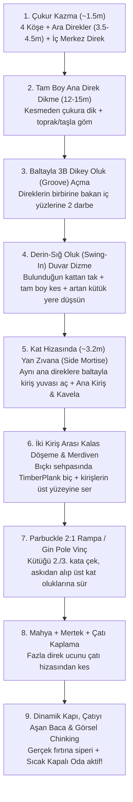

# DOK1 — Hedef ve Gereksinimler: Gerçekçi Sıfır İç İçe Geçmeli Çok Katlı Kütük Ev ve Fiziksel Marangozluk Sistemi

> **4'lü Dokümantasyon Seti Üst Bağlantıları:**
> - **[DOK1 — Hedef ve Gereksinimler (Bu Doküman)](file:///d:/oyun/docs/gercekci-cok-katli-kutuk-ev-ve-marangozluk/DOK1_HEDEF_VE_GEREKSINIMLER.md)**
> - **[DOK2 — Mevcut Kod Debug ve Akış Raporu (7 Kritik Uyuşmazlık Analizi)](file:///d:/oyun/docs/gercekci-cok-katli-kutuk-ev-ve-marangozluk/DOK2_MEVCUT_KOD_DEBUG_VE_AKIS_RAPORU.md)**
> - **[DOK3 — Endüstri, Gerçek İnşaat Mühendisliği ve Benzer Projeler Araştırması](file:///d:/oyun/docs/gercekci-cok-katli-kutuk-ev-ve-marangozluk/DOK3_ENDUSTRI_VE_BENZER_PROJELER_ARASTIRMASI.md)**
> - **[DOK4 — Adım Adım Geliştirme ve Canlı Doğrulama Planı](file:///d:/oyun/docs/gercekci-cok-katli-kutuk-ev-ve-marangozluk/DOK4_ADIM_ADIM_GELISTIRME_PLANI.md)**

---

## 1. Vizyon ve Temel Tasarım Yasaları (Biz Ne Yapmak İstiyoruz?)

Stratocraft'ta oyuncu ormanda gerçek bir ağacı baltayla devirip kendi elleriyle ister **küçük tek katlı bir avcı kulübesi**, ister **2–3 katlı büyük bir kütük konak** inşa ederken hiçbir adım yapay, büyüsel veya fizik dışı hissettirmemelidir.

### Değişmez 5 Altın Kural
1. **Sıfır İç İçe Geçme (*Zero-Clipping* Yasası):** İki dolu ahşap gövde birbirinin içinden **asla** hayalet gibi geçemez. Bir parça diğerine bağlanacaksa, taşıyıcı parçada baltayla **gerçek 3B oyuk / dikey oluk (*Groove*) / yan zıvana yuvası (*Side Mortise*)** açılmış olmalı ve giren parçanın ana gövdesi dış kabuğa sıfıra sıfır dayanıp yalnızca **inceltilmiş zıvana dili (*Tenon*)** oyuğun içine girmelidir.
2. **Sıfır Kütük İsrafı ve Gerçek Metre Cetveli:** `12.00 m` boyundaki bir ağaç `3.60 m` net açıklığa sahip iki oluklu direk arasına konduğunda, tam `3.60 m` parça kesilip kanala takılır; **artan `8.40 m` sağlam kütük santimi santimine korunarak hemen yanına yere düşer** (tek ağaçtan 3 sıra duvar çıkar).
3. **Ufacık İtem Taşı Üstüne Kütük Koyma Yasağı:** `[Q]` ile yere atılan avuç içi kadar `RoughStoneChunk` iteminin üstüne dev kütük konmaz. Temel ya doğrudan kazılmış `~1.5 m` derin çukura dikilip toprak/taşla sıkıştırılan **kesintisiz ana direklerdir**, ya düz topraktır, ya da `[C]` Madde Kristaliyle döşenen gerçek **`1×1 m` Taş Blok** subasmandır.
4. **Tam Boy Kesintisiz Ana Kolon (*Continuous Full-Height Post*):** 2–3 katlı binada oyuncu kestiği `12–15 m` dev ağacı boşuna `4.8 m` parçalara doğramak zorunda değildir; tam boy dikip gömdüğünde bu direk **1., 2. ve 3. katın tamamını tek parça taşıyan ana kolon** olur. Yatay duvar kütükleri 12 m tepeye çıkmadan, bulunduğun kattan **Derin-Sığ Oluk (*Swing-In Groove*)** hareketiyle yandan kanala takılır; üst kat kirişleri de aynı direğe kat hizasında açılan **Yan Kiriş Yuvası (*Side Mortise*)** ile bağlanır.
5. **Tek Birleşik Fizik Dünyası (`RigidTimber` Bütünlüğü):** Döşeme kalasları, kat merdivenleri, çatı mertekleri, kapı, kepenk, taş şömine bacası ve sıcak oda yalıtımı; oyuncunun serbest açıda ve serbest aralıkta diktiği gerçek kütük iskelete **milimetrik olarak** uyum sağlar (`90°` voksel gridine mahkûm edilmez).

---

## 2. Oyuncu Deneyimi: Baştan Sona İki Gerçekçi İnşa Yolu

### SEÇENEK A — Küçük Tek Katlı Direksiz Yığma Kulübe (*Saddle-Notch / Çantı*)
Hiç dikey direk dikmeden `4×4 m` veya `5×4 m` tek katlı kulübe yapmak isteyen oyuncu için:
1. **Taban Hazırlığı:** Düz toprak zemine veya `[C]` Madde Kristaliyle döşediği gerçek `1×1 m` taş blok subasman üstüne başlar.
2. **Taban Kütüklerini (*Sill Logs*) Yatırma:** Yerde baltayla (nişangâhtaki metre cetvelini görerek) istediği boyda kestiği ilk iki kütüğü arabayla/omuzda getirir; `[V]` Yatay modda (`[R]` `15°`, `[Shift+R]` `5°` hassas dönüşle) karşılıklı iki kenara `[Sol Tık]` ile paralel yatırır.
3. **3B Eyer Kertiği (*Saddle Notch*) Oyma:** `[1]` Balta ile yatan kütüklerin iki ucuna (`~30 cm` içeriden üst yüzeye) 2 kez vurur; kütük mesh'inde **gerçek 3B yarım daire oyuk** açılır.
4. **90° Çapraz Bindirme:** Diğer iki kenarın kütüğünü oyukların üstüne tuttuğunda önizleme `90°` dik açıyla oyuklara mıknatıslanır; `[Sol Tık]` ile kütük oyuğa yarı çapı kadar oturur, köşe uçları `30 cm` dışarı taşar (*Log Crown*), gövdeler iç içe geçmez.

### SEÇENEK B — Büyük ve Çok Katlı (2–3 Katlı) Dikmeli Kütük Ev (*Pièce-sur-Pièce*)

1. **Aşama 1 — Tam Boy Kesintisiz Ana Direkler:**
   - 4 köşeye, uzun duvarlarda her `3.5–4.5 m`'de bir ara noktalara (kapı için `~1.8–2.2 m` aralıklı iki direk) ve geniş evde (`> 5 m`) merkeze `~1.5 m` derin çukur kazılır.
   - `12–15 m` dev ağaç **hiç kesilmeden** çukura dikilir ve toprak/taşla gömülür (3 kat boyunca tek parça ana kolon).
2. **Aşama 2 — 3B Dikey Oluk (*Groove*) ve *Swing-In* Duvar Sürgüleme:**
   - Oyuncu `[1]` Balta ile direğin duvar öreceği yan yüzüne bakar (yüzeyde sarı kesim rehberi: *"Doğu Yüzü Dikey Oluk [0/2]"* görünür) ve **2 kez** vurur; direk mesh'inde aşağıdan yukarıya **`10 cm` derinliğinde gerçek 3B oyuk kanal** açılır.
   - Karşı direğin bakan yüzüne de oluk açıldıktan sonra kütük araya tutulduğunda:
     - **Oluk yoksa:** Kırmızı uyarı çıkar (*"⚠️ Önce iki direğin birbirine bakan yüzüne baltayla dikey oluk açın!"*), iç içe geçerek koyma **engellenir**.
     - **Oluklar açıksa:** Önizleme direkler hangi açıda olursa olsun (`0°..360°` serbest açı!) iki oluk arasına sıfıra sıfır kilitlenir, kaç metre kullanılacağını ve kaç metre artacağını yazar (`🪵 3.60m kullanılacak | 8.40m artacak`).
   - `[Sol Tık]` yapıldığında kütük 12 m tepeye çıkmadan **bulunduğun kattan önce derin oluğa girip karşı oluğa çevrilerek oturma (*Swing-In*) animasyonuyla** (`0.35 sn`) yerine kilitlenir; artan `8.40 m` kütük tam boyuyla (`float`) yanına yere düşer.
3. **Aşama 3 — Yan Zıvana (*Side Mortise*), Ana Kirişler, Döşeme ve Merdiven:**
   - Geçici Ahşap İskele (`[T] -> [7]`) ile `~3.2 m` yüksekliğe çıkılır; aynı ana direklerin (dış direkler + iç merkez direk) yan yüzüne baltayla 2 vuruşta **Yan Kiriş Yuvası (*Side Mortise / Ledger Notch*)** açılır.
   - Kütük kirişler iki direğin yan yuvaları arasına oturtulur ve `Dal / Kavela` ile `[E]` tuşuyla kilitlenir.
   - Bıçkı Sehpasında biçilen `TimberPlank` kalaslar elde tutulurken iki paralel kirişin arasına bakıp `[Sol Tık]` yapıldığında, **tam o iki kirişin açıklığında ve açısında** yürünebilir kat döşemesi kirişlerin **üst yüzeyine** serilir; bırakılan merdiven boşluğuna çıkılabilir ahşap kat merdiveni takılır.
4. **Aşama 4 — Üst Kat Lojistiği (3 Kaynaklı Kütük Beslemesi):**
   - Kütük yerleştirme önizlemesi **1) Kütük El Arabası**, **2) Omuzda Taşınan Kütük (`<= 4.0 m`)** ve **3) Parbuckle Rampa / Gin Pole Vinç Tepesinde Mandallı Bekleyen Kütük** kaynaklarının üçünden de çalışır.
   - Oyuncu 2. veya 3. kat döşemesindeyken rampanın/vincin tepesine çektiği kütüğü doğrudan iki üst kat oluğunun arasına `[Sol Tık]` ile takar; artan parça üst kat döşemesinin üstüne düşer!
5. **Aşama 5 — Çatı Makası, Dinamik Kapı/Baca ve Gerçek Sıcak Oda:**
   - En üst katta orta direk/kiriş üstüne **Mahya Kirişi (*Ridge Beam*)**, mahyadan dış kirişlere **Kuş Ağzı Kertikli (*Birdsmouth*) Eğimli Mertekler (*Rafters*)** ve mertek üstüne **Çatı Kalasları** döşenir; çatıdan fazla taşan direk uçları baltayla çatı hizasından kesilir.
   - **Menteşeli Kapı** iki kapı direğinin net iç açıklığına (`1.4 m – 2.4 m`) otomatik genişler; **Pencere Kepengi** pencere boşluğuna ve üst katlara takılabilir; **Taş Şömine Bacası** üstteki çatıyı algılayıp çatının `0.6 m` üstüne kadar uzar; **Kil/Lif Chinking** kütük birleşimlerinde gerçek açık renk harç şeridi oluşturur ve ev kapandığında fırtına rüzgârını kesip karakterin gerçek vücut ısısını korur.

---

## 3. İş Paketleri ve Kabul Kriterleri

| İş Paketi | Kapsam Özeti | Kabul Kriteri (Test Ölçütü) |
| :--- | :--- | :--- |
| **İP-1: Birleşik Raycast & Küsuratlı Kütük** | `RigidTimber` OBB raycast + metre cetveli + `float` kütük boyu koruma | Direğin `3.2m` yüksekliğine bakınca nişangâh arkadaki dağı değil direği vurur; `12.00m - 3.60m = 8.40m` sıfır kayıpla yere düşer. |
| **İP-2: Gerçek 3B Oluk, Eyer Kertiği & Yan Zıvana** | Balta ile direklerde 4 yönlü 3B oluk (*Groove*), yan zıvana (*Mortise*) ve yatan kütükte 3B *Saddle Notch* mesh üretimi | Oluk açılmamış iki direk arasına kütük konamaz; 2 balta darbesiyle direk mesh'inde gerçek girintili kanal oluşur. |
| **İP-3: Sıfır İç İçe Geçmeli *Swing-In* Duvar & Statik Onarım** | Serbest açıda oluktan oluğa sıfır iç içe geçmeli duvar + 2-3 direkli inşaat yıkılma hatasının giderilmesi | Herhangi bir açıda (`17°`, `63°` vb.) iki oluklu direk arasına 10 sıra duvar dizildiğinde iç içe geçme `0 mm`, kendi kendine yıkılma `0`. |
| **İP-4: 3-Kaynaklı Üst Kat Lojistiği & Kalas Döşeme/Merdiven/Çatı** | Araba + Omuz + Rampa/Vinç askısı; kiriş üstü `RigidTimber` döşeme, merdiven ve mertekli çatı | Oyuncu el arabasını 2. kata çıkarmadan Parbuckle/GinPole ile çektiği kütükle 2. ve 3. kat duvar + döşeme + çatısını tamamlar. |
| **İP-5: Dinamik Kapı, Baca, Görsel *Chinking* & Gerçek Termal Oda** | Direk açıklığına uyan kapı, üst kat eşya kurulumu, çatı üstü baca, görsel derz harcı ve `ThermalAndBiologySystem` bağlantısı | Kapalı + sıvalı + şömineli evde fırtına itmesi `0 N`, iç ortam sıcaklığı gerçek karakter ısısını yükseltir. |

### Performans ve Kalite Bütçeleri (Zorunlu)
- **Kaplama VRAM Bütçesi:** `0` yeni disk dokusu (tamamı prosedürel tepe rengi + `StratocraftUberShader`, toplam `< 16.0 MB`).
- **GC Tahsisi:** Kararlı durumda `0 B/kare` (mesh güncellemeleri yalnızca balta/inşa olay anında `_meshScratch` tamponunu yeniden kullanır).
- **Derleme ve Akışkan Koruması:** `0 Error / 0 Warning`; dondurulmuş 4 su dosyasında `0` satır fark.
