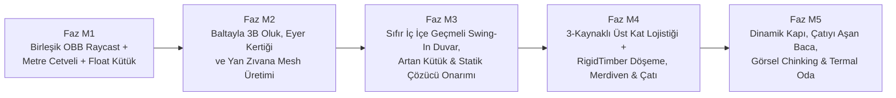

# DOK4 — Adım Adım Geliştirme ve Canlı Doğrulama Planı

> **4'lü Dokümantasyon Seti Üst Bağlantıları:**
> - **[DOK1 — Hedef ve Gereksinimler](file:///d:/oyun/docs/gercekci-cok-katli-kutuk-ev-ve-marangozluk/DOK1_HEDEF_VE_GEREKSINIMLER.md)**
> - **[DOK2 — Mevcut Kod Debug ve Akış Raporu (7 Kritik Uyuşmazlık Analizi)](file:///d:/oyun/docs/gercekci-cok-katli-kutuk-ev-ve-marangozluk/DOK2_MEVCUT_KOD_DEBUG_VE_AKIS_RAPORU.md)**
> - **[DOK3 — Endüstri, Gerçek İnşaat Mühendisliği ve Benzer Projeler Araştırması](file:///d:/oyun/docs/gercekci-cok-katli-kutuk-ev-ve-marangozluk/DOK3_ENDUSTRI_VE_BENZER_PROJELER_ARASTIRMASI.md)**
> - **[DOK4 — Adım Adım Geliştirme ve Canlı Doğrulama Planı (Bu Doküman)](file:///d:/oyun/docs/gercekci-cok-katli-kutuk-ev-ve-marangozluk/DOK4_ADIM_ADIM_GELISTIRME_PLANI.md)**

---

## 1. Faz Sırası ve Bağımlılık Diyagramı

[DOK2](file:///d:/oyun/docs/gercekci-cok-katli-kutuk-ev-ve-marangozluk/DOK2_MEVCUT_KOD_DEBUG_VE_AKIS_RAPORU.md) içindeki **7 kod uyuşmazlığını** ve [DOK1](file:///d:/oyun/docs/gercekci-cok-katli-kutuk-ev-ve-marangozluk/DOK1_HEDEF_VE_GEREKSINIMLER.md) içindeki **Seçenek A + Seçenek B** gereksinimlerini hiçbir regresyon üretmeden devreye almak için geliştirme 5 sıralı fazda yürütülecektir:



---

## 2. Faz Bazlı Teknik Uygulama Detayları (Değişecek Dosyalar, Veri Yapıları ve İmzalar)

### FAZ M1 — Birleşik Nişangâh Raycast, Kesim Metre Cetveli ve `float` Kütük Boyu Koruma
*(Çözülen Uyuşmazlıklar: [DOK2 Uyuşmazlık 3](file:///d:/oyun/docs/gercekci-cok-katli-kutuk-ev-ve-marangozluk/DOK2_MEVCUT_KOD_DEBUG_VE_AKIS_RAPORU.md#uyuşmazlık-3--rigidtimber-görsellerinde-collider-yok--miningctrlaimhit-direkleri-iskalar) ve [DOK2 Uyuşmazlık 4](file:///d:/oyun/docs/gercekci-cok-katli-kutuk-ev-ve-marangozluk/DOK2_MEVCUT_KOD_DEBUG_VE_AKIS_RAPORU.md#uyuşmazlık-4--kütük-el-arabası-ve-yerdeki-devrik-ağaçlarda-int-tam-metre-yuvarlaması))*

- **Değişecek Dosyalar:**
  - [Stage1RigidTimberBridge.cs](file:///d:/oyun/Assets/_Stratocraft/Character/Stage1RigidTimberBridge.cs)
  - [Stage1StructuralCollapseBridge.cs](file:///d:/oyun/Assets/_Stratocraft/Character/Stage1StructuralCollapseBridge.cs)
  - [Stage1LogArchCartController.cs](file:///d:/oyun/Assets/_Stratocraft/Character/Stage1LogArchCartController.cs)
  - [Stage1TimberPlacementPreviewController.cs](file:///d:/oyun/Assets/_Stratocraft/Character/Stage1TimberPlacementPreviewController.cs)
- **Eklenecek / Güncellenecek Veri Yapıları ve İmzalar:**
  1. `Stage1RigidTimberBridge.TryRaycastAnyPiece(Vector3 rayOrigin, Vector3 rayDir, float maxDist, out int pieceIdx, out Vector3 hitWorldPoint, out Vector3 hitWorldNormal, out float hitDist)`:
     - Mevcut `TryRaycastPieceObb` metodunu yüzey normali ve tam dünya temas noktasıyla genişletir.
     - `StepPreviewAndPlacement` içinde `voxelHitDist` ile `timberHitDist` karşılaştırılarak hangisi daha yakınsa o nokta seçilir (artık direğin `3.2 m` yüksekliğine bakınca ışın direğin yüzeyini yakalar!).
  2. **Yerdeki Ağaç Kesim Metre Cetveli:**
     - Oyuncu elinde Balta varken yerdeki `FallenTreeLogInstance` veya `RigidStructurePiece` gövdesine baktığında HUD alt ipucunda kesim noktasının iki uca olan gerçek mesafesi gösterilir: `📏 Kesim: Sol 4.20m | Sağ 7.80m (Toplam 12.00m)`.
  3. **Tam `float` Kütük Boyu:**
     - `FallenTreeLogInstance` içine `public float ExactLengthMeters;` eklenir (`SpawnExactLengthFallenLog(Vector3 center, Vector3 dirXZ, byte woodMat, float exactLengthM, float diameterM)`).
     - `LogArchCartRuntime` içinde `BoundExactLengthM` (`float`) saklanır; arabadan indirirken veya kesimden artan parçayı düşürürken tam `float` metre (`12.00f - 3.56f = 8.44f`) korunur.

---

### FAZ M2 — Baltayla Gerçek 3B Dikey Oluk (*Groove*), Eyer Kertiği (*Saddle Notch*) ve Yan Kiriş Yuvası (*Side Mortise*)
*(Çözülen Sorun: [DOK2 Kök Neden 0](file:///d:/oyun/docs/gercekci-cok-katli-kutuk-ev-ve-marangozluk/DOK2_MEVCUT_KOD_DEBUG_VE_AKIS_RAPORU.md#kök-neden-0--iç-içe-geçme-clipping-ve-düz-silindir-geometrisi) & [DOK1 Seçenek A + B](file:///d:/oyun/docs/gercekci-cok-katli-kutuk-ev-ve-marangozluk/DOK1_HEDEF_VE_GEREKSINIMLER.md))*

- **Değişecek Dosyalar:**
  - [RigidTimberTypes.cs](file:///d:/oyun/Assets/_Stratocraft/Physics/RigidTimber/RigidTimberTypes.cs)
  - [ReducedAemBondEvaluator.cs](file:///d:/oyun/Assets/_Stratocraft/Physics/RigidTimber/ReducedAemBondEvaluator.cs)
  - [Stage1RigidTimberBridge.cs](file:///d:/oyun/Assets/_Stratocraft/Character/Stage1RigidTimberBridge.cs)
- **Eklenecek Veri Yapıları:**
  - `TimberJoineryKind` enumuna `GroovedChannel = 5` ve `SideMortisePegged = 6` eklenir (yüksek kesme ve yanal çekme dayanımı ile).
  - Her parça için 0-GC paralel dizi `PostCarpentryProfile[] _carpentryProfiles`:
    ```csharp
    public struct PieceCarpentryProfile
    {
        public byte GrooveSectorMask;       // 8 sekizgen yuzey dilimi (45° adimli 0..7 yonlerinde acilmis dikey oluk bit-maskesi!)
        public byte GrooveHitProgress0;     // Vurulan yuzeyde 1/2 -> 2/2 oluk acilma sayaci
        public byte LastHitSector;
        public byte EndSaddleNotchMask;     // Yatay kutukte bit0: -Y ucu Eyer Kertigi, bit1: +Y ucu Eyer Kertigi (Mod A Canti!)
        public byte SideMortiseCount;       // Direkte acilmis kat kirisi yan zivana yuvasi sayisi (maks 4)
        public float MortiseHeightLocalY0, MortiseHeightLocalY1, MortiseHeightLocalY2, MortiseHeightLocalY3;
        public byte MortiseSector0, MortiseSector1, MortiseSector2, MortiseSector3;
        public byte ChinkedSeamMask;        // Derz yalitimi (Chinking) uygulanmis mi?
    }
    ```
  - **Neden 8 Sekizgen Dilim (`GrooveSectorMask`, `45°` yerine sürekli açı toleranslı)?**
    - Direk zaten 8 yüzeyli prizmadır (`EmitLogPrism`, her yüzey `45°` genişlikte ve `±24°` açı toleransıyla her yönü kapsar!). Oyuncu direğin hangi yanına bakıp baltayla **2 kez** vurursa o sekizgen yüzey dilimi `10 cm` içeri doğru **gerçek 3B girintili U-kanal (iç yan duvarları açık odun rengi `WoodPlank`, dış kabuğu `OakWood`)** olarak yeniden mesh'lenir!
    - Oyuncu direğin `>= 1.8 m` yüksekliğinde bir noktasına **`[Sol Alt]` basılı tutarak** (veya nişangâh mod seçimiyle: normal vuruş = Dikey Oluk, yüksekte kiriş hizası `[V]` / `Shift` vuruşu = Yan Kiriş Zıvanası) baltayla 2 kez vurduğunda o yükseklikte **gerçek 3B Kiriş Omuz Yuvası (*Side Mortise*)** oyulur!
    - Yatay yatan taban/duvar kütüğünün (`RigidTimberPieceKind.Log`) uç `0.45 m` bölgesinin üst yüzüne baltayla 2 kez vurulduğunda (Mod A Çantı için) `EndSaddleNotchMask` set edilir ve kütük ucunda **gerçek 3B yarım daire Eyer Kertiği** oyulur!

---

### FAZ M3 — Sıfır İç İçe Geçmeli *Swing-In* Duvar Sürgüleme, Artan Kütük Düşürme ve Statik Çözücü Onarımı
*(Çözülen Uyuşmazlıklar: [DOK2 Uyuşmazlık 2](file:///d:/oyun/docs/gercekci-cok-katli-kutuk-ev-ve-marangozluk/DOK2_MEVCUT_KOD_DEBUG_VE_AKIS_RAPORU.md#uyuşmazlık-2--timberstaticequilibriumsolver-i̇çindeki-anchoredpostcount--3-erken-yıkım-hatası), Serbest `[R]` Dönüşü, Oluk Zorunluluğu ve Mod A + Mod B Duvar Dizimi)*

- **Değişecek Dosyalar:**
  - [TimberStaticEquilibriumSolver.cs](file:///d:/oyun/Assets/_Stratocraft/Physics/RigidTimber/TimberStaticEquilibriumSolver.cs)
  - [Stage1RigidTimberBridge.cs](file:///d:/oyun/Assets/_Stratocraft/Character/Stage1RigidTimberBridge.cs)
  - [Stage1TimberPlacementPreviewController.cs](file:///d:/oyun/Assets/_Stratocraft/Character/Stage1TimberPlacementPreviewController.cs)
- **Uygulama Adımları:**
  1. **Statik Çözücü Erken Yıkım Onarımı (`TimberStaticEquilibriumSolver.cs:187`):**
     - `anchoredPostCount <= 3` yapay yıkım bloğu kaldırılıp yerine **gerçek destek çokgeni / kırılan bağ kontrolü** konur: İki sağlam gömülü direk arasındaki `GroovedChannel` duvar kütüklerinin ağırlık merkezi iki direğin doğru parçası üzerinde (`perpEccentricity <= postDiameter`) olduğu sürece yapı **%100 dengededir**; ancak direklerden biri baltayla kesildiğinde veya toprağı kazıldığında karşı uç konsol kalıp anında devrilir!
  2. **Oluk Doğrulamalı Sıfır İç İçe Geçme Hesabı (`TryEvaluateInfillBetweenPosts`):**
     - İki direk ($A, B$) arasındaki yön vektörü $\hat{u} = \text{normalize}(P_B - P_A)$ için:
       - Direk $A$'da $+\hat{u}$ yönüne bakan dilimde (`±35°`) oluk açık mı? Direk $B$'de $-\hat{u}$ yönüne bakan dilimde oluk açık mı?
       - **Açık değilse:** Hayalet önizleme **kırmızı** gösterilir, HUD'da *"⚠️ Önce iki direğin birbirine bakan iç yüzüne Baltayla (2 vuruş) dikey oluk açın!"* yazar ve `[Sol Tık]` iç içe geçerek yerleştirmeyi **reddeder**.
       - **İkisi de açıksa:**
         - Net gövde boyu $L_{\text{clear}} = \|P_B - P_A\|_{XZ} - (R_A + R_B)$ hesaplanır; mesh'in iki ucuna yalnız oluk içine giren inceltilmiş `8 cm` zıvana dilleri (`EmitTenonEnds`) üretilir (ana gövde direk kabuğuna sıfıra sıfır oturur, **clipping = 0.0 mm**!).
         - Üst üste sıra yüksekliği alt sıranın düzleştirilmiş üst yüzeyine tam teğet (`prevCenterY + (prevDiam + curDiam) * 0.46f`) hesaplanır.
         - Eldeki kütük boyu $L_{\text{held}} < L_{\text{clear}} + 0.12\,\text{m}$ ise *"⚠️ Bu kütük iki direk açıklığına (X.XX m) kısa geliyor!"* uyarısı verir (lastik gibi sündürmez!).
         - $L_{\text{held}} \ge L_{\text{clear}} + 0.12\,\text{m}$ ise `[Sol Tık]` anında `0.35 sn` **Derin-Sığ Oluk *Swing-In*** animasyonuyla takılır; kalan $L_{\text{rem}} = L_{\text{held}} - (L_{\text{clear}} + 0.12\,\text{m})$ eğer $\ge 0.80\,\text{m}$ ise tam boyuyla (`SpawnExactLengthFallenLog`) oyuncunun yanına yere bırakılır (`< 0.80 m` talaş/parça ise `SplitFirewood` verir).
  3. **Mod A (Direksiz Yığma Çantı) Yakalaması + Hassas `[R]`:**
     - Serbest yatay koymada `[R]` `15°`, `[Shift+R]` `5°` döndürür.
     - Yakında uçlarında `EndSaddleNotchMask` açılmış yatay kütükler varsa, önizleme o yarım ay oyukların üstüne `90°` dik açıyla mıknatıslanır ve uçları köşeden `0.30 m` dışarı taşacak şekilde oyuğa oturur.

---

### FAZ M4 — 3-Kaynaklı Üst Kat Lojistiği + Yan Zıvanalı Kiriş + `RigidTimber` Kalas Döşeme, Merdiven ve Çatı
*(Çözülen Uyuşmazlıklar: [DOK2 Uyuşmazlık 1](file:///d:/oyun/docs/gercekci-cok-katli-kutuk-ev-ve-marangozluk/DOK2_MEVCUT_KOD_DEBUG_VE_AKIS_RAPORU.md#uyuşmazlık-1--t---3-worldloosebuildsystem-i̇le-stage1rigidtimberbridge-i̇ki-kopuk-sistemdir) ve [DOK2 Uyuşmazlık 5](file:///d:/oyun/docs/gercekci-cok-katli-kutuk-ev-ve-marangozluk/DOK2_MEVCUT_KOD_DEBUG_VE_AKIS_RAPORU.md#uyuşmazlık-5--yerleştirme-önizlemesinin-sadece-el-arabasına-bağlı-olması-üst-kat-çıkmazı))*

- **Değişecek Dosyalar:**
  - [Stage1TimberSiteRigController.cs](file:///d:/oyun/Assets/_Stratocraft/Character/Stage1TimberSiteRigController.cs)
  - [Stage1HolsterAndBackpackController.cs](file:///d:/oyun/Assets/_Stratocraft/Character/Stage1HolsterAndBackpackController.cs)
  - [Stage1TimberPlacementPreviewController.cs](file:///d:/oyun/Assets/_Stratocraft/Character/Stage1TimberPlacementPreviewController.cs)
  - [Stage1RigidTimberBridge.cs](file:///d:/oyun/Assets/_Stratocraft/Character/Stage1RigidTimberBridge.cs)
- **Uygulama Adımları:**
  1. **3-Kaynaklı Kütük Havuzu (`TryPeekAvailableLogSource` / `TryConsumeAvailableLogSource`):**
     - Öncelik 1: Oyuncu el arabası çekiyorsa arabadaki kütük,
     - Öncelik 2: Oyuncu omuzda kısa kütük taşıyorsa (`IsCarryingShoulderLog`, `ShoulderLogExactLengthM` eklenir, `<= 4.5 m` kesilmiş kütükler `[E]` ile omuza alınıp merdivenden 2./3. kata çıkarılabilir!),
     - Öncelik 3: Oyuncunun `12 m` yakınında tepesinde kütük bekleyen (`HoistState.IsCompleted != 0`) bir **Parbuckle Rampa** veya **Gin Pole Vinç** varsa oradaki kütük! (Rampa tamamlandığında kütüğü rastgele fırlatmaz; tepede mandallı bekletir, oyuncu üst katta iki oluk veya iki yan zıvana arasına `[Sol Tık]` yaptığında oradan tüketir; artan kütük de oyuncunun durduğu üst kat döşemesinin üstüne düşer!).
  2. **Yan Zıvanalı Ana Kiriş (*Main Girder*) ve Kavela Kilidi:**
     - İki direkte aynı kat hizasında (`|yA - yB| <= 0.45 m`) `SideMortise` açılmışsa ve oyuncu o yüksekliğe nişan alırsa, kütük `RigidTimberPieceKind.Beam` (veya çatı hizasında `TieBeam / RidgeBeam`) olarak tam iki yan yuvanın omuz basamağına oturur. Elinde `Stick` (Dal/Kavela) ile `[E]` basıldığında `SideMortisePegged` olarak kavelalanır.
  3. **`RigidTimber` Üstü Kalas Döşeme, Merdiven ve Eğimli Çatı (`TimberPlank` El Önizlemesi):**
     - Oyuncu Bıçkı Sehpasında biçtiği **`TimberPlank` (Ahşap Kalas)** slotunu eline aldığında (`[V]` ile `1: Kat Döşemesi` -> `2: Çıkılabilir Kat Merdiveni` -> `3: Eğimli Çatı Merteği/Kaplaması` arasında geçiş yapar!):
       - **Mod 1 (Kat Döşemesi):** İki paralel yatay kirişin (`Beam`) arasına baktığında, tam iki kirişin açıklığını ve açısını kaplayan yürünebilir `Plank` tabliyesi kirişlerin **tam üst yüzeyine** (`beamTopY + plankHalfThickness`) sıfır iç içe geçmeyle oturur (`1–2x TimberPlank` tüketir; merdiven çıkışı bırakmak istediği açıklığı boş bırakır!).
       - **Mod 2 (Kat Merdiveni):** Alt döşeme/zemin ile üst kiriş kenarı arasına otomatik basamak dizisi (`10` basamaklı yürünebilir merdiven) kurar.
       - **Mod 3 (Çatı Merteği & Kaplaması):** Üst duvar kirişi ile Mahya Kirişi (`RidgeBeam`) arasına Kuş Ağzı kertikli eğimli `Rafter` ve üstüne `TimberShingleRoof` kaplama paneli oturtur.

---

### FAZ M5 — Dinamik Kapı, Üst Kat Eşya Desteği, Çatıyı Aşan Baca, Görsel *Chinking* ve Gerçek Termal Oda
*(Çözülen Uyuşmazlıklar: [DOK2 Uyuşmazlık 6](file:///d:/oyun/docs/gercekci-cok-katli-kutuk-ev-ve-marangozluk/DOK2_MEVCUT_KOD_DEBUG_VE_AKIS_RAPORU.md#uyuşmazlık-6--t---7-zemin-kilidi-sabit-190-m-kapı-ve-sabit-boylu-şömine-bacası) ve [DOK2 Uyuşmazlık 7](file:///d:/oyun/docs/gercekci-cok-katli-kutuk-ev-ve-marangozluk/DOK2_MEVCUT_KOD_DEBUG_VE_AKIS_RAPORU.md#uyuşmazlık-7--sahte-termal-oda-sayıları-ve-karakter-biyolojisi-kopukluğu))*

- **Değişecek Dosyalar:**
  - [Stage1TimberInteriorController.cs](file:///d:/oyun/Assets/_Stratocraft/Character/Stage1TimberInteriorController.cs)
  - [Stage1TimberPlacementPreviewController.cs](file:///d:/oyun/Assets/_Stratocraft/Character/Stage1TimberPlacementPreviewController.cs)
  - [Stage1WorldLooseBuildController.cs](file:///d:/oyun/Assets/_Stratocraft/Character/Stage1WorldLooseBuildController.cs)
  - [Stage1InteractivePlayController.cs](file:///d:/oyun/Assets/_Stratocraft/Character/Stage1InteractivePlayController.cs)
- **Uygulama Adımları:**
  1. **Ahşap Döşeme Üstü Kurulum & Pencere Mıknatıslanması:**
     - `[T] -> [7]` plan yüksekliği ve `[Q]` ile bırakılan kurulum malzemeleri `Stage1RigidTimberBridge.TrySampleSupportingFloorTopY(x, z, refY)` ile 2. ve 3. kat ahşap döşemelerinin üstünde durur. `WindowShutter` (Pencere Kepengi) ise pencere alt kütüğünün üst yüzeyine mıknatıslanır.
  2. **Dinamik Genişlikli Menteşeli Kapı (`1.35 m – 2.45 m`):**
     - Kapı kurulurken yanındaki iki dikey direğin net iç yüzey açıklığını ölçer; hem kapı kanadı mesh'ini hem de `ResolvePlayerDoorCollision` genişliğini tam o açıklığa ölçekler (0 boşluk, 0 iç içe geçme).
  3. **Çatıyı Otomatik Aşan Taş Baca:**
     - `StoneFireplaceWithChimney` kurulurken `(x, z)` dikey hattındaki en yüksek `RigidTimber` çatı parçasını bulur ve taş bacayı `roofTopY + 0.65f` yüksekliğine kadar örer.
  4. **Görsel *Chinking* Şeridi ve Gerçek Karakter Isı/Rüzgâr Koruması:**
     - Duvar kütüğüne Kil/Lif ile `[E]` uygulandığında kütük mesh'inin alt/üst temas derzine açık krem/kil rengi **gerçek 3B harç şeridi** eklenir (`ChinkedSeamMask = 1`).
     - `EvaluatePlayerCabinShelter(Vector3 playerPos)` oyuncunun 4 yönünde gerçek `RigidTimber` duvar + üstünde `Plank/Rafter` çatı olup olmadığını kontrol eder; kapalı evin içindeyken `_currentPlayerWindDragForceN = Vector3.zero` olur ve yanan şömine + derz sızdırmazlığı `_ambientTempCelsius` değerini gerçek zamanlı yükseltir!

---

## 3. Her Faz Sonunda Zorunlu Doğrulama Protokolü

Hiçbir faz kullanıcıya "dene" denmeden önce aşağıdaki 3 otomatik kontrolden geçmeden teslim edilmeyecektir:
1. **Derleme Kontrolü:** Temiz `Play Mode Stop -> script_recompile -> console_get` ile `0 Error / 0 Warning` ve dondurulmuş 4 akışkan dosyasında `0 diff`.
2. **Birim & Fizik Testleri:** Oluk kontrolü, sıfır iç içe geçme boy hesabı (`L_clear`), artan `float` kütük korunumu ve 2–3 direkli duvar statik dengesi için regresyon testleri.
3. **Canlı Unity Play Mode Kanıtı (`script_eval` + `capture_game_view`):**
   - Açık Unity Editöründe Play Mode başlatılıp senaryo bizzat kodla simüle edilerek (2 direk dikme -> oluksuz koymanın reddedilmesi -> baltayla 3B oluk açma -> `12m` kütükten iki direk arasına sürme ve artan kütüğün tam boy düşmesi -> 2. sıra üst üste oturma -> yan zıvana + kiriş + döşeme) hem sayısal koordinatlarla (`clipping == 0.00m`) hem de ekran görüntüsüyle doğrulandıktan sonra kullanıcıya sunulacaktır.
