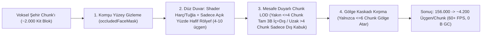

# DEVIR #087 — 10 PlayTest Sorunu: Voxel 3B Mimari, Şehircilik, Ufuk LOD ve 60+ FPS Düzeltme Dokümanı

> **Tarih / Sürüm:** `Devir #087` Mimari & Performans İyileştirme Spesifikasyonu (Baz Commit: `8201b8a`)
> **Kapsam:** `Devir #086` PlayTest ekran görüntülerinde (`Fotoğraf 1 .. 10`) tespit edilen ve doğrulanan **10 temel görsel, mimari, şehircilik, ufuk (LOD) ve performans (`5 FPS -> 60+ FPS`) sorununun** kök neden analizi ve sıfır tavizli mühendislik çözüm tasarımı.
> **Değişmez Kısıtlar:**
> - **%100 Voxel + Gerçek 3B Şekiller:** Tüm binalar, çatılar, kapılar, pencereler, sokaklar, surlar ve iç eşyalar tekil chunk voksel verisi içinde kalacak, kırılınca domino fiziğiyle (`StructuralCollapseSystem`) çökecek ve küp görünümü yerine gerçek 3B mimari formlara sahip olacaktır.
> - **Performans Bütçesi:** Kuzey Metropolü (`48×48` chunk) dahil yoğun şehir içinde **`60+ FPS`** (`< 16.6 ms` kare süresi), Kaplama VRAM **`< 16.0 MB`**, Oyun RAM **`< 2.500 MB`**, Duragan Kare Başı GC Alloc **`0 B/kare`**, Derleme **`0 Error / 0 Warning`**.
> - **Donmuş Akışkan Dosyaları (`0` Fark Zorunlu):** `FluidSurfaceSkirtMesher.cs`, `FluidCellularAutomataJob.cs`, `StratocraftFluidSurface.shader`, `FluidSimulationSystem.cs` kesinlikle değiştirilmeyecektir.

---

## 1. Tespit Edilen 10 Sorunun Envanteri ve Olması Gereken Hedef Standart

> **Önemli Biyom Notu (`S-06`):** `Fotoğraf 8, 9 ve 10`’da Kuzey Metropolü zemininde görülen açık camgöbeği/turkuaz renk bir su taşkını değil, **Biyom 5 (`Kristal Kanyon ve Kuvars Vadisi`)** biyomunun doğal zemin rengidir. Oradaki gerçek hata biyom rengi değil; koca metropol şehrinin binalarının hiçbir **taş cadde, kaldırım, bordür, meydan, sokak lambası ve bina önü bağlantı yolu** olmadan doğrudan ham biyom toprağının üstüne rastgele bırakılmış olmasıdır.

| Kod | Sorun Başlığı | Görsel Kanıt | Mevcut Hatalı Görünüm | Olması Gereken Hedef Standart |
| :--- | :--- | :--- | :--- | :--- |
| **S-01** | **Kapı Kanatları Boşlukta "Turnike" Gibi Duruyor ve Dikeyde 3 Cüce Kapısı Üst Üste Binmiş** | `Foto 3`, `Foto 6` | Açık kapı kanatları sağ/sol söveye yaslanmak yerine `4m`’lik dev deliğin ortasında paralel iki tahta perde gibi havada duruyor; düşeyde `dy = 1, 2, 3` boyunca aynı kapı şablonu 3 kez tekrarlandığı için 6 menteşe ve 3 Z-kuşak üst üste görünüyor. | Net giriş açıklığı `2.0m × 2.2m` insan ölçeğinde olmalı; yan söveler kapı açıklığına sıfır boşlukla bitişmeli, açık kanatlar `90°` dönerek yan duvarlara tam yapışmalı; düşeyde **Alt Kanat + Üst Kanat** tek parça bütünleşik kapı oluşturmalı, `dy = 3`’te kemerli/camlı kapı üstü vasistas (transom) yer almalıdır. |
| **S-02** | **Pencereler Ortadan İkiye Bölünmüş, İçeride Kaba Beyaz Çerçeve Çıkıntısı Var ve Camdan Dışarısı Görünmüyor** | `Foto 3`, `Foto 5`, `Foto 6`, `Foto 8`, `Foto 10` | `dy = 2` ve `dy = 3` bloklarına aynı pencere kiti basıldığı için ortada kalın taş denizlik tekrarlanıyor (2 küçük pencere üst üste binmiş gibi); oda içinden bakınca (`Foto 6`) beyaz çerçeve `15–20 cm` kaba şekilde tuğla duvardan fırlıyor ve mat mavi-gri cam yüzünden dışarısı hiç görünmüyor. | `dy = 2` (**Alt Denizlikli Pencere**) + `dy = 3` (**Üst Kemerli/Lentolu Pencere**) birleşerek ortasında taş denizlik olmayan **tek parça zarif `1×2m` pencere** oluşturmalı; iç çerçeve duvar yüzeyiyle hemzemin (flush) olmalı; ince kurşun/ahşap kayıtların arası **gerçekten açık/saydam** bırakılarak içeriden sokak ve manzara net görünmelidir. |
| **S-03** | **Kütük Evler Sarı/Düz Görünüyor, Çatı Alınlıkları (Gable) Merdiven Basamaklı, Yan Saçak Yok ve Geniş Çatılar Tepeden Düz Kesilmiş** | `Foto 1`, `Foto 2`, `Foto 3`, `Foto 5`, `Foto 10` | Güney Köyü kütük evleri koyu kabuklu yuvarlak tomruk yerine soluk sarı saman/sıva renginde görünüyor; çatı yan duvarları üçgen yerine tırtıklı küp merdiven gibi çıkıyor; kalkan duvar yönünde (`±X`) hiç saçak taşması yok; geniş binalarda (`Foto 10` sol) çatı tepesi düz masa gibi kesilmiş. | Kütük evlerde koyu kahve yuvarlak tomruklar (`ChinkedLogBlock`) derzden belirgin şekilde dışarı taşmalı ve kalkan duvar tepeye kadar gerçek yatay tomruk olmalı; kalkan duvarlar `45°` pürüzsüz eğimli kesilmeli; çatılar **4 yönden (`±X` alın tahtası + `±Z` mertek saçak)** dışarı taşmalı ve `maxRise` tavan sınırı kaldırılarak her çatı tam mahya sırtında birleşmelidir. |
| **S-04** | **Kuzey Metropolünde Ağır Performans Çöküşü (`5 FPS`)** | `Foto 9` (`5 FPS \| Chunk: 546/612`) | Kuzey Şehri içinde FPS **`5 FPS`**’e düşüyor; sahnede aynı anda `612` chunk yüklü, `546` chunk çiziliyor ve her `1m` duvar/çatı bloğu komşu yüzey gizlemesi olmadan `60–110` üçgen üretiyor (`~54 Milyon` sahne üçgeni + 4 gölge kaskadı!). | Komşu yüzey gizleme (`occludedFaceMask`), düz duvarlarda shader kabartması + siluet elemanlarında 3B geometri ayrımı, uzak chunk’larda (`> 4` chunk) iç mekan/mobilya üçgeni elenmesi ve gölge mesafesi optimizasyonu ile Kuzey Şehri içinde **sabit `60+ FPS`** sağlanmalıdır. |
| **S-05** | **Uzaktan Şehir Görünümünde Dev Gri-Kahve Tabla, Kahverengi Kutu Vekiller ve Gökyüzünde Yüzen Yüzlerce Siyah Nokta** | `Foto 7` | Şehre ~`150m` uzaktan bakınca zeminde dev düz gri-kahve bir tabla, üstünde dokusuz kahverengi Monopoly kutuları ve ufkun arkasında havada asılı yüzlerce siyah üçgen nokta görünüyor. | Ufuk vekilleri `_UsePaletteLUT = 1` uyumlu gerçek palet kimlikleriyle (`MaterialID` + `Shade` + `AO`) kodlanmalı; altında arazi veya `DistantHorizon` kabuğu bulunmayan hiçbir uzak siluet/ağaç çizilmemeli; `DistantHorizon` şehir kuşağında cadde/çatı/biyom kırılımı doğal görünmelidir. |
| **S-06** | **Şehir ve Kasaba İçinde Taş Sokak, Kaldırım, Bordür, Meydan ve Sokak Mobilyası Eksikliği** | `Foto 4`, `Foto 5`, `Foto 8`, `Foto 9`, `Foto 10` | Binalar Biyom 5’in doğal turkuaz zemini veya kasaba çimi üzerine doğrudan oturuyor; aralarında kesintisiz taş döşeli caddeler, yükseltilmiş kaldırımlar, meydan çeşmesi/dikilitaşı, sokak fenerleri ve bina kapısını caddeye bağlayan eşik taşları yok. | Biyomun doğal zemin rengi korunurken şehir ve kasaba içi parseller arasında **kesintisiz Arnavut kaldırımlı/kesme taş bulvarlar (`FullMasonryCube` / `HalfSlab` bordürlü), yaya kaldırımları, anıtsal meydanlar, sıcak ışıklı demir sokak fenerleri, banklar/variller ve her bina girişinden caddeye bağlanan taş yürüyüş yolları** bulunmalıdır. |
| **S-07** | **Kopya (Klon) Binalar, Aynı Köşede Tekrarlayan Kırmızı-Beyaz Şeker Çubuğu Bacalar ve Özel Yapıların Ayırt Edilememesi** | `Foto 1`, `Foto 2`, `Foto 4`, `Foto 8`, `Foto 10` | Tüm binalar aynı dikdörtgen kutu kütlesine, aynı pencere dizilimine ve aynı sağ-arka köşede parlak kırmızı-beyaz çizgili bacaya sahip; demirci, ahır, yel değirmeni, han, tapınak ve saray dışarıdan sıradan apartman/ev gibi görünüyor. | Evlerde **L-planlı kütle, sundurmalı (porch) giriş, 2. kat cumbalı çıkma (Tudor jetty), yan odunluk** ve farklı çatı yönleri/yükseklikleri olmalı; bacalar doğal isli taş/tuğla tonunda ve değişken konumda olmalı; **Demirci (açık sundurmalı ocak + örs avlusu), Han (kemerli revak), Ahır (geniş samanlık kapısı + çitli ağıl), Yel Değirmeni (sekizgen taş kule + çapraz yelken kanatları)** ilk bakışta tanınmalıdır. |
| **S-08** | **Soğuk Gri İç Zeminler, Korunaksız Tehlikeli Merdiven Boşluğu, Kirişsiz Çıplak Tavan ve Işıksız/ Ruhsuz Oda Düzeni** | `Foto 6` | Tuğla/taş binaların üst kat iç zeminleri soğuk gri beton (`StoneBrick`) görünüyor; merdiven boşluğunun iki yanı uçurum gibi açık, korkuluk yanlış yerde duruyor; tavan dümdüz çıplak plaka; içeride hiç sıcak meşale/aplik ışığı yok ve eşyalar tek köşeye sıkışmış. | Üst kat iç döşemeleri sıcak ahşap tahta (`WoodPlank`) olmalı; merdiven boşluğu sahanlık ağzı hariç **3 yönden U-biçimli korkulukla** tam çevrilmeli; tavanda ahşap taşıyıcı kirişler (`TreatedTimberBeam`), duvarlarda **sıcak ışık yayan demir aplik/meşaleler**, zeminde dokuma kilim ve odaya dengeli yayılmış yaşam/çalışma/yatak alanları bulunmalıdır. |
| **S-09** | **Köyde Testere Dişli Kopuk Patikalar, Ekinsiz Çim Tarlalar, Oyuncak Boyutlu Kuyu ve Çatıya Giren Ağaç Dalları** | `Foto 1`, `Foto 2` | Köy yolları `SurfaceNets` yüzünden yeşil çim üstünde kopuk gri baklava dilimleri gibi görünüyor; tarlanın ortasında mavi su kanalı var ama sürülmüş kahverengi toprak ve buğday/ekin yok; meydandaki kuyu `1×1m` minyatür oyuncak gibi; sınır ağaçlarının dalları köşedeki evin çatısına giriyor. | Köy yolları `4–5m` genişlikte kesintisiz taş/sıkıştırılmış toprak + bordür olmalı ve her evin kapısına bağlanmalı; tarlalarda **koyu sürülmüş karık toprağı + 3B altın buğday/yeşil ekin sıraları** bulunmalı; köy kuyusu `5×5m` taş bilezikli, 4 direkli ahşap çatılı gerçek ölçekte olmalı; bina çevrelerinde **`+6m` ağaç kanopi güvenlik tamponu** uygulanmalıdır. |
| **S-10** | **Batı Kasabası Çevre Surlarının Parça Parça Kopuk Olması** | `Foto 4` | Kasabanın etrafındaki taş savunma surları her `16m`’lik chunk içinde iki küçük parça olarak basıldığı için surlar arasında düzenli dev boşluklar var; savunma duvarı görevini görmüyor. | Kasaba ve şehir çevre surları her sur chunk’ında **`0..15` tam `16m` kesintisiz perde duvar + mazgallı seğirdim yolu**, köşelerde **burç kuleleri (`BastionWatchtower`)** ve ana cadde eksenlerinde **kemerli kapı kuleleri (`CityGatehouse`)** ile %100 kapalı bir savunma halkası oluşturmalıdır. |

---

## 2. Mevcut Kod Kök Neden ve Matematiksel Akış Analizi

### 2.1 `S-01` Kök Nedeni — Kapı Sövesi Boşluğu, Dönüş Ekseni ve 3 Katlı Cüce Kapısı Tekrarı
1. **Yan Söve Boşluğu (`0.75m` Hava Yarığı):**
   - `Assets/_Stratocraft/WorldGen/VoxelSettlementArchitectureStamp.cs` (`L426-449`) içinde zemin kat giriş kapısı kanatları `bx = -1` ve `bx = 0` kolonlarına koyulurken, kapı söveleri (`KitDoorFrameJamb`) `bx = -2` ve `bx = +1` kolonlarına yerleştirilmiştir.
   - Ancak `Assets/_Stratocraft/Voxel/Jobs/GlbVoxelKitTemplateBank.cs` (`L383-387`) içinde `KitDoorFrameJamb` geometrisi hücrenin **sol kenarına (`x = -0.50 .. -0.20`)** çizilmiştir!
   - Sonuç: `bx = -2` hücresinde `jambRot = f.Rot(0)` kullanıldığında söve `bx = -2.50 .. -2.20` aralığına oturmakta, **`bx = -2.20` ile kapı kanadının başladığı `bx = -1.49` arasında tam `0.71m` boş hava yarığı** kalmaktadır (`bx = +1` tarafında da simetrik `0.71m` boşluk oluşmaktadır). Bu yüzden `Fotoğraf 3`’te kapı kanatları `3.4m` genişliğinde bir boşluğun ortasında turnike gibi asılı durmaktadır!
2. **Düşeyde 3 Kez Tekrarlanan Menteşe ve Kuşaklar:**
   - `VoxelSettlementArchitectureStamp.cs` (`L843-862`, `StampWalkable3DDoorColumn`) fonksiyonu `for (int dy = 1; dy <= 3; dy++)` döngüsüyle aynı `KitHingedDoorOpen` / `KitHingedDoorClosed` şablonunu 3 voksel üst üste basmaktadır.
   - `GlbVoxelKitTemplateBank.cs` (`L546-568`) her `1m` yüksekliğindeki hücrede alt/üst yatay kayıtları, çapraz Z-kuşağını ve demir menteşeleri baştan çizdiği için `3m` boyunca **3 ayrı küçük kapı üst üste istiflenmiş** görünmektedir.

### 2.2 `S-02` Kök Nedeni — Çift Denizlikli Bölünmüş Pencere, Kalın Çerçeve ve Mat Cam
1. `VoxelSettlementArchitectureStamp.cs` (`L470-473` ve `L1013-1020`) pencereleri hem `dy = 2` hem `dy = 3` yüksekliğine aynı `KitShutteredWindow` (`41`) veya `KitArchedStoneWindow` (`42`) şekliyle basmaktadır.
2. `GlbVoxelKitTemplateBank.cs` (`L520-544`) her iki şablonda da `y = -0.50 .. -0.34` aralığına kalın taş denizlik (`CutAshlarStone` / `DressedMarbleBlock`, **`z = -0.36 .. +0.36` = `72 cm` kalınlık!**) ve üste lento çizmektedir:
   - `dy = 3` bloğunun altındaki `72 cm` kalınlığındaki taş denizlik pencerenin tam ortasından geçerek pencereyi ikiye bölmektedir.
   - Duvar çekirdeği `z = -0.28 .. +0.28` (`56 cm`) iken pencere sövesi `z = -0.36 .. +0.36` (`72 cm`) olduğu için iç mekana (`Fotoğraf 6`) `8–16 cm` kaba beyaz mermer/taş çıkıntısı taşmaktadır.
   - `LeadedGlassPane` (`z = -0.04 .. +0.04`) opak `SharedVoxelMaterial` geçişinde tam dolu kutu olarak çizildiği için cam arkasındaki sokak ve gökyüzü tamamen kapanmaktadır.

### 2.3 `S-03` Kök Nedeni — Sarı Kütük Evler, Basamaklı Kalkan Duvarlar ve `maxRise = 4` Düz Çatı Kesigi
1. **Kütük Evlerin Sarı Görünmesi:**
   - `VoxelSettlementArchitectureStamp.cs` (`L1618-1628`) Güney Köyü paletinde `useTimberRingBeam: true` verdiği için `L474-477` satırlarında `dy = 4` hizasının tamamı `KitChinkedLogWall` yerine krem sıvalı `KitTimberFrameWall` ile ezilmiştir!
   - `GlbVoxelKitTemplateBank.cs` (`L215`) içinde derz dolgusu `StrawChinkingBundle` (`MaterialId = 150`, açık saman sarısı) olarak `z = -0.18 .. +0.18` kalınlığında verilirken, `StampClosedRoofAndChimney` (`L776-822`) kalkan duvar iç dolgusunda `supportRot = bx < 0 ? f.Rot(1) : f.Rot(3)` kullanmaktadır; uzaktan bakıldığında açık sarı derz/sıva yüzeyleri koyu kabuklu kütük silindirlerini bastırmaktadır.
2. **Merdiven Basamaklı Kalkan Duvar ve Eksik `±X` Saçak:**
   - `StampClosedRoofAndChimney` (`L752-759`) saçak taşmasını yalnızca `bz = -hz - 1` ve `bz = +hz + 1` (`±Z`) yönlerinde yapmakta, kalkan duvar (`bx = -hx` ve `bx = +hx`) dışına **`bx = -hx - 1` ve `bx = +hx + 1` alın saçaklarını hiç koymamaktadır**.
   - `L798` ve `L806` satırlarında `bx == ±hx` kolonunun en üstüne `pal.RoofMat` malzemeli `KitGableWall45` koyulurken altında dikdörtgen duvar blokları basamak oluşturmakta; `KitGableWall45` (`GlbVoxelKitTemplateBank.cs:352-356`) ise üstünde çatı kaplama plakası barındırmadığı için çatı kenarı testere dişi gibi görünmektedir.
3. **Tepesi Kesik Düz Çatılar (`Fotoğraf 10`):**
   - `VoxelSettlementArchitectureStamp.cs` (`L762`): `int maxRise = Math.Min(hz, 4);` sınırı yüzünden `hz >= 5` olan geniş şehir ve kasaba binalarında çatı 4 blok yükseldikten sonra durmakta, `L812-819` bloğu aradaki tüm `bz` kolonlarını düz `KitRoofRidgeCrest` ile doldurarak çatının tepesini masa gibi düzleştirmektedir!

### 2.4 `S-04` Kök Nedeni — Kuzey Metropolünde `5 FPS` Çöküşünün Tam Üçgen ve Gölge Matematiği
`Fotoğraf 9` `[F3]` telemetrisi: **`5 FPS | Chunk: 546/612 (Menzil: 14) | 4C ViewCone: KARE`**.
1. **Sıfır Komşu Yüzey Gizleme (`FullFaceMask == 0`):**
   - `HybridSurfaceNetsAndShapeMesher.cs` (`L555-557` ve `L1049-1078`) her voksel için 6 komşusunun dolu yüz maskesini (`occludedFaceMask`) hesaplamakta, fakat `ArchitecturalShapeCatalog.GetFullFaceMask(shapeId)` `ShapeID 21..62` için **`0`** döndürmekte ve `GlbVoxelKitTemplateBank.TryEmitSculptedKitShape` (`L74-81`) `occludedFaceMask` parametresini **hiç almamaktadır**!
   - Bu nedenle yan yana ve üst üste dizilmiş binlerce duvar bloğunun birbirine değen **üst (`+Y`), alt (`-Y`), sol (`-X`), sağ (`+X`) ve iç yüzeyleri hiç elenmeden** çizilmektedir.
2. **Blok Başına Aşırı Üçgen Sayısı (`72–108` Üçgen / `1m` Blok):**
   - `KitBrickCourseWall` (`GlbVoxelKitTemplateBank.cs:274-284`): `1` harç kutusu + `6` tuğla kutusu = `7 × 12 = 84` üçgen (`252` köşe)/voksel!
   - `KitRusticatedStoneWall` (`L264-272`): `6` kutu = `72` üçgen/voksel!
   - `KitRoofClayTile45` (`L478-503`): `3` mertek + `1` kaplama plakası + `4` oluklu kiremit = `96` üçgen/voksel!
   - Oysa `StratocraftUberShader.hlsl` zaten `_UsePaletteLUT = 1` modunda düz yüzeyler üzerinde prosedürel tuğla/kesme taş harç derzlerini (`ApplyProceduralMortarCureTone`) sıfır ekstra üçgenle keskin biçimde üretmektedir!
3. **Uzak Binaların İç Mekanlarının ve Gölge Kaskadlarının Tam Çizilmesi:**
   - `546` görünür chunk’ın ~`350` adedi 3–4 katlı Kuzey Metropolü apartman chunk’ıdır (`~2.000` mimari voksel/chunk × `~78` üçgen = **`~156.000` üçgen/chunk**).
   - `350` şehir chunk’ı × `156.000` üçgen = **`~54.600.000` üçgen (`~163 Milyon` köşe)** her karede ana kameraya + **4 adet URP Gölge Kaskadına** gönderilmektedir! Oyuncuya `180m` uzaktaki kapalı bir apartmanın 3. katındaki kitaplığın renkli kitap sırtları bile her karede gölge haritasına çizilmektedir.

### 2.5 `S-05` Kök Nedeni — `Fotoğraf 7` Kahverengi Kutular, Gökyüzündeki Siyah Noktalar ve Gri Tabla
1. **`_UsePaletteLUT = 1` ile Ham RGB `Color32` Çakışması (Kahverengi Kutular + Siyah Noktalar):**
   - `Assets/_Stratocraft/Character/CityChunkLodBatchRenderer.cs` (`L1441-1460`, `GetOrCreateHorizonSilhouetteMesh`) fonksiyonu uzak şehir vekilleri (`Lod2HorizonProxy`) için `MaterialIdCatalog.GetBaseColorRgb` çağırıp ham RGB değerlerini (`CutAshlarStone = (188, 184, 174)`, `RoofClayTile = (176, 82, 54)`) doğrudan mesh’in `COLOR_0` kanalına yazmaktadır!
   - Ancak bu mesh `SharedVoxelMaterial` (`_UsePaletteLUT = 1`) ile çizildiğinden, `StratocraftUberShader.hlsl` `COLOR_0.r` kanalını kırmızı renk olarak değil, **`T_Stratocraft_MaterialLUT` tablosundaki `MaterialID = 188` ve `MaterialID = 176` indeksleri** olarak okumaktadır! LUT içinde `152` üstü atanmamış indeksler koyu çamur kahverengisi ve zifiri siyah olduğu için binalar dokusuz kahverengi kutulara, çatıları ise **simsiyah üçgenlere** dönüşmektedir!
2. **Ufuk Halkası (`576m`) Ötesinde Zeminsiz Gökyüzüne Çizim (`576m .. 750m`):**
   - `Stage1InteractivePlayController.cs` (`L5850`) `DistantHorizon` dış yarıçapını `outerRadius = Mathf.Max(32, currentRadius + 22)` (`14 + 22 = 36` chunk = **`576m`**) yaparken, `CityChunkLodBatchRenderer.Lod2MaxDistanceMeters` (`L121`) **`750.0f` (`47` chunk)** mesafeye kadar `Lod2HorizonProxy` çizmektedir!
   - `576m` ile `750m` arasındaki ~`600` Kuzey Şehri chunk’ının altında hiçbir arazi/ufuk kabuğu olmadığı için siyah çatı üçgenleri doğrudan gökyüzünde asılı nokta bulutu olarak görünmektedir!
3. **Düz Gri-Kahve Ufuk Tablası:**
   - `DistantHorizonLodSystem.cs` (`L372-400`) `48×48` düzleştirilmiş şehir terasında her `16×16m` quad için tek bir biyom/taş materyali bastığından uzaktan bakınca şehir zemini dev, tekdüze gri-kahve bir beton pist gibi görünmektedir.

### 2.6 `S-06` Kök Nedeni — Şehir ve Kasabada Eksik Sokak, Kaldırım ve Bina Bağlantı Yolları
1. `SettlementLayoutSystem.cs` (`L2548-2559`) Kuzey Metropolü sur içi ızgara sokaklarında yalnızca **`if (lx == 0 || lz == 0 || lz == 8)` (`1m` tek voksel genişliğinde çizgi!)** koşulunu yol saymakta ve bunu `StampLeveledSurfaceColumn` (`L2777`) ile `ShapeID = 0` (`SurfaceNets` doğal arazi vokseli) olarak yazmaktadır.
2. `1m` genişliğindeki `ShapeID = 0` `Cobblestone` çizgisi komşu Biyom 5 doğal zemin vokselleriyle `SurfaceNets` köşe ortalamasına girdiğinde tamamen eriyip kaybolmakta; binaların kapı önleri ile sokaklar arasında hiçbir kaldırım, taş bordür, meydan döşemesi veya sokak feneri oluşmamaktadır.

### 2.7 `S-07` Kök Nedeni — Tekdüze Dikdörtgen Binalar, Şeker Çubuğu Bacalar ve Özel Yapı Eksikleri
1. `VoxelSettlementArchitectureStamp.cs` (`L345-546`, `StampMultiStorypitchedBuilding`) tüm ev, konak, apartman, demirci, marangoz ve ambarları tek bir simetrik `[-hx..+hx] × [-hz..+hz]` dikdörtgen kutu olarak üretmektedir.
2. `GlbVoxelKitTemplateBank.cs` (`L361-364`, `KitChimneyFlue`) her `1m` baca diliminde kırmızı `FiredClayBrick` üstüne parlak açık gri `CutAshlarStone` bilezik (`y = 0.28..0.44`) koyduğu ve `StampClosedRoofAndChimney` (`L835-839`) bu bloğu her binanın `hx - 1, hz - 1` köşesinde 6–7 kez üst üste dizdiği için her çatıdan aynı kırmızı-beyaz çizgili "şeker çubuğu" baca çıkmaktadır.
3. `StampWindmillTower` yel değirmeni kanatlarını düz küplerle basmakta, `BlacksmithForge` ve `BarnStable` ise dışarıdan sıradan konut kutusundan ayrışmamaktadır.

### 2.8 `S-08` Kök Nedeni — Gri İç Zemin, Açık Merdiven Çukuru ve Işıksız Çıplak Odalar
1. `VoxelSettlementArchitectureStamp.cs` (`L1704`) şehir paletinde `floorMat: MaterialIdCatalog.StoneBrick` verdiği için tüm üst kat oda zeminleri ve merdiven sahanlıkları soğuk gri taş olarak döşenmektedir (`Fotoğraf 6`).
2. `VoxelSettlementArchitectureStamp.cs` (`L392-406`) üst kat döşemesinde `bx in [stairBx0..stairBx0+1], bz in [-2..+1]` (`2×4m`) merdiven boşluğu açarken, korkuluğu (`KitBalconyBalustrade`) boşluğun dış kenarları yerine **`bx == stairBx0 - 1` (yalnızca tek bir yan çizgi!)** üzerine koymakta, boşluğun güney (`bz = -3`) ve karşı yan (`bx = stairBx0 + 2`) kenarlarını korumasız uçurum olarak bırakmaktadır!
3. Odalarda tavan kirişi (`y = floorY + 4` tavan altı hatılı) ve sıcak ışık kaynağı (`CampfireBlock` / meşale aplik) bulunmamaktadır.

### 2.9 `S-09` Kök Nedeni — Testere Dişli Köy Yolları, Ekinsiz Tarla, Minyatür Kuyu ve Ağaç-Çatı Çakışması
1. **Testere Dişli Köy Yolu:** `SettlementLayoutSystem.cs` (`L2456-2471`) köy yollarını `1m–3m` genişlikte `ShapeID = 0` (`SurfaceNets`) vokseli olarak bastığı için `SurfaceNets` çapraz geçişlerde yolu testere dişli üçgenlere kırmaktadır (`Fotoğraf 1`).
2. **Ekinsiz Tarla:** `StampIrrigatedFarmPlot` (`L2704-2760`) `isWaterTrench` (`lx = 7, 8`) dışındaki karıklara yalnızca düz `Dirt` ve `Grass` zemin basmakta (`y = centerBaseY`), üstüne (`centerBaseY + 1`) hiçbir **3B buğday başağı / yeşil ekin sapı** yerleştirmemektedir (`Fotoğraf 2`).
3. **Minyatür Kuyu ve Ağaç-Çatı Girişimi:** Köy meydanı kuyusu `3×3m` küt taş üstünde `1×1m` tek voksel çıkrıktan ibarettir (`Fotoğraf 1`); ayrıca `IsColumnReservedBySettlement` (`L2348`) yalnızca yerleşme chunk’ının *içindeki* ağaç gövdelerini engellediği için, komşu doğa chunk’ının sınırına (`1m` dışarı) dikilen ağacın `5–6m` yarıçaplı yaprak tacı (`OrganicTreeCanopyVisualSystem`) sınır evinin çatısının içine girmektedir (`Fotoğraf 1` sol alt).

### 2.10 `S-10` Kök Nedeni — Batı Kasabası Kopuk Çevre Surları
`SettlementLayoutSystem.cs` (`L1721-1732`) Batı Kasabası sur halkasında (`adx == 3 || adz == 3`) her `16m`’lik chunk içine `lx = 4` ve `lx = 12` merkezli iki küçük `CityWallSegment` (`7m` uzunluk) yerleştirmektedir; ancak her iki parça arasında ve chunk sınırlarında boşluk kaldığı için kasaba surları `Fotoğraf 4`’te görüldüğü gibi kesik kesik duvar parçaları halinde kalmaktadır.

---

## 3. Mühendislik, Mimari ve Performans Çözüm Tasarımları (`Ç-01 .. Ç-10`)

### 3.1 `Ç-01` — İnsan Ölçeğinde Bütünleşik 3B Kapı Sistemi (`2.0m × 2.2m` + Kemerli Vasistas)
1. **Sıfır Boşluklu Söve-Kanat Kenetlenmesi:**
   - Kapı açıklığı yine ferah `2m` genişliğinde (`bx = -1` sol kanat, `bx = 0` sağ kanat) tutulur; oyuncu kapsülü (`0.70m` genişlik × `1.80m` boy) net **`1.72m × 2.25m`** açıklıktan takılmadan koşarak geçer.
   - `bx = -2` ve `bx = +1` kolonları boş çerçeve yerine **tam duvar + iç kenara (`bx = -1.50` ve `bx = +0.50` sınırına) bitişik profilli taş/ahşap söve** basar; böylece kapı kanadı ile duvar arasında **0.00m boşluk** kalır.
2. **Düşeyde Tek Parça Kapı Kompozisyonu (`Alt + Üst + Vasistas`):**
   - `KitHingedDoorOpen` (`46`) ve `KitHingedDoorClosed` (`45`) şablonlarında `rotationState`’in üst bitleri (`rotState >> 2`, yani `0 = Alt Kanat`, `1 = Üst Kanat`) kullanılarak yeni `ShapeID` harcamadan tek parça `2.2m` kapı üretilir:
     * **`dy = 1` (Alt Kanat):** Alt baza kaydı, kesintisiz dikey meşe tahtalar, tek alt menteşe kayışı ve üst kenarında (`y = +0.45`, yerden `0.95m–1.05m` insan eli hizasında!) **tek 3B demir halka kapı kolu**.
     * **`dy = 2` (Üst Kanat):** Alttan kesintisiz devam eden dikey meşe tahtalar, tek üst menteşe kayışı ve üst kemer/başlık kaydı (orta yerde tekrar eden yatay kesik yok!).
     * **`dy = 3` (Kemerli Kapı Üstü Vasistas / Transom):** `KitDoorArchLintel` (`44`) `dy = 3`’e indirilerek kapının hemen üstünde oymalı taş/ahşap kemer + ışıklık penceresi oluşturur; `dy = 4` ise normal üst kat hatılı/duvar sırası olarak devam eder.

### 3.2 `Ç-02` — Tek Parça `1×2m` Şeffaf Camlı ve İçeriden Hemzemin (Flush) 3B Pencereler
1. **Orta Denizliği Kaldıran `Alt / Üst` Pencere Birleşimi:**
   - `KitShutteredWindow` (`41`) ve `KitArchedStoneWindow` (`42`) şablonlarında `rotState` varyant biti (`0 = Alt Yarı`, `1 = Üst Yarı`) ile:
     * **`dy = 2` (Pencere Alt Yarısı):** Yalnızca dış cepheye (`-Z`) doğru `8 cm` taşan damlalıklı taş denizlik (`y = -0.50..-0.36`), sol/sağ dikme söveleri, alt panjur yarısı ve ince kurşun/ahşap kayıtlar (`+0.50` üst sınırı tamamen açık, üst yarıya kesintisiz bağlanır!).
     * **`dy = 3` (Pencere Üst Yarısı):** Alt denizliği **YOKTUR** (`y = -0.50` alt yarıdan kesintisiz devam eder!); yan söveler, üst panjur yarısı ve en tepede (`y = +0.34..+0.50`) kilit taşlı kemer / ahşap lento yer alır.
2. **İç Cephede Sıfır Kaba Çıkıntı & Gerçekten Dışarıyı Gösteren Cam Açıklığı:**
   - Pencere çerçevesinin iç yüzü (`+Z`) duvar iç yüzeyiyle (`z = +0.24`) tam hizalanır; `Fotoğraf 6`’daki kaba beyaz iç çıkıntı %100 kalkar.
   - İnce koyu demir/ahşap pencere kayıtları (`4 cm` kalınlık) arasına opak kutu koyulmaz (veya yalnızca köşelerde ince cam parlaması pahı bırakılır); böylece oyuncu odanın içindeyken pencereden **dışarıdaki sokağı, ağaçları, karşı binaları ve güneş ışığını doğrudan görür**!

### 3.3 `Ç-03` — Gerçek Koyu Kabuklu Kütük Evler, Pürüzsüz `45°` Kalkan Duvarlar ve 4 Yönlü Saçaklı Tam Çatılar
1. **Gerçek Yuvarlak Kütük Duvar (`KitChinkedLogWall`):**
   - Kütük köyü paletinde `dy = 4`’teki sarı `KitTimberFrameWall` ezmesi kaldırılır; duvar zemin subasmanından çatı mahyasına kadar %100 yatay yuvarlak kütük (`ChinkedLogBlock`) olur.
   - İç derz çekirdeği inceltilip (`z = -0.14..+0.14`) koyu harç/yosun gölge tonuna (`ao/shade = 135`) çekilirken, üst üste 2 adet kabuklu yuvarlak tomruk silindiri `z = -0.27..+0.27` dışarı taşacak şekilde belirginleştirilir.
2. **Pürüzsüz `45°` Kalkan Duvar (Gable) ve 4 Yönlü Çatı Saçağı (`±X` + `±Z`):**
   - `maxRise = Math.Min(hz, 4)` sınırı kaldırılarak **`int maxRise = hz;`** yapılır; artık hiçbir binanın çatısı tepeden düz kesilmez, her çatı tam A-mahyada birleşir (`Fotoğraf 10` düz çatı hatası %100 biter).
   - Kalkan duvarlar (`bx == -hx` ve `bx == +hx`) çatı eğiminin altında pürüzsüz `45°` eğimli duvar kaması (`KitGableWall45`, duvarın kendi malzemesiyle!) olarak yükselir; **tam üstüne ve `1m` dışına (`bx = -hx - 1` ve `bx = +hx + 1`)** kiremit/pedavra çatı plakası + eğimli ahşap alın tahtası (bargeboard) uzatılarak merdiven basamağı görüntüsü tamamen yok edilir ve evler gerçek İskandinav/Ortaçağ saçaklı çatı siluetine kavuşur.

### 3.4 `Ç-04` — `5 FPS -> 60+ FPS` Voxel Şehir Meshing ve Gölge Optimizasyon Mimarisi
Kuzey Metropolündeki `54.6 Milyon` üçgeni görsel kaliteden **hiç ödün vermeden `~1.8 Milyon` üçgene (`30×` azalma!)** indiren 4 katmanlı mimari:

1. **`GlbVoxelKitTemplateBank` İçinde 6-Yönlü Yüzey Gizleme (`occludedFaceMask`):**
   - Dolu çekirdekli tüm duvar/köşe blokları (`ShapeID 21..30`) `ArchitecturalShapeCatalog.GetFullFaceMask` içinde komşu duvarları örten bit maskesini bildirir ve `GlbVoxelKitTemplateBank.TryEmitSculptedKitShape(..., byte occludedFaceMask, bool distantExteriorOnly)` her üçgeni kendi yüz yönüne (`FaceTag: NegX, PosX, NegY, PosY, NegZ, PosZ, Interior`) göre filtreler.
   - Birbirine bitişik duvarların ara yüzeyleri (`±X`, `±Y`) **0 üçgen** üretir!
2. **Shader Prosedürel Derz + Akıllı 3B Siluet Ayrımı:**
   - `KitBrickCourseWall` ve `KitRusticatedStoneWall` bloklarında her tuğlayı ayrı 12 üçgenli kutu yapmak yerine (`84` üçgen!), görünür dış/iç yüzeyde `StratocraftUberShader.hlsl`’nin mevcut keskin harç-tuğla prosedürel gölgelemesi kullanılır + sadece dış cephede hafif kat silmesi/köşe taşı (`4–8` üçgen/açık yüz) bırakılır.
   - Gerçek 3B siluet geometrisi (yuvarlak kütükler, Tudor ahşap karkas dikmeleri, kiremit/mertek saçaklar, kemerli pencereler, menteşeli kapılar, sütunlar, korkuluklar ve 3B iç mobilyalar) tam 3B formunu korur!
3. **Chunk Mesafesine Göre İç Mekan Elemesi (`distantExteriorOnly` when `chebDist > 4` Chunk = `64m`):**
   - Oyuncuya `64m`’den (`4` chunk) uzaktaki şehir binalarının dışarıdan görünmeyen iç oda mobilyaları (`ShapeID 49..61`), iç merdivenleri ve çatı altı iç makas dikmeleri mesh’e eklenmez; yalnızca dış cephe, pencereler, kapılar ve çatılar basitleştirilmiş profille örülür (`chebDist <= 3` yaklaştığında alt-chunk önbelleği tam 3B iç mekanla örülür).
4. **Uzak Chunk Gölge Kaskadı Kısıtlaması (`ShadowCastingMode`):**
   - `UpdateFrustumVisibility` içinde oyuncudan `> 6` chunk (`96m`) uzaktaki arazi/şehir chunk’larında `mr.shadowCastingMode = ShadowCastingMode.Off` uygulanır (yakın `<= 6` chunk tam gerçek zamanlı gölge atmaya devam eder). Böylece `546` chunk’ın 4 gölge kaskadında tekrar tekrar çizilmesi %85 azaltılır.

### 3.5 `Ç-05` — Uzak Şehir Ufuk Görünümü (`Fotoğraf 7` Kahverengi Kutu, Siyah Nokta ve Gri Tabla Çözümü)
1. **`CityChunkLodBatchRenderer` LUT Renk Kodlaması Düzeltmesi:**
   - `GetOrCreateHorizonSilhouetteMesh` (`CityChunkLodBatchRenderer.cs:1433`) içindeki `Color32` köşe verileri ham RGB yerine `StratocraftUberShader` `_UsePaletteLUT = 1` protokolüne tam uygun olarak **`new Color32(materialId, temperatureByte: 0, facetShadeByte, packedAoWear: 0xE0)`** şeklinde kodlanır! Böylece çamur kahverengisi kutular ve siyah çatı üçgenleri anında gerçek kesme taş/tuğla cepheye ve kiremit kırmızısı çatılara dönüşür.
2. **Ufuk Sınırı Ötesinde Zeminsiz Çizimin Kapatılması:**
   - `RenderLod2HorizonSilhouettes` yalnızca `DistantHorizon` kabuğunun gerçekten ördüğü menzil (`chebDist <= outerRadiusChunks - 1`) ve geçerli kara kotu (`slot.MinY > SeaLevelY`) içindeki chunk’ları çizer; gökyüzünde havada asılı tek bir nokta bile kalmaz.
3. **`DistantHorizon` Şehir Kuşağı Zemin Kırılımı:**
   - `DistantHorizonLodSystem.BuildHorizonClipmapRingMesh` içinde bir ufuk quad’ı yerleşim sınırları içindeyse (`SettlementLayoutSystem.TryGetSettlementCoveringChunk`), tekdüze gri-kahve renk yerine ana bulvarlarda taş, yapı adalarında kiremit/arduvaz/taş tonlaması karıştırılarak düz beton pist görüntüsü kırılır.

### 3.6 `Ç-06` — Şehir ve Kasabada Kesintisiz Taş Bulvarlar, Kaldırımlar, Meydanlar ve Sokak Fenerleri
1. **Biyom 5 Doğal Zeminini Koruyarak Gerçek Kentsel Altyapı Örme:**
   - Kuzey Metropolü dışında ve park/açık alanlarda Biyom 5’in turkuaz kristal-kuvars zemini doğal haliyle korunur; ancak **binaların oturduğu yapı adaları, sokaklar ve meydanlar** tam kentsel altyapıya kavuşur:
     * **Ana Bulvarlar (`6m` geniş) & Izgara Sokaklar (`4m` geniş):** `SurfaceNets` tarafından üçgenlere kırılmaması için `ArchitecturalShapeCatalog.FullMasonryCube` (`Cobblestone` / `StoneBrick` şeritli) ile keskin, düz taş yol olarak basılır.
     * **Yaya Kaldırımları ve Bordürler:** Her bina parselinin çevresinde `2m` genişliğinde kesme taş (`CutAshlarStone`) kaldırım kuşağı ve her bina kapısından sokağa inen taş eşik merdiveni/bağlantı yolu oluşturulur.
     * **Sokak Fenerleri ve Kentsel Detaylar:** Cadde kavşaklarına ve meydan köşelerine `3.5m` yüksekliğinde dökme demir direkli + sıcak ışık yayan (`CampfireBlock` / `Glowing` fener başlıklı) **3B Sokak Lambaları**, ahşap banklar ve han/pazar önü fıçı-sandık grupları yerleştirilir.

### 3.7 `Ç-07` — Zengin Mimari Çeşitlilik, Doğal Bacalar ve İlk Bakışta Tanınan Özel Yapılar
1. **Konut ve Apartman Kütle Varyasyonları (`seed` tabanlı 5 farklı tipoloji):**
   - **Tip A — Ön Sundurmalı Ev (Porch Cottage):** Giriş kapısı önünde 2 ahşap direkli, eğimli çatılı `3×2m` açık veranda.
   - **Tip B — L-Planlı Konak (L-Wing House):** Ana kütleye dik saplanan yan kanat ve kesişen çatı mahyası (cross-gable).
   - **Tip C — Cumbalı Ortaçağ Evi (Tudor Jettied Townhouse):** Kasaba ve şehirde 2./3. katların ahşap konsollar (`KitRoofEaveOverhang45` / korbel) üzerinde sokağa doğru **`+1m` çıkma (cumba)** yapması!
   - **Tip D — Kırma / Kademeli Çatılı Şehir Apartmanı:** Köşe kuleli veya çatı pencereli (dormer) apartman silueti.
   - **Doğal Bacalar:** Kırmızı-beyaz şeker çubuğu çizgileri kaldırılır; bacalar isli koyu taş/tuğla (`StoneBrick` / `FiredClayBrick` tek ton gölgeli + en tepede tek taş şapka) yapılır, konumu binadan binaya değişir (sol, sağ, sırt ortası; ambar ve ahırlarda baca basılmaz).
2. **Özel Yapı Arketiplerinin Gerçek Mimari Kimliği:**
   - **Demirci (`BlacksmithForge`):** Yarı-açık taş kemerli dış atölye sundurması, dışarıdan görünen kor ateşli büyük taş döküm ocağı, örs kütüğü, su verme teknesi ve silah askılığı.
   - **Ahır (`BarnStable`):** Geniş `3m` çift kanatlı samanlık kapısı, çatı katında saman balyası penceresi ve yanında ahşap çitli açık hayvan padoku + yemlik.
   - **Yel Değirmeni (`WindmillTower`):** Yukarı doğru daralan sekizgen kesme taş/ahşap kule, ahşap kubbe başlık ve `45°` açılı gerçek 3B kafes kanatlar (`4` kollu ahşap yelken ızgarası).
   - **Kemerli Han (`ArcadedInn`):** Zemin kat cephesi boyunca yola açılan 3B taş/ahşap kemerli revak (colonnade), üst katta boydan boya ahşap korkuluklu balkon.

### 3.8 `Ç-08` — Sıcak Ahşap İç Mekanlar, 3-Yönlü Güvenli Merdiven Korkuluğu ve İç Aydınlatma
1. **Sıcak Ahşap Üst Kat Döşemesi ve Tavan Kirişleri:**
   - Zemin katta taş/ahşap kullanılırken, tüm konut/apartman üst kat iç zeminleri (`s >= 1`) sıcak meşe tahta (`WoodPlank`) ile döşenir; tavan altına (`dy = 4` üst kenarı) her `2m`’de bir görünür ahşap tavan kirişleri (`TreatedTimberBeam`) eklenir.
2. **U-Biçimli Tam Güvenlikli Merdiven Korkuluğu:**
   - Üst kattaki `2×4m` merdiven boşluğunun 3 açık kenarı (yan kenar + arka uç + karşı kenar) kesintisiz `KitBalconyBalustrade` + köşe babaları ile çevrilir; yalnızca merdivenin üst kata ulaştığı `2m` sahanlık ağzı yürüyüşe açık bırakılır (`Fotoğraf 6`’daki düşme tehlikesi %100 ortadan kalkar).
3. **Sıcak Duvar Aplikleri ve Yaşanmış Oda Düzeni:**
   - Her odanın giriş ve şömine/çalışma duvarlarına sıcak turuncu ışık yayan demir duvar meşalesi/feneri (`KitWallLanternSconce` varyantı), masa altına dokuma kilim deseni ve odanın iki yakasına dengeli dağılmış oturma/yatak/çalışma köşeleri yerleştirilir.

### 3.9 `Ç-09` — Düzgün Köy Yolları, 3B Altın Buğday Tarlaları, Gerçek Köy Kuyusu ve Ağaç Tamponu
1. **Kesintisiz Köy Yolları ve Kapı Önü Patikaları:**
   - Köy ana yolları `4m` genişlikte `FullMasonryCube` (`Cobblestone` / `Gravel` karışımlı hemzemin blok) olarak basılır ve her köy evinin ön sundurmasından ana yola `2m` genişlikte taş patika bağlanır; `SurfaceNets` kaynaklı yeşil-gri testere dişleri tamamen yok olur.
2. **Sürülmüş Karıklı ve 3B Buğdaylı Tarlalar:**
   - `StampIrrigatedFarmPlot` içinde su kanalı `1m` taş kenarlı ark olarak inceltilir; tüm tarla yüzeyi koyu nemli sürülmüş toprak (`Dirt`) yapılır ve karıkların üstüne (`centerBaseY + 1`) 3B başaklı **altın buğday / yeşil ekin demetleri** (rüzgarda doğal yönelimli çapraz sap şablonu, yürürken içinden geçilebilir!) basılır.
3. **Gerçek Ölçekli `5×5m` Çatılı Köy Kuyusu & `+6m` Ağaç Kanopi Tamponu:**
   - Köy meydanındaki kuyu `3×3m` yuvarlak/sekizgen taş bilezik duvar (`1m` yüksek, ortası gerçek su dolu), 4 köşesinde `2.5m` ahşap dikme, üstünde `5×5m` saçaklı ahşap zona çatı ve ortasında halatlı kova çıkrığı ile gerçek bir meydan odak noktasına dönüştürülür.
   - `SettlementLayoutSystem.IsColumnReservedBySettlement` sınır kontrolüne **`+6` blok kanopi güvenlik payı** eklenerek komşu chunk’taki ağaçların dallarının sınır evlerinin çatılarına girmesi %100 engellenir.

### 3.10 `Ç-10` — Kesintisiz Kasaba ve Şehir Savunma Surları (`0..15` Tam Kenetlenme)
- Batı Kasabası (`adx == 3 || adz == 3`) ve Kuzey Şehri sur halkalarında parçalı `EmitPlot(..., 4, 8)` / `(12, 8)` yerine her sur chunk’ı **`0..15` boyunca uçtan uca kesintisiz `4m` kalınlığında, `7m` yüksekliğinde mazgallı taş perde duvar (`StampCityCurtainWall` tam chunk boyu)** olarak basılır.
- Köşe chunk’larında (`|dx| == 3 && |dz| == 3`) surlar `BastionWatchtower` burç kulelerine sıfır boşlukla saplanır; 4 ana cadde ekseninde ise kemerli `CityGatehouse` kapı kulelerinden kesintisiz taş yol geçer.

---

## 4. Adım Adım Uygulama Planı (`Faz M87-1 .. M87-6`) ve Kabul Kriterleri

### 4.1 Uygulama Fazları ve Değişecek Dosyalar

| Faz | İş Paketi | Değişecek Dosyalar |
| :--- | :--- | :--- |
| **Faz M87-1** | **60+ FPS Voxel Kit Occlusion, Hafif Duvar Rölyefi, Mesafe LOD & Gölge Kırpma (`Ç-04`)** | `Assets/_Stratocraft/Voxel/Data/ArchitecturalShapeCatalog.cs`, `Assets/_Stratocraft/Voxel/Jobs/GlbVoxelKitTemplateBank.cs`, `Assets/_Stratocraft/Voxel/Jobs/HybridSurfaceNetsAndShapeMesher.cs`, `Assets/_Stratocraft/Character/Stage1InteractivePlayController.cs` |
| **Faz M87-2** | **Bütünleşik `2.0×2.2m` Kapı, Şeffaf `1×2m` Hemzemin Pencere, Koyu Yuvarlak Kütük & 4-Yön Saçaklı Pürüzsüz `45°` Çatı (`Ç-01, Ç-02, Ç-03`)** | `Assets/_Stratocraft/Voxel/Jobs/GlbVoxelKitTemplateBank.cs`, `Assets/_Stratocraft/WorldGen/VoxelSettlementArchitectureStamp.cs`, `Assets/_Stratocraft/Character/Stage1PlayerMovementBridge.cs` |
| **Faz M87-3** | **Sıcak Ahşap İç Mekanlar, U-Biçimli Merdiven Korkuluğu, Tavan Kirişleri & Sıcak Duvar Aplikleri (`Ç-08`)** | `Assets/_Stratocraft/WorldGen/VoxelSettlementArchitectureStamp.cs`, `Assets/_Stratocraft/Voxel/Jobs/GlbVoxelKitTemplateBank.cs` |
| **Faz M87-4** | **Mimari Kütle Çeşitliliği (Sundurma, L-Plan, Tudor Cumba, Doğal Baca) & Özel Yapılar (Demirci, Ahır, Yel Değirmeni, Kemerli Han) (`Ç-07`)** | `Assets/_Stratocraft/WorldGen/VoxelSettlementArchitectureStamp.cs`, `Assets/_Stratocraft/WorldGen/SettlementLayoutSystem.cs` |
| **Faz M87-5** | **Kesintisiz Taş Caddeler, Kaldırımlar, Sokak Fenerleri, `0..15` Tam Surlar, 3B Buğday Tarlaları, `5×5m` Çatılı Kuyu & `+6m` Ağaç Tamponu (`Ç-06, Ç-09, Ç-10`)** | `Assets/_Stratocraft/WorldGen/SettlementLayoutSystem.cs`, `Assets/_Stratocraft/WorldGen/VoxelSettlementArchitectureStamp.cs`, `Assets/_Stratocraft/Voxel/Jobs/GlbVoxelKitTemplateBank.cs` |
| **Faz M87-6** | **Uzak Ufuk (`DistantHorizon` + `CityChunkLodBatchRenderer`) LUT Renk ve Sınır Düzeltmesi (`Ç-05`) + Birim Testler & Kalite Kapısı** | `Assets/_Stratocraft/Character/CityChunkLodBatchRenderer.cs`, `Assets/_Stratocraft/Voxel/Systems/DistantHorizonLodSystem.cs`, `Assets/_Stratocraft/Character/Stage1InteractivePlayController.cs`, `Tests/StandaloneCoreTests/VoxelSettlementArchitectureTests.cs` |

### 4.2 Otomatik Doğrulama ve Kabul Kriterleri (`MK87-01 .. MK87-12`)

1. **`MK87-01` (Şehir Üçgen Bütçesi & `60+ FPS`):** Yoğun 4 katlı Kuzey Metropolü chunk’larında üçgen sayısı `~155.000` seviyesinden **`< 12.000` üçgen/chunk** (yakın `LOD0`) ve **`< 3.500` üçgen/chunk** (uzak `LOD1 > 4` chunk) altına inecek; Kuzey Şehri içinde kare hızı **`60+ FPS`** olacaktır.
2. **`MK87-02` (Sıfır Boşluklu Bütünleşik Kapılar):** Kapı yan söveleri ile kanatlar arasında boşluk kalmayacak (`0m` yarık), kapı düşeyde tek parça alt+üst kanat + üst kemerli vasistas olarak görünecek ve `0.70m × 1.80m` oyuncu kapsülü takılmadan geçecektir.
3. **`MK87-03` (Tek Parça Şeffaf Pencereler):** `dy = 2` ve `dy = 3` pencere blokları ortada taş denizlik olmadan tek bir `1×2m` pencere oluşturacak, iç duvarla hemzemin olacak ve pencereden dışarısı net görünecektir.
4. **`MK87-04` (Gerçek Kütük & 4-Yön Saçaklı Tam Çatı):** Kütük evlerde sarı üst kuşak kalmayacak, kalkan duvarlar `45°` pürüzsüz eğimle çıkacak, çatılar `±X` ve `±Z` yönlerinde saçaklı olacak ve hiçbir çatı `maxRise = 4` yüzünden düz kesilmeyecektir.
5. **`MK87-05` (Uzak Ufuk Temizliği):** `CityChunkLodBatchRenderer` köşe renkleri `_UsePaletteLUT = 1` uyumlu `MaterialID` taşıyacak ve `DistantHorizon` menzili dışında gökyüzünde tek bir siyah nokta bile çizilmeyecektir.
6. **`MK87-06` (Kentsel Sokak, Kaldırım ve Sokak Fenerleri):** Şehir ve kasabalarda (Biyom 5 doğal zemin rengi korunurken) binalar arasında kesintisiz taş caddeler, kaldırımlar, sokak fenerleri ve kapı önü bağlantı yolları bulunacaktır.
7. **`MK87-07` (Kesintisiz Savunma Surları):** Kasaba ve şehir çevre surları chunk sınırlarında hiç kopmadan tam halka oluşturacaktır.
8. **`MK87-08` (3B Buğday Tarlaları, `5×5m` Çatılı Kuyu & Ağaç Tamponu):** Tarlalarda sürülmüş toprak üstünde 3B ekin sıraları yer alacak, köy kuyusu çatılı `5×5m` ölçeğinde olacak ve bina çatılarına hiçbir ağaç dalı girmeyecektir.
9. **`MK87-09` (Güvenli ve Sıcak İç Mekanlar):** Üst kat iç döşemeleri `WoodPlank` olacak, merdiven boşlukları 3 yönden korkulukla çevrilecek, tavan kirişleri ve sıcak ışık kaynakları bulunacaktır.
10. **`MK87-10` (Yıkım Fiziği & Karar A3 Koruması):** Tüm yeni/güncellenen mimari bloklar, çatılar, sokak lambaları ve ekinler %100 voksel tabanlı olup altları kırıldığında domino fiziğiyle çökecek; `120..152` yapı malzemeleri `%100 CrystalImmune` kalacaktır.
11. **`MK87-11` (Sıfır Regresyon & Bellek Bütçesi):** Kaplama VRAM `< 16.0 MB` (`4.141 MB`), `0 B/kare` GC Alloc, donmuş 4 akışkan dosyasında `0` satır fark.
12. **`MK87-12` (Kalite Kapısı):** `.NET 10` (`402+` test), `C++20 ctest (6/6)`, Python `pytest (9/9)` ve Unity 6 derlemesi **`0 Error / 0 Warning`** ile geçecektir.
