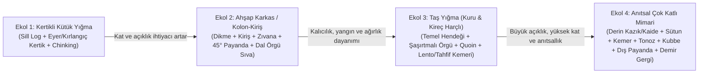

# DOK1 — Gerçekçi İnşaat ve Mimari Sistemi: Hedef, Tek Sistem Anayasası ve Kabul Kriterleri

> **Belge Kodu:** `DOK1` | **Bağlı Set:** `docs/gercekci-insaat-ve-mimari-sistemi/DOK1..DOK7`  
> **Durum:** Devir #081 Sonrası Master Tasarım Şartnamesi (Onaylı Mimari Anayasa)  
> **Kapsam:** Oyuncu İnşaatı, Fiziksel Yapı Mekaniği, 4 Mimari Ekol, Dünya Yerleşimleri (`Köy / Kasaba / Şehir / Harabe`), İç Mekânlar ve Performans/VRAM Sözleşmesi

---

## 1. Yönetici Özeti ve Çözdüğümüz Temel Kriz

Stratocraft'ın Devir #081 (`PT-01..PT-10`) aşamasında temel modüler inşa parçaları (`13` parça), SOTF katmanlı yığma prototipi (`SotfLogStackAndInputSystem`), `3×3` Köy / `5×5` Kasaba / `9×9` Şehir planlayıcısı (`SettlementLayoutSystem` + `SettlementBuildingBlueprints`) ve OBB kapsül çarpışması (`ModularStructureCollisionSolver`) devreye alınmıştır. Ancak canlı PlayTest gözlemleri ve kod denetimi *(ayrıntılı satır numaralı kanıtlar için bkz. [`DOK2_MEVCUT_YAPI_ENVANTERI_VE_DONUSUM.md`](DOK2_MEVCUT_YAPI_ENVANTERI_VE_DONUSUM.md))*, sistemin **oyun içi gerçekçilik, fiziksel bütünlük ve dünya birliği** açısından şu 3 kritik krizi yaşadığını ortaya koymuştur:

1. **Dünya Yerleşimleri ile Oyuncu İnşaatının Kopukluğu:** Köy, Kasaba ve Şehir binaları `SettlementBuildingBlueprints` içindeki sabit `15` parçalık kalıplarla ve tüm biyomlarda aynı ahşap/taş kombinasyonuyla kurulmaktadır. Oyuncunun doğadan kesip omzunda taşıdığı kütükle, yonttuğu taşla veya yaktığı kireç harcıyla kurduğu yapı diliyle yerleşim binaları görsel ve mekanik olarak birleşik bir ekosistem oluşturmamaktadır.
2. **Mavi ve İncecik Kütük Hatası:** Oyuncu kütükleri üst üste dizmek istediğinde `Stage1WorldLooseBuildController` içindeki önizleme ve yerleştirme yolu `StratocraftGhostPreview.shader` cyan-mavi tonlamasına (`Color32(82, 214, 255, 112)`) ve `scale = (0.38, 1.00, 0.38)` ile ince, yapay silindirik bir görünüme düşmektedir; bu durum kütük ev kurma hissini zedelemektedir.
3. **Havada Uçan ve Bağlantısız Kütükler:** Mevcut serbest yerleştirmede kütükler köşe kertiği (saddle/dovetail notch), zıvana, temel ankrajı veya alttaki kütüğün fiziksel taşıma ekseni doğrulanmadan havada veya tek uçtan boşlukta kalabilmektedir.

Bu master tasarım seti (`DOK1..DOK7`), oyunu baştan sona tek bir fiziksel anayasaya bağlar: **Dünyadaki her kulübe, han, saray, sur, harabe ve oyuncunun kendi eliyle kurduğu her yapı aynı elemanlardan, aynı bağlantı mekaniklerinden ve aynı statik fizik grafından doğar.**

---

## 2. Tek Sistem Anayasası ("Oyuncu İnşaatı == Dünya Yerleşimi")

> [!IMPORTANT]
> **Anayasal Kural:** Stratocraft'ta *"NPC/Dünya Üretimi Bina"* ile *"Oyuncu Yapımı Bina"* diye iki ayrı dünya yoktur. Tek bir yapı veri modeli (`UnifiedStructureNode` + `StructuralJoint`), tek bir statik çözücü (`UnifiedStructureGraph`), tek bir çarpışma/geçirgenlik katmanı (`ModularStructureCollisionSolver`) ve tek bir UV-Free `COLOR_0` render hattı vardır.

Bu anayasanın 5 bağlayıcı ilkesi şunlardır:

| İlke No | Kural Adı | Somut Anlamı |
| :--- | :--- | :--- |
| **TSA-01** | **Aynı Parça ve Bağlantı Sözleşmesi** | Köydeki bir kütük evin köşe bağlantısı ile oyuncunun kurduğu kulübenin köşe bağlantısı aynı `SaddleNotch / DovetailNotch` düğüm tipini kullanır. Oyuncu bir köy evinin kütüğünü sökebilir, tamir edebilir veya üzerine ek kat çıkabilir. |
| **TSA-02** | **Gerçek Fizikle Parçalanma Eşliği** | Köy, Kasaba veya Şehirdeki herhangi bir evin taşıyıcı köşe kütüğü, ahşap dikmesi, taş temeli veya kemer kilit taşı kırıldığında; o dünya binası da oyuncunun binasıyla birebir aynı olay-güdümlü statik graf üzerinden yük dağıtımı yapar ve yetersiz kalırsa gerçek fiziksel yıkıma uğrar. |
| **TSA-03** | **Biyom ve Hammadde Sadakati** | Yerleşimler bulundukları biyomun doğal hammaddelerinden inşa edilir (`Orman -> Kertikli Kütük`, `Yayla/Kanyon -> Taş Yığma`, `Şehir Merkezi -> Ahşap Karkas + Kesme Taş/Mermer Anıtsal Mimari`). |
| **TSA-04** | **`[C]` Madde Kristali ile Çelişkisiz Entegrasyon** | Madde Kristali temel hendeği kazmayı, arazi teraslamayı ve ham taş/toprak şekillendirmeyi hızlandırır; ancak kristal ile yerleştirilen yapı blokları da **aynı statik graf, eğilme açıklığı ve temel taşıma kapasitesi** kurallarına tabidir (`Floatstone (18)` istisnası hariç havada yapı tutulamaz). |
| **TSA-05** | **Klan ve Kuşatma Sistemleriyle Tam Uyum** | Faz 3 Klan `3D BFS` sınırları (duvar/çit kapalı hacim) ve Faz 9 Kuşatma silahlarının (`Mancınık`, `Top`) gedik açma hasarı doğrudan aynı `UnifiedStructureGraph` düğümlerini hedefler. |

---

## 3. Dört Yapı Ekolü (Ekol 1 .. Ekol 4)

Stratocraft mimarisi gerçek dünya inşaat tarihi ve mühendisliğine dayanan *(ayrıntılı saha araştırması için [`DOK3_GERCEK_HAYAT_MIMARI_VE_REFERANS_ARASTIRMASI.md`](DOK3_GERCEK_HAYAT_MIMARI_VE_REFERANS_ARASTIRMASI.md))* **4 kademeli yapı ekolünden** oluşur:

### 3.1. Ekol 1 — Kertikli Kütük Yığma (*Log Cabin*)
- **Kullanım Alanı:** Oyun başı barınaklar, orman köyleri, avcı/oduncu kulübeleri, dağ yayla evleri.
- **Zorunlu Yapı Elemanları:** Taş/kazık subasman pabuçları (`StoneFooting`), eşik kütüğü (`SillLog`), köşede **Eyer Kertik (`SaddleNotch`)** veya **Kırlangıçkuyruğu Kertik (`DovetailNotch`)** ile birbirine kenetlenen yatay kütük sıraları (`Course 1..N`), yosun/kil derz dolgusu (`Chinking`), üst aşık (`Purlin`), mertek (`Rafter`) ve zona/saz/ahşap çatı kaplaması.
- **Fiziksel Kurallar:** Kertiksiz veya alttan en az iki temas noktası / köşe kilidi olmayan kütük üst üste konulamaz ve havada asılı kalamaz.

### 3.2. Ekol 2 — Ahşap Karkas / Kolon–Kiriş (*Post & Beam / Timber Frame*)
- **Kullanım Alanı:** Çok katlı kasaba evleri, atölyeler (marangoz, han, depo), rüzgâra açık alanlar.
- **Zorunlu Yapı Elemanları:** Taş kaide/subasman, dikey taşıyıcı dikmeler (`Post`), yatay ana kirişler (`MainBeam`), **Zıvana–Delik (`MortiseAndTenon`)** + ahşap çivi bağlantısı, **`45°` Çapraz Rüzgâr Payandası (`DiagonalBrace`)**, çerçeve içi **Dal Örgü + Çamur Sıva (`WattleAndDaub`)**, **Kerpiç (`Adobe`)** veya ahşap kalas dolgu paneller.
- **Fiziksel Kurallar:** Yatay rüzgâr/deprem/darbe yükü altında çapraz payandası (`DiagonalBrace`) eksik yüksek ahşap karkas çerçeveler yanal burkulma yaşar ve devrilme riskine girer.

### 3.3. Ekol 3 — Gerçek Taş Yığma (*Dry-Stone & Kireç Harçlı Kâgir*)
- **Kullanım Alanı:** Yayla ve dağ yerleşimleri, kale duvarları, ocak/fırın yapıları, zemin kat yük taşıyıcı duvarları.
- **Zorunlu Yapı Elemanları:** Kazılmış temel hendeği (`FoundationTrench`) + kırma taş drenaj/altlık (`Footings`), şaşırtmalı derz örgüsü (`RunningBond`), köşe kilit taşları (`Quoin`), kireçtaşı yakma -> söndürme ile üretilen **Islak/Sertleşen Kireç Harcı (`LimeMortar`)**, açıklık üstü **Ahşap/Taş Lento** ve ağır duvarlarda üst yükü yanlara aktaran **Tahfif Kemeri (`RelievingArch`)**.
- **Fiziksel Kurallar:** Taş basınca çok dayanıklı (`~480–860 kN`) ancak **çekme/eğilme altında kırılgandır**. `2.5–3.5 m` üzerindeki boşluklar düz taş blokla geçilemez; ahşap/demir kiriş veya taş kemer zorunludur. Harç ıslakken (`CureRatio < 0.45`) üzerine aşırı kat çıkılırsa duvar oturur veya kayar.

### 3.4. Ekol 4 — Anıtsal Çok Katlı Mimari (*Sütun–Kemer–Tonoz–Kubbe*)
- **Kullanım Alanı:** Şehir merkezindeki Büyük Saray, Kubbeli Tapınak / Büyük Cami, Kervansaray/Han, Büyük Katedral/Anıt, Şehir Kapısı (`CityGatehouse`) ve Burçlar.
- **Zorunlu Yapı Elemanları:** Derin kazık/temel kaidesi, sütun kaidesi-gövdesi-başlığı (`ColumnBase/Shaft/Capital`), kama taşlı gerçek kemer + **Kilit Taşı (`Keystone`)**, beşik/çapraz tonoz (`Vault`), pandantif/tromp kubbe geçişi, **Kubbe (`Dome`)**, dışa açılan yanal itmeyi (*lateral thrust*) dengeleyen **Dış / Uçan Payanda (`Buttress / FlyingButtress`)** ve kemer ayaklarını içeriden bağlayan **Osmanlı Tipi Demir Gergi Çubuğu + Kurşun Kenet (`IronTieRod / LeadCramp`)**.
- **Fiziksel Kurallar:** Kemer, tonoz ve kubbe yükü dikey olduğu kadar **yanal itme** üretir. Ayaklarda yeterli duvar kalınlığı, dış payanda veya demir gergi yoksa kemer yan duvarları dışa iterek açar ve kubbe/kemer çöker. Kilit taşı kırılırsa tüm kemer yayı boşalır.

---

## 4. Gerçekçilik – Eğlence Dengesi İlkeleri (8 Altın Kural)

Gerçekçi mühendislik kuralları oyunu sıkıcı bir "CAD simülatörüne" çevirmemelidir. Tasarımımız aşağıdaki 8 denge ilkesine uyar *(ayrıntılı UX akışı için [`DOK5_MALZEME_PROGRESYON_UX_VE_IC_MEKAN.md`](DOK5_MALZEME_PROGRESYON_UX_VE_IC_MEKAN.md))*:

1. **Akıllı Kertik/Harç Yakalama + 1–2 Dokunsal Vuruş:** Oyuncu milimetrik piksel hizalamasıyla uğraşmaz; hayalet kılavuz doğru kertik/derz soketine mıknatıslanır, oyuncu balta (kertik oturtma) veya mala (harç sürme) ile `1–2` doyurucu vuruşta parçayı yerine kilitler.
2. **İp Çekme / Kireç İpi Kılavuzu (`ChalkLine`):** Uzun duvar, temel hendeği ve simetrik sütun aksı kurarken yere 2 kazık arası gergin ip çekilir; tüm taşlar/direkler bu çizgiye sıfır sapmayla dizilir.
3. **Şantiye Malzeme Yığını (`SiteMaterialPile`):** Oyuncu kütük, kesme taş ve harç kovasını cebinde 999'luk sihirli yığınlarla taşımak zorunda kalmaz; el arabası/kağnıyla şantiyeye yığar ve **yığın yarıçapı (`8 m`)** içinden inşa ederken malzemeler otomatik tüketilir.
4. **Şeffaf Yapısal Geribildirim:** "Neden koyamıyorum?" belirsizliği yasaktır. Hayalet parça kırmızıysa kısa ve net neden gösterilir (*"Eğilme Açıklığı Aşıldı: Kiriş/Kemer Gerekli"*, *"Temel Zayıf: Çamur Üzerine Taş Altlık Gerekli"*, *"Köşe Kertiği/Payanda Eksik"*).
5. **İskele ve Vinç/Palanga Desteği:** Çok katlı yapılarda yüksekliğe ulaşmak için ucuz/hızlı sökülebilir **Ahşap İskele (`Scaffolding`)** ve ağır taş blokları yukarı çekmek için **Makaralı Vinç (`PulleyCrane`)** bulunur; yüksekten düşüp ölme veya imkânsız parkur zorunluluğu yoktur.
6. **Geri Dönüşümlü Söküm ve Onarım:** Yanlış konulan veya hasar gören elemanlar balta/keski/kazma ile kontrollü sökülebilir ve malzemenin büyük kısmı (`%75–%100` sağlamlık oranında) kurtarılır.
7. **Prosedürel Esneklik (Yaratıcı Mod Uyumu):** `[F4]` Yaratıcı Mod'da malzeme maliyeti sıfırlanır ve harç anında kürlenebilir, ancak **statik fizik kuralları varsayılan olarak açık kalır** (isteğe bağlı test kilidi hariç) ki oyuncu mühendislik deneyimini serbestçe test edebilsin.
8. **PT-04 Çakışmasız Tuş Haritası Korunumu:** Mevcut `[T]`, `[V]/[Shift+V]`, `[R]`, `[G]`, `[ESC]/[Q]/RMB`, `[B]/[Shift+B]`, `[C]`, `[Alt]` tuş politikası (`Stage1InputConflictPolicy`) korunur; hiçbir yeni inşa kısayolu savaş veya envanter tuşlarını ezmez.

---

## 5. Donanım, VRAM, RAM, GC ve Dondurulmuş Sistem Kısıtları

| Kısıt Kategorisi | Zorunlu Sınır / Anayasa Hedefi | Uygulama Şartı |
| :--- | :--- | :--- |
| **Hedef Donanım** | `Windows 11`, `RTX 3050 Ti 4GB` / alt sınır `8 GB RAM + iGPU` | Unity 6 `6000.6.7f1`, `>= 60 FPS` (`<= 15.0 ms` kare süresi). |
| **Kaplama VRAM Bütçesi** | **`< 16.0 MB` Toplam VRAM** (Mevcut: `4.14 MB / 16.000 MB`) | Tüm yeni mimari `.glb` parçaları (Ekol 1..4, iskele, vinç, kapı, pencere, merdiven, mobilya) **%100 UV-Free `COLOR_0` Vertex Color** ile üretilir (`0` yeni gömülü doku). |
| **Çalışma Belleği (RAM)** | **`< 2.5 GB` Toplam Oyun RAM** | Şehir ölçeğinde (`10.000+` parça) `LOD0/LOD1/LOD2` + havuzlu slot ve chunk streaming kullanılır. |
| **Steady-State GC Alloc** | **`0 B / kare`** (`Update`, `FixedUpdate`, `OnGUI` ve `Collapsed/Collision` yollarında) | `Span<T>`, `stackalloc`, `NativeArray`, `[ThreadStatic]` geçici diziler ve sabit kapasiteli dizinler (`No LINQ`, `No per-frame List/string allocation`). |
| **Statik Çözücü Maliyeti** | **`< 2.0 ms`** (Parça ekleme/kırma anında; normal karede **`0.0 ms`**) | Olay-güdümlü (`Event-Driven`) statik graf; sadece yapı değişimi, harç kuruma tikleri ve fırtına/kuşatma olaylarında çalışır *(bkz. [`DOK4_YAPISAL_FIZIK_STATIK_VE_PERFORMANS.md`](DOK4_YAPISAL_FIZIK_STATIK_VE_PERFORMANS.md))*. |
| **Domain Reload Disabled** | `%100 Temiz Statik Sıfırlama` | Tüm yeni statik önbellek ve kayıt defterlerinde `[RuntimeInitializeOnLoadMethod(RuntimeInitializeLoadType.SubsystemRegistration)]` zorunludur. |
| **Dondurulmuş Sıvı Dosyaları** | **`0` Değişiklik (KESİN DOKUNULMAZ)** | `FluidSurfaceSkirtMesher.cs`, `FluidCellularAutomataJob.cs`, `StratocraftFluidSurface.shader`, `FluidSimulationSystem.cs` dosyalarına hiçbir fazda müdahale edilmeyecektir. |
| **Kayıt Sistemi** | `.sregion V3` (`RegionFileStore.cs`) | Zstd + XXH64 bütünlük, geriye dönük V2/V3 migrasyon ve aktif yapı içeren chunk'ların `PristineChunkDecay` muafiyeti korunur. |

---

## 6. Ölçülebilir Kabul Kriterleri (`AK-01 .. AK-25`)

Her kabul kriteri en az bir otomatik test (`T01..T24`, [`DOK7_ADIM_ADIM_UYGULAMA_VE_TEST_PLANI.md`](DOK7_ADIM_ADIM_UYGULAMA_VE_TEST_PLANI.md)) veya canlı PlayMode kalite kapısı ölçümüyle doğrulanır:

| Kod | Kategori | Kabul Kriteri (Ölçülebilir Hedef) | Bağlı Faz | Test |
| :--- | :--- | :--- | :--- | :--- |
| **AK-01** | PlayTest BugFix | Kütük yerleştirme ve önizlemesinde maviye/ince silindire dönme hatası `%100` giderilmiş olacak; hayalet önizleme gerçek çap (`0.38–0.44m`) ve doğru materyal dokusu/stres rengiyle (`Yeşil/Sarı/Kırmızı`) görünecek. | Faz I.1 | `T01` |
| **AK-02** | PlayTest BugFix | Desteksiz/havada kütük veya blok placement'ı statik graf tarafından reddedilecek (`CanStand == false`) veya gerçek yerçekimiyle düşecek; `0` havada asılı kütük mümkün olacak (`Floatstone` hariç). | Faz I.1 | `T02` |
| **AK-03** | Tek Sistem | Oyuncu yapıları ve dünya yerleşimleri (Köy/Kasaba/Şehir/Harabe) aynı `UnifiedStructureNode` ve `UnifiedStructureGraph` veri modelini kullanacak (`%100` ortak şema). | Faz I.1–I.6 | `T03` |
| **AK-04** | Ekol 1 (Kütük) | Ekol 1'de köşe kertiği (`SaddleNotch / DovetailNotch`) olmadan kütük duvar 2. sıradan sonra devrilecek; kertikli duvar ise yan kenetlenme ile `5–7` sıra kararlı çıkabilecek. | Faz I.1 | `T04` |
| **AK-05** | Ekol 1 (Kütük) | Kütük arası derz dolgusu (`Chinking`: yosun/kil) yapılmamış kütük kulübe kapalı hacim sayılmayacak ve iç ısı yalıtımı sağlamayacak; dolgu tamamlandığında kapalı mekân aktif olacak. | Faz I.1 / I.5 | `T05` |
| **AK-06** | Ekol 2 (Karkas) | Ekol 2 ahşap karkasta `3.0m` üstü dikme+kiriş çerçevesi `DiagonalBrace` (çapraz payanda) olmadan yanal rüzgâr/itme yükünde (`>= 25 kN`) devrilecek; payanda + zıvana takıldığında kararlı kalacak. | Faz I.2 | `T06` |
| **AK-07** | Ekol 2 (Dolgu) | Karkas arasına dal örgü + çamur sıva (`WattleAndDaub`) veya kerpiç dolgu uygulandığında rüzgâr sızdırmazlığı ve termal izolasyon `0.0 -> >= 0.70` yükselecek. | Faz I.2 | `T07` |
| **AK-08** | Temel & Zemin | Çamur/kum zemin üzerine temelsiz kurulan `>= 2` katlı taş yapı diferansiyel oturma/hasar alacak; kazılmış temel hendeği + sıkışmış taş altlık (`Footings`) ile `0` oturma sağlanacak. | Faz I.3 | `T08` |
| **AK-09** | Ekol 3 (Taş) | Harçsız/bağlantısız `> 2.5m` düz taş açıklığı çekme/eğilme kırılmasıyla çökecek; ahşap/demir lento veya tahfif kemeri yerleştirildiğinde taşıma sağlanacak. | Faz I.3 | `T09` |
| **AK-10** | Ekol 3 (Harç) | Islak kireç harcı (`CureRatio < 0.45`) üzerine tek seferde `>= 3` kat taş örüldüğünde taze harç ezilme/kayma uyarısı ve yük sınırı çalışacak; kuruma sonrası tam dayanıma (`%100`) çıkacak. | Faz I.3 | `T10` |
| **AK-11** | Ekol 4 (Kemer) | Kama taşlı kemer (`Arch`) tüm taşları + kilit taşı (`Keystone`) tamamlanana kadar geçici iskele/kalıp gerektirecek; kilit taşı kırıldığında kemer yayı anında çökecek. | Faz I.4 | `T11` |
| **AK-12** | Ekol 4 (İtme) | Kemer/tonoz/kubbeden doğan yanal itme (*lateral thrust*), ayak duvar kalınlığı yetersizse ve dış payanda (`Buttress`) ya da demir gergi (`IronTieRod`) yoksa yan duvarı dışa itip yıkacak; payanda/gergi eklendiğinde denge sağlanacak. | Faz I.4 | `T12` |
| **AK-13** | Yıkım Fiziği | Bir köy evinin köşe taşıyıcı kütüğü veya bir kemerin ayağı kırıldığında statik graf `< 2.0 ms` sürede yeniden hesaplanacak, stres uyarısı sonrası etkilenen üst kısım 3B yerçekimi ve açısal torkla çökecek. | Faz I.1–I.6 | `T13` |
| **AK-14** | Çevre & İklim | Yüksek dağ/kış biyomunda yoğun kar birikimi (`SnowLoad SWE`) zayıf/düz çatıda aşırı yük oluşturacak; `45°` dik çatı veya sık mertek kar yükünü güvenle taşıyacak. | Faz I.3–I.5 | `T14` |
| **AK-15** | İç Mekân & Isı | Şömine/ocak yakıldığında kapalı odada çatı baca çıkışı (`ChimneyFlue`) yoksa duman/CO birikecek ve hasar uyarısı verecek; baca kurulduğunda oda güvenle ısınacak. | Faz I.5 | `T15` |
| **AK-16** | İç Mekân & OBB | Kapılar açılıp kapanabilecek (kapalıyken çarpışma aktif, açıkken oyuncu ve AI geçebilir); pencereler görüş/ok geçirir ama oyuncu kapsülünü bloke eder; merdivenler katlar arası kesintisiz yürünebilir olacak. | Faz I.5 | `T16` |
| **AK-17** | İnşa UX | İp çekme (`ChalkLine`), şantiye malzeme yığını (`8m` yarıçap), ahşap iskele ve vinç/palanga tam işlevsel olacak; PT-04 tuş haritasında `0` çakışma korunacak. | Faz I.5 | `T17` |
| **AK-18** | Yerleşim Birliği | Orman köyü Ekol 1 kütük kulübelerden, yayla yerleşimi Ekol 3 taş yapılardan, şehir merkezi ise Ekol 2 + Ekol 3 + Ekol 4 (saray, kubbeli tapınak/cami, han, sur, kapı) yapılarından oluşacak. | Faz I.6 | `T18` |
| **AK-19** | Eğimli Arazi | Eğimli arazideki yerleşim binaları (`0.5m < Δh <= 3.5m`) havada sarkan köşe bırakmadan otomatik kademeli taş temel kaidesi / istinat duvarı ve giriş merdiveni üretecek. | Faz I.6 | `T19` |
| **AK-20** | Harabeler | Harabeler (`Ruins`) prosedürel olarak sağlam yapı grafı + deterministik hasar/kısmi çökme ile oluşacak ve oyuncu tarafından onarılıp tamamlanabilecek. | Faz I.6 | `T20` |
| **AK-21** | Şehir Streaming | `9×9` chunk (`~3.000–10.000+` eleman) bir şehir `LOD0/LOD1/LOD2` streaming ile gezilirken kare süresi bütçesi aşmayacak (`<= 15.0 ms` hedef, `<= 1.5 ms` chunk entegrasyon bütçesi). | Faz I.6 | `T21` |
| **AK-22** | Kayıt & Migrasyon | `.sregion V3` tüm `UnifiedStructureNode`, bağlantı, harç kuruma durumu ve yıkım deltalarını XXH64 doğrulamalı kaydedip yükleyecek; oyuncu yapısı olan chunk `PristineChunkDecay`'den muaf kalacak. | Faz I.6 | `T22` |
| **AK-23** | VRAM Bütçesi | Tüm yeni mimari `.glb` varlıkları eklendikten sonra toplam kaplama VRAM'i `< 16.0 MB` sınırının altında kalacak (`0` yeni gömülü doku, `%100 COLOR_0`). | Faz I.1–I.6 | `T23` |
| **AK-24** | Sıfır-GC & Bellek | Kararlı durumda yapı çarpışma/render/streaming yolları `0 B/kare` GC Alloc üretecek ve toplam oyun RAM'i `< 2.5 GB` kalacak. | Faz I.1–I.6 | `T23` |
| **AK-25** | Regresyon | Dondurulmuş 4 sıvı dosyasında `0` diff olacak; `quality-gate.ps1 -Phase 4` (`.NET 10`, `ctest`, `pytest`, Unity `0 Error / 0 Warning`) tam PASS verecek. | Her Faz | `T24` |

---

## 7. `DOK1 .. DOK7` Master Doküman Dizini

Bu mimari paket birbirini tamamlayan 7 dokümandan oluşur:

| Doküman | İçerik ve Sorumluluk Alanı |
| :--- | :--- |
| **[`DOK1_HEDEF_VE_GEREKSINIMLER.md`](DOK1_HEDEF_VE_GEREKSINIMLER.md)** | *(Bu belge)* Tek Sistem Anayasası, 4 yapı ekolü özeti, gerçekçilik–eğlence dengesi, VRAM/GC/sıvı kısıtları ve `AK-01..AK-25` kabul kriterleri. |
| **[`DOK2_MEVCUT_YAPI_ENVANTERI_VE_DONUSUM.md`](DOK2_MEVCUT_YAPI_ENVANTERI_VE_DONUSUM.md)** | Kod tabanı denetimi, 3 PlayTest hatasının satır numaralı kök nedenleri, mevcut tüm yapı/tezgâh/istasyonların dönüşüm matrisi ve çarpışma/kayıt kancaları. |
| **[`DOK3_GERCEK_HAYAT_MIMARI_VE_REFERANS_ARASTIRMASI.md`](DOK3_GERCEK_HAYAT_MIMARI_VE_REFERANS_ARASTIRMASI.md)** | Gerçek hayat kütük, ahşap karkas, taş yığma ve anıtsal sütun-kemer-kubbe mimarisi mühendislik araştırması + referans oyun sentezi. |
| **[`DOK4_YAPISAL_FIZIK_STATIK_VE_PERFORMANS.md`](DOK4_YAPISAL_FIZIK_STATIK_VE_PERFORMANS.md)** | `UnifiedStructureGraph` veri modeli, basınç/eğilme/kesme/yanal itme/burkulma formülleri, zemin taşıma, iklim/ısı/baca fiziği, olay-güdümlü çözücü ve `0-GC` şehir performansı. |
| **[`DOK5_MALZEME_PROGRESYON_UX_VE_IC_MEKAN.md`](DOK5_MALZEME_PROGRESYON_UX_VE_IC_MEKAN.md)** | Hammadde progresyon matrisi, dokunsal inşa UX'i (ip çekme, iskele, vinç, malzeme yığını, PT-04 tuş akışı) ve kapı/pencere/merdiven/şömine/mobilya kataloğu. |
| **[`DOK6_YERLESIM_KOY_KASABA_SEHIR_BIRLESIMI.md`](DOK6_YERLESIM_KOY_KASABA_SEHIR_BIRLESIMI.md)** | Köy (`3×3`), Kasaba (`5×5`), Şehir (`9×9`) ve Harabelerin tekil sistemle birleşimi, biyom üslupları, eğimli arazi temel kaideleri ve şehir ölçeği LOD streaming. |
| **[`DOK7_ADIM_ADIM_UYGULAMA_VE_TEST_PLANI.md`](DOK7_ADIM_ADIM_UYGULAMA_VE_TEST_PLANI.md)** | `Faz I.1 .. Faz I.6` kodlama adımları, C#/HLSL/Blender `.glb` dosya listesi, `.sregion V3` migrasyon planı ve `T01..T24` test matrisi. |
