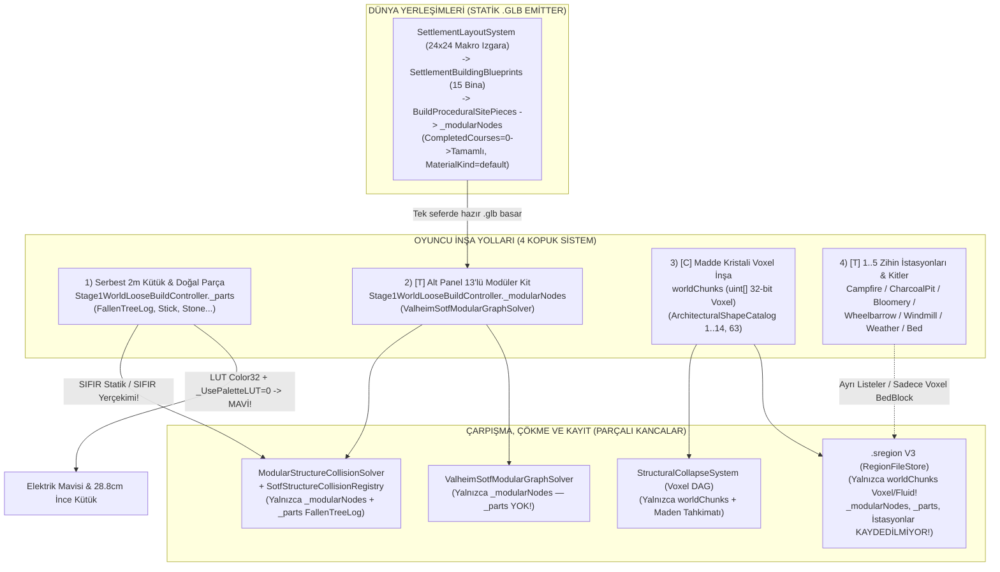

# DOK2 — Mevcut Yapı Envanteri, 3 Kritik PlayTest Kök Neden Denetimi ve Birleşik 4-Ekollü Dönüşüm Matrisi

> **Doküman Seti:** Gerçekçi İnşaat ve Mimari Sistemi (`docs/gercekci-insaat-ve-mimari-sistemi/`)
> **Referans Kod Tabanı:** `Devir #081` (`PT-01..PT-10` birleşimi sonrası canlı `main` dalı)
> **Kısıtlar:** `< 16.0 MB` Kaplama VRAM (`%100` UV-free `COLOR_0`), `0 B/kare` kararlı-durum GC, 4 dondurulmuş 4B.4 sıvı dosyasına sıfır müdahale (`FluidSurfaceSkirtMesher.cs`, `FluidCellularAutomataJob.cs`, `StratocraftFluidSurface.shader`, `FluidSimulationSystem.cs`).

## Doküman Seti Gezinti Dizini

| Doküman | Kapsam |
| :--- | :--- |
| [`DOK1_HEDEF_VE_GEREKSINIMLER.md`](DOK1_HEDEF_VE_GEREKSINIMLER.md) | Tek Sistem Anayasası ("Oyuncu İnşaatı == Dünya Yerleşimi"), 4 Yapı Ekolü ve `AK-01..AK-25` Kabul Kriterleri |
| **`DOK2_MEVCUT_YAPI_ENVANTERI_VE_DONUSUM.md`** *(Bu Doküman)* | Mevcut Kod Tabanı Envanteri, 3 PlayTest Hatasının Satır Numaralı Kök Nedenleri, Tam Dönüşüm Matrisi, Çarpışma/Yıkım/`.sregion` Kancaları |
| [`DOK3_GERCEK_HAYAT_MIMARI_VE_REFERANS_ARASTIRMASI.md`](DOK3_GERCEK_HAYAT_MIMARI_VE_REFERANS_ARASTIRMASI.md) | 5 YouTube Referans Kaynağı, 4 Gerçek Hayat Yapı Ekolü Mühendisliği ve 6 Referans Oyun Sentezi |
| [`DOK4_YAPISAL_FIZIK_STATIK_VE_PERFORMANS.md`](DOK4_YAPISAL_FIZIK_STATIK_VE_PERFORMANS.md) | Birleşik Yapısal Graf, Gerçek Statik/Yanal İtme/Temel/Harç Fiziği, İklim-Isı-Kristal Etkileşimi ve Şehir Ölçeği Performansı |
| [`DOK5_MALZEME_PROGRESYON_UX_VE_IC_MEKAN.md`](DOK5_MALZEME_PROGRESYON_UX_VE_IC_MEKAN.md) | Malzeme Progresyonu (Aşama 1–4), Dokunsal İnşaat UX (İp/İskele/Vinç/PT-04 Tuşları) ve İç Mekân/Ekipman Kataloğu |
| [`DOK6_YERLESIM_KOY_KASABA_SEHIR_BIRLESIMI.md`](DOK6_YERLESIM_KOY_KASABA_SEHIR_BIRLESIMI.md) | Köy (`3×3`), Kasaba (`5×5`), Şehir (`9×9`) ve Harabelerin Oyuncu İnşaat Motoruyla `%100` Birleşimi |
| [`DOK7_ADIM_ADIM_UYGULAMA_VE_TEST_PLANI.md`](DOK7_ADIM_ADIM_UYGULAMA_VE_TEST_PLANI.md) | `Faz I.1..I.6` Uygulama Yol Haritası, Dosya/Asset Planı, `.sregion V3` Geçişi ve `T01..T24` Test Matrisi |

---

## 1. Yönetici Özeti ve Mevcut Parçalı Mimari Haritası

Devir `#081` (`PT-01..PT-10`) itibarıyla kod tabanında **birbiriyle konuşmayan 5 ayrı yapı/yerleştirme kanalı** aynı anda yaşamaktadır. Her kanal farklı bir veri yapısına, farklı bir çarpışma yoluna, farklı bir fizik/çökme çözücüsüne (veya hiçbirine) ve farklı bir görselleştirme/shader sözleşmesine bağlıdır:



### Denetlenen Çekirdek Dosya Envanteri (`26` Dosya)

| # | Dosya (Git-İçi Göreceli Yol) | Satır | Mevcut Sorumluluk |
| :--- | :--- | :---: | :--- |
| 1 | `Assets/_Stratocraft/Character/Stage1WorldLooseBuildController.cs` | 3.342 | `WorldLooseBuildSystem`: serbest parçalar (`_parts`), omuz kütüğü (`FallenTreeLog`), 13 modüler parça (`_modularNodes`), katmanlı mesh (`BuildProgressiveLayeredCourseMesh`), hayalet önizleme, OBB çarpışma sağlayıcısı (`ISolidStructureCollisionProvider`) |
| 2 | `Assets/_Stratocraft/Inventory/Systems/SotfLogStackAndInputSystem.cs` | 1.345 | `SotfStructuralBuildMechanics`: 6 malzeme / 3 kesit profili, serbest kütük snap matematiği (`ComputeSotfFreeformSnapPose`), OBB üretimi (`EmitPieceSolidObbs`, `CreateTimberLogObb`), `SotfStructureCollisionRegistry`, PT-04 `Stage1InputConflictPolicy` |
| 3 | `Assets/_Stratocraft/Inventory/Systems/WorldLooseBuildSystem.cs` | 876 | `WorldLoosePlacementMath` (dal kırma/teepee, taş/kil yığma), `PlacedWeatherInstrumentsSystem` (5 meteoroloji aleti + Metal Paratoner) |
| 4 | `Assets/_Stratocraft/Character/Stage1MindBuildingController.cs` | 995 | `[T]` Zihin İnşası + SOTF Modüler Seçici arayüzü, `2.8 sn` tebeşir-mavisi düşünce silüeti (`EmitThinLineBar`), küme doğrulama ve istasyon kaydı (`ExecuteValidateAndBind`) |
| 5 | `Assets/_Stratocraft/Inventory/Systems/MindStructureClusterValidator.cs` | 2.953 | `MindStructureClusterValidator` (9 zihin şablonu), `ModularBuildPieceKind` (`0..12`), `ModularPlacedPieceNode`, `ValheimSotfModularGraphSolver` (manyetik soket, Bellman-Ford + Tributary Load, SOTF devrilme, 4 temel prosedürel yapı) |
| 6 | `Assets/_Stratocraft/WorldGen/SettlementLayoutSystem.cs` | 1.030 | `24×24` chunk makro-ızgarada Köy (`3×3`), Kasaba (`5×5`), Şehir (`9×9`) yerleşim planlayıcısı; yol/meydan/tarla/kuyu/çeşme/teras voksel damgalama |
| 7 | `Assets/_Stratocraft/Inventory/Systems/SettlementBuildingBlueprints.cs` | 606 | 11 ek yerleşim binası planı (`KindVillageWell = 4` .. `KindCityGatehouse = 14`; `0..3` ile toplam `15` bina türü) |
| 8 | `Assets/_Stratocraft/Inventory/Systems/ModularStructureCollisionSolver.cs` | 656 | 13 modüler parça için yerel-uzay OBB kutuları (`PopulateLocalSolidBoxes`), anti-tunneling alt-adımlı kapsül engelleme, yatay MTV depenetrasyon, yürünebilir yüzey ve tavan/headroom çözümü |
| 9 | `Assets/_Stratocraft/Physics/Systems/StructuralCollapseSystem.cs` | 514 | Voxel dünyası için 2-Aşamalı Domino Yıkım (`GeodesicSupportDijkstraJob` + `TributaryLoadDagJob` + `GreedyBoxFractureJob`), hayalet renk önizlemesi, çarpma kat delme ve molozlaştırma |
| 10 | `Assets/_Stratocraft/Character/Stage1StructuralCollapseBridge.cs` | 2.882 | `32×32` komşu chunk halolu voxel çökme çözücüsü, `Delta-Yük` kapısı, Terzaghi mağara kubbesi, `ExternalTimberSupportLookup` / `ExternalTimberSupportWindowRasterizer` maden tahkimatı köprüsü |
| 11 | `Assets/_Stratocraft/Rendering/Shaders/StratocraftGhostPreview.shader` | 94 | `Stratocraft/GhostPreviewHologram` yarı-şeffaf Fresnel hologram önizleme shader'ı |
| 12 | `Assets/_Stratocraft/Rendering/Shaders/StratocraftUberShader.hlsl` | 790 | UV-free `COLOR_0` Uber-Shader (`_UsePaletteLUT > 0.5` LUT modu vs `_UsePaletteLUT <= 0.5` Doğrudan RGB modu) |
| 13 | `Assets/_Stratocraft/Voxel/Jobs/HybridSurfaceNetsAndShapeMesher.cs` | 2.002 | Kanal 1 SurfaceNets + Kanal 2 Mimari Şekiller (`EmitArchitecturalShape`, `EmitOctagonalPillar`), LUT-kodlu `UberMeshVertex` (`BuildUnityMeshZeroGc`) |
| 14 | `Assets/_Stratocraft/Character/Stage1MatterCrystalAndMiningController.cs` | 3.523 | `[C]` Madde Kristali (`T0..T5`), `17` inşa malzemesi, `ShapeWheelCycle` (`0, 1..14, 63`), `0.25m` Mikro-Keski, voxel blok yerleştirme ve çökme tetikleyicisi |
| 15 | `Assets/_Stratocraft/Voxel/Data/ArchitecturalShapeCatalog.cs` | 258 | `62` kanonik mimari şekil (`1..62`), `24` SO(3) + `8` eğik yönelim, `FullFaceLut` yüzey kapatma maskesi |
| 16 | `Assets/_Stratocraft/Core/Constants/MaterialIdCatalog.cs` | 348 | `0..255` voksel malzeme ID kataloğu (`OakWood = 70`, `StoneBrick = 120`, `WoodPlank = 121`, `CampfireBlock = 166`, `PrimitiveStoneKilnBlock = 167`, `BedBlock = 168` vb.) |
| 17 | `Assets/_Stratocraft/Inventory/Systems/SurvivalRecipeBookCatalog.cs` | 758 | `[B]` 5 sekmeli hayatta kalma rehber kitabı (malzemeler, `[I]/[R]` tarifler, `[T]` zihin/SOTF yapıları, demircilik, hava tahmini) |
| 18 | `Assets/_Stratocraft/Inventory/Systems/PrimitiveSurvivalCraftingCatalog.cs` | 703 | `[I]` 3B kumaş çanta birleştirme tarifleri (aletler, eski kitler, 5 hava aleti + paratoner, yelken kanadı, 5 ileri yapı bloğu) |
| 19 | `Assets/_Stratocraft/Character/Stage1VisualHotbarAndInventoryUi.cs` | 5.568 | `InventoryItemKind` (`0..62`), hotbar, 3B çanta, `[C]` 7'li kayar şerit, `[Alt]` 17'li sağ palet dock'u |
| 20 | `Assets/_Stratocraft/WorldGen/StratocraftFloatingIslandWorldGen.cs` | 4.100+ | `ProceduralModularSiteKind` (`0..14`), `StampSettlementTerrainFeaturesForChunk`, `TryGetChunkModularStructureSites`, ganimet sandığı yerleşimi |
| 21 | `Assets/_Stratocraft/Character/Stage1InteractivePlayController.cs` | 9.893 | Ana oyun döngüsü, chunk yükleme/boşaltma, `02_Faz2_Workshop_Anvil_CASChest_And_ClanCrystal`, `DamageModularSupportAt`, `SaveAllChunksToRegionStore` / `LoadAllChunksFromRegionStore` |
| 22 | `Assets/_Stratocraft/Character/Stage1PlayerMovementBridge.cs` | 3.000+ | Oyuncu kapsül hareketi, `SotfStructureCollisionRegistry` ve `ModularStructureCollisionSolver` çağrı noktaları |
| 23 | `Assets/_Stratocraft/Character/Stage1CampfireAndCookingController.cs` | 1.600+ | Fiziksel Kamp Ateşi kayıt, kıvılcım tutuşturma, et/seramik/cevher pişirme |
| 24 | `Assets/_Stratocraft/Character/Stage1BloomeryAndForgingController.cs` | 3.200+ | Odun Kömürü Ocağı (`RegisterCharcoalPit`), Bloomery İzabe Fırını (`RegisterBloomeryFurnace`), Örs (`AnvilTransform`) sıcak dövme |
| 25 | `Assets/_Stratocraft/Character/Stage1WindmillController.cs` & `Stage1WheelbarrowController.cs` | 700+ / 400+ | Fiziksel Yel Değirmeni (`RegisterWindmillStation`) ve 36 Yuvalı Ahşap El Arabası (`RegisterWheelbarrowStation`) |
| 26 | `Assets/_Stratocraft/Character/Systems/BedSpawnPointService.cs`, `RegionFileStore.cs`, `ChunkPersistencePipeline.cs`, `IWorldPersistenceService.cs` | 75 / 985 / 558 / 118 | Yatak doğma noktası servisi ve `.sregion V3` kalıcılık boru hattı |

---

## 2. PlayTest'te Görülen 3 Kritik Hatanın Satır Numaralı KESİN Kök Neden Analizi

### Hata (a): Köy / Kasaba / Şehir Evleri ile Oyuncunun Ev Yapma Yönteminin Tamamen Kopuk ve Alakasız Olması

PlayTest'te oyuncu bir köye/kasabaya/şehre girdiğinde hazır 3B Nordik ahşap-taş binalar görürken, kendisi ev yapmaya kalktığında ya ormanda kestiği kütüklerle bambaşka (çatısız, kapısız, görsel olarak bozuk) bir şey elde etmekte ya da `[T]` menüsünün altından yapay "tıkla-şişir" kalıplar basmak zorunda kalmaktadır.

#### Kesin Kod Kanıtları (`Dosya:Satır`)

| Alt Neden | Dosya ve Satır | Teknik Tespit |
| :--- | :--- | :--- |
| **A1 — Yerleşim evleri oyuncunun inşa akışından tamamen kopuk tek-seferlik `.glb` kabuk emitter'ıdır** | `Assets/_Stratocraft/WorldGen/SettlementLayoutSystem.cs:330-655`<br>`Assets/_Stratocraft/WorldGen/StratocraftFloatingIslandWorldGen.cs:3417-3423`<br>`Assets/_Stratocraft/Character/Stage1WorldLooseBuildController.cs:1802-1866`<br>`Assets/_Stratocraft/Inventory/Systems/MindStructureClusterValidator.cs:2517-2552, 2708-2936`<br>`Assets/_Stratocraft/Inventory/Systems/SettlementBuildingBlueprints.cs:34-70, 72-605` | Chunk yüklenince `SpawnOrSyncChunkModularStructureSite` -> `BuildProceduralSitePieces` -> `BlueprintEmitter.Emit` çalışır. `15` bina şablonu `Assets/Art/Generated/Structures_Modular/*.glb` altındaki `13` hazır Blender kabuğunu (`ModularBuildPieceKind 0..12`) **tamamlanmış** halde (`CompletedCourses = 0`, `SotfLogStackAndInputSystem.cs:349` gereği `req` olarak yorumlanır) tek seferde sahneye dizer. |
| **A2 — Yerleşim binalarında malzeme/ekol ayrımı, merdiven, kapı kanadı ve iç mekân yoktur** | `Assets/_Stratocraft/Inventory/Systems/SettlementBuildingBlueprints.cs:50-68, 224-288, 529-548`<br>`Assets/_Stratocraft/Inventory/Systems/MindStructureClusterValidator.cs:2532-2550, 2844-2890` | `BlueprintEmitter.Emit` ve `SitePieceEmitter.Emit` düğümlerin `MaterialKind` ve `ThicknessKind` alanlarını **hiç atamaz** (`default = 0 -> PineTimber / Standard`). Sonuç olarak Şehir Suru (`EmitCityWallSegment`, L537–541) ahşap `PlankWall2x2m` / `PlankWindow2x2m` duvarlarından, Kadim Mermer Tapınak (`CarvedMarbleShrine`, L2857–2864) ahşap duvar/pencerelerden oluşur. `TownHouseTwoStory` (L224–288) ve `MeadHallWatchtower` (L2784–2842) 2 katlıdır ancak **hiç merdiven veya üst kat erişimi yoktur**; hiçbir kapıda açılır kanat, hiçbir evde şömine/baca yoktur. |
| **A3 — Oyuncunun ormanda kestiği 2m kütük (`FallenTreeLog`) ile yaptığı yapı `_modularNodes`'a asla dönüşmez** | `Assets/_Stratocraft/Character/Stage1WorldLooseBuildController.cs:343-353, 509-621`<br>`Assets/_Stratocraft/Character/Stage1MindBuildingController.cs:479-550`<br>`Assets/_Stratocraft/Inventory/Systems/MindStructureClusterValidator.cs:803-1075` | Oyuncu ağaç kesip kütük omuzladığında kütükler `_parts` (`List<WorldLoosePartInstance>`) listesine eklenir (`L602-610`). Oyuncu `[T]->[6..9]` (`LogWall`, `LogPalisade`, `LogBeam`, `LogCabin`) ile doğrulama yaptığında `ExecuteValidateAndBind` (`Stage1MindBuildingController.cs:539-549`) yalnızca `BoundStationId` atayıp `_registeredNonCampfireStations` listesine boş bir meta kayıt ekler — **hiçbir zaman** bir `NordicTimberCabin` duvarı, penceresi, kapısı, çatısı veya statik graf düğümü oluşturmaz! |
| **A4 — `[T]` alt panelindeki modüler sistem Survival'da malzeme kontrolünü dahi yoksayar (bedava inşa açığı)** | `Assets/_Stratocraft/Character/Stage1WorldLooseBuildController.cs:1609-1613, 1725-1729`<br>`Assets/_Stratocraft/Character/Stage1MindBuildingController.cs:306-448` | Oyuncu `[T]` menüsünün alt kısmından `PlankWall2x2m` seçtiğinde omuzda kütük taşımadan Taş Çekiçle tıklar. **Kritik bug:** `L1612` ve `L1728`'de `_ = holsterCtrl.InventoryUi?.TryConsumeItemFromInventory(...)` çağrısının `bool` dönüş değeri **`_` ile çöpe atılmaktadır**! Oyuncunun çantasında `0` odun/taş varken bile `Sol Tık` ile sınırsız duvar/kolon/çatı basılabilmektedir. |
| **A5 — 4 sistem arasında sıfır ortak veri modeli vardır** | `Assets/_Stratocraft/Character/Stage1MatterCrystalAndMiningController.cs:30-37, 741-751`<br>`Assets/_Stratocraft/Character/Stage1WorldLooseBuildController.cs:115-119`<br>`Assets/_Stratocraft/Character/Stage1InteractivePlayController.cs:343-375` | (1) `_parts` (`WorldLoosePartInstance`), (2) `_modularNodes` (`ModularPlacedPieceNode`), (3) `worldChunks` (`uint[]` 32-bit voxel), (4) ayrı istasyon controller listeleri (`_campfireCtrl`, `_bloomeryCtrl`, `_windmillCtrl`, `_wheelbarrowCtrl`, `_placedWeatherInstruments`) birbirinden habersiz 4 ayrı evrendir. |

---

### Hata (b): Kütükleri Üst Üste Dizince Maviye Dönmesi ve İncecik Bir Şeye Dönüşmesi

PlayTest'te oyuncunun kütükleri yerleştirip üst üste dizdiğinde hem **parlak maviye boyanmasının** hem de **incecik bir çıta/levha gibi görünmesinin** kod tabanında **birbiriyle üst üste binen 3 kesin teknik kök nedeni** tespit edilmiştir:

#### Kök Neden B1 (BİRİNCİL — Elektrik Mavisi Kütük): LUT-Kodlu `UberMeshVertex` Mesh'ine `_UsePaletteLUT = 0.0f` Materyali Atanması!

```text
GetOrCreateTimberLogMeshCached(woodMat = 70 / OakWood)
   └─► EmitArchitecturalShape(..., shapeId: 2 [OctagonalColumn])
       └─► BuildUnityMeshZeroGc() -> COLOR_0.rgba = (R=70 [MatID], G=0 [Temp], B=148..210 [FacetShade], A=245 [AO])
   └─► SpawnBoundOrLoosePartDirect() -> mr.sharedMaterial = ResolveModularVertexColorMaterial()
       └─► _UsePaletteLUT = 0.0f  (DOĞRUDAN RGB MODU!)
   └─► StratocraftUberShader.hlsl (L536-542):
       albedo = sRGB_to_Linear(float3(70/255, 0/255, 183/255)) = PARLAK KOBALT / ELEKTRİK MAVİSİ!
```

| Kanıt Adımı | Dosya ve Satır | Kesin Kod Bulgusu |
| :--- | :--- | :--- |
| **1. LUT-kodlu mesh üretimi** | `Assets/_Stratocraft/Character/Stage1WorldLooseBuildController.cs:766-783`<br>`Assets/_Stratocraft/Voxel/Jobs/HybridSurfaceNetsAndShapeMesher.cs:1370-1394, 1680-1737, 1871-1874, 1923-1926` | `GetOrCreateTimberLogMeshCached` 2m kütüğü `EmitArchitecturalShape(..., actualMat, shapeId: 2)` + `BuildUnityMeshZeroGc` ile üretir. `BuildUnityMeshZeroGc`, vertex renk kanalına gerçek RGB değil **`UberMeshVertex` LUT kodlaması** yazar: `R = MaterialId` (`OakWood = 70`, `MaterialIdCatalog.cs:168`), `G = Temperature` (`0`), `B = FacetShade` (`148..210`, `EmitOctagonalPillar` L1389–1392), `A = AO` (`245`). |
| **2. Yanlış shader modu atanması** | `Assets/_Stratocraft/Character/Stage1WorldLooseBuildController.cs:733-737, 1330` | `SpawnBoundOrLoosePartDirect` (`L733-737`), `FallenTreeLog` için LUT'lu `sharedMat` yerine `ResolveModularVertexColorMaterial(sharedMat)` materyalini atar. Bu materyal `L1330`'da **`_UsePaletteLUT = 0.0f`** (Direct RGB) moduna kilitlidir! |
| **3. Shader'ın R/G/B'yi mavi olarak çizmesi** | `Assets/_Stratocraft/Rendering/Shaders/StratocraftUberShader.hlsl:427, 536-542` | `_UsePaletteLUT <= 0.5` dalında `albedo = ConvertLutSrgbToActiveColorSpace(saturate(input.directColorAndFog.rgb))` çalışır. `R = 70/255 (0.275)`, `G = 0`, `B = 155..210/255 (0.61..0.82)` doğrudan RGB okunduğu için yerleştirilen **her tekil 2m ağaç kütüğü parlak mavi-mor renge dönüşür**! |

#### Kök Neden B2 (BİRİNCİL — İncecik Kütük + `9.12 cm` Hava Boşluğu): Çift `0.38x` Ölçekleme Hatası!

| Kanıt Adımı | Dosya ve Satır | Kesin Kod Bulgusu |
| :--- | :--- | :--- |
| **1. Mesh içi `rShaft = 0.38f`** | `Assets/_Stratocraft/Voxel/Jobs/HybridSurfaceNetsAndShapeMesher.cs:1374` | `EmitOctagonalPillar` sekizgen gövdeyi zaten `rShaft = 0.38f` yarıçapla (yerel çap `0.76m`, yükseklik `2.00m` için 2 blok) oluşturur. |
| **2. `localScale = (0.38, 1.00, 0.38)` ile ikinci kez daraltma** | `Assets/_Stratocraft/Character/Stage1WorldLooseBuildController.cs:706, 728, 789, 2625` | `SpawnBoundOrLoosePartDirect` (`L706`) ve `GetLooseBuildVisualScale` (`L789`) kütüğün `XZ` ölçeğini bir kez daha **`0.38f`** ile çarpar (`Ghost` `L2625`'te `0.39f`). Gerçek dünya yarıçapı $0.38 \times 0.38 = 0.1444\text{ m}$ -> **çap yalnızca `28.88 cm`** (`2.00m` boyda `~7:1` incecik sopa/direk oranı)! |
| **3. Üst üste dizmede `9.12 cm` boşluk** | `Assets/_Stratocraft/Inventory/Systems/SotfLogStackAndInputSystem.cs:654, 700`<br>`Assets/_Stratocraft/Inventory/Systems/MindStructureClusterValidator.cs:202`<br>`Assets/_Stratocraft/Character/Stage1WorldLooseBuildController.cs:739-741` | Yatay dizme adımı `courseStepY = 0.38f` (`38 cm`) ve `BoxCollider.size = (1.0, 2.0, 1.0) * 0.38 = 0.38m` iken görsel kütük çapı `28.88 cm`'dir. Üst üste dizilen her iki kütük arasında **`9.12 cm` çıplak hava boşluğu** oluşur! |

#### Kök Neden B3 (İKİNCİL — Katmanlı Modüler Dizimde İncecik Düz Levha + Mavi Hologram Örtüsü)

| Kanıt Adımı | Dosya ve Satır | Kesin Kod Bulgusu |
| :--- | :--- | :--- |
| **1. `12–22 cm` ince düz dikdörtgen kutu katmanları** | `Assets/_Stratocraft/Character/Stage1WorldLooseBuildController.cs:2049-2060, 2111-2226`<br>`Assets/_Stratocraft/Inventory/Systems/MindStructureClusterValidator.cs:1328-1337, 1362-1365`<br>`Assets/_Stratocraft/Inventory/Systems/SotfLogStackAndInputSystem.cs:300`<br>`Assets/_Stratocraft/Character/Stage1WorldLooseBuildController.cs:2018-2035` | `PlankWall2x2m / Doorway / Window` sınırları `Z ∈ [-0.06..+0.06]` = **yalnızca `12 cm` kalınlıktadır** (`PlankFloor2x2m`: `10 cm`, `GableWall45Deg2m`: `14 cm`). Kısmi katmanlarda (`1/5..4/5`) `BuildProgressiveLayeredCourseMesh` (`L2111-2226`) silindirik kertikli kütük yerine **`20–22 cm` kalınlığında düz kutu dilimleri** (`AppendBox`) üretir; `5/5` olunca `L2070-2072` aniden `12 cm` kalınlıktaki `.glb` levhaya sıçrar (`Slender` kesit seçiliyse `0.68x` ile **`8.16 cm`** inceliğe düşer!). |
| **2. Üst üste dizme anında tam-boy mavi hologram örtüsü** | `Assets/_Stratocraft/Character/Stage1WorldLooseBuildController.cs:465-483, 1577-1605, 2228-2259, 2541-2589, 2611`<br>`Assets/_Stratocraft/Inventory/Systems/MindStructureClusterValidator.cs:1284-1305`<br>`Assets/_Stratocraft/Rendering/Shaders/StratocraftGhostPreview.shader:5, 84-88` | Omuzda kütükle (`L465-483`) veya çekiçle (`L1577-1605`) yarım duvara bakıldığında `UpdateGhostVisualForModularPiece` tam `2×2m` `ValheimStabilityBand.Blue` `(62, 172, 255)` hologramını (`StratocraftGhostPreview.shader`, `lerp(vCol * hemi, _GhostTint.rgb, 0.62h) + fresnel`) mevcut duvarın üstüne bindirir; `UpdateGhostVisualForTimberLog` (`L2611`) de sabit camgöbeği-mavi `(82, 214, 255)` boyar. Ayrıca `[T]` düşünce silüetleri (`Stage1MindBuildingController.cs:715, 789-831`) `1.6–2.4 cm` inceliğinde tebeşir-mavisi (`AstralOre`) çizgiler çizer. |

---

### Hata (c): Kütüklerin Havada Uçması ve Üst Üste Durmasını Destekleyen Hiçbir Fiziksel Temel / Kertik Olmadan Durabilmesi

PlayTest'te oyuncu kütükleri boş havaya bırakabilmekte, alttaki kütüğü alsa bile üsttekiler havada asılı kalmakta ve hiçbir temel, dikme ya da köşe kertiği olmadan silindirik kütükler kendi başına kule gibi dizilebilmektedir.

#### Kesin Kod Kanıtları (`Dosya:Satır`)

| Alt Neden | Dosya ve Satır | Kesin Kod Bulgusu |
| :--- | :--- | :--- |
| **C1 — Serbest `FallenTreeLog` kütükleri için SIFIR statik graf, yerçekimi veya çökme kontrolü vardır** | `Assets/_Stratocraft/Character/Stage1WorldLooseBuildController.cs:509-550, 592-621, 854-876` | `PlaceCarriedShoulderLog` (`L592-621`) kütüğü yalnızca `_parts` listesine statik `GameObject` olarak ekler. `ValheimSotfModularGraphSolver.EvaluateGraphAndTriggerCollapse` ve `StructuralCollapseSystem` bu listeye **hiç bakmaz**. Alttaki kütük `[E]` ile geri omuzlandığında (`TryPickupAimedUnboundPart`, `L855-875`) sadece `Destroy(part.VisualGo)` + `_parts.RemoveAt(idx)` çalışır; **üstündeki tüm kütükler sonsuza dek havada asılı kalır!** |
| **C2 — `TrySampleAimSurface` gökyüzüne bakınca havada sahte yüzey noktası uydurur** | `Assets/_Stratocraft/Character/Stage1WorldLooseBuildController.cs:1058-1069` | Modüler/kütük modunda (`maxReach > 3.35f`) kamera ışını hiçbir yere çarpmasa bile `forwardProbe = playerPos + flatFwd * 3.40f` hesaplanır ve yukarı bakıldığında (`camDir.y > 0.15f`) `aimHeightOffset = Clamp((camDir.y - 0.15f) * 4.2f, 0f, 3.2f)` eklenerek **yerden `+3.2m` yukarıda havada sahte bir `surfacePoint`** üretilir. |
| **C3 — `HorizontalMainBeam` ve `InclinedRoofRafter` hiç destek yokken kütüğü `+2.00m` / `+2.52m` havaya koyar** | `Assets/_Stratocraft/Inventory/Systems/SotfLogStackAndInputSystem.cs:561-564, 623-625, 629-650`<br>`Assets/_Stratocraft/Inventory/Systems/MindStructureClusterValidator.cs:164-190` | `HorizontalMainBeam` (`L563, L623`) etrafta **tek bir kolon/duvar olmasa dahi** `beamY = surfacePoint.Y + 2.00f` ile kirişi `2.00m` havaya yerleştirir (`MindStructureClusterValidator.cs:167`'de `+1.92m`). `InclinedRoofRafter` (`L631, L648`) hiçbir duvar/kiriş olmadan merteği `surfacePoint.Y + 2.00f + 0.52f` = **`+2.52m` havaya** çakar! |
| **C4 — Yatay kütük dizme (`HorizontalWallCourse`) köşe kertiği veya dikme aramadan tek silindirin üstüne sınırsız yığar** | `Assets/_Stratocraft/Inventory/Systems/SotfLogStackAndInputSystem.cs:654, 687-737`<br>`Assets/_Stratocraft/Inventory/Systems/MindStructureClusterValidator.cs:192-219` | `L698-714`: Yatay mesafe `<= 0.68m` içinde tek bir alt kütük bulması yeterlidir; **karşılıklı köşe çapraz kütüğü (`saddle/dovetail notch`) veya iki uçta taşıyıcı dikme (`post`) şartı yoktur!** Yuvarlak kütükler kendi başlarına üst üste `+0.38m` yükselir (`3.20m`'ye kadar) ve B2'deki `0.2888m` görsel çap nedeniyle her sıra alttakinin `9.12 cm` **havasında** süzülür. Ayrıca `L722-734` uç-uca `1.98m` eklemede hedef `(endPos.X, endPos.Z)` noktasında alt zemin olup olmadığını hiç kontrol etmez -> **yamaç/uçurum kenarında kütük havaya uzanır!** |
| **C5 — Dikey kolon snap'i alt zemin kotunu örneklemez ve üst üste uzatmada temel aramaz** | `Assets/_Stratocraft/Inventory/Systems/SotfLogStackAndInputSystem.cs:515-558` | `L530-538` dikey kütüğü `+2.00m` yukarı uzatırken temel/bağlantı denetlemez; `L541-552` `±2.0m` yandaki komşu kolonu hedef XZ'deki arazi yüksekliğini sormadan `surfacePoint.Y + 1.00f` kotuna yerleştirir -> eğimli arazide yeni kolon ya havada kalır ya toprağa gömülür. |
| **C6 — Modüler sistemde bile temel şartı yok, `26 cm` hava boşluğu "bağlı" sayılıyor ve altı kazılan bina havada kalıyor** | `Assets/_Stratocraft/Inventory/Systems/MindStructureClusterValidator.cs:1207, 1399-1407, 1834, 1918-1921, 2146-2148, 2172` | (1) `L1834` & `L1918`: Çıplak çim/kum üzerine doğrudan konulan **herhangi bir parça** (`PlankWall`, `PlankFloor`, `RoofRafter` dahil) temel/hendek/zemin taşıma kontrolü olmadan `isGrounded = true -> Stability01 = 1.0 (Blue)` alır. (2) `L1207` & `L1399-1407`: `JointOverlapToleranceMeters = 0.26f` nedeniyle aralarında **`26 cm` hava bulunan** iki parça birbirini taşıyor sayılır; kertik, zıvana, harç veya yanal itme kontrolü yoktur. (3) `L2146`: `bool grounded = nodes[i].IsGrounded \|\| ...` ifadesi nedeniyle bir kez `IsGrounded = true` olan düğüm, oyuncu **altındaki arazi voksellerini tamamen kazıp boşaltsa bile** sonsuza dek `IsGrounded = true` kalıp boşlukta uçar! |

---

## 3. Kapsamlı Mevcut Yapı, İstasyon, Yerleşim ve İç Mekân Dönüşüm Matrisi

Aşağıdaki matris, Stratocraft kod tabanında **şu an yapılabilen veya dünyada üretilen HER BİR** yapı elemanını, zihin şablonunu, yerleşim binasını, tezgâh/istasyonu, yapı bloğunu, mimari şekli ve iç mekân öğesini; yeni Birleşik 4-Ekollü Sistemdeki (**Ekol 1:** Kertikli Kütük Yığma, **Ekol 2:** Ahşap Karkas / Kolon–Kiriş, **Ekol 3:** Gerçek Taş Yığma & Harç, **Ekol 4:** Anıtsal Çok Katlı Sütun–Kemer–Tonoz–Kubbe) karşılığıyla eşler. Ayrıntılı fizik kuralları için [`DOK4_YAPISAL_FIZIK_STATIK_VE_PERFORMANS.md`](DOK4_YAPISAL_FIZIK_STATIK_VE_PERFORMANS.md), malzeme/UX için [`DOK5_MALZEME_PROGRESYON_UX_VE_IC_MEKAN.md`](DOK5_MALZEME_PROGRESYON_UX_VE_IC_MEKAN.md) ve yerleşim entegrasyonu için [`DOK6_YERLESIM_KOY_KASABA_SEHIR_BIRLESIMI.md`](DOK6_YERLESIM_KOY_KASABA_SEHIR_BIRLESIMI.md) dokümanlarına bakınız.

### 3.1. Oyuncu Modüler Yapı Kiti (`ModularBuildPieceKind 0..12`) ve Serbest Kütükler (`FallenTreeLog`)

| Mevcut Öğe | Mevcut Kod (Dosya:Satır) | Mevcut Durum & Kusurlar | Yeni Birleşik 4-Ekollü Sistemde Dönüşüm | Hedef Ekol(ler) |
| :--- | :--- | :--- | :--- | :--- |
| **`FallenTreeLog` (2m Omuz Kütüğü)** | `Stage1WorldLooseBuildController.cs:431-621, 703-742, 766-783`<br>`SotfLogStackAndInputSystem.cs:491-746` | `_parts` listesinde statik graf dışı; LUT-kodlu mesh + `_UsePaletteLUT=0` yüzünden **mavi**; çift `0.38x` ölçekle **28.88 cm incecik**; `9.12 cm` hava boşluğuyla uçar; kertik/temel yok. | Birleşik `StructuralNode` sisteminin **ana ham yapıtaşı** olur. Doğrudan RGB (veya doğru LUT materyali) ile gerçek `0.36–0.42m` çaplı kabuklu/soyulmuş `.glb` kütük; yalnız taş/kazık temel (`SillLog`) veya iki uçta çapraz kertik/dikme desteği varken üst üste kilitlenir; balta vuruşuyla `Saddle/Dovetail` kertiği açılır; kütük altı boşalınca gerçek yerçekimiyle yuvarlanır/düşer. | **Ekol 1** (Ana eleman), **Ekol 2** (Kiriş/Dikme hammaddesi) |
| **`LogBeam2m`** (`mod_log_beam_2m.glb`) | `MindStructureClusterValidator.cs:1083, 1214, 1320-1323`<br>`SotfLogStackAndInputSystem.cs:339, 388, 444` | 1 tıklamada konan tekil kiriş; `LogPillar` olmadan da havada snap/kopya riski; uç zıvana/mesnet kontrolü yok. | **Taşıyıcı Yatay Kiriş / Aşık (`MainBeam / Purlin`)** ailesine dönüşür: `2m / 3m / 4m` modüller; iki uçta gerçek mesnet (dikme/duvar/başlık) zorunludur; açıklık-eğilme momenti ($M = wL^2/8$) hesabı ile taş/ahşap/demir malzeme farkı gerçek işler. | **Ekol 1**, **Ekol 2**, **Ekol 3** (Lento/Hatıl), **Ekol 4** |
| **`LogPillar3m`** (`mod_log_pillar_3m.glb`) | `MindStructureClusterValidator.cs:1084, 1215, 1324-1327`<br>`SotfLogStackAndInputSystem.cs:420, 471` | `3m` tek boy dikme; zemin taşıma veya kaide şartı yok; burkulma ve yatay rüzgâr rijitliği eksik. | **Dikey Taşıyıcı Dikme (`TimberPost`)**: `1m / 2m / 3m / 4m` boylar; doğrudan toprağa dikilirse çürüme/oturma riski, taş kaide (`Plinth`) veya temel üstünde tam basınç kapasitesi; 2+ katta veya rüzgârda çapraz payanda (`DiagonalBrace`) gerektirir; maden tahkimatı kancası korunur. | **Ekol 2** (Ana kolon), **Ekol 1** (Köşe/veranda dikmesi) |
| **`PlankWall2x2m`** (`mod_plank_wall_2x2m.glb`) | `MindStructureClusterValidator.cs:1085, 1216, 1328-1333`<br>`Stage1WorldLooseBuildController.cs:2049-2226` | `12 cm` ince levha; `1/5..4/5` arası düz kutu dilimi + mavi hologram; Survival'da bedava konabiliyor (`L1612/L1728`); malzeme seçilince sadece vertex rengi boyanıyor. | Tek monolitik parça **4 ekole ayrılır**: (1) **Ekol 1:** Gerçek kertikli kütük duvarı (`4–6` kütük sırası + yosun/kil `chinking` derz dolgusu), (2) **Ekol 2:** Dikme + yatay kuşak + payanda iskeletine **dal-örgü + çamur sıva (`Wattle & Daub`) / kalas kaplama / kerpiç dolgu**, (3) **Ekol 3:** Şaşırtmalı kırma/kesme taş yığma duvarı (`Running Bond` + ıslak->kuru kireç harcı), (4) **Ekol 4:** Kalın kesme taş/mermer/tuğla anıtsal duvar. Survival malzeme tüketimi kesin zorunlu olur. | **Ekol 1, 2, 3, 4** (Ayrı geometri & fizik profilleri) |
| **`PlankDoorway2x2m`** (`mod_plank_doorway_2x2m.glb`) | `MindStructureClusterValidator.cs:1086, 1217`<br>`ModularStructureCollisionSolver.cs:55-69` | Kapısız boş geçit; 3-kutulu çarpışma çalışıyor ama **açılır kapı kanadı, menteşe, kilit/sürgü ve taşıyıcı lento/kemer fiziği yok**. | **Taşıyıcı Kapı Kasası + Gerçek Açılır Kapı Kanadı**: Ekol 1/2'de ahşap söve + üst başlık kirişi; Ekol 3'te kalın ahşap/taş **lento** veya **tahfif kemeri** olmadan üstüne duvar çıkılamaz; Ekol 4'te kemerli çift kanatlı kale/saray kapısı. Menteşeli/sürgülü kanat ısı yalıtımı (kapalıyken `clo`/ısı tutar) ve kilit/sürgü taşır. | **Ekol 1, 2, 3, 4** |
| **`PlankWindow2x2m`** (`mod_plank_window_2x2m.glb`) | `MindStructureClusterValidator.cs:1087, 1218`<br>`ModularStructureCollisionSolver.cs:49-53` | Tam katı tek kutu (`12 cm`), sabit statik kepenk; açılıp kapanmaz, cam takılamaz, ışık/hava/duman geçirgenliği yok. | **Gerçek Pencere Çerçevesi + Açılır Kepenk + Cam Panel**: Lento/kemer destekli boşluk; açıkken hava/duman/ok geçer, kapalı kepenk veya cam panel takılıyken soğuk/rüzgâr yalıtımı sağlar; Ekol 4'te kemerli yüksek vitray/pencere. | **Ekol 1, 2, 3, 4** |
| **`PlankFloor2x2m`** (`mod_plank_floor_2x2m.glb`) | `MindStructureClusterValidator.cs:1088, 1219, 1334-1337`<br>`Stage1WorldLooseBuildController.cs:2172-2178` | `10–11 cm` ince düz plaka; altında kiriş olmadan da geniş yayılabiliyor; merdiven boşluğu açılamıyor. | **Kirişli Ahşap Döşeme (`Joist + Plank Deck`) & Taş Tonoz Döşeme**: Ahşap döşeme mutlaka alt kirişlere/duvarlara oturur; > 3.5–4m açıklıkta orta ana kiriş + kolon gerekir; merdiven iniş-çıkış boşluğu açıldığında kenar kirişi (`trimmer beam`) yükü çevreden aktarır. Ekol 4'te beşik/çapraz tonoz üstü taş döşeme. | **Ekol 1, 2, 3, 4** |
| **`StoneFoundation2x2m`** (`mod_stone_foundation_2x2m.glb`) | `MindStructureClusterValidator.cs:1089, 1220, 1338-1341`<br>`SotfLogStackAndInputSystem.cs:385, 418` | Toprağın üstüne düz oturan tek blok; temel hendeği kazma veya zemin taşıma kapasitesi (kaya vs kum/çamur) kontrolü yok. | **Gerçek Temel Sistemi**: (1) **Ekol 1:** Taş ayak (`Corner Pier Stones`) veya çakılı ahşap kazık temel, (2) **Ekol 2:** Çevre taş subasman kirişi, (3) **Ekol 3:** Kazılmış **temel hendeği (`Foundation Trench`)** içine kırma taş altlık + harçlı taş subasman, (4) **Ekol 4:** Derin ana-kaya temeli / kazıklı radye ve eğimli arazide istinat duvarı (`Retaining Wall`). | **Ekol 1, 2, 3, 4** |
| **`StoneArchPillar3m`** (`mod_stone_arch_pillar_3m.glb`) | `MindStructureClusterValidator.cs:1090, 1221, 1342-1345` | Yalnızca düz sütun gibi kullanılıyor; gerçek kemer açıklığı ve yanal itme (`Lateral Thrust`) fiziği yok. | **Kaide + Sütun Gövdesi + Başlık (`Base + Shaft + Capital`)** ile ayrı **Kemer Taşı (`Voussoir`) + Kilit Taşı (`Keystone`)** modüllerine ayrılır. Kemer tamamlanıp kilit taşı oturana kadar ahşap kalıp (`Centering`) gerekir; kemerin ürettiği yanal itme kalın duvar, dış payanda (`Buttress`) veya demir gergi (`Iron Tie-Rod`) ile dengelenir. | **Ekol 3** (Kapı/pencere kemeri), **Ekol 4** (Sütun-kemer-tonoz-kubbe) |
| **`RoofRafter26Deg2x2m` & `RoofRafter45Deg2x2m`** | `MindStructureClusterValidator.cs:1091-1092, 1222-1223, 1346-1353`<br>`Stage1WorldLooseBuildController.cs:2179-2188` | Kısmi katmanda basamaklı kutular, bitince tek parça zona; mertek-aşık-kaplama aşaması yok; kar yükü (`SWE`) ve rüzgâr kaldırma kuvveti bağlı değil. | **Gerçek Çatı İskeleti + Kaplama**: Önce ana mahya (`Ridge Beam`) + aşık (`Purlin`) + mertek (`Rafter`) kurulur, üzerine saz/ot (`Thatch`), ahşap zona (`Wood Shingle`) veya pişmiş kiremit (`Clay Roof Tile`) döşenir. Kış kar yükü (`SWE`) 26° çatıda yüksek, 45° çatıda kayma nedeniyle düşüktür; kapalı çatı + yalıtım iç mekân algılamasını tamamlar. | **Ekol 1, 2, 3, 4** |
| **`RoofRidge2m`** (`mod_roof_ridge_2m.glb`) | `MindStructureClusterValidator.cs:1093, 1224, 1354-1357` | İki çatı arasına dekoratif tepe kapağı. | **Taşıyıcı Mahya Kirişi + Tepe Kiremiti**: İki yan alınlık duvarı veya kral dikmesi (`King Post`) arasında gerçek yük aktaran mahya kirişi + su sızdırmaz tepe kaplaması. | **Ekol 1, 2, 3** |
| **`DiagonalBrace2m`** (`mod_diagonal_brace_2m.glb`) | `MindStructureClusterValidator.cs:1094, 1225, 1358-1361, 2190-2226` | Sadece bağlı komşuya sabit `+0.24` stabilite bonusu verir; yatay rüzgâr/burkulma yönü yoktur. | **Gerçek Üçgenleme & Rüzgâr Payandası (`Wind Brace / Knee Brace`)**: Ekol 2 ahşap karkasta yatay rüzgâr/deprem kesme kuvvetini karşılar (payandasız yüksek karkas rüzgârda yan yatar/burkulur); Ekol 3/4'te taş dış payanda (`Buttress`) ve uçan payanda (`Flying Buttress`) karşılığı eklenir. | **Ekol 2** (Zorunlu), **Ekol 1, 3, 4** |
| **`GableWall45Deg2m`** (`mod_gable_wall_45deg_2m.glb`) | `MindStructureClusterValidator.cs:1095, 1226, 1362-1365` | `14 cm` ince üçgen levha; sadece `45°` var (`26°` alınlık yok). | **26° ve 45° Ekol-Uyumlu Alınlık Duvarları**: Ekol 1'de kısalan kütük sıralı alınlık + aşık delikleri; Ekol 2'de karkas alınlık; Ekol 3/4'te harçlı taş üçgen alınlık. | **Ekol 1, 2, 3, 4** |

---

### 3.2. `[T]` Zihin İnşası Yapıları (`MindStructureBlueprintId 0..8`) ve Tüm Yerleştirilebilir İstasyonlar

| Mevcut Yapı / İstasyon | Mevcut Kod (Dosya:Satır) | Mevcut Durum & Kusurlar | Yeni Birleşik 4-Ekollü Sistemde Dönüşüm | Hedef Ekol / Yerleşim Kuralı |
| :--- | :--- | :--- | :--- | :--- |
| **`[T]->[1]` Kamp Ateşi (`Campfire`)** | `MindStructureClusterValidator.cs:17, 285-423`<br>`Stage1CampfireAndCookingController.cs:40-1550` | Kav + `>=3` dal (+ opsiyonel `>=4` taş çemberi) -> `RegisterUnlitCampfire`, 3 kıvılcım, et/seramik/cevher pişirme. Bina içi duman/CO ve baca bağlantısı yok; `.sregion`'a kaydedilmez. | **Dış Mekân Kamp Ateşi** olarak korunur; **Bina İçinde** taş ocak / **Şömine + Taş/Tuğla Baca (`Chimney`)** içine kurulursa güvenle ısıtır ve pişirir. Bacasız kapalı odada yakılırsa duman/CO birikimi + ahşap döşeme/duvar yangın/kömürleşme riski tetiklenir (`DOK4`, `DOK5`). | **Ekol 1–4** (Açık alan veya bacalı şömine) |
| **`[T]->[2]` Odun Kömürü Ocağı (`CharcoalPit`)** | `MindStructureClusterValidator.cs:18, 425-498`<br>`Stage1BloomeryAndForgingController.cs:122-252` | `>=4` odun + `>=4` toprak/kil -> `28 sn` piroliz (`6–8x` odun kömürü). Dışarıda tekil obje; `.sregion`'a kaydedilmez. | **Dış Mekân / Avlu Piroliz Ocağı** olarak korunur (yoğun duman nedeniyle kapalı ahşap bina içi yasak/boğulma riski); Ekol 3'te kalıcı **Tuğla/Taş Kömür & Kireç Fırını (`Lime & Charcoal Kiln`)** yükseltmesi ile kireçtaşı yakıp sönmemiş kireç (`Quicklime`) üretir (`DOK5`). | **Açık alan -> Ekol 3 Kâgir Fırın** |
| **`[T]->[3]` Bloomery İzabe Fırını (`BloomeryFurnace`)** | `MindStructureClusterValidator.cs:19, 500-582`<br>`Stage1BloomeryAndForgingController.cs:253-830` | `>=8` taş + `>=6` kil -> `1250 °C` izabe, tuyere + körük + pota + sünger demir. Yerleşim demirci atölyeleriyle bağlantısı yok. | **Taş/Kil Tabanlı Metalürji İstasyonu**: Ahşap döşeme üstüne konamaz (yangın kuralı — taş temel/subasman zorunlu); kapalı atölyede üstünde taş baca/davlumbaz gerektirir; kasaba/şehir `BlacksmithForge` binalarında **gerçek çalışan** Bloomery olarak üretilir (`DOK6`). | **Ekol 3** (Taş tabanlı/bacalı atölye) |
| **`[T]->[4]` Ahşap El Arabası (`WoodenWheelbarrow`)** | `MindStructureClusterValidator.cs:20, 584-674`<br>`Stage1WheelbarrowController.cs:21-350` | 1 tekerlek + 6 odun/dal + 2 lif -> 36 yuvalı sürülebilir el arabası. | **Şantiye Lojistik Aracı** olarak güçlendirilir: ağır taş blok, kireç harcı kovası ve `2m` kütükleri şantiye malzeme yığınına (`Site Material Pile`) taşımada temel araç olur; sonraki aşamada **Kağnı / Kervan Vagonu** ile ölçeklenir (`DOK5`). | **Tüm Ekoller** (Şantiye lojistiği) |
| **`[T]->[5]` Fiziksel Yel Değirmeni (`Windmill`)** | `MindStructureClusterValidator.cs:21, 676-800`<br>`Stage1WindmillController.cs:24-660`<br>`WindmillAerodynamicsAndWorkSystem.cs` | 4 taş + 4 ahşap + 4 yelken -> tekil prosedürel kule + Betz rotor + tahıl/cevher/kalker öğütme + `[Shift+E]` fren. Köy/kasaba `WindmillTower` binalarıyla **tamamen ayrı**! | **Tek Birleşik Yel Değirmeni**: Köy/kasaba/şehirdeki `WindmillTower` ile oyuncunun yaptığı değirmen birleştirilir! Oyuncu Ekol 2/3 kulesini kendisi inşa edip üstüne **Değirmen Mili + 4 Yelken Kanat + Değirmen Taşı** mekanizmasını monte eder; yerleşim değirmenleri de aynı parçalarla çalışır (`DOK6`). | **Ekol 2 / Ekol 3** (Mekanik kule) |
| **`[T]->[6..9]` `LogWall`, `LogPalisade`, `LogBeam`, `LogCabin`** | `MindStructureClusterValidator.cs:22-25, 803-1075`<br>`Stage1MindBuildingController.cs:166-185, 539-549, 789-832` | Yalnızca `_parts` sayıp boş `RegisteredMindStationInfo` kaydı atar; çatı, kapı, iç mekân, gerçek statik veya çarpışma grafı üretmez! | **EMEKLİ EDİLİR / Ekol 1 Birleşik İnşa Motoruna Yedirilir:** Artık `[T]->[6..9]` yapay "etiketleme" butonlarına gerek yoktur! Oyuncu kütükleri gerçek kertikle (`Ekol 1`) dizdiğinde duvar, palisade çit, kiriş ve kapalı kütük kulübe **doğrudan fiziksel graf ve kapalı iç mekân flood-fill algoritması** tarafından otomatik tanınır (`DOK4`, `DOK5`). | **Ekol 1** (Otomatik fiziksel yapı) |
| **Demirci Örsü (`AnvilTransform`) & Başlangıç Atölyesi (`02_Faz2_Workshop...`)** | `Stage1InteractivePlayController.cs:48, 1026, 3511-3576`<br>`Stage1BloomeryAndForgingController.cs:1949-2000` | Sahnede tek sabit `AnvilTransform` (+ CAS Sandık + Klan Kristali); oyuncu yeni örs veya atölye tezgâhı yerleştirip taşıyamıyor. | **Yerleştirilebilir Fiziksel Atölye Ekipmanı** olur: Dökme/dövme **Demirci Örsü**, **Marangoz Tezgâhı (Kütük Yontma/Kalas Kesme Sehpası)**, **Taşçı Tezgâhı**, **Harç Teknesi** ve **Sandık** oyuncunun kurduğu herhangi bir Ekol 1–4 binasının içine (zemin taşıma şartıyla) yerleştirilebilir; yerleşim demirci/marangoz binalarında da bu gerçek istasyonlar bulunur. | **Tüm Ekoller** (İç mekân istasyonları) |
| **Yatak (`MaterialIdCatalog.BedBlock = 168`)** | `MaterialIdCatalog.cs:226`<br>`BedSpawnPointService.cs:14-75`<br>`Stage1InteractivePlayController.cs:3190-3195`<br>`Stage1MatterCrystalAndMiningController.cs:35` | Sadece `[C]` Madde Kristali paletinde ham `1m³` voksel küp (`BedBlock`)! Hayatta kalma başında kristal uykudayken oyuncu yatak bile yapıp koyamıyor! | **İki Aşamalı Gerçek Mobilya**: (1) İlkel **Saman/Post Döşek** (çanta/el yapımı, kristal gerekmez), (2) Marangoz **Ahşap Karyola + Yün/Kürk Yatak**. Kapalı ve ısınan bir ev içinde uyuyunca dinlenme/ısı bonusu verir; `BedSpawnPointService` hem voxel hem mobilya düğümünü destekler. | **Ekol 1–4** (İç mekân mobilyası) |
| **Eski Kitler: `PlaceableCampfire` (23) & `PlaceableStoneKiln` (31)** | `Stage1VisualHotbarAndInventoryUi.cs:41, 49, 3791-3792, 3877-3878`<br>`PrimitiveSurvivalCraftingCatalog.cs:27-28, 454, 469`<br>`Stage1HolsterAndBackpackController.cs:627-637` | UI'da `[Eski Prototip]` etiketli artıklar; eski tek-blok `CampfireBlock (166)` ve `PrimitiveStoneKilnBlock (167)` voksellerini yerleştiriyordu. | **Temizlenir / Dönüştürülür:** Eski tek-blok prototip kitleri kaldırılır; `CampfireBlock (166)` yalnızca şömine/ocak içi sıcak köz ışık kaynağı, `PrimitiveStoneKilnBlock (167)` ise Ekol 3 **Kireç/Tuğla/Seramik Fırını** olarak yeniden tanımlanır. | **Temizlik -> Ekol 3 Fırın** |
| **5 Meteoroloji Aleti + Metal Paratoner (`PlacedWeatherInstrumentsSystem`)** | `WorldLooseBuildSystem.cs:265-707`<br>`PrimitiveSurvivalCraftingCatalog.cs:145-183`<br>`Stage1InteractivePlayController.cs:8390-9680` | `AnvilTransform` yanına otomatik dizilen ve `[I]` çantadan üretilebilen 6 bağımsız dış mekân aygıtı; `HasOpenSkyAbove` kontrolü yapıyor. | **Bina & Çatı Entegrasyonu:** Barometre/Termometre/Higrometre ev duvarına veya iç mekâna asılabilir (iç vs dış sıcaklık/nem okur!); **Rüzgâr Gülü + Anemometre** ve **Metal Paratoner** doğrudan Ekol 1–4 binalarının **çatı mahyasına / kule tepesine** monte edilip yıldırım koruması sağlar (`DOK4`, `DOK5`). | **Ekol 1–4** (Duvar & Çatı eki) |
| **Ganimet / Depo Sandıkları (`CASChest` & Yerleşim Sandıkları)** | `Stage1VisualHotbarAndInventoryUi.cs:224, 482-494`<br>`StratocraftFloatingIslandWorldGen.cs:3478-3496` | Başlangıç atölyesinde 1 sabit sandık + yerleşim binalarında voksel koordinatlı sandık referansı. | Oyuncu tarafından üretilip döşeme/raf üzerine konabilen **Ahşap Sandık / Demir Çemberli Sandık / Duvar Rafı** mobilya kataloğu; altındaki döşeme çökerse sandık düşer/içeriği saçılır. | **Ekol 1–4** (İç mekân depolama) |

---

### 3.3. Dünya Yerleşim Binaları (`15` `ProceduralModularSiteKind` + Yollar/Tarlalar)

| # | Mevcut Yerleşim Yapısı | Mevcut Kod (Dosya:Satır) | Mevcut Durum & Eksikler | Yeni Birleşik 4-Ekollü Sistemde Dönüşüm (`DOK6`) | Hedef Ekol |
| :---: | :--- | :--- | :--- | :--- | :--- |
| 0 | `NordicTimberCabin` | `MindStructureClusterValidator.cs:2735-2782` | `4×4m` tek tip `.glb` kabuk; kapı kanadı, şömine, baca, iç mobilya ve biyom malzeme farkı yok. | Orman/tayga köylerinde **Ekol 1 Kertikli Kütük Kulübe** (taş ayak + kertikli kütük + yosun `chinking` + kapı kanadı + taş şömine/baca + yatak/sandık); bozkır/yayla köylerinde **Ekol 2 Karkas + Dal-Örgü/Kerpiç Ev**. | **Ekol 1 / Ekol 2** |
| 1 | `MeadHallWatchtower` | `MindStructureClusterValidator.cs:2784-2842` | 2 katlı `4×4m` kule ama **merdivensiz**, 2. kata çıkılamıyor; tamamı `PineTimber`. | Taş subasman + **Ekol 2/3** 2 katlı gözetleme kulesi; içte gerçek **L-dönüşlü ahşap merdiven**, döşeme merdiven boşluğu, üst katta mazgallı kepenkler ve köşe payandaları. | **Ekol 2 + Ekol 3** |
| 2 | `CarvedMarbleShrine` | `MindStructureClusterValidator.cs:2844-2890` | "Mermer Tapınak" adına rağmen duvarları ahşap `PlankDoorway`/`PlankWindow`! | **Ekol 4 Anıtsal Tapınak / Küçük Kubbeli Anıt**: Derin taş/mermer kaide, mermer sütun + başlık, kemer + kilit taşı, pandantif + küçük taş kubbe ve demir gergi çubukları. | **Ekol 4** |
| 3 | `CollapsedTimberStoneRuin` | `MindStructureClusterValidator.cs:2892-2930` | İsmine rağmen sağlam `4×4m` karakol evi üretiyor (gerçek yıkıntı değil!). | **Gerçek Hasarlı Harabe**: Önceden yüklenmiş statik graf üzerinde eksik köşe/kırık kiriş/çökmüş çatı + çevresinde moloz; oyuncu harabeyi iskele/harçla onarıp üs yapabilir (`DOK6`). | **Ekol 1–4** (Harabe) |
| 4 | `VillageWell` | `SettlementBuildingBlueprints.cs:135-153` | 1 taş temel + 6 dikme + 26° çatı; su kovası/makara mekaniği yok. | **Ekol 3 Harçlı Taş Kuyu Bileziği + Ekol 2 Makaralı Çatı**: Gerçek voksel su kuyusuna bağlı, çıkrık + kova ile su çekilebilir. | **Ekol 3 + Ekol 2** |
| 5 | `WindmillTower` | `SettlementBuildingBlueprints.cs:156-221` | `LogBeam` ve `DiagonalBrace` ile sabit hareketsiz "sahte pervane" çiziyor; dönmüyor, öğütmüyor! | **Çalışan Fiziksel Yel Değirmeni**: Ekol 3 kâgir alt kule + Ekol 2 üst kule + merdiven + gerçek dönen `Stage1WindmillController` Betz rotoru ve öğütme taşı (`DOK6`). | **Ekol 3 + Ekol 2** |
| 6 | `TownHouseTwoStory` | `SettlementBuildingBlueprints.cs:224-288` | `6×4m` 2 katlı kasaba/şehir evi; **merdivensiz**, şöminesiz, tamamı `PineTimber` kopyası. | **Ekol 2 Ahşap Karkas + Ekol 3 Zemin Kat Taş Yığma**: Alt kat taş yığma, üst kat çıkmalı (cumbalı) ahşap karkas + kireç sıva + kiremit çatı + iç merdiven + şömine/baca + kapı/cam. | **Ekol 3 (Alt) + Ekol 2 (Üst)** |
| 7 | `BlacksmithForge` | `SettlementBuildingBlueprints.cs:291-333` | Sadece boş bina kabuğu; içinde örs, bloomery, körük veya baca yok. | **Ekol 3 Taş Yığma Demirci Ocağı + Bacalı Veranda**: İçinde gerçek çalışan **Bloomery İzabe Fırını**, **Demirci Örsü**, **Su Verme Yalağı** ve **Taş Baca**. | **Ekol 3 + Ekol 2** |
| 8 | `MarketStall` | `SettlementBuildingBlueprints.cs:336-359` | 4 dikme + tezgâh kirişi + tente; sabit dekor. | **Ekol 2 Hafif Karkas Pazar Tezgâhı**: Zıvanalı 4 dikme + çapraz payanda + bez/ahşap tente + tezgâh rafı (Faz 9 Takas/Pazar kontrat kancasına hazır). | **Ekol 2** |
| 9 | `BarnStable` | `SettlementBuildingBlueprints.cs:362-406` | `6×4m` ahır; samanlık asma katı ve merdiveni yok. | **Ekol 2 Geniş Açıklıklı Karkas Ahır**: Orta kolon-kiriş + çapraz rüzgâr payandaları + çift kanatlı geniş ahır kapısı + samanlık asma katı/merdiveni. | **Ekol 2** |
| 10 | `CarpenterWorkshop` | `SettlementBuildingBlueprints.cs:409-454` | Boş `6×4m` kabuk; marangoz tezgâhı ve kereste yığını yok. | **Ekol 2 Marangoz Atölyesi**: İçinde gerçek **Marangoz/Hızar Tezgâhı**, **Şantiye Kereste Yığını** ve el arabası park alanı. | **Ekol 2** |
| 11 | `WarehouseHall` | `SettlementBuildingBlueprints.cs:457-499` | `6×4m` depo; köşelerde `StoneArchPillar` ama duvarlar ahşap. | **Ekol 3 Taş Yığma Ambar**: Kalın harçlı taş duvarlar, lento/kemerli çift kapı, ağır yük taşıyan kalın kirişli döşeme ve depo rafları/sandıkları. | **Ekol 3** |
| 12 | `CityFountain` | `SettlementBuildingBlueprints.cs:502-527` | 5 `StoneArchPillar` + ahşap `PlankFloor` çatı tablası! | **Ekol 4 Mermer Kemerli Meydan Çeşmesi / Şadırvan**: Mermer havuz, 4/8 mermer sütun, kemerler, gergi demiri ve küçük kurşun/taş kubbe. | **Ekol 4** |
| 13 | `CityWallSegment` | `SettlementBuildingBlueprints.cs:530-548` | **Kritik tutarsızlık:** Şehir suru `PlankWall2x2m` (ahşap kalas) ve `PlankWindow2x2m` parçalarından yapılmış! | **Ekol 3/4 Gerçek Kesme Taş Şehir Suru**: Derin temel hendeği, kalın kesme taş dış/iç perde duvarı, taş kemerli seğirdim yolu, mazgal siperlikleri (`BattlementMerlon`) ve Faz 9 kuşatma gedik açma desteği (`DOK4`, `DOK6`). | **Ekol 3 / Ekol 4** |
| 14 | `CityGatehouse` | `SettlementBuildingBlueprints.cs:554-604` | İki yanda ahşap `PlankWall` nöbet odaları, üstte `PlankFloor` köprü. | **Ekol 4 Kemerli Şehir Ana Kapısı (Kale Kapısı)**: İki taş burç kulesi, gerçek kilit taşlı taş kemer geçidi, demir takviyeli çift kanatlı kale kapısı, üstte taş seğirdim köprüsü ve merdiven. | **Ekol 4** |
| + | **Yollar, Meydanlar, Sulamalı Tarlalar** | `SettlementLayoutSystem.cs:715-1028` | Voxel zemin damgalama + çit direği (`ShapeId=2`) + sulama kanalı; gayet sağlam. | **Korunur ve Genişletilir:** Arazi tesviyesi + eğimli parselde taş istinat duvarı (`Retaining Wall`) + büyük şehir merkezine **Ekol 4 Saray / Büyük Cami / Katedral / Han** parselleri eklenir (`DOK6`). | **Arazi + Ekol 1–4** |

---

### 3.4. `[C]` Madde Kristali, Mimari Voxel Şekilleri ve İleri Yapı Blokları

| Mevcut Öğe | Mevcut Kod (Dosya:Satır) | Mevcut Durum | Yeni Birleşik 4-Ekollü Sistemde Dönüşüm (`DOK4`, `DOK5`) |
| :--- | :--- | :--- | :--- |
| **`[C]` Madde Kristali (`T0..T5`) — Doğal Arazi Fırçası (`ShapeId = 0`)** | `Stage1MatterCrystalAndMiningController.cs:28-37, 205-243, 556-764, 2694` | `3x` Kuvarsla `T1`'e uyanır; `Sol Tık` arazi vakumu, `Sağ Tık` doğal arazi saçılımı; `StructuralCollapseBridge` bağlı. | **Temel Kazma & Zemin Düzleme Güçlendiricisi:** Kristal uyanınca temel hendeği kazma, yamaç düzleme, dolgu/istinat hazırlığı ve büyük şantiyede taş/toprak nakliyesini hızlandırır; ancak doğa yasalarını bozmaz (`DOK4`). |
| **`[C]` Madde Kristali — Mimari Voxel Şekilleri (`ShapeWheelCycle: 1..14, 63`)** | `ArchitecturalShapeCatalog.cs:24-43`<br>`Stage1MatterCrystalAndMiningController.cs:37, 2490, 3235` | `1: FullMasonryCube`, `2: OctagonalColumn`, `3: Ramp45`, `4: ArchVoussoir`, `5: TrapezoidalKeystone`, `6: BattlementMerlon`, `7: FacetedCrystalSpire`, `8: HalfSlab`, `9: QuarterBeam`, `10..13: Rampa/Çatı Köşesi`, `14: StairStep`, `15..20: ArrowSlit/Buttress/Cornice/GothicArch/Grating/Trophy`, `63: 4×4×4 Mikro-Keski`. | **Kristal ile Yerleştirilen Her Blok Aynı Statik Fizik Grafına Tabi Olur:** Kristal, Ekol 3/4 kesme taş blokları, sütunları, kemer/kilit taşlarını (`Shape 2, 4, 5, 16, 18`), mazgalları (`Shape 6, 15`) ve `0.25m` mikro-keski (`Shape 63`) süslemelerini hassas biçimlendirmede kullanılır; havada asılı blok koyamaz (yalnız `Floatstone` hariç) ve aynı `StructuralNode`/voxel statik köprüsüyle yük taşır/çöker! |
| **17 Kristal Yapı Malzemesi + 5 İleri Yapı Bloğu (`[I]` Çanta)** | `Stage1MatterCrystalAndMiningController.cs:30-36`<br>`PrimitiveSurvivalCraftingCatalog.cs:219-251`<br>`MaterialIdCatalog.cs:196-211` | `Stone`, `Dirt`, `Grass`, `Sand`, `Clay`, `Gravel`, `PackedIce`, `Cobblestone`, `Basalt`, `Marble`, `NaturalObsidian`, `OakWood`, `Ironwood`, `StoneBrick`, `WoodPlank`, `BedBlock`, `LooseRubble` + `[I]` tarifli `ReinforcedSteelBlock (122)`, `ObsidianBrick (123)`, `IronGrating (125)`, `DamascusSteel (60)`, `Floatstone (18)`. | **Malzeme Progresyonu ile Tam Eşleşme:** Ham toprak/kum/çakıl yalnızca dolgu ve harç/kerpiç hammaddesi olur; `Cobblestone/StoneBrick/Basalt/Marble` **Ekol 3–4** kâgir basınç sınıfına; `OakWood/Ironwood/WoodPlank` **Ekol 1–2** ahşap çekme-eğilme sınıfına; `ReinforcedSteelBlock` **Ekol 4** demir gergi/kiriş sınıfına; `IronGrating` havalandırma/baca/mazgal sınıfına; `Floatstone` ise anayasal istisna olarak gökyüzü adası ankrajına (`SkyAnchor`) bağlanır. Yeni malzemeler (kireçtaşı, sönmüş kireç harcı, pişmiş tuğla/kiremit, cam, demir kenet) `MaterialIdCatalog` + `DOK5` matrisiyle eklenir. |
| **`0.25m` Mikro-Keski (`ToolMicroChisel`)** | `Stage1MatterCrystalAndMiningController.cs:713-725, 778-820` | `4×4×4` (`ulong` 64-bit) blok yontma ve ekleme; çökme köprüsünü (`L817`) tetikler. | **Ekol 3/4 Taş İşçiliği & Süsleme Aracı:** Sütun başlığı, pencere sövesi, niş, kabartma ve özel taş kilit profili yontmak için korunur; blok kesiti aşırı inceltildiğinde basınç kapasitesi oransal olarak azalır (`TributaryLoadDagJob` mikro-maske desteği korunur). |

---

## 4. Mevcut Çarpışma, Yıkım ve `.sregion` Kayıt Kancaları Denetimi

Yeni Birleşik 4-Ekollü İnşaat Sisteminin sıfırdan motor yazmak yerine üzerine inşa edeceği veya dönüştüreceği 3 kritik alt-sistem kancası aşağıda satır numaralı olarak belgelenmiştir.

### 4.1. Çarpışma Kancaları (`ModularStructureCollisionSolver` & `SotfStructureCollisionRegistry`)

Mevcut sistemde yapı çarpışması **çift katmanlı** (hem 0-GC saf C# analitik kapsül çözücüsü hem de Unity `BoxCollider` PhysX katmanı) yürütülür, ancak **iki ayrı sağlayıcı yolunun paralel çalışması nedeniyle gereksiz tekrar ve tutarsızlık** vardır:

| Kanca / Katman | Dosya ve Satır | Ne Yapıyor? | Mevcut Boşluk / Yeni Sistemde Yapılacak |
| :--- | :--- | :--- | :--- |
| **`SotfStructureCollisionRegistry`** (`ISolidStructureCollisionProvider`) | `SotfLogStackAndInputSystem.cs:1070-1122`<br>`Stage1WorldLooseBuildController.cs:28-33, 328, 2704-2854` | `WorldLooseBuildSystem` tekil sağlayıcı olarak kayıt olur; `IsCapsuleStepBlocked`, `ResolveHorizontalDepenetration`, `SampleWalkableTopY` metodlarıyla hem `_modularNodes` hem `_parts` (`FallenTreeLog`) üzerinde **O(N) doğrusal tarama** yapar! | **Kritik performans darboğazı:** Şehir ölçeğinde (`10.000+` parça) her karede `for (int i = 0; i < _modularNodeCount; i++)` O(N) taraması kabul edilemez! `DOK4`'te tasarlanan **Chunk/Hücre Bazlı 2B/3B Mekânsal Hash (`SpatialHashGrid`)** arkasına alınarak O(1) yerel sorguya dönüştürülmelidir. |
| **`ModularStructureCollisionSolver`** | `ModularStructureCollisionSolver.cs:17-656`<br>`Stage1PlayerMovementBridge.cs:657-685, 2843-2900` | `13` modüler parça için yerel-uzay kutuları (`PopulateLocalSolidBoxes`), `<= 0.14m` anti-tunneling alt-adımlı engelleme (`L225-240`), 3-iterasyonlu yatay MTV (`L345-431`), yürünebilir yüzey (`L441-504`), tavan kafa çarpma (`L510-588`) ve çömelme/ayakta `headroom` (`L593-654`). | **Çift çalışma tespiti:** `Stage1PlayerMovementBridge.cs` hem `SotfStructureCollisionRegistry` (`L525, L634, L710, L2528, L2908`) hem de doğrudan `ModularStructureCollisionSolver` (`L658, L679, L2844, L2859, L2875, L2896`) çağırarak aynı `_modularNodes` dizisini **iki kez** taramaktadır! Yeni sistemde tek bir **Mekânsal Hash'li `UnifiedStructureCollisionSolver`** çatısında birleştirilmeli; ek olarak açılır kapı kanatları, merdiven basamakları, kemer altı geçiş boşlukları ve iskele platformları eklenmelidir. |
| **Unity PhysX `BoxCollider` (`BoxCollider`, `AuxCollider1`, `AuxCollider2`)** | `Stage1WorldLooseBuildController.cs:56-58, 739-741, 2383-2495` | Raycast (kazma/balta/nişan alma/inşa yüzeyi bulma) için her modüler parçada 1–3 adet `BoxCollider`, her `FallenTreeLog`'da 1 adet `BoxCollider` tutulur; çöken parçada (`IsFalling`) devre dışı bırakılır (`L1943-1945`). | Yeni sistemde tekil parça başına ayrı GameObject+Collider şişmesini önlemek için uzak/statik yapılar **Chunked Mesh Batching + Compound/Spatial Raycast** ile yönetilmeli (`DOK4`), yalnızca yakın etkileşim/hasar alanındaki aktif parçalarda ince raycast çalışmalıdır. |

### 4.2. Yıkım ve Yapısal Çökme Kancaları

Kod tabanında **iki ayrı statik/çökme motoru** çalışmaktadır ve aralarında **yalnızca tek yönlü bir maden tahkimatı köprüsü** mevcuttur:

| Motor | Dosya ve Satır | Kapsam ve Algoritma | Mevcut Kopukluk & Yeni Birleşik Kanca |
| :--- | :--- | :--- | :--- |
| **Motor 1 — Voxel Domino Yıkım (`StructuralCollapseSystem` + `Stage1StructuralCollapseBridge`)** | `StructuralCollapseSystem.cs:51-194`<br>`Stage1StructuralCollapseBridge.cs:405-725`<br>`Stage1InteractivePlayController.cs:968-970`<br>`Stage1MatterCrystalAndMiningController.cs:817, 1266, 2490, 2694` | `32×32` komşu chunk halosu + `Delta-Yük` kapısı + `GeodesicSupportDijkstraJob` + `TributaryLoadDagJob` + `GreedyBoxFractureJob` (`< 0.35 ms` hedef). `ExternalTimberSupportLookup` (`Stage1InteractivePlayController.cs:968`) ve `ExternalTimberSupportWindowRasterizer` (`L970`) üzerinden `_looseBuildSystem` içindeki dikili kütük/direkleri yeraltı maden tahkimatı olarak görür (`Stage1WorldLooseBuildController.cs:1345-1484`). | **Ters yönlü bağ kopuktur:** Oyuncu bir binanın altındaki **arazi voksellerini** kazdığında `Stage1StructuralCollapseBridge` voxel çökmesini hesaplar, ancak o vokselin üstünde duran `_modularNodes` / kütük binalarına **"altındaki zemin yok oldu!" bildirimi GÖNDERMEZ!** `MindStructureClusterValidator.cs:2146` yüzünden bina havada kalır. Yeni sistemde `NotifyWorldVoxelEdited` -> `UnifiedStructuralGraph.OnTerrainVoxelChanged(wx, wy, wz)` olay kancası eklenerek zemin kazıldığında üstteki temelin/binanın oturma veya çökme kontrolü tetiklenecektir. |
| **Motor 2 — Modüler Yapı Grafı (`ValheimSotfModularGraphSolver`)** | `MindStructureClusterValidator.cs:1899-2515`<br>`Stage1WorldLooseBuildController.cs:1908-1983`<br>`Stage1InteractivePlayController.cs:3642, 3913, 7109` | Balta/kazma/kılıç/kuşatma darbesi `DamageModularSupportAt` -> `ApplyDamageAtPoint` -> `EvaluateGraphAndTriggerCollapse` çağırır. Bellman-Ford stabilite yayılımı + `DiagonalBrace` bonusu + yukarıdan aşağıya `Tributary Load (kN)` + basınç aşımı -> `IsFalling` 3B yerçekimi + tork devrilmesi (`StepFallingPieces`, `5 sn` sonra havuza iade). | **4 temel eksik:** (1) `_parts` (`FallenTreeLog`) grafın tamamen dışındadır; (2) `EvaluateGraphAndTriggerCollapse` tüm sahnedeki `_modularNodes` dizisi üzerinde **O(N³)** döngü (dış cascade × Bellman-Ford `count` × `u` × `v`) çalıştırır — şehir ölçeğinde (`10.000` parça) **CPU'yu kilitler!**; (3) Yanal itme (kemer/kubbe), eğilme momenti, temel derinliği/zemin taşıma kapasitesi, bağlantı tipi (kertik/zıvana/harç kuruma) ve rüzgâr/kar yükü yoktur; (4) `FallenDebrisLifetimeSec = 5.0f` (`Stage1WorldLooseBuildController.cs:68`) sonrası çöken enkaz yok olur, yere odun/moloz bırakmaz. Yeni **Olay-Güdümlü Bağlı-Bileşen (Connected-Component) Statik Çözücü** (`DOK4`) yalnızca etkilenen binayı çözer ve gerçek malzeme/moloz düşürür. |

### 4.3. `.sregion V3` Kalıcılık (Kaydetme / Yükleme) Kancaları — KRİTİK EKSİK!

Kod denetimi sonucunda **çok kritik bir kalıcılık açığı** tespit edilmiştir:

| Kalıcılık Katmanı | Dosya ve Satır | Şu An Ne Kaydediliyor? | Şu An NE KAYDEDİLMİYOR (Veri Kaybı)? |
| :--- | :--- | :--- | :--- |
| **`RegionFileStore` (`.sregion V3`)** | `Assets/_Stratocraft/Core/Persistence/RegionFileStore.cs:29-400`<br>`Assets/_Stratocraft/Core/Persistence/IWorldPersistenceService.cs:12-85` | `32×32` chunk bölgesi (`r.{rx}.{rz}.sregion`): `VoxelCells` (`uint[65536]`, Seed-Delta XOR + RLE), `FluidCells` (`ushort[65536]`), `MicroPoolEntries`, `LastSimulatedGameSeconds`, `DirtyFlags`, `SparseSoilMoisture`, `SnowSwe256`, `SalinityBits1024`, `HasActiveStructures`, `IsInsideClan`, Zstd + XXH64 checksum. | **SIFIR yapı/istasyon verisi!** `ChunkSerializationSnapshot` içinde oyuncu modüler yapıları (`_modularNodes`), serbest kütük/parçalar (`_parts`), yerleşim binalarındaki yıkım/hasar farkları (`SettlementDelta`), Kamp Ateşi/Kömür Ocağı/Bloomery/Yel Değirmeni/El Arabası istasyonları, Yatak (`BedSpawnPointService`) ve Meteoroloji Aletleri (`PlacedWeatherInstrumentsSystem`) için **hiçbir alan veya yan dosya yoktur!** |
| **`ChunkPersistencePipeline` (Otomatik Unload/Load)** | `Assets/_Stratocraft/Voxel/Systems/ChunkPersistencePipeline.cs:58-346`<br>`Stage1InteractivePlayController.cs:1343-1370` | Chunk boşaltılırken `EnqueueDirtyChunkOnUnload` yalnız voxel/fluid/nem/kar/tuzluluğu RLE'leyip arka plan `Task` ile `.sregion V3`'e yazar. `L1343` yerleşim chunk'ını `_looseBuildSystem.ReleaseChunkModularStructureSite` ile bellekten atar; yeniden yüklenince `L605` **her seferinde sıfırdan hasarsız prosedürel bina üretir**! | Oyuncu bir köy evini balta/kuşatmayla yıkıp uzaklaşır ve geri dönerse **yıkılan köy evi mucizevi biçimde sıfırdan sağlam doğar!** Oyuncunun kendi kurduğu modüler ev (`ChunkOwnerKey == 0`) ise `[F6]` kaydet -> `[Shift+F9]` yükle (`SaveAllChunksToRegionStore` `L4503-4538` / `LoadAllChunksFromRegionStore` `L4554-4597`) döngüsünde **diskten hiç okunmaz / kaydedilmez!** |
| **`HasActiveStructures` Pristine Decay Koruması** | `Stage1InteractivePlayController.cs:1350, 4512, 4540-4552`<br>`RegionFileStore.cs:245, 284` | `ChunkContainsPlayerPlacedBlocks` (`L4540-4552`) yalnızca voksel dizisinde `BlokKokenDurumu.OyuncuItemBlogu` arar (üstelik `i += 4` adımla tarar!). | Oyuncu `[C]` kristali olmadan tamamen ahşap/taş modüler bir kütük ev kurduğunda o chunk'taki voksel dizisinde `OyuncuItemBlogu` olmayabilir -> `HasActiveStructures == false` kalıp **14 günlük Pristine Chunk Decay** ile silinme riski doğar! |

#### `.sregion` Genişletme Gereksinimi (DOK4 & DOK7 Kancası)

Yeni Birleşik 4-Ekollü İnşaat Sistemi için geriye uyumlu iki temiz yol öngörülür (ayrıntılı şema [`DOK4_YAPISAL_FIZIK_STATIK_VE_PERFORMANS.md`](DOK4_YAPISAL_FIZIK_STATIK_VE_PERFORMANS.md) ve [`DOK7_ADIM_ADIM_UYGULAMA_VE_TEST_PLANI.md`](DOK7_ADIM_ADIM_UYGULAMA_VE_TEST_PLANI.md) içindedir):
1. **`.sregion` V3 -> V4 Opsiyonel Yapı Bloğu (veya Bölge Yan Dosyası `r.{rx}.{rz}.sstruct`):** Chunk başına sabit boyutlu byte-packed `StructuralNodeRecord` (ekol, eleman türü, malzeme, kesit, pozisyon/rotasyon, harç kuruma `%`, can/hasar, bağlantı bitmask'i) + **Yerleşim Hasar Deltası** (yalnızca yıkılmış/değiştirilmiş yerleşim düğümlerinin `InstanceId` + hasar farkı; bozulmamış yerleşimler `0 byte` yer kaplar!).
2. **`HasActiveStructures` Birleşimi:** `ChunkContainsPlayerPlacedBlocks(voxels) || UnifiedStructuralRegistry.HasPlayerNodesInChunk(cx, cz)` şartı bağlanarak oyuncu yapılarının Pristine Decay tarafından silinmesi `%100` engellenir.
3. **İstasyon & Yatak Kalıcılığı:** `Campfire`, `CharcoalPit`, `Bloomery`, `Windmill`, `Wheelbarrow`, `WeatherInstrument` ve `BedSpawnPointService` kayıtları aynı bölge yapı katmanına (veya dünya meta SQLite/JSON kaydına) eklenir.

---

## 5. Özet: Acil Öncelikli 6 Mimari Bulgu (`Faz I.1` Girdisi)

Bu denetim raporu, [`DOK7_ADIM_ADIM_UYGULAMA_VE_TEST_PLANI.md`](DOK7_ADIM_ADIM_UYGULAMA_VE_TEST_PLANI.md) içindeki **`Faz I.1` Acil Düzeltme ve Çekirdek Birleştirme** aşamasına şu 6 somut teknik girdiyi devreder:

1. **Mavi Kütük Düzeltmesi (`Stage1WorldLooseBuildController.cs:733-737, 766-783`):** LUT-kodlu `BuildUnityMeshZeroGc` mesh'inin `_UsePaletteLUT = 0.0f` materyaliyle çizilmesi sonlandırılmalı; tüm yapı kütükleri ve elemanları tek tutarlı UV-free `COLOR_0` doğrudan RGB `.glb` boru hattına alınmalıdır.
2. **İncecik Kütük & `9.12 cm` Boşluk Düzeltmesi (`HybridSurfaceNetsAndShapeMesher.cs:1374` & `Stage1WorldLooseBuildController.cs:706, 789, 2111-2226`):** Çift `0.38x` ölçekleme ve `12 cm` ince düz kutu duvarlar kaldırılıp gerçek hacimli `36–42 cm` kertikli kütük, karkas ve taş yığma geometrilerine geçilmelidir.
3. **Havada Uçan Kütük & Kertiksiz Yığma Yasaklaması (`SotfLogStackAndInputSystem.cs:515-746` & `Stage1WorldLooseBuildController.cs:1058-1069`):** Gökyüzünde sahte `surfacePoint` üretimi, kolonsuz `+2.00m` kiriş / `+2.52m` mertek yerleştirme ve köşe kertiği/dikme olmadan kütük istifleme tamamen yasaklanmalı; serbest kütükler birleşik `StructuralNode` grafına alınmalıdır.
4. **Survival Bedava İnşa Açığının Kapatılması (`Stage1WorldLooseBuildController.cs:1612, 1728`):** `_ = TryConsumeItemFromInventory(...)` dönüş değerinin yoksayılması kaldırılıp gerçek fiziksel malzeme/kütük/harç tüketimi zorunlu kılınmalıdır.
5. **Yerleşim <-> Oyuncu Tek Sistem Birleşimi (`SettlementBuildingBlueprints.cs`, `MindStructureClusterValidator.cs:2517-2936`):** Hazır tek-malzemeli merdivensiz/kapısız `.glb` kabuk emitter'ı yerine Köy/Kasaba/Şehir binalarının tamamı oyuncunun elindeki aynı 4-ekollü yapı elemanlarıyla (merdiven, kapı kanadı, şömine/baca, gerçek sur taşı, çalışan değirmen ve demirci ocağı dahil) üretilmelidir.
6. **Ölçeklenebilir Olay-Güdümlü Statik + Mekânsal Hash Çarpışma + `.sregion` Kayıt Kancası:** `O(N³)` çökme ve `O(N)` çift çarpışma taramaları şehir ölçeğine uygun bağlı-bileşen statik çözücü + mekânsal hash'e taşınmalı, arazi kazıldığında `IsGrounded` yeniden doğrulanmalı ve tüm yapı/istasyon/yerleşim hasar deltaları `.sregion` kalıcılığına bağlanmalıdır.
