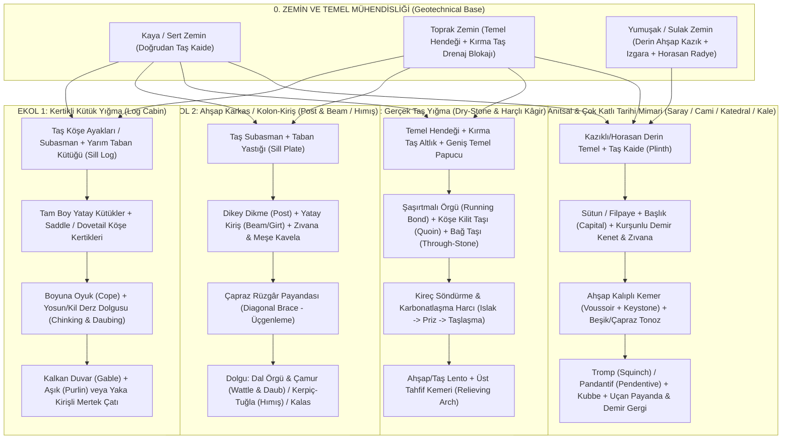
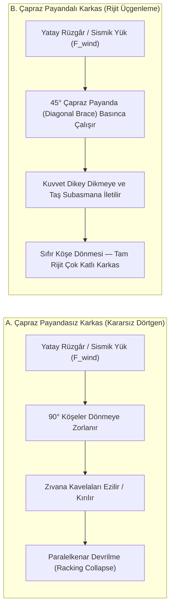
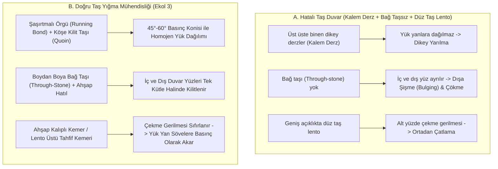
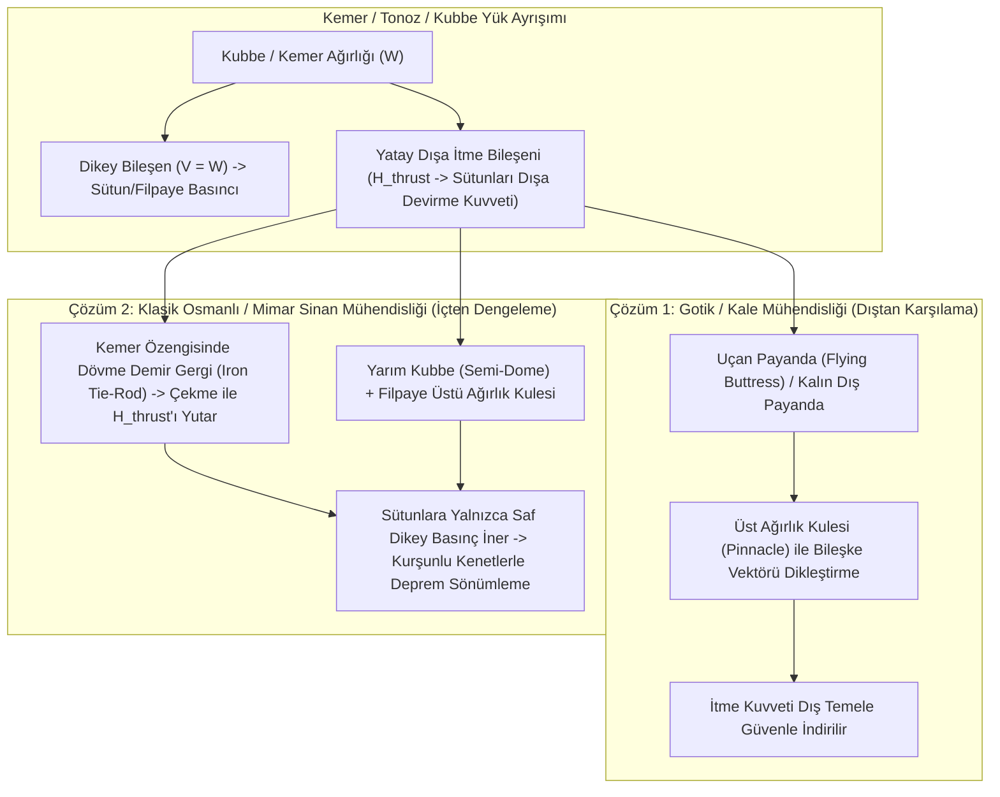

# DOK3 — Gerçek Hayat Mimari, Yapı Mühendisliği ve Referans Oyunlar Araştırması

> **Doküman Seti Navigasyonu (Gerçekçi İnşaat ve Mimari Sistemi — 7'li Master Şartname):**
> - **DOK1 (Hedef & Gereksinimler):** [`DOK1_HEDEF_VE_GEREKSINIMLER.md`](DOK1_HEDEF_VE_GEREKSINIMLER.md)
> - **DOK2 (Mevcut Yapı Envanteri & Dönüşüm Denetimi):** [`DOK2_MEVCUT_YAPI_ENVANTERI_VE_DONUSUM.md`](DOK2_MEVCUT_YAPI_ENVANTERI_VE_DONUSUM.md)
> - **DOK3 (Bu Doküman — Gerçek Hayat Mimari & Referans Araştırması):** [`DOK3_GERCEK_HAYAT_MIMARI_VE_REFERANS_ARASTIRMASI.md`](DOK3_GERCEK_HAYAT_MIMARI_VE_REFERANS_ARASTIRMASI.md)
> - **DOK4 (Yapısal Fizik, Statik Graf & Performans):** [`DOK4_YAPISAL_FIZIK_STATIK_VE_PERFORMANS.md`](DOK4_YAPISAL_FIZIK_STATIK_VE_PERFORMANS.md)
> - **DOK5 (Malzeme Progresyonu, İnşaat UX & İç Mekân):** [`DOK5_MALZEME_PROGRESYON_UX_VE_IC_MEKAN.md`](DOK5_MALZEME_PROGRESYON_UX_VE_IC_MEKAN.md)
> - **DOK6 (Yerleşim, Köy, Kasaba & Şehir Birleşimi):** [`DOK6_YERLESIM_KOY_KASABA_SEHIR_BIRLESIMI.md`](DOK6_YERLESIM_KOY_KASABA_SEHIR_BIRLESIMI.md)
> - **DOK7 (Adım Adım Uygulama & Test Planı):** [`DOK7_ADIM_ADIM_UYGULAMA_VE_TEST_PLANI.md`](DOK7_ADIM_ADIM_UYGULAMA_VE_TEST_PLANI.md)

---

## Yönetici Özeti ve Araştırma Metodolojisi

Bu doküman, Stratocraft'ın **"Oyuncu İnşaatı == Dünya Yerleşimi"** anayasasını ([`DOK1_HEDEF_VE_GEREKSINIMLER.md`](DOK1_HEDEF_VE_GEREKSINIMLER.md)) gerçek hayat yapı mühendisliği ve tarihsel ustalık kuralları üzerine oturtmak için hazırlanmıştır. Araştırma üç ana eksende yürütülmüştür:

1. **Kullanıcının Paylaştığı 5 YouTube Kaynağının Doğrulanmış İncelemesi (Bölüm 1):** Verilen 2 oynatma listesi ve 3 tekil video kaynağının tamamı web aramaları, YouTube oEmbed/RSS üstverileri ve bölüm açıklamaları üzerinden tek tek doğrulanmış; yapımcıları, süreleri, bölüm dizileri ve gösterdikleri gerçek şantiye aşamaları hiçbir uydurma detaya yer verilmeden dürüstçe raporlanmıştır.
2. **4 Gerçek Hayat Yapı Ekolünün Temelden Çatıya/Kubbeye Mühendislik Analizi (Bölüm 2):**
   - **Ekol 1:** Kertikli Kütük Yığma (*Notched Log Cabin*)
   - **Ekol 2:** Ahşap Karkas / Kolon–Kiriş (*Post & Beam / Timber Framing / Hımış*)
   - **Ekol 3:** Gerçek Taş Yığma (*Dry-Stone & Lime-Mortared Stone Masonry*)
   - **Ekol 4:** Anıtsal ve Çok Katlı Tarihi Mimari (*Saray, Büyük Cami, Katedral, Kale — Sütun, Kemer, Tonoz, Pandantif/Tromp, Kubbe, Uçan Payanda, Osmanlı Gergi Demiri ve Kurşunlu Kenet*)
3. **6 Referans Oyunun Karşılaştırmalı Analizi ve Stratocraft Hibrit Sentezi (Bölüm 3 & Bölüm 4):** *Sons of the Forest*, *Valheim*, *Medieval Engineers*, *Vintage Story*, *Enshrouded* ve *Eco* oyunlarının inşa UX'i, yapısal statik derinliği ve eğlence-gerçekçilik dengesi incelenerek Stratocraft için sıfır angaryalı, dokunsal ve gerçek fizik kurallarına tabi hibrit mimari sentez çıkarılmıştır.

---

## BÖLÜM 1: Kullanıcının Paylaştığı 5 YouTube Kaynağının Doğrulanmış Teknik İncelemesi

> [!IMPORTANT]
> **Araştırma Dürüstlüğü İlkesi:** Aşağıdaki 5 kaynağın tamamı canlı web indeksleri, YouTube oEmbed ve kanal/oynatma listesi XML beslemeleri üzerinden doğrulanmıştır. Her kaynağın başlığı, yapımcısı, süresi, bölüm listesi ve doğrudan gözlemlenen inşaat teknikleri kanıtlarıyla raporlanmış; arama ve üstveri kayıtlarında yer almayan hiçbir görsel detay uydurulmamış, teknik boşluklar uluslararası yapı mühendisliği literatürüyle desteklenmiştir.

### 1.1.Beş Kaynağın Kimlik ve Doğrulama Özeti

| # | Bağlantı & ID | Tür | Doğrulanan Başlık | Yapımcı / Kanal | Süre / Bölüm Sayısı | Temsil Ettiği Yapı Ekolü |
| :--- | :--- | :--- | :--- | :--- | :--- | :--- |
| **1** | [`watch?v=E_6b_cwuB6A`](https://www.youtube.com/watch?v=E_6b_cwuB6A&list=PL4hMjAZ2AKgAVsgvmNMLZlvRKfQERlXTT)   Liste: `PL4hMjAZ2AKgAVsgvmNMLZlvRKfQERlXTT` | Ana Belgesel + 15 Videoluk Oynatma Listesi | *One Year of Log Cabin Building / One Man Building His Dream House* (Liste: *Kütük ev yapımı*) | **Nik Rijavec** (`@nikrijavec47`)   Liste Derleyicisi: *Fahri Ozkalfa (Sıhhatli Yaşam)* | Ana Video: `7.503 sn` (`2 sa 5 dk 3 sn`)   Liste: `15 video` | **Ekol 1:** Kertikli Kütük Ev (*Full-Scribe & Saddle/Dovetail Notch Log Cabin*) + Şantiye Vinci (*Log Lift*) |
| **2** | [`watch?v=Ynfsbt0G-jk`](https://www.youtube.com/watch?v=Ynfsbt0G-jk&list=PLFHsjK8j-Em0NoGEWvlYjIiBQOqwPKbHR)   Liste: `PLFHsjK8j-Em0NoGEWvlYjIiBQOqwPKbHR` | Bölüm 1 + 14 Bölümlük Seri (`Part 1..14`) | *TAŞ EV ( BAĞ EVİ ) YAPIMI "TAŞ GETİRTME, ZEMİN HAZIRLAMA" PART 1* (Liste: *TAŞ EV ( BAĞ EVİ )*) | **ÇEVİKGİLLER** (`@cevikgiller`) | Part 1: `332 sn` (`5 dk 32 sn`)   Liste: `14 bölüm` (`15 kayıt`, Part 4 çift ekli) | **Ekol 3:** Harçlı Doğal Taş Yığma, Ahşap Kalıplı Kapı/Pencere Kemerleri, Taş Baca & Derz İşçiliği |
| **3** | [`watch?v=dQwWbTReS6k`](https://www.youtube.com/watch?v=dQwWbTReS6k) | Tekil Teknik/Animasyon Özeti | *Villa Nasıl Yapılır \|İnşaat Aşamaları \|Betonarme Yapım Aşama Aşama* | **Dr inşaat** | `134 sn` (`2 dk 14 sn`) | **Ekol 2 & 4 (Karkas/Çok Katlı Yük Zinciri):** 4 Aşamada Temel $\rightarrow$ Kolon $\rightarrow$ Kiriş/Tabliye $\rightarrow$ Üst Kat & Duvar Dolgusu |
| **4** | [`watch?v=w8u_yApCRLo`](https://www.youtube.com/watch?v=w8u_yApCRLo) | Tekil Mimari Kaba İnşaat Rehberi | *BAŞTAN SONA KABA İNŞAAT YAPIM AŞAMALARI* | **Mimar Ahmet Yalın** (`@mimarahmetyalin`) | `838 sn` (`13 dk 58 sn`) | **Ekol 2, 3 & 4 (Kaba İnşaat Sırası):** 2+1 Dubleks (`70 m² + 70 m²`) Kazı, Blokaj, Temel, Subasman, Kolon, Tabliye, Çatı |
| **5** | [`watch?v=hgSB6lF46KQ`](https://www.youtube.com/watch?v=hgSB6lF46KQ) | Kapsamlı Mühendislik Ders Videosu | *Bir İnşaatın Yapım Aşamaları \| İnşaat Nasıl Yapılır? \| İnşaat Yaptırmadan Önce Mutlaka İzleyin!* | **İnşaat Mühendisi Emirhan Aydın** (`@emirhanaydin`) | `3.206 sn` (`53 dk 26 sn`, `25` zaman damgalı bölüm) | **Tüm Ekoller (Tam Yapı Yaşam Döngüsü):** Zemin Etüdü & İyileştirme $\rightarrow$ Kazı $\rightarrow$ Temel $\rightarrow$ Karkas $\rightarrow$ Çatı $\rightarrow$ Duvar $\rightarrow$ Kör Kasa & İnce İşler |

---

### 1.2. Kaynak 1: Kütük Ev Oynatma Listesi (`E_6b_cwuB6A` & `PL4hMjAZ2AKgAVsgvmNMLZlvRKfQERlXTT`)

#### A. Oynatma Listesinin Tam İçerik Dökümü
Fahri Ozkalfa (*Sıhhatli Yaşam*) tarafından derlenen `PL4hMjAZ2AKgAVsgvmNMLZlvRKfQERlXTT` (*"Kütük ev yapımı"*) oynatma listesi, Slovenyalı solo kütük ev ustası **Nik Rijavec**'in Ekim 2018'de tek başına ormanda başlattığı *Building Off Grid Log Cabin* serisinin ana 2 saatlik belgeseli ile kritik aşama bölümlerini ve Alman/Avusturya geleneksel kütük yapı (*Naturstamm-Blockhausbau*) videolarını bir araya getirmektedir:

| Sıra | Video ID | Başlık | Kanal / Yapımcı | Gösterilen Teknik Odak |
| :--- | :--- | :--- | :--- | :--- |
| **1** | `E_6b_cwuB6A` | *One Year of Log Cabin Building / One Man Building His Dream House* | Nik Rijavec | 1 yıllık tam inşaat özeti (Ekim 2018 – Kasım 2019): Temel, kütük soyma, vinç kurulumu, *full-scribe* ve *saddle notch* ile duvarların tamamlanması. |
| **2** | `KxfFdzjMU9Y` | *Building Off Grid Log Cabin - S 2 Ep 2 / Cutting The Door* | Nik Rijavec | Duvarlar yükseldikten sonra içeri malzeme taşımak için testereyle kapı boşluğunun kesilmesi; çatı kapanmadan önce kapı/döşeme takılmaması kuralı. |
| **3** | `9TRiWeAm6JQ` | *Building Off Grid Log Cabin - S 2 Ep 3 / Balcony Support Logs* | Nik Rijavec | Çatıya geçmeden önce üst kat balkon çıkmasını (konsol kirişi) alttan taşıyacak dikey destek kütüklerinin (*support logs*) oturtulması. |
| **4** | `P8kM5kI-Sn0` | *Building Off Grid Log Cabin - Ep 20 / Second Floor Joists* | Nik Rijavec | Yan duvar kütükleri tamamlandıktan sonra 2. kat döşeme kirişlerinin (*second floor joists*) kertilerek duvar üstüne oturtulması. |
| **5** | `7ZDlvLYSZjE` | *Building Off Grid Log Cabin - Ep 14 / Fully Scribed Log* | Nik Rijavec | Kütük pergeli (*Log Scriber*) ile alt kütüğün tüm doğal profilinin üst kütüğe kopyalanıp boyuna oyuk (*lateral groove*) ve köşe kertiğinin açılması. |
| **6** | `04k4PQZ1xGo` | *NICOLOG: Präzise Blockhaus- Schnitte mit der Micromill!* | Nikolas Berwian | Kütük ev birleşimlerinde kılavuz raylı testere aparatıyla (*Micromill*) hassas kertik ve yüzey kesimi. |
| **7** | `z-jqTJwZb3E` | *Einblicke in den Blockhausbau - so entsteht ein Haus aus Baumstämmen* | Dehler Outdoor (Naturstammbauer) | Augsburg/Gersthofen'deki profesyonel doğal kütük ev ustalarının kütük seçimi, kabuk soyma, köşe kilitleme ve yalıtım süreci. |
| **8** | `eZgtjQDt95c` | *Blockhaus bauen - Stamm aussuchen, anzeichnen, aussägen* | Die Selbstversorger Familie | Doğru ağacı seçme, kütük pergeli (*Kopierzirkel*) ile çizim (*anzeichnen*) ve motorlu testere/ıskarpela ile oyma (*aussägen*). |
| **9** | `U1PLgRRhPH4` | *Building Off Grid Log Cabin - Ep 10 / Construction of The Lift* | Nik Rijavec | Ağır yaş kütükleri tek başına duvar üstüne kaldırabilmek için ahşap direkli şantiye vincinin (*The Lift*) inşası (ilk denemede kısa kaldığı için sökülüp uzatılarak ikinci kez dikilmesi). |
| **10** | `yYfYBHwWRTU` | *Building Off Grid Log Cabin - Ep 11 / Lift Works And The First Logs Are In Place* | Nik Rijavec | Vincin test edilmesi ve temel üzerindeki ilk iki yarım taban kütüğünün (*first two half logs / sill logs*) vinçle kaldırılıp yerine oturtulması. |
| **11** | `zzghMHml9nM` | *Building Off Grid Log Cabin - Ep 19 / The Walls Are Done And The Lift is Out!* | Nik Rijavec | 1 yılın sonunda ana kütük duvarların tamamlanması ve 2. kat kirişleri ile çatıya engel olmaması için bina ortasındaki ahşap vincin sökülmesi. |
| **12** | `dzLYygNdG0g` | *Naturstamm Blockhaus Aufbau im Zeitraffer* | Team Kanadablockhaus | Kanada usulü doğal kütük evin temel üstünde sıra sıra (*course by course*) yükselmesi ve aşık (*purlin*) çatısının hızlandırılmış kurulumu. |
| **13** | `txMozU2My1o` | *Aşık Veysel Aslında Kim?* | ViBio | *(Oynatma listesi sahibinin listeye sehven eklediği konu dışı biyografi videosu — dürüstlük gereği not edilmiştir).* |
| **14** | `JpoLpAukiD8` | *Building an Off Grid Log Cabin Ep. 21* | TheHardWay | *"Chinking the cabin!"* — Kütük sıraları arasındaki yatay birleşim boşluklarının derz dolgusu (*chinking*) ile rüzgâr ve soğuğa karşı kapatılması. |
| **15** | `uptbaiX-0CI` | *Building log cabin: Blind wall dovetail* | Wooden Workshop | Kütük ev duvarında gizli kırlangıç kuyruğu (*blind wall dovetail*) geçme kertiğinin adım adım yontulması ve kilitlenmesi. |

#### B. Doğrudan Gözlemlenen Mühendislik Kuralları ve Stratocraft Çıkarımları
1. **Kütükler Asla Doğrudan Toprağa ve Düz Silindir Olarak Konmaz (`Ep 11`):** İlk sıra her zaman taş temel üzerine oturan, alt yüzeyi düzlenmiş **yarım taban kütükleridir (*Half Logs / Sill Logs*)**.
2. **Scribing & Saddle Notch Olmadan Kütükler Üst Üste Duramaz (`Ep 14`, `eZgtjQDt95c`, `uptbaiX-0CI`):** İki yuvarlak kütük üst üste konduğunda temas alanı yalnızca ince bir çizgidir ve yanal kuvvette anında yuvarlanır. Usta, **Log Scriber (Kütük Pergeli)** ile alt kütüğün konturunu üst kütüğe kopyalar, üst kütüğün altını boydan boya içbükey oyar (*Lateral Groove*) ve köşelerde **Saddle Notch (Semer Kertik)** veya **Dovetail Notch (Kırlangıç Kuyruğu)** açarak iki dik duvarı birbirine yerçekimiyle kilitler.
3. **Ağır Kütükler İçin Şantiye Vinci (*The Lift*) Zorunluluğu (`Ep 10`, `Ep 11`, `Ep 19`):** Bel hizasından yukarıya `200–400 kg`'lık yaş kütükleri tek başına kaldırmak imkânsızdır; usta önce ahşap bir **Vinç / Palanga (*Lift*)** kurar, duvarlar bitince vinci söker (`DOK5` içindeki Vinç/Palanga mekaniğinin doğrudan gerçek hayat karşılığı).
4. **Konsol Çıkmalar Alttan Desteklenmek Zorundadır (`S2 Ep 3`):** Balkon veya saçak için dışarı uzanan kütükler havada serbest bırakılmaz; uçlarının altına **Balcony Support Logs (Destek Dikmeleri)** yerleştirilerek yük temele indirilir.
5. **Çatı Kapanmadan İç Mekân Yapılmaz (`S2 Ep 2`):** Nik Rijavec kapı boşluğunu malzeme geçirmek için açar ancak *"Çatı kapanıp içerisi yağmurdan tamamen korunmadan kapı, iç döşeme veya iç mobilya kurmayacağım"* kuralını vurgular.

---

### 1.3. Kaynak 2: Taş Ev (Bağ Evi) Oynatma Listesi (`Ynfsbt0G-jk` & `PLFHsjK8j-Em0NoGEWvlYjIiBQOqwPKbHR`)

#### A. Oynatma Listesinin Tam İçerik Dökümü
**ÇEVİKGİLLER** (`@cevikgiller`) kanalının 1 dönüm tarla üzerinde kendi elleriyle inşa ettikleri `1+1` taş bağ evi (+ yüksek tavanlı ahşap çatı katı ve veranda) serisi, 14 kronolojik bölümden oluşmaktadır:

| Bölüm | Video ID | Başlık | Gösterilen Şantiye Aşaması ve Ustalık Detayı |
| :--- | :--- | :--- | :--- |
| **Part 1** | `Ynfsbt0G-jk` | *TAŞ EV ( BAĞ EVİ ) YAPIMI "TAŞ GETİRTME, ZEMİN HAZIRLAMA" PART 1* | Şantiyeye kamyonlarla doğal yapı taşlarının getirilip yığılması (*Şantiye Taş Yığını*) ve temel zemininin hazırlanıp tesviye edilmesi. |
| **Part 2** | `grsa-pboMfM` | *TAŞ EV ( BAĞ EVİ ) YAPIMI "TAŞ DÖŞEME, DUVAR ÖRME" PART 2* | Hazırlanan temel üzerine ilk sıra iri taşların döşenmesi, ip çekilerek harçlı taş duvar örgüsünün başlatılması. |
| **Part 3** | `kzh99OO7Ul8` | *TAŞ EV ( BAĞ EVİ ) YAPIMI "KALIP YERLEŞTİRME, DUVAR YÜKSELTME" PART 3* | Pencere ve kapı kemerleri için önceden çakılan **ahşap kemer kalıplarının (*wooden arch centering*)** duvar boşluklarına yerleştirilmesi ve duvarın yükseltilmesi. |
| **Part 4** | `mBjsP5u8lg4` | *TAŞ EV ( BAĞ EVİ ) YAPIMI "DUVAR ÖRME VE YÜKSELTME" PART 4* | *(Listede iki kez yer alır)* Kalıplar etrafında taş duvar sıralarının şaşırtmalı olarak yükseltilmesi. |
| **Part 5** | `fZ0etvT8ky8` | *TAŞ EV ( BAĞ EVİ ) YAPIMI "DUVAR ÖRME" PART 5* | Kalın taş duvarların iç ve dış yüzlerinin seçilmiş taşlarla örülmeye devam edilmesi. |
| **Part 6** | `TePYEVss84Y` | *TAŞ EV ( BAĞ EVİ ) YAPIMI "KEMER VE DUVAR ÖRME" PART 6* | Pencere açıklıkları üzerindeki ahşap kalıpların üstüne kama biçimli kemer taşlarının dizilerek kemerlerin örülmesi ve duvarın yükseltilmesi. |
| **Part 7** | `KeGjMtEs7XE` | *TAŞ EV ( BAĞ EVİ ) YAPIMI "DUVAR ÖRME, TAŞLARIN GELİŞİ" PART 7* | Taş duvarın üst kotlara çıkması ve şantiyede biten taş stokunun yeni taş sevkiyatıyla beslenmesi (lojistik süreklilik). |
| **Part 8** | `o8QLb7VYH6A` | *TAŞ EV (STONE HOUSE) YAPIMI "DUVAR ÖRME VE KEMER" PART 8* | Üst kot duvarlarının ve diğer cephe kemerlerinin örülmesi. |
| **Part 9** | `CI0P0nRx4-s` | *TAŞ EV ( BAĞ EVİ ) YAPIMI "DUVAR ÖRME, KAPI PENCERE'YE KEMER" PART 9* | Ana giriş kapısı ve pencere açıklıklarının kemerlerinin tamamlanıp kilit taşlarıyla kapatılması. |
| **Part 10** | `KaaCZZ2CMcE` | *TAŞ EV ( BAĞ EVİ ) YAPIMI "ZEMİN BETONU ATIMI" PART 10* | Taş duvarlarla çevrelenen iç mekânın zemin tesviyesi ve taban döşemesinin dökülmesi. |
| **Part 11** | `kImQaxNOixw` | *TAŞ EV ( BAĞ EVİ ) YAPIMI "TAVAN BETONU ATIMI" PART 11* | Üst tavan/kat döşemesi için kalıpların çakılması, taşıyıcı donatıların bağlanması ve tavan tablasının oluşturulması. |
| **Part 12** | `c0gb3AT9I0M` | *TAŞ EV ( BAĞ EVİ ) YAPIMI "SERAMİK DÖŞEME" PART 12* | İç mekân mutfak/zemin kaplamalarının döşenmesi, veranda tabanına başlanması ve iç derzlerin boyaya/sıvaya hazırlanması. |
| **Part 13** | `u8kdMF42MKk` | *TAŞ EV ( BAĞ EVİ ) YAPIMI "BACA VE DERZLER" PART 13* | Taş evin **bacasının (*chimney*)** örülmesi ve dış/iç taş duvarlar arasındaki **derzlerin (*pointing/repointing*)** harçla doldurulup şekillendirilmesi. |
| **Part 14** | `nYVnRxWsPXE` | *TAŞ EV ( BAĞ EVİ ) YAPIMI "VERANDA DEVAMI" PART 14* | Ön veranda yapısının ve dış cephe rötuşlarının tamamlanması. |

#### B. Doğrudan Gözlemlenen Mühendislik Kuralları ve Stratocraft Çıkarımları
1. **Kemer Kalıbı (*Wooden Centering*) Olmadan Taş Kemer Örülemez (`Part 3`, `Part 6`, `Part 8`, `Part 9`):** Serideki en kritik yapısal ders budur. Kapı ve pencere üstlerini taşla geçerken taşlar havada durmaz; önce ahşaptan yarım daire/yay şeklinde bir **Kemer Kalıbı** çakılıp iki yan duvar (söve) üstüne oturtulur (`Part 3`), kemer taşları ve harç bu ahşap kalıbın sırtına dizilir (`Part 6..9`), en tepeye kilit taşı sıkıştırılıp harç prizini aldıktan sonra kalıp sökülür.
2. **Şantiye Taş Yığını Lojistiği (`Part 1`, `Part 7`):** Taş duvar inşası çok yüksek kütleli taş tüketir. Oyuncunun cebinde 500 taş taşıması yerine, şantiye yanına kurulan **Şantiye Malzeme Yığını (*Site Material Pile*)** ve el arabası ile taşınması gerçek şantiye akışıdır.
3. **Baca ve Derz İşçiliği (`Part 13`):** Kaba taş duvar örüldükten sonra taşların arasındaki boşlukların derz harcıyla doldurulması (*Pointing*) hem rüzgâr/su sızdırmazlığını sağlar hem de yük dağılımını homojenleştirir; ısınma için taş baca duvarla bütünleşik yükselir.

---

### 1.4. Kaynak 3, 4 ve 5: Çok Katlı Yapı, Temel–Kolon–Kiriş–Tabliye ve Şantiye Mühendisliği Referansları (`dQwWbTReS6k`, `w8u_yApCRLo`, `hgSB6lF46KQ`)

Kullanıcının "Çok Katlı / Tarihi Kolon-Kiriş / Temel-Sütun Referansları" başlığı altında paylaştığı bu 3 Türkçe video, Türkiye'deki inşaat mühendisliği ve mimarlık kanalları tarafından hazırlanmış **kaba inşaat ve yapı statiği aşama rehberleridir**.

> [!NOTE]
> **Dürüst Gözlem Notu:** Her üç video da modern müstakil villa/bina kaba inşaatını (betonarme/çelik karkas terminolojisiyle) anlatmaktadır. Ancak anlattıkları **statik yük aktarım hiyerarşisi (Zemin $\rightarrow$ Temel Kazısı $\rightarrow$ Blokaj/Tesviye $\rightarrow$ Subasman/Kaide $\rightarrow$ Düşey Kolon/Sütun $\rightarrow$ Yatay Kiriş & Kat Döşemesi $\rightarrow$ Çatı $\rightarrow$ Dolgu Duvar & Kör Kasa)**, Stratocraft'ın **Ekol 2 (Ahşap Karkas / Kolon–Kiriş)** ve **Ekol 4 (Anıtsal Çok Katlı Sütun–Kemer–Tonoz–Kubbe)** sistemlerinin **birebir mühendislik omurgasıdır**.

#### A. Kaynak 3 (`dQwWbTReS6k` — *Dr inşaat*: "Villa Nasıl Yapılır | İnşaat Aşamaları | Betonarme Yapım Aşama Aşama", `2 dk 14 sn`)
- **İçerik ve Gözlem:** Müstakil iki katlı bir villanın kaba inşaatını **4 ardışık yapısal fazda** görselleştirir:
  1. **Faz 1 (Altyapı ve Temel):** Temel çukurunun kazılması, zeminin düzlenmesi ve tüm bina taban yükünü zemine yayan radye temel plağının oluşturulması.
  2. **Faz 2 (Zemin Kat İskeleti):** Temel filizlerinden yükselen düşey kolonların dikilmesi ve zemin kat tavanını (1. kat tabanını) oluşturan yatay kiriş + döşeme tablasının kapatılması.
  3. **Faz 3 (1. Kat İskeleti ve Çatı Tablası):** Alt kat kolonlarının tam hizası üzerine 1. kat kolonlarının yükselmesi ve üst çatı tablasının bağlanması (**sürekli düşey yük yolu / continuous vertical load path**).
  4. **Faz 4 (Bölme/Cephe Duvarları ve Kabuk):** Taşıyıcı kolon–kiriş karkası kendi başına ayakta durduktan sonra, kolonlar arasındaki boşlukların duvarlarla doldurulması ve çatının kapatılması.

#### B. Kaynak 4 (`w8u_yApCRLo` — *Mimar Ahmet Yalın*: "BAŞTAN SONA KABA İNŞAAT YAPIM AŞAMALARI", `13 dk 58 sn`)
- **Örnek Proje:** `2+1` dubleks müstakil konut (Zemin kat: `70 m²` kapalı alan + `38 m²` açık teras; 1. kat: `70 m²` kapalı alan + `16 m²` balkon).
- **Adım Adım Gösterilen Kaba İnşaat Sırası:**
  1. **Aplikasyon ve Temel Hafriyatı:** Köşe kazıklarının çakılması, kireç/ip hattıyla bina oturum alanının belirlenmesi ve sağlam zemine kadar temel kazısı yapılması.
  2. **Mıcır Blokaj ve Grobeton:** Temel tabanına yeraltı suyunu drene eden kırma taş/mıcır serilmesi ve üzerine çamur/toprak temasını kesen ince tesviye katmanı (*grobeton*) dökülmesi.
  3. **Bohçalama Su Yalıtımı ve Radye Temel:** Temelin nemden korunması ve ana taşıyıcı temelin inşası.
  4. **Subasman Perdeleri ve Temel Dolgusu:** Zemin kat döşemesini toprak ve yağmur suyundan yukarı kaldırmak için **Subasman (Kaide/Plinth)** duvarlarının çevrilmesi, içinin kırma taş/dolguyla sıkıştırılması ve zemin tablasının oluşturulması.
  5. **Zemin Kat Kolonları $\rightarrow$ 1. Kat Tabliyesi (`70 m²` + `16 m²` konsol balkon):** Düşey kolonların dikilmesi, ardından kalıp ve dikmeler (*shoring/props*) kurularak 1. kat kiriş ve döşeme tablasının (*tabliye*) oluşturulması. Balkonların (`16 m²`) iç döşeme kirişlerinin konsol devamı olarak taşınması.
  6. **1. Kat Kolonları $\rightarrow$ Çatı ve Duvar İmalatları:** Üst kat kolonlarının ve çatı tablasının tamamlanıp dış/iç duvarların örülmesi.

#### C. Kaynak 5 (`hgSB6lF46KQ` — *İnşaat Mühendisi Emirhan Aydın*: "Bir İnşaatın Yapım Aşamaları", `53 dk 26 sn`)
- **Doğrulanmış 25 Zaman Damgalı Mühendislik Akışı ve Tarihsel/Oyun İçi Karşılıkları:**

| Video Zaman Damgası | Emirhan Aydın'ın Anlattığı Mühendislik Aşaması | Tarihsel Mimari (Ekol 1–4) & Stratocraft Sistem Karşılığı |
| :--- | :--- | :--- |
| `02:15` – `06:27` | **Proje Aşaması & Zemin Etüdü (`04:15`):** Zeminin taşıma kapasitesinin ölçülmesi ve statik projenin zemine göre çizilmesi. | **Zemin Taşıma Kapasitesi (`DOK4`):** Kaya (`1.0x`) vs Sıkışmış Toprak (`0.7x`) vs Kum/Çamur (`0.3x`). Ağır taş/kubbeli yapılar çamur üstüne temelsiz yapılırsa çöker. |
| `10:00` – `11:33` | **Zemin İyileştirme (`10:00`) & Kazı İşleri (`11:33`):** Zayıf/gevşek zeminde kazık/enjeksiyon ile zemini sağlamlaştırma ve temel çukuru kazma. | **Ekol 4 Ahşap Kazıklı Temel (*Timber Piles*) & Hendek Kazısı:** Yumuşak zeminde meşe kazıklar çakma veya kazmayla temel hendeği açıp kırma taş blokaj doldurma. |
| `12:16` – `13:54` | **Grobeton, İzolasyon (`12:16`) & Temel (`13:54`):** Toprak nemini kesen tesviye katmanı ve yükü zemine yayan temel. | **Kırma Taş Blokaj + Taş Subasman / Horasan Harçlı Temel:** Ahşap taban kirişlerini (*Sill Log / Sill Plate*) toprak neminden ve çürümeden koruyan taş kaide. |
| `14:40` – `19:25` | **Kat Betonları (`14:40`) & Çatı İşleri (`19:25`):** Kolon $\rightarrow$ Kiriş $\rightarrow$ Döşeme döngüsüyle katların çıkılması ve çatının kapatılması. | **Ekol 2 (Dikme–Kiriş–Payanda–Döşeme) & Ekol 4 (Sütun–Kemer–Tonoz–Kubbe):** Düşey taşıyıcılar olmadan üst kat döşemesi veya çatı/kubbe kurulamaz. |
| `19:53` – `23:40` | **Duvar İşleri (`19:53`), Kör Kasa (`23:27`) & Sıva (`23:40`):** Karkas arasına duvar örülmesi, kapı/pencere boşluklarına **Kör Kasa (*Rough Buck Frame*)** takılması ve sıva. | **Dolgu Duvar (*Wattle & Daub / Hımış / Tuğla*) + Kapı/Pencere Kasası (*Buck*) + Kireç Sıva:** Kapı/pencere kanadı doğrudan kaba taşa/kütüğe değil, önce boşluğa sabitlenen ahşap kasaya (*kör kasa*) menteşelenir. |
| `25:03` – `51:23` | **Mantolama/Yalıtım (`25:03`), Isıtma (`30:16`), Döşeme Kaplamaları (`34:33`, `42:25`, `48:16`), Pencere (`38:47`) & Kapı Montajı (`45:39`).** | **İç Mekân & Termal Konfor (`DOK4` & `DOK5`):** Kütük arası yosun/kil *chinking* veya kireç sıva ile tam kapalı oda yalıtımı (*clo* / iç sıcaklık bonusu), şömine/baca ısıtması, cam/kepenkli pencere ve menteşeli kapılar. |

---

## BÖLÜM 2: Dört Gerçek Hayat Yapı Ekolünün Temelden Çatıya/Kubbeye Mühendislik Analizi

Aşağıdaki diyagram, insanlık tarihindeki 4 temel yapı ekolünün yük aktarım prensiplerini ve birbirleriyle olan yapısal evrim ilişkisini özetlemektedir:

---

### 2.1. EKOL 1: Kertikli Kütük Yığma Ev (*Notched Log Cabin*)

Kertikli kütük mimarisi (İskandinav, Kuzey Amerika, Alp ve Karadeniz/Anadolu yayla "çantı" geleneği), ağacın hem **taşıyıcı duvar** hem de **ısı yalıtım kabuğu** olarak yatay sıralar (*courses*) halinde üst üste kilitlendiği yığma ahşap sistemdir.

#### A. Adım Adım İnşaat ve Ustalık Süreci
1. **Ağaç Seçimi, Kesim ve Kabuk Soyma (*Felling & Peeling*):**
   - Düz gövdeli, az budaklı iğne yapraklılar (çam, ladin, köknar) veya dayanıklı sert ağaçlar (meşe, kestane) seçilir.
   - Kütük kabuğu altında böcek/mantar barınmasını ve çürümeyi önlemek için iki saplı **çekme bıçağı (*Drawknife*)** veya **kabuk soyma demiri (*Bark Spud*)** ile kabuk tamamen soyulur.
2. **Taş/Kazık Temel ve Taban Kütüğü (*Foundation & Sill Logs*):**
   - Ahşap doğrudan nemli toprağa değerse kapiler su emilimiyle 2–3 yılda çürür. Bu yüzden köşe ve orta noktalara **Taş Ayaklar (*Stone Piers*)** veya **Kuru/Harçlı Taş Subasman Duvarı** örülerek ahşap zeminden en az `30–50 cm` yukarı kaldırılır.
   - En alt sıraya konan iki paralel kütüğe **Taban Kütüğü (*Sill Log*)** denir. Taban kütüklerinin alt yüzeyi balta/testere ile düzlenir (*half-log* veya *flat-bottomed sill*) ki taş temel üzerinde yuvarlanmasın ve tam yüzey temasıyla yükü aktarsın.
3. **Köşe Kertikleri (*Corner Notching*) ve Boyuna Oyuk (*Scribing & Lateral Groove*):**
   - Taban kütüklerine dik doğrultuda ikinci sıra kütükler (*Header Logs*) yatırılır.
   - **Kütük Pergeli (*Log Scriber / Kopierzirkel*):** Su terazili çift uçlu pergel ile alttaki kütüğün doğal yüzey kıvrımı ve köşe kesiti üstteki kütüğe birebir çizilir.
   - **Boyuna Oyuk (*Lateral Groove / Cope*):** Üst kütüğün alt yüzeyi boyunca oluklu keski (*Gouge*), oluklu keser (*Hollow Adze*) veya testere ile ters V/U şeklinde boyuna bir kanal açılır; böylece üst kütük alt kütüğün sırtına iki kenardan ısırma yaparak oturur.
   - **Kütük Yönü Değişimi (*Butt-and-Pass Alternation*):** Ağaç gövdesi kökten (*butt*) uca (*tip*) doğru incelir. Duvarın teraziye (yatay düzleme) gelmesi için her sırada kütüklerin kalın ve ince uçları ters çevrilerek dizilir.
4. **3 Temel Köşe Kertiği Geometrisi ve Statik Farkları:**

| Kertik Türü | Geometri ve Yapım Tekniği | Statik Kilitlenme ve Su Tahliyesi |
| :--- | :--- | :--- |
| **Semer Kertik (*Saddle Notch / Round Notch*)** | Yuvarlak kütüğün alt/üst ucuna, alttaki dik kütüğün sırtını kavrayan içbükey eyer (*semere benzer*) oyuk açılır. *Compression-fit* (eğimli yanak) kesiminde kütük kurudukça kendi ağırlığıyla kama gibi daha sıkı oturur. | En hızlı açılan ve tam yuvarlak kütükte en yüksek kesme/devrilme direncini veren kertiktir. Sadece alt yüzeye açılan (*blind underside*) semer kertik yağmur suyunu tutmaz. |
| **Kırlangıç Kuyruğu Kertik (*Full / Half Dovetail Notch*)** | Kütük uçları (veya tüm kütük boyu balta/keserle yontularak — *Hewn Log*) yamuk/trapez kesitli kırlangıç kuyruğu şeklinde yontulur; eğimler hem dışa hem aşağıya bakar. | **İki eksenli mekanik kilit:** Kütüklerin ne boyuna ne enine kaymasına izin verir; dışa eğimli yüzeyler yağmur suyunu merkezden dışarı akıtır (*self-draining*). En üst düzey ustalık kertiğidir. |
| **Kare / Düz Bindirme Kertik (*Square / Halving Notch*)** | Kütük uçlarının yarı kalınlığı düz olarak kesilip üst üste bindirilir. | Tek başına yanal kaymaya karşı zayıftır; köşeden dikey delik delinip **Ahşap Kavela / Kazık (*Wooden Peg / Treenail*)** çakılarak sabitlenmesi zorunludur. |

5. **Kapı/Pencere Açıklıkları, Kavelalama (*Pegging*) ve Oturma Payı (*Settling Space*):**
   - Kapı ve pencere boşluklarının yanlarındaki kesik kütük uçları boşta kalıp dönmesin diye, üstten alta matkapla (*Auger*) delinip meşe kavelalarla birbirine pimlenir ve yan yüzeylere dikey **Kör Kasa / Kızaklı Söve (*Door/Window Buck with Slotted Spline*)** takılır.
   - Yaş kütükler kururken liflere dik yönde (çapında) **%3 ila %5** oranında büzülür; `2.50 m` yüksekliğindeki bir kütük duvar **`7.5 cm – 12.5 cm` aşağı çöker (*Settling*)**. Bu yüzden kapı ve pencere kasalarının üstünde bu büzülmeyi emecek yosun/yün dolgulu bir **Oturma Boşluğu (*Settling Space*)** bırakılır.
6. **Derz Dolgusu (*Chinking & Daubing*):**
   - Kütük sıraları arasındaki yatay derzlere önce kuru yosun (*Sphagnum moss*), koyun yünü, keten/kenevir kıtığı veya ince odun kamaları sıkıca tıkanır (**Chinking**).
   - Üzerine kil + sönmüş kireç + ince kum + kıyılmış saman/hayvan kılı karışımı esnek harç mala ile sıvanır (**Daubing**). Bu işlem yapılmadan kütük kulübe rüzgârı içeri alır ve tam ısı yalıtımı sağlamaz.
7. **Çatı Konstrüksiyonu (Aşık / *Purlin* vs Mertek / *Rafter*):**
   - **İskandinav / Alp Aşık Çatısı (*Gable-and-Purlin Roof*):** Ön ve arka cephede kütükler üçgen **Kalkan Duvar (*Gable Wall*)** şeklinde tepeye kadar daralarak dizilir. Kalkan duvar kütüklerinin arasına yatay **Aşık Kirişleri (*Purlins*)** ve en tepeye **Mahya Kütüğü (*Ridgepole*)** oturtulur. Ancak üçgen kalkan duvar kurudukça çökeceği için, sabit mertek çakılırsa çatı eğimi bozulur; bu yüzden kayar mesnet (*sliding eave notch*) veya büzülmeye uyumlu kalas/turba/zona kaplama kullanılır.
   - **Mertek ve Yaka Kirişli Çatı (*Rafter & Collar-Tie Roof*):** Kalkan duvar kütükten örülmez; dört kütük duvar aynı hizada (*Wall Plate / Cap Log*) biter. Üzerine üçgen çatı makasları (eğik **Mertekler / *Rafters*** + iki merteği yatay bağlayan **Yaka Kirişi / *Collar Tie* veya Bırakma Kirişi / *Tie Beam***) oturtulur.

#### B. Kullanılan Geleneksel El Aletleri
- **Devirme & Boylama:** Ormancı Baltası (*Felling Axe*), İki Kişilik Çekme Testeresi (*Crosscut Saw*).
- **Kabuk Soyma & Düzleme:** Çekme Bıçağı (*Drawknife*), Kabuk Soyma Demiri (*Bark Spud*), Yontma Baltası (*Broadaxe*), Keser (*Adze*).
- **Çizim & Kertik Açma:** Su Terazili Kütük Pergeli (*Log Scriber*), Oluklu Keski (*Slick / Gouge Chisel*), Ahşap Tokmak (*Mallet*), Burgu Matkap (*T-Auger* — kavela delikleri için).
- **Kaldırma & Yerleştirme:** Kütük Çevirme Kancası (*Cant Hook / Peavey*), Kütük Kıskacı (*Timber Tongs*), Eğik Kızak (*Skid Poles*) ve Ahşap Şantiye Vinci (*Log Lift / Tripod Hoist*).

#### C. Gerçek Hayatta Hata ve Çökme Nedenleri (*Structural Failure Modes*)
1. **Kertiksiz Yuvarlak Kütük İstifleme (*Unnotched Rolling Failure*):** Köşe kertiği (*Saddle/Dovetail*) veya dikey kazık desteği olmadan iki yuvarlak kütüğü üst üste koymak statik olarak **kararsız dengedir**; en ufak yanal kuvvet veya üst kütük ağırlığında yuvarlanıp yıkılır (kullanıcının PlayTest'te bildirdiği *"kütüklerin hiçbir kertik/destek olmadan üst üste durması"* hatasının gerçek hayat karşılığı).
2. **Kısa Kütük Ucu Kesme Kırılması (*Short Log-Tail Shear-Out*):** Köşe kertiğinden dışarı taşan kütük ucu (*Log Tail / Overhang*) kütük çapının yarısından (`< 15–20 cm`) kısa bırakılırsa, kertik boynu liflere paralel kesme gerilmesiyle (*horizontal shear*) kopar ve köşe dağılır.
3. **Diferansiyel Oturma ve Asılı Kalma (*Differential Settling / Hang-Up*):** Yatay kütük duvar kurudukça `%3–5` çökerken, araya vidasız/kızaksız dikey bir direk veya sert kapı kasası konursa üst kütükler bu dikmeye takılıp havada asılı kalır (*Hang-Up*), kütükler arasında yumruk girecek yarıklar açılır ve köşe kertikleri yükten çıkarak burkulur.
4. **Yaka Kirişsiz Merteklerin Duvarı Dışa Devirmesi (*Unrestrained Rafter Spread*):** Çatı mertekleri alt uçtan yatay bir bırakma/yaka kirişiyle (*Tie Beam / Collar Tie*) birbirine bağlanmazsa, çatı ve kar yükü yan kütük duvarların en üst sırasını dışarı doğru iter ve üst kütük sıralarını devirir.

---

### 2.2. EKOL 2: Ahşap Karkas / Kolon–Kiriş (*Post & Beam / Timber Framing / Hımış*)

Ahşap karkas mimarisi (Orta Çağ Avrupa *Fachwerk / Half-Timber*, Japon *Zairai* ve Geleneksel Osmanlı/Anadolu **Hımış** sistemi), tüm kütüklerle dolu masif duvar örmek yerine **yükü kalın dikey kolonlar (*Posts*), yatay kirişler (*Beams*) ve çapraz payandalardan (*Braces*) oluşan iskelet bir kafese taşıtan**, aradaki boşlukları ise hafif dolgu malzemeleriyle kapatan mühendislik devrimidir. Ağaç tüketimini `%60–70` azaltırken çok katlı ve cumbalı (*cantilevered*) yapılara imkân tanır.

#### A. Adım Adım İnşaat ve Ustalık Süreci
1. **Taş Subasman Kaidesi ve Taban Yastığı (*Masonry Plinth & Sill Plate*):**
   - Önce zemine taş ve harçla `40–80 cm` yüksekliğinde bir **Subasman Duvarı (*Plinth*)** örülür.
   - Subasman üzerine boylu boyunca kare kesitli kalın ahşap **Taban Yastığı (*Sill Plate / Güdül*)** yatırılır.
2. **Dikey Dikmeler (*Posts*) ve Yatay Kirişler (*Beams / Girts / Wall Plates*):**
   - Köşelere ve `2.0–3.5 m` aks aralıklarına kare kesitli (`15×15 cm` – `25×25 cm`) **Ana Dikmeler (*Principal Posts*)**, aralarına ise kapı/pencere açıklıklarını sınırlayan **Ara Dikmeler (*Studs*)** dikilir.
   - Dikmelerin üst uçları kat hizasında yatay **Bağ Kirişleri (*Girts*)**, ana taşıyıcı **Orta Kiriş (*Summer Beam*)** ve en üstte **Duvar Başlığı (*Wall Plate*)** ile birbirine bağlanır.
   - İki yan duvar kirişleri arasına daha sık aralıklarla (`40–60 cm`) yatay **Döşeme Kirişleri (*Floor Joists*)** dizilir ve üzerine döşeme kalasları (*Floor Planks*) çakılır.
3. **Zıvana ve Meşe Kavela Bağlantısı (*Mortise & Tenon with Drawbore Oak Peg*):**
   - Ahşap karkasta metal çivi kullanılmaz; tüm düğüm noktaları **Erkek–Dişi Zıvana (*Mortise and Tenon*)** ile birleşir:
     - Dikme (*Post*) veya ana kiriş içine keskiyle dikdörtgen bir yuva (**Dişi Zıvana / *Mortise***) açılır.
     - Bağlanan kirişin ucu bu yuvaya tam girecek bir dil (**Erkek Zıvana / *Tenon***) şeklinde testere ve keskiyle yontulur.
   - **Çektirmeli Kavela (*Drawboring*) Mühendisliği:** Zıvana birleşiminin çekme altında çıkmasını önlemek için delik delinirken erkek zıvana üzerindeki delik, dişi zıvana deliğine göre omuz tarafına doğru **`2–4 mm` kaçık (*offset*)** delinir. Sert kuru meşeden yontulmuş sekizgen/silindirik **Ahşap Çivi (*Oak Peg / Treenail*)** balyozla bu deliğe çakıldığında, kaçık delikleri hizalamaya zorlayarak kiriş omzunu dikmeye muazzam bir mekanik ön-gerilmeyle (*pre-tension*) çeker ve kilitler.
4. **Çapraz Rüzgâr Payandası (*Diagonal Wind Brace / Knee Brace*):**
   - Yalnızca dikey dikme ve yatay kirişlerden oluşan bir dikdörtgen çerçeve, köşeleri zıvanalı olsa bile geometrik olarak **dört çubuklu bir mekanizmadır**; yandan rüzgâr veya deprem kuvveti geldiğinde paralelkenar (*rhombus*) şeklinde yatıp çöker (**Racking Failure**).
   - Bunu önlemek için dikme ile yatay kiriş arasına $45^\circ$ açıyla **Çapraz Payandalar (*Diagonal Braces / Göğüsleme / Payanda*)** zıvanalanır. Üçgen, kenar uzunlukları değişmeden açıları değişemeyen tek geometrik şekil olduğu için karkası tamamen rijitleştirir.
5. **Üst Kat Çıkmaları / Cumba (*Jettying / Eli Böğründe*):**
   - Çok katlı ahşap karkas evlerde (hem Orta Çağ Avrupa *Jetty* hem Osmanlı **Cumba** mimarisinde), üst kat döşeme kirişleri (*Floor Joists*) alt kat duvarından `40–80 cm` dışarıya konsol olarak uzatılır ve altlarından eğik **Eli Böğründe (*Console/Knee Bracket*)** payandalarıyla desteklenir.
   - *Mühendislik Sırrı:* Dışarı uzanan konsol uçların üzerine binen üst kat dış duvarının ağırlığı, kirişin iç açıklıktaki aşağı yönlü eğilme momentini (*sagging bending moment*) ters yönlü bir karşı-moment (*counter-balancing hogging moment*) yaratarak azaltır!
6. **Duvar Dolgu Teknikleri (*Wall Infill*):**
   - Karkas iskelet yükü tek başına taşır; dikmeler arasındaki boşluklar iklime ve malzeme erişimine göre 4 yöntemle doldurulur:
     1. **Dal Örgü ve Çamur Sıva (*Wattle and Daub*):** Dikmeler arasındaki oluklara dikey çıtalar (*Staves*) yerleştirilir, aralarına esnek fındık/söğüt dalları sepet gibi örülür (*Wattle*) ve her iki yüzüne kil + kum + saman + gübre/kireç karışımı çamur (*Daub*) sıvanıp kurutulur, üzerine kireç badana vurulur.
     2. **Hımış (Kerpiç / Tuğla / Taş Dolgu):** Anadolu ve Balkan ahşap karkas geleneğinde dikme ve payandalar arasındaki üçgen/dikdörtgen gözler güneşte kurutulmuş **Kerpiç (*Adobe*)**, **Pişmiş Tuğla (*Brick Nogging*)** veya harçlı **Moloz Taş** ile örülür. Depremde ahşap çerçeve esneyip enerjiyi yutarken dolgu malzemesi çerçeve içinde sıkışarak binanın toptan yıkılmasını önler.
     3. **Bağdadi (*Lath and Plaster*):** Dikmeler üzerine sık aralıklarla (`1–2 cm`) yatay ahşap çıtalar çakılır ve üzerine kıtıklı kireç harcı sıvanır.
     4. **Ahşap Kalas / Yalıbaskı Kaplama (*Board / Clapboard Sheathing*):** Bol ormanlık bölgelerde karkas dıştan üst üste bindirilmiş yatay kalaslarla kaplanır.

#### B. Kullanılan Geleneksel El Aletleri
- **Boyutlandırma (*Squaring & Ripping*):** Yontma Baltası (*Broadaxe*), İki Kişilik Hızar / Boy Testeresi (*Pit Saw / Frame Saw*), Çırpı İpi / Boyalı Kireç İpi (*Chalk Line* — eğri kütükten düz kiriş hattı çıkarmak için).
- **Zıvana & Kavela İşçiliği:** Zıvana Keskisi (*Mortise Chisel*), Geniş Düzeltme Keskisi (*Slick*), Omuz Testeresi (*Tenon Saw*), Burgu Matkap (*Auger*), Marangoz Gönyesi (*Framing Square*), Şakul (*Plumb Bob*).

#### C. Gerçek Hayatta Hata ve Çökme Nedenleri (*Structural Failure Modes*)
1. **Yanal Burkulma ve Paralelkenar Devrilme (*Racking Failure*):** Çapraz payandası (*Diagonal Brace*) olmayan bir kolon-kiriş çerçeve, üzerine çatı veya üst kat bindiğinde rüzgâr yüküyle domino taşı gibi yana yatarak çöker.
2. **Zıvana Sıyrılması (*Tenon Pull-Out / Relish Shear*):** Erkek zıvana dilinde kavela deliğinin uç kenara olan mesafesi (*relish*) çok kısa bırakılırsa veya meşe kavela çakılmazsa, çekme kuvveti altında zıvana ucu yırtılarak kiriş dikmeden kurtulur.
3. **Aşırı Açıklıkta Kiriş Eğilme Kırılması (*Mid-Span Bending Failure*):** Ahşap bir kirişin eğilme gerilmesi açıklığın karesiyle ($\sigma_b \propto L^2$), sehim (sarkma) ise açıklığın dördüncü kuvvetiyle ($\delta \propto L^4$) artar. Altına ara dikme veya göğüsleme payandası konmadan `5–6 m`'den fazla geçilen ince ahşap kirişler üst kat yükü altında ortadan bel verip kırılır.

---

### 2.3. EKOL 3: Gerçek Taş Yığma (*Dry-Stone & Lime-Mortared Stone Masonry*)

Taş yığma mimarisi, doğadaki en yüksek basınç dayanımına ve yangın/iklim direncine sahip kâgir (*masonry*) yapı ekolüdür. İki tarihsel kademesi vardır: harçsız **Kuru Taş Duvar (*Dry-Stone*)** ve **Kireç Harçlı Taş Duvar (*Lime-Mortared Rubble/Ashlar Masonry*)**.

#### A. Adım Adım İnşaat ve Ustalık Süreci
1. **Temel Hendeği Kazma ve Kırma Taş Drenaj Altlığı (*Foundation Trench & Rubble Drain*):**
   - Taş duvar ahşap yapının **4 ila 6 katı** ağırlığındadır (`~2.200–2.600 kg/m³`). Doğrudan yumuşak çayır toprağı (*topsoil*) üzerine taş duvar örülürse yağmurda toprak çamurlaşıp duvarın bir tarafı batar (**diferansiyel oturma**) ve duvar boydan boya çatlayıp yıkılır.
   - Önce kazma ve kürekle bitkisel toprak sıyrılıp sağlam alt zemine / don derinliğinin altına (`50–80 cm` derinlik, duvar kalınlığından `20–30 cm` daha geniş) **Temel Hendeği (*Foundation Trench*)** kazılır.
   - Hendek tabanına `15–25 cm` kalınlığında **Kırma Taş / Çakıl Blokaj (*Crushed Stone / Gravel Bed*)** serilip tokmakla sıkıştırılır; bunun üzerine duvar kalınlığından daha geniş ilk sıra yassı **Temel Papucu Taşları (*Footing Stones*)** oturtulur.
2. **Kuru Taş Duvar (*Dry-Stone Walling*) Kuralları:**
   - Harçsız kuru taş duvarda mukavemet tamamen **taşlar arası sürtünme, ağırlık merkezi ve üç noktalı temas** ile sağlanır.
   - Duvar iki dış yüz (*Double-Wythe*) halinde örülür; iki yüzün ortasındaki boşluk asla boş bırakılmaz, küçük yassı kırma taşlarla (**Kama / *Hearting & Pinning Stones***) boşluksuz sıkıştırılır.
   - Yuvarlak dere taşları tek başına kuru duvarda kullanılamaz (bilye gibi kayar); taş çekiciyle kırılarak düz yatak yüzeyi (*bed face*) oluşturulur.
   - Kuru taş duvarlar yukarı çıkarken her iki yandan içeriye doğru hafif bir eğimle (**Şev / *Batter*: her `1 m` yükseklikte `5–8 cm` daralma**) örülür ve en üste iki yüzü birden örten ağır yassı **Harpuşta Taşları (*Coping Stones*)** dizilir.
3. **Kireç Döngüsü (*The Lime Cycle*) ve Harç Hazırlama:**
   - Çok katlı veya yüksek taş binalarda taşlar arasındaki noktasal gerilme yığılmalarını önlemek ve duvarı monolitik bir kütleye dönüştürmek için **Kireç Harcı (*Lime Mortar*)** kullanılır.
   - **4 Aşamalı Kimyasal Kireç Döngüsü:**
     1. **Kalsinasyon (Kireç Yakma — `900 °C – 1000 °C`):** Doğadan çıkarılan Kireçtaşı veya Mermer ($\text{CaCO}_3$), kireç ocağında odun/kömür ateşiyle yakılarak karbondioksit gazı uçurulur ve hafif, gözenekli **Sönmemiş Kireç (*Quicklime*, $\text{CaO}$)** elde edilir:
        $$\text{CaCO}_3 + \text{Isı } (900\text{–}1000\,^\circ\text{C}) \longrightarrow \text{CaO} + \text{CO}_2\uparrow$$
     2. **Söndürme (*Slaking* — Ekzotermik Reaksiyon):** Sönmemiş kireç ($\text{CaO}$) kireç kuyusunda veya fıçıda suyla buluşturulur; şiddetli ısı çıkararak kabarır ve beyaz krem kıvamında **Sönmüş Kireç Hamuru (*Slaked Lime Putty*, $\text{Ca(OH)}_2$)** oluşur:
        $$\text{CaO} + \text{H}_2\text{O} \longrightarrow \text{Ca(OH)}_2 + \text{Isı}\uparrow$$
     3. **Harç Karma (*Mixing*):** `1 ölçü` Sönmüş Kireç Hamuru + `3 ölçü` dişli nehir/ocak kumu (+ suya dayanıklı **Horasan Harcı** isteniyorsa pişmiş kil/tuğla/kiremit tozu puzolanı) suyla karılarak harç yapılır.
     4. **Karbonatlaşma (*Carbonation* — Yeniden Taşlaşma):** Duvara sürülen ıslak harç önce suyunu kaybederek **ilk prizini (*Initial Set*)** alır, ardından haftalar/aylar içinde havadaki $\text{CO}_2$'yi emerek kimyasal olarak yeniden **Kireçtaşına ($\text{CaCO}_3$)** dönüşür:
        $$\text{Ca(OH)}_2 + \text{CO}_2 \longrightarrow \text{CaCO}_3 + \text{H}_2\text{O}\uparrow$$
4. **Şaşırtmalı Örgü (*Running Bond*), Köşe Kilit Taşı (*Quoin*) ve Bağ Taşı (*Through-Stone*):**
   - **Altın Kural — "Bir Taş İki Taşa, İki Taş Bir Taşa Basar" (*Running Bond*):** Üst sıradaki iki taşın dikey birleşim derzi (*Head Joint*), alt sıradaki taşın tam gövde ortasına gelmelidir. Dikey derzler asla üst üste (**Kalem Derz / *Stack Bond***) getirilemez; şaşırtmalı örgü dikey yükü $45^\circ\text{–}60^\circ$ açılı bir basınç konisiyle aşağıya dağıtır.
   - **Köşe Kilit Taşları (*Quoins*):** Binanın köşeleri iki dik duvarın birleştiği en kritik gerilme noktasıdır. Köşelere en büyük, düzgün yontulmuş kesme taşlar (**Köşe Taşı / *Quoin***) bir sırada uzun kolu Kuzey duvarına, bir üst sırada uzun kolu Doğu duvarına uzanacak şekilde (*In-and-Out Quoining*) yerleştirilerek iki duvar fermuar gibi birbirine kilitlenir.
   - **Bağ Taşı (*Through-Stone / Bond Stone*):** Kalın taş duvarın iç yüzü ile dış yüzünün birbirinden ayrılıp karnı şişmiş gibi dışa patlamasını (*Wythe Delamination*) önlemek için her `1 m²`'de en az bir adet, duvarın dış yüzünden iç yüzüne kadar tek parça uzanan uzun **Bağ Taşı** konur (Anadolu'da buna ek olarak duvar içine boyuna ahşap **Hatıl / *Timber Ring Beam*** yatırılır).
5. **Kapı ve Pencere Açıklıkları: Lento Kırılması ve Tahfif Kemeri (*Lintel & Relieving Arch*):**
   - Taşın basınç dayanımı çok yüksektir (`30–150 MPa`), ancak **çekme ve eğilme dayanımı basınç dayanımının yalnızca `%3–%5`'i kadardır (`2–6 MPa`)**.
   - Kapı veya pencere açıklığının üzerine düz bir taş kiriş (**Taş Lento / *Stone Lintel***) konduğunda, üstündeki duvarın ağırlığı lentoyu aşağı doğru eğer; lentonun alt yüzeyinde çekme gerilmesi oluşur ve açıklık `1.2–1.5 m`'yi geçtiğinde taş lento tam ortadan şak diye dikey çatlayıp çöker.
   - **Tarihsel Çözüm:**
     1. **Kalın Ahşap Lento (*Timber Lintel*):** Lifli yapısı sayesinde çekme gerilmesini taşıyan kalın meşe/kestane kiriş kullanmak.
     2. **Tahfif Kemeri (*Relieving / Discharging Arch*):** Çevikgiller taş ev serisinde (`Part 3, 6, 8, 9`) görüldüğü gibi ahşap bir kalıp üzerine kama taşlarla kemer örmek veya düz lentonun hemen üstüne bir **Tahfif (Hafifletme) Kemeri** örerek üst duvarın tüm ağırlığını lentonun üzerinden aşırıp yan duvar sövelerine (*Jambs*) aktarmak!

#### B. Kullanılan Geleneksel El Aletleri
- **Kazı & Temel:** Kazma (*Pickaxe*), Kürek (*Shovel*), Demir Levye/Küskü (*Crowbar*), Zemin Tokmağı (*Earth Tamper*).
- **Taş Yontma (*Stone Dressing*):** Madırga / Taşçı Çekici (*Lump/Club Hammer*), Balyoz (*Sledgehammer*), Sivri Taşçı Kalemi (*Point Chisel*), Düz/Dişli Kalem (*Pitching & Claw Chisel*), Tarak Çekici (*Boucharde / Bush Hammer*).
- **Örgü & Harç:** Mala (*Trowel*), Derz Malası (*Pointing Trowel*), Çırpı/Hiza İpi (*Mason's Line & Pins*), Şakul (*Plumb Rule*), Gönye (*Mason's Square*), Harç Teknesi ve Ahşap Kemer Kalıbı (*Wooden Centering*).

#### C. Gerçek Hayatta Hata ve Çökme Nedenleri (*Structural Failure Modes*)
1. **Temelsiz Toprak Üzerinde Oturma Çatlağı (*Differential Settlement Failure*):** Hendek kazılıp kırma taş blokaj yapılmadan doğrudan toprağa örülen ağır taş duvarın bir köşesi zemine batar ve duvar $45^\circ$ diyagonal kesme çatlağıyla yarılır.
2. **İç-Dış Yaprak Ayrılması (*Wythe Delamination / Out-of-Plane Bulging*):** Bağ taşı (*through-stone*) kullanmadan iki ince taş yüz arasına moloz doldurulan duvarlarda, içteki moloz kama gibi dış yüzleri iter ve duvarın karnı dışa şişerek bir anda patlar.
3. **Islak Harç Ezilmesi (*Green Mortar Crushing*):** Kireç harcı henüz ıslakken (ilk prizini almadan) aynı gün içinde çok yüksek duvar veya ağır çatı/kemer yüklenirse, ıslak harç derzlerden dışarı fışkırır ve taşlar kayarak duvar devrilir.

---

### 2.4. EKOL 4: Anıtsal ve Çok Katlı Tarihi Mimari (*Saray, Büyük Cami, Katedral, Kale*)

Anıtsal mimari (Roma, Bizans, Selçuklu, Klasik Osmanlı / **Mimar Sinan** ve Avrupa **Gotik** katedral/kale mühendisliği), kâgir yapı sanatının zirvesidir. Temel mühendislik problemi şudur: **Binlerce tonluk taş kemerleri, tonozları ve dev kubbeleri, iç mekânda geniş ve yüksek açıklıklar bırakarak yerçekimine ve depreme karşı nasıl ayakta tutarız?**

#### A. Adım Adım İnşaat ve Ustalık Süreci
1. **Derin Temel, Ahşap Kazıklar ve Horasan Radye (*Deep Pile Foundation & Grillage*):**
   - Süleymaniye, Selimiye veya Ayasofya ölçeğindeki bir yapıda tek bir ana filpaye (ana taşıyıcı ayak) zemine binlerce ton noktasal yük indirir.
   - Sağlam anakaya (*bedrock*) yüzeye yakınsa doğrudan anakayaya kadar derin temel çukuru kazılır.
   - Zemin yumuşak, alüvyonlu veya yeraltı suyuna yakınsa zemine sık aralıklarla ucu demir çarıkla sivriltilmiş meşe/çam/kızılağaç **Ahşap Kazıklar (*Timber Piles*)** şahmerdanla (*pile driver*) çakılır (su altındaki havasız ortamda ahşap kazıklar yüzyıllarca çürümez).
   - Kazık başları aynı kotta kesilir, üzerlerine yatay **Ahşap Izgara Kirişleri (*Timber Grillage*)** döşenir ve araları `1.5–3.0 m` kalınlığında **Horasan Harçlı (Kireç + Tuğla Tozu + Kırma Taş) Blokaj Radye** ile doldurulup aylarca oturmaya bırakılır.
2. **Kaide, Sütun/Filpaye, Başlık ve Kurşunlu Demir Kenet (*Column, Capital & Lead-Poured Cramps*):**
   - Temel üzerine geniş taş **Kaide (*Plinth / Base*)** oturtulur.
   - Üzerine tek parça mermer/granit **Monolit Sütun Gövdesi (*Column Shaft*)** veya üst üste tambur taşlardan (*Column Drums*) örülen dev **Filpayeler (*Massive Piers*)** dikilir.
   - **Kurşunlu Demir Kenet ve Zıvana (*Lead-Poured Iron Cramps & Dowels*):**
     - Üst üste konan sütun tamburlarının veya kesme taş (*Ashlar*) blokların depremde birbirinin üzerinden kaymasını önlemek için:
       1. Üst üste gelen iki taşın merkezine dikey bir demir pim (**Zıvana / *Dowel***) yerleştirilir.
       2. Yan yana gelen iki kesme taş bloğun üst yüzeyine uçları kıvrık U şeklinde dövme **Demir Kenet (*Iron Cramp / Kenet*)** yuvası oyulur.
       3. Demir kenet yuvaya oturtulur ve potada eritilmiş **Sıcak Kurşun (*Molten Lead*, erime noktası `327.5 °C`)** kenetin etrafına dökülür. Kurşun soğurken her mikroskobik boşluğu doldurur, demiri oksijenden koruyarak paslanmasını (ve paslanıp şişerek taşı çatlatmasını) önler, ayrıca yumuşak sünek yapısıyla deprem sarsıntılarında plastik sönümleyici (*seismic damper*) görevi görür!
   - Sütun gövdesinin tepesine, üstten gelen geniş kemer ayağını dar sütun gövdesine daralmadan aktaran **Sütun Başlığı (*Capital* — Mukarnaslı, Baklavalı, Korint veya Dor)** ve onun üstüne **Karşılık Taşı (*Impost Block*)** konur.
3. **Kemer (*Arch*) ve Tonoz (*Vault*) İnşası:**
   - İki sütun veya ayak arasını taşla geçmek için önce iki başlık arasına yarım daire veya sivri kemer formunda sağlam bir **Ahşap Kemer Kalıbı (*Wooden Centering*)** kurulur.
   - Kalıbın her iki yanından (*Springing Point / Özengi Taşı*) simetrik olarak kama biçimli **Kemer Taşları (*Voussoirs*)** yukarı doğru dizilir.
   - En tepeye kama açılı **Kilit Taşı (*Keystone*)** çakıldığı anda kemer geometrik olarak kendi kendini kilitleyen bir **basınç yayına** dönüşür; harç prizini aldıktan sonra altındaki ahşap kalıp kamaları gevşetilerek sökülür (*Decentering*).
   - Kemer bir çizgi boyunca derinliğe doğru uzatılırsa **Beşik Tonoz (*Barrel Vault*)**, iki beşik tonoz dik açıyla kesiştirilirse yükü yalnızca dört köşe sütuna indiren **Çapraz Tonoz (*Groin Vault*)**, çapraz köşegenlere önce taş kaburga kemerler örülüp araları hafif taş/tuğlayla doldurulursa **Kaburgalı Gotik Tonoz (*Ribbed Vault*)** elde edilir.
4. **Kareden Daireye Geçiş (Tromp vs Pandantif) ve Kubbe (*Dome*) Statiği:**
   - Alt mekân dört sütun/duvarla çevrili bir **kare**, üstünü örtecek kubbe tabanı ise bir **dairedir**. Kare plan üzerine doğrudan dairesel kubbe oturtulamaz (köşeler boşta kalır). Tarihte bu geçiş iki mühendislik elemanıyla çözülmüştür:
     1. **Tromp (*Squinch*):** Kare odanın dört üst iç köşesine diyagonal birer küçük kemer/tonoz (*tromp*) örülerek kare plan önce **sekizgene (*octagon*)**, sekizgenden de dairesel kubbe kasnağına dönüştürülür (Selçuklu ve Erken Osmanlı kubbeleri).
     2. **Pandantif (*Pendentive / Küresel Üçgen*):** Kareyi sınırlayan dört büyük kemerin arasındaki köşe boşlukları, içbükey küresel üçgen taş/tuğla örgülerle (*pandantif*) yukarı doğru kapatılarak dört kemerin tepe kilit taşları seviyesinde kusursuz bir **tam daire halkası (*Dome Ring / Kasnak*)** elde edilir (Ayasofya ve Mimar Sinan'ın klasik büyük camileri).
   - **Kubbe Gerilme Fiziği (Meridyen Basıncı vs Çember Çekmesi):**
     - Küresel bir kâgir kubbede tepeden aşağı inen **Meridyen Kuvvetleri (*Meridional Forces*)** her zaman basınçtır.
     - Yatay halkalar boyunca oluşan **Çember Kuvvetleri (*Hoop Forces*)** ise kubbe tepe noktasından $\phi \approx 51.8^\circ$ açıya kadar **basınç** (*compression*) iken — bu sayede kubbenin en tepesi açık bıraksa bile (*Pantheon Oculus'u* gibi) çökmez — $\phi > 51.8^\circ$ alt etek bölgesinde **çekmeye (*Hoop Tension*)** dönüşür ve kubbe eteğini dışarıya doğru patlatmaya çalışır (**Yanal İtme / *Outward Lateral Thrust***).
5. **Yanal İtmeyi (*Lateral Thrust*) Dengeleyen İki Büyük Mühendislik Çözümü:**
   - **Çözüm A — Dış Payanda ve Uçan Payanda (*Buttress & Flying Buttress*):**
     - Kemer, tonoz veya kubbenin duvarın üst kotunda yarattığı dışa doğru yatay itme kuvveti ($H_{thrust}$), duvarın dışına bitişik örülen kalın bir taş **Payanda (*Exterior Buttress*)** veya yüksek orta nef duvarından dış payanda kulesine havadan atlayan eğik bir yarım-kemer (**Uçan Payanda / *Flying Buttress***) ile yakalanıp zemine indirilir.
     - Dış payanda kulesinin tepesine konan ağır taş külah (**Ağırlık Kulesi / *Pinnacle***) süs değildir; dikey ağırlık vektörünü ($\vec{W}$) artırarak yatay itme vektörüyle ($\vec{H}$) olan bileşke kuvvet çizgisini (*Line of Thrust*) payanda kesitinin orta üçte biri (*Middle-Third Rule*) içinde tutar!
   - **Çözüm B — Osmanlı Gergi Demiri (*Iron Tie-Rod*) ve Yarım Kubbe Kademelenmesi:**
     - Mimar Sinan ve Osmanlı mimarları dış cephede iskelet gibi görünen uçan payandalar yerine üç dahiyane yöntem kullanmıştır:
       1. **Gergi Demiri (*Iron Tie-Rod*):** Kemerin iki başlangıç noktasını (sütun başlıklarının hemen üstündeki özengi taşlarını) yatay bir dövme **Demir Gergi Çubuğu** ile birbirine bağlamak. Kemer ayakları dışa doğru açılmaya çalıştığında demir gergi çubuğu yüksek çekme dayanımıyla ($\sigma_t \approx 250\text{–}350\text{ MPa}$) bu yatay itmeyi kemer içinde sıfırlar; sütunlara yalnızca saf dikey ağırlık kalır!
       2. **Yarım Kubbe (*Semi-Dome*) ve Eksedra Hiyerarşisi:** Ana kubbenin yanal itmesini doğrudan duvarlara vermek yerine, ana kubbeye yaslanan **Yarım Kubbeler (*Semi-Domes*)** ve çeyrek kubbelerle kademe kademe aşağıya ve geniş bir tabana yaymak.
       3. **Ağırlık Kuleleri (*Weight Towers*):** Ana kemer ayaklarının (filpayelerin) tam üstüne kubbe kasnağı etrafında içi dolu ağır taş kuleler oturtarak bileşke kuvvet vektörünü dikleştirmek.

#### B. Kullanılan Geleneksel El Aletleri ve Şantiye Makineleri
- **Hassas Taşçılık & Metalürji:** Kesme Taş Kalemleri, Profil Şablonları (*Wooden/Zinc Templates* — her kemer taşı ve mukarnas için), Kurşun Eritme Potası ve Kepçesi (*Lead Ladle*), Demirci Örsünde Dövülmüş Gergi Demiri ve Kama Kilitleri (*Gib and Cotter*).
- **Ağır Kaldırma Makineleri:** Palangalı Dikme Vinç (*Gin Pole / Shear Legs*), İnsan/Hayvan Çarklı Büyük Şantiye Vinci (*Treadwheel Crane*), Taş Kavrama Kıskacı (*Lewis Pin / Wolf Tongs* — taşın tepesindeki kırlangıç kuyruğu deliğe giren üç parçalı demir kama halkası), Çok Katlı Ahşap İskele (*Multi-Tier Timber Scaffolding*).

#### C. Gerçek Hayatta Hata ve Çökme Nedenleri (*Structural Failure Modes*)
1. **Kilit Taşsız Erken Kalıp Sökümü (*Premature Decentering*):** Kemer veya tonozun en tepesindeki kilit taşı (*Keystone*) yerine çakılmadan (veya iki yan simetrik yükselmeden tek taraflı ağır yüklenerek) ahşap kemer kalıbı sökülürse kemer taşları anında boşluğa dökülür.
2. **Yanal İtme Çökmesi (*Unrestrained Lateral Thrust / Spread of Supports*):** Yüksek ve ince sütunlar üzerine oturtulan geniş bir kemer veya kubbede **Demir Gergi Çubuğu (*Iron Tie-Rod*)**, **Dış Payanda (*Buttress*)** veya **Yarım Kubbe** yoksa, yatay itme kuvveti ($H_{thrust}$) sütun tepelerini dışa doğru iter; kemer karnı aşağı çöker, üç mafsallı mekanizma dört mafsala (*Four-Hinge Collapse Mechanism*) dönüşür ve kubbe/kemer içeri göçer.
3. **Narin Sütun Burkulması (*Euler Column Buckling*):** Çok yüksek ve ince kesitli bir sütuna eksenel kapasitesinin veya burkulma sınırının ($P_{cr} = \frac{\pi^2 E I}{(K L)^2}$) üzerinde kat/kubbe yükü bindirilirse sütun ortadan bel vererek kırılır.

---

### 2.5. Dört Yapı Ekolünün Mühendislik Parametreleri Özet Matrisi

| Mühendislik Boyutu | Ekol 1: Kertikli Kütük Ev (*Log Cabin*) | Ekol 2: Ahşap Karkas (*Post & Beam / Hımış*) | Ekol 3: Gerçek Taş Yığma (*Stone Masonry*) | Ekol 4: Anıtsal Tarihi Mimari (*Monumental*) |
| :--- | :--- | :--- | :--- | :--- |
| **Zorunlu Temel Tipi** | Taş Köşe Ayakları (*Piers*) veya Alçak Taş Subasman + Düz Taban Kütüğü (*Sill Log*). | Harçlı Taş Subasman (*Plinth*) + Ahşap Taban Yastığı (*Sill Plate*). | Kazılmış Temel Hendeği + Kırma Taş Drenaj Altlığı + Geniş Temel Papucu. | Anakaya Hafriyatı veya Çakma Ahşap Kazık (*Timber Piles*) + Horasan Harçlı Radye. |
| **Ana Düşey Taşıyıcı** | Köşe kertikleriyle birbirine binen yatay kütük duvarların kendisi (yığma ahşap). | Kare kesitli Dikey Ahşap Dikmeler (*Posts*). | Şaşırtmalı örülmüş kalın taş duvarlar + Köşe Kilit Taşları (*Quoins*). | Mermer/Kesme Taş Sütunlar (*Columns*), Filpayeler (*Piers*) ve Kalın Perde Duvarlar. |
| **Birincil Bağlantı Mekaniği** | *Saddle Notch* (Semer Kertik) veya *Dovetail Notch* (Kırlangıç Kuyruğu) + *Lateral Groove*. | Erkek-Dişi Zıvana (*Mortise & Tenon*) + Çektirmeli Meşe Kavela (*Drawbore Peg*). | Kuru taşta sürtünme + Bağ Taşı (*Through-Stone*); harçlıda **Kireç Harcı** ($\text{CaCO}_3$ karbonatlaşması). | **Kurşunlu Demir Kenet & Zıvana** + Horasan Harcı + **Dövme Demir Gergi (*Iron Tie-Rod*)**. |
| **Açıklık (Kapı/Pencere) Geçme** | Kesilen kütük uçlarına dikey Kızaklı Kör Kasa (*Slotted Buck*) + üstte Oturma Payı + tam boy üst kütük. | İki dikme arasına zıvanalı Ahşap Başlık Kirişi (*Header Beam*). | Kalın Ahşap Lento veya Taş Lento + Üst **Tahfif Kemeri (*Relieving Arch*)**. | Ahşap Kalıplı (*Centering*) Kesme Taş **Kemer (*Voussoirs + Keystone*)**. |
| **Yanal (Rüzgâr / İtme / Deprem) Direnci** | Birbirine dik kilitlenen 4 kütük duvarın kutu davranışı (*Box Action*). | $45^\circ$ **Çapraz Rüzgâr Payandası (*Diagonal Wind Brace*)** ile üçgenleme. | Duvar kalınlığı (`>= 50 cm`), Bağ Taşları, Köşe *Quoin*'leri ve Ahşap Hatıllar. | **Dış Payanda / Uçan Payanda (*Flying Buttress*)**, Ağırlık Kulesi, Yarım Kubbe ve **Demir Gergi Çubuğu**. |
| **Maksimum Doğal Kat / Yükseklik** | `1–2 Kat` (`~4–8 m`). | `2–4 Kat` (`~8–14 m`, cumbalı çıkmalarla). | `1–3 Kat` (`~4–12 m`). | `15–45+ m` kubbe/kule yüksekliği, çok katlı galeri ve kemer dizileri. |

---

## BÖLÜM 3: Altı Referans Oyunun Karşılaştırmalı Analizi (İnşa UX, Yapısal Fizik ve Eğlence–Gerçekçilik Dengesi)

Gerçek hayat yapı mühendisliğini bir oyuna aktarırken yapılan en büyük tasarım hatası, ya **gerçekçiliği tamamen feda edip havada uçan mavi kutular koymak** ya da **oyuncuyu 1000 kez mikro-piksel hizalamaya zorlayan sıkıcı bir şantiye simülatörüne dönüştürmektir**. Aşağıda endüstrideki 6 referans oyunun bu dengeyi nasıl kurduğu incelenmiştir.

### 3.1. Altı Referans Oyunun Derinlemesine Mekanik ve UX İncelemesi

#### 1. *Sons of the Forest* (Endnight Games) — Dokunsal Serbest İnşa (*Diegetic Freeform Building*)
- **İnşa UX'i:** Menüden "duvar prefabı" seçip tek tıkla dikmek yerine, oyuncu kütüğü omzunda taşır; yere veya başka bir kütüğe baktığında bağlama göre **beyaz kesikli çizgi / ok ipuçları** (*contextual snap guides*) belirir. Sağ tıkla yatay istifleme / dikey dikme modu değişir. Balta ile kütük üzerinde kırmızı kesik çizgi görerek `3/4`, `1/2`, `1/4` boy kesme veya boyuna ikiye yarma (*log splitting* — döşeme/merdiven kalası için) yapılır.
- **Yapısal Fizik Derinliği:** Yatay bir kirişin altındaki dikmeleri kırmak üst yapıyı yıkar; ancak köşe birleşimlerine $45^\circ$ yarım-kütük **Payanda (*Strut*)** takıldığında yük yan dikmelere aktarılır ve ortadaki dikme kaldırılarak geniş iç mekân açılabilir.
- **Neden Eğlenceli & Nerede Tökezliyor?** Kütüğü kucaklayıp yerine "tak" diye oturtma ve baltayla tek vuruşta ikiye yarma hissi **son derece dokunsal ve tatmin edicidir**. Ancak:
  1. Kütükleri üst üste dizerken gerçek bir köşe kertiği (*saddle notch*) kuralı olmadığı için tek bir duvar bile yanal desteksiz dizilebilir.
  2. Taş duvar örmek için 3'er 3'er yüzlerce taşı elle taşıyıp tek tek dizmek büyük yapılarda yorucu (*tedious*) hale gelir (oyuncular bunu aşmak için Kelvin'e şömine yaptırıp sökme hilesine başvurur).

#### 2. *Valheim* (Iron Gate) — Sezgisel Renk Kodlu Stabilite ve Modüler Çıtçıt (*Snap & Color Stability*)
- **İnşa UX'i:** Çekiç (*Hammer*) eldeyken parçalar birbirinin kenar/köşe *snap* noktalarına mıknatıs gibi yapışır; `[Shift]` ile serbest hizalama, fare tekerleği ile `22.5°` döndürme yapılır. Parçayı kırmak `%100` malzemeyi iade eder (deneme-yanılma cezası sıfırdır).
- **Yapısal Fizik Derinliği:** Gerçek kütle/moment hesabı yerine zeminden başlayan **En Kısa Destek Yolu (*Shortest-Path Support Decay*)** kullanır. Her malzemenin bir `MaxSupport`, `MinSupport` ve metre başına `VerticalLoss` / `HorizontalLoss` katsayısı vardır:
  - Normal Ahşap: `Max = 100`, `Min = 10`, dikey kayıp `%12.5/m`, yatay kayıp `%20/m` ($\sim 16\text{ m}$ tavan).
  - Çekirdek Odun (*Core Wood*): `Max = 140`, `Min = 10`, dikey kayıp `%10/m`, yatay kayıp `%16.7/m` ($\sim 24\text{ m}$ tavan).
  - Taş: `Max = 1000`, `Min = 100`, dikey kayıp `%12.5/m`, **yatay kayıp `%100/m`** (taş konsol olarak havada asla çıkma yapamaz; altından ahşap/demir kiriş veya kemerle desteklenmesi gerekir!).
  - Demir-Ahşap Kiriş (*Wood-Iron Beam*): `Max = 1500`, `Min = 20`, kayıp `%7.7/m` ($\sim 50\text{ m}$ anıtsal yükseklik).
- **Görsel UX Geri Bildirimi:** **Mavi** (zemine tam bağlı temel) $\rightarrow$ **Yeşil** (sağlam) $\rightarrow$ **Sarı/Turuncu** (sınırda) $\rightarrow$ **Kırmızı** (kritik limit; üstüne konan parça çatırdayıp kırılır).
- **Neden Eğlenceli & Nerede Tökezliyor?** Renk kodlu geri bildirim sayesinde oyuncu mühendislik formülü bilmese bile **tek bakışta yük akışını anlar**; ayrıca duman fiziği (*Smoke Voxels*) oyuncuyu gerçek baca ve çatı havalandırması tasarlamaya iter. Eksisi: parçalar tamamen hazır prefab duvar panelleridir; dokunsal kütük/taş işçiliği hissi yoktur.

#### 3. *Medieval Engineers* (Keen Software House) — Gerçek Yapısal Bütünlük Grafı ve Dinamik Yıkım
- **İnşa UX'i:** *Compound Blocks* (aynı hücre içinde ahşap dikme + çapraz payanda + taş duvar birleşimi) ve *Structural Integrity View* (yapısal stres haritası görünümü).
- **Yapısal Fizik Derinliği:** Sadece mesafe azalması değil, **gerçek kümülatif kütle (*Cumulative Mass*) ve moment aktarımı** hesaplar. Üst katlara ağır taş bloklar eklendikçe alt kattaki sütunların taşıdığı yük artar! Bir taş lentonun veya konsol kirişin üstüne çok yük binerse kesme/çekme sınırını aşar, önce sesli **çatlama (*cracking*)** başlar, ardından parça kırılarak dinamik fizik enkazına (*rigidbody debris*) dönüşür ve düştüğü alt döşemeyi de ezerek **zincirleme yıkım (*cascading collapse*)** başlatır.
- **Neden Eğlenceli & Nerede Tökezliyor?** Bir kale duvarının altını lağımla kazıp veya mancınıkla köşe sütununu vurup tüm kulenin gerçek fizikle devrilmesini izlemek eşsizdir. Eksisi: hayatta kalma (*survival*) döngüsü ve malzeme işleme derinliği zayıf bırakıldığı için saf bir fizik kum havuzu olarak kalmıştır.

#### 4. *Vintage Story* (Anego Studios) — Tarihsel Malzeme Zinciri ve Mikro-Yontma (*Chisel & Authentic Craft*)
- **İnşa UX'i:** `16×16×16` mikro-voksel **Keski (*Chisel*)** sistemi ve `5×5` alt-ızgaralı serbest **Destek Kirişleri (*Support Beams*)**.
- **Malzeme ve Üretim Derinliği:** Tarihsel yapı malzemesi progresyonunda endüstri altın standardıdır:
  - *Aşama 1:* Kuru taş yığma (*Drystone*), sıkıştırılmış toprak (*Rammed Earth / Cob*) ve dal örgü üzerine çamur sıva (*Wattle & Daub* — önce dal çit örülür, üzerine kil/toprak hamuru elle sıvanır).
  - *Aşama 2:* Testere ile kalas biçme, çukur fırında (*Pit Kiln*) veya kubbeli tuğla fırınında (*Beehive Kiln*) çiğ kil tuğla ve çatı kiremidi pişirme.
  - *Aşama 3:* Kireçtaşını öğütüp fırında yakarak sönmemiş kireç (*Quicklime*), su fıçısında söndürerek sönmüş kireç (*Slaked Lime*) ve kumla karıştırarak **Kireç Harcı (*Mortar*)** üretme; kesme taş ve ateş tuğlası (*Refractory Brick*) ile yüksek fırın/baca örme.
- **Neden Eğlenceli & Nerede Tökezliyor?** Oyuncuya *"bu evi gerçekten doğadaki taşı yakıp harç yaparak, ağacı biçerek kendi ellerimle kurdum"* gururunu en güçlü yaşatan oyundur. Eksisi: her bir bloğu `16×16×16` mikro-voksel keskiyle tek tek oymak büyük yapılarda aşırı zaman alır; şablon kopyalama veya akıllı mimari parça kataloglarıyla desteklenmesi gerekir.

#### 5. *Enshrouded* (Keen Games) — Bağlamsal Kenar Kaynaşması ve Şablon + Voksel Hibriti
- **İnşa UX'i:** `0.5 m` çözünürlüklü `4M` voksel motoru üzerinde hem tekil bloklarla hem de hazır mimari şablonlarla (duvar, kemer, çatı eğimi) inşa yapma + **Geri Al (*Undo History*)** desteği.
- **Görsel ve Mimari Sır (*Contextual Blending*):** İki farklı malzeme (ör. ahşap kiriş ile taş duvar veya taş temel ile toprak zemin) yan yana konduğunda keskin bir küp çizgisi oluşmaz; motor sınır yüzeyde **bağlamsal harç, çıkıntılı köşe taşı (*quoin*) ve eskitme geçişlerini otomatik üretir**.
- **Neden Eğlenceli & Nerede Tökezliyor?** Çok hızlı büyük kaleler/köyler kurulabilir ve görsel olarak el yapımı gibi durur. Eksisi: **yapısal fizik ve yerçekimi tamamen yoktur** (koca bir taş şato tek bir ahşap bloğun üzerinde veya havada asılı durabilir) ve büyü sandığından (*Magic Chest*) uzaktan ışınlamalı inşa yapıldığı için fiziksel ağırlık/şantiye hissi kaybolur.

#### 6. *Eco* (Strange Loop Games) — Oda Kademesi (*Room Tier*), Malzeme Yığını (*Stockpile*) ve El Arabası Lojistiği
- **İnşa UX'i ve Lojistik:** Kütük, taş ve kesme bloklar oyuncunun cebine binlerce adet sığmaz; şantiyede fiziksel **Malzeme Yığını (*Stockpile*)** içinde `3B` yığın olarak durur. Oyuncu ormandan/taş ocağından şantiyeye **El Arabası (*Wheelbarrow*)** veya kağnı ile malzeme taşır; şantiyedeki yığının belirli bir yarıçapı (`~10–14 m`) içindeyken elindeki çekiçle doğrudan yığından beslenerek hızlıca duvar örer!
- **Mimari Oda Değeri (*Room Tier & Enclosure*):** Bir binanın tam kapalı olması (duvarlar + çatı + kapı/pencere) ve inşa edildiği malzemenin kademesi (*Tier 1 Kütük/Kerpiç* $\rightarrow$ *Tier 2 Kalas/Harçlı Taş* $\rightarrow$ *Tier 3 Kesme Taş/Tuğla/Cam*) içindeki zanaat tezgâhlarının çalışma verimini ve oyuncunun barınma/dinlenme bonusunu doğrudan belirler.
- **Neden Eğlenceli?** Oyuncuya **neden kütük kulübeden taş eve ve ardından kesme taş/mermer konağa geçmesi gerektiğinin** somut oynanış ödülünü verir; ayrıca *Şantiye Malzeme Yığını + El Arabası* sistemi hem fiziksel gerçekçiliği korur hem de "2 kütük koyup tekrar ormana koşma" angaryasını sıfırlar.

---

### 3.2. Altı Referans Oyunun Çok Boyutlu Karşılaştırma Matrisi

| Değerlendirme Kriteri | *Sons of the Forest* | *Valheim* | *Medieval Engineers* | *Vintage Story* | *Enshrouded* | *Eco* | **Stratocraft 4-Ekollü Hibrit Hedefi** |
| :--- | :--- | :--- | :--- | :--- | :--- | :--- | :--- |
| **Fiziksel / Dokunsal İnşa Hissi** | **Çok Yüksek** (Elde kütük/taş, baltayla kertme/yarma). | Orta (Çekiçle tek tık prefab yerleştirme). | Orta (Blok/bileşik parça yerleştirme). | **Çok Yüksek** (Sıva sürme, kireç yakma, keski). | Düşük-Orta (Hızlı şablon damgalama). | Orta-Yüksek (3B Stockpile + çekiçle dizim). | **Maksimum (Kireç İpi + Akıllı Yakalama + Balta/Mala ile 1-2 Dokunsal Vuruşla Oturtma)** |
| **Yapısal Fizik & Statik Derinliği** | Orta (Dikme/Kiriş + $45^\circ$ *Strut* yük aktarımı; kertik kuralı eksik). | Orta-Yüksek (Mesafe bazlı destek kaybı; kütle ve kemer itmesi yok). | **Çok Yüksek** (Kütle, basınç, çekme/konsol momenti, çatlama ve zincirleme yıkım). | Düşük-Orta (Seçmeli blok/maden çökmesi + *Support Beam*). | Yok (Havada uçan bloklar serbest). | Düşük (Sadece oda kapalılık kontrolü). | **Gerçek Olay-Güdümlü Statik Graf (Basınç, Çekme/Lento, Kemer/Kubbe Yanal İtmesi, Payanda, Zemin Taşıma & Harç Kürlenme)** |
| **Kertik / Harç / Bağlantı Gerçekçiliği** | Kısmi (Görsel kertik var ama tek duvar desteksiz durabilir). | Yok (Temas eden her parça yapışır). | Kısmi (Geometrik kilit taşı/kemer desteği). | **Yüksek** (Kireç döngüsü harcı, *wattle & daub*). | Görsel (Shader/voksel kenar kaynaşması). | Orta (Harçlı taş/tuğla üretim reçetesi). | **Tam 4 Ekol Bağlantısı:** Kertiksiz kütük duramaz; Karkasta Zıvana+Payanda; Taşta Kireç Harcı; Anıtsalda Kurşunlu Kenet & Demir Gergi |
| **Şantiye Lojistiği & Anti-Angarya** | Kütük Kızağı (*Log Sled*) + Zipline (Taşta yorucu). | Cepte yığın taşıma + El Arabası (*Cart*). | Envanterden inşa. | Küfe/Sandık + El işleme. | Büyü sandığından sınırsız menzil. | **El Arabası + Şantiye Yığını (*Stockpile* yarıçapı)**. | **El Arabası + Şantiye Malzeme Yığını (`12m` yarıçap) + Ahşap İskele + Makaralı Vinç/Palanga** |
| **İç Mekân, İklim & Oda Fonksiyonu** | Yatak/Dinlenme + soğuk/ıslaklık koruması. | **Gerçek Duman Fiziği (Baca şart)** + *Comfort* bonusu. | Sadece fiziksel kabuk. | **Kış Yalıtımı + Kiler (*Cellar*) + Fırın Bacası**. | *Comfort* seviyesi (mobilya kategorileri). | **Room Tier (Malzeme kademesi = Atölye & Konfor verimi)**. | **Termal Yalıtım (*Chinking/Sıva*) + Duman/Baca Boğulma Fiziği + Oda Kademesi Atölye/Konfor Bonusu** |
| **Dünya Yerleşimleri ile Bütünlük** | Yamyam kampları farklı prefablardır. | Harabeler aynı parçalarla üretilir ve tamir/yıkım yapılabilir! | Harabeler/kaleler aynı fiziksel bloklardır. | Harabeler aynı blok/keski sistemindedir. | Dünya köyleri aynı voksel/şablon motoruyla üretilmiştir! | Oyuncu şehri = dünya şehri. | **%100 Tek Sistem Anayasası:** Köy (`3×3`), Kasaba (`5×5`), Şehir (`9×9`) ve Harabeler oyuncunun elindeki aynı 4-Ekollü parçalar ve statik grafla üretilir! |

---

## BÖLÜM 4: Stratocraft İçin Hibrit Sentez — "Sıkıcı Olmayan Gerçekçi Mimari"nin 10 Altın Kuralı

Gerçek hayat araştırması (Bölüm 1 ve 2) ile 6 referans oyunun analizi (Bölüm 3) birleştirildiğinde, Stratocraft'ın yeni inşaat ve mimari sisteminin hem PlayTest'teki 3 kritik hatayı ([`DOK2_MEVCUT_YAPI_ENVANTERI_VE_DONUSUM.md`](DOK2_MEVCUT_YAPI_ENVANTERI_VE_DONUSUM.md)) kökten çözen hem de oyuncuya eşsiz bir ustalık keyfi yaşatan **10 Altın Sentez Kuralı** ortaya çıkmaktadır:

1. **Kural 1 — Kertiksiz ve Temelsiz Kütük/Taş Asla Havada veya Tek Başına Üst Üste Duramaz (*SONS OF THE FOREST + GERÇEK KÜTÜK USTALIĞI*):**
   - İki yuvarlak kütük hiçbir köşe kertiği (*Saddle Notch / Dovetail Notch*) veya dikey kazık/payanda desteği olmadan üst üste bırakılırsa yuvarlanıp düşer.
   - Kütük evin (`Ekol 1`) ayakta durması için önce zemine taş köşe ayakları / subasman ve düz tabanlı **Taban Kütüğü (*Sill Log*)** yatırılmalı, üst sıralar ise kendilerine dik gelen yan duvar kütükleriyle köşelerde **kertiklenerek (*interlocking corner notch*)** dörtgen kutu kilidi oluşturmalıdır.
2. **Kural 2 — İncecik Mavi Çizgi Yerine Gerçek Hacimli Önizleme + Valheim Renk Kodlu Statik Stres Göstergesi (*VALHEIM + MEDIEVAL ENGINEERS*):**
   - Yapı elemanı yerleştirilirken veya incelenirken asla incecik mavi bir tel/kutu gösterilmez; parçanın gerçek 3B hacimli geometrisi (*COLOR_0* `.glb` / prosedürel mesh) üzerinden yapısal sağlık rengi gösterilir:
     - **Mavi:** Doğrudan sağlam zemine / anakayaya / taş temele oturan ana temel elemanı.
     - **Yeşil:** Güvenli basınç/çekme sınırları içinde (`Stres < %60`).
     - **Sarı / Turuncu:** Yük veya konsol momenti sınıra yaklaşıyor (`%60 <= Stres < %90`, hafif ahşap gıcırtısı / taş tozuma uyarısı).
     - **Kırmızı:** Kritik aşırı yük (`Stres >= %90`, sesli çatırdama; desteklenmezse kırılır ve bağlı üst parçaları zincirleme yıkar!).
3. **Kural 3 — "Kireç İpi Kılavuzu + 1-2 Dokunsal Vuruşla Oturtma" (*SIFIR PİKSEL HİZALAMA ANGARYASI*):**
   - Oyuncu kütük, kiriş veya taş dizmeye başlamadan önce iki nokta arasına **Çırpı / Kireç İpi (*Chalk Line*)** çekebilir veya mevcut alt sıraya baktığında parça **akıllı kertik/şaşırtmalı derz yuvasına (*Running Bond / Saddle Notch Snap*)** otomatik hizalanır.
   - Parça yuvasına oturduğunda oyuncu elindeki **Balta/Keser** ile 1-2 vuruş yaparak kertigi açıp kütüğü yerine oturtur veya **Mala** ile kireç harcını sürüp taşı şaşırtmalı sıraya kilitler. Böylece 1000 kez fareyle milimetrik piksel ayarlama eziyeti yaşanmadan gerçek ustalık hissi verilir ([`DOK5_MALZEME_PROGRESYON_UX_VE_IC_MEKAN.md`](DOK5_MALZEME_PROGRESYON_UX_VE_IC_MEKAN.md)).
4. **Kural 4 — Çapraz Payandasız (*Diagonal Brace*) Ahşap Karkas Yanal Rüzgârda Devrilir (*EKOL 2 MÜHENDİSLİĞİ*):**
   - `Ekol 2` (Ahşap Karkas / Kolon–Kiriş) ile 2–3 katlı bina çıkarken yalnızca dikey dikme (*Post*) ve yatay kiriş (*Beam*) koymak yeterli değildir; zıvana + meşe kavela bağlantısı ve köşelere $45^\circ$ **Çapraz Payanda (*Diagonal Wind Brace*)** eklenmezse yapı fırtına/rüzgâr yükünde paralelkenar burkulmasıyla (*Racking Failure*) çöker ([`DOK4_YAPISAL_FIZIK_STATIK_VE_PERFORMANS.md`](DOK4_YAPISAL_FIZIK_STATIK_VE_PERFORMANS.md)).
5. **Kural 5 — Taşın Çekme Zayıflığı, Lento Sınırı ve Ahşap Kalıplı Kemer Zorunluluğu (*ÇEVİKGİLLER TAŞ EV SERİSİ + EKOL 3/4*):**
   - Taş basınçta çok güçlü ama çekmede zayıf olduğu için düz taş lento ile `> 2 m` geniş kapı/salon açıklığı geçilemez (ortadan çatlar).
   - Geniş açıklıkları taşla geçmek için oyuncu tıpkı Çevikgiller `Part 3..9`'da olduğu gibi önce iki yan söve/sütun arasına **Ahşap Kemer Kalıbı (*Wooden Arch Centering*)** kurar, kama şeklindeki kemer taşlarını (*Voussoirs*) iki yandan dizip tepeye **Kilit Taşını (*Keystone*)** çakar; kilit taşı oturduğu anda kemer yükü yanlara basınç olarak aktarır ve ahşap kalıp sökülüp bir sonraki pencerede tekrar kullanılır!
6. **Kural 6 — Gerçek Kireç Döngüsü ve Harç Kürlenme Eğrisi (*VINTAGE STORY + TARİHSEL KÂGİR*):**
   - Harçsız kuru taş duvarla (*Dry-Stone*) yalnızca alçak bahçe duvarı, temel veya tek katlı çoban barınağı yapılabilir.
   - Yüksek taş duvar, kemer, tonoz ve kubbe için Kireçtaşı yakılıp **Sönmemiş Kireç**, suyla söndürülüp **Sönmüş Kireç** ve kum/tuğla tozuyla karılarak **Kireç/Horasan Harcı** üretilir. Taze sürülen harç `Islak (%35 mukavemet)` $\rightarrow$ `Priz Almış (%75)` $\rightarrow$ `Karbonatlaşmış/Taşlaşmış (%100)` eğrisiyle sertleşir; fırtınalı sağanak yağmur altında çatısız bırakılan ıslak harç yıkanıp zayıflar.
7. **Kural 7 — Kubbe ve Kemer Yanal İtmesi İçin Dış Payanda veya Osmanlı Gergi Demiri (*MİMAR SİNAN & GOTİK SENTEZİ — EKOL 4*):**
   - Büyük kemerler, tonozlar ve pandantif/tromp üzerine oturan kubbeler, altlarındaki sütun ve duvarları dışa doğru iter (*Lateral Thrust*).
   - Bu yatay itme; ya duvar dışına örülen **Payanda / Uçan Payanda (*Buttress / Flying Buttress*)** ile, ya **Yarım Kubbe** ile, ya da kemer özengi taşları arasına demirci örsünde dövülen **Demir Gergi Çubuğu (*Iron Tie-Rod*)** takılarak dengelenir. Kesme taş sütun tamburları birbirine **Kurşunlu Demir Kenet (*Lead-Poured Cramp*)** ile bağlandığında sismik/kuşatma dayanımı katlanır.
8. **Kural 8 — Şantiye Malzeme Yığını, El Arabası, Ahşap İskele ve Makaralı Vinç (*NIK RIJAVEC "THE LIFT" + ECO LOJİSTİĞİ*):**
   - Büyük bir taş konak, kütük ev veya kubbeli tapınak yaparken oyuncunun 2 kütük için 500 kez ormana gidip gelmesini önlemek adına:
     - Ormandan/taş ocağından malzemeler **El Arabası (*Wheelbarrow*)** ile topluca getirilir ve inşaat yanındaki **Şantiye Malzeme Yığınına (*Site Material Pile*)** boşaltılır. Oyuncu şantiye yığınının `12 m` yarıçapı içindeyken eline yeni kütük/taş/harç otomatik beslenir.
     - Üst katlara ve yüksek kemer/kubbe kotlarına ulaşmak için kolayca kurulup sökülen **Ahşap İskele (*Scaffolding*)** ve ağır kesme taşları/kütükleri yukarı çeken **Makaralı Şantiye Vinci (*Timber Lift / Pulley Crane*)** kullanılır.
9. **Kural 9 — Yaşayan İç Mekân: Derz Dolgusu (*Chinking*), Baca Duman Fiziği ve Oda Kademesi (*VALHEIM + VINTAGE STORY + ECO*):**
   - Kütük evin kütük araları **Yosun + Kil (*Chinking & Daubing*)** ile veya ahşap karkasın gözleri **Dal Örgü & Çamur (*Wattle & Daub*) / Hımış** ile kapatılıp çatı, kapı ve pencere takıldığında içerisi tam yalıtımlı kapalı mekân (*Enclosed Room*) sayılır; dışarıdaki tipi ve fırtınayı keser.
   - İçeride yakılan ateş veya şöminenin dumanı yukarı yükselir; çatıdan dışarı çıkan bir **Taş/Tuğla Baca (*Chimney*)** yoksa duman tavanda birikip oyuncuyu boğar.
10. **Kural 10 — Tek Sistem Anayasası ("Oyuncu İnşaatı == Dünya Yerleşimi"):**
    - Dünyadaki Köyler (`3×3`), Kasabalar (`5×5`), Şehirler (`9×9`) ve Harabeler ([`DOK6_YERLESIM_KOY_KASABA_SEHIR_BIRLESIMI.md`](DOK6_YERLESIM_KOY_KASABA_SEHIR_BIRLESIMI.md)), oyuncunun kullandığı bu 4 Yapı Ekolünün **%100 aynı yapı elemanları, aynı kertik/zıvana/harç bağlantıları ve aynı statik fizik grafıyla** üretilir.
    - Orman biyomundaki bir köy evi gerçek *Saddle Notch* kertikli kütüklerden (`Ekol 1`), kasaba evleri çapraz payandalı ahşap karkas ve taş subasmandan (`Ekol 2 & 3`), şehir merkezindeki saray, ulu tapınak/cami, han ve surlar ise kurşun kenetli sütunlar, kilit taşlı kemerler, demir gergiler ve kubbelerden (`Ekol 4`) oluşur. Bir köy evinin taşıyıcı köşe kütüğünü veya bir harabenin kemer kilit taşını kırdığınızda, o bina da tıpkı oyuncunun yaptığı bina gibi gerçek fizikle çöker!

---

### 4.1. Araştırma Bulgularının `DOK1..DOK7` Şartname Setine Doğrudan Girdi Haritası

| Bu Dokümandaki (`DOK3`) Araştırma Bulgusu | Bağlandığı Hedef Doküman | Hedef Dokümandaki Karşılığı / Tasarım Kancası |
| :--- | :--- | :--- |
| **Tek Sistem İlkesi ve 4 Yapı Ekolü Tanımı** | [`DOK1_HEDEF_VE_GEREKSINIMLER.md`](DOK1_HEDEF_VE_GEREKSINIMLER.md) | 4 Ekol mimari anayasası ve `AK-01..AK-25` kabul kriterleri. |
| **PlayTest'teki 3 Kök Nedenin Gerçek Hayat Karşılığı** (Kertiksiz kütük, mavi çizgi, köy-oyuncu kopukluğu) | [`DOK2_MEVCUT_YAPI_ENVANTERI_VE_DONUSUM.md`](DOK2_MEVCUT_YAPI_ENVANTERI_VE_DONUSUM.md) | Mevcut `SotfLogStackAndInputSystem` ve `SettlementBuildingBlueprints` dönüşüm matrisi. |
| **Zemin Taşıma Gücü, Basınç/Çekme/Kesme, Kemer/Kubbe Yanal İtmesi, Payanda, Harç Kürlenmesi, Baca/Isı Yalıtımı** | [`DOK4_YAPISAL_FIZIK_STATIK_VE_PERFORMANS.md`](DOK4_YAPISAL_FIZIK_STATIK_VE_PERFORMANS.md) | Olay-güdümlü (`Event-Driven`) `StructuralNode`/`StructuralEdge` statik çözücüsü ve matematiksel formüller. |
| **Malzeme Zinciri (Kütük $\rightarrow$ Karkas $\rightarrow$ Kireç Harcı $\rightarrow$ Kesme Taş/Demir Gergi), Kireç İpi UX, İskele, Vinç (`The Lift`), Kapı/Pencere/Baca** | [`DOK5_MALZEME_PROGRESYON_UX_VE_IC_MEKAN.md`](DOK5_MALZEME_PROGRESYON_UX_VE_IC_MEKAN.md) | 4 aşamalı malzeme progresyon tablosu, dokunsal inşa UX akışı ve iç mekân ekipman kataloğu. |
| **Biyoma ve Yerleşim Kademesine Göre 4 Ekolün Köy/Kasaba/Şehir/Harabe Üretiminde Kullanımı** | [`DOK6_YERLESIM_KOY_KASABA_SEHIR_BIRLESIMI.md`](DOK6_YERLESIM_KOY_KASABA_SEHIR_BIRLESIMI.md) | `SettlementLayoutSystem` üzerinde Ekol 1–4 prosedürel/şablonlu birleşik yerleşim mimarisi. |
| **Faz Faz Uygulama Sırası (`Faz I.1..I.6`) ve Doğrulama Test Senaryoları (`T01..T24`)** | [`DOK7_ADIM_ADIM_UYGULAMA_VE_TEST_PLANI.md`](DOK7_ADIM_ADIM_UYGULAMA_VE_TEST_PLANI.md) | C#, HLSL, Blender `.glb` (`COLOR_0`, `< 16 MB` VRAM) uygulama yol haritası ve test matrisi. |
