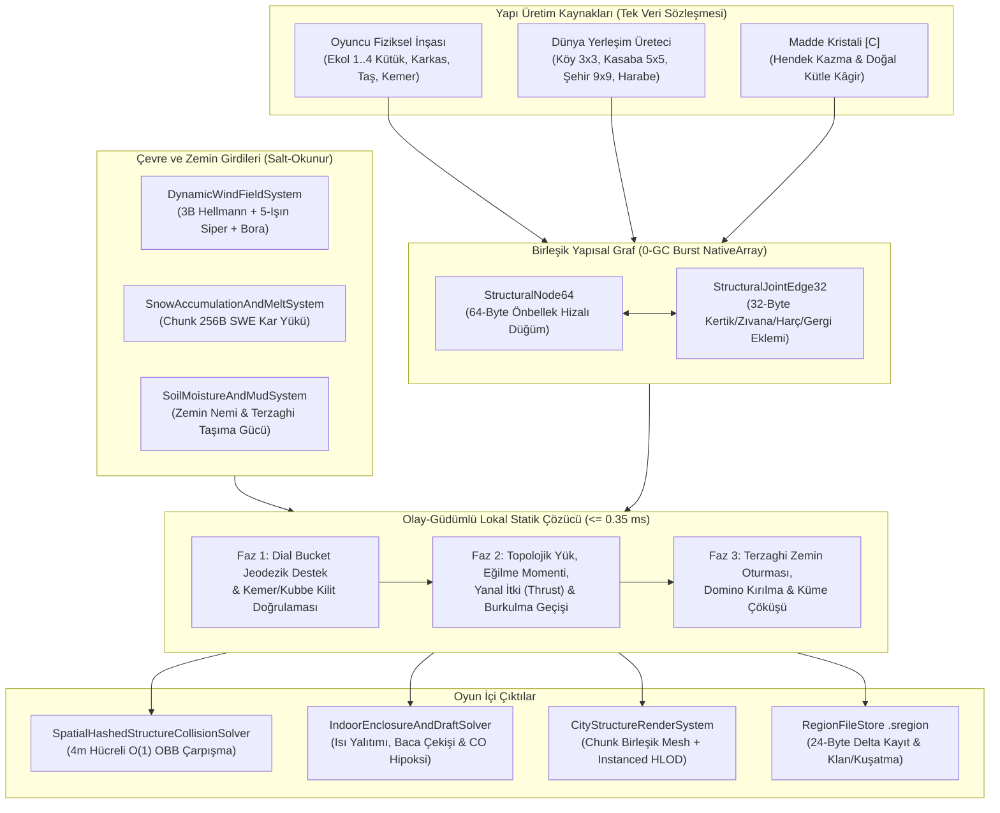
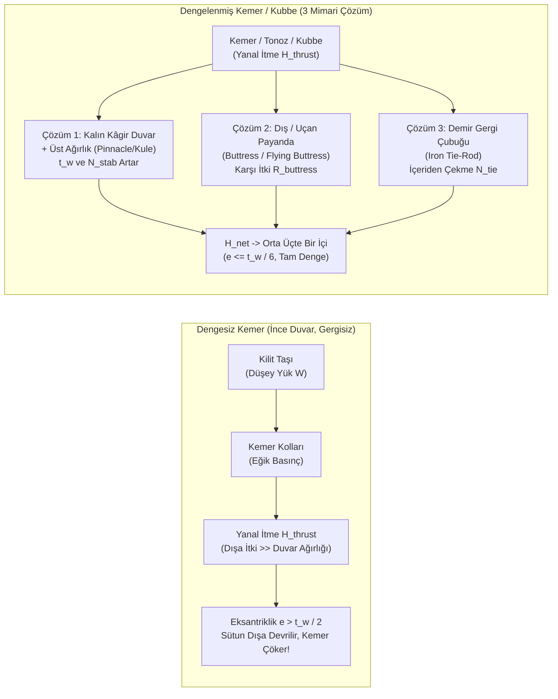
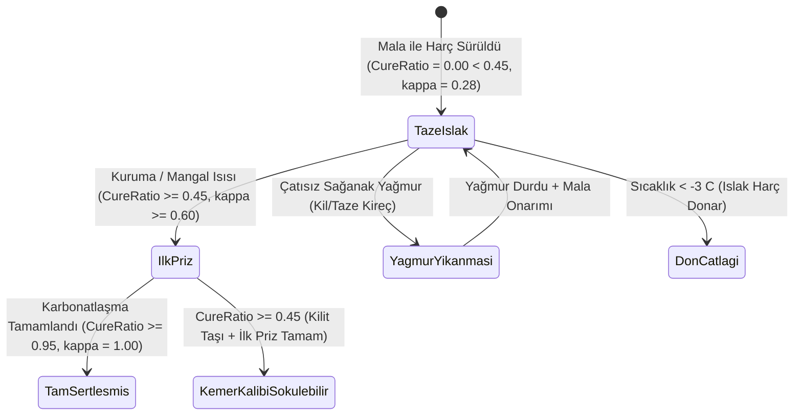
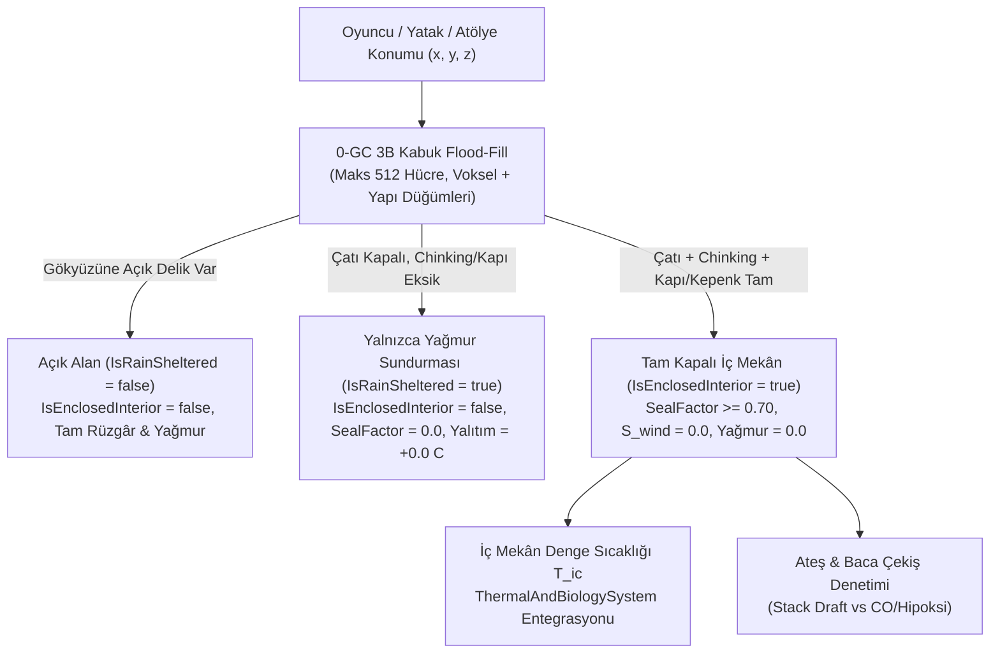
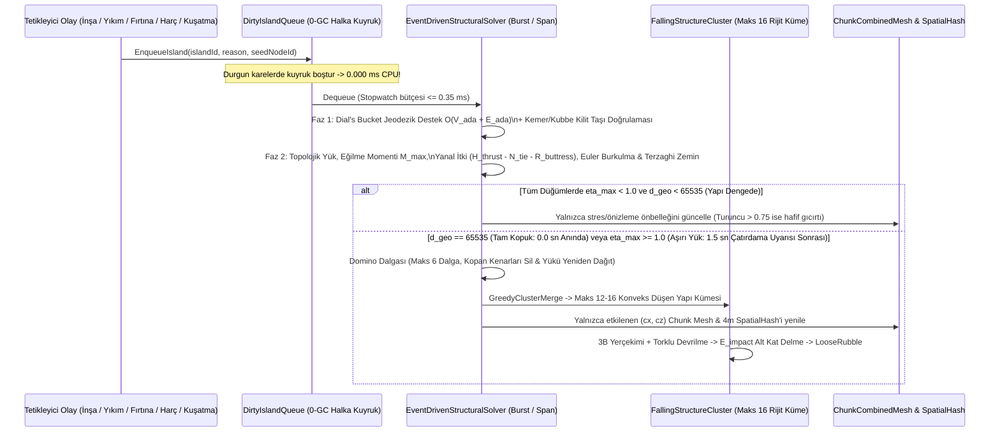

# 🏗️ DOK4: Yapısal Fizik, Birleşik Statik Graf, Çevre Etkileşimi ve Performans Mimarisi

> **Doküman Seti Navigasyonu (Gerçekçi İnşaat ve Mimari Sistemi — 7'li Şartname):**
> - **DOK1 (Hedef & Gereksinimler):** [DOK1_HEDEF_VE_GEREKSINIMLER.md](DOK1_HEDEF_VE_GEREKSINIMLER.md)
> - **DOK2 (Mevcut Yapı Envanteri & Dönüşüm):** [DOK2_MEVCUT_YAPI_ENVANTERI_VE_DONUSUM.md](DOK2_MEVCUT_YAPI_ENVANTERI_VE_DONUSUM.md)
> - **DOK3 (Gerçek Hayat Mimari & Referans Araştırması):** [DOK3_GERCEK_HAYAT_MIMARI_VE_REFERANS_ARASTIRMASI.md](DOK3_GERCEK_HAYAT_MIMARI_VE_REFERANS_ARASTIRMASI.md)
> - **DOK4 (Bu Doküman — Yapısal Fizik, Statik & Performans):** [DOK4_YAPISAL_FIZIK_STATIK_VE_PERFORMANS.md](DOK4_YAPISAL_FIZIK_STATIK_VE_PERFORMANS.md)
> - **DOK5 (Malzeme Progresyonu, İnşaat UX & İç Mekân):** [DOK5_MALZEME_PROGRESYON_UX_VE_IC_MEKAN.md](DOK5_MALZEME_PROGRESYON_UX_VE_IC_MEKAN.md)
> - **DOK6 (Yerleşim: Köy, Kasaba ve Şehir Birleşimi):** [DOK6_YERLESIM_KOY_KASABA_SEHIR_BIRLESIMI.md](DOK6_YERLESIM_KOY_KASABA_SEHIR_BIRLESIMI.md)
> - **DOK7 (Adım Adım Uygulama & Test Planı):** [DOK7_ADIM_ADIM_UYGULAMA_VE_TEST_PLANI.md](DOK7_ADIM_ADIM_UYGULAMA_VE_TEST_PLANI.md)
> - **Üst Referanslar:** [DURUM_VE_DEVIR.md](../../DURUM_VE_DEVIR.md) | [STRATOCRAFT_GELISTIRICI_DOKUMANI.md](../../STRATOCRAFT_GELISTIRICI_DOKUMANI.md)

---

## İçindekiler

1. [Mimari Tasarım Felsefesi ve Mevcut Sistemlerle Köprü](#1-mimari-tasarım-felsefesi-ve-mevcut-sistemlerle-köprü)
2. [Bölüm 1 — Birleşik Yapısal Graf Veri Modeli (Burst & NativeArray Dostu)](#2-bölüm-1--birleşik-yapısal-graf-veri-modeli-burst--nativearray-dostu)
   - 2.1 Tek Graf İlkesi (`Oyuncu İnşaatı == Köy/Kasaba/Şehir == Kristal Kâgir`)
   - 2.2 Temel Sabit Tamsayı Enum Sözleşmeleri (`ArchitecturalSchool`, `StructuralElementRole`, `AnchorType`, `JointConnectionKind`)
   - 2.3 `StructuralNode64` (Tam `64-Byte` Önbellek Hizalı Düğüm Şeması)
   - 2.4 `StructuralJointEdge32` (Tam `32-Byte` Fiziksel Eklem/Bağlantı Şeması)
   - 2.5 4 Mimari Ekolün (`Ekol 1..4`) Düğüm ve Eklem Temsil Matrisi
3. [Bölüm 2 — Gerçek Yapısal Mekanik ve Oyun-Dostu Kapalı Form Denklemleri](#3-bölüm-2--gerçek-yapısal-mekanik-ve-oyun-dostu-kapalı-form-denklemleri)
   - 3.1 Eksenel Basınç, Çekme, Eğilme Momenti ve Kesme (Taş Neden 4–6m Düz Açıklıkta Kırılır?)
   - 3.2 Yanal İtme (`Lateral Thrust`): Kemer, Tonoz ve Kubbe Statiği; Kalın Duvar, Payanda ve Demir Gergi Çubuğu
   - 3.3 Euler Burkulması ve Yanal Rüzgâr Rijitliği: Çapraz Payandasız Ahşap Karkasın Devrilmesi
   - 3.4 Zemin Taşıma Kapasitesi, Nem Yumuşaması ve Temel Derinliği (Terzaghi Denklemi & Oturma Hasarı)
   - 3.5 Fiziksel Bağlantı Mekanikleri: Kertik Zorunluluğu, Zıvana, Kireç/Kil Harcı Kuruma Eğrisi ve Demir Kenet
   - 3.6 Yapı Malzemeleri ve Zemin Sınıfları Kanonik Parametre Tabloları
4. [Bölüm 3 — Çevre, İklim, Isı, Yangın ve Madde Kristali Etkileşimi](#4-bölüm-3--çevre-iklim-ısı-yangın-ve-madde-kristali-etkileşimi)
   - 4.1 3B Rüzgâr/Bora Yanal Yükü, Kar Su Eşdeğeri (`SWE`) Çatı Yükü ve Yağmur Aşınması
   - 4.2 Kapalı İç Mekân Algılama (`Flood-Fill` + `Chinking` + Kapı/Pencere) ve Isı Yalıtımı (`U-Value` / `clo`)
   - 4.3 Şömine Baca Çekişi (`Stack Effect`) vs. Bacasız Duman / Karbonmonoksit (`CO`) Boğulma Riski
   - 4.4 Yangın Yayılımı, Eurocode 5 Ahşap Kömürleşme Hızı ve Kesit Kaybı Çökmesi
   - 4.5 `[C]` Madde Kristali ile Çelişmeyen Entegrasyon Sözleşmesi
5. [Bölüm 4 — Performans, Olay-Güdümlü Çözücü, Şehir Ölçeği LOD ve Kayıt Mimarisi](#5-bölüm-4--performans-olay-güdümlü-çözücü-şehir-ölçeği-lod-ve-kayıt-mimarisi)
   - 5.1 Donanım ve Anayasa Performans Bütçesi (`RTX 3050 Ti 4GB`, `< 16.0 MB` VRAM, `0 B/kare` GC)
   - 5.2 Olay-Güdümlü (`Event-Driven`) Artımlı Lokal Statik Çözücü (`<= 0.35 ms`)
   - 5.3 Şehir Ölçeğinde (`10.000+` Parça) Chunked Mesh Batching, GPU Instancing ve 3-Kademeli HLOD
   - 5.4 `SpatialHashedStructureCollisionSolver` (`O(1)` Kapsül Çarpışması)
   - 5.5 `.sregion V3` / Delta Serileştirme, `ChunkDeltaLog`, Faz 3 Klan `3D BFS` ve Faz 9 Kuşatma Gedik Uyumluluğu

---

## 1. Mimari Tasarım Felsefesi ve Mevcut Sistemlerle Köprü

Stratocraft'ın mevcut kod tabanında yapısal fizik ve çarpışma üç ayrı alt sistemde parçalı olarak yaşamaktadır:
1. **Voksel Mağara/Kale Domino Motoru:** [StructuralCollapseSystem.cs](../../Assets/_Stratocraft/Physics/Systems/StructuralCollapseSystem.cs), [GeodesicSupportDijkstraJob.cs](../../Assets/_Stratocraft/Physics/Jobs/GeodesicSupportDijkstraJob.cs), [TributaryLoadDagJob.cs](../../Assets/_Stratocraft/Physics/Jobs/TributaryLoadDagJob.cs), [StructuralMaterialProps.cs](../../Assets/_Stratocraft/Physics/Data/StructuralMaterialProps.cs) ve [Stage1StructuralCollapseBridge.cs](../../Assets/_Stratocraft/Character/Stage1StructuralCollapseBridge.cs) (`32×32` komşu chunk halolu pencere, Dial's Bucket Dijkstra + Tek Geçişli Tributary Load DAG).
2. **Serbest Kütük ve Modüler Çizge Çözücüsü:** [SotfLogStackAndInputSystem.cs](../../Assets/_Stratocraft/Inventory/Systems/SotfLogStackAndInputSystem.cs), [WorldLooseBuildSystem.cs](../../Assets/_Stratocraft/Inventory/Systems/WorldLooseBuildSystem.cs) ve `ValheimSotfModularGraphSolver` ([MindStructureClusterValidator.cs](../../Assets/_Stratocraft/Inventory/Systems/MindStructureClusterValidator.cs)).
3. **Katı Parça Çarpışma Çözücüsü:** [ModularStructureCollisionSolver.cs](../../Assets/_Stratocraft/Inventory/Systems/ModularStructureCollisionSolver.cs) (`0-GC` yerel OBB, 3-kutulu kapı söve/lento ayrımı, eğimli çatı ve tavan çarpma denetimi).

> [!IMPORTANT]
> **Birleşik Yapısal Fizik İlkesi:** Bu dokümanda tasarlanan **`UnifiedStructuralGraph`** mimarisi; mevcut voksel yıkım motorunu, serbest kütük/taş dizimini ve köy/kasaba/şehir binalarını **tek bir deterministik statik graf** altında birleştirir:
> - **Sıfır Matris Tersi (`0` Gauss-Seidel /LU İterasyonu):** Gerçek zamanlı oyunda $6N \times 6N$ rijitlik matrisi çözmek kare süresini patlatır. Bunun yerine **Dial's Bucket Jeodezik Destek ($O(V+E)$) + Topolojik Tributary Yük & İtki Yayılımı ($O(V+E)$) + Analitik Kesit/Eklem/Temel Limit Kontrolleri ($O(1)$)** birleştirilerek gerçek inşaat mühendisliği kuralları **`< 0.35 ms`** içinde çözülür.
> - **Dondurulmuş Sıvı Koruması:** Paket 4B.4 kapsamında mühürlenen 4 akışkan dosyasına (`FluidSurfaceSkirtMesher.cs`, `FluidCellularAutomataJob.cs`, `StratocraftFluidSurface.shader`, `FluidSimulationSystem.cs`) hiçbir şekilde dokunulmaz; toprak nemi yalnızca [SoilMoistureAndMudSystem.cs](../../Assets/_Stratocraft/Physics/Systems/SoilMoistureAndMudSystem.cs) salt-okunur sorgularıyla (`ReadWorldMoisture`) temele bağlanır.



---

## 2. Bölüm 1 — Birleşik Yapısal Graf Veri Modeli (Burst & NativeArray Dostu)

### 2.1 Tek Graf İlkesi (`Oyuncu İnşaatı == Köy/Kasaba/Şehir == Kristal Kâgir`)

Oyundaki her yapısal parça — ister oyuncunun balta ile kertik açıp koyduğu bir çam kütüğü, ister kasabadaki iki katlı ahşap karkas hanın çapraz payandası, isterse şehir merkezindeki kubbeli taş yapının demir gergi çubuğu olsun — bellekte **`StructuralNode64`** düğümü ve komşularıyla kurduğu **`StructuralJointEdge32`** yönlü kenarları ile temsil edilir:
- **Sıfır Referans Tipi (`unmanaged`):** Düğümler ve kenarlar `class`, `string`, `List<T>` veya `delegate` içermez; doğrudan `NativeList<StructuralNode64>` ve `NativeList<StructuralJointEdge32>` içinde veya saf `.NET 10` birim testlerinde `Span<T>` / havuzlanmış dizilerde tutulur.
- **Bölgesel Adacık İzolasyonu (`Connected Island ID`):** Birbirine temas eden düğümler tek bir `IslandId` (yapı adası) paylaşır. Bir köy evinde kırılan tek bir köşe dikmesi yalnızca o evin `40–180` düğümlük adasını uyandırır; yan sokaktaki `9.800` parçaya dokunulmaz.

### 2.2 Temel Sabit Tamsayı Enum Sözleşmeleri

```csharp
/// <summary>4 Tarihsel ve Fiziksel İnşaat Ekolü (DOK1 & DOK3 ile birebir uyumlu).</summary>
public enum ArchitecturalSchool : byte
{
    None = 0,
    Ekol1_NotchedLog = 1,       // Kertikli Kütük Yığma (Sill Log, Saddle/Dovetail Notch, Chinking, Purlin)
    Ekol2_TimberFrame = 2,      // Ahşap Karkas / Kolon-Kiriş (Post & Beam, Zıvana, Çapraz Payanda, Kerpiç/Taş Dolgu)
    Ekol3_StoneMasonry = 3,     // Taş Yığma (Temel Hendeği, Kuru/Harçlı Şaşırtmalı Örgü, Quoin, Lento/Tahfif Kemeri)
    Ekol4_MonumentalVault = 4   // Anıtsal Sütun-Kemer-Tonoz-Kubbe (Derin Temel, Sütun, Kemer, Pandantif, Kubbe, Gergi Demiri)
}

/// <summary>Ekol 1..4 kapsamındaki tüm taşıyıcı, örtü, dolgu ve geçici kalıp eleman rolleri.</summary>
public enum StructuralElementRole : byte
{
    // --- A. Temel ve Zemin Altlıkları (0..7) ---
    TrenchRubbleFooting = 0,        // Kazılmış hendek içi sıkıştırılmış kırma taş/çakıl drenaj altlığı
    StonePlinthFoundation = 1,      // Harçlı taş subasman / temel duvarı (zeminden +0.32m su/çamur kesici)
    DrivenTimberPile = 2,           // Bataklık/çamur/gevşek kum zemine çakılan ahşap kazık temel
    MonumentalAshlarPedestal = 3,   // Anıtsal kesme taş / mermer sütun kaidesi ve derin radye taban
    SillBeamOrLog = 4,              // Temel üstü ilk yastık kütüğü (Sill Log) veya ahşap taban kirişi

    // --- B. Düşey Taşıyıcılar ve Duvar Gövdeleri (8..15) ---
    NotchedWallLog = 8,             // Ekol 1: Yatay duvar kütüğü (yalnızca köşe kertiği veya dikme oluğuyla durur)
    TimberPost = 9,                 // Ekol 2: Dikey taşıyıcı ahşap dikme / kolon
    RubbleMasonryCourse = 10,       // Ekol 3: Kaba yonu / moloz taş duvar sırası
    AshlarMasonryWall = 11,         // Ekol 3/4: Kesme taş veya pişmiş tuğla şaşırtmalı duvar + köşe kilit taşı (Quoin)
    InfillPanelWattleAdobe = 12,    // Ekol 2: Dal örgü+çamur (Wattle & Daub) veya kerpiç dolgu (0 düşey taşıma, rüzgâr/ısı perdesi)
    MonolithicColumnShaft = 13,     // Ekol 4: Silindirik/sekizgen taş veya mermer sütun gövdesi
    ColumnCapitalImpost = 14,       // Ekol 4: Sütun başlığı ve kemer üzengi tablası (gerilme yayıcı)
    ExteriorButtressPier = 15,      // Ekol 3/4: Yanal itmeyi karşılayan dış payanda ayağı / kule payandası

    // --- C. Yatay Açıklık, Döşeme, Çatı ve Rijitlik Elemanları (16..27) ---
    TimberMainGirder = 16,          // İki kolon/duvar arası ana taşıyıcı kiriş
    FloorJoistDeck = 17,            // Kat döşeme kirişlemesi ve yürünebilir kalas kaplaması
    StoneOrWoodLintel = 18,         // Kapı/pencere üstü düz lento kirişi (taşta kısa açıklık, ahşap/demirde orta açıklık)
    DiagonalWindBrace = 19,         // Ekol 2: 45° çapraz göğüsleme / rüzgâr payandası (yanal rijitlik kilidi)
    RoofPurlin = 20,                // Ekol 1/2: Alınlık duvarları arasında uzanan yatay çatı aşığı
    InclinedRoofRafter = 21,        // Eğimli çatı merteği ve kaplaması (26° / 45°)
    RoofRidgeBeam = 22,             // Çatı tepe mahya kirişi
    CollarTieOrTruss = 23,          // Çatı merteklerinin dışa açılmasını önleyen yatay gergi / makas alt başlığı
    IronTieRod = 24,                // Ekol 4: Kemer/kubbe üzengilerini birbirine bağlayan dövme demir gergi çubuğu (saf çekme)
    FlyingButtressStrut = 25,       // Ekol 4: Yüksek tonoz/kubbe itmesini dış payanda ayağına aktaran uçan payanda kemeri

    // --- D. Kemer, Tonoz ve Kubbe Elemanları (28..35) ---
    ArchVoussoir = 28,              // Kama kesitli kemer taşı (kilitlenmeden önce konsol, kilitlenince saf basınç)
    ArchKeystone = 29,              // Kemeri kapatan ve iki kolu kilitleyen tepe kilit taşı
    RelievingArch = 30,             // Düz lento üzerindeki duvar yükünü yan sövelere saptıran tahfif (boşaltma) kemeri
    BarrelOrCrossVault = 31,        // Beşik tonoz veya 4 köşeye yük aktaran haç (groin) tonoz dilimi
    PendentiveOrSquinch = 32,       // Kare altyapıdan dairesel kubbe kasnağına geçiş elemanı (Pandantif / Tromp)
    DomeRingCourse = 33,            // Kubbe kasnağı ve küresel kubbe çember sırası
    DomeOculusCrown = 34,           // Kubbeyi kilitleyen tepe bileziği / kilit taşı

    // --- E. Boşluklar, Merdiven, Baca ve Şantiye İskeleleri (36..42) ---
    DoorFrameOpening = 36,          // Kapı kasası ve kanat yerleşim çerçevesi
    WindowFrameOpening = 37,        // Pencere kasası (kepenk/cam yuvalı)
    StairStringerFlight = 38,       // Merdiven limon kirişi ve basamak kolu
    MasonryHearthChimney = 39,      // Taş/tuğla şömine ocağı ve duman tahliye bacası
    TemporaryCenteringScaffold = 40,// Kemer/kubbe örülürken kilit taşı konana kadar yük taşıyan geçici ahşap kalıp
    StairwellTrimmerOpening = 41,   // Üst kat döşemesinde merdiven geçiş oyuğu + Header/Trimmer kenar kiriş çerçevesi
    ModularScaffolding = 42         // Dış cephe yürünebilir ahşap şantiye iskelesi (platform + iç merdiven + korkuluk)
}

/// <summary>Zemin taşıma gücü ve ankraj sınıfı (Terzaghi zemin mekaniği girdisi).</summary>
public enum AnchorType : byte
{
    NoneFloating = 0,               // Zemine temas yok (sadece komşu yapı eklemlerinden destek alabilir)
    BedrockOrSanctum = 1,           // Bedrock(5), Floatstone(18) veya Zindan(>=240): Sonsuz taşıma, 0 oturma
    IntactHardRock = 2,             // Doğal sağlam kaya (Stone, Basalt, Marble, NaturalObsidian): q_ult = 2400 kPa
    CompactedGravelOrTrench = 3,    // Kazılmış hendek + sıkıştırılmış kırma taş/çakıl temel: q_ult = 650 kPa
    FirmDrySoilOrClay = 4,          // Kuru toprak (Dirt/Grass) veya kuru kil (Clay): q_ult = 220 kPa (ıslanınca düşer)
    LooseSandOrRubble = 5,          // Gevşek kum (Sand) veya yıkıntı molozu (LooseRubble): q_ult = 95 kPa
    SaturatedMudOrPeat = 6          // Su doygun çamur (Moisture >= 150) / bataklık: q_ult = 35 kPa (kazıksız taş batar!)
}

/// <summary>İki yapı elemanı arasındaki fiziksel birleşim ve kuvvet aktarım türü.</summary>
public enum JointConnectionKind : byte
{
    UnboundResting = 0,             // Kertiksiz/harçsız serbest temas (0 çekme, çok düşük kesme; kütük yuvarlanır!)
    SaddleNotch = 1,                // Ekol 1: Semer kertik (köşede X/Z yanal kilitleme)
    DovetailNotch = 2,              // Ekol 1: Kırlangıç kuyruğu kertik (yüksek kesme + kısmi çekme kilidi)
    MortiseAndTenonPinned = 3,      // Ekol 2: Zıvana ve ahşap çivi (kesme + çekme + kısmi moment)
    IronSpikedOrBolted = 4,         // Demir çivi / bulonlu birleşim (yüksek kesme ve çekme)
    DryStoneInterlock = 5,          // Ekol 3: Kuru taş şaşırtmalı örgü + köşe kilit taşı (basınç + sürtünmeli kesme, 0 çekme)
    ClayMudMortar = 6,              // Ekol 3: Kil/çamur harcı (orta kohezyon, açık yağmurda yıkanmaya açık)
    LimeMortar = 7,                 // Ekol 3/4: Söndürülmüş kireç harcı (ıslak -> kuruma -> karbonatlaşma eğrisi)
    HydraulicPozzolanicMortar = 8,  // Ekol 4: Horasan / puzolanik harç (suya dayanıklı, yüksek kemer/kubbe kohezyonu)
    IronCrampLeadPoured = 9,        // Ekol 4: Kurşunlu demir kenet (kesme taşları birbirine kilitler)
    IronTieRodSocket = 10           // Ekol 4: Demir gergi çubuğu üzengi ankrajı (yanal itmeyi saf çekmeyle dengeler)
}
```

### 2.3 `StructuralNode64` (Tam `64-Byte` Önbellek Hizalı Düğüm Şeması)

Her `StructuralNode64` yapısı tam **64 bayttır** (x86-64 mimarisinde **1 tam L1 CPU önbellek satırı**). Tüm 2-bayt ve 4-bayt alanlar doğal bellek sınırlarına hizalanmıştır (`0` dolgu baytı israfı, `0` hizasız okuma cezası):

```csharp
[StructLayout(LayoutKind.Explicit, Size = 64)]
public struct StructuralNode64
{
    [FieldOffset(0)]  public uint NodeId;                     // 4B: Tekil düğüm kimliği (24b Index + 8b Generation)
    [FieldOffset(4)]  public int ChunkCoordPacked;            // 4B: (short)ChunkX | ((int)(short)ChunkZ << 16)
    [FieldOffset(8)]  public Vector3 Position;                // 12B: Dünya uzayı merkez koordinatı (m)
    [FieldOffset(20)] public ulong RotQuatSnorm64;            // 8B: 4 x short snorm16 kuaterniyon (Qx, Qy, Qz, Qw)
    [FieldOffset(28)] public int FirstEdgeIndex;              // 4B: Kenar havuzundaki ilk StructuralJointEdge32 indeksi (-1 = yok)

    [FieldOffset(32)] public byte EdgeCount;                  // 1B: Bu düğüme bağlı eklem sayısı (0..255)
    [FieldOffset(33)] public ArchitecturalSchool School;      // 1B: Ekol 1..4
    [FieldOffset(34)] public StructuralElementRole Role;      // 1B: Yapısal eleman rolü (0..42)
    [FieldOffset(35)] public byte VoxelMaterialId;            // 1B: MaterialIdCatalog malzemesi (OakWood=70, Marble=14 vb.)
    [FieldOffset(36)] public byte SectionOriginAnchorPacked;  // 1B: [0..2]=AnchorType, [3..4]=Thickness, [5..6]=OriginState, [7]=IsChinked
    [FieldOffset(37)] public byte CourseAndFlagsPacked;       // 1B: [0..3]=CompletedCourses, [4..6]=ReqCourses, [7]=IsSettledCracked
    [FieldOffset(38)] public byte FoundationDepthDm;          // 1B: Zemine gömülme derinliği D_f (0..255 dm -> 0.0..25.5m)
    [FieldOffset(39)] public byte EnvStatePacked;             // 1B: [0..3]=Wetness0_15, [4..7]=CharDepth0_15 (yangın kömürleşmesi)

    [FieldOffset(40)] public ushort CurrentHpQ12_4;           // 2B: Anlık yapı canı (0..4095.9 HP, 1/16 hassasiyet)
    [FieldOffset(42)] public ushort GeodesicSupportDist;      // 2B: En yakın sağlam temele jeodezik uzaklık d_geo (65535 = kopuk)

    [FieldOffset(44)] public float AxialForceKn;              // 4B: +N_c eksenel basınç (kN), -N_t eksenel çekme (kN)
    [FieldOffset(48)] public float BendingMomentKnM;          // 4B: Açıklık/konsol maksimum eğilme momenti M_max (kNm)
    [FieldOffset(52)] public float ShearForceKn;              // 4B: Kesme kuvveti V (kN)
    [FieldOffset(56)] public int LateralThrustDeciKnXZ;       // 4B: Paketli 2 x short (0.1 kN birimli X ve Z yanal itki H_x, H_z)
    [FieldOffset(60)] public float MaxUtilizationRatio;       // 4B: Birleşik zorlanma oranı eta_max (<0.75 güvenli, >=1.0 kırılma)
}
```

| Bayt Aralığı | Alan Adı | Boyut | Fiziksel ve Mimari Görevi |
| :--- | :--- | :---: | :--- |
| `0 .. 3` | `NodeId` | `4 B` | Düğüm silindiğinde bayat referansları yakalayan nesil (`generation`) korumalı kimlik |
| `4 .. 7` | `ChunkCoordPacked` | `4 B` | Chunk yükleme/boşaltma ve birleşik mesh yenilemesi için `O(1)` sahip chunk anahtarı |
| `8 .. 27` | `Position` + `RotQuatSnorm64` | `20 B` | Serbest açılı tonoz, kemer, merdiven ve payanda yerleşimi için tam 3B poz |
| `28 .. 32` | `FirstEdgeIndex` + `EdgeCount` | `5 B` | `2.14` milyara kadar kenar adresleyen sıkıştırılmış komşuluk listesi başlığı |
| `33 .. 35` | `School` + `Role` + `VoxelMaterialId` | `3 B` | 4 ekol davranışı ve [MaterialIdCatalog.cs](../../Assets/_Stratocraft/Core/Constants/MaterialIdCatalog.cs) malzeme kimliği |
| `36 .. 39` | Paketli Durum Baytları | `4 B` | Temel tipi, kesit (`Slender`/`Standard`/`HeavyBearing`), `Chinking` yalıtımı, temel derinliği $D_f$, nem ve kömürleşme |
| `40 .. 43` | `CurrentHpQ12_4` + `GeodesicSupportDist` | `4 B` | Kuşatma/balta hasarı ve Faz 1 Dial's Bucket Dijkstra jeodezik mesnet uzaklığı |
| `44 .. 63` | İç Kuvvetler ve `MaxUtilizationRatio` | `20 B` | Çözücünün hesapladığı $N$, $M_{\max}$, $V$, $(H_x, H_z)$ ve hologram/çatırdama renk girdisi $\eta_{\max}$ |

### 2.4 `StructuralJointEdge32` (Tam `32-Byte` Fiziksel Eklem/Bağlantı Şeması)

```csharp
[Flags]
public enum StructuralJointFlags : byte
{
    None = 0,
    TransfersTension = 1 << 0,       // Zıvana, demir çivi, kenet veya gergi demiri: çekme kuvveti aktarır
    TransfersMoment = 1 << 1,        // Çift zıvana, derin ankastre veya göğüsleme: eğilme momenti aktarır
    LocksLateralRoll = 1 << 2,       // Semer/kırlangıç kertik veya oluklu dikme: kütüğün yana yuvarlanmasını kilitler
    IsRunningBondStaggered = 1 << 3, // Ekol 3/4: Şaşırtmalı derz örgüsü (+%35 kesme ve çatlak yayılım direnci)
    IsQuoinCornerLock = 1 << 4,      // Ekol 3/4: İki dik duvarı kenetleyen büyük köşe kilit taşı (Quoin)
    IsTemporaryCentering = 1 << 5,   // Geçici kemer/kubbe kalıp desteği (kalıp sökülünce kenar silinir)
    RainWashedDegraded = 1 << 6,     // Açık yağmurda yıkanmış taze kil/kireç harcı zayıflaması
    YieldedCracked = 1 << 7          // Aşırı yük veya zemin oturmasıyla çatlamış eklem
}

[StructLayout(LayoutKind.Explicit, Size = 32)]
public struct StructuralJointEdge32
{
    [FieldOffset(0)]  public uint TargetNodeId;               // 4B: Bağlanan komşu düğüm kimliği
    [FieldOffset(4)]  public int NextEdgeInList;              // 4B: Aynı düğümün sonraki kenar indeksi (-1 = son)
    [FieldOffset(8)]  public short ContactOffsetMmX;          // 2B: Düğüm merkezinden yerel temas noktası X (mm)
    [FieldOffset(10)] public short ContactOffsetMmY;          // 2B: Düğüm merkezinden yerel temas noktası Y (mm)
    [FieldOffset(12)] public short ContactOffsetMmZ;          // 2B: Düğüm merkezinden yerel temas noktası Z (mm)
    [FieldOffset(14)] public sbyte NormalSnormX;              // 1B: Birim temas normali n_x (-127..+127)
    [FieldOffset(15)] public sbyte NormalSnormY;              // 1B: Birim temas normali n_y (-127..+127)
    [FieldOffset(16)] public sbyte NormalSnormZ;              // 1B: Birim temas normali n_z (-127..+127)
    [FieldOffset(17)] public JointConnectionKind Kind;        // 1B: Kertik, zıvana, kuru taş, kireç harcı, demir gergi vb.
    [FieldOffset(18)] public byte MortarCureProgress255;      // 1B: 0 = Taze ıslak harç, 255 = Tam sertleşmiş/kürlenmiş
    [FieldOffset(19)] public StructuralJointFlags Flags;      // 1B: Çekme/moment/kertik/şaşırtmalı örgü bayrakları
    [FieldOffset(20)] public float TransferredNormalKn;       // 4B: Eklemden geçen basınç/çekme kuvveti (kN)
    [FieldOffset(24)] public float TransferredShearKn;        // 4B: Eklemden geçen kesme kuvveti (kN)
    [FieldOffset(28)] public float EffectiveJointStiffness01; // 4B: Kürlenme ve hasara bağlı anlık rijitlik [0..1]
}
```

### 2.5 4 Mimari Ekolün (`Ekol 1..4`) Düğüm ve Eklem Temsil Matrisi

| Mimari Ekol | Temel Düğümü (`AnchorType` & `D_f`) | Ana Taşıyıcı Düğümler | Kritik Eklem (`JointConnectionKind`) | Örtü / Açıklık Geçme Elemanı | Yanal Stabilite Mekanizması |
| :--- | :--- | :--- | :--- | :--- | :--- |
| **Ekol 1: Kertikli Kütük Ev** | Köşe Taş Ayaklar veya `StonePlinthFoundation` ($D_f \ge 0.3\text{m}$) + `SillBeamOrLog` | `NotchedWallLog` (yatay yığma kütük sıraları) | `SaddleNotch` veya `DovetailNotch` (`LocksLateralRoll = 1`) + `IsChinked` yosun/kil | `RoofPurlin` (aşık) + `InclinedRoofRafter` | 4 duvarın köşelerde dik açıyla birbirini kertikle kilitlemesi (*kutu etkisi*) |
| **Ekol 2: Ahşap Karkas (Post & Beam)** | `StonePlinthFoundation` veya bataklıkta `DrivenTimberPile` ($D_f \ge 0.8\text{m}$) | `TimberPost` + `TimberMainGirder` (`InfillPanelWattleAdobe` yük taşımaz!) | `MortiseAndTenonPinned` (zıvana + ahşap çivi) | `TimberMainGirder` + `FloorJoistDeck` + `CollarTieOrTruss` | **`DiagonalWindBrace` (45° göğüsleme payandası)** — yoksa fırtınada paralelkenar olup devrilir! |
| **Ekol 3: Gerçek Taş Yığma** | `TrenchRubbleFooting` ($D_f \ge 0.6\text{m}$) + `StonePlinthFoundation` | `RubbleMasonryCourse` veya `AshlarMasonryWall` | `DryStoneInterlock` veya `ClayMudMortar` / `LimeMortar` + `IsRunningBondStaggered` + `IsQuoinCornerLock` | Kısa açıklıkta `StoneOrWoodLintel` + `RelievingArch` (tahfif kemeri); ahşap çatı | Duvar kalınlığı ($t_w \ge 0.45\text{m}$), şaşırtmalı derz ve köşe kilit taşları (`Quoin`) |
| **Ekol 4: Anıtsal Sütun-Kemer-Kubbe** | `TrenchRubbleFooting` ($D_f \ge 1.5\text{m}$) + `MonumentalAshlarPedestal` | `MonolithicColumnShaft` + `ColumnCapitalImpost` + `AshlarMasonryWall` | `LimeMortar` / `HydraulicPozzolanicMortar` + `IronCrampLeadPoured` + `IronTieRodSocket` | `ArchVoussoir` + `ArchKeystone`, `BarrelOrCrossVault`, `PendentiveOrSquinch` + `DomeRingCourse` | Kalın fil ayağı, **`ExteriorButtressPier` / `FlyingButtressStrut`** ve **`IronTieRod` (demir gergi)** |

---

## 3. Bölüm 2 — Gerçek Yapısal Mekanik ve Oyun-Dostu Kapalı Form Denklemleri

### 3.1 Eksenel Basınç, Çekme, Eğilme Momenti ve Kesme (Taş Neden 4–6m Düz Açıklıkta Kırılır?)

Bir yapı elemanının kesitinde dört temel iç tesir birlikte değerlendirilir: eksenel kuvvet $N$ ($+N_c$ basınç, $-N_t$ çekme), eğilme momenti $M_{\max}$ ve kesme kuvveti $V$.

#### A. Düz Kiriş ve Konsol Eğilme Denklemleri
İki mesnet arasındaki net açıklığı $L$ (metre) olan yatay bir kiriş/döşeme veya tek taraflı mesnetli $L_c$ uzunluklu bir konsol üzerinde toplam yayılı yük $q = q_{\text{öz}} + q_{\text{üst}} + q_{\text{kar}}$ ($\text{kN/m}$) ve orta tekil yük $P_{\text{tekil}}$ ($\text{kN}$) bulunduğunda:

$$M_{\max} = \begin{cases} \dfrac{q L^2}{8} + \dfrac{P_{\text{tekil}} L}{4}, & \text{(İki ucu basit mesnetli düz kiriş / lento)} \\[8pt] \dfrac{q L^2}{12} + \dfrac{P_{\text{tekil}} L}{6}, & \text{(İki ucu zıvanalı + göğüsleme payandalı yarı-ankastre kiriş)} \\[8pt] \dfrac{q L_c^2}{2} + P_{\text{uç}} L_c, & \text{(Tek ucu mesnetli konsol / tamamlanmamış kemer kolu)} \end{cases}$$

$$V_{\max} = \begin{cases} \dfrac{q L}{2} + \dfrac{P_{\text{tekil}}}{2}, & \text{(İki ucu mesnetli açıklık)} \\[6pt] q L_c + P_{\text{uç}}, & \text{(Konsol)} \end{cases}$$

Kesit alanı $A = b \cdot h$ ve elastik kesit modülü $W = \dfrac{b h^2}{6}$ (dairesel kütükte $A = \dfrac{\pi D^2}{4}$, $W = \dfrac{\pi D^3}{32}$) için alt lifte oluşan **maksimum çekme gerilmesi** ($\sigma_{t,\max}$) ve üst lifte oluşan **maksimum basınç gerilmesi** ($\sigma_{c,\max}$):

$$\sigma_{t,\max} = \frac{M_{\max}}{W} - \frac{N_c}{A}, \qquad \sigma_{c,\max} = \frac{M_{\max}}{W} + \frac{N_c}{A}$$

#### B. Fiziksel Kanıt: Taş Neden 4–6 Metre Düz Açıklıkta Kırılır?
1. **Çekme / Basınç Asimetrisi:** Kâgir malzemeler (taş, tuğla, mermer) basınca karşı dev mukavemete sahiptir ($f_c = 18\text{–}85\text{ MPa}$), ancak kristal/mikro-çatlak yapısı ve derzler nedeniyle çekme dayanımları çok düşüktür ($f_t = 0.25\text{–}1.80\text{ MPa}$, yani basıncın yalnızca $\%1.5\text{–}\%4$'ü!).
2. **Öz Ağırlık Cezası:** Taşın yoğunluğu ($\rho \approx 2\,500\text{ kg/m}^3$), meşe kerestenin ($\rho \approx 700\text{ kg/m}^3$) **$3.57\times$ katıdır**.
3. **Sayısal Karşılaştırma ($b = 0.40\text{ m}, h = 0.40\text{ m}$, $W = 0.01067\text{ m}^3$ Kesit):**
   - **Düz Kesme Taş Kiriş ($L = 5.0\text{ m}$, $N_c = 0$):** Yalnızca öz ağırlık ($q_{\text{öz}} = 2500 \times 9.81 \times 0.16 = 3.92\text{ kN/m}$) + hafif döşeme yükü ($4.08\text{ kN/m}$, toplam $q = 8.0\text{ kN/m}$) altında $M_{\max} = \frac{8.0 \times 5.0^2}{8} = 25.0\text{ kNm}$. Alt lif çekme gerilmesi:
     $$\sigma_{t,\max} = \frac{25.0 \times 10^3}{0.01067} = \mathbf{2.34\text{ MPa}} > f_{t,\text{taş}} \;(1.10\text{ MPa}) \implies \eta_{\text{bend}} = \mathbf{2.13 \ge 1.0} \;\text{(KIRILIR!)}$$
   - **Aynı Açıklıkta Meşe Kiriş (`OakWood`, $L = 5.0\text{ m}$):** $q_{\text{öz}} = 1.10\text{ kN/m}$, toplam $q = 5.18\text{ kN/m} \implies M_{\max} = 16.19\text{ kNm} \implies \sigma_{t,\max} = \mathbf{1.52\text{ MPa}} \ll f_{m,\text{meşe}} \;(18.0\text{ MPa}) \implies \eta_{\text{bend}} = \mathbf{0.084} \;\text{(TAM GÜVENLİ!)}$
   - **Aynı Açıklıkta Taş Kemer (`ArchVoussoir` + `ArchKeystone`, $L = 5.0\text{ m}, f = 2.0\text{ m}$):** Kemer eğrisi $M_{\max} \approx 0$ yapar ve yükü eksenel basınca ($N_c \approx 29\text{ kN} \implies \sigma_c = 0.18\text{ MPa} \ll 45\text{ MPa}$) dönüştürür; taş kemer $5\text{–}16\text{ m}$ açıklığı rahatça taşır!

#### C. Birleşik Kesit Kullanım Oranı ($\eta_{\text{node}}$)
Her düğüm için çözücü aşağıdaki boyutsuz birleşik zorlanma oranını hesaplar ($\eta_{\text{node}} \ge 1.00$ ise düğüm kırılır):

$$\eta_{c+b} = \frac{\max(0, N_c)}{\phi_b \, N_{c,\text{cap}}} + \frac{M_{\max}}{M_{c,\text{cap}}}, \qquad \eta_{t+b} = \max\!\left(0,\; \frac{M_{\max}}{M_{t,\text{cap}}} - 0.65 \frac{\max(0, N_c)}{N_{c,\text{cap}}}\right) + \frac{\max(0, -N_c)}{N_{t,\text{cap}}}$$

$$\eta_v = \frac{|V_{\max}|}{V_{\text{cap},0} \cdot \kappa_{\text{cure}} + \mu_{\text{joint}} \max(0, N_c)}, \qquad \eta_{\text{node}} = \max\!\left(\eta_{c+b},\; \eta_{t+b},\; \eta_v\right)$$

#### D. Döşeme Merdiven Boşluğu (`Header / Trimmer`) ve Kapı/Pencere Lento Yük Aktarımı
Çok katlı yapılarda döşeme veya duvar içinde sirkülasyon boşluğu açıldığında düşey yük akışı kesintiye uğramaz, boşluk çevresindeki çerçeve kirişlerine saptırılır:
1. **Merdiven Boşluğu (`StairwellTrimmerOpening = 41` — `Header` & `Trimmer` Kiriş Çerçevesi):** Üst kat `FloorJoistDeck` döşemesinde merdiven çıkışı için boşluk açıldığında, kesilen tali döşeme kirişlerinin (*tail joists*) uç reaksiyonları $R_{\text{tail}} = \frac{1}{2} q_{\text{döşeme}} L_{\text{kesik}}$ önce boşluğu enine sınırlayan **başlık kirişine (`Header Beam`)** tekil yük olarak biner; `Header` kirişi de toplam reaksiyonu boşluğun iki yanındaki boyuna **kasnak kirişlerine (`Trimmer Joists`)** $P_{\text{trimmer}} = \frac{1}{2} \sum R_{\text{tail}}$ tekil yükü olarak (`§3.1.A` $P_{\text{tekil}}$ terimiyle) aktarır. Yan `Trimmer` kirişleri (`Standard` veya `HeavyBearing`) bulunmadan döşeme ortası kesilirse kesik döşeme uçları konsol eğilmesinden kırılır.
2. **Kapı ve Pencere Boşlukları (`DoorFrameOpening` / `WindowFrameOpening`):** Boşluk üzerindeki duvar ve kat yükü $q_{\text{üst}}$, boşluk tavanındaki düz lentoya (`StoneOrWoodLintel`) veya tahfif kemerine (`RelievingArch`) biner ve buradan sol/sağ kapı-pencere söve dikmelerine (`Jamb Posts / Quoin Piers`) $V_{\text{söve}} = \frac{1}{2} q_{\text{üst}} L_{\text{boşluk}}$ eksenel basınç artışı olarak indirilir.

---

### 3.2 Yanal İtme (`Lateral Thrust`): Kemer, Tonoz ve Kubbe Statiği; Kalın Duvar, Payanda ve Demir Gergi Çubuğu

Kemerler, tonozlar ve kubbeler düşey yükleri eğrisel basınç hattı (*line of thrust*) boyunca taşırken, mesnet noktalarında (üzengi kotu $y_{\text{spring}}$) duvarları ve sütunları **dışarıya doğru iten büyük bir yatay kuvvet ($H_{\text{thrust}}$)** üretirler.



#### A. Kemer, Tonoz ve Kubbe Yanal İtme Formülleri
Açıklığı $L$ (m), kemer yüksekliği (ok / *rise*) $f$ (m) ve kemerin taşıdığı toplam düşey yük $W_{\text{tot}}$ (kN; kemer öz ağırlığı + üst duvar/döşeme + kar yükü) için her iki üzengi mesnedine aktarılan düşey reaksiyon $V_{\text{arch}}$ ve dışa doğru yatay itme $H_{\text{thrust}}$:

$$V_{\text{arch}} = \frac{W_{\text{tot}}}{2}, \qquad H_{\text{thrust}} = \gamma_{\text{form}} \, \frac{W_{\text{tot}} \, L}{8 \, \max(0.25\text{m},\, f)}$$

| Eğrisel Yapı Tipi | Geometri Oranı ($f / L$) | Form Katsayısı ($\gamma_{\text{form}}$) | Yanal İtme Dağılımı |
| :--- | :---: | :---: | :--- |
| **Basık Kemer (*Segmental Arch*)** | $0.20 \text{ – } 0.30$ | `1.15` | Çok yüksek yatay itme ($H \approx 0.58 \, W_{\text{tot}}$); kalın yan duvar veya demir gergi şarttır |
| **Tam Dairesel Kemer (*Roman Arch*)** | $0.50$ | `1.00` | Klasik yarım daire kemer ($H = 0.25 \, W_{\text{tot}}$) |
| **Sivri Kemer (*Pointed / Ottoman / Gothic*)** | $0.58 \text{ – } 0.70$ | `0.82` | İtki çizgisi dikleştiği için yatay itme **%28–%35 daha düşüktür**; yüksek yapılara idealdir |
| **Beşik Tonoz (*Barrel Vault*)** | $0.45 \text{ – } 0.55$ | `1.00` | İtmeyi tonoz boyunca **tüm yan duvar uzunluğuna** yayılı yük ($h_{\text{lin}}$ kN/m) olarak verir |
| **Haç Tonoz (*Cross / Groin Vault*)** | $0.50$ | `0.95` | İtmeyi yan duvarlar yerine **yalnızca 4 köşe sütununa/payandasına** diyagonal vektör olarak toplar |
| **Kubbe (*Dome* + Pandantif/Tromp)** | $f_d / D \approx 0.35\text{–}0.50$ | `0.68` | Çember gerilmesi $T_{\text{hoop}} = \dfrac{W_{\text{dome}} D}{16 f_d}$; pandantiflerle 4 ana kemere ve kasnak çemberine aktarılır |

#### B. Gergi Çubuğu, Payanda ve Heyman Orta-Üçte-Bir Devrilme Dengesi
Üzengi mesnedine bağlanan **Demir Gergi Çubuğu (`IronTieRod`)** yatay itmeyi kemer tabanında doğrudan çekme mukavemetiyle ($N_{t,\text{tie}}$) tutar; dış yüzeye yaslanan **Payanda (`ExteriorButtressPier` / `FlyingButtressStrut`)** ise $R_{\text{buttress}}$ karşı kuvveti ve ek taban genişliği $d_b$ sağlar:

$$H_{\text{net}} = \max\!\left(0,\; H_{\text{thrust}} + V_{\text{wind,lat}} - N_{t,\text{tie}} - R_{\text{buttress}}\right)$$

Yüksekliği $h_{\text{pier}}$, etkin taban kalınlığı $t_{\text{eff}} = t_w + 0.75 \, d_b$ ve üzerindeki toplam düşey bastırıcı yükü $N_{\text{stab}} = W_{\text{pier}} + V_{\text{arch}} + W_{\text{pinnacle}}$ olan duvar/sütun ayağında devrilme eksantrikliği $e$:

$$e = \frac{H_{\text{net}} \cdot h_{\text{pier}}}{\max(1.0\text{ kN},\, N_{\text{stab}})}, \qquad \eta_{\text{thrust}} = \frac{e}{0.45 \, t_{\text{eff}} \cdot \left(1 - \dfrac{N_{\text{stab}}}{N_{c,\text{cap}}}\right)}$$

- **Önemli Mimari Sonuç (*Pinnacle / Ağırlık Kulesi Etkisi*):** Gerçek Gotik katedrallerde ve Osmanlı camilerinde fil ayaklarının/payandaların tepesine konan ağırlık kuleleri $N_{\text{stab}}$ değerini büyüterek eksantrikliği $e$ küçültür ($\eta_{\text{thrust}}$ düşer!). Ancak kolon basınç limitine yakınsa ($N_{\text{stab}} \to N_{c,\text{cap}}$) ezilme başlar; formül her iki sınırı doğal olarak yakalar.
- **Geçici Kalıp (`TemporaryCenteringScaffold`) Yasası:** Bir kemerde veya kubbede `ArchKeystone` / `DomeOculusCrown` henüz yerleştirilmemişse $H_{\text{thrust}} = 0$'dır ama her yarım kemer kolu **açık konsol ($M = q L_c^2 / 2$)** olarak çalışır. Açıklık $L > 3.0\text{ m}$ ise altta `TemporaryCenteringScaffold` olmadan kemer taşları harç tutmadan boşluğa düşer; kilit taşı konup harç ilk priz eşiğini geçtiğinde (`CureRatio >= 0.45`, yani `MortarCureProgress255 >= 115`) kalıp güvenle sökülür!

---

### 3.3 Euler Burkulması ve Yanal Rüzgâr Rijitliği: Çapraz Payandasız Ahşap Karkasın Devrilmesi

#### A. Narin Dikme ve Sütunlarda Euler Burkulma Çarpanı ($\phi_b$)
Kesit genişliği $b_{\min}$ ve desteksiz serbest yüksekliği $L_{\text{col}}$ olan düşey bir kolonun narinlik oranı $\lambda_{\text{col}} = \dfrac{K_{\text{eff}} \, L_{\text{col}}}{0.289 \, b_{\min}}$ üzerinden burkulma azaltma katsayısı $\phi_b \in (0, 1]$:

$$\bar{\lambda} = \frac{K_{\text{eff}} \, L_{\text{col}}}{b_{\min}} \sqrt{\frac{12 \, f_c}{\pi^2 E}}, \qquad \phi_b = \frac{1}{1 + \bar{\lambda}^2}$$

- Çapraz payandalı rijit çerçevede $K_{\text{eff}} = 0.75$; çapraz payandasız serbest sallanan karkasta $K_{\text{eff}} = 1.85$!
- Örneğin `Slender` ($b = 0.18\text{ m}$) kesitli $6.0\text{ m}$ (2 kat) yanal desteksiz bir ahşap dikmede $\bar{\lambda} \approx 2.35 \implies \phi_b = \mathbf{0.153}$: Kolonun taşıma kapasitesi **%85 düşer** ve üst kat döşemesi konduğunda bel vererek burkulur!

#### B. Çapraz Payandasız Karkasın Yanal Rüzgâr/Depar Yükü Altında Devrilmesi (`Racking Sway`)
Bir kat çerçevesinin ($h_{\text{story}}$ yükseklikli) yatay kesme rijitliği $K_{\text{story}}$ ($\text{kN/m}$):

$$K_{\text{story}} = \sum_{j \in \text{Posts}} \frac{k_{\theta,\text{joint},j}}{h_{\text{story}}^2} + \sum_{b \in \text{Braces}} \frac{E_b A_b}{L_b} \cos^2\theta_b \cdot \kappa_{\text{joint},b} + \sum_{p \in \text{Walls}} k_{\text{shear},p}$$

Kat üzerindeki toplam düşey ağırlık $N_{\text{story}}$ ve kat yatay kuvveti $V_{\text{lat}} = F_{\text{wind,story}} + 0.03 \, N_{\text{story}}$ (*kusur / eksantriklik eşdeğeri yatay yük*) altında ikinci mertebe ($P\text{-}\Delta$) kat öteleme oranı $\theta_{\text{drift}}$:

$$\theta_{\text{drift}} = \begin{cases} \infty \;\;(\eta_{\text{sway}} = 2.0), & K_{\text{story}} \cdot h_{\text{story}} \le 1.15 \, N_{\text{story}} \quad \text{(Kararsız Mekanizma — Anında Yana Yatar!)} \\[8pt] \dfrac{V_{\text{lat}}}{K_{\text{story}} \cdot h_{\text{story}} - N_{\text{story}}}, & K_{\text{story}} \cdot h_{\text{story}} > 1.15 \, N_{\text{story}} \end{cases}$$

$$\eta_{\text{sway}} = \frac{\theta_{\text{drift}}}{\theta_{\text{allow}}} \qquad (\theta_{\text{allow}} = 0.035\text{ rad} \approx 2.0^\circ)$$

- **Çıplak Ekol 2 Çerçevesi (4 adet `TimberPost` + 4 adet `TimberMainGirder`, `0` adet `DiagonalWindBrace`):** Yalnızca zıvana dönme rijitliği vardır ($K_{\text{story}} \approx 14\text{ kN/m}$). İkinci kat veya ağır çatı bindiğinde ($N_{\text{story}} \ge 38\text{ kN}$) ya $P\text{-}\Delta$ kararsızlığından ya da $15\text{ m/s}$ rüzgârda $\theta_{\text{drift}} > 0.08\text{ rad} \implies \eta_{\text{sway}} > 2.2$ aşımından zıvanalar kırılarak karkas yana devrilir!
- **Her Cepheye 2 Adet `DiagonalWindBrace` Eklenince:** $K_{\text{story}} \approx 14 + 2 \times 145 = \mathbf{304\text{ kN/m}}$ ($21\times$ artış!) $\implies$ aynı fırtınada $\theta_{\text{drift}} = 0.0028\text{ rad}$ ($\eta_{\text{sway}} = 0.08$, Yeşil — kaya gibi rijit!).

---

### 3.4 Zemin Taşıma Kapasitesi, Nem Yumuşaması ve Temel Derinliği (Terzaghi Denklemi & Oturma Hasarı)

Her temel veya zemine doğrudan oturan düğüm için altındaki voksel malzemesi ([MaterialIdCatalog.cs](../../Assets/_Stratocraft/Core/Constants/MaterialIdCatalog.cs)) ve toprak nemi $m_w \in [0..255]$ ([SoilMoistureAndMudSystem.cs](../../Assets/_Stratocraft/Physics/Systems/SoilMoistureAndMudSystem.cs)) okunarak basitleştirilmiş **Terzaghi Sığ Temel Taşıma Kapasitesi** hesaplanır:

$$q_{\text{ult}}(m_w, D_f, B_f) = q_{0,\text{kuru}} \cdot \psi_{\text{nem}}(m_w) \cdot \left(1 + k_d \, \min\!\left(2.5,\, \frac{D_f}{B_f}\right)\right)$$

$$\psi_{\text{nem}}(m_w) = 1.0 - \alpha_{\text{çamur}} \left(\frac{m_w}{255}\right)^2, \qquad q_{\text{emniyet}} = \frac{q_{\text{ult}}}{1.50}$$

Taban alanı $A_{\text{taban}} = B_f \cdot L_f$, düşey yükü $N_{\text{taban}}$ ve devrilme eksantrikliği $e$ olan temel düğümünün zemine uyguladığı maksimum taban basıncı $\sigma_{\text{zemin}}$:

$$\sigma_{\text{zemin}} = \frac{N_{\text{taban}}}{A_{\text{taban}}} \left(1 + \min\!\left(2.0,\, \frac{6 \, e}{B_f}\right)\right), \qquad \eta_{\text{zemin}} = \frac{\sigma_{\text{zemin}}}{q_{\text{emniyet}}}$$

| Zemin Sınıfı (`AnchorType`) | Voksel Malzemeleri | $q_{0,\text{kuru}}$ ($\text{kPa}$) | Nem Hassasiyeti ($\alpha_{\text{çamur}}$) | Derinlik Çarpanı ($k_d$) | Kazısız ($D_f=0$) Davranışı |
| :--- | :--- | :---: | :---: | :---: | :--- |
| **`BedrockOrSanctum`** | `Bedrock(5)`, `Floatstone(18)`, `Zindan(>=240)` | $\infty$ | `0.00` | `0.00` | Sonsuz mesnet, `0` oturma |
| **`IntactHardRock`** | `Stone(1)`, `Basalt(7)`, `Marble(14)`, `NaturalObsidian(6)` | `2.400` | `0.02` | `0.35` | Çok katlı taş kale ve anıtsal sütunu doğrudan taşır |
| **`CompactedGravelOrTrench`** | Kazılmış Hendek + `Cobblestone(8)` / `Gravel(9)` dolgu | `650` | `0.08` | `0.65` | Suyu drene eder; $D_f = 0.8\text{m}$ hendekle $2\text{–}4$ katlı taş binayı güvenle taşır |
| **`FirmDrySoilOrClay`** | `Dirt(2)`, `Grass(3)`, `Clay(16)` ($m_w < 150$) | `220` | `0.68` | `0.45` | Tek katlı kütük/ahşap evi taşır; temelsiz taş duvar yağmurda çamurlaşınca ($\psi_{\text{nem}} \to 0.32$) oturur ve çatlar! |
| **`LooseSandOrRubble`** | `Sand(4)`, `LooseRubble(15)` | `95` | `0.45` | `0.55` | Geniş taş pabuç (`StonePlinthFoundation`) veya derin hendek olmadan ağır yapı yan yatar |
| **`SaturatedMudOrPeat`** | Doygun Çamur ($m_w \ge 150$) / Bataklık | `35` | `0.25` | `0.30` | Yalnızca **`DrivenTimberPile` (çakma ahşap kazık, $q_{\text{kazık}} \ge 480\text{ kPa}$)** ile ağır bina taşır! |

- **Kademeli Oturma vs. Göçme Tepkisi:**
  - $\eta_{\text{zemin}} \le 0.80$: Sağlam temel (`0` oturma).
  - $0.80 < \eta_{\text{zemin}} < 1.15$: **Farklı Oturma Hasarı (`Differential Settlement`)** — düğüm zemine $\delta_s = 0.12 \cdot (\eta_{\text{zemin}} - 0.80)\text{ m}$ batar, `IsSettledCracked = 1` işaretlenir, üstteki kâgir eklemlerde kesme çatlağı oluşur ve yapı `%30` can kaybeder (oyuncu duvar dibini kazıp taş payanda/subasman besleyerek binayı kurtarabilir!).
  - $\eta_{\text{zemin}} \ge 1.15$: **Zemin Zımbalama Göçmesi (`Punching Failure`)** — temel düğümü yenilir ve üst yapı devrilerek çöker.

---

### 3.5 Fiziksel Bağlantı Mekanikleri: Kertik Zorunluluğu, Zıvana, Kireç/Kil Harcı Kuruma Eğrisi ve Demir Kenet

#### A. Kütüklerin Havada veya Kertiksiz Üst Üste Duramaması Yasası
PlayTest'te görülen *"kütüklerin havada asılı kalması ve hiçbir kertik/destek olmadan ince bir çizgi gibi üst üste durması"* hatası 3 kesin fiziksel kuralla kökünden kapatılmıştır:
1. **Mutlak Yerçekimi Sürekliliği (Anında Kopuş vs. `1.5 sn` Aşırı Yük Çatırdama Uyarısı):** `GeodesicSupportDist == 65535` (hiçbir temel düğümüne geçerli yol bulamayan parça) **asla** sahnede statik düğüm olarak kalamaz; önizlemede Kırmızı (`RedWillCollapse`) verir ve yerleştirilmesi reddedilir. Mevcut bir yapıda:
   - **Tam Mesnet Kopuşu (`d_geo == 65535`):** Alt desteği tamamen kırılıp havada bağlantısız kalan alt-graf **`0.0 sn` gecikmeyle (anında)** `FallingStructureClusterComponent` serbest düşüşüne geçirilir.
   - **Aşırı Yük / Kapasite Aşımı ($\eta_{\max} \ge 1.0$, ancak $d_{\text{geo}} < 65535$):** Temele bağlı olduğu halde basınç, eğilme, kesme veya yanal itme sınırını aşan düğümler `StructuralCollapseSystem.PreCollapseWarningDurationSeconds = 1.5f` (`DOK6`/`DOK7 T13` standardı) uyarınca **`1.5 sn` boyunca sesli çatırdama + görsel çatlak/kırmızı kenar uyarısı** verir; bu `1.5 sn` içinde acil dikme/payanda eklenmezse düğüm kırılır ve domino çöküşü başlar.
2. **Silindirik Kütük Devrilme Kararsızlığı (`UnboundResting` Yasağı):** Düz zemine konan ilk yastık kütüğü (`SillBeamOrLog`) taş takoz veya temel üstünde durabilir; ancak onun üzerine konan `NotchedWallLog` sıraları eğer `JointFlags.LocksLateralRoll` bayrağına sahip **en az 2 uç bağlantısına** (köşede $90^\circ$ kesişen kütükle `SaddleNotch` / `DovetailNotch` kertiği **veya** iki uçta zemine çakılı dikey `TimberPost` kılavuz direği) sahip değilse, silindir-silindir temas genişliği $t_{\text{temas}} = 0.02\text{ m}$ kabul edilir. İkinci kütüğün üzerindeki en ufak rüzgâr veya $0.03 \, W$ kusur eksantrikliği $e > t_{\text{temas}}/2$ üreterek kütükleri anında yana yuvarlar!
3. **Şaşırtmalı Derz (`Running Bond`) ve Köşe Kilit Taşı (`Quoin`):** Ekol 3/4 taş örmede üst üste dikey derzlerin çakışması (*stack bond*) kesme kapasitesini `%40` düşürür; şaşırtmalı örgü (`IsRunningBondStaggered`) ve köşelerde uzun-kısa kenetlenen `IsQuoinCornerLock` taşları kesme ve yanal itme direncini `%35` artırır.

#### B. Kireç / Kil Harcı Islak $\to$ Kuruma $\to$ Sertleşme (Karbonatlaşma) Eğrisi
Harçlı eklemlerde (`ClayMudMortar`, `LimeMortar`, `HydraulicPozzolanicMortar`) harç ilk sürüldüğünde ıslaktır (`MortarCureProgress255 = 0`, normalize `CureRatio` $c = 0.0$, $\kappa_{\text{ıslak}} = 0.28$) ve `StratocraftConstants.SecondsPerInGameDay = 3600.0` (`1 oyun günü = 60 gerçek dk`, `1 oyun saati = 2.5 gerçek dk`) zaman ölçeğinde kuruyup karbonatlaşarak tam mukavemete ($c = 1.0 \leftrightarrow 255$) ulaşır. **`CureRatio < 0.45` (`MortarCureProgress255 < 115`)** aralığında harç henüz ıslak/kırılgan evrededir (`DOK1 AK-10` & `DOK5` uyumlu; bu evrede kemer kalıbı sökülürse veya çok katlı ağır kâgir yük bindirilirse taze harç ezilir); **`CureRatio >= 0.45`** olduğunda ilk priz tamamlanır:

$$c(t + \Delta t) = \operatorname{clamp}\!\left(c(t) + \left(r_0 \, f_T(T_{\text{ortam}}) \, f_{\text{yağmur}}(w_{\text{açık}}) \, (1 - c(t)) - d_{\text{yıkanma}}(w_{\text{açık}})\right) \Delta t,\; 0,\; 1\right)$$

$$\kappa_{\text{cure}}(c) = \kappa_{\text{ıslak}} + (1 - \kappa_{\text{ıslak}}) \, c^{0.75}$$



| Harç / Eklem Türü | $\kappa_{\text{ıslak}}$ ($c=0$) | Tam Kür Süresi (`SecondsPerInGameDay = 3600s`: `1s = 2.5 gerçek dk`) | Yağmur Davranışı | Don ($< -3^\circ\text{C}$) | Çekme ($N_{t,\text{cap}}$) | Kesme Kohezyonu ($V_0$) |
| :--- | :---: | :---: | :--- | :--- | :---: | :---: |
| **`DryStoneInterlock` (Kuru Taş)** | `1.00` | `0` (Anında) | Yıkanmaz, su sızdırır | Etkilenmez | `0 kN` | `12 kN` ($+\mu N_c$) |
| **`ClayMudMortar` (Kil/Çamur Harcı)** | `0.32` | `4 oyun saati` (`10 gerçek dk`) | Çatısızsa yıkanır ($d_{\text{yıkanma}} > 0$) | Çatlar (`-25%`) | `4 kN` | `28 kN` |
| **`LimeMortar` (Sönmüş Kireç Harcı)** | `0.28` | `10 oyun saati` (`25 dk`; ateş yanında `4s = 10 dk`) | Taze iken (`c < 0.45`) yavaşlar, sertleşince dayanıklı | Taze iken don riski | `18 kN` | `75 kN` |
| **`HydraulicPozzolanicMortar` (Horasan)** | `0.38` | `6 oyun saati` (`15 gerçek dk`) | **Su altında ve yağmurda bile tam sertleşir!** | Yüksek direnç | `36 kN` | `140 kN` |
| **`IronCrampLeadPoured` (Kurşunlu Kenet)** | `1.00` | `0` (Döküm anı) | Tam su/korozyon zırhı (kurşun kaplı) | Etkilenmez | `145 kN` | `210 kN` |
| **`IronTieRodSocket` (Demir Gergi Çubuğu)** | `1.00` | `0` (Kama kilidi) | Paslanmaya karşı yağ/kireç korumalı | Etkilenmez | **`240 – 450 kN`** | `95 kN` |

---

### 3.6 Yapı Malzemeleri Kanonik Mukavemet ve Açıklık Parametre Tablosu

Aşağıdaki tablo, `Standart Kesit (1.0x)` bir yapı elemanı için [MaterialIdCatalog.cs](../../Assets/_Stratocraft/Core/Constants/MaterialIdCatalog.cs) ve [SotfLogStackAndInputSystem.cs](../../Assets/_Stratocraft/Inventory/Systems/SotfLogStackAndInputSystem.cs) ile tam uyumlu kanonik çözücü katsayılarını tanımlar (`Slender = 0.65x` kesitte $N_{c,\text{cap}} \times 0.44, M_{\text{cap}} \times 0.35$; `HeavyBearing = 1.45x` kesitte $N_{c,\text{cap}} \times 2.25, M_{\text{cap}} \times 2.60$):

| Yapı Malzemesi | `MaterialId` | Birim Ağırlık ($\text{kg/m}^3$) | Basınç $N_{c,\text{cap}}$ ($\text{kN}$) | Eğilme $M_{c,\text{cap}}$ / $M_{t,\text{cap}}$ ($\text{kNm}$) | Düz Kiriş Maks. Güvenli Açıklık ($L_{\text{düz}}$) | Kemer/Tonoz Maks. Açıklık ($L_{\text{kemer}}$) | Yangın Yanıcılığı ($\beta_{\text{char}}$) |
| :--- | :---: | :---: | :---: | :---: | :---: | :---: | :---: |
| **Saz / Dal Örgü (`ThatchTile`)** | `124` | `280` | `24` | `4 / 4` | `2.0 m` (yalnızca hafif örtü) | Kemer kuramaz | Çok Yüksek (`3.0x`) |
| **Çam / Meşe Kütüğü (`OakWood`)** | `70` / `121` | `680` | `185` | `38 / 38` | **`4.5 m`** (payandalı `6.0 m`) | Ahşap tonoz `8.0 m` | Orta (`1.0x`) |
| **Demir Ağacı (`Ironwood`)** | `71` | `960` | `360` | `78 / 78` | **`6.5 m`** (payandalı `8.5 m`) | Ahşap kemer `12.0 m` | Düşük (`0.42x`, yavaş kömürleşir) |
| **Kerpiç (`Adobe` / `Clay`)** | `16` | `1.650` | `140` | `6 / 1.8` | `1.5 m` (ahşap lento şart) | Kubbe/tonoz `5.0 m` | **Yanmaz (`0.0x`)** |
| **Kaba Yonu Taş (`Cobblestone`)** | `8` | `2.250` | `480` | `22 / 2.6` | **`2.2 m`** (4m+ düzde kırılır!) | Kemer `8.0 m` | **Yanmaz (`0.0x`)** |
| **Pişmiş Tuğla / Kesme Taş (`StoneBrick`)** | `120` | `2.400` | `680` | `32 / 4.2` | **`2.8 m`** (4m+ düzde kırılır!) | Kemer/Kubbe **`14.0 m`** | **Yanmaz (`0.0x`)** |
| **Kesme Bazalt (`Basalt`)** | `7` | `2.800` | `860` | `40 / 5.4` | **`3.4 m`** (5m+ düzde kırılır!) | Kemer/Tonoz **`16.0 m`** | **Yanmaz (`0.0x`)** |
| **Kadim Mermer (`Marble`)** | `14` | `2.700` | `940` | `45 / 6.2` | **`3.8 m`** (revak lentosu; 5m+ kırılır!) | Anıtsal Kubbe **`20.0 m`** | **Yanmaz (`0.0x`)** (aşırı ateşte kalsinasyon) |
| **Dövme Demir / Çelik (`ReinforcedSteelBlock`)** | `51` / `122` | `7.850` | `1.850` | `210 / 210` | **`10.0 m`** (`Heavy` `14.0 m`) | Çelik/Obsidyen Kemer **`28.0 m`** | **Yanmaz (`0.0x`)** ($>600^\circ\text{C}$ yumuşama) |

---

## 4. Bölüm 3 — Çevre, İklim, Isı, Yangın ve Madde Kristali Etkileşimi

### 4.1 3B Rüzgâr/Bora Yanal Yükü, Kar Su Eşdeğeri (`SWE`) Çatı Yükü ve Yağmur Aşınması

Birleşik yapısal fizik motoru, Paket 4A/4B'de çalışan atmosfer ve hidroloji sistemlerinden canlı fiziksel yük alır:

#### A. 3B Rüzgâr ve Fırtına Bora Yanal Yükü (`DynamicWindFieldSystem` Entegrasyonu)
[DynamicWindFieldSystem.cs](../../Assets/_Stratocraft/Physics/Systems/DynamicWindFieldSystem.cs) içerisindeki `EvaluateLocal3DWind` fonksiyonu; Hellmann irtifa çarpanını ($z^\alpha$), 5-ışınlı rüzgâr-üstü siper sönümlemesini ($S_{\text{wind}} \in [0, 1]$) ve barometrik $|\nabla P| + \text{CAPE}$ bora darbesini hesaplar. Bir cephe veya çatı düğümüne etkiyen dinamik rüzgâr basıncı $q_{\text{wind}}$ ($\text{kPa}$) ve yanal rüzgâr kuvveti $F_{\text{wind},i}$ ($\text{kN}$):

$$q_{\text{wind}} = \frac{1}{2} \, \rho_{\text{hava}}(T, P) \cdot C_p(\alpha_i) \cdot S_{\text{wind},i}^2 \cdot V_{\text{etkin},i}^2 \times 10^{-3}, \qquad F_{\text{wind},i} = q_{\text{wind}} \cdot A_{\text{izdüşüm},i} \cdot \max\!\left(0,\, \hat{\mathbf{w}} \cdot \hat{\mathbf{n}}_i\right)$$

- **İrtifa ve Siper Etkisi:** Vadi tabanındaki veya kale surunun rüzgâr gölgesindeki evler $S_{\text{wind}} \approx 0.12$ ile korunurken, dağ sırtına dikilen yüksek ahşap gözetleme kulesi $z = 25\text{ m}$ Hellmann çarpanı ($\ge 1.30\times$) ve Beaufort 10–11 fırtına borasında ($V_{\text{etkin}} \approx 30\text{ m/s}$) yüksek yanal kesme alır; çapraz payandası (`DiagonalWindBrace`) yoksa yıkılır!
- **Çatı Kalkma (*Uplift*) Etkisi:** Saçak altı açık bırakılan hafif saz çatılar (`ThatchTile`) şiddetli fırtınada negatif emme katsayısıyla ($C_{p,\text{uplift}} = -0.75$) kirişlere çivili/bağlı değilse uçarak kopar.

#### B. Kar Su Eşdeğeri (`SWE`) Çatı Yükü (`SnowAccumulationAndMeltSystem` Entegrasyonu)
[SnowAccumulationAndMeltSystem.cs](../../Assets/_Stratocraft/Physics/Systems/SnowAccumulationAndMeltSystem.cs) her `16×16` chunk sütununda `SweUnits` (`0..255` birim; `1 birim = 2.0 mm SWE = 2.0 kg/m²`, maksimum `510 kg/m² ≈ 5.00 kN/m²`) tutar. Çatı eğim açısı $\alpha_{\text{çatı}}$ için Eurocode 1 uyumlu **çatı kar tutma şekil katsayısı** $\mu_{\text{eğim}}(\alpha)$:

$$\mu_{\text{eğim}}(\alpha) = \begin{cases} 1.00, & 0^\circ \le \alpha \le 20^\circ \quad \text{(Düz dam / teras — tüm kar birikir!)} \\[4pt] 1.00 - 0.55 \dfrac{\alpha - 20^\circ}{25^\circ}, & 20^\circ < \alpha \le 45^\circ \quad \text{(}26^\circ \to 0.87,\;\; 45^\circ \to 0.45\text{)} \\[6pt] 0.45 \dfrac{60^\circ - \alpha}{15^\circ}, & 45^\circ < \alpha < 60^\circ \\[4pt] 0.00, & \alpha \ge 60^\circ \quad \text{(Dik külah / kubbe — kar tutunamaz, yanlara kayar)} \end{cases}$$

$$Q_{\text{kar},i} = \left(\text{SweUnits}_{x,z} \times 2.0\text{ kg/m}^2\right) \cdot 9.81 \cdot A_{\text{yatay},i} \cdot \mu_{\text{eğim}}(\alpha_i) \times 10^{-3} \quad (\text{kN})$$

- **Biyom Mimari Sonucu:** Kuzey ve yüksek dağ biyomlarında (`Y >= 168m`) oyuncu düz ahşap dam yaparsa kış fırtınasında biriken `5.0 kN/m²` kar yükü mertekleri eğilme momentinden kırar; buna karşılık **$45^\circ$ dik Nordik çatı + aşık/dikme desteği** veya **taş tonoz** kar yükünü yarıdan fazla azaltarak kışı güvenle atlatır. Ayrıca bina içinde yanan şömine ısısı çatı karını alttan eriterek yükü düşürür.

#### C. Yağmurun Taze Harca ve Açık Ahşaba Etkisi
- Üzerinde çatı örtüsü (`ChunkSkyOcclusionMap256` veya çatı düğümü saçak izdüşümü) bulunmayan taze `ClayMudMortar` yağmurda erir (`RainWashedDegraded`), `LimeMortar` ise yağmur altında priz alamaz.
- Toprakla doğrudan temas eden (taş subasmansız, $y_{\text{taban}} \le y_{\text{zemin}} + 0.05\text{ m}$) ve sürekli ıslak kalan (`Wetness0_15 >= 10`) ahşap taban kirişlerinde uzun vadeli **nem çürümesi çarpanı** $\psi_{\text{çürüme}} \in [0.65, 1.00]$ devreye girer; `StonePlinthFoundation` (`+0.32m` taş subasman) ve $\ge 0.40\text{ m}$ çatı saçağı bu aşınmayı `%100` engeller.

---

### 4.2 Kapalı İç Mekân Algılama (`Flood-Fill` + `Chinking` + Kapı/Pencere) ve Isı Yalıtımı (`U-Value` / `clo`)

Mevcut [EnclosedOxygenFloodFillSystem.cs](../../Assets/_Stratocraft/Character/Systems/EnclosedOxygenFloodFillSystem.cs) (`MaxFloodFillNodes = 512`, `0 B GC` halka kuyruk + açık adreslemeli karma tablo), hem voksel yüzeylerini hem de `StructuralNode64` kabuk düzlemlerini okuyacak biçimde **`IndoorEnclosureAndDraftSolver`** ile genişletilir.



#### A. `IsRainSheltered` vs. `IsEnclosedInterior` Sözleşmesi ve `Chinking` Rolü (`AK-05` / `T05`)
Bir kütük kulübede ham yuvarlak kütükler üst üste dizilip çatısı kapatıldığında dikey yağmur/kar kesilir (`IsRainSheltered = true`), fakat kütüklerin dairesel birleşim derzleri arasında rüzgâr sızdıran açıklıklar kalır:
- **Derz Dolgusuz Ham Kütük Duvar (`IsChinked == 0`) veya Açık Kapı/Kepenksiz Pencere:** Yalnızca `IsRainSheltered = true` döner; rüzgâr sızıntısı devam ettiği için **`IsEnclosedInterior = false`**, **`SealFactor = 0.0`** ($\sigma_{\text{seal}} = 0.0$) ve termal yalıtım/konfor bonusu **`0.0 °C`** olarak kalır.
- **Yosun + Kil veya Kireç Harcı Derz Dolgulu Kütük (`IsChinked == 1`, *Chinking / Daubing*) + Kapı & Pencere/Kepenk:** Tüm kütük duvarlarda `Chinking` tamamlandığında (veya harçlı taş / sıvalı karkas duvar örüldüğünde) ve `DoorFrameOpening` kanadı ile `WindowFrameOpening` ahşap kepenk/cam kapakları takılıp kapatıldığında **`IsEnclosedInterior = true`** ve **`SealFactor >= 0.70`** (tam sızdırmazda `1.00`, iç rüzgâr `S_wind = 0.0`) aktif olur; cam pencere ek olarak gün ışığını içeri taşır.

#### B. İç Mekân Denge Sıcaklığı ($T_{\text{iç}}$) ve Biyoloji Entegrasyonu
`IsEnclosedInterior == false` iken ($\sigma_{\text{seal}} = 0.0$) yapısal yalıtım bonusu `0.0 °C`'dir ($T_{\text{iç,denge}} = T_{\text{dış}}$; yalnızca ateşin yakın açık-hava radyatif ısısı etki eder). `IsEnclosedInterior == true` ($\sigma_{\text{seal}} \ge 0.70$) sağlandığında ise kabuk ısıl direnci $R_{\text{kabuk}}$ ($\text{m}^2\text{K/W}$) ve aktif ısıtma gücü $Q_{\text{ısıtma}}$ ($\text{kW}$; şömine `18 kW`, taş fırın `25 kW`, bloomery `55 kW`) ile odanın denge sıcaklığı [ThermalAndBiologySystem.cs](../../Assets/_Stratocraft/Character/Systems/ThermalAndBiologySystem.cs) içine doğrudan `ambientTempCelsius` ve `localWindSpeedMps = 0` olarak verilir:

$$U_{\text{etkin}} = \frac{1}{R_{\text{kabuk}} \cdot \left(0.30 + 0.70 \, \sigma_{\text{seal}}\right)}, \qquad T_{\text{iç,denge}} = T_{\text{dış}} + \Delta T_{\text{pasif}} + \frac{1000 \, Q_{\text{ısıtma}} \, \eta_{\text{ocak}}}{U_{\text{etkin}} \, A_{\text{kabuk}} + V_{\text{oda}} \, n_{\text{sızıntı}} \, 0.34}$$

| Duvar / Kabuk Tipi | Kapalılık & `SealFactor` | $R_{\text{kabuk}}$ ($\text{m}^2\text{K/W}$) | Pasif Koruma ($\Delta T_{\text{pasif}}$) | Dışarısı $-20^\circ\text{C}$ Tipide Şömineli Oda ($24\text{ m}^2$) |
| :--- | :---: | :---: | :---: | :--- |
| **Ham Kütük Ev (`Chinking` Yok)** | `IsRainSheltered=true`, `IsEnclosedInterior=false` (`0.00`) | `0.00` (Cereyanlı) | **`+0.0 °C`** (`0.0` bonus) | Yalnızca yağmuru keser; iç yalıtım bonusu `0.0` (`AK-05` / `T05`) |
| **Saz / Dal Örgü Baraka (İnce Sıvalı + Kapılı)** | `IsEnclosedInterior=true` (`0.70`) | `0.65` | `+2.5 °C` | $+3.5^\circ\text{C}$ (Fırtına rüzgârı kesilir, orta kürk gerekir) |
| **Çamur Sıvalı Karkas (`Wattle & Daub` / Kerpiç)** | `IsEnclosedInterior=true` (`0.85`) | `1.55` | `+6.5 °C` | $+17.5^\circ\text{C}$ (Tam konfor, giysi kurutma) |
| **Yosun/Kil Dolgulu (`Chinked`) Kalın Kütük Ev** | `IsEnclosedInterior=true` (`0.95`) | `2.15` | `+8.5 °C` | **`+22.0 °C`** (Çıplak/ince kıyafetle bile tam normotermi!) |
| **Harçlı Kalın Taş Duvar ($50\text{ cm}$) + Cam/Kepenk** | `IsEnclosedInterior=true` (`1.00`) | `1.95` (+Yüksek Isıl Kütle) | `+8.0 °C` | **`+21.5 °C`** (Ateş sönse bile ısıl kütle odayı saatlerce ılık tutar!) |

---

### 4.3 Şömine Baca Çekişi (`Stack Effect`) vs. Bacasız Duman / Karbonmonoksit (`CO`) Boğulma Riski

Gerçek hayatta ve *Valheim* gibi referans inşaat oyunlarında oyuncuya en unutulmaz mimari dersi veren mekanik **duman tahliyesi ve baca fiziğidir**:

1. **Doğal Baca Çekişi (`Bernoulli Stack Draft`):** Bir ateş kaynağının (`CampfireBlock`, `MasonryHearthChimney`, `PrimitiveStoneKilnBlock`, `Bloomery`) hemen üstündeki hücreden başlayarak en fazla $1\text{ blok}$ yanal kayma toleransıyla (`45°` duman davlumbazı) yukarı tırmanan ve çatı dışına açılan kesintisiz bir baca kanalı varsa, yüksekliği $H_{\text{baca}}$ (m) olan bacanın çekiş verimi:
   $$\Delta P_{\text{çekiş}} = \rho_{\text{hava}} \, g \, H_{\text{baca}} \left(1 - \frac{T_{\text{dış,K}}}{T_{\text{baca,K}}}\right), \qquad \eta_{\text{tahliye}} = \operatorname{clamp}\!\left(\frac{H_{\text{baca}}}{1.8\text{ m}},\, 0,\, 1\right)$$
   - $H_{\text{baca}} \ge 2.0\text{ m}$ ve baca ağzı rüzgâr kapanı/şapkası ile açıksa **$\eta_{\text{tahliye}} = 1.00$**: Dumanın `%100`'ü bacadan gökyüzüne tüter, oda havası tertemiz kalır (`LungOxygenPercent = 100%`) ve şömine radyatif ısısı odayı ısıtır!
2. **Bacasız Kapalı Odada Duman Çökmesi ve `CO` / Hipoksi Boğulması:**
   - Oyuncu kapalı bir odanın ortasına baca veya çatı duman deliği bırakmadan kamp ateşi/fırın yakarsa ($\eta_{\text{tahliye}} = 0$), sıcak duman ve karbonmonoksit önce tavanda birikir ve duman tabanı $y_{\text{duman}}(t)$ aşağı doğru iner:
     $$\frac{dy_{\text{duman}}}{dt} = -\frac{\dot{V}_{\text{duman}} \cdot (1 - \eta_{\text{tahliye}})}{A_{\text{tavan}}}$$
   - Duman katmanı oyuncunun baş hizasına ($y_{\text{ayak}} + 1.65\text{ m}$) indiğinde öksürük uyarısı + gri duman vinyeti başlar ve [EnclosedOxygenFloodFillSystem.cs](../../Assets/_Stratocraft/Character/Systems/EnclosedOxygenFloodFillSystem.cs) içindeki `StepOxygen` (`Campfire` $\text{O}_2$ tüketimi) hızla `LungOxygenPercent` değerini düşürür (`< 25%` `Hypoxia`, `0%`'da `10 HP/s` boğulma; oksijen biterse ateş de kendiliğinden boğularak söner!).
   - Oyuncu çömelirse (`1.15m`, duman tabakasının altı!) nefes alacak birkaç saniye kazanıp kapıyı/kepengi açarak odayı havalandırabilir!

---

### 4.4 Yangın Yayılımı, Eurocode 5 Ahşap Kömürleşme Hızı ve Kesit Kaybı Çökmesi

- **Tutuşma Koşulları:** Arada taş/tuğla yangın duvarı veya baca yakası (*fireback / stone collar*, güvenli mesafe **`0.0 m`**) bulunmadan yanıcı ahşap duvara/çatıya **`< 1.20 m`** mesafede yakılan yüksek sıcaklıklı fırın/ocaklar (`Bloomery` $1200^\circ\text{C}$, açık demirci ocağı, kireç ocağı — `DOK5` §3.6 ile birebir uyumlu), yıldırım düşmesi (`MetalLightningRod` koruma konisi dışında kalan en yüksek sivri çatı!) veya kuşatma ateş okları/ateş topu ahşap ve saz elemanları tutuşturur. Yağmur ve ıslaklık (`Wetness0_15`) tutuşma eşiğini yükseltir.
- **Eurocode 5 Kömürleşme (`Charring`) ve Gerçek Statik Çöküş:** Yanmakta olan bir ahşap elemanda yangın sadece soyut bir HP sayacını sıfırlamaz; dış yüzeyden içe doğru **kömürleşme derinliği** $d_{\text{char}}$ (`CharDepth0_15`, her kademe `12 mm`) ilerler ve kalan sağlam kesit alanını küçültür:
  $$b_{\text{kalan}} = \max(0,\, b_0 - 2 d_{\text{char}}), \qquad h_{\text{kalan}} = \max(0,\, h_0 - 2 d_{\text{char}})$$
  $$N_{c,\text{cap,ateş}} = N_{c,\text{cap},0} \cdot \frac{b_{\text{kalan}} h_{\text{kalan}}}{b_0 h_0}, \qquad M_{\text{cap,ateş}} = M_{\text{cap},0} \cdot \frac{b_{\text{kalan}} h_{\text{kalan}}^2}{b_0 h_0^2}$$
  - **Gerçekçi Sonuç:** Saz çatı (`ThatchTile`) saniyeler içinde tutuşup yanarken, kalın meşe veya `Ironwood` ana taşıyıcı kolonların dışı kömürleşip iç çekirdeği koruduğu için bina hemen çökmez; oyuncu su kovasıyla yangını söndürürse bina kararmış (`CharDepth > 0` görsel vertex kararması) ama ayakta kalır! Söndürülmezse kalan kesit üst kat yükünü taşıyamadığı an ($\eta_{\text{node}} \ge 1.0$) çatı ve üst kat gerçek fizikle çöker.

---

### 4.5 `[C]` Madde Kristali ile Çelişmeyen Entegrasyon Sözleşmesi

[MatterCrystalVacuumSystem.cs](../../Assets/_Stratocraft/Inventory/Systems/MatterCrystalVacuumSystem.cs) ve [ArchitecturalShapeCatalog.cs](../../Assets/_Stratocraft/Voxel/Data/ArchitecturalShapeCatalog.cs) ile Birleşik İnşaat Sistemi arasında **sıfır kural çelişkisi** vardır:

| İşlem Alanı | Madde Kristali (`[C]`) Yeteneği | Fiziksel ve Oyun-Dengesi Sınırı (Hilesiz Kurallar) |
| :--- | :--- | :--- |
| **1. Temel Hendeği & Arazi Tesviyesi** | `Tier 1+` kristal ile doğal toprak/kum (`OriginState == 0`), `Tier 2+` ile ham taş hızla vakumlanarak düzgün **temel hendeği (`Foundation Trench`)** açılır ve yamaç teraslanır. | Cevher/kömür/mücevher damarları (`ERR_ORE_RESONANCE_IMMUNE`) ve işlenmiş oyuncu/klan yapıları (`OriginState != 0`, `ERR_CRYSTAL_CRAFTED_BLOCK_FORBIDDEN`) asla vakumlanamaz. |
| **2. Doğal Kütle & Mimari Şekil Püskürtme** | Kristal içindeki sıkıştırılmış taş/mermer/bazalt kütlesi `ShapeId 1..62` (`FullMasonryCube`, `OctagonalColumn`, `ArchVoussoir`, `TrapezoidalKeystone`, `ButtressSupport`) olarak yerleştirilebilir. | Yerleştirilen her blok **daima `BlokKokenDurumu.DogalKutle (0)`** kalır (`IS_ITEM_BLOCK = 0`; batarya/mayın yapılamaz). |
| **3. %100 Aynı Statik Fizik Grafı** | Kristalle konulan sütunlar, duvarlar ve kemer taşları doğrudan aynı statik çözücüye (`UnifiedStructuralGraph` + `StructuralCollapseSystem`) bağlanır. | **Kristal yerçekimini iptal etmez!** Kristalle havaya taş konulamaz, çamur üstüne temelsiz taş kule dikilirse batar, `5m` düz desteksiz taş tavan çekilirse eğilme çekmesinden kırılıp çöker (kristalle de kemer/sütun kurmak zorunludur!). |
| **4. Bağlayıcı Harç & Metal Donatı Sınırı** | Kristal saf doğal kütleyi şekillendirir (`DryStoneInterlock` eşdeğeri kuru kâgir kenetlenme sağlar). | Suya dayanıklı **kireç/Horasan harcı**, **ahşap kertik/zıvana**, **kurşunlu demir kenet** ve yüksek açıklık kemerlerini tutan **demir gergi çubuğu (`IronTieRod`)** yalnızca fiziksel fırınlarda/örste üretilip elle uygulanır! |

---

## 5. Bölüm 4 — Performans, Olay-Güdümlü Çözücü, Şehir Ölçeği LOD ve Kayıt Mimarisi

### 5.1 Donanım ve Anayasa Performans Bütçesi

Referans hedef donanım (`NVIDIA GeForce RTX 3050 Ti Laptop GPU 4GB VRAM / 16 GB RAM` + alt sınır `8 GB RAM / iGPU`) ve [STRATOCRAFT_GELISTIRICI_DOKUMANI.md](../../STRATOCRAFT_GELISTIRICI_DOKUMANI.md) Bölüm 1.5 bütçe kilitleri:

| Alt Sistem / Metrik | Anayasa Tavan Bütçesi | `10.000` Parçalı Şehirde Tasarım Değeri | Garanti Mekanizması |
| :--- | :---: | :---: | :--- |
| **Kaplama VRAM Artışı** | `+0.00 MB` (Toplam `< 16.0 MB`, mevcut `4.14 MB`) | **`0.00 MB`** | Tüm yapı `.glb` ve birleşik chunk mesh'leri %100 UV-free `POSITION + NORMAL + COLOR_0` |
| **Kararlı-Durum (`Steady-State`) GC** | **`0 Byte / kare`** | **`0 Byte / kare`** | `NativeList` / `[ThreadStatic]` sabit diziler, `Span<T>`, `stackalloc`, sıfır boxing/LINQ |
| **Yapısal Graf RAM Ayak İzi** | `< 32 MB` | **`~1.92 MB`** (`10K × 64B` düğüm + `40K × 32B` eklem) | Önbellek hizalı sıkıştırılmış `StructuralNode64` & `StructuralJointEdge32` |
| **Durgun Karede Statik Çözücü CPU** | `0.00 ms` | **`0.000 ms`** (`0` iterasyon) | `%100` Olay-Güdümlü (`Event-Driven`); değişiklik yoksa çözücü hiç çalışmaz |
| **Aktif Yıkım / İnşa Karesi CPU** | `<= 0.35 ms / kare` | **`0.08 – 0.32 ms`** (bina adası başına) | `Connected Island` izolasyonu + `Stopwatch` bütçeli kuyruk (`MaxEvaluationsPerFrame`) |
| **Kapsül – Bina Çarpışması CPU** | `< 0.05 ms` | **`~0.0025 ms` (`2.5 µs`) / karakter** | `4m × 4m` XZ CSR mekânsal hash ızgarası (`O(1)` komşuluk sorgusu) |
| **`10.000` Parçalı Şehir Çizimi** | `< 1.5 ms` GPU, düşük Draw Call | **`35 – 90 Draw Call`** (tüm şehir!) | `16×16` Chunk Birleşik Mesh (`LOD 0/1`) + `DistantHorizon` Silüet Kabuğu (`LOD 2`) |

---

### 5.2 Olay-Güdümlü (`Event-Driven`) Artımlı Lokal Statik Çözücü (`<= 0.35 ms`)

Gerçek zamanlı mimarinin en kritik performans kuralı şudur: **Dengede duran bir bina her karede yeniden çözülmez!** `EventDrivenStructuralSolver` yalnızca `DirtyIslandQueue` içine bir olay düştüğünde uyanır:



#### Çözücüyü Uyandıran Yalnızca 4 Olay Sınıfı:
1. **Topoloji Mutasyonu (Anında — Aynı Kare):** Oyuncu yeni bir parça yerleştirdiğinde, balta/kazma ile bir parçayı söktüğünde/kırdığında, kemer altındaki `TemporaryCenteringScaffold` kalıbını kaldırdığında veya `[C]` Madde Kristali / kazma ile temel altındaki vokseli kazdığında (`NotifyVoxelMutatedNearFoundation`).
2. **Harç Kuruma Kademesi (Seyrek Zamanlayıcı — Her `15.0 sn` Oyun Zamanında):** Yalnızca içinde `MortarCureProgress255 < 255` taze eklem barındıran binalar `ActiveCuringIslands` listesinde tutulur; kürlenme tamamlandığında (`255`) bina bu listeden tamamen çıkar ve bir daha asla tik almaz!
3. **Fırtına Bora Zirvesi ve Kar Eşiği (Kuantize İklim Olayı):** Rüzgâr her karede çözülmez; bir chunk'taki etkin fırtına hızı bir önceki çözümden $\ge +4.0\text{ m/s}$ üstüne çıktığında veya çatı `SweUnits` değeri $+16$ birim (`+32 mm SWE`) arttığında yalnızca o chunk'taki adalar kuyruğa eklenir.
4. **Kuşatma Darbesi, Patlama veya Yangın Kesit Daralması:** Mancınık/top güllesi çarptığında veya yangında `CharDepth0_15` bir tam kademe arttığında ilgili yapı adası çözülür.

---

### 5.3 Şehir Ölçeğinde (`10.000+` Parça) Chunked Mesh Batching, GPU Instancing ve 3-Kademeli HLOD

Bir şehirde (`9×9` yerleşim çekirdeği + surlar + kuleler + saray/tapınak = `8.000 – 15.000` yapı elemanı) her kütük veya kesme taş için ayrı bir Unity `GameObject` oluşturmak sahne grafiğini ve CPU çizim döngüsünü kilitler. `CityStructureRenderSystem` bunu **0-GameObject Statik Chunk Birleştirme + Aktif Instancing** mimarisiyle çözer:

1. **LOD 0 (`0 – 48 m` Yakın Mesafe — Tam Geometri & Kertik/Harç Detayı, `DOK6` §7 Uyumlu):**
   - **Durgun (`Baked`) Cepheler:** Bir `(cx, cz)` chunk'ındaki tüm durağan `StructuralNode64` elemanlarının `.glb` alt-üçgenleri (`POSITION + NORMAL + COLOR_0`), mevcut `BuildUnityMeshZeroGc` boru hattıyla **tek bir `ChunkCombinedStructureMesh`** içinde birleştirilir (`16×16m` başına **yalnızca `1 Draw Call`**!). Malzeme varyasyonu, harç rengi, `chinking` yosunu ve yangın islenmesi doğrudan `COLOR_0` tepe rengine yazılır.
   - **Aktif Şantiye / Kırılma Anı (`Dynamic Overlay`):** Oyuncunun o an katman dizdiği (`CompletedCourses < RequiredCourses`) düğümler, `1.5 sn` çatırdama uyarısındaki aşırı yüklü elemanlar, açılıp kapanan kapı/kepenk kanatları ve düşmekte olan `FallingStructureClusterComponent` kümeleri bireysel fizik / `Graphics.RenderMeshInstanced` ile çizilir; inşa tamamlanınca chunk birleşik mesh'ine katılır (`< 0.25 ms` arka plan köşe birleştirme).
2. **LOD 1 (`48 – 128 m` Orta Mesafe — İç Mekân Elemesi / `Interior Culling`, `DOK6` §7 Uyumlu):**
   - Bina dışından görünmeyen iç bölmeler, döşeme altı kirişler (`FloorJoistDeck`), merdivenler, mobilyalar ve küçük zıvana/çivi geometrileri elenir; yalnızca dış duvar, sütun, kemer ve çatı yüzeyleri tek `ChunkExteriorShellMesh` olarak çizilir (`%60–%72` üçgen tasarrufu).
3. **LOD 2 (`128 – 384 m+` Uzak Ufuk — `DistantHorizonLodSystem` Entegrasyonu, `DOK6` §7 Uyumlu):**
   - Her bina adası düşük üçgenli prizmatik/kubbeli ufuk silüetine (`HorizonStructureShell`, bina başına `24–64` üçgen) indirgenerek mevcut uzak ufuk kabuklarıyla birleştirilir. Uzaktan görünen koca bir ortaçağ şehri toplamda **`8 – 16 Draw Call`** harcar!

---

### 5.4 `SpatialHashedStructureCollisionSolver` (`O(1)` Kapsül Çarpışması)

Mevcut [ModularStructureCollisionSolver.cs](../../Assets/_Stratocraft/Inventory/Systems/ModularStructureCollisionSolver.cs) içerisindeki analitik OBB, 3-kutulu kapı söve/lento, eğimli çatı ve kafa çarpma (`TryResolveCeilingHeadBonk`) matematiği %100 korunurken, doğrusal dizi taraması **`4m × 4m` XZ CSR Mekânsal Hash Izgarası** ile değiştirilir:

```csharp
/// <summary>
/// 10.000+ parçalı şehirde O(1) kapsül ve mermi çarpışması sağlayan 0-GC düz dizili (CSR) mekânsal özet.
/// Hücre boyutu: 4.0m x 4.0m (Chunk başına 4x4 = 16 hücre).
/// </summary>
public sealed class SpatialHashedStructureCollisionSolver : ISolidStructureCollisionProvider
{
    public const int CellShiftXZ = 2; // 2^2 = 4m hücre
    // Her yüklü chunk için 16 hücrelik başlangıç/uzunluk tablosu ve düz NodeIndex dizisi:
    // Kapsül (r = 0.34m) hareketinde yalnızca temas edilen maksimum 2x2 = 4 hücre taranır (~4..12 parça)!
}
```

- **Eklenen Yeni Analitik Çarpışma Yüzeyleri (`0` Unity `MeshCollider` Maliyeti):**
  - **Merdiven Boşluğu Tavan Geçiş Oyuğu (`StairwellTrimmerOpening = 41`, `>= 1.95 m` Net Baş Açıklığı):** Üst kat `FloorJoistDeck` döşemesinde merdiven çıkışı için `StairwellTrimmerOpening` açıldığında tam `2×2m` katı döşeme kutusu iptal edilip yalnızca kenar `Header/Trimmer` çerçeve OBB'leri bırakılır; `TryResolveCeilingHeadBonk` ve `SampleSupportGroundY` bu iç oyuk bölgesini tavan engelinden muaf tutarak merdiven tırmanışı boyunca en az **`>= 1.95 m` net kafa açıklığı** garantiler (üst kata çıkarken tavan döşemesine kafa çarpma / takılma hatası `%100` engellenir).
  - **Yürünebilir Dış Cephe Şantiye İskelesi (`ModularScaffolding = 42`):** Çok katlı duvar, kemer ve kubbe inşasında dış cepheye kurulan ahşap iskele modülleri; üzerinde serbestçe yürünebilen kalas platform OBB'si (`IsWalkableTop = true`), katlar arası kesintisiz çıkışı sağlayan entegre iç rampa/merdiven düzlemi ve dış kenarda kazara düşmeyi önleyen `0.95 m` bel korkuluğu OBB'si üretir.
  - **Kemer ve Tonoz Altı Eğrisel Geçit (`ArchIntradosClearance`):** Kemer/tonoz altından geçen oyuncu veya binek/kervan vagonu için yerel $x \in [-L/2, +L/2]$ konumunda kemer karın yüksekliği $y_{\text{karın}}(x) = y_{\text{üzengi}} + f \left(1 - \frac{4x^2}{L^2}\right)$ analitik olarak örneklenir (`0` ekstra kutu tahsisi!).
  - **Dinamik Kapı Kanadı ve Sarmal/Düz Merdiven:** Açık kapı (`DoorOpenAngleRad > 1.1f`) geçidi serbest bırakır, kapalı/sürgülü kapı OBB engeli oluşturur; merdiven kolları (`StairStringerFlight`) `maxStepUpMeters` sınırı içinde pürüzsüz rampa/basamak yüksekliği döndürür.

---

### 5.5 `.sregion V3` / Delta Serileştirme, `ChunkDeltaLog`, Faz 3 Klan `3D BFS` ve Faz 9 Kuşatma Gedik Uyumluluğu

#### A. `.sregion V3` (`ChunkDirtyFlags.Structures = 1 << 7`) Kayıt Formatı ve `0-Byte` Dokunulmamış Şehir Deltası
[RegionFileStore.cs](../../Assets/_Stratocraft/Core/Persistence/RegionFileStore.cs) ve [ChunkDirtyFlags.cs](../../Assets/_Stratocraft/Core/Persistence/ChunkDirtyFlags.cs) (`satır 19`: `1<<4 = Salinity`, `1<<5 = MicroPool`, `1<<6 = PlayerFluid` dolu) içindeki Zstd Seviye 3 + XXH64 atomik bölge mimarisiyle `%100` çakışmasız kayıt sözleşmesi:
1. **`ChunkDirtyFlags.Structures = 1 << 7` (`0x80`) Opsiyonel V3 Yapı Bloğu:** `byte` içindeki boş 7. bit kullanılarak mevcut V3 kayıtlarıyla tam geriye dönük uyumlu opsiyonel bir blok eklenir. Bu bayrak set edildiğinde tek atomik chunk diliminde şu 4 veri kümesi eksiksiz saklanır:
   - **Oyuncu Yapı Düğümleri (`SerializedStructuralNode24[]`):** Oyuncunun inşa ettiği her düğüm kompakt **24-Byte** (`PositionHalf3` / yerel `ushort3` + `RotSnorm64` + `School/Role/Material` + `Course/Anchor/Depth` + `CurrentHp` + `MortarCureByte`) olarak yazılır; kenarlar yükleme anında deterministik soket/temas komşuluğundan `< 0.1 ms` içinde yeniden bağlanır (yalnızca özel harç kürlenme veya hasar bayrağı taşıyan kenarlar ek `6-Byte` delta olarak saklanır).
   - **Yerleşim (`Seed-Delta`) Sıkıştırması:** Prosedürel üretilen Köy, Kasaba, Şehir ve Harabeler dünya tohumundan (`worldSeed`) deterministik üretilir. Oyuncu bir şehir binasına hiç dokunmadıysa `.sregion` dosyasında **ek `0 Byte`** yer kaplar (`Structures` biti `0` kalır)! Oyuncu şehirdeki bir evin duvarını kırdığında veya ekleme yaptığında yalnızca `StructuralSeedDeltaRecord` (`SilinenBaselineNodeId` veya `EklenenNode24`) kaydedilir.
   - **Kapı ve Kepenk Durum Bitleri (`DoorShutterStateBits`):** Her kapı ve pencere kepenginin açık/kapalı ve içten sürgülü/kilitli durum bitleri saklanır.
   - **Chunk İçi İstasyon, Şantiye Yığını ve Yatak (`SpawnPoint`) Kayıtları:** Yerleştirilmiş zanaat tezgâhları/fırınları, `SiteMaterialPile` stokları ve aktif yatak dirilme noktaları aynı dilimde kalıcı hale getirilir.
2. **`PristineChunkDecay` Muafiyeti:** İçinde oyuncu yapısı, istasyon/yatak veya değiştirilmiş yerleşim binası bulunan her chunk'ta `HasActiveStructures = true` bayrağı otomatik set edilerek `14` günlük vahşi doğa sıfırlamasından `%100` korunur.

#### B. Ekran-Dışı `ChunkDeltaLog` Entegrasyonu
[ChunkDeltaLog.cs](../../Assets/_Stratocraft/Voxel/Data/ChunkDeltaLog.cs) üzerinden ekran-dışı (`Unloaded`) bir chunk'a Lanchester savaş krateri (`CarveSurfaceCrater`), yıldırım veya akışkan gediği yazıldığında, oyuncu o bölgeye yaklaşıp `DrainAndApply` çalıştığı anda etkilenen chunk'ın yapı adaları `EventDrivenStructuralSolver` tarafından tek geçişte çözülür; böylece oyuncu kasabaya vardığında havada asılı kalmış yarım bina görmez, gerçek fizikle çökmüş harabe ve moloz yığını (`LooseRubble`) bulur.

#### C. Faz 3 Klan Bölgesi (`3D Çit BFS` & `ClanTerritoryBitmaskSystem`) Uyumluluğu
- `ClanFenceBfsClosureJob` (`±1m` yükseklik toleranslı 6-komşuluk sınır kapanışı), yalnızca tekil çit bloklarını değil; `UnifiedStructuralGraph` içindeki Ekol 1 kütük duvarları, Ekol 3/4 taş kale surlarını (`AshlarMasonryWall`), dış payandaları ve kapalı kale kapılarını (`DoorFrameOpening`) geçerli klan sınır duvarı olarak tanır.
- Surun taşıyıcı alt sırası veya kemer ayağı kırılıp `EventDrivenStructuralSolver` üst sur bedenini çökerttiğinde, `ClanTerritoryBitmaskSystem` üzerinde otomatik olarak **`8m` yerel gedik (`BreachWindow`)** tetiklenir ve düşman piyadelerinin klan bölgesine giriş kapısı açılır.

#### D. Faz 9 Kuşatma Silahları (`in-situ DFA`) ve Gerçek Gedik Açma Fiziği
- Faz 9'daki 5 aşamalı Mancınık (`Trebuchet`), Kuşatma Topu (`Cannon`) ve Ateş Topu Atar mermileri yapısal grafa çarptığında darbe kinetik enerjisi $E_k = \frac{1}{2} m_p v_p^2$ temas düğümüne ve komşu eklemlere konik darbe kesmesi ($V_{\text{darbe}}$) olarak biner:
  - Harçsız kuru taş veya ince ahşap tahkimat tek gülleyle dağılırken; **Horasan harçlı + Kurşunlu Demir Kenetli (`IronCrampLeadPoured`) + Kalın (`HeavyBearing`) Kesme Bazalt Kale Suru** yüksek kesme kohezyonuyla darbeyi komşu taşlara yayarak direnir.
  - Kuşatma mühendisleri surun **temel altını kazıp ahşap dikmeleri ateşe verdiğinde (*Sapping / Lağım Kazma*)** veya **kemer üzengisini / köşe kilit taşlarını (`Quoin`)** kırdığında, `EventDrivenStructuralSolver` üstteki tüm burcu kendi ağırlığıyla devirir.
  - Yıkılan sur kütlesi [StructuralCollapseSystem.cs](../../Assets/_Stratocraft/Physics/Systems/StructuralCollapseSystem.cs) içindeki `RevoxelizeClusterToLooseRubble` mekaniğiyle hendek/duvar dibinde **üzerinden yürünerek kaleye tırmanılabilen gerçekçi bir taş moloz rampasına (`Walkable Siege Breach Ramp`)** dönüşür!

---

## 6. Mimari Doğrulama Özeti ve Çapraz Doküman Bağlantıları

| Tasarım Gereksinimi | Bu Dokümandaki Çözüm Bölümü | İlgili Kardeş Dokümanlar |
| :--- | :--- | :--- |
| **3 PlayTest Kök Hatasının Fiziksel Kapatılması** (Kopuk yerleşim evleri, mavi/incecik kütük, havada/kertiksiz duran kütükler) | `§2.1`, `§2.3`, `§3.5.A` | [DOK2](DOK2_MEVCUT_YAPI_ENVANTERI_VE_DONUSUM.md), [DOK5](DOK5_MALZEME_PROGRESYON_UX_VE_IC_MEKAN.md), [DOK7](DOK7_ADIM_ADIM_UYGULAMA_VE_TEST_PLANI.md) |
| **4 Mimari Ekolün (`Ekol 1..4`) Gerçek Mühendislik Kuralları** (Kertik, çapraz payanda, harç, kemer-kubbe yanal itmesi ve demir gergi) | `§2.5`, `§3.1 – §3.6` | [DOK1](DOK1_HEDEF_VE_GEREKSINIMLER.md), [DOK3](DOK3_GERCEK_HAYAT_MIMARI_VE_REFERANS_ARASTIRMASI.md) |
| **Temel Kazma, Harç Üretimi, İskele/Kalıp, Şömine/Baca ve `Chinking` Oynanışı** | `§3.2.B`, `§3.4`, `§3.5.B`, `§4.2`, `§4.3` | [DOK5](DOK5_MALZEME_PROGRESYON_UX_VE_IC_MEKAN.md) |
| **Köy (`3×3`), Kasaba (`5×5`), Şehir (`9×9`) ve Harabelerin Aynı Statik Grafla Üretilmesi & HLOD** | `§2.1`, `§5.3`, `§5.5.A` | [DOK6](DOK6_YERLESIM_KOY_KASABA_SEHIR_BIRLESIMI.md) |
| **Faz I.1 .. Faz I.6 Uygulama Yol Haritası ve `.NET 10` / PlayMode Test Matrisi (`T01..T24`)** | `§5.1 – §5.5` | [DOK7](DOK7_ADIM_ADIM_UYGULAMA_VE_TEST_PLANI.md) |
