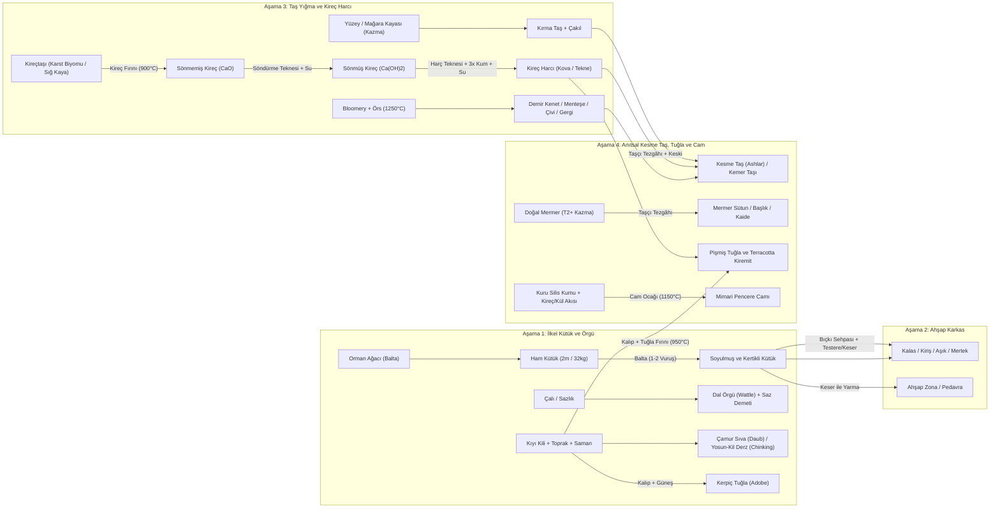
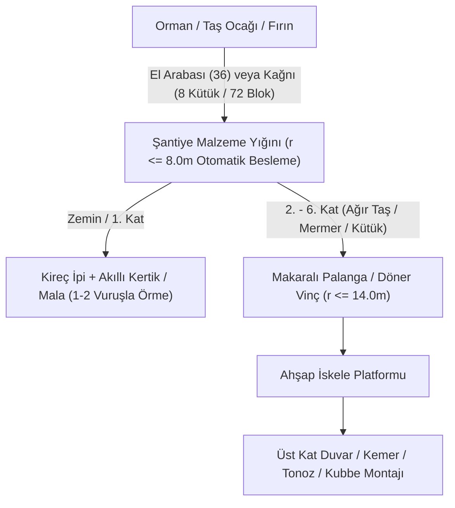
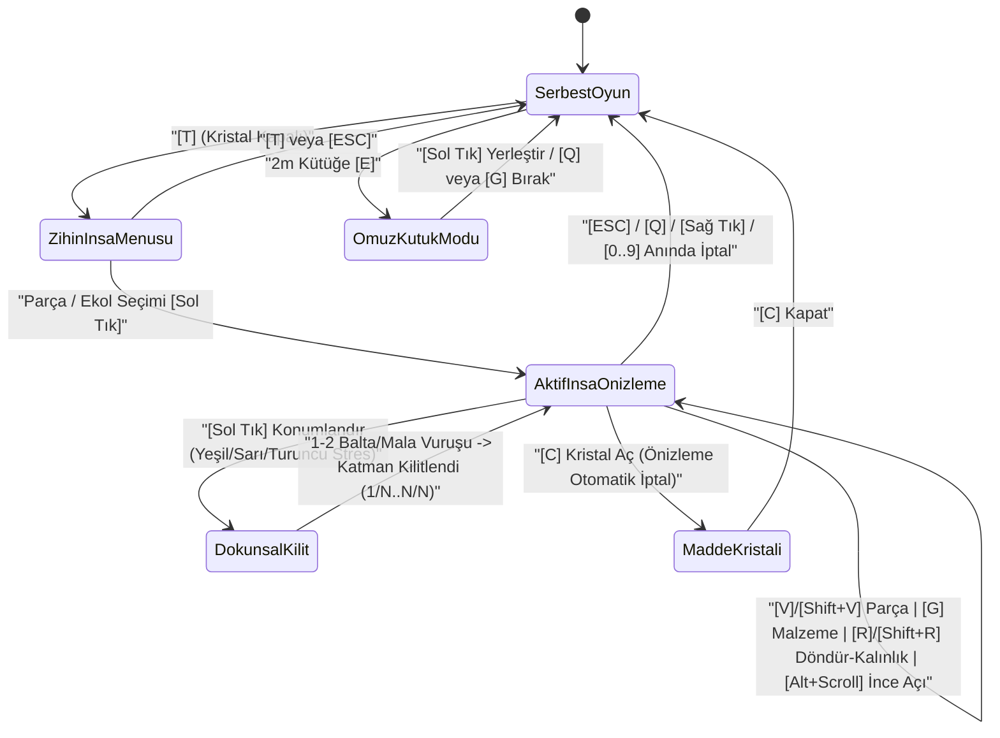

# DOK5 — Malzeme Progresyonu, Dokunsal İnşaat UX'i ve İç Mekân / Ekipman Kataloğu

> **Belge Seti:** `docs/gercekci-insaat-ve-mimari-sistemi/` (7 Parçalı Birleşik Gerçekçi İnşaat ve Mimari Şartnamesi)
> **Kapsam:** 4 Aşamalı Malzeme & Teknoloji Progresyonu, Dokunsal ama Sıkıcı Olmayan İnşaat UX & Şantiye Lojistiği, Çakışmasız PT-04 Tuş Akışı, İç Mekân Mimari Elemanları ve Mevcut Zanaat Atölyelerinin Bina İçi Yerleşim Kuralları.
> **Bağlı Belgeler:**
> - [DOK1 — Hedef, Tek Sistem Anayasası ve Kabul Kriterleri](DOK1_HEDEF_VE_GEREKSINIMLER.md)
> - [DOK2 — Mevcut Yapı Envanteri, 3 Kök Neden ve Dönüşüm Matrisi](DOK2_MEVCUT_YAPI_ENVANTERI_VE_DONUSUM.md)
> - [DOK3 — Gerçek Hayat Mimarisi ve Referans Oyun Araştırması](DOK3_GERCEK_HAYAT_MIMARI_VE_REFERANS_ARASTIRMASI.md)
> - [DOK4 — Yapısal Fizik, Statik Graf, Çevre ve Performans Mimarisi](DOK4_YAPISAL_FIZIK_STATIK_VE_PERFORMANS.md)
> - [DOK6 — Yerleşim (Köy / Kasaba / Şehir / Harabe) Birleşimi](DOK6_YERLESIM_KOY_KASABA_SEHIR_BIRLESIMI.md)
> - [DOK7 — Adım Adım Uygulama Yol Haritası ve Test Planı](DOK7_ADIM_ADIM_UYGULAMA_VE_TEST_PLANI.md)
> - Referans Proje Devir & Tuş Haritası: [`DURUM_VE_DEVIR.md`](../../DURUM_VE_DEVIR.md) (Bölüm 4 — Çakışmasız PT-04 Haritası)

---

## 0. Tasarım Anayasası ve Kod Tabanı Bağlamı

Stratocraft'ta inşaat sistemi **üç kırılmaz tasarım ilkesi** üzerine oturur:

1. **Gerçekçi Fiziksel Şekil Korunumu & `[C]` Madde Kristali Sınırı (`Karar A3`):** Ham kütük, dal, taş, kil ve kum doğadaki 3B şeklini (`PhysicalItemShapeDna`) korur; ham taş/toprak blok gibi havada asılı dizilemez. Gerçek `Ekol 1..4` yapıları **`[C]` Kristal kullanmadan**, kazma/balta ile elde edilen ve işlenen malzemelerle (kertik açma, hızar/kalas kesimi, taş yontma, harç karımı, tuğla/cam pişirme) inşa edilir ve **`[C]` Madde Kristali vakumuna `%100` bağışıktır** (`CrystalResistanceFlags.CrystalImmune`; yalnızca gerçek aletler veya kuşatma silahlarıyla kırılabilir). `[C]` Madde Kristali ise YALNIZCA ham doğal maddeleri (`IsCraftedItemBlockMaterial == false`; yekpare doğal taş, toprak, kireçtaşı vb.) çıkarabilir veya şekil verebilir; **asla tuğla, harçlı taş duvar, kertikli kütük veya işlenmiş mimari parça üretemez**. Doğal `[C]` kristal maddesiyle yapılan barınaklar (`ArchitecturalSchool.RawNaturalCrystal = 0`) belirgin biçimde daha zayıftır (`RawNaturalCrystalStrengthFactor = 0.45x`) ve doğal madde olarak kaldığı için diğer oyuncular/düşmanlar tarafından `[C]` Kristal ile kolayca vakumlanıp kırılabilir (bkz. [DOK1](DOK1_HEDEF_VE_GEREKSINIMLER.md) ve [DOK4](DOK4_YAPISAL_FIZIK_STATIK_VE_PERFORMANS.md)).
2. **Dokunsal Gerçekçilik, Sıfır Eziyet ("2-Vuruş Kuralı"):** Oyuncu bir kütük evi ya da kubbeli taş yapıyı inşa ederken temel kazdığını, ip çektiğini, kertik oturttuğunu, harç sürdüğünü ve ağır taşları vinçle kaldırdığını **elleriyle hisseder**; ancak her tek çiviyi ya da harç milimetresini 1000 kez piksel piksel hizalamak zorunda kalmaz. Akıllı yakalama (`Smart Notch & Mortar Snap`) + 1–2 dokunsal alet vuruşu hem gerçekçilik hem akıcı tempo sağlar.
3. **Tek Malzeme & Tek Eleman Havuzu (`Oyuncu İnşaatı == Dünya Yerleşimi`):** Bu belgede tanımlanan her malzeme, her kapı/pencere/merdiven/baca ve her iç mekân donanımı hem oyuncunun kurduğu yapılarda hem de Köy/Kasaba/Şehir/Harabe yapılarında ([DOK6](DOK6_YERLESIM_KOY_KASABA_SEHIR_BIRLESIMI.md)) birebir aynı veri yapısıyla, UV-free `COLOR_0` `.glb` (`< 16.0 MB` toplam VRAM bütçesi) ve `0 B/kare` kararlı-durum GC kuralıyla çalışır.

### Mevcut Kod Tabanı Entegrasyon Noktaları (Salt-Okunur Denetim Özeti)

| Kod Dosyası (Göreceli Yol) | Mevcut Rolü | DOK5 ile Genişletme / Bağlantı Noktası |
| :--- | :--- | :--- |
| `Assets/_Stratocraft/Core/Constants/MaterialIdCatalog.cs` | `0..255` blok, cevher, ahşap ve üretilmiş yapı malzemesi ID kataloğu (`StoneBrick=120`, `WoodPlank=121`, `ReinforcedSteelBlock=122`, `ObsidianBrick=123`, `ThatchTile=124`, `IronGrating=125`, `CampfireBlock=166`, `PrimitiveStoneKilnBlock=167`, `BedBlock=168`; `120..199` aralığı `IsCraftedItemBlockMaterial == true`) | Doğal Karst arazi bloğu için boş doğal aralıkta **`Limestone = 20`** (`IsCraftedItemBlockMaterial == false`, `[C]` Kristal `Tier 2` ile vakumlanabilir); `Quicklime` voksel blok yerine yalnızca `InventoryItemKind` (`QuicklimePowder`) olarak tutulur; işlenmiş mimari bloklar ise `126..136` aralığına (`CutAshlarStone=126`, `DressedMarbleBlock=127`, `FiredClayBrick=128`, `RoofClayTile=129`, `AdobeBrickBlock=130`, `WattleDaubPanelBlock=131`, `LimeMortarStoneWall=132`, `ChinkedLogBlock=133`, `IronTieBeamBlock=134`, `LeadedGlassPane=135`, `TimberShingleRoof=136` — tamamı `IsCraftedItemBlockMaterial == true` ve `IsCrystalVacuumImmune == true`) eklenir (Faz I.1–I.5) |
| `Assets/_Stratocraft/Inventory/Systems/PrimitiveSurvivalCraftingCatalog.cs` | `[R]` taş yontma kalıpları + `[I]` 3B kumaş çanta bezi birleştirme tarifleri (22 tarif) ve Madde Kristali T0→T5 evrimi | Yeni el aletleri (Kireç İpi & Kazık Seti, Taş/Demir Mala, Keser/Bıçkı, Taşçı Keskisi, Halat & Makara Çarkı) ve ilk aşama yapı parçası bağlama tarifleri |
| `Assets/_Stratocraft/Inventory/Systems/SurvivalRecipeBookCatalog.cs` | `[B]` 5 sekmeli iki sayfalı deri rehber kitabı (`Tab0..Tab4`) | Mevcut 5 sekme yapısı korunarak Sekme 1 (Malzemeler), Sekme 2 (Alet/Craft) ve Sekme 3 (`[T]` İnşaat & 4 Ekol) girişlerinin yeni malzeme zincirleri ve iç mekân kurallarıyla güncellenmesi |
| `Assets/_Stratocraft/Character/Stage1VisualHotbarAndInventoryUi.cs` | `InventoryItemKind` (`0..62`), `VisualInventorySlot`, 9'lu hotbar + 24'lü çanta + 16'lı sandık + `[C]` 7'li kayar şerit & `[Alt]` `3×6` sağ palet | `63..95` aralığında yeni inşaat hammaddeleri, bağlayıcılar, aletler ve iç mekân kitleri (`LogDebarked`, `TimberPlank`, `TimberBeam`, `WattlePanel`, `AdobeBrick`, `ChinkingMossClay`, `LimestoneChunk`, `QuicklimePowder`, `MortarBucket`, `AshlarBlock`, `FiredBrick`, `RoofTile`, `IronHardware`, `GlassPane`, `ThatchBundle`, `WoodShingle`, `ToolTrowel`, `ToolChalkLine`, `ToolHandSaw`, `ToolMasonChisel`) |
| `Assets/_Stratocraft/Inventory/Systems/SotfLogStackAndInputSystem.cs` | `BuildStructuralMaterialKind` (6), `BuildSectionThickness` (3), `SotfFreeformLogRole`, 3B OBB çarpışma ve **`Stage1InputConflictPolicy` (PT-04 çakışmasız tuş karar motoru)** | 4-Ekol malzeme/bağlantı tipleriyle genişletme; `Stage1InputConflictPolicy` öncelik kurallarını **%100 koruyarak** Kireç İpi, İskele ve Vinç akışlarını aynı tuş gramerine bağlama |
| `Assets/_Stratocraft/Character/Stage1WorldLooseBuildController.cs` | `WorldLooseBuildSystem`, 2m omuz kütüğü taşıma (`+32 kg`), katmanlı (`1/N..N/N`) modüler inşa, `UpdateGhostVisualForTimberLog` ve `BuildProgressiveLayeredCourseMesh` | Mavi/incecik hayalet hatasını ([DOK2](DOK2_MEVCUT_YAPI_ENVANTERI_VE_DONUSUM.md)) kaldıran **1:1 hacimli önizleme + 4-renk stres halkası + şantiye malzeme yığını (`Proximity Site Supply`)** dönüşümü |
| `Assets/_Stratocraft/Character/Stage1MindBuildingController.cs` | `[T]` Zihin İnşası & SOTF Modüler Yapı Menüsü + 2.8 sn zihin silüeti ipucu | 4-Ekol sekmeli (Ekol 1..4 + İstasyonlar + Şantiye Araçları + İç Mekân) birleşik `[T]` inşa menüsü |
| `Assets/_Stratocraft/Character/Stage1InteractivePlayController.cs` | Ana giriş yönlendirici (`HandleCameraModeAndPersistenceHotkeys`), `[ESC]` tekil katman kapatma, `[B]`/`[T]`/`[V]`/`[R]`/`[G]`/`[X]`/`[C]`/`[Alt]` | PT-04 çakışmasız kontrol zincirinin korunması ve yeni inşaat/iç mekân etkileşim (`[E]`/`[Shift+E]`) kancaları |
| `Assets/_Stratocraft/Character/Stage1WheelbarrowController.cs` | 36 yuvalı fiziksel El Arabası (`WheelbarrowCargoBuffer`) | `IsStorableInWheelbarrow` listesinin kireç, harç, tuğla, kiremit, kesme taş ve çakıl kabul edecek şekilde genişletilmesi + Kağnı türevi |
| `Assets/_Stratocraft/Character/Stage1BloomeryAndForgingController.cs` | Kömür Ocağı (28 sn piroliz), `1250 °C` Bloomery, Örs sıcak dövme (8 darbe) | Demir kenet/menteşe/çivi/gergi çubuğu dövme tarifleri + Kireç/Tuğla/Cam fırınlarıyla ortak termodinamik çekirdek |
| `Assets/_Stratocraft/Character/Systems/BedSpawnPointService.cs` & `EnclosedOxygenFloodFillSystem.cs` | Yatak `SpawnPoint` + `2 m` tavan açıklığı; `0-GC` 3B O₂ Flood-Fill, `IronGrating` geçirgenliği, `CampfireBlock` O₂ tüketimi | Kapalı oda algılama, şömine/baca çekiş dengesi, kepenk/cam havalandırma ve atölye iç mekân güvenlik kuralları |

---

## 1. Malzeme & Teknoloji Progresyon Matrisi (Aşama 1 → Aşama 4)

Stratocraft'ta mimari progresyon, oyuncunun **ekonomik ve metalürjik ilerleyişiyle** (`Taş Devri → Erken Marangozluk / Bakır → Demir Çağı / Kireç & Duvarcılık → İleri Metalürji / Anıtsal Taşçılık & Cam`) birebir örtüşür. Oyuncu ilk gecede kütük/dal sığınak kurabilirken, geniş açıklıklı katedral/cami kubbesi veya çok katlı mermer saray inşa edebilmek için **kireç söndürme, kesme taş yontma, demir gergi dövme ve vinç/iskele kurma** basamaklarından geçer.

### 1.1. 4 Aşamalı Yapı Ekolü & Teknoloji Özeti

| Aşama | Mimari Ekol | Açılma Eşiği (Oyundaki Aşama) | Temel Aletler & İstasyonlar | Karakteristik Yapılar | Desteksiz Max Açıklık / Kat Limiti |
| :--- | :--- | :--- | :--- | :--- | :--- |
| **Aşama 1** | **Ekol 1: İlkel Kütük Yığma & Dal Örgü** | Oyun başı (Dakika 1–30, Taş Devri) | `[R]` Taş Yontma, `[I]` Çanta Bezi, T1 Taş Balta, T1 Taş Kazma, Avuçla Kazma (`Sol Ctrl+E`), `[T]->[1]` Kamp Ateşi | Kertikli kütük kulübe, dal örgü-çamur sıva barınak, saz çatı, kerpiç duvar, ilkel taş kaide | `<= 4.0 m` açıklık · `1–1.5` kat (tavan arası) |
| **Aşama 2** | **Ekol 2: Ahşap Karkas (Kolon–Kiriş & Payanda)** | Bakır / Erken Demir çağı (`[T]->[2]` Kömür Ocağı + `[T]->[3]` Bloomery → Bakır/T2 Demir) | T2 Demir Balta, **Keser & El Testeresi**, **Bıçkı/Marangoz Sehpası**, Ahşap El Arabası, Ahşap İskele, Kireç İpi | 2–3 katlı ahşap karkas evler, hanlar, marangoz/demirci atölyeleri, ahır, yel değirmeni kulesi, pedavra/zona çatı | `<= 6.5 m` (kiriş + çapraz payanda ile) · `2–3` kat |
| **Aşama 3** | **Ekol 3: Gerçek Taş Yığma & Kireç Harcı** | Orta Demir Çağı (T2 Demir Kazma/Çekiç + **Kireç Fırını** + **Harç Teknesi** + Örs) | T2 Demir Kazma, Taşçı Çekici, **Mala (`Trowel`)**, **Kireç Fırını**, **Söndürme & Harç Teknesi**, Şantiye Kağnısı, Makaralı Palanga | Taş yığma konutlar, şömineli/bacalı taş evler, kasaba surları, gözetleme kuleleri, taş kemerli köprü ve mahzenler | Düz taş lento `<= 2.2 m`; taş kemerle `<= 8.0 m` · `3–4` kat |
| **Aşama 4** | **Ekol 4: Anıtsal Kesme Taş, Mermer, Tuğla, Demir Gergi & Cam** | İleri Demir / Çelik Çağı & T3+ Madencilik (T2–T3 Kazma + **Taşçı Tezgâhı** + **Tuğla/Kiremit Fırını** + **Cam Ocağı** + Döner Vinç) | **Taşçı Keskisi & Gönye**, Çelik Çekiç, **Taşçı Yontma Tezgâhı**, **Tuğla/Kiremit Fırını**, **Cam Ocağı**, Döner Şantiye Vinci, Örs (Demir Gergi/Kenet) | Çok katlı saraylar, kubbeli tapınak/büyük cami, katedral tonozları, uçan payandalı kaleler, vitraylı salonlar, sur kapıları | Kemer/tonoz + demir gergi/payanda ile `10–18 m` açıklık · `4–6+` kat |

---

### 1.2. Malzeme İşleme Zinciri Akış Şeması (Aşama 1 → Aşama 4)

---

### 1.3. Kapsamlı Malzeme & Teknoloji Progresyon Matrisi (Tüm 15 Malzeme Grubu)

> **Not:** Mevcut `MaterialIdCatalog` sabitleri `(ID=...)` şeklinde, yeni önerilen sabitler `(Yeni ID=...)` şeklinde belirtilmiştir. Her malzemenin elde ediliş yolu mevcut biyom/katman kurallarıyla (`StratocraftFloatingIslandWorldGen`, `SurvivalRecipeBookCatalog`) birebir tutarlıdır.

| # | Malzeme (TR / EN) & Kod Karşılığı | Nerede Bulunur? (Biyom / Katman / Konum) | Açılma Aşaması | Elde Etme Aleti & Eylemi | İşleme Tezgâhı / Fırını & Adım Adım İşlem | Mimari / Yapısal / Yalıtım Rolü |
| :--- | :--- | :--- | :--- | :--- | :--- | :--- |
| **1** | **Ham Kütük** *(Raw Log — `FallenTreeLog`, Meşe `ID=70`, Demir Ağacı `ID=71`, Çam/Huş/Söğüt/Palmiye)* | Orman biyomları (Biyom `0, 1, 4, 12, 13`), ağaç gövdeleri (`7` tür). Demir Ağacı sisli/derin ormanlarda. | **Aşama 1** (Başlangıç) | **T1 Taş Balta** (veya T2 Demir Balta) ile ağaç gövdesini kesip devirme → gövdeyi `2 m` parçalara dilimleme → `[E]` ile omuza alma (`+32 kg`) veya El Arabası/Şantiye Yığınına taşıma. | Doğrudan işlenmeden ilkel palisad / kaba kütük yığını olarak kullanılabilir; yapısal duvar için **kabuğu soyulup kertiklenmelidir** (bkz. #2). | Hammadde gövdesi. Çürümeye karşı kabuklu kalırsa nem tutar; yapısal taşıyıcılık için #2 veya #3'e işlenir. |
| **2** | **Soyulmuş & Kertikli Kütük** *(Debarked & Saddle/Dovetail-Notched Log — `LogDebarked`, `ChinkedLogBlock ID=133`)* | Ham kütükten (#1) şantiye alanında veya Bıçkı Sehpasında üretilir (`IsCraftedItemBlockMaterial == true`, `[C]` Kristal vakumuna `%100` bağışık). | **Aşama 1** (İlk Ev) | **T1 Taş Balta / Keser** (kabuk soyma + uç kertik açma; `[C]` Kristal ile üretilemez!). | **Yerde veya Bıçkı Sehpasında:** 1) Ham kütüğe Balta/Keserle `1` vuruş → kabuk soyulur (`+1` ağaç kabuğu/yakıt), 2) Köşe yerleşiminde akıllı kertik hayaleti belirir, `1–2` dokunsal balta darbesiyle **Semer Kertik (Saddle Notch)** (Aşama 1) veya **Kırlangıç Kuyruğu Kertik (Dovetail Notch)** (Aşama 2, Keserle) kilitlenir. | **Ekol 1 ana duvar ve köşe kilit elemanı.** Köşe kertiği olmadan kütükler üst üste yatay stabilite kazanamaz ([DOK4](DOK4_YAPISAL_FIZIK_STATIK_VE_PERFORMANS.md)). |
| **3** | **Kalas, Kiriş, Aşık ve Mertek** *(Plank `ID=121`, Beam, Purlin, Rafter — `TimberPlank` / `TimberBeam`)* | Ham veya soyulmuş kütükten (#1/#2) üretilir. Geniş açıklıklar için **Demir Ağacı (`ID=71`)** kiriş önerilir. | **Aşama 2** (Ahşap Karkas) *(kaba yarma kalas Aşama 1 geç dönemi)* | **Keser (Adze)** + **Bakır/Demir El Testeresi (Hand Saw)** (T1+ bakır/demir külçe + dal + lif). | **Bıçkı / Marangoz Sehpası (Sawhorse Bench):** 1) Soyulmuş kütüğü sehpaya `[Sağ Tık]` yerleştir, 2) Kesim modu seç (`4x Kalas` / `1x Kare Kiriş 20×20cm` / `2x Mertek-Aşık`), 3) Testere ile `2` ritmik çekme darbesiyle düzgün dikdörtgen kereste çıkar (zıvana başlıkları otomatik hazırlanır). | **Ekol 2 iskeleti** (kolon, ana kiriş, çapraz payanda, döşeme kirişi, çatı makası), kapı/pencere/merdiven/mobilya ve iskele üretimi. |
| **4** | **Dal Örgü + Çamur Sıva + Kerpiç** *(Wattle & Daub `WattleDaubPanelBlock ID=131`, Adobe Brick `AdobeBrickBlock ID=130`)* | **Dal/Çalı:** Orman/ova çalıları (`[E]`/`Sol Tık`). **Kil:** Suya `<= 4 m` ıslak kıyılar (`Clay`, `ID=16`). **Toprak & Saman:** Çayır/tarla (`WildGrainBundle` artığı / `PlantFiber`). | **Aşama 1** (Dal Örgü & Çamur Sıva) → **Aşama 1–2** (Kerpiç) | Çalı kesimi `[E]`/`Sol Tık`; Kil & Toprak `Sol Ctrl + [E]` avuçla kazma veya Kürek/Kazma. | **Dal Örgü (Wattle):** `[I]` Çanta veya şantiyede `4x Kuru Dal + 2x Lif` → esnek örgü paneli (Ekol 2 dikmeleri arasına gerilir). **Çamur Sıva (Daub):** Harç/Karıştırma teknesinde (veya `[I]` çanta) `2x Kil + 2x Toprak + 1x Lif/Saman + Su` → mala veya elle örgü üstüne `1` sürüşle sıvanır. **Kerpiç (Adobe):** Ahşap kalıba (`2x Kil + 2x Toprak + 1x Saman + Su`) basılır, güneşte/kuru sundurmada kurutulur (`4x Kerpiç Tuğla`, `IsCrystalVacuumImmune == true`). | Ekol 2 ahşap karkas arası hafif/ucuz dolgu duvarı, sıcak/kurak biyomlarda (`Kızıl Kumtaşı`, `Yayla`) yüksek ısıl kütleli duvar. Yağmurdan geniş çatı saçağıyla korunmalıdır! |
| **5** | **Yosun / Kil Derz Dolgusu** *(Chinking & Daubing — `ChinkingMossClay` [Item] -> `ChinkedLogBlock ID=133`)* | **Yosun:** Orman ağaç dipleri, nemli kayalar, mağara girişi (`GlowingMoss` veya doğal orman yosunu). **Kil:** Göl/deniz kıyısı (`<= 4 m`). | **Aşama 1** (Kütük Ev Isı Mühürleme) | Elle `[E]` yosun toplama + `Sol Ctrl + [E]` kıyı kili. | `[I]` Çantada `2x Yosun + 1x Lif` (Kuru Yosun Fitili) veya `1x Kil + 1x Kum + 1x Yosun` (Kil Derz Harcı; `120 sn` ilk yük taşıma / `300 sn` tam kür). Kütük duvar dizildikten sonra kütük aralıklarına `1` sürme/sıkıştırma hareketiyle uygulanır (`ChinkingFlags`). | Kütük duvarlar arasındaki rüzgâr/soğuk sızıntısını `%100` keser; **kapalı sıcak iç mekân (`EnclosedRoom`, `SealFactor >= 0.70`)** etiketini aktif eder ve `Wind Chill` ısı kaybını engeller ([DOK4](DOK4_YAPISAL_FIZIK_STATIK_VE_PERFORMANS.md)). |
| **6** | **Kırma Taş** *(Rubble / Fieldstone — `RoughStoneChunk`, `Cobblestone ID=8`)* | Yeryüzü kaya döküntüleri, dağ yamaçları ve sığ mağara duvarları (`Stone ID=1`, `Cobblestone ID=8`). | **Aşama 1** (Temel/Ocak) → **Aşama 3** (Taş Yığma Duvar) | Yerden `[E]` toplama veya **T1 Taş Kazma** / **T2 Demir Kazma** ile kaya kırma. | Ham halde **Kuru Taş Duvar / Temel Altlığı** olarak örülebilir (düşük yükseklik `<= 2.5 m`). **Aşama 3'te** Taş Çekiciyle kaba yüzü düzeltilip **Kireç Harcı (#9)** ile şaşırtmalı (`Running Bond`, `LimeMortarStoneWall ID=132`) örülür. | Temel drenaj yatağı, kuru bahçe/ahır duvarı, Ekol 3 harçlı taş yığma duvarlar, şömine ve ocak gövdeleri. |
| **7** | **Çakıl ve Kum** *(Gravel `ID=9`, Sand `ID=4` / `SandPile`)* | **Çakıl:** Nehir yatakları, dağ etekleri, kıyı şeritleri. **Kum:** Sudan `> 4 m` kuru kumsallar, çöl ve kanyon biyomları (Biyom `6, 13`). | **Aşama 1** (Seramik/Drenaj) → **Aşama 3** (Harç) → **Aşama 4** (Cam) | `Sol Ctrl + [E]` avuçla kazma veya **Kürek / Kazma** (`Sol Tık`). | **Çakıl:** Doğrudan temel hendeği tabanına drenaj/sıkıştırma katmanı olarak serilir. **Kum:** 1) Kil pota/tuyere harcı (`[I]`), 2) **Kireç Harcı agregası** (`3x Kum + 1x Sönmüş Kireç`), 3) **Cam ergitme hammaddesi** (Bölüm #13). | Temel drenajı & zemin taşıma gücü artırımı (+%25 zemin kapasitesi), harç bağlayıcı iskeleti ve cam üretimi. |
| **8** | **Kesme Taş** *(Ashlar Block — `StoneBrick ID=120`, Bazalt `ID=7`, `CutAshlarStone ID=126`)* | Sığ/Orta kaya (`Stone`), Karst (`Limestone ID=20`), Derin Mağara (`Basalt ID=7`, T2 Kazma gerektirir). | **Aşama 4** *(köşe kilit taşı `Quoin` Aşama 3 geç dönemi)* | **T2 Demir Kazma** (taş/kireçtaşı/bazalt blok çıkarma) + **Taşçı Keskisi & Demir Çekiç** (`[C]` Kristal kesme taş üretemez!). | **Taşçı Yontma Tezgâhı (Mason's Chisel Table):** 1) `2x Kırma Taş` veya `1x Ham Kaya Bloğu` tezgâha konur, 2) Şablon seçilir (`Düz Kesme Taş`, `Köşe Kilit Taşı / Quoin`, `Kemer Kama Taşı / Voussoir`, `Kilit Taşı / Keystone`, `Lento`), 3) Taşçı Keskisi + Çekiçle `2` darbede pürüzsüz gönyeli blok çıkar (`IsCrystalVacuumImmune == true`). | **Ekol 3–4 yüksek dayanımlı taşıyıcı duvar, kemer, tonoz, payanda ve kale suru.** Düşük harç kalınlığı, çok yüksek basınç dayanımı (`480–860 kN`). |
| **9** | **Kireç Zinciri: Kireçtaşı → Sönmemiş Kireç → Sönmüş Kireç → Kireç Harcı** *(Doğal `Limestone ID=20` → `QuicklimePowder` [Item] → `SlakedLime` [Item] → `LimeMortarStoneWall ID=132`)* | **Kireçtaşı (`ID=20`, doğal arazi, `IsCraftedItemBlockMaterial == false`):** Biyom `2` (Karstik Kireçtaşı Düdenleri), sığ kanyon yamaçları ve mağara Katman 1 (`Y = 63..96 m`); ayrıca mevcut `Marble` (`ID=14`) da öğütülerek kireç/akı verebilir. | **Aşama 3** (Taş Yığma & Harç) | **T1–T2 Kazma** (ham kireçtaşı doğal blok olduğu için `[C]` Kristal `Tier 2` ile de çıkarılabilir) + **Su Kovası** ile söndürme suyu. | **4 Adımlı Gerçekçi Kimyasal Zincir:** 1. **Kalsinasyon (`Kireç Fırını`, `900 °C`, 35 sn):** `6x Kireçtaşı + 4x Odun Kömürü/Odun` → `4x Sönmemiş Kireç (CaO)` (`InventoryItemKind.QuicklimePowder`, voksel blok değildir; yağmurdan korunmalıdır!). 2. **Söndürme (`Söndürme Teknesi`):** `4x Sönmemiş Kireç + 1x Su Kovası` → buhar çıkışı (`6 sn`) → `4x Sönmüş Kireç Macunu (Ca(OH)₂)`. 3. **Harç Karımı (`Harç Teknesi`):** `1x Sönmüş Kireç + 3x Kum + Su` → **`8x Kireç Harcı`** *(Opsiyonel: `+1x Ezilmiş Pişmiş Tuğla/Volkanik Kül` eklenirse suya dayanıklı **Hidrolik/Horasan Harcı** olur!)*. 4. **Uygulama & Kürlenme (`Karar A2`):** Mala ile sürülür; **`CureRatio < 0.45` (`kappa_islak = 0.28`)** ıslak/kırılgan fazda üstüne ağır kat binerse kayar ve şiddetli yağmurda yıkanır → Survival'da taze kireç harcı **`240 sn` (`4 gerçek dk`)** içinde yük taşıma eşiğine (`CureRatio >= 0.45`) ulaşır ve **`600 sn` (`10 gerçek dk`)** içinde tam sertleşir (`CureRatio == 1.0`, `%100` dayanım; kil harcı `120 sn / 300 sn` ölçeğindedir; `[F4]` Yaratıcı Mod'da ise harç **anında `1.0`** kürlenir — bkz. [DOK1](DOK1_HEDEF_VE_GEREKSINIMLER.md) ve [DOK4](DOK4_YAPISAL_FIZIK_STATIK_VE_PERFORMANS.md)). | Ekol 3 ve Ekol 4 kâgir yapıların **zorunlu bağlayıcısı** (`IsCrystalVacuumImmune == true`). Harçsız taş duvarlar `2.5 m` üstünde devrilme/kayma riski taşırken kireç harçlı duvarlar çok katlı yük ve kemer itmesini taşır. |
| **10** | **Mermer** *(Carved Marble — Doğal `Marble ID=14` → İşlenmiş `DressedMarbleBlock ID=127`, sütun/başlık/kaide)* | Orta mağara katmanı (`Y = 42..68 m`), dağ mermer damarları ve yüksek yayla kayalıkları (`Altın & Alacakaranlık Yaylası`). | **Aşama 4** (Anıtsal Mimari) | **T2+ Demir Kazma** (ham doğal mermer `T3` Kristal ile kazılabilir; işlenmiş blok tezgâhta üretilir). | **Taşçı Yontma Tezgâhı:** Ham mermer blok → `2` keski-çekiç darbesiyle **Mermer Kaide**, **Yivli Sütun Tamburu**, **Korint/Mukarnas Başlık**, **Mermer Kemer Kama Taşı** veya **Parlatılmış Mermer Döşeme Plağı** (`DressedMarbleBlock ID=127`, `IsCrystalVacuumImmune == true`) üretilir. | En yüksek estetik ve yüksek basınç kapasiteli (`860 kN`) anıtsal sütun, saray/tapınak/cami revakı ve döşeme kaplaması. |
| **11** | **Pişmiş Tuğla & Terracotta Kiremit** *(Fired Clay Brick `FiredClayBrick ID=128`, Roof Tile `RoofClayTile ID=129`)* | **Kil (`ID=16`):** Su kıyıları (`<= 4 m`). **Kum (`ID=4`):** Kuru sahil. | **Aşama 3 Geç / Aşama 4** | Avuçla kazma / Kürek (Kil + Kum) + **Tuğla Kalıbı** (Ahşap; `[C]` Kristal ile tuğla/kiremit üretilemez!). | **3 Adım:** 1) **Kalıplama (Marangoz/Kil Tezgâhı):** `3x Kil + 1x Kum + Su` → `6x Yaş Tuğla` veya `6x Yaş Kiremit`. 2) **Ön Kurutma:** Sundurma altında kısa kuruma (`20 sn` oyun içi hızlı raf). 3) **Pişirme (`Tuğla / Kireç Fırını`, `950 °C`, 30 sn + Odun/Kömür):** → `6x Pişmiş Kırmızı Tuğla` (`ID=128`) veya `6x Su Geçirmez Terracotta Kiremit` (`ID=129`, tamamı `IsCrystalVacuumImmune == true`). | **Tuğla:** Hafif ama çok mukavemetli tonoz, kubbe (Osmanlı/Roma tuğla kubbesi — taştan `%30` hafif, daha az yanal itme!), baca ve iç bölme duvarı. **Kiremit:** `%100` su geçirmez, yanmaz, uzun ömürlü çatı örtüsü. |
| **12** | **Demir Kenet, Menteşe, Çivi ve Gergi Çubuğu** *(Iron Hardware & Tie-Rod — `WroughtIronBar` türevi, `IronTieBeamBlock ID=134`)* | **Demir Cevheri (`IronOre ID=32`):** Yüzey mostra ve sığ mağaralar (T1 Taş Kazma ile çıkarılır; cevher vakum bağışıktır). | **Aşama 2** (Çivi/Menteşe) → **Aşama 3–4** (Kenet & Gergi Çubuğu) | T1+ Kazma (Demir Cevheri) → `[T]->[3]` `1250 °C` Bloomery → Taş/Demir Çekiç + Örs. | **Mevcut Bloomery + Örs Zinciri (`Stage1BloomeryAndForgingController`):** `WroughtIronBar` ısıtılır (`>= 720 °C`) ve Örste dövülür: • `1x Dövme Demir` → `12x Demir Çivi` veya `2x Kapı/Kepenk Menteşesi` veya `4x Taş Kenet Demiri (Cramp)` • `2x Dövme Demir` → `1x Ağır Kilit & Kale Sürgüsü` • `3x Dövme Demir` → `1x Anıtsal Demir Gergi Çubuğu (Iron Tie-Rod)` (`ID=134`, `IsCrystalVacuumImmune == true`, kemer ayaklarını birbirine bağlar!). | **Kenet:** Kesme taş blokları yatayda kilitler (deprem/kuşatma direnci). **Menteşe/Kilit:** Çalışan kapı/kepenk/kale kapısı. **Gergi Çubuğu:** Kemer/kubbe yanal itmesini (`Lateral Thrust`) çekme kuvvetiyle dengeler — ince sütunlu büyük açıklıkları mümkün kılar ([DOK4](DOK4_YAPISAL_FIZIK_STATIK_VE_PERFORMANS.md)). |
| **13** | **Mimari Pencere Camı** *(Architectural Glass — `GlassPane`, `LeadedGlassPane ID=135`)* | **Kuru Silis Kumu (`Sand ID=4`):** Kumsallar/çöl. **Akı (`CrushedFluxPowder` / Kireçtaşı / Odun Külü):** Yel Değirmeni veya Kamp Ateşi külü. | **Aşama 4** (İleri Mimari) | Kürek (Kum) + Yel Değirmeni (`Mermer/Kireçtaşı → Flux`) + Kömür Ocağı. | **Cam Ergitme Ocağı (`Glass Pot Furnace`, `1150 °C`, Pişmiş Kil Pota + Körük):** `3x Kum + 1x Kireç/Akı Tozu (CrushedFluxPowder) + 2x Odun Kömürü` → `25 sn` ergitme → düz taş tablada açma → **`2x Mimari Cam Levha`** (`ID=135`, `IsCrystalVacuumImmune == true`; biyom cevher tozu/Ametist/Safir/Bakır oksit eklenirse renkli **Vitray Cam**!). | Pencerede rüzgâr ve soğuğu `%100` keserken gün ışığını `%88` geçirir; kapalı oda ısı yalıtımını bozmadan aydınlık saray/ev içi sağlar. |
| **14** | **Saz / Saman & Ahşap Zona / Pedavra** *(Thatch `ID=124`, Wood Shingle `TimberShingleRoof ID=136`)* | **Saz/Saman:** Göl/nehir kıyısı sazlıkları, çayırlar (`WildGrainBundle` / `LeafPile` / `PlantFiber`). **Zona:** Çam/Meşe/Sedir kütükleri. | **Aşama 1** (Saz) → **Aşama 2** (Ahşap Zona) | **Saz:** Bıçak/elle `[E]` toplama. **Zona:** Balta/Keser ile kısa kütük dilimi yarma. | **Saz Demeti (`[I]` Çanta):** `4x Bitki Lifi / Saz + 1x Kuru Dal` → `2x Saz Çatı Paneli` (`ThatchTile`). **Ahşap Zona (Marangoz Sehpası):** `1x Soyulmuş Kütük` → keserle ince bindirmeli `8x Ahşap Zona` (`ID=136`, `IsCrystalVacuumImmune == true`). | **Saz:** İlk gece çatı örtüsü, çok hafif (ince mertek taşır), fakat **yanıcıdır** ve fırtınada yıpranır. **Zona:** Sazdan `2.5x` dayanıklı, kar yükünü kaydırır, Ekol 1–2 Nordik çatılarının doğal kaplaması. |
| **15** | **Mevcut İleri Yapı Blokları Köprüsü** *(`ReinforcedSteelBlock ID=122`, `ObsidianBrick ID=123`, `IronGrating ID=125`, `DamascusSteel ID=60`, `Floatstone ID=18`)* | Mevcut `PrimitiveSurvivalCraftingCatalog.BuildingMaterialRecipes` (`[I]` Çanta Bezi) ve derin mağara/gökyüzü adaları. | **Aşama 4 / Geç Oyun (End-Game)** | T2–T3 Kazma + Bloomery + Örs + `[I]` Çanta / İleri Atölye. | Mevcut 5 tarif **aynen korunur** (`ReinforcedSteelBlock`, `ObsidianBrick`, `IronGrating`, `DamascusSteel`, `Floatstone`); ek olarak **Aşama 4 yapısal profillerde** (çelik kiriş, obsidyen kuşatma duvarı, mazgal pencere/havalandırma, uçan ada ankrajı) birleşik statik grafa bağlanır. | Kuşatma kalesi zırh kaplaması (`12.000–25.000` basınç), oksijen geçirgen mazgal ve gökyüzü adası inşaatı (`SkyAnchor`). |

---

### 1.4. İnşaat İşleme Tezgâhları & Fırınları Özeti (Mevcut + Yeni)

Tüm yeni işleme istasyonları mevcut `[T]` Zihin İnşası geleneğine uyar (yere fiziksel malzemeleri koy → `[T]` ile mühürle; sıfır yapay "havadan spawn" penceresi):

| İstasyon / Tezgâh | Durum | Kurulum Aşaması & Malzemesi (`[T]`) | Ürettiği Yapı Malzemeleri | Oyun İçi Etkileşim Akışı |
| :--- | :--- | :--- | :--- | :--- |
| **3B Kumaş Çanta Bezi (`[I]`) & Taş Yontma (`[R]`)** | Mevcut | Başlangıç (Kurulum gerektirmez) | T1 Taş aletler, Saz demeti, Yosun derz dolgusu, Kireç İpi seti, Dal örgü paneli | Mevcut fiziksel 3B birleştirme & 8×8 taş yontma |
| **Kamp Ateşi (`[T]->[1]`) & Kömür Ocağı (`[T]->[2]`)** | Mevcut | Aşama 1 | Odun Kömürü (28 sn piroliz), pişmiş kil pota/boru, odun külü (cam akısı) | Çakmaktaşı kıvılcımı, `[Shift+E]` yakıt koruyarak söndürme |
| **Bloomery (`[T]->[3]`) & Demirci Örsü** | Mevcut | Aşama 2 | Dövme Demir Külçe → Çivi, Menteşe, Kilit, Taş Keneti, **Demir Gergi Çubuğu**, Mala/Testere/Keski başları | `1250 °C` körük + Örste sıcak dövme (`>= 720 °C`) |
| **Yel Değirmeni (`[T]->[5]`)** | Mevcut | Aşama 2–3 | Mermer/Kireçtaşı → İnce Kalsiyum Akı Tozu (`CrushedFluxPowder` — cam & hidrolik harç katkısı) | Rüzgârla otomatik öğütme (`[Shift+E]` fırtına freni) |
| **Bıçkı & Marangoz Sehpası (`Sawhorse Bench`)** | **Yeni (Faz I.2)** | Aşama 2 (`2x Soyulmuş Kütük + 4x Dal + 2x Lif`) | Kalas, Ana Kiriş, Aşık, Mertek, Ahşap Zona, Kapı/Pencere Kasası, Merdiven Limon Kirişi, İskele Modülü | Kütüğü `[Sağ Tık]` sehpaya koy → `[V]` kesim profili seç → Testere/Keserle `2` vuruşta biç |
| **Kireç & Tuğla Fırını (`Lime & Brick Kiln`)** | **Yeni (Faz I.3)** | Aşama 3 (`12x Kırma Taş + 8x Kil + 2x Kum`) | Sönmemiş Kireç (`900 °C`, 35 sn), Pişmiş Tuğla & Terracotta Kiremit (`950 °C`, 30 sn) | Üst/yan kapaktan malzeme + odun/kömür doldur → Çakmaktaşıyla yak → pişim bitince `[E]` hasat |
| **Söndürme & Harç Teknesi (`Mortar Trough`)** | **Yeni (Faz I.3)** | Aşama 3 (`4x Kalas + 2x Lif/Çivi` veya oyma kütük tekne) | Sönmüş Kireç, Kireç Harcı, Hidrolik Harç, Çamur Sıva (`Daub`) | Sönmemiş kireç + Su Kovası `[Sağ Tık]` → `6 sn` buharlı söndürme → `+3x Kum` → Mala/Kova ile şantiyeye taşı |
| **Taşçı Yontma Tezgâhı (`Mason's Chisel Table`)** | **Yeni (Faz I.4)** | Aşama 3–4 (`2x Kalın Kütük Ayak + 2x Düz Kaya Tablası`) | Kesme Taş (`Ashlar`), Köşe Kilit Taşı (`Quoin`), Kemer Kama Taşı (`Voussoir`), Kilit Taşı, Mermer Sütun/Başlık, Taş Basamak | Ham kaya/mermer koy → `[V]` mimari profil seç → Keski+Çekiçle `2` darbede yont |
| **Cam Ergitme Ocağı (`Glass Pot Furnace`)** | **Yeni (Faz I.5)** | Aşama 4 (`10x Pişmiş Tuğla + 1x Pişmiş Kil Pota + 1x Deri Körük`) | Mimari Pencere Camı, Renkli Vitray Cam, Fener Camı | `3x Kum + 1x Akı + Kömür` → `1150 °C` ergitme (`25 sn`) → düz tablada levha çıkar |

---

## 2. Dokunsal Ama Sıkıcı Olmayan İnşaat UX & Ergonomisi

Gerçekçi inşaat oyunlarının en büyük tuzağı, gerçekçiliği **"işkenceye"** dönüştürmektir (her tahta için 15 ayrı menü tıklaması, her taşı 3 eksende piksel piksel sürükleme veya 1 saat boyunca sadece çamur taşıma). Stratocraft'ın inşaat UX'i **Sons of the Forest**'ın fiziksel dokunsallığını, **Valheim**'ın zahmetsiz mıknatıslı hizalamasını ve **Vintage Story**'nin malzeme işçiliğini tek akışta birleştirir.

### 2.1. "Dokunsal 2-Vuruş" İnşaat Döngüsü (Sıkıcılıktan Kaçınma Kuralları)

1. **İp Çekme / Kireç İpi Kılavuz Hattı (`Chalk Line & Stakes`):**
   - Oyuncu `[T]` menüsündeki **Şantiye Araçları** sekmesinden (veya envanterdeki `Kireç İpi & Kazık Seti`'ni kuşanarak) ilk köşe kazığını zemine `[Sol Tık]` ile çakar, yürüyüp ikinci köşeye tıkladığında iki kazık arasında **gergin beyaz kireç ipi** gerilir.
   - İp otomatik olarak **`90°` gönye** (dik açı kilidi — `Alt` ile serbest açı), **`1.0 m` / `2.0 m` modül işaretleri** ve eğimli arazide **su terazisi yatay seviyesi** gösterir.
   - Bu ip yalnızca bir görsel çizgi değildir: Temel kazarken kazma/kürek darbelerini düz hendek hattına yönlendirir; duvar örerken kütük ve taşların akıllı yakalama (`Snap`) eksenini belirler. İnşaat bitince kazığa `[E]` basılarak ip sarılıp geri alınır (`0` kayıp).
2. **Akıllı Kertik & Harç Yakalama + 1–2 Dokunsal Vuruş:**
   - **Kütük Evde (Ekol 1):** Oyuncu omuzundaki `2 m` kütüğü (veya şantiye yığınından çekilen kütüğü) duvara/köşeye yaklaştırdığında sistem alt kütüğün çapını ve dik eksenini okuyup **otomatik Semer/Kırlangıç kertik yuvası** önerir.
     - `1. Sol Tık`: Kütük yerine oturur (yarı sabit, hizalanmış).
     - `2. Dokunsal Balta/Keser Vuruşu` *(veya balta eldeyken tek `Sol Tık` kilit)*: Kertik yongaları fırlar, tok ahşap oturma sesi çalar ve kütük **yapısal grafa kalıcı kilitlenir**. (Hızlı modda oyuncu baltasını kemerinde taşıyorsa kütüğü koyduğu anda otomatik kısa `0.35 sn` kertik oturtma animasyonuyla tek tıkta akıcı ilerler!)
   - **Taş Yığmada (Ekol 3–4):** Oyuncu elinde **Mala (`Trowel`)** varken (harç teknesi `<= 8.0 m` yakınında, Döner Vinç/Palanga aktifken `<= 14.0 m` veya kemerde harç kovası varsa):
     - Duvar üstüne `[Sol Tık]` basılı tutup yana çekerek (`Drag-Course`) bir sıra (`1–4 m`) harç yatağı serer ve şantiye taş yığınından gelen kırma/kesme taşları **şaşırtmalı (`Running Bond`)** olarak ritmik `"tık-tık-tık"` (`~0.25 sn/taş`) sesiyle sıraya dizer.
     - Böylece tek tek 200 taş piksel hizalamak yerine **gerçek duvar ustası ritmiyle** 1 duvar sırası 2–3 saniyede örülür; her taşın şaşırtmalı derzi ve harç rengi fiziksel olarak görünür.
   - **Ahşap Karkasta (Ekol 2):** Dikmeler (`Post`) temel taşlarına oturur, kirişler (`Beam`) iki dikme arasına mıknatısla kilitlenir, çapraz payandalar (`Diagonal Brace`) köşe `45°` yuvasını otomatik görür; `1` tokmak/balta vuruşuyla zıvana ahşap çivisi çakılır.

### 2.2. Mavi / İncecik Hayalet Hatasının Kalıcı Çözümü → 1:1 Hacimli Önizleme & 4-Kademeli Stres Göstergesi

Mevcut PlayTest'te raporlanan *"kütükleri üst üste dizince maviye dönmesi ve incecik bir şeye dönüşmesi"* hatasının kök nedenleri ([DOK2](DOK2_MEVCUT_YAPI_ENVANTERI_VE_DONUSUM.md)):
- `Stage1WorldLooseBuildController.cs` (`UpdateGhostVisualForTimberLog`, satır 2591–2632) içinde `ResolveSemiTransparentGhostMaterial(new Color32(82, 214, 255, 112))` ile sabit neon-mavi boya basılması ve `localScale = (0.39, 1.01, 0.39)` ince silindir/kutu katmanları (`BuildProgressiveLayeredCourseMesh`, satır 2212–2216, `hz = 0.11m` ince plakalar).
- `Stage1MindBuildingController.cs` (satır 715–799) içinde `0.012–0.022 m` kalınlığında incecik mavi tebeşir çubukları.

**Yeni Standart — Gerçek Hacimli Önizleme (`Volumetric Material-True Preview`):**
1. **1:1 Gerçek Geometri:** Önizleme objesi, yerleştirilecek gerçek `.glb` / kesit mesh'iyle **birebir aynı hacim, çap ve kalınlığa** sahiptir (`0.32–0.38 m` kütük çapı, `0.38–0.55 m` taş duvar kalınlığı, tam kemer/sütun profili). Hiçbir koşulda ince tel veya yassı levhaya küçülmez.
2. **Malzeme Rengini Koruyan Yarı-Şeffaflık:** `StratocraftGhostPreview.shader` (`COLOR_0`, `0` doku) artık tüm yüzeyi boğucu maviye boyamaz. Parçanın kendi gerçek ahşap/taş/mermer rengini **`%70` oranında korur** (`Alpha = 0.58`), yalnızca **dış kenar Fresnel konturunu (`Rim Glow`)** yapısal stres rengiyle aydınlatır.
3. **4-Kademeli Gerçek Zamanlı Yapısal Stres & Çatırdama Geri Bildirimi:**

| Stres Bandı (DOK4 Çözücü Çıktısı) | Kenar Fresnel Rengi | Diyajetik HUD / Dünya Simgesi | Ses & Fizik Tepkisi | Yerleştirme Kuralı |
| :--- | :--- | :--- | :--- | :--- |
| **Güvenli (`Yük < %55` veya Zemine/Temele Bağlı)** | **Zümrüt Yeşili** *(temel/zemin temasında tok koyu yeşil)* | İnce simge: `✓ Sağlam (Temel/Taşıyıcı)` + yük oranı (`%32`) | Yerleşince tok ahşap/taş oturma sesi | Serbest yerleştirme |
| **Yük Altında (`%55 .. %80`)** | **Kehribar Sarısı** | `△ Eğilme/Açıklık Yüksek — Payanda veya Kiriş Önerilir` | Hafif ahşap esneme tıkırtısı | Yerleştirilebilir; üstüne ekstra kat eklenirse turuncuya geçer |
| **Kritik Sınır (`%80 .. %95`)** | **Nabız Atan Turuncu** | `⚠ Kritik Yük (%88) — Çökme Riski! Alt Kolon/Gergi Gerekli` | **Sürekli hafif gıcırtı (`TimberCreak`)** veya taş derzinden **ince toz parçacıkları** dökülmesi | Yerleştirilebilir ama anlık yük artışı (kar/fırtına/üst kat) yıkımı tetikler |
| **Geçersiz / Çöker (`>= %95` veya Havada / Kertiksiz)** | **Kesik Kırmızı** | `✕ Desteksiz / Aşırı Yük! (Havada duramaz / Kertik-Temel yok)` | Red uyarısı (`Low Thud`) — mevcut yapıda tam kopuk/desteksiz (`d_geo == 65535`) parça **`0.0 sn` (anında)** düşer; aşırı yüklü (`eta_max >= 1.0`) yapı **`1.5 sn` görsel çatlak + yoğun çatırdama uyarısı** sonrası 3B devrilmeyle çöker (`Karar A1`)! | **Havada boşluğa yerleştirme engellenir**; destek kırıldığında gerçek zamanlı 3B fiziksel çöküş başlar |

---

### 2.3. Temel Kazma, Ahşap İskele, Makaralı Vinç ve Şantiye Lojistiği

Büyük bir kütük kulübe, taş konak veya kubbeli katedral inşa etmek gerçekçi ama akıcı bir şantiye döngüsü ister:

#### A. Temel Kazma Akışı (`Foundation Excavation`)
1. **Planlama:** Oyuncu Kireç İpi ile bina sınırlarını çizer. Zemin eğimliyse kireç ipi yatay su terazisini ve dolgu/kazı derinliğini gösterir.
2. **Hendek Kazma:**
   - **İlkel / Standart Yol:** Kürek veya Kazma ile kireç ipi boyunca toprak/çim kaldırılır (`0.5 m` derinlik — Ekol 1–2; `1.0–1.5 m` derinlik veya ana kayaya ulaşım — Ekol 3–4).
   - **Madde Kristali (`[C]`) Sınırı (`Karar A3`):** Uyandırılmış Kristal (`T1+`) yalnızca ham doğal arazi maddelerini (`IsCraftedItemBlockMaterial == false`; toprak, kum, ham taş, kireçtaşı) vakumlayarak temel çukurlarını hızla açabilir veya zayıf (`RawNaturalCrystalStrengthFactor = 0.45x`) ve diğer oyuncular/düşmanlar tarafından `[C]` ile vakumlanabilen doğal kütle bırakabilir. Gerçek `Ekol 1..4` temelleri ve duvarları ise `[C]` Kristal kullanmadan, işlenmiş ve `%100` vakum bağışık (`CrystalResistanceFlags.CrystalImmune`) malzemelerle örülür ([DOK4](DOK4_YAPISAL_FIZIK_STATIK_VE_PERFORMANS.md)).
3. **Drenaj & Temel Örme:** Çukura çakıl/kırma taş dökülür → harçlı temel taşı (veya Ekol 1'de köşe taşı / ahşap kazık) dizilir. Eğimli yamaçta alt taraf otomatik **kademeli taş kaide / istinat duvarı (`Stepped Stone Plinth`)** olarak uzatılabilir (havada uçan döşeme kesinlikle yok!).

#### B. Ahşap İskele (`Modular Scaffolding`)
- **Neden Gerekli?** Oyuncu havada uçamaz (Hayatta Kalma modunda); 2., 3. kat duvarlarını, kemer kilit taşlarını veya kubbe kasnağını örmek için güvenli çalışma platformuna ihtiyaç duyar.
- **Üretim & Kurulum:** Aşama 2'de açılır. Her `2 × 2 × 2 m` iskele modülü **`4x Kuru Dal/Sırık + 2x Kalas + 2x Lif`** (şantiye yığınından otomatik çekilir).
- **Özellikleri:**
  - Mevcut iskelelerin üstüne ve yanına tek tıkla mıknatısla kenetlenir (`maks 6 kat / 12 m` yükseklik; duvara çapraz payandayla bağlanırsa `20 m`).
  - İçinde entegre **tırmanılabilir ahşap merdiven** ve üstünde yürünür kalas platform + düşme önleyici bel hizası korkuluk bulunur.
  - **Sıfır Kayıplı Hızlı Söküm (`[Shift+E]` veya Balta):** İnşaat bittiğinde en üst modülden aşağıya (veya taban bağlantısını sökerek güvenli malzeme yığınına düşürerek) `%100` malzeme iadesiyle saniyeler içinde toplanır.

#### C. Makaralı Vinç / Palanga (`Crane / Pulley & Hoist`)
- **Problem:** Aşama 3–4'te tek bir Kesme Taş bloğu `80–160 kg`, bir Mermer Sütun tamburu `250 kg`, bir kütük demeti `120 kg` gelir. Oyuncunun bunları merdivenden sırtında 4. kata çıkarması hem gerçekçi değildir hem sıkıcıdır.
- **Çözüm — 2 Kademeli Şantiye Vinci:**
  1. **Basit Palanga / Makara Askısı (Aşama 2–3):** İskele tepesine veya duvar üstü konsol kirişine takılan `1x Ahşap Makara Çarkı + 4x Bitki Lifi Halat + 1x Demir Kanca`. Aşağıdaki kütük veya harç/taş sepetini dikey yukarı çeker (`[E]` basılı tutarak veya çıkrık kolunu çevirerek `2.2 m/sn` kaldırma).
  2. **Döner Kollu Şantiye Vinci / Treadwheel Jib Crane (Aşama 3–4):** Taş kule, saray ve kubbe inşası için temel/döşeme üstüne kurulan `360°` dönebilen ahşap vinç (`4x Kiriş + 2x Makara Çarkı + 1x Demir Dişli/Aks + 6x Halat`).
     - Aşağıdaki **Şantiye Malzeme Yığınından** veya **Kağnıdan** kancayla ağır kesme taşı / mermer sütunu yakalar (`[E]`).
     - `[W/S]` halatı kaldırır/indirir, `[A/D]` vinç kolunu döndürür; üst kattaki montaj noktasına yaklaşınca akıllı yakalama halkası yanar ve `[Sol Tık]` ile taş/sütun doğrudan duvar/kemer yuvasına bırakılır!

#### D. El Arabası, Kağnı ve Şantiye Malzeme Yığını (`Site Material Pile`)
- **El Arabası (`Stage1WheelbarrowController`, 36 yuva — Aşama 1–2):** Mevcut fiziksel 36 yuvalı el arabası korunur; `IsStorableInWheelbarrow` listesine **Çakıl, Kireçtaşı, Sönmemiş/Sönmüş Kireç, Harç, Kerpiç, Pişmiş Tuğla, Kiremit, Kesme Taş, Demir Kenet, Saz ve Zona** eklenir.
- **Şantiye Kağnısı / Ağır Yük Arabası (`Site Cart`, Aşama 2–3):** `2x Ahşap Tekerlek + 6x Kalas + 2x Kiriş + 4x Lif/Demir Aks`.
  - Kapasite: **`72` küçük yuva VEYA `8` adet `2 m` tam kütük / `8` adet ağır Kesme Taş / Mermer blok**.
  - Oyuncu çekebilir (yokuşta ağırlaşır) veya evcilleştirilmiş **Savaş Atı (#5)** koşularak ormandan/taş ocağından şantiyeye yüksek hızda toplu sevkiyat yapılır.
- **Şantiye Malzeme Yığını (`Site Material Pile` — Ergonominin Kalbi):**
  - Oyuncu şantiye kenarına `[T]` → Şantiye Yığını (`Kütük İstifi [16]`, `Taş/Tuğla Paleti [64]`, `Kereste İstifi [48]`, `Harç Teknesi [32]`) kurar; El Arabası veya Kağnıyı yanına getirip `[Shift+E]` ile **tek tuşta boşaltır**.
  - **Yakın-Kaynak Beslemesi (`Proximity Site Supply`, `r <= 8.0 m`, Döner Vinç/Palanga aktifken `r <= 14.0 m`):** Oyuncu şantiye yığınının `8.0 m` yakınında (veya Döner Vinç/Palanga menzilinde `14.0 m`) duvar/çatı örerken malzemeler **otomatik olarak en yakın şantiye yığınından çekilir** (yığındaki 3B kütük/taş sayısı görsel olarak azalır!). Oyuncu eline tek tek 40 kere kütük almak zorunda kalmaz; yalnızca lojistiği (ormandan şantiyeye taşıma) ve inşaat ustalığını (ip çekme, kertik, harç, kemer, iskele) yaşar.

---

### 2.4. PT-04 Çakışmasız Tuş Haritasıyla %100 Uyumlu Tam İnşaat Tuş Akışı

[`DURUM_VE_DEVIR.md`](../../DURUM_VE_DEVIR.md) Bölüm 4 ve `Stage1InputConflictPolicy` (`Assets/_Stratocraft/Inventory/Systems/SotfLogStackAndInputSystem.cs`, satır 1128–1344) projenin **kilitli çakışmasız tuş anayasasıdır**. Yeni inşaat sistemi **tek bir mevcut tuşu bozmadan veya yeni çakışma yaratmadan** aşağıdaki tam matrise oturur:

| Tuş / Kombinasyon | İnşaat / Şantiye Modundaki İşlevi | Madde Kristali (`[C]`) Aktifken İşlevi | Normal Oyun / Savaş İşlevi | Çakışma Koruması (`Stage1InputConflictPolicy`) |
| :--- | :--- | :--- | :--- | :--- |
| **`[T]`** *(yalın)* | **Birleşik Zihin & 4-Ekol İnşa Menüsünü açar/kapatır** (Sekmeler: Ekol 1–4, İstasyonlar, Şantiye Araçları [Kireç İpi/İskele/Vinç/Yığın], İç Mekân) | Kristali kapatıp `[T]` İnşa Menüsünü açar | `[T]` İnşa Menüsünü açar | `!Shift && !Ctrl && !Alt`; modal açıkken pasif |
| **`[Shift+T]`** | *(İnşa modunda kilitli/pasif — yanlışlıkla fırça değişmez)* | **Kristal vakum / arazi düzleme fırça yarıçapını değiştirir** | Pasif | Yalnızca `IsCrystalActive && ShiftHeld` |
| **`[V]`** *(yalın)* | **Aktif Ekol içinde bir sonraki yapı parçasına geçer** (Duvar → Kapı Kasası → Pencere → Köşe/Sütun → Kiriş → Kemer → Merdiven → Çatı) | **Doğal Arazi Saçılım Fırçası (`ShapeId=0`) ↔ Mimari Blok Şekli geçişi** | Pasif (gizli durum bozmaz) | `ResolveKeyV`: Kristal ile İnşa modu karşılıklı dışlayıcıdır |
| **`[Shift+V]`** | **Önceki yapı parçasına geri döner** *(veya Kireç İpi/Alt-Varyant çevrimi)* | **Mimari Kristal Şekilleri (`0, 1..14, 63`) arasında döner** | Pasif | `ResolveKeyV` + `ShiftHeld` |
| **`[R]`** *(yalın)* | **Bağlama göre:** 1) Omuz kütüğünde rol çevirir (`Yatay Duvar / Dikey Dikme / Ana Kiriş / Mertek`), 2) Modüler parçada **`90°` döndürür** (Kireç İpi varsa ip eksenine hizalar) | Kristal blok şeklini `24` 3B yönde döndürür | Yerdeki Kaba Taşa bakarken **`[R]` 8×8 Taş Yontma**; `[I]` çanta açıkken **İple Bağla** | `ResolveKeyR` katı öncelik sırası: `BleedOut > Çanta > Kristal > İnşa/Omuz Kütüğü > Taş Yontma > Gevşek Parça` |
| **`[Shift+R]`** | **Kesit Kalınlığı / Bağlantı Profili çevirir** (`İnce 0.65x → Standart 1.0x → Kalın Ana Taşıyıcı 1.45x` veya Kertik tipi `Semer / Kırlangıç`) | Pasif | Pasif | Yalnızca `IsModularBuildModeActive && ShiftHeld` |
| **`[G]`** *(yalın)* | **Aktif Ekol için Yapı Malzemesi değiştirir** (örn. Meşe ↔ Demir Ağacı; Kırma Taş ↔ Kesme Bazalt ↔ Mermer ↔ Tuğla) · Omuzda kütük varsa yere bırakır · `[T]` menüde `2.8 sn` silüet ipucu | Pasif | **Kılıç Dövüş Duruşu (`Dojo Stance`) değiştirir** | `ResolveKeyG`: `IsModularBuildModeActive` iken dövüş duruşu tetiklenmez! |
| **`[Alt]`** / **`[Alt + Tekerlek]`** | **`[Alt]` basılıyken Dodge KESİNLİKLE tetiklenmez!** `[Alt + Tekerlek]` ile **`15° / 22.5°` ince açı döndürme** (Kireç İpi serbest açı ve özel kemer/çatı hizası) | **`[Alt]` basılıyken Dodge yapmadan sağ kenar `3×6` tam paleti imleçle açar**; `[Alt + Tekerlek]` şekil değiştirir | Normal/savaşta `Side-Step Dodge` (`18 EP`) | `CanTriggerCombatDodgeOnAlt`: İnşa, Omuz Kütüğü, Gevşek Hayalet veya Kristal aktifken `false` döner |
| **`[Sol Tık]` (`LMB`)** | **Yerleştir / Katman Diz / Dokunsal Vuruş:** Hayalet konuma ilk sırayı/elemanı koyar; yarım kalmış elemana bakarken sonraki sırayı dizer (`1/N→N/N`); Balta/Mala eldeyken `1–2` vuruşla kertik/harç kilitler; Mala ile basılı tutup sürükleyerek seri harç sırası örer | Vakum (`LMB` tut) / Kristal blok koyma | Silah/alet savurma, yumruk (`[0]`) | Modül önceliği net ayrılmıştır |
| **`[ESC]` / `[Q]` / `[Sağ Tık]` (`RMB`) / `[0..9]`** | **Anında Aktif İnşa / Önizleme İptali (`CancelActiveBuildPlacement`):** Elde veya önizlemede hiçbir parça asla takılı kalmaz; tek basışta el boşalır (veya `[1..9]` seçilen alete geçer). `[ESC]` önce en üst modalı/inşayı kapatır, duraklatma menüsüne sızmaz! | `[C]` Kristali kapatır; `[ESC]` önce palet/modal kapatır | `[ESC]` duraklatma menüsü; `[Q]` 1 eşya at (`Ctrl+Q` tüm yığın) / kılıçta Feint; `RMB` blok/kullan | `ResolveEscapePress`, `ResolveKeyQ`, `EvaluateBuildPlacementCancel` |
| **`[B]`** *(yalın)* | **İnşa önizlemesini güvenle kapatıp 5 sekmeli Fiziksel Deri Rehber Kitabını açar** (İnşa parça değişiminde ASLA kullanılmaz!) | Rehber Kitabı açar (Kristal malzemesi `[Shift+B]`!) | Rehber Kitabı açar (`[A/D]` sayfa çevir) | `ResolveKeyB`: `!Shift && !Ctrl && !Alt` |
| **`[Shift+B]`** | Pasif | **Kristal 7'li Kayar Şeritte malzeme değiştirir** | Pasif | Yalnızca `IsCrystalActive && ShiftHeld` |
| **`[C]`** | İnşa modunu kapatıp **Madde Kristalini** açar (veya kapalıyken Kuvars/Rezonans yedirir) | Kristali kapatır / üst kademe Rezonans Kristali yedirir | Madde Kristalini açar/kapatır | `WorldLooseBuildSystem.Step` içinde otomatik karşılıklı kilit |
| **`[E]`** / **`[Shift+E]`** | **`[E]`:** Kütük omuzla, kapı/kepenk aç-kapat, vinç kancası/çıkrık kullan, şantiye yığınından al, yatakta `SpawnPoint` kaydet · **`[Shift+E]`:** Kapı sürgüsünü kilitle/aç, iskeleyi `%100` iadeyle sök, el arabasını şantiye yığınına toplu boşalt, şömine/fırın/ateş söndür | Etkileşim (topla/kullan) | `[E]` topla/etkileş; `[Shift+E]` ateş/fırın söndür & değirmen freni | Mevcut `[Shift+E]` ikincil güvenli eylem standardıyla %100 uyumlu |
| **`[X]`** | Aktif inşa modundan çıkar; omuzda kütük varsa bırakır | Pasif | **Kılıç eldeyken Yarı-Kılıç (`Halbschwert`)** (kılıcı asla yere atmaz!) | `ResolveKeyX`: Kılıç eldeyken kesinlikle eşya atmaz |

#### İnşaat UX Durum Makinesi

---

## 3. İç Mekân & Mimari Ekipman Kataloğu

Bir yapı yalnızca dört duvar ve çatıdan ibaret olduğunda yaşanabilir bir mekân olmaz. Bu bölüm; kapı, pencere, merdiven, şömine/baca, aydınlatma, mobilya ve mevcut zanaat atölyelerinin **statik graf, 3B OBB çarpışma (`ModularStructureCollisionSolver`), kapalı oda ısısı/oksijeni (`EnclosedOxygenFloodFillSystem`) ve yangın güvenliği** kurallarıyla birlikte tam kataloğunu tanımlar.

---

### 3.1. Kapı Kasaları, Kanatları ve Kilit / Sürgü Sistemleri

#### A. Kapı Kasaları (Lento & Kemer Yük Aktarımı)
Her kapı açıklığı duvardaki düşey yük akışını kesintiye uğratır. Bu nedenle her kapı kasası **3 parçalı katı OBB** (`Sol Söve + Sağ Söve + Üst Lento/Kemer`, orta boşluk geçirgen) ve **yapısal yük köprüsü** içerir:

| Kapı Kasası Tipi | Ekol / Aşama | Açıklık Boyutu (`G × Y`) | Üst Yük Aktarım Elemanı | Max Üst Kat Yükü | Çarpışma & Geçirgenlik |
| :--- | :--- | :--- | :--- | :--- | :--- |
| **Kertikli Kütük Kapı Kasası** | Ekol 1 (Aşama 1) | `1.00 m × 1.95 m` | Yan dikme kütük söveler + üst kalın kütük lento (`d = 0.34 m`) | `1.5` kat ahşap/saz | 3-kutulu OBB; oyuncu (`r = 0.32 m`, `h = 1.75 m`) rahatça geçer |
| **Ahşap Karkas Zıvanalı Kasa** | Ekol 2 (Aşama 2) | `1.10 m × 2.05 m` | Zıvanalı çift dikme + `20×20 cm` üst başlık kirişi + köşe guse | `3` kat ahşap karkas | 3-kutulu OBB; El Arabası (`0.85 m`) rahatça geçer |
| **Taş Söveli & Lentolu Kasa** | Ekol 3 (Aşama 3) | `1.15 m × 2.10 m` | Köşe taş söveler + tek parça kalın ahşap/taş lento + üstte küçük **tahfif kemeri** | `3` kat taş yığma | 3-kutulu OBB; lento kırılırsa üstteki taşlar kemerleşemezse çöker |
| **Kemerli Anıtsal / Kale Portalı** | Ekol 4 (Aşama 3–4) | `2.40–4.00 m × 3.20–4.50 m` | Kesme taş/mermer yarım daire veya sivri kemer + kilit taşı (`Keystone`) + (gerekirse) demir gergi | `5+` kat sur / kule / saray | Kağnı, Savaş Atı ve kalabalık geçişine uygun; yan ayaklarda yanal itme karşılanır |

#### B. Kapı Kanatları & Kilit / Sürgü Kataloğu

| Kapı Kanadı | Aşama | Malzeme & Üretim | Açılma Mekaniği & OBB | Isı / Rüzgâr Yalıtımı | Dayanıklılık (HP) & Güvenlik |
| :--- | :--- | :--- | :--- | :--- | :--- |
| **1. İlkel Dal / Kütük Kapı** | Aşama 1 | `4x Yarılmış Odun/Dal + 2x Ham Deri/Lif` (Deri menteşe) | `[E]` `90°` menteşeli açılma (açıkken kanat OBB'si yeni konuma döner) | Orta (`%70` rüzgâr keser; soğuk sızdırır) | `90 HP` · Basit ahşap mandal |
| **2. Kalas Menteşeli Ev Kapısı** | Aşama 2 | `4x Kalas + 2x Demir Menteşe + 4x Demir Çivi` (Marangoz Sehpası) | `[E]` `90°` yumuşak menteşe + otomatik kapanma opsiyonu | Yüksek (`%95` rüzgâr/yağmur keser, tam `EnclosedRoom`) | `180 HP` · İçten **Ahşap/Demir Sürgü (`[Shift+E]`)** |
| **3. Sürgülü Ahır / Atölye Kapısı** | Aşama 2–3 | `6x Kalas + 1x Üst Kiriş Rayı + 2x Makara/Demir Askı` | `[E]` Duvar yüzeyine paralel yana kayar (`0` süpürme alanı!) | Orta-Yüksek (`%88` yalıtım) | `220 HP` · Dar atölyeler ve Kağnı/El Arabası girişi için ideal; yan pim kilidi (`[Shift+E]`) |
| **4. Demir Takviyeli Kapı** | Aşama 3 | `4x Demir Ağacı Kalası + 3x Dövme Demir Kuşak + 2x Ağır Menteşe + 1x Demir Kilit` | `[E]` Ağır menteşeli (`0.55 sn` tok metal gıcırtı) | Tam (`%100` sızdırmaz) | `520 HP` · Yaratıklar açamaz, yalnızca kuşatma darbesiyle kırar; **Demir Kilit + Klan Erişimi** |
| **5. Çift Kanatlı Kale / Saray Kapısı** | Aşama 3–4 | `2x` Kanat (`12x Demir Ağacı Kalas + 6x Dövme Demir + 4x Ağır Menteşe`) + Arka **Kale Kalas Sürgüsü** | `[E]` İki kanat simetrik `90°` açılır (`2.4–4.0 m` tam açıklık) | Tam (`%100`) | `1.200+ HP` · İçten dev ahşap/demir travers sürgü (`[Shift+E]`) takılınca dış darbelere `+40%` direnç |

> **Kilit & Sürgü Kuralı (`[Shift+E]`):** Kapı kapalıyken iç taraftan `[Shift+E]` ile sürgü indirilir. Sürgülü kapılar dışarıdan açılmaz (Faz 3 Klan kancasıyla klan üyelerine yetki tanınabilir); saldırgan yaratıklar veya kuşatma silahları kapı HP'sini sıfırladığında kapı kanadı fiziksel olarak parçalanır, ancak kasa sağlamsa yeni kanat takılabilir.

---

### 3.2. Pencere Çerçevesi, Ahşap Kepenk ve Cam Sistemleri

| Öğe | Aşama | Malzeme & Üretim | OBB & Geçirgenlik | Gün Işığı / Hava (`O₂`) / Termal (`clo`) Etkisi | Etkileşim |
| :--- | :--- | :--- | :--- | :--- | :--- |
| **Pencere Çerçevesi (Ahşap / Taş / Kemerli)** | Aşama 1–4 | Ekol 1 kütük açıklığı; Ekol 2 karkas kasa; Ekol 3–4 taş denizlik + söve + lento/kemer | Alt parapet (`0..0.95 m`), üst lento (`1.80..2.00 m`) ve yanlar **katı OBB**; orta boşluk (`0.85 × 0.85 m`) görüş, ışık ve ok geçirir (oyuncu kapsülü geçemez, küçük yaratık geçemez) | Açık çerçeve: `%100` gün ışığı & tam `O₂` havalandırma, fakat fırtınada rüzgâr/kar/soğuk girer (`EnclosedRoom` ısısı düşer) | İçine Kepenk, Cam veya Demir Mazgal monte edilebilir (`[Sol Tık]`) |
| **Ahşap Kepenk (`Wooden Shutters`)** | Aşama 1–2 | `2x Kalas (veya 4x Yarılmış Odun) + 2x Deri/Demir Menteşe` | Kapalıyken pencere boşluğunu tam kapatır (ok ve yağmur engeli) | **Kapalı:** `%0` gün ışığı, `%95` soğuk/rüzgâr yalıtımı, iç meşale ışığını dışarıdan gizler. **Açık:** `%100` gün ışığı + tam `O₂` girişi | `[E]` Aç / Kapat · `[Shift+E]` İçten mandalla kilitle |
| **Mimari Cam Pencere (`Glass Window`)** | Aşama 4 | `1x Ahşap/Kurşun Çerçeve + 2x Mimari Cam Levha` (Cam Ocağı) | Katı kırılabilir cam OBB (`35 HP` — darbe/okla şıngırtıyla kırılır, cam kırığı düşer) | **Kapalıyken bile `%88` gün ışığı + `%100` rüzgâr/yağmur/soğuk yalıtımı!** (Açılabilir kanatlı varyantta `[E]` ile havalandırma) | `[E]` Kanat aç/kapat (kanatlı tipte) · Tamir: `1x Cam Levha` |
| **Anıtsal Kemerli / Vitray Pencere** | Aşama 4 | `1x Taş Kemerli Pencere Kasası + 3x Renkli Vitray Cam + 2x Demir/Kurşun Kafes` | Katı cam + kafes OBB (`85 HP`) | Renkli güneş huzmesi (`COLOR_0` ışık tonu) + `%100` termal yalıtım | Saray/tapınak/katedral yüksek duvarlarına (`2.0–4.0 m` boy) |
| **Demir Mazgal / Parmaklık (`IronGrating ID=125`)** | Aşama 2–3 | Mevcut `[I]` tarifi: `2x Dövme Demir + 1x Dal + 1x Lif` | Canlı/oyuncu geçemez; **hava (`O₂`), duman, ok ve sıvı geçirir!** | Kapalı atölye/bodrum havalandırması (`EnclosedOxygenFloodFillSystem` zaten `IronGrating` geçirgenliğini destekler!) | Pencere, kale mazgalı veya zemin havalandırması |

---

### 3.3. Merdivenler, Sahanlık, Tırabzan ve Döşeme Boşluğu Yük Aktarımı

#### A. 4 Merdiven Tipi ve Sahanlık / Tırabzan Kataloğu

| Merdiven / Eleman | Aşama / Ekol | Geometri & Boyut | Malzeme & Üretim | Yürüme Fiziği (OBB) & Statik Destek |
| :--- | :--- | :--- | :--- | :--- |
| **1. Kertikli Kütük Basamak (`Notched Log Ladder / Steps`)** | Aşama 1 (Ekol 1) | `0.65 m` genişlik, `2.0 m` veya `3.0 m` boy (`48°` veya `60°` dik çıkış) | `1x Soyulmuş Kütük` + Balta ile kertik açma (veya `2x` yan kütük + `5x` kısa kütük basamak) | Düşük eğimde (`<= 48°`) akıcı rampa OBB (zıplamadan yürünür); dik (`60°`) konumda tırmanma etkileşimi. Alt zemine ve üst kirişe oturur |
| **2. Düz Ahşap Merdiven (`Straight Plank Stairs`)** | Aşama 2 (Ekol 2) | `1.20–2.00 m` genişlik, `2.0 m` dikey × `2.5–3.0 m` yatay (`~34°–38°` konforlu eğim) | `2x Limon Kirişi (Beam) + 8x Kalas + 8x Çivi` (Marangoz Sehpası) | Tek akıcı eğimli rampa OBB (`SampleWalkableStructureTopY`, `0` takılma, `0` kamera sarsıntısı) + El Arabası çıkarılabilir eğim varyantı |
| **3. L-Dönüşlü & U-Dönüşlü Sahanlıklı Merdiven (`L/U-Turn Stairs`)** | Aşama 2–3 (Ekol 2–3) | `2.0 × 2.0 m` veya `2.0 × 4.0 m` ayak izi; ara `1.0 × 1.0 m` veya `2.0 × 1.0 m` **Sahanlık (`Landing`)** | Alt merdiven kolu + `1x` Sahanlık Platformu + `2x` Sahanlık Dikmesi (veya yan duvar ankrajı) + Üst merdiven kolu | Ara sahanlık yatay yürüme yüzeyi OBB; çok katlı ev/han/konaklarda yer tasarrufu |
| **4. Taş Sarmal Merdiven (`Stone Spiral Staircase`)** | Aşama 3–4 (Ekol 3–4) | `2.0 m` veya `3.0 m` çap, her `3.0 m` katta `360°` tam dönüş (`12–16` kama basamak) | `1x Merkez Taş Çekirdek Sütun (Newel)` + `12x Yontma Taş Kama Basamak` + Kireç Harcı (Taşçı Tezgâhı) | Her kama basamak hem merkez sütuna hem dairesel taş kule duvarına yük aktarır; kule ve kale surları için en kompakt yanmaz merdiven |
| **Tırabzan & Korkuluk (`Railing / Balustrade`)** | Aşama 2–4 | `0.95 m` yükseklik (merdiven eğimine veya yatay sahanlığa otomatik uyumlu) | Ahşap (`2x Dal + 1x Kalas`), Taş Korkuluk (`2x Kesme Taş`), Demir Ferforje (`2x Dövme Demir`) | Yanal düşme önleyici katı OBB (`0..0.95 m`); oyuncu aşağı düşmez ama üstünden bakabilir / yay-arbalet kullanabilir |

#### B. Döşeme Merdiven Boşluğu Yük Aktarımı (`Stairwell Trimmer Framing`)
Çok katlı bir yapıda üst kat döşemesine merdiven boşluğu açıldığında gerçek hayatta **kesilen döşeme kirişleri (`Cut Joists`) havada kalamaz**. Stratocraft'ta bu hem gerçekçi hem de oyuncuyu yormayacak şekilde çözülür:
1. Oyuncu üst döşemeye `Merdiven Boşluğu / Çerçevesi` yerleştirdiğinde (veya merdivenin tepesini bir döşeme açıklığına bağladığında) sistem kesilen kirişlerin uçlarını otomatik olarak **Başlık Kirişi (`Header Beam`)** ve iki yandaki çift kesitli **Kuşaklama Kirişleriyle (`Trimmer Beams`)** çevreler.
2. **Statik Akış ([DOK4](DOK4_YAPISAL_FIZIK_STATIK_VE_PERFORMANS.md)):** Kesilen kirişlerin taşıdığı döşeme yükü önce `Header Beam`'e, oradan dik açıyla `Trimmer Beam`'lere, oradan da ana kolon/taşıyıcı duvarlara aktarılır.
3. **Kural:** Kuşaklama kirişleri `4.0 m`'den uzun bir boşluğu geçiyorsa **altına köşe dikmesi (`Post`)** veya **Kalın Kesit (`HeavyBearing`) / Demir Ağacı** kiriş gerekir; aksi halde önizleme **Sarı/Turuncu** uyarı verir ve döşeme kenarı aşırı yükte kırılır.

---

### 3.4. Şömine, Taş/Tuğla Baca ve Çatı Baca Çıkışı

Ateş, ısınma ve duman tahliyesi hem hayatta kalmanın hem mimari tasarımın merkezindedir:

| Bileşen | Aşama | Malzeme & Boyut | Yapısal & Yangın Kuralları | O₂ / Duman / Isı Etkisi |
| :--- | :--- | :--- | :--- | :--- |
| **Şömine Tabanı & Ocağı (`Stone/Brick Hearth & Fireplace`)** | Aşama 1–3 | Aşama 1–2: `10x Kırma Taş + 4x Kil` · Aşama 3–4: `12x Kesme Taş / Pişmiş Tuğla + 4x Kireç Harcı` (`1.6 × 1.0 × 2.0 m`) | **Yanmaz Taban Şartı:** Ahşap döşeme üstüne kurulacaksa altına mutlaka `1` kat taş/tuğla izolasyon plağı gelir (doğrudan ham ahşaba açık ateş konursa yangın başlar!). Ağır taş şömine 2. katta kurulacaksa altında kolon veya taş baca kaidesi gerekir. | Yandığında `8–12 m` kapalı oda içinde `+18..+26 °C` ısı sağlar, ıslak giysileri (`clo`) `2.5x` hızlı kurutur, yemek pişirilebilir. |
| **Taş / Tuğla Baca Şaftı (`Chimney Flue`)** | Aşama 1–4 | Her `2.0 m` dikey modül: `6x Kırma Taş + 2x Kil` (Aşama 1–2) veya `6x Tuğla/Kesme Taş + 2x Harç` (Aşama 3–4) | Dikey süreklilik zorunludur (maks `1` kademe `30°` dirsek sapması desteklenir). Döşeme/çatı geçişlerinde otomatik **yanmaz taş yaka (`Flue Collar`)** oluşur. | Baca çekişi (`Draft`): Şömine üstten açık bacaya bağlıysa duman yukarı tahliye edilir; kapalı odada **duman/CO₂ boğulması `%0`**, O₂ tüketimi `0.15x` seviyesine iner! |
| **Çatı Baca Çıkışı & Şapkası (`Roof Chimney Cap`)** | Aşama 1–4 | `4x Taş/Tuğla + 2x Kiremit/Taş Kapak` | Çatı yüzeyini en az **`0.60 m`** aşmalıdır (rüzgârda ters duman tepmesini önler). Üst şapka yağmur/karın bacadan girip ateşi söndürmesini **`%100` engeller**. | Uzaktan bacadan yükselen duman sütunu köy/ev yaşamını ve hava rüzgâr yönünü (Beaufort) görsel olarak gösterir. |

> **Bacasız Kapalı Oda Kuralı (`EnclosedOxygenFloodFillSystem` Entegrasyonu):** Bacaya bağlı olmayan açık bir kamp ateşi veya meşale sürüsü tam kapalı, penceresi/mazgalı kapalı küçük bir odada yakılırsa tavan altında gri duman katmanı birikir, `EnclosedOxygenFloodFillSystem` O₂ seviyesini hızla düşürür (`3.0x` tüketim) ve ekranda `⚠ DUMAN & OKSİJEN AZALIYOR: Baca kurun veya pencere/kepenk/mazgal açın!` uyarısı çıkar.

---

### 3.5. Aydınlatma ve Temel İç Mekân Mobilyaları

| Kategori & Öğe | Aşama | Malzeme & Üretim | Yerleşim & Yapısal Kural | Oynanış İşlevi |
| :--- | :--- | :--- | :--- | :--- |
| **Duvar Meşale Askısı (`Wall Torch Sconce`)** | Aşama 1–2 | `1x Dövme Demir (veya 2x Dal + 1x Taş) + 1x Meşale` | Dikey duvara/kolona `[Sol Tık]` asılır; ahşap duvardan `0.22 m` öne uzanan yanmaz dirsek. Çatı altında yağmurda sönmez. | `7 m` sıcak ışık yarıçapı; kapalı odada hafif O₂ tüketimi (pencere/baca/mazgal varken sıfır risk). |
| **Şamdan / Yağ Lambası (`Candelabra / Oil Lamp`)** | Aşama 2–3 | `1x Bakır/Demir Külçe + 1x Lif + Hayvansal Yağ / Reçine` | Masa, raf veya şömine üstüne konur. | Uzun yanma süresi (`4x` meşale), dumansız, düşük O₂ tüketimi; iç mekân okuma/zanaat ışığı. |
| **Tavan Avizesi (`Chandelier`)** | Aşama 3–4 | Ahşap çark (`4x Kalas + 4x Demir Askı + 4x Mum/Meşale`) veya Demir Halka Avize (`3x Dövme Demir + Zincir`) | **Üst Kiriş / Tavan / Kubbe Kilit Taşına** çekme ankrajıyla asılır (zayıf/kırık tavan kirişinden düşebilir!). | Büyük salonlarda `14–18 m` geniş ve gölgesiz sıcak aydınlatma. |
| **Yatak (`BedBlock ID=168`)** | Aşama 1–3 | **Aşama 1 (Saman Döşek):** `4x Yaprak/Saz + 2x Kumaş/Deri` · **Aşama 2–3 (Ahşap Karyola):** `4x Kalas + 2x Kürk/Kumaş + 4x Çivi` | `BedSpawnPointService` gereği üstünde en az **`2.0 m` engelsiz tavan açıklığı (`headClear`)** zorunlu; kapalı/sıcak odada dinlenme bonusu. | `[E]` ile **Yeniden Doğma Noktası (`SpawnPoint`)** kaydı, gece/fırtına dinlenmesi ve yüksek can/enerji yenileme. |
| **Masa & Bank / Sandalye (`Table & Bench`)** | Aşama 1–3 | Kütük masa (`2x Kütük + 2x Kalas`) veya Marangoz masası (`4x Kalas + 4x Çivi`) | Düz zemin/döşeme; üst yüzeyine yemek, harita, şamdan, barometre/termometre konabilir. | Oturma (`[E]` hızlı stamina/ısı toparlama) ve diyajetik eşya sergileme. |
| **Sandık (`Storage Chest`, 16 / 24 Yuva)** | Aşama 1–3 | **Ahşap Sandık (`16` yuva):** `6x Kalas + 2x Lif/Menteşe` · **Demir Çemberli Sandık (`24` yuva):** `+2x Dövme Demir + Kilit` | Duvar dibi ve raf altına hizalanır; mevcut `ChestSlots` (`Stage1VisualHotbarAndInventoryUi`) ile uyumlu fiziksel açılan kapak. | Güvenli eşya depolama; `[Shift+E]` ile demir kilit (Faz 3 Klan desteği). |
| **Duvar Rafı & Silah/Alet Askısı (`Wall Shelf & Weapon Rack`)** | Aşama 2–3 | `2x Kalas + 2x Dal/Demir Konsol` | Dikey duvara monte edilir. | `PhysicalItemShapeDna` 1:1 görünür 3B sergileme (4 kılıç arketipi, kazma/balta, meteoroloji aletleri, iksirler, kask/zırh standı). |

---

### 3.6. Mevcut ve Yeni Zanaat Atölyelerinin Bina İçi Yerleşim Kuralları

Oyuncunun kurduğu her zanaat istasyonu artık binalarla **fiziksel olarak etkileşir** (yağmur koruması, zemin taşıma gücü, yangın yalıtımı, duman/baca gereksinimi ve rüzgâr fiziği):

| Atölye / İstasyon | Bina İçi Kurulabilir mi? | Zemin & Taşıyıcı Şartı | Baca / Havalandırma & Yangın Kuralı | Bina İçi Kurulum Bonusu / Kısıtı |
| :--- | :--- | :--- | :--- | :--- |
| **Kamp Ateşi (`[T]->[1]`)** | **Koşullu Evet** (Şömine içinde veya toprak/taş zeminde) | Doğrudan ahşap döşemeye **yasak** (taş/tuğla altlık şart) | Üstte baca veya açık çatı duman deliği yoksa kapalı odada duman + `3.0x` O₂ tüketimi! | Sundurma/çatı altında sağanak yağmurda (`>= 6 mm/sa`) **asla sönmez**. |
| **Odun Kömürü Ocağı (`[T]->[2]`)** | **Hayır** (Yalnızca açık alan veya yanları açık sundurma) | Toprak veya taş zemin (`~1.85 m` çap) | 28 sn yoğun piroliz dumanı çıkarır; kapalı odada kurulursa **kurulum reddedilir** (`"Kömür Ocağı kapalı odada yakılamaz — açık hava veya yanları açık sundurma gerekir"`). | Üstüne yanları açık sundurma yapılırsa yağmurdan korunur. |
| **Bloomery İzabe Fırını (`[T]->[3]`, `1250 °C`)** | **Evet — Demirci Atölyesi Kurallarıyla** | **Yalnızca Taş Temel / Toprak / Kaya Zemin** (ahşap döşemede yasak!) | 1) Üstte **Taş/Tuğla Demirci Bacası** veya açık çatı menfezi zorunlu, 2) Yanıcı ahşap duvardan **`>= 1.20 m`** boşluk (**taş yangın duvarı / yanmaz yaka varsa `0 m`** — bkz. [DOK4](DOK4_YAPISAL_FIZIK_STATIK_VE_PERFORMANS.md)), 3) En az 1 açık pencere veya `IronGrating` hava girişi. | Kapalı/sundurmalı demircide sağanak yağmurda `1250 °C` sıcaklık düşmez ve ateş sönmez! |
| **Demirci Örsü (`Anvil`)** | **Evet** | Taş zemin veya altında dikey kolon bulunan `HeavyBearing` ahşap döşeme (`350 kg` darbe yükü) | Bloomery'ye `<= 3.5 m` yakınlıkta konumlandırılması önerilir; yangın riski yok. | Kapalı sıcak atölyede akkor Sünger Demir (`1180 °C → 720 °C`) **`%25` daha yavaş soğur** (daha rahat dövme penceresi!). |
| **Kireç / Tuğla Fırını & Cam Ocağı** | **Evet — Yanmaz Atölye Kurallarıyla** | Yalnızca **Taş Temel / Kaya Zemin** | Bloomery ile birebir aynı: Taş/tuğla baca + yanıcı ahşaptan **`>= 1.20 m`** mesafe (**taş yangın duvarı / yanmaz yaka varsa `0 m`**) + hava girişi. | Yağmurda sönmemiş kirecin ıslanıp bozulmasını önler; kesintisiz pişirme sağlar. |
| **Bıçkı / Marangoz Sehpası & Taşçı Tezgâhı** | **Evet (Önerilen)** | Herhangi bir sağlam zemin veya kat döşemesi (`2.5 × 2.0 m` çalışma açıklığı) | Duman/ateş yok; yalnızca çalışma ışığı (pencere/meşale) önerilir. | Kuru kapalı atölyede yağmur/soğuk `Wind Chill` cezası olmadan kesintisiz üretim. |
| **Söndürme & Harç Teknesi** | **Evet / Avlu** | Düz zemin veya sağlam döşeme | Söndürme sırasında `6 sn` sıcak su buharı çıkarır (duman/CO₂ riski yok). | Kuru sundurma altında harç kuruyup bozulmadan şantiye yığını olarak saklanır. |
| **Yel Değirmeni (`[T]->[5]`)** | **Hayır (Kule Çatısına / Açık Sırta Kurulur)** | `4` taş kaide + `4` dikme veya **Ekol 3 Taş Değirmen Kulesi tepesi** | Bina içine kurulamaz; Hellmann irtifa profili gereği rüzgâr gölgesinden ve diğer değirmenlerin `14 m` iz konisinden uzak olmalıdır. | Alt taş gövdesi gerçek 2 katlı **Değirmen Binası** olarak inşa edilip içinde tahıl/un depolanabilir! |
| **5 Meteoroloji Aleti & Metal Paratoner** | **Alete Göre Değişir** | **Barometre/Termometre/Higrometre:** İç/dış duvar veya masa · **Anemometre & Yağmur Ölçer:** Açık çatı/bahçe · **Paratoner:** Çatı mahyası / kubbe alemi | **Metal Paratoner (`MetalLightningRod`)** ahşap/saz çatının en yüksek noktasına dikilerek `24–32 m` koruma konisiyle tüm binayı yıldırım yangınından **`%100` korur**. | İç/dış termometre farkıyla binanın gerçek ısı yalıtım performansı canlı ölçülebilir! |

---

## 4. `[B]` Rehber Kitap ve `[F4]+[Tab]` Yaratıcı Katalog Entegrasyon Notları

- **`[B]` İki Sayfalı Deri Rehber Kitabı (`SurvivalRecipeBookCatalog.cs`):** Mevcut 5 sekme yapısı bozulmaz:
  - *Sekme 1 (`Malzemeler ve Kaynaklar`):* Kireçtaşı, Sönmemiş/Sönmüş Kireç, Harç, Kerpiç, Yosun Derz Dolgusu, Kesme Taş, Pişmiş Tuğla/Kiremit ve Cam kaynak kartları eklenir.
  - *Sekme 2 (`[I] / [R] Craft Tarifleri`):* Kireç İpi, Mala, El Testeresi, Keser, Taşçı Keskisi, Halat/Makara ve Saz/Zona bağlama tarifleri eklenir.
  - *Sekme 3 (`[T] Zihin İnşası Yapıları`):* 4 Yapı Ekolü (Kertikli Kütük, Ahşap Karkas, Taş Yığma, Anıtsal Kemer-Kubbe), yeni şantiye araçları (İskele, Palanga/Vinç, Kağnı, Şantiye Yığını) ve 4 yeni fırın/tezgâh rehberleri eklenir.
- **`[F4] + [Tab]` Yaratıcı Test Kataloğu:** Mevcut 6 sekmeye ek test kolaylığı olarak **İnşaat & İç Mekân** hızlı alım filtresi (Kireç Harcı, Kesme Taş, Mermer, Tuğla, Demir Gergi, Cam, Kapı/Pencere/Merdiven/Şömine kitleri) bağlanır; böylece Faz I.1–I.5 boyunca tüm yeni elemanlar canlı PlayMode'da saniyeler içinde test edilebilir (bkz. [DOK7](DOK7_ADIM_ADIM_UYGULAMA_VE_TEST_PLANI.md)).

---

## 5. DOK5 Kapsamında Doğrulama & Kabul Kriterleri Özeti

Bu belgedeki tasarımın uygulama fazlarında ([DOK7](DOK7_ADIM_ADIM_UYGULAMA_VE_TEST_PLANI.md)) eksiksiz hayata geçtiğini doğrulamak için 8 somut UX ve Progresyon kapısı tanımlanmıştır:

1. **UX-01 (1:1 Hacimli Önizleme):** Kütük, taş duvar, kiriş ve kemer önizlemelerinde incecik mavi çubuk veya aşırı mavi yıkama oluşmaz; gerçek 3B hacim + `%70` malzeme rengi + 4-kademeli (Yeşil/Sarı/Turuncu/Kırmızı) Fresnel stres kenarı görünür.
2. **UX-02 (Dokunsal 2-Vuruş & Kireç İpi):** Kireç ipiyle çekilen hatta kütükler otomatik semer/kırlangıç kertiğiyle `1–2` vuruşta, taşlar malayla sürükleyerek şaşırtmalı sırada kilitlenir.
3. **UX-03 (Şantiye Yığını & Vinç/İskele):** `r <= 8.0 m` şantiye malzeme yığını (Döner Vinç/Palanga aktifken `r <= 14.0 m`) aktif inşa parçalarını otomatik besler; ahşap iskele `100%` malzeme iadesiyle sökülebilir; vinç `250 kg` mermer bloğu üst kata kaldırabilir.
4. **UX-04 (PT-04 Sıfır Tuş Çakışması):** `[T]`, `[Shift+T]`, `[V]`, `[Shift+V]`, `[R]`, `[Shift+R]`, `[G]`, `[B]`, `[Shift+B]`, `[C]`, `[Alt]`, `[X]`, `[Q]`, `[ESC]` ve `RMB` tuşlarının tümü `Stage1InputConflictPolicy` birim testleriyle `%100` çakışmasız geçer; inşa parçası elde asla takılı kalmaz.
5. **PRG-01 (4 Aşamalı Malzeme Zinciri):** Kireçtaşı → Sönmemiş Kireç → Sönmüş Kireç → Kireç Harcı ve Kil → Kalıp → Pişmiş Tuğla/Kiremit ile Kum → Cam zincirlerinin tamamı gerçekçi fırın/tekne adımlarıyla çalışır.
6. **INT-01 (Kapı/Pencere/Merdiven OBB):** Kapı kasası 3-kutulu OBB ile ortadan geçilebilir, kanat açıldığında OBB döner, sürgülü kapı kilidi dışarıdan açılmaz, merdivenler zıplamadan çıkılır ve merdiven boşluğu kuşaklama kirişleriyle statik yüke bağlanır.
7. **INT-02 (Şömine, Baca & O₂):** Bacalı şömine kapalı odayı ısıtır ve duman/hipoksi üretmez; bacasız açık ateş kapalı odada O₂ uyarısı ve duman üretir.
8. **INT-03 (Atölye İç Mekân Kuralları):** Kömür Ocağı kapalı odada engellenir; Bloomery/Kireç Fırını yanmaz taş zemin + baca ister; Paratoner çatıya dikildiğinde `24–32 m` koruma sağlar; `0 B/kare` steady-state GC ve `< 16.0 MB` VRAM bütçesi korunur.
