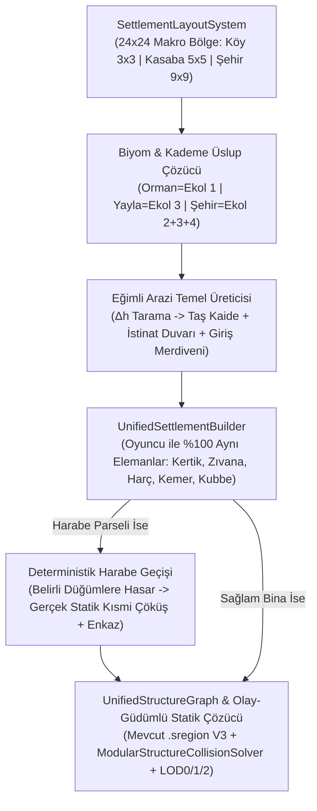
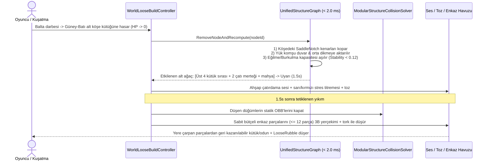

# DOK6 — Köy, Kasaba, Şehir ve Harabelerin Tekil Yapı Sistemiyle Birleşimi

> **Belge Kodu:** `DOK6` | **Bağlı Set:** `docs/gercekci-insaat-ve-mimari-sistemi/DOK1..DOK7`  
> **Üst Anayasa:** [`DOK1_HEDEF_VE_GEREKSINIMLER.md`](DOK1_HEDEF_VE_GEREKSINIMLER.md) (`Tek Sistem Anayasası: Oyuncu İnşaatı == Dünya Yerleşimi`)  
> **İlgili Sistemler:** [`SettlementLayoutSystem.cs`](../../Assets/_Stratocraft/WorldGen/SettlementLayoutSystem.cs), [`SettlementBuildingBlueprints.cs`](../../Assets/_Stratocraft/Inventory/Systems/SettlementBuildingBlueprints.cs), [`ModularStructureCollisionSolver.cs`](../../Assets/_Stratocraft/Inventory/Systems/ModularStructureCollisionSolver.cs), [`DOK4_YAPISAL_FIZIK_STATIK_VE_PERFORMANS.md`](DOK4_YAPISAL_FIZIK_STATIK_VE_PERFORMANS.md)

---

## 1. Eski `SettlementBuildingBlueprints` Kopukluğunun Giderilmesi

Devir #081'de eklenen `SettlementLayoutSystem.cs` (`24×24` chunk makro-ızgara üzerinde seyrek ve düzenli **Köy `3×3`**, **Kasaba `5×5`**, **Şehir `9×9`** dağılımı) makro yerleşim planlaması açısından doğru bir temel kurmuştur. Ancak binaları üreten `SettlementBuildingBlueprints.cs` ile oyuncunun inşaat sistemi arasında 4 yapısal kopukluk vardır:

1. **Sabit `2m` İskandinav Şablonlarına Sıkışma:** `SettlementBuildingBlueprints` yalnızca `13` adet sabit `ModularBuildPieceKind` parçasını (neredeyse tüm yapılarda `StoneFoundation2x2m` + `PlankWall2x2m` + `RoofRafter26/45`) koordinat ezberiyle dizer; oyuncunun kertikli kütük dizimi, ahşap karkas zıvana/payandası, kireç harçlı taş yığması veya kemer/tonoz/kubbe dili dünya binalarında yoktur.
2. **Biyom Körlüğü:** Ormandaki bir köyle dağ/yayla bölgesindeki bir kasaba veya sıcak güney bölgesindeki bir şehir birebir aynı renk/üslupta kereste duvarlarla üretilir (`EmitTownHouseTwoStory`, `EmitWarehouseHall`).
3. **Eğimli Arazi ve Yapay Teras Sorunu:** `SettlementLayoutSystem.ResolveSettlementColumnSurfaceY` yalnızca `±2 m` yumuşak teraslama yapar; eğimli yamaca oturan parsellerde kademeli taş temel kaidesi (*stepped plinth*) veya istinat duvarı üretilmez.
4. **Harabelerin Gerçek Hasar Grafına Sahip Olmaması:** `KindCollapsedTimberStoneRuin (3)` önceden sabit dizilmiş bir dekor şablonudur; gerçek yapısal yük çözümüyle yarı yıkılmış, eksikleri tamamlanarak restore edilebilen bir yapı değildir.

### Yeni Birleşik Üretim Boru Hattı (`UnifiedSettlementBuilder`)

`SettlementLayoutSystem` makro planlama katmanı (`24×24` chunk makro bölgesi, yol/meydan/tarla/kuyu rezervleri, `IsColumnReservedBySettlement`) korunur; ancak parsel içi bina üretimi **`UnifiedSettlementBuilder`** üzerinden doğrudan oyuncunun kullandığı **`UnifiedStructureNode` + `StructuralJoint`** grafına bağlanır:



> [!IMPORTANT]
> **%100 Eşitlik Garantisi:** `UnifiedSettlementBuilder` tarafından üretilen bir köy evi, kasaba hanı veya şehir camisinin tek bir ayrıcalıklı "NPC dokunulmazlığı" yoktur. Her yapı parçası kendi ekol malzemesi, kesiti, kertik/harç bağlantısı ve temel ankrajıyla sahneye girer.

---

## 2. Biyom ve Yerleşim Kademesine Göre Mimari Üslup ve Malzeme Matrisi

`StratocraftFloatingIslandWorldGen.cs` içindeki `14` biyom (`0..13`) ve `BiomeVisualPaletteCatalog.cs` içindeki `6` görsel bölge temel alınarak yerleşimlerin mimari kimliği biyoma ve kademeye göre otomatik belirlenir. *(Volkanik Kaldera `8`, Hiçlik Uçurumu `11` ve Asit Bataklığı `3` yerleşim yasağı korunur.)*

### 2.1. Biyom Ailelerine Göre Mimari Üslup Eşleşmesi

| Biyom Grubu (Biyom ID) | Ana Yapı Ekolü | Baskın Malzeme Paleti | Çatı & İklim Adaptasyonu |
| :--- | :--- | :--- | :--- |
| **Ilıman & Orman Biyomları**<br>(`0` Zümrüt Vadi, `1` Demir Ağacı Ormanı) | **Köy:** Ekol 1 (Kertikli Kütük)<br>**Kasaba/Şehir:** Ekol 2 + Ekol 3 subasman | Meşe / Çam / Demir Ağacı kütüğü, yosun/kil `Chinking`, dere/kırma taş subasman, wattle & daub sıva | `35°–45°` eğimli ahşap zona/saz çatı, geniş saçak, ahşap/taş baca |
| **Karstik, Yayla & Kanyon Biyomları**<br>(`2` Karstik Kireçtaşı, `7` Bazalt Platosu, `12` Altın Yayla) | **Köy:** Ekol 3 (Kuru/Harçlı Taş) + Ekol 1 çatı<br>**Kasaba/Şehir:** Ekol 3 + Ekol 4 (Kemer/Tonoz) | Kireçtaşı, kesme bazalt, kireç harcı, mermer lento/kemer | Kalın taş duvar, kemerli pencere/revak, ahşap kirişli taş/kiremit çatı |
| **Soğuk & Yüksek Dağ Biyomları**<br>(`4` Güneşli Buzul Etekleri, `5` Kristal Kanyon, `10` Gökyüzü Adaları) | **Köy:** Kalın Ekol 1 + Taş Kaide<br>**Kasaba/Şehir:** Ekol 3 Kalın Kâgir + Ekol 2 Çatı | Ağır Demir Ağacı kütüğü, kesme granit/bazalt, çift kat chinking & yün/keçe yalıtım | **Dik `45°–52°` kar kaydırıcı çatı**, sık mertek (`<= 0.8m` aralık), merkezî taş şömine |
| **Sıcak, Kurak & Kıyı Biyomları**<br>(`6` Kızıl Kor Kanyonları, `9` Küllü Toprak, `13` Safir Lagün Kıyıları) | **Köy:** Ekol 2 (Kerpiç/Sıvalı Karkas) + Kazık İskele (`13`)<br>**Kasaba/Şehir:** Ekol 2 + Ekol 3/4 Revaklı Avlu | Kerpiç, beyaz/okre kireç sıva, kırmızı kil tuğla, palmiye/kıyı kerestesi | Gölgelikli kemerli revaklar, kalın duvarlı serin iç mekân, hafif eğimli teras / kiremit çatı |

### 2.2. Yerleşim Kademesine Göre Bina Tipolojisi (`Köy -> Kasaba -> Şehir`)

| Kademe (Boyut) | Yol & Altyapı | Konut & Zanaat Yapıları | Anıtsal / Kamu Yapıları & Ekol Dağılımı |
| :--- | :--- | :--- | :--- |
| **Köy (`3×3` chunk, `48×48 m`)** | Toprak + çakıl yol, `10×10 m` merkez meydan, sulamalı 2 tarla | 5 adet biyoma özgü tek katlı konut (`Ekol 1` orman kulübesi veya `Ekol 3` yayla taş evi), 1 Ahır/Samanlık, 1 Yel Değirmeni (`Ekol 2` rüzgâr pervanesi) | Taş bilezikli **Köy Kuyusu**, açık sundurmalı **Basit Ocak** (`%75` Ekol 1/2, `%25` Ekol 3) |
| **Kasaba (`5×5` chunk, `80×80 m`)** | Kırma taş + bordürlü ana cadde, `14×14 m` taş meydan, 4 tarla | 12+ konut (tek katlı kulübeler + **2 katlı ahşap karkas kasaba evleri**), **Demirci Atölyesi** (gerçek bloomery + körük + örs), **Marangoz/Taşçı**, **3 Pazar Tezgâhı**, Ahır, Yel Değirmeni | **Kasaba Meydan Kuyusu / Kemerli Çeşme**, **2 Katlı Han / Taverna** (`Ekol 2` zıvana+payandalı iskelet, içeride şömine + masalar + yataklar) |
| **Şehir (`9×9` chunk, `144×144 m`)** | `5 m` genişliğinde mermer şeritli taş bulvarlar, radyal ara sokaklar, dış tarım kuşağı (`2` ahır, `2` değirmen) | 23+ çok katlı konut (`Ekol 2` karkas + `Ekol 3` zemin kat), **Pazar Arastası** (kemerli dükkân sırası), **Demirci / Marangoz / Taşçı / Simya Atölyeleri**, **2 Ambar / Depo** | **Ekol 4 Anıtsal Yapılar:**<br>1. **Taş Sur Hattı & Seyirdim** (`CityWallSegment`)<br>2. **4 Kemerli Ana Kapı Kulesi** (`CityGatehouse` — sürgülü/çift kanat demir takviyeli kapı)<br>3. **4 Köşe Gözetleme Burcu** (`Ekol 3+4` sarmal taş merdivenli)<br>4. **Büyük Saray / Konsey Salonu** (`Sütunlu giriş + kemerli galeri + 2 kat`)<br>5. **Kubbeli Büyük Cami / Tapınak** (`Pandantif/tromp kubbe + dış payanda + demir gergi çubukları`)<br>6. **Büyük Merkez Meydan Çeşmesi** |

### 2.3. Şehir İçi Anıtsal Yapıların Yapısal Anatomisi (Örnekler)

1. **Kubbeli Tapınak / Büyük Cami (Şehir İçi İbadet & Anıt Parseli):**
   - **Temel:** `1.0–1.5 m` derinliğinde basamaklı kesme taş/mermer temel kaidesi.
   - **Taşıyıcı Sistem:** 4 ana köşe filayağı (*pier*) + çevre duvarları; aralarında yüksek taş kemerler ve yanal itmeyi karşılayan **demir gergi çubukları (`IronTieRod`)** + dış duvarlarda **taş payandalar (`Buttress`)**.
   - **Üst Örtü:** Pandantif/tromp geçiş halkası üzerinde merkezi **Ekol 4 Kubbe** ve yan küçük kubbeler/beşik tonozlu revak; kubbe eteğinde pencereler.
2. **Büyük Saray / Konsey Salonu:**
   - **Alt Kat (`Ekol 3`):** Kesme taş/mermer kalın duvarlar, sütunlu ön revak ve kemerli ana giriş.
   - **Üst Kat (`Ekol 2 + Ekol 4`):** Çok katlı taş/ahşap kirişli döşeme, büyük kabul salonunda açıklığı geçen ağır Demir Ağacı kirişler + çapraz payandalar + şömine bacaları.
3. **İki Katlı Revaklı Han / Kervansaray:**
   - Avluya bakan kemerli taş alt revak (`Ekol 3/4`), üst katta çıkmalı ahşap karkas odalar (`Ekol 2`), ortak şömine, yemek masaları, yataklar ve zemin katta yük sandıkları/araba parkı.

---

## 3. Eğimli Arazide Taş Temel Kaidesi ve İstinat Duvarı Uyumu

Yerleşimlerin tepsi gibi yapay düzlüğe zorlanmasını önlemek için her parsel **arazi eğimine uyum sağlayan temel kaidesi** üretir:

```text
Eğim Yüksek Tarafı (h_max)                 Eğim Alçak Tarafı (h_min)
─────────────────────────┐                 
Doğal Toprak / Kaya       │   Ahşap/Taş Üst Yapı (+0.32m eşik)
                          ├───────────────────────────────────┐
                          │   Taş Subasman (Min 0.45m)        │
                          │   ┌───────────────────────────┐   │  Kademeli Taş Kaide
                          │   │  Dolgu / Tonoz Altlığı    │   │  & İstinat Duvarı
                          └───┴───────────────────────────┴───┤  (Δh = h_max - h_min)
                              Doğal Yamaç Zemini (Kaya/Toprak)└───▶ [Taş Giriş Merdiveni]
```

**Algoritmik Kurallar (`TerrainPlinthSolver`):**
1. Parselin ayak izi (*footprint*) çevresinde `8` noktalı yükseklik örneklemesi (`VoxelSurfaceNetsGroundSampler` / `SampleIslandTopSurfaceY`) alınır -> $h_{\min}, h_{\max}$ ve $\Delta h = h_{\max} - h_{\min}$ bulunur.
2. **Düz Parsel ($\Delta h \le 0.5\text{ m}$):** Standart `0.45–0.65 m` taş subasman + eşik kütüğü konur.
3. **Orta Eğimli Parsel ($0.5\text{ m} < \Delta h \le 3.5\text{ m}$):** Bina eşik kotu $h_{\text{floor}} = h_{\max} + 0.32\text{ m}$ sabitlenir. Alçak tarafta kalan tüm temel kenarları boyunca zemin taşıma katmanına (`Stone` / sıkıştırılmış katman) kadar inen **kademeli taş istinat kaidesi** (*stepped masonry plinth*) örülür; kapı önü yola yüksek kalırsa otomatik **taş basamaklı giriş merdiveni + sahanlık** eklenir.
4. **Aşırı Dik Yamaç ($\Delta h > 3.5\text{ m}$):** Konut parseli o noktada elenir veya kıyı/uçurum biyomunda **kazıklı ahşap platform (`TimberStiltFoundation` — Ekol 1/2)** üretilir.
5. **Sıfır Havada Asılı Köşe:** Her temel kolonunun alt ucu `AnchorType.BedrockOrStone` veya `CompactedEarth` düğümüyle gerçek arazi vokseline bağlanır.

---

## 4. Önceden Hasarlı ve Yarı Yıkık Harabeler (*Ruins*) Sistemi

Harabeler dünyada rastgele konmuş süs taşları değil, **yaşanmış bir geçmişin fiziksel kalıntılarıdır**:

1. **İki Aşamalı Prosedürel Harabe Üretimi:**
   - **Adım A (Tam Bina İnşası):** `UnifiedSettlementBuilder`, seçilen harabe arketipini *(Terk Edilmiş Orman Kulübesi, Yıkık Gözetleme Kulesi, Kemerli Tapınak Kalıntısı, Eski Taş Han)* önce **%100 sağlam statik graf** olarak üretir.
   - **Adım B (Deterministik Hasar & Fiziksel Çöküş):** Yerleşim/bölge seed'ine göre belirlenen `1..3` taşıyıcı elemanın (ör. bir köşe dikmesi, kemer ayağı veya çatı aşığı) sağlığı sıfırlanır. `UnifiedStructureGraph` olayı çalıştırılır; desteksiz kalan üst çatı ve bir kanat duvarı **gerçek fizikle çöker** ve yerinde `LooseRubble` / kırık ahşap kalıntısı bırakır. Kalan sağlam kısım (ör. ayakta kalan taş kemerler, yarım kütük duvarlar, şömine bacası) **doğal yarı-yıkık silüeti** oluşturur.
2. **Yaşlanma ve Biyom İzi:** Harabe parçalarında `WeatheringAge01` bayrağı yüksek başlatılır; vertex rengi hafif yosunlu/isli tona kayar.
3. **Tamir Edilebilirlik (`Restore`):** Oyuncu bir harabedeki kırık/eksik kütük, kesme taş, harç veya kilit taşını kendi eliyle yerine koyduğunda aynı graf yeniden bağlanır ve harabe yaşanabilir sağlam bir üsse/eve dönüşür.

---

## 5. Çok Katlı OBB, Kapı/Pencere Geçirgenliği ve İç Mekân Canlılığı

`ModularStructureCollisionSolver.cs` ve `SotfStructureCollisionRegistry` şu birleşik kurallarla genişletilir *(ayrıntılı iç mekân kataloğu için [`DOK5_MALZEME_PROGRESYON_UX_VE_IC_MEKAN.md`](DOK5_MALZEME_PROGRESYON_UX_VE_IC_MEKAN.md))*:

| Yapı Öğesi | Kapsül Çarpışması (Oyuncu & AI) | Mermi / Ok / Görüş Hattı | Etkileşim & Canlılık |
| :--- | :--- | :--- | :--- |
| **Açılır Kapı (`DoorLeaf`)** | Kapalıyken tam engel; `[E]` ile açıldığında OBB kanat açısına döner ve `>= 0.96 m × 1.88 m` eşik serbest kalır. | Kapalıyken bloke; açıkken serbest. | Şehir kapılarında çift kanatlı ağır kapı + kilit/sürgü desteği. |
| **Kemerli Geçit (`Archway`)** | Sadece sağ/sol ayaklar (`Pier`) katı OBB üretir; kemer içi boşluk (`>= 1.8 m` veya bulvar kapısında `>= 2.6 m` genişlik) tamamen geçilebilir. | Kemer altı tamamen açık. | At arabası / kağnı / eğitilmiş büyük binek geçişine uygun genişlik. |
| **Pencere (`WindowFrame`)** | Tam duvar OBB'si (oyuncu atlayıp geçemez, kasıtlı geniş pencere/balkon hariç). | Açık veya kepenk açıkken ok/ışık/görüş geçirir; kapalı kepenkte bloke. | Kapalı iç mekân BFS'si kepenk/cam varsa hacmi kapalı sayar. |
| **Merdivenler (`Stairs` — Düz / L / Sarmal)** | Eğimli adım rampa OBB'si + korkuluk yan bariyeri; katlar arası kesintisiz yürüme (`maxStepUpMeters` uyumu). | Korkuluk aralıkları geçirgen. | Üst kat döşemesindeki **merdiven boşluğu (`StairwellOpening`)** yükü çevre kirişlere aktarır. |
| **Şömine & Baca + İstasyonlar** | Şömine gövdesi katı OBB; baca şaftı dikey `Voxel` / çatı çıkışı açık. | Duman ve sıcaklık üstten tahliye edilir. | Yerleşim demircisinde gerçek bloomery/örs, handa yatak/masa/şömine **birebir etkileşimli** çalışır. |

---

## 6. Köy Evinin Gerçek Fizikle Yıkılması (Uçtan Uca Senaryo)

Oyuncunun (veya bir kuşatma mancınığının / dev yaratığın) bir orman köyündeki kütük evin **güney-batı köşe kütüğünü** balta ile kırdığı anda yaşanan fiziksel zincir:



- **Sağlam Kalan Taraf:** Evin karşı köşesi kendi taş subasmanına ve sağlam köşe kertiğine basmaya devam ediyorsa tüm ev anlamsızca buharlaşmaz; yalnızca desteğini kaybeden çatı/köşe kanadı fiziksel olarak çöker, karşı duvar yarım ve gerçekçi bir enkaz silüeti olarak ayakta kalır!

---

## 7. Şehir Ölçeğinde (`9×9` Chunk, `3.000–10.000+` Eleman) Chunk-Batched LOD Streaming

Mevcut sistemde her modüler parça için sahnede ayrı `GameObject` + `MeshRenderer` + `BoxCollider` açılmaktadır (`MaxModularVisualPoolCapacity = 1536`). `9×9` chunk (`144×144 m`) boyutunda kubbeli cami, saray, han, surlar ve 23+ evi tekil parçalarla render etmek bir şehirde `3.500–10.000+` düğüme ulaşarak draw call ve GameObject bütçesini zorlar. Bu nedenle **`DOK4`'teki performansa uyumlu 3 kademeli Chunk-Batched LOD Streaming** uygulanır:

| LOD Kademesi | Mesafe Bandı | Temsil Biçimi | Çarpışma & Fizik | Hedef Maliyet |
| :--- | :--- | :--- | :--- | :--- |
| **LOD0 (Yakın Etkileşim)** | `0 – 48 m` (`±3` chunk) | Bireysel `UnifiedStructureNode` parçaları veya aynı malzeme/katmandaki parçaların **GPU Instanced (`DrawMeshInstanced` / BRG)** çizimi | Tam `ModularStructureCollisionSolver` mekânsal hash OBB + dinamik kapı/pencere/merdiven + tam olay-güdümlü statik graf aktif | `0` per-frame GC, `1–12` instanced batch |
| **LOD1 (Orta Şehir Silüeti)** | `48 – 128 m` (`4..8` chunk) | Chunk bazlı (`16×16 m` sütun) birleştirilmiş **Chunk-Batched Statik Mesh** (`Mesh.CombineMeshes`, `COLOR_0` korunur); küçük iç mekân mobilya/çit/detay düğümleri gizli | Yalnızca makro bina/sur OBB kutuları (uzak AI / okçuluk için); iç mekân collider'ı kapalı (`0` Unity `BoxCollider` spam'ı) | Chunk başına `1–2` statik mesh, `<= 1.5 ms` Stopwatch streaming bütçesi |
| **LOD2 (Ufuk Panoraması)** | `128 – 384 m+` | Dış kabuk + çatı/kubbe/kule silüeti (`DistantHorizonLodSystem` ile birleşik düşük üçgenli proxy kabuk) | `0` çarpışma, `0` oyun içi statik tik (sadece veri `.sregion` / hafızada özet olarak bekler) | Tüm uzak şehir için `< 0.4 ms` GPU |

- **Dinamik Geçiş Kuralı:** Oyuncu uzak bir şehre yaklaştığında `Stage1InteractivePlayController.StepDynamicContinentChunkStreaming` (`1–2` chunk/kare, `<= 1.5 ms` bütçe) içinde önce LOD2/LOD1 görünür, `48 m` içine girildiğinde yalnızca aktif chunk'ın etkileşim düğümleri `0-GC` havuzdan **LOD0** olarak uyandırılır.
- **Hasar Senkronizasyonu:** Oyuncu uzaktan (ör. mancınık veya yay ile) LOD1'deki bir şehir suruna hasar verirse, o chunk anında LOD0 statik grafına yükseltilir ve yıkım hesaplanır; böylece uzak mesafede "kırılmayan duvar" hatası yaşanmaz.
