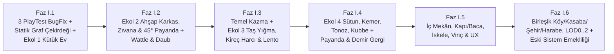

# DOK7 — Adım Adım Uygulama Planı, Dosya Envanteri, `.sregion V3` Geçişi ve `T01..T24` Test Matrisi

> **Belge Kodu:** `DOK7` | **Bağlı Set:** `docs/gercekci-insaat-ve-mimari-sistemi/DOK1..DOK7`  
> **Kapsam:** `Faz I.1 .. Faz I.6` Geliştirme Yol Haritası, C#/HLSL/Blender `.glb` Dosya Listesi, `.sregion V3` Kalıcılık & Migrasyon Planı, `T01..T24` Test Matrisi ve Kalite Kapısı Sözleşmesi

---

## 1. Uygulama Stratejisi ve Ortak Mühendislik Kuralları

Bu yol haritası, mevcut çalışan oyun döngüsünü (`313/313` `.NET 10`, `6/6` `ctest`, `9/9` `pytest`, `4.14 MB` VRAM, Unity `0 Error / 0 Warning`) **hiçbir aşamada kırmadan**, önce PlayTest'teki acil hataları kapatıp ardından `Ekol 1 -> Ekol 2 -> Ekol 3 -> Ekol 4 -> İç Mekân & UX -> Birleşik Yerleşimler & Eski Kod Emekliliği` sırasıyla ilerler.

**Her Fazda Uyulacak Zorunlu Kurallar:**
1. **Önce Saf C# Çekirdeği (`.NET 10`), Sonra Unity Köprüsü:** Tüm statik graf, malzeme/harç eğrisi, kemer yanal itmesi, OBB çarpışma ve yerleşim planlayıcısı kodu `UnityEngine` bağımlılığı olmadan yazılır ve `.NET 10` NUnit testleriyle doğrulanır.
2. **Sıfır-GC & `Reload Domain disabled` Güvencesi:** Tüm yeni hot-path yolları `0 B/kare` GC Alloc ile yazılır; her statik alan/önbellek `[RuntimeInitializeOnLoadMethod(RuntimeInitializeLoadType.SubsystemRegistration)]` ile temizlenir.
3. **VRAM ve Sıvı Kilidi:** Yeni `.glb` modellerinin tamamı headless Blender Python betikleriyle **UV-Free `COLOR_0`** olarak (`0` gömülü doku, toplam `< 16.0 MB` VRAM) üretilir. Dondurulmuş 4 sıvı dosyasına (`FluidSurfaceSkirtMesher.cs`, `FluidCellularAutomataJob.cs`, `StratocraftFluidSurface.shader`, `FluidSimulationSystem.cs`) **kesinlikle dokunulmaz**.

---

## 2. Faz Faz Uygulama Yol Haritası (`Faz I.1 .. Faz I.6`)

### Faz I.1 — Acil 3 PlayTest Hatası Çözümü + Birleşik Statik Graf Çekirdeği & Ekol 1 (Kertikli Kütük Ev)
- **Hedef Kabul Kriterleri:** `AK-01`, `AK-02`, `AK-03`, `AK-04`, `AK-05`, `AK-13`, `AK-23`, `AK-24`, `AK-25`.
- **Somut İş Kalemleri:**
  1. **Mavi & İncecik Kütük Hatası Tamiri:**
     - `Stage1WorldLooseBuildController.UpdateGhostVisualForTimberLog` ve `GetOrCreateTimberLogMeshCached` içindeki cyan-mavi sabit tint (`Color32(82, 214, 255, 112)`) ile dar silindir ölçeği (`0.38, 1.00, 0.38`) kaldırılır.
     - `StratocraftGhostPreview.shader` üzerine materyal/hologram mod bayrağı (`_PreviewStateMode`: Geçerli = sıcak şeffaf ahşap/yeşil vurgu, Sınırda = kehribar, Hatalı/Desteksiz = kızıl) eklenir; gerçek kütük çapı (`0.42–0.46 m` tam uç kertikli `.glb`) kullanılır.
  2. **Havada Uçan Kütük Hatası Tamiri:**
     - Serbest/modüler kütük yerleştirmede temel ankrajı (`GroundAnchor`), alttan en az 2 destek veya köşe kertiği (`SaddleNotch` / `DovetailNotch`) yoksa `CanPieceStand == false` ile havada yerleştirme reddedilir; altındaki kütük/destek kırıldığında üst kütükler havada kalmayıp gerçek 3B yerçekimiyle düşer.
  3. **`UnifiedStructureGraph` Çekirdeği (`DOK4` uyumlu):**
     - `UnifiedStructureNode` (`32-64 B` unmanaged struct), `StructuralJoint` (`SaddleNotch`, `DovetailNotch`, `GroundAnchor`), `AnchorType` ve olay-güdümlü (`Event-Driven`) statik graf çözücüsü yazılır.
  4. **Ekol 1 Elemanları & Çevre:**
     - Taş subasman pabuçları, eşik kütüğü (`SillLog`), köşe kertikli kütük duvar sıraları, yosun/kil derz dolgusu (`Chinking`), aşık/mertek çatı ve kütük ev yıkım testi.
- **Çıkış Kapısı:** `T01..T05`, `T13` (Ekol 1 kısmı), `T23`, `T24` PASS.

### Faz I.2 — Ekol 2 (Ahşap Karkas / Kolon–Kiriş, Zıvana & Çapraz Payanda)
- **Hedef Kabul Kriterleri:** `AK-06`, `AK-07`, `AK-13`, `AK-23..AK-25`.
- **Somut İş Kalemleri:**
  1. **Taşıyıcı Karkas Düğümleri:** Dikey dikme (`TimberPost`), yatay ana kiriş (`MainBeam`), üst kuşak, **Zıvana–Delik (`MortiseAndTenon`)** + ahşap çivi bağlantısı.
  2. **Yanal Rüzgâr & Burkulma Fiziği:** `45°` **Çapraz Payanda (`DiagonalBrace`)** olmadan yüksek veya uzun ahşap çerçevelerin yanal rüzgâr/darbe yükünde devrilme mekaniği (`DOK4`).
  3. **Dolgu Paneller & İzolasyon:** Dal örgü + çamur sıva (`WattleAndDaub`), kerpiç (`Adobe`) ve kalas dolgu panelleri; rüzgâr sızdırmazlığı ve termal izolasyonun `ThermalAndBiologySystem` ile birleştirilmesi.
- **Çıkış Kapısı:** `T06`, `T07` PASS.

### Faz I.3 — Temel Kazma, Zemin Taşıma Kapasitesi ve Ekol 3 (Taş Yığma & Kireç Harcı)
- **Hedef Kabul Kriterleri:** `AK-08`, `AK-09`, `AK-10`, `AK-14`, `AK-23..AK-25`.
- **Somut İş Kalemleri:**
  1. **Temel Hendeği & Zemin Mekaniği:** Kazma/kürek (veya `[C]` Madde Kristali) ile temel hendeği açma, zemin sınıfına göre (`Bedrock/Stone > CompactedGravel > Dirt > Sand/Mud`) taşıma kapasitesi sınırı, kırma taş altlık (`Footings`) zorunluluğu ve zayıf zeminde diferansiyel oturma hasarı.
  2. **Ekol 3 Taş Örgü & Harç Kürlenme Eğrisi:** Kuru taş (`DryStone`) ve harçlı taş bloklar, şaşırtmalı örgü (`RunningBond`), köşe kilit taşı (`Quoin`); kireçtaşı yakma -> sönmüş kireç -> **Islak/Kuruyan/Sertleşen Kireç Harcı (`CureRatio 0.0 -> 1.0`)** ve yağmurda taze harç yıpranması.
  3. **Çekme/Eğilme Limiti & Lento/Tahfif Kemeri:** Taş duvarların `> 2.5 m` açıklıklarda düz kırılması; ahşap/demir lento veya **Tahfif Kemeri (`RelievingArch`)** gereksinimi; kar yükü (`SWE`) hesaplaması.
- **Çıkış Kapısı:** `T08`, `T09`, `T10`, `T14` PASS.

### Faz I.4 — Ekol 4 (Anıtsal Sütun, Kemer, Tonoz, Kubbe, Dış Payanda & Demir Gergi)
- **Hedef Kabul Kriterleri:** `AK-11`, `AK-12`, `AK-13`, `AK-23..AK-25`.
- **Somut İş Kalemleri:**
  1. **Sütun & Kemer Fiziği:** Sütun kaidesi/gövdesi/başlığı, kama taşlı kemer (`Voussoir`) ve **Kilit Taşı (`Keystone`)** mekaniği; kemer örülürken geçici ahşap kemer kalıbı/iskele zorunluluğu, kilit taşı konunca kalıbın sökülebilmesi, kilit taşı kırılınca anında çökme.
  2. **Tonoz & Kubbe + Yanal İtme (`Lateral Thrust`):** Beşik tonoz, çapraz tonoz, pandantif/tromp geçişi ve kubbe segmentleri; bunların duvar tepesinde ürettiği dışa açıcı yanal itme vektörlerinin (`DOK4`) hesabı.
  3. **Dış Payanda & Osmanlı Tipi Demir Gergi / Kurşun Kenet:** Yanal itmeyi dengeleyen kalın ayak duvarı, dış/uçan payanda (`Buttress`) ve demirci örsünde üretilen **Demir Gergi Çubuğu (`IronTieRod`)** + kurşun kenet (`LeadCramp`).
- **Çıkış Kapısı:** `T11`, `T12`, `T13` (kemer/kubbe yıkımı) PASS.

### Faz I.5 — İç Mekân, Kapı/Pencere/Merdiven/Baca, İskele, Vinç & Dokunsal İnşa UX'i
- **Hedef Kabul Kriterleri:** `AK-15`, `AK-16`, `AK-17`, `AK-23..AK-25`.
- **Somut İş Kalemleri:**
  1. **İnşa UX & Lojistik:** İp çekme (`ChalkLine`) kılavuzu, akıllı snap + 1–2 dokunsal balta/mala vuruşu, şantiye malzeme yığını (`SiteMaterialPile`, `8 m` yarıçap), el arabası/kağnı yükleme, kolay sökülen ahşap iskele (`Scaffolding`) ve yüksek katlara taş/kütük çıkaran makaralı vinç (`PulleyCrane`).
  2. **İç Mekân & Geçirgenlik:** Açılır-kapanır menteşeli/çift kanatlı kapılar + kilit/sürgü, camlı/kepenkli pencereler, düz/L/sarmal merdivenler + döşeme merdiven boşluğu yük aktarımı (`ModularStructureCollisionSolver` OBB uyumu).
  3. **Kapalı Mekân, Şömine/Baca & Atölyeler:** Kapalı iç mekân flood-fill/BFS algılama, baca şaftı bağlantısı (`ChimneyFlue`) ve bacasız duman/CO uyarısı, meşale/şamdan/avize, yatak/masa/sandık/raf ve örs/bloomery/kömür ocağının bina içi kurulum kuralları.
- **Çıkış Kapısı:** `T15`, `T16`, `T17` PASS.

### Faz I.6 — Birleşik Köy/Kasaba/Şehir/Harabe Üretimi, Şehir LOD Streaming & Eski Sistemlerin Emekliliği
- **Hedef Kabul Kriterleri:** `AK-18`, `AK-19`, `AK-20`, `AK-21`, `AK-22`, `AK-23`, `AK-24`, `AK-25`.
- **Somut İş Kalemleri:**
  1. **`UnifiedSettlementBuilder` & Biyom Üslupları:** `SettlementLayoutSystem` üzerinden Orman Köyü (Ekol 1), Yayla Yerleşimi (Ekol 3), Kasaba (Ekol 1+2+3) ve Şehir (`9×9` — Ekol 2+3+4 Saray, Kubbeli Tapınak/Cami, Revaklı Han, Sur, 4 Kemerli Kapı, Burçlar) üretimi.
  2. **Eğimli Arazi & Prosedürel Harabeler:** `TerrainPlinthSolver` (kademeli taş temel kaidesi + istinat duvarı + giriş merdiveni) ve iki aşamalı deterministik hasarlı/tamir edilebilir harabe üretimi.
  3. **Şehir Ölçeği LOD0/LOD1/LOD2 Streaming:** Chunk-batched statik mesh birleştirme + GPU Instancing + hasar anında anlık LOD0 yükseltmesi; `<= 1.5 ms` streaming bütçesi.
  4. **Klan/Kuşatma Uyumu & Eski Sistem Emekliliği:** Faz 3 Klan `3D BFS` ve Faz 9 Kuşatma hasarının `UnifiedStructureGraph`'a yönlendirilmesi; eski `SettlementBuildingBlueprints` sabit şablonlarının ve geçici kütük kodlarının kaldırılıp `Stage1WorldLooseBuildController` ile tamamen tekilleştirilmesi.
- **Çıkış Kapısı:** `T18..T24` ve tam `quality-gate.ps1 -Phase 4` PASS.

---

## 3. Oluşturulacak ve Güncellenecek Dosya Envanteri

> [!WARNING]
> **Kesin Koruma Sınırı:** Aşağıdaki listede yer almayan 4 dondurulmuş akışkan dosyasına (`FluidSurfaceSkirtMesher.cs`, `FluidCellularAutomataJob.cs`, `StratocraftFluidSurface.shader`, `FluidSimulationSystem.cs`) **hiçbir fazda** dokunulmayacaktır.

### 3.1. C# Veri, Statik Çözücü, Yerleşim ve Köprü Dosyaları

| Durum | Dosya Yolu (Göreceli) | Faz | Sorumluluk |
| :--- | :--- | :--- | :--- |
| **Yeni (Saf C#)** | `Assets/_Stratocraft/Inventory/Data/UnifiedStructureTypes.cs` | I.1–I.4 | `UnifiedStructureNode`, `StructuralJoint`, `BuildingSchoolKind (Ekol 1..4)`, `AnchorType`, `MortarState`, `ChinkingFlags` (`0-GC` value types). |
| **Yeni (Saf C#)** | `Assets/_Stratocraft/Inventory/Systems/UnifiedStructureGraphSolver.cs` | I.1–I.4 | Olay-güdümlü graf çözücü: basınç, çekme/eğilme açıklığı, yanal itme, burkulma, zemin taşıma kapasitesi ve zincirleme çöküş. |
| **Yeni (Saf C#)** | `Assets/_Stratocraft/Inventory/Systems/MortarAndInteriorEnvironmentSolver.cs` | I.3–I.5 | Harç kürlenme eğrisi, kar yükü (`SWE`), rüzgâr yanal yükü, kapalı mekân BFS, ısı yalıtımı & baca/CO denetimi. |
| **Yeni (Saf C#)** | `Assets/_Stratocraft/WorldGen/UnifiedSettlementBuilder.cs` | I.6 | Biyom (`0..13`) + kademe (`Köy/Kasaba/Şehir/Harabe`) tabanlı yapı üretimi ve `TerrainPlinthSolver` eğimli temel kaidesi. |
| **Yeni (Unity)** | `Assets/_Stratocraft/Character/CityChunkLodBatchRenderer.cs` | I.6 | Şehir ölçeği (`9×9` chunk) `LOD0/LOD1/LOD2` GPU Instancing & Chunk-Batched mesh havuzu (`0-GC`). |
| **Yeni (Unity)** | `Assets/_Stratocraft/Character/BuildingSiteLogisticsController.cs` | I.5 | İp çekme (`ChalkLine`), şantiye malzeme yığını (`8m`), iskele ve makaralı vinç/palanga etkileşimi. |
| **Güncelleme** | `Assets/_Stratocraft/Inventory/Systems/SotfLogStackAndInputSystem.cs` | I.1–I.5 | Yeni malzeme/kesit/ekol bağlantılarıyla `UnifiedStructureGraphSolver` köprüsü; eski bağımsız parça sınırlamalarının birleştirilmesi. |
| **Güncelleme** | `Assets/_Stratocraft/Inventory/Systems/ModularStructureCollisionSolver.cs` | I.4–I.6 | Kemer altı geçit, açılır kapı kanadı, pencere/kepenk geçirgenliği, düz/L/sarmal merdiven rampası OBB kuralları + mekânsal hash. |
| **Güncelleme** | `Assets/_Stratocraft/Character/Stage1WorldLooseBuildController.cs` | I.1–I.6 | Mavi/incecik & uçan kütük tamiri, dokunsal balta/mala vuruşu, stres uyarı görseli, `LOD0` havuz entegrasyonu. |
| **Güncelleme** | `Assets/_Stratocraft/Character/Stage1MindBuildingController.cs` | I.1–I.5 | `[T]` Zihin Menüsü üzerinden Ekol 1..4 şablonları, ip çekme ve iskele/vinç seçimi. |
| **Güncelleme** | `Assets/_Stratocraft/WorldGen/SettlementLayoutSystem.cs` | I.6 | Eski `SettlementBuildingBlueprints` çağrılarının `UnifiedSettlementBuilder` hattına devredilmesi ve harabe parsellerinin eklenmesi. |
| **Güncelleme** | `Assets/_Stratocraft/Physics/Systems/StructuralCollapseSystem.cs` | I.1–I.6 | Voxel/yapı köprüsü, `UnifiedStructureGraph` hasar olayları ve enkaz düşüş bütçesi senkronizasyonu. |
| **Güncelleme** | `Assets/_Stratocraft/Inventory/Systems/SurvivalRecipeBookCatalog.cs` | I.2–I.5 | Kireç yakma/söndürme/harç, demir gergi/kenet, kerpiç, wattle & daub, iskele, vinç ve mobilya tarifleri. |
| **Güncelleme** | `Assets/_Stratocraft/Core/Persistence/RegionFileStore.cs` & `IWorldPersistenceService.cs` | I.6 | `.sregion V3` bina grafı bloğu eklenmesi ve V2/V3 migrasyon desteği. |
| **Emekli** | `Assets/_Stratocraft/Inventory/Systems/SettlementBuildingBlueprints.cs` | I.6 | Sabit 15 şablonlu eski sistem Faz I.6 sonunda kullanımdan kaldırılır (gerekiyorsa yalnızca legacy test/migrasyon adaptörü kalır). |

### 3.2. HLSL ve Shader Güncellemeleri (0 Ekstra VRAM)

| Durum | Dosya Yolu (Göreceli) | Faz | Amaç |
| :--- | :--- | :--- | :--- |
| **Güncelleme** | `Assets/_Stratocraft/Rendering/Shaders/StratocraftGhostPreview.shader` | I.1 | `_PreviewStateMode` (doğal yarı-şeffaf kütük/taş önizlemesi vs yeşil/sarı/kırmızı yapısal stres modu) — maviye boyama hatasının kesin çözümü. |
| **Güncelleme** | `Assets/_Stratocraft/Rendering/Shaders/StratocraftUberShader.hlsl` | I.3–I.6 | `COLOR_0` + dünya koordinatı bazlı ıslak/kuru harç tonu, stres titreme/çatlak vurgusu, kömürleşme (`Charred`) kararması ve harabe yosun/yaşlanma tonlaması (`0` yeni doku). |

### 3.3. Blender 4.2 `.glb` Varlık Üretimi (`COLOR_0`, `< 16.0 MB` VRAM)

Tüm yeni mimari `.glb` modelleri `Tools/AutonomousAssetFactory/generators/` altında Python `bpy` ile üretilip `Assets/Art/Generated/Structures_Modular/` dizinine yerleştirilecektir (`0` gömülü kaplama, vertex sayısı LOD uyumlu sıkı bütçeli):

| Blender Üretici Betiği | Çıktı `.glb` Grubu (`Assets/Art/Generated/Structures_Modular/`) | Ekol / Faz | Bütçe Notu |
| :--- | :--- | :--- | :--- |
| `Tools/AutonomousAssetFactory/generators/modular_building_kit_builder.py` (Güncelleme) | `mod_notched_log_saddle_2m.glb`, `mod_notched_log_dovetail_2m.glb`, `mod_chinked_log_course_2m.glb`, `mod_stone_footing_pad.glb`, `mod_roof_purlin_2m.glb` | Ekol 1 (Faz I.1) | Vertex-colored, gömülü texture = `0 B` |
| `modular_building_kit_builder.py` (Genişletme) | `mod_timber_post_mortise_3m.glb`, `mod_timber_beam_tenon_2m.glb`, `mod_wattle_daub_panel_2x2m.glb`, `mod_adobe_wall_2x2m.glb` | Ekol 2 (Faz I.2) | Mevcut `mod_diagonal_brace_2m.glb` ile uyumlu |
| `modular_building_kit_builder.py` (Genişletme) | `mod_rubble_stone_course_2x1m.glb`, `mod_ashlar_quoin_corner.glb`, `mod_stone_lintel_2m.glb`, `mod_relieving_arch_2m.glb`, `mod_stepped_plinth_base.glb` | Ekol 3 (Faz I.3 & I.6) | Şaşırtmalı derz + harç rengi `COLOR_0` |
| `Tools/AutonomousAssetFactory/generators/monumental_arch_dome_builder.py` (Yeni) | `mod_classical_column_base.glb`, `mod_classical_column_shaft_3m.glb`, `mod_classical_column_capital.glb`, `mod_arch_voussoir_segment.glb`, `mod_arch_keystone.glb`, `mod_barrel_vault_2x2m.glb`, `mod_dome_rib_segment.glb`, `mod_pendentive_corner.glb`, `mod_exterior_buttress_3m.glb`, `mod_iron_tie_rod_2m.glb` | Ekol 4 (Faz I.4) | Kemer & kubbe parçaları instanced paylaşılır; VRAM artışı `0.00 MB` |
| `Tools/AutonomousAssetFactory/generators/interior_and_site_kit_builder.py` (Yeni) | `mod_hinged_door_leaf.glb`, `mod_double_gate_leaf.glb`, `mod_shuttered_window_2x2m.glb`, `mod_stairs_straight_2m.glb`, `mod_stairs_spiral_stone.glb`, `mod_fireplace_hearth.glb`, `mod_chimney_flue_2m.glb`, `mod_scaffolding_frame_2m.glb`, `mod_pulley_crane_3m.glb`, `mod_site_material_pile.glb` | UX & İç Mekân (Faz I.5) | Tamamı `asset_validator.py` manifold & `COLOR_0` doğrulamalı |

---

## 4. `.sregion V3` Kayıt ve Geriye Dönük Migrasyon Planı

`RegionFileStore.cs` hâlihazırda `RegionFormatVersionV3 = 3` formatında Seed-Delta XOR + Zstd Seviye 3 + XXH64 + `MicroVoxelPool4096` + Hidroloji/Kar verilerini atomik olarak saklamaktadır (`ChunkSerializationSnapshot`). Mevcut `V3` sözleşmesini bozmadan bina grafı kalıcılığı şu şekilde eklenir:

1. **Chunk İçi Opsiyonel Yapı Bloğu (`StructureGraphSection`):**
   - `ChunkDirtyFlags` içine `Structures = 1 << 4` bayrağı eklenir.
   - Yapısı olan chunk'larda (oyuncu inşaatı veya oyuncu tarafından değiştirilmiş/yıkılmış/tamir edilmiş yerleşim parseli) `UnifiedStructureNode[]` + `StructuralJoint[]` + `MortarCureTick` + `SettlementSiteDeltaMask` verileri `ChunkSerializationSnapshot`'ın ek opsiyonel bölümü olarak Zstd ile sıkıştırılıp XXH64 sağlama toplamına dahil edilir.
   - Hiç dokunulmamış prosedürel yerleşim chunk'ları diskte ek yer kaplamaz (**0 B delta**); chunk yüklendiğinde `UnifiedSettlementBuilder` deterministik olarak yeniden üretir.
2. **Pristine Chunk Decay Koruması:**
   - Oyuncu tarafından bir yapı parçası yerleştirildiği veya bir yerleşim binası tamir/tahrip edildiği anda `ChunkSerializationSnapshot.HasActiveStructures = true` işaretlenir; böylece `PruneAbandonedWildernessChunks` (`14` gerçek gün) oyuncunun kurduğu evleri veya ele geçirdiği kaleleri **asla silmez**.
3. **Eski Kayıtlardan Otomatik Migrasyon:**
   - V2 veya erken V3 kayıtlarında bulunan eski `ModularPlacedPieceNode` kayıtları ilk yüklemede `LegacyPieceToUnifiedMigrator` üzerinden varsayılan `BuildingSchoolKind` + `AnchorType` + `CompletedCourses` alanlarına otomatik çevrilir; eski kayıt dosyası çökmeden açılır.

---

## 5. Kapsamlı `.NET 10` + Unity PlayMode Test Matrisi (`T01 .. T24`)

Aşağıdaki 24 test senaryosu `Tests/StandaloneCoreTests/` (`.NET 10` NUnit) ve Unity PlayMode test çalıştırıcısı için zorunlu doğrulama matrisidir:

| Test ID | Hedef AK | Ortam | Senaryo ve Beklenen Kesin Sonuç |
| :--- | :--- | :--- | :--- |
| **T01** | `AK-01` | Unity PlayMode | Omuzda kütük taşırken ve mevcut kütüğün üstüne nişan alırken hayalet rengi mavi/ince silindir değil, gerçek çaplı (`~0.42m`) yarı-şeffaf kütük önizlemesi olmalı; sol tıkla dizilen kütük gerçek boyutta yerleşmeli. |
| **T02** | `AK-02` | `.NET 10` + PlayMode | Boşlukta (`groundDist > 0.25m`, köşe kertiği/kolon desteği yok) kütük veya blok yerleştirme `CanStand == false` dönmeli; havada duran sıfır kütük kalmamalı. |
| **T03** | `AK-03` | `.NET 10` | `UnifiedSettlementBuilder`'ın ürettiği bir köy kulübesi düğümü ile oyuncunun koyduğu bir kütük duvar düğümü aynı `UnifiedStructureNode` tipinde olmalı; oyuncu köy duvarına yeni kütük snap edebilmeli. |
| **T04** | `AK-04` | `.NET 10` | Ekol 1'de köşe kertiği (`SaddleNotch`) olmadan 3 sıra üst üste konulan kütük duvar yanal testte devrilmeli; `SaddleNotch` ile kilitlenen `4` duvarlı kütük çerçeve `5–7` sıra kararlı kalmalı. |
| **T05** | `AK-05` | `.NET 10` | `Chinking` yapılmamış kütük odada `IsEnclosedInterior == false` ve termal yalıtım `0.0`; derz dolgusu tamamlandığında `IsEnclosedInterior == true` ve izolasyon `>= 0.70` olmalı. |
| **T06** | `AK-06` | `.NET 10` | Ekol 2'de `3.2m` yüksekliğinde ahşap kolon-kiriş çerçeveye `>= 25 kN` rüzgâr yükü uygulandığında `DiagonalBrace` yoksa çerçeve devrilmeli; `45°` payanda + zıvana eklenince stabil kalmalı. |
| **T07** | `AK-07` | `.NET 10` | Ekol 2 karkas boşluğuna `WattleAndDaub` / kerpiç dolgu konduğunda duvar rüzgâr geçirgenliği sıfırlanmalı ve iç ısı korunumu sağlanmalı. |
| **T08** | `AK-08` | `.NET 10` | `Sand/Mud` zemin tipinde temel hendeği ve kırma taş altlık olmadan kurulan 2 katlı taş duvar diferansiyel oturma hasarı almalı; `StoneFooting` sonrası oturma `0` olmalı. |
| **T09** | `AK-09` | `.NET 10` | Harçsız/kirişsiz `3.2m` açıklığa düz dizilen taş bloklar çekme kırılmasıyla çökmeli; üzerine `TimberBeam` / `StoneLintel` veya `RelievingArch` konduğunda yük güvenle taşınmalı. |
| **T10** | `AK-10` | `.NET 10` | `CureRatio = 0.15` ıslak kireç harcıyla bir anda `4` sıra örülen taş duvar kayma/ezilme hatası vermeli; `CureRatio >= 0.85` kuruma sonrası aynı yükü sorunsuz taşımalı. |
| **T11** | `AK-11` | `.NET 10` + PlayMode | Ekol 4 kemerde `Keystone` (kilit taşı) konmadan kalıp kaldırılırsa kemer düşmeli; kilit taşı konduktan sonra kalıp kaldırıldığında kemer ayakta durmalı; kilit taşı kırıldığında tüm kemer çökmeli. |
| **T12** | `AK-12` | `.NET 10` | Yanal itme üreten `4m` açıklıklı kemer/kubbe, ince ayak duvarını dışa itip yıkmalı; dış payanda (`Buttress`) veya `IronTieRod` eklendiğinde net yanal itme dengelenmeli. |
| **T13** | `AK-13` | `.NET 10` + PlayMode | Yerleşimdeki bir köy evinin köşe kütüğü kırıldığında graf çözümü `< 2.0 ms` sürmeli, `1.5s` uyarı sonrası desteksiz çatı ve köşe kanadı fiziksel torkla düşmeli, karşı sağlam duvar ayakta kalmalı. |
| **T14** | `AK-14` | `.NET 10` | Dağ/buzul biyomunda yüksek `SnowLoad SWE` altında geniş aralıklı düz ahşap çatı çökme sınırına girmeli; `45°` dik çatı veya sık mertek sınır altında kalmalı. |
| **T15** | `AK-15` | `.NET 10` + PlayMode | Kapalı Ekol 1/3 odada şömine yakılıp çatı baca çıkışı (`ChimneyFlue`) kapalıysa duman/CO konsantrasyonu eşik üstüne çıkmalı; baca takıldığında CO sıfırlanıp oda sıcaklığı yükselmeli. |
| **T16** | `AK-16` | `.NET 10` + PlayMode | Kapalı kapı kapsülü bloke etmeli, `[E]` ile açılan kapıdan oyuncu geçebilmeli; pencere ok geçirip oyuncu kapsülünü tutmalı; düz ve sarmal merdivenle 2. kata yürünmeli. |
| **T17** | `AK-17` | `.NET 10` + PlayMode | `ChalkLine` hizalama, `SiteMaterialPile` (`8m`) içinden otomatik tüketim, ahşap iskele ve vinç çalışmalı; `Stage1InputConflictPolicy` üzerinde `0` tuş çakışması doğrulanmalı. |
| **T18** | `AK-18` | `.NET 10` | Orman biyomunda üretilen Köy Ekol 1 kütük ağırlıklı, yaylada Ekol 3 taş ağırlıklı, Şehirde ise Saray + Kubbeli Cami/Tapınak + Han + Sur/Kapı düğümlerini içermeli. |
| **T19** | `AK-19` | `.NET 10` | `Δh = 2.4m` eğimli yamaca yerleştirilen kasaba binasının alçak köşesi havada kalmamalı; taş temel kaidesi + istinat duvarı zemin taşıma katmanına kadar inmeli. |
| **T20** | `AK-20` | `.NET 10` | Harabe parseli üretiminde sağlam graf -> kilit düğüm kırımı -> kısmi çöküş çalışmalı; oyuncu eksik taş/kütük parçalarını eklediğinde harabe stabilitesi yeşile dönmeli. |
| **T21** | `AK-21` | Unity PlayMode | `9×9` chunk Şehir (`>= 3.000` yapı düğümü) çevresinde gezinti sırasında `LOD2 -> LOD1 -> LOD0` geçişlerinde chunk streaming `<= 1.5 ms`, kare süresi `<= 15.0 ms` altında kalmalı. |
| **T22** | `AK-22` | `.NET 10` | `.sregion V3` kaydet/yükle sonrası tüm Ekol 1..4 düğümleri, `MortarCureRatio`, açık/kapalı kapı durumu ve yıkılmış ev deltaları birebir geri dönmeli; `PristineChunkDecay` aktif yapılı chunk'ı silmemeli. |
| **T23** | `AK-23`, `AK-24` | Unity PlayMode + Gate | Tüm yeni `.glb` modelleri yüklüyken toplam kaplama VRAM `< 16.0 MB` (`0` yeni doku), steady-state GC Alloc `0 B/kare` ve oyun RAM `< 2.5 GB` doğrulanmalı. |
| **T24** | `AK-25` | Tüm Hat | 4 dondurulmuş sıvı dosyasında `git diff == 0`; `quality-gate.ps1 -Phase 4` (`.NET 10`, `ctest`, `pytest`, Unity Recompile `0 Error / 0 Warning`) TAM PASS. |
