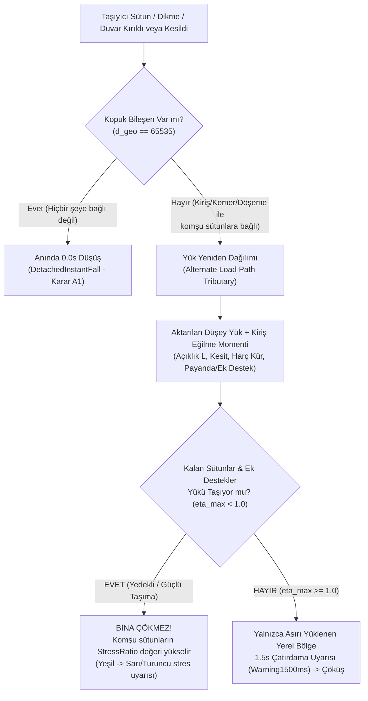
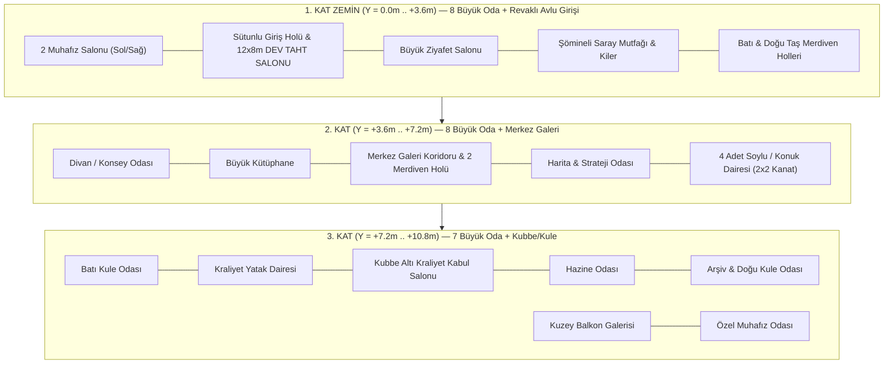

# Mimari Özellikleri Geliştirme Dokümanı — Gerçekçi Fiziksel İnşaat (9 Ekol), Yük Yeniden Dağılımı, 0→Çağ 5 UX & Çok Katlı Şehir/Saray

> **Doküman Seti Navigasyonu (`docs/gercekci-insaat-ve-mimari-sistemi/`):**
> - **Ana Proje Devir Raporu:** [DURUM_VE_DEVIR.md](../../DURUM_VE_DEVIR.md)
> - **Hedef & Gereksinimler:** [DOK1_HEDEF_VE_GEREKSINIMLER.md](DOK1_HEDEF_VE_GEREKSINIMLER.md)
> - **Mevcut Yapı Envanteri & Dönüşüm:** [DOK2_MEVCUT_YAPI_ENVANTERI_VE_DONUSUM.md](DOK2_MEVCUT_YAPI_ENVANTERI_VE_DONUSUM.md)
> - **Gerçek Hayat Mimarisi & Referanslar:** [DOK3_GERCEK_HAYAT_MIMARI_VE_REFERANS_ARASTIRMASI.md](DOK3_GERCEK_HAYAT_MIMARI_VE_REFERANS_ARASTIRMASI.md)
> - **Yapısal Fizik, Statik & Performans:** [DOK4_YAPISAL_FIZIK_STATIK_VE_PERFORMANS.md](DOK4_YAPISAL_FIZIK_STATIK_VE_PERFORMANS.md)
> - **Malzeme Progresyonu, UX & İç Mekân:** [DOK5_MALZEME_PROGRESYON_UX_VE_IC_MEKAN.md](DOK5_MALZEME_PROGRESYON_UX_VE_IC_MEKAN.md)
> - **Yerleşim (Köy/Kasaba/Şehir/Harabe):** [DOK6_YERLESIM_KOY_KASABA_SEHIR_BIRLESIMI.md](DOK6_YERLESIM_KOY_KASABA_SEHIR_BIRLESIMI.md)
> - **Önceki Uygulama Planı (`Faz I.1..I.6`):** [DOK7_ADIM_ADIM_UYGULAMA_VE_TEST_PLANI.md](DOK7_ADIM_ADIM_UYGULAMA_VE_TEST_PLANI.md)
> - **Bu Doküman (Birleştirici Geliştirme Şartnamesi):** [MIMARI_OZELLIKLERI_GELISTIRME_DOKUMANI.md](MIMARI_OZELLIKLERI_GELISTIRME_DOKUMANI.md)
> - **Swarm Organizatör Promptu:** [ORGANIZATOR_SWARM_PROMPTU.md](ORGANIZATOR_SWARM_PROMPTU.md)

> [!IMPORTANT]
> **Amaç ve Kapsam:** Bu doküman, `Devir #083` (`94f0fd6`) sonrası canlı PlayTest incelemesinde tespit edilen **5 kritik görsel/mimari hatayı** kökten çözmek; gerçek hayat araştırmasıyla doğrulanan **9 yapı yönteminin** tamamını (geçici destekler + **Yük Yeniden Dağılımı / Ek Destek** fiziğiyle) oyuna kazandırmak; **0'dan Çağ 5'e** tüm eşya, fırın/tezgâh ve tuş-tuş UX akışını canlı oynanışa bağlamak; **Köy çeşitliliği (Taş/Odun/Karma/Kerpiç)**, **2–3 katlı Kasaba**, **3–4 katlı apartmanlı Şehir** ve **en az 22 büyük odalı, 3 katlı gerçek Dev Saray** mimarisini kurmak için tek bağlayıcı teknik geliştirme şartnamesidir.

---

## BÖLÜM 1 — Devir `#083` Canlı PlayTest Kök Neden Denetimi (Neyi Neden Yapamadık?)

Devir `#083`'te saf C# statik motoru (`.NET 10`: `370/370 PASS`) ve `34` yeni Blender `.glb` dosyası üretilmiş olmasına rağmen canlı Unity 6 PlayMode'da yapıların bozuk görünmesinin **5 kesin satır-numaralı kök nedeni** şunlardır:

| Kök Neden ID | Sahnedeki Belirti | Kesin Dosya & Satır Kök Nedeni | Kesin Çözüm |
| :--- | :--- | :--- | :--- |
| **KN-1: Moloz / Kaba Küp Görünümü** | Köy/kasaba evleri mimari parça yerine irili ufaklı rastgele küp yığını gibi duruyor. | [`CityChunkLodBatchRenderer.cs`](../../Assets/_Stratocraft/Character/CityChunkLodBatchRenderer.cs#L593-L665): `RenderVisibleCityBatches` diskteki 47 `.glb` yerine `GetOrCreateSharedUnitBoxMesh()` (`PrimitiveType.Cube`) kullanıyor; `ResolveNodeProxyScale` yalnızca 5 rolü ölçeklendiriyor, kalan 35+ rolü `1×1×1 m` küp basıyor. | `PrimitiveType.Cube` tamamen silinir; yeni `StructureRoleGlbRegistry` üzerinden `47 + 18 = 65` gerçek `.glb` mesh gruplu `Graphics.DrawMeshInstanced` (`0-GC`) ile çizilir. |
| **KN-2: Bembeyaz HDR Parlama Hatası** | Küpler kör edici bembeyaz projektör gibi parlıyor. | [`Stage1InteractivePlayController.cs`](../../Assets/_Stratocraft/Character/Stage1InteractivePlayController.cs#L1320): `RenderVisibleCityBatches(SharedVoxelMaterial)` gönderiliyor. `SharedVoxelMaterial` (`_UsePaletteLUT = 1`) vertex rengi olmayan `PrimitiveType.Cube`'ta `color.g = 255` değerini [`StratocraftUberShader.hlsl`](../../Assets/_Stratocraft/Rendering/Shaders/StratocraftUberShader.hlsl#L539-L542) & [`L837-L862`](../../Assets/_Stratocraft/Rendering/Shaders/StratocraftUberShader.hlsl#L837-L862) içinde `heatNorm = 1.0` magma sıcaklığı sanıp Stefan–Boltzmann $T^4$ kor ışıması patlatıyor. | `SharedVoxelMaterial` yerine `WorldLooseBuildSystem.ResolveModularVertexColorMaterial(SharedVoxelMaterial)` (`_UsePaletteLUT = 0`, `enableInstancing = true`) verilir. |
| **KN-3: Eski & Yeni Yapıların İç İçe Girmesi** | Her binanın içinde kahverengi eski ev ile yeni küp yığını birbirine girmiş. | [`Stage1WorldLooseBuildController.cs`](../../Assets/_Stratocraft/Character/Stage1WorldLooseBuildController.cs#L2078-L2095): `SpawnOrSyncChunkModularStructureSites` önce **eski** `ValheimSotfModularGraphSolver.BuildProceduralSitePieces` parçalarını sahneye koyuyor (`L2078-L2090`), 4 satır sonra (`L2094`) **aynı koordinata** `_unifiedBridge.SpawnChunkSettlementUnifiedGraph` çağırıyor. | Yerleşim chunk'larında eski `BuildProceduralSitePieces` spawn döngüsü tamamen kapatılır; yalnızca `UnifiedSettlementBuilder` hattı çalıştırılır. |
| **KN-4: `0/34` Yeni `.glb` & Kopuk Oyuncu Girdisi** | Yeni üretilen 34 `.glb` görünmüyor; Kireç İpi, İskele, Vinç, Kapı/Merdiven/Şömine envanterde ikon olup dünyada kurulamıyor. | Tüm C# kodunda yalnızca eski `13` `.glb` referanslı; `BuildingSiteLogisticsController` (`HandleChalkLineClick`, `TryPlaceScaffolding`, `TryPlacePulleyCrane`, `TryRegisterMaterialPile`) metodları `Stage1InteractivePlayController` içinden hiç çağrılmıyor; `[T]` menüsü hâlâ eski listeyi gösteriyor. | `StructureRoleGlbRegistry` ile `65` `.glb` yüklenir; `Stage1InteractivePlayController` canlı girdi kancaları + 6-sekmeli `[T]` menüsü bağlanır. |
| **KN-5: Tek Tip Küçük Evler & Minik Saray** | Her yer aynı küçük kulübe; 3–4 katlı apartman yok; saray `10×8 m` tek kutu. | [`SettlementLayoutSystem.cs`](../../Assets/_Stratocraft/WorldGen/SettlementLayoutSystem.cs#L587-L839)'ta köy çeşitliliği ve 3–4 katlı apartman yok; [`UnifiedSettlementBuilder.cs`](../../Assets/_Stratocraft/WorldGen/UnifiedSettlementBuilder.cs#L1519-L1578) `EmitCityPalace` sadece `19` düğümlü `10×8 m` 2 katlı kutu; `DefaultMaxNodesPerBuilding = 256` ve `_siteNodesScratch[1024]` limiti dar. | `2m × 2m` `ModularGridBuildingEmitter`, 4 köy çeşidi, 2–3 katlı kasaba konakları, 3–4 katlı şehir apartmanları ve **`3×2` chunk (`~48×32 m`) 3 katlı, en az 22 büyük odalı Dev Saray** yazılır; tampon kapasiteleri `4096 / 16384 / 65536` ölçeğine çıkarılır. |
| **KN-6: Eski Sürümden Kalan Sahne Artıkları & Yuvarlak Yama Spam'ı** | SceneView'da haritaya ızgara gibi saçılmış yuvarlak yeşil/gri teras yamaları ve eski sürümlerden kalma küçük tekil ahşap kulübeler duruyor. | [`StratocraftStage1Showcase.unity`](../../Assets/Scenes/StratocraftStage1Showcase.unity) içine eski sürümlerden yüzlerce `ModularPiece3D_*` objesi ve `Assets/Art/GeneratedSceneAssets/` bayat chunk mesh'leri kayıtlı kalmış; [`StratocraftFloatingIslandWorldGen.cs`](../../Assets/_Stratocraft/WorldGen/StratocraftFloatingIslandWorldGen.cs#L3358-L3405) içinde eski süs blokları ve [`SettlementLayoutSystem.cs`](../../Assets/_Stratocraft/WorldGen/SettlementLayoutSystem.cs#L186-L250) başlangıç yerleşim yönleri test dostu değil. | Sahnedeki tüm eski `ModularPiece3D_*` artıkları ve bayat `GeneratedSceneAssets` mesh'leri tamamen temizlenir; `StratocraftStage1SceneBuilder` ile başlangıç sahnesi sıfırdan tertemiz kurulur; başlangıç vadisinin hemen **Kuzeyinde Büyük Şehir, Güneyinde Köy, Batısında Kasaba** deterministik olarak konumlandırılır. |

---

## BÖLÜM 2 — Gerçekçi Yapısal Fizik Anayasası (Anlık Denge, Geçici Destek & Yük Yeniden Dağılımı)

### 2.1. Kural A — Yük Yeniden Dağılımı (*Redundant Load Path*) ve Ek Destekler

> [!IMPORTANT]
> **Kullanıcının Temel Fizik Şartı:** Bir sütun, dikme veya duvar parçası kırıldığında/kesildiğinde bina körlemesine çökmez! Yapısal graf çözücü (`UnifiedStructureGraphSolver`), yükü ayakta kalan taşıyıcılara ve varsa oyuncunun eklediği **ek destek dikmelerine/payandalarına** gerçekçi biçimde yeniden dağıtır.

1. **Çoklu-Yol Yük Paylaşımı (Tributary Load Redistribution):**
   - `UnifiedStructureGraphSolver` içinde her yatay eleman (kiriş, hatıl, döşeme, kemer, çatı makası), kendi altındaki tüm sağlam (`CollapseState == Stable`) komşu taşıyıcılara (köşe sütunu, ara dikme, duvar, **oyuncunun koyduğu geçici veya kalıcı ek destek**) bağlıdır.
   - Bir sütun (`C_cut`) kırıldığında:
     1. Üstündeki kiriş/döşemenin taşıdığı yük ($W_{\text{total}}$) kalan komşu desteklere $k_i$ rijitlik/mesafe ağırlığıyla bölünür: $\Delta F_i = W_{\text{total}} \cdot \frac{k_i}{\sum k_j}$.
     2. Kirişin efektif desteksiz açıklığı $L_{\text{eff}}$ komşu en yakın iki sağlam destek arasındaki mesafeye güncellenir.
     3. Eğilme gerilmesi $\sigma_b \propto W \cdot L_{\text{eff}} / S_{\text{section}}$ yeniden hesaplanır.
2. **Ek Destek Atarak Sütun Değiştirme (*Reshoring*):**
   - Oyuncu hasarlı veya değiştirmek istediği bir sütunun yanına (`<= 2.0 m`) önceden **Ek Sütun**, **45° Payanda** veya **Teleskopik Çelik Dikme** dikerse yeni kenarlar grafı birbirine bağlar.
   - Eski sütunu balta/kazmayla kırdığında yük anında yeni ek desteğe akar; `eta_max < 1.0` kaldığı sürece bina tek bir parça bile kaybetmeden ayakta kalır!
3. **Kısmi / Bölgesel Yıkım Garantisi:**
   - 22 odalı 3 katlı Dev Saray'ın bir kanadındaki 2 sütun yıkılırsa sadece o kanattaki desteksiz/aşırı yüklü tavan ve duvar çöker; karşı kanat ve sağlam kalan taşıyıcı aks **ayakta kalmaya devam eder**.

### 2.2. Kural B — İnşaat Anındaki Anlık Denge & Geçici Destekler (`IsTemporarySupport`)

Hiçbir eleman havada veya desteksiz üst üste duramaz; her aşamanın kendi denge kilidi vardır:

| İnşaat Durumu | Tek Başına Konduğunda Denge Durumu | Zorunlu Geçici veya Kalıcı Denge Kilidi | Erken Sökülürse Ne Olur? |
| :--- | :--- | :--- | :--- |
| **Yuvarlak Kütük (`Ekol 1`)** | Düz üst üste yuvarlanır (`CanStand == false` veya devrilir). | **Yöntem A (Dikmeli):** Taş pabuç + Taban Kirişi + **Oluklu Dikme (`TemporaryWoodBrace` ile payandalı)** arasına geçer. **Yöntem B (Kertikli):** Altı düz Yarım Taban Kütüğü + 4 köşede Semer/Kırlangıç Kertik + Kavela + geçici köşe payandası. | Geçici payanda üst kuşak + çatı kilitlenmeden sökülürse duvar yanal yükte devrilir. |
| **Ahşap Karkas 2B Çerçeve (`Bent`) / Platform Duvar** | Tek dikme veya 2B çerçeve kendi düzlemi dışına devrilir (`Turuncu/Sarı` uyarı). | Dikildiği anda **`TemporaryWoodBrace` (45° Geçici Payanda)** ile yere/platforma sabitlenir. Boyuna kiriş + kalıcı `45°` payanda veya **OSB Perde Levha (`PlywoodSheathingPanel`)** çakılınca kilitlenir. | Boyuna bağ/OSB olmadan geçici payanda sökülürse paralelkenar devrilme (*Racking*) yaşanır. |
| **Taş / Tuğla Kemer (`ArchVoussoir`)** | Kilit taşı konana kadar taşlar boşlukta düşer. | Önce iki söve arasına **`WoodenArchCentering` (Ahşap Kemer Kalıbı)** konur; taşlar kalıp üstüne dizilip tepeye **`ArchKeystone`** çakılır ve harç yük eşiğine (`CureRatio >= 0.45`) gelir. | Kilit taşı olmadan veya harç ıslakken kalıp `[Shift+E]` ile sökülürse kemer `0.0s`'de çöker! |
| **Sıkıştırılmış Toprak (`Rammed Earth`)** | Gevşek toprak kalıpsız yayılmaz / durmaz. | **`SlidingEarthFormwork` (Kayar Toprak Kalıbı)** konur → toprak dökülüp `ToolEarthTamper` ile `%50` sıkıştırılır → sıkışır sıkışmaz **`0s` beklemeden** kalıp sökülebilir. | Tokmaklanmadan kalıp sökülürse gevşek toprak dökülür. |
| **Kalıpsız *Cob* Çamuru** | Tek seferde `> 45 cm` yüksek çıkılırsa alt ıslak katman ezilir. | Kavisli geometri + katman başına `90 s` (`[F4]` `0s`) kuruma hızı sınırı. | Hız sınırı aşılırsa şişme/çökme uyarısı ve akma. |
| **Betonarme Kolon & Tabliye** | Sıvı beton kalıpsız/dikmesiz dökülemez (`Red` red). | **Kolon:** L-Filiz + Etriyeli Demir + `4 Yanlı Payandalı Kalıp`. **Tabliye:** **`TelescopicShoringProp` (Dikme Ormanı + Tabliye Kalıbı)** altına kurulmadan tavan dökülemez! | Dikmeler `%75` kür (`300s`, `[F4]` `0s`) dolmadan sökülürse tabliye bel verip çöker. |
| **Çelik Kolon (`SteelHBeamColumn`)** | Tek başına ankrajlı kolon rüzgârda burkulur. | Ankraj bulonu + **`SteelGuyWireBrace` (Geçici Çelik Halat)**; kiriş + **`SteelXBrace`** torklanınca halat sökülür; üstüne dikmesiz **`CorrugatedMetalDeck` (Trapez Sac)** serilir. | X-Çapraz olmadan geçici halat sökülürse çerçeve yanal rüzgârda yatar. |

### 2.3. Kural C — Oyunlaştırılmış Kür / Sertleşme Süreleri (Karar A2 Genişlemesi)

`[F4]` Yaratıcı Mod'da (`isCreativeMode == true`) tüm bağlayıcılar ve kalıp kürleri **anında (`0.0 s` → `1.0`)** sertleşir. Survival modundaki süreler:

| Bağlayıcı / Malzeme | Yük Taşıma / Kalıp Söküm Eşiği (`CureRatio >= 0.45 / 0.75`) | Tam Sertleşme (`CureRatio == 1.0`) | Kural / Fizik Etkisi |
| :--- | :---: | :---: | :--- |
| **Kil / Çamur Harcı (`MortarType.Clay`)** | `120 sn` (`2 dk`) | `300 sn` (`5 dk`) | Sığ taş, kerpiç, çamur derz (`Chinking`). |
| **Kireç Harcı (`MortarType.Lime`)** | `240 sn` (`4 dk`) | `600 sn` (`10 dk`) | Şiddetli yağmurda çatısız taze harç yıpranır (`kappa_islak = 0.28`). |
| **Horasan Harcı (`MortarType.Horasan`)** | `180 sn` (`3 dk`) | `450 sn` (`7.5 dk`) | Suya/neme tam dayanıklı; kemer/kubbe/temel için ideal. |
| ***Cob* Çamur Katmanı (`<= 45 cm`)** | `90 sn` (`1.5 dk`) | `180 sn` (`3 dk`) | Alt kat sertleşmeden üstüne katman yığılırsa akma/şişme. |
| **Sıkıştırılmış Toprak (*Rammed Earth*)** | **`0 sn` (Tokmak sonrası anında)** | `240 sn` (tam kuruma) | Tokmaklandıktan hemen sonra kayar kalıp sökülüp yana taşınabilir. |
| **Betonarme — Kolon Yan Kalıbı** | `90 sn` (`1.5 dk`) | `300 sn` (`5 dk`) | Yan kalıp yük taşımadığı için erken sökülebilir. |
| **Betonarme — Kiriş/Tabliye Ana Dikmeleri** | `300 sn` (`5 dk`, `%75` kür) | `600 sn` (`10 dk`) | `%75` kür dolmadan `TelescopicShoringProp` sökülürse tavan çöker! |

### 2.4. Kural D — Sabit Koruma Sınırları
1. **Karar A3 (`[C]` Madde Kristali):** `[C]` Kristal yalnızca ham doğal maddeleri şekillendirir/kırar (`RawNaturalCrystal`, `0.45x` dayanım). Tüm 9 ekolün işlenmiş malzemeleri (`120..159`, `CrystalImmune`) Kristal tarafından **kesinlikle vakumlanamaz veya üretilemez**.
2. **Dondurulmuş 4 Sıvı Dosyası:** `FluidSurfaceSkirtMesher.cs`, `FluidCellularAutomataJob.cs`, `StratocraftFluidSurface.shader`, `FluidSimulationSystem.cs` dosyalarında **`0` diff**.

---

## BÖLÜM 3 — 9 Gerçek Hayat Yapı Yöntemi ve Mikro Alt-Adım / Denge Matrisi

`UnifiedStructureTypes.cs` içinde `ArchitecturalSchool` (0..9) ve yeni `StructuralElementRole` (0..63) tanımlarıyla tüm 9 gerçek sistem ortak fizik motorunda birleştirilir:

| Ekol ID | Yapı Yöntemi | Taşıyıcı Omurga | Zorunlu Temel | Mikro Alt-Adım Sırası (Kısaltılmış Kanonik Zincir) |
| :-: | :--- | :--- | :--- | :--- |
| **0** | `RawNaturalCrystal` | Doğal ham kütle | Ham zemin | `[C]` ile ham toprak/taş barınak (zayıf `0.45x`, kristalle kırılabilir). |
| **1** | `LogCabinNotched` (Klasik Kertikli Kütük) | 4 duvar köşe kertik kutusu | Taş pabuç + düz `SillLog` | Pabuç → düz Taban Kütüğü → 4 duvar birlikte `Saddle/Dovetail` kertik + Kavela + geçici köşe payandası → Kızaklı kapı/pencere (+oturma payı) → Çatı → Geçici payanda sök → `Chinking`. |
| **2** | `LogPostAndFill` (**Dikmeli-Kanallı Kütük**) | Oluklu dikey dikmeler + araya geçen yatay kütükler | Taş pabuç / Kazık + düz Taban Kirişi | Pabuç/Kazık → Taban Kirişi → **`GroovedTimberPost` dik + `TemporaryWoodBrace` 45° sabitle** → Yatay kütükleri kanaldan indir → Üst Kuşak + Kalıcı Payanda + Çatı → Geçici payandayı `[Shift+E]` sök → `Chinking`. |
| **3** | `TimberFrame` (Ağır Ahşap Karkas / *Hımış*) | Kare dikme + kiriş + `45°` payanda | Taş subasman + Taban Yastığı | Subasman + Yastık → 1. 2B Çerçeve (`Bent`) + `TemporaryWoodBrace` → 2. Çerçeve + Boyuna Bağ Kirişleri + Kavela + Kalıcı Payanda → Geçici sök → Cumba/Döşeme → **EN SON** `Wattle & Daub` / Kerpiç dolgu. |
| **4** | `PlatformWoodFrame` (Hafif Platform Çerçeve) | Sık ince dikme + **OSB/Kontrplak Perde** | Temel + alt döşeme platformu | Döşeme Kirişi + OSB Alt Döşeme → Platformda panel dik + geçici çıta → **`PlywoodSheathingPanel` çak (Shear Wall kilidi!)** → Geçici çıta sök → 2. Kat platformu → Makas çatı. |
| **5** | `StoneMasonry` (Tek & Çok Katlı Taş Yığma) | Kalın taş duvar + **Bağ Taşı + Ahşap Hatıl** | Hendek + Çakıl blokaj + Temel Papucu | Hendek + Blokaj + Papuç → Köşe `Quoin` + ip + şaşırtmalı çift yüz + Bağ Taşı → Kapıda **`WoodenArchCentering` + Kemer + Kilit Taşı** (veya Lento + Tahfif Kemeri) → Çok katta **Ahşap Hatıl + Ankrajlı Döşeme Kirişi** + üst katta incelen duvar → Çatı hatılı + Baca + Derz. |
| **6** | `BrickMasonry` (Taşıyıcı Pişmiş Tuğla) | İngiliz/Flaman bağlı tuğla duvar | Temel + Nem Bandı (DPC) | DPC + kuru deneme → Merdivenli Köşe Kılavuzu (`Racking Back`) + ip + İngiliz Bağı + Duvar Bağı Teli → Kemer Kalıbı + Kemer → Döşeme Kirişi + **`FloorJoistIronStrap` gergi şeridi** → Çatı. |
| **7** | `RammedEarth` (Sıkıştırılmış Toprak) | Tokmakla `%50` sıkışmış toprak blok | Yükseltilmiş su geçirmez taş/beton kaide | Kaide + DPC → **`SlidingEarthFormwork` (gergili kalıp)** → `15 cm` toprak karışımı + `ToolEarthTamper` (`%50` sıkıştırma) → **Anında `[Shift+E]` kalıp sökümü** → Tekrar → Üst Hatıl + Geniş Saçak. |
| **8** | `AdobeAndCob` (Kerpiç & Kalıpsız *Cob*) | Kuru kerpiç (`1:10` oran) / Kavisli samanlı çamur | Yüksek (`>= 40 cm`) taş subasman | *Adobe:* Güneşte kurumuş kerpiç + çamur harç + derin lento + Ahşap Hatıl. *Cob:* Subasman → Kavisli planda `CobMudBall` elle yığma (kat başına maks `45 cm`, `90s` kuruma) → Ahşap Hatıl + Geniş Saçak. |
| **9** | `MonumentalArchDome` (Anıtsal Saray/Cami/Kale) | Mermer sütun/filpaye + Kemer + Pandantif/Tromp + Kubbe | Kazıklı / Horasan Radye Temel | Kazık/Radye → Kaide + Sütun + **Kurşunlu Kenet** → Kemer Kalıbı + Voussoir + Keystone + **`IronTieRod` (Demir Gergi)** → Pandantif/Tromp + Kubbe Kasnağı + Kubbe + Dış Payanda. |
| **10** | `ReinforcedConcreteAndSteel` (Betonarme & Çelik) | Kolon–Kiriş–Tabliye iskeleti (**Duvar en son!**) | Grobeton + L-Filizli/Ankrajlı Radye | **Betonarme:** Grobeton + DPC → Temel Demiri + L-Filiz + Beton + Şişleme → Etriyeli Kolon + Payandalı Kalıp + Beton → **`TelescopicShoringProp` Dikme Ormanı + Tabliye Kalıbı** + Demir + Monolitik Beton → Kademeli söküm (`90s` yan / `300s` dikme) → Çatı → **EN SON Tuğla Dolgu Duvar**. **Çelik:** Ankraj Bulonu → `SteelHBeamColumn` + **`SteelGuyWireBrace`** → Kiriş (`Snug-Tight`) + `SteelXBrace` + Tork → Geçici halat sök → **`CorrugatedMetalDeck` Trapez Sac** + Beton → Hafif panel. |

---

## BÖLÜM 4 — 0'dan Çağ 5'e Oyuncu Progresyonu, Eşyalar, Tezgâhlar & Tuş-Tuş UX Akışı

### 4.1. Mevcut Eşyalar (`0..92`) ve Yeni Eklenecek Eşyalar (`93..115`)

`Stage1VisualHotbarAndInventoryUi.cs` içindeki `0..92` arası mevcut tüm `InventoryItemKind` değerleri korunur; üzerine **23 yeni eşya (`93..115`)** eklenir:

| ID | Enum Adı (`InventoryItemKind`) | Türkçe Adı | Nerede Üretilir / Bulunur? | Ne İşe Yarar & Hangi Tuşla Kullanılır? |
| :-: | :--- | :--- | :--- | :--- |
| **93** | `ToolShovel` | Kürek (T1 Taş / T2 Demir) | `[I]` Çanta (`Knapped` veya Demir + Dal + Lif) | Kireç ipi boyunca temel hendeği kazma, kum/toprak/çakıl çıkarma (`Sol Tık`). |
| **94** | `ToolEarthTamper` | Toprak & Blokaj Tokmağı | `[I]` Çanta (Ağır Kütük + Dal) / Örs | Hendek çakılını sıkıştırma + `SlidingEarthFormwork` içindeki toprağı `%50` tokmaklama (`Sol Tık`). |
| **95** | `ToolPlumbAndLevel` | Şakul & Su Terazisi | `[I]` Çanta (Taş/Kurşun + İp + Çubuk) | Eldeyken duvar/dikme diklik & kot göstergesi + hizalı inşa hızı bonusu. |
| **96** | `WoodenStake` | Ahşap Temel Kazığı | Bıçkı / `[I]` (`1x Dal` + Balta) | Kireç ipi kazığı, geçici payanda yer sabitleme ve kazıklı temel ankrajı. |
| **97** | `WoodenDowelPeg` | Meşe Kavela / Ahşap Pim | Bıçkı / `[I]` (`1x Dal` + Bıçak) | Kertikli kütük duvarları dikey kilitleme ve zıvana-delik sabitleme (`Sol Tık` çekiçle). |
| **98** | `TemporaryWoodBrace` | Geçici 45° Kurulum Payandası | Bıçkı (`2x Kalas` + `2x Kazık`) | Dikmeleri/çerçeveleri/platform duvarları geçici tutar; kilitlenince **`[Shift+E]` ile `%100` geri alınır**. |
| **99** | `CobMudBall` | Samanlı *Cob* Çamur Topu | Harç/Çamur Teknesi (`2x Kil + 1x Kum + 2x Saman + Su`) | Kavisli kalıpsız *Cob* duvar örme (`Sol Tık` / sürükle-ör). |
| **100** | `RammedEarthMixBucket` | Sıkıştırılmış Toprak Karışımı | Harç Teknesi (`2x Kum + 1x Çakıl + 1x Kil + Az Su`) | Kayar kalıp içine `15 cm` tabakalar dökme (`Sağ Tık`/`Sol Tık`). |
| **101** | `GroovedTimberPost` | Oluklu Dikey Kütük Dikmesi | Bıçkı / Balta+Keski (`1x Soyulmuş Kütük`) | `LogPostAndFill` (Dikmeli Kütük) duvar iskeleti (`Sol Tık` dik, ardından payandala). |
| **102** | `PlywoodSheathingPanel` | Kontrplak / OSB Perde Levhası | Bıçkı Sehpası (`4x Kalas + Tutkal/Çivi`) | `PlatformWoodFrame` duvarı `Shear Wall` diyaframına kilitleme + tabliye/kayar kalıp yüzeyi. |
| **103** | `WoodenArchCentering` | Ahşap Kemer Kalıbı | Bıçkı Sehpası (`3x Kalas + 2x Çivi`) | Taş/tuğla kemer örerken taşları taşır; Kilit Taşı + kür sonrası **`[Shift+E]` ile `%100` geri alınır**. |
| **104** | `SlidingEarthFormwork` | Kayar Toprak Kalıbı | Bıçkı (`2x OSB + 2x Kiriş + 2x Demir Saplama`) | *Rammed Earth* döküm kalıbı; tokmak sonrası **`0s`'de `[Shift+E]` ile sökülüp taşınır**. |
| **105** | `FloorJoistIronStrap` | Döşeme Gergi Şeridi & Duvar Bağı | Demirci Örsü (`1x Dövme Demir`) | Tuğla/taş duvarda çift cidar duvar bağı + döşeme kirişini dış duvara kilitleyen gergi. |
| **106** | `PortlandCementBag` | Portland Çimento Torbası | Kireç/Çimento Fırını (`1450°C` Klinker) → Yel Değirmeni öğütme | Beton karışımı hammaddesi (`4x Torba` / parti). |
| **107** | `FreshConcreteBucket` | Taze Beton Kovası / Yükü | Harç & Beton Teknesi (`1x Çimento + 2x Kum + 3x Çakıl + Su`) | Grobeton, temel, kolon kalıbı ve tabliye dökümü (`Sol Tık` / sürükle). |
| **108** | `SteelRebarBundle` | İnşaat Demiri (Rebar, Filiz & Etriye) | Çelik Hadde Tezgâhı (`2x Çelik Külçe`) | L-kolon filizleri, kolon/kiriş kafesi ve döşeme ızgarası donatısı. |
| **109** | `TelescopicShoringProp` | Teleskopik Çelik Dikme + Tabliye Kalıbı | Çelik Hadde Tezgâhı + Bıçkı (`2x Çelik + 2x OSB`) | Betonarme kolon yan kalıbı & tabliye altı dikme ormanı; kür sonrası **`[Shift+E]` ile `%100` iade**. |
| **110** | `SteelAnchorBoltSet` | Çelik Ankraj Bulon Seti | Çelik Hadde Tezgâhı (`1x Çelik Külçe`) | Beton temele çelik kolon sabitleme şablonu ve denge somunu. |
| **111** | `SteelHBeamColumn` | H/I Profil Çelik Kolon & Kiriş | Çelik Hadde Tezgâhı (`3x Çelik Külçe`) | Endüstriyel/yüksek çok katlı çelik taşıyıcı iskelet (`Vinç 14m` destekli). |
| **112** | `SteelGuyWireBrace` | Geçici Çelik Halat Gergisi | Çelik Hadde (`1x Çelik Tel + Gerdirme`) | Çelik kolon montajında geçici rüzgâr halatı; X-Çapraz sonrası **`[Shift+E]` `%100` iade**. |
| **113** | `SteelXBraceAndDeck` | Çelik X-Çapraz & Trapez Sac (*Metal Deck*) | Çelik Hadde (`2x Çelik Külçe`) | Kalıcı çelik rüzgâr çaprazı + dikmesiz döşeme kalıbı görevi gören trapez sac. |
| **114** | `ToolConcreteVibrator` | Beton Şişleme / Vibratör Çubuğu | Demirci / Çelik Hadde (`1x Demir/Çelik + Halat`) | Taze dökülen beton içindeki hava boşluklarını sıkıştırıp mukavemeti `%100`'e çıkarma (`Sol Tık`). |
| **115** | `ToolTorqueWrench` | Çelik Tork Anahtarı | Çelik Hadde (`1x Çelik + Demir`) | Çelik kolon/kiriş cıvatalarını *Snug-Tight* → Tam Tork kilitleme (`Sol Tık`). |

### 4.2. Kurulabilir İşleme Tezgâhları & Fırınları (`[T] -> [1] İstasyonlar`)

| # | İstasyon | Çağ | Kurulum Malzemesi | Üretim Akışı (Oyuncu Etkileşimi) |
| :-: | :--- | :---: | :--- | :--- |
| **1–5** | Kamp Ateşi, Kömür Ocağı, Bloomery+Örs, El Arabası, Betz Yel Değirmeni | 1–2 | *(Mevcut sistem)* | Yel Değirmeni +1 görev: `Klinker → Portland Çimento` öğütme. |
| **6** | **Bıçkı & Marangoz Sehpası (`SawhorseBench`)** | 2 | `2x Soyulmuş Kütük + 4x Dal + 2x Lif` | Kütüğü `Sağ Tık` koy → `[V]` profil seç (`Kalas/Dikme/Oluklu Dikme/Kiriş/Hatıl/OSB/Kemer Kalıbı/Kayar Kalıp`) → Testere `2` vuruş. |
| **7** | **Harç, Çamur & Beton Teknesi (`MortarAndConcreteTrough`)** | 1–5 | `4x Kalas + 2x Lif/Çivi` | Kuru/ıslak karışım haznesi: `Sağ Tık` malzeme+su ekle → `[V]` reçete (`Cob / Rammed Earth / Çamur Sıva / Sönmüş Kireç / Kireç Harcı / Horasan / Taze Beton`) → `[E]` doldur. |
| **8** | **Kireç, Tuğla & Çimento Fırını (`MasonryKiln`)** | 3–5 | `12x Kırma Taş + 8x Kil + 2x Kum` | `Sağ Tık` hammadde + odun/kömür yükle → Çakmaktaşı kıvılcımıyla yak (`900°C` Kireç `35s`, `950°C` Tuğla/Kiremit `30s`, `1450°C` Klinker `45s` [Körük ile]). |
| **9** | **Taşçı Yontma Tezgâhı (`MasonsChiselTable`)** | 3–4 | `2x Kalın Kütük Ayak + 2x Düz Kaya Tablası` | Ham taş/mermer koy → `[V]` profil (`Ashlar / Quoin / Bağ Taşı / Voussoir / Keystone / Sütun Kaide-Gövde-Başlık`) → Keski+Çekiç `2` darbe. |
| **10** | **Cam Ergitme Ocağı (`GlassPotFurnace`)** | 4 | `10x Pişmiş Tuğla + Kil Pota + Deri Körük` | `3x Kum + 1x Akı + Kömür` → `1150°C` (`25s`) → Pencere & Vitray Camı. |
| **11** | **Çelik Hadde & Donatı Tezgâhı (`SteelRebarBench`)** | 5 | `4x Çelik Blok + 4x Ateş Tuğlası + Örs` | Çelik külçe koy → `[V]` profil (`Rebar/Etriye / Teleskopik Dikme / Ankraj / H-Kolon-Kiriş / X-Çapraz / Trapez Sac / Tork Anahtarı`) → Çekiç `2` darbe. |

### 4.3. 6-Sekmeli `[T]` Menüsü & PT-04 Çakışmasız Tuş Haritası

Tüm tuşlar mevcut PT-04 çakışmasız haritaya (`DURUM_VE_DEVIR.md` Bölüm 4) `%100` uyumludur:
- **`[T]` (`!Shift && !Ctrl && !Alt`):** 6 Sekmeli Birleşik İnşaat Menüsü açar/kapatır:
  - **`1` İstasyonlar & Lojistik:** Kamp Ateşi, Kömür Ocağı, Bloomery, El Arabası, Yel Değirmeni, Bıçkı Sehpası, Harç/Beton Teknesi, Kireç/Tuğla/Çimento Fırını, Taşçı Tezgâhı, Cam Ocağı, Çelik Hadde + **Şantiye Malzeme Yığını (`SiteMaterialPile`)**.
  - **`2` Şantiye & Geçici Destekler:** Kireç İpi, Geçici 45° Payanda, Ahşap Kemer Kalıbı, Kayar Toprak Kalıbı, Ahşap İskele (`2×2×2 m`), Makaralı Vinç (`3 m`), Teleskopik Dikme + Tabliye Kalıbı, Geçici Çelik Halat.
  - **`3` Kütük & Ahşap Ev:** Dikmeli-Kanallı Kütük (`LogPostAndFill`), Klasik Kertikli Kütük (`LogCabinNotched`), Ağır Ahşap Karkas / *Hımış*, Platform Çerçeve + OSB Perde, Saz/Zona Çatı, İç Mekân (Kapı/Pencere/Merdiven).
  - **`4` Toprak & Kerpiç:** Taş Subasman, Kalıpsız Kavisli *Cob*, Kerpiç (*Adobe*) + Hatıl, Sıkıştırılmış Toprak (*Rammed Earth*).
  - **`5` Taş, Tuğla & Anıtsal:** Kuru/Harçlı Taş Duvar, Köşe `Quoin`, Bağ Taşı, Ahşap Hatıl, Lento & Tahfif Kemeri, İngiliz Bağı Tuğla Duvar, Mermer Sütun/Başlık, Kemer/Keystone, Tonoz, Pandantif/Kubbe, Dış Payanda, Demir Gergi, Şömine & Baca.
  - **`6` Betonarme & Çelik:** Grobeton, Temel Hasır+L-Filiz, Kolon Kalıbı+Donatı, Kiriş+Döşeme Demiri, Taze Beton Döküm, Çelik Ankraj, H/I Çelik Kolon/Kiriş, X-Çapraz, Trapez Sac (*Metal Deck*).
- **`[V]` / `[Shift+V]`:** Seçili sekme içindeki alt yapı parçasını veya malzeme/kesit kalınlığını (`İnce 0.65x / Standart 1.00x / Ağır 1.45x`) değiştirir.
- **`[R]`:** Parçayı `90°` döndürür (veya yatay/dikey kütük ekseni seçer).
- **`Sol Tık` (Basılı Tut & Sürükle):** Kireç ipi / duvar hattı boyunca sürükleyerek ritmik sıra örer (*Anti-Angarya!*). İkinci dokunsal alet vuruşu (balta/mala/tokmak/vibratör/tork anahtarı) elde veya kemerdeyken otomatik kısa animasyonla kilitlenir.
- **`[E]`:** Kapı/Kepenk aç-kapa (`0° ↔ 90°` görsel dönüş + OBB geçiş), istasyon/yığın kullan, düşen eşya topla.
- **`[Shift+E]`:** Geçici destekleri (`TemporaryWoodBrace`, `WoodenArchCentering`, `SlidingEarthFormwork`, `TelescopicShoringProp`, `SteelGuyWireBrace`, `ModularScaffolding`) **`%100` malzeme iadesiyle sök** (erken sökülürse statik çöküş tetiklenir!) veya El Arabasından Şantiye Yığınına tek tuş boşalt.
- **`[ESC]` / `[Q]` / `Sağ Tık` / `[0..9]`:** Aktif hayalet/inşa yerleştirmesini anında iptal eder.

---

## BÖLÜM 5 — Birleşik Dünya Yerleşimleri Mimarisi (Köy Çeşitliliği, Kasaba, 3–4 Katlı Şehir & 22+ Odalı Dev Saray)

### 5.1. 2m × 2m Modüler Kat Planı Üreticisi (`ModularGridBuildingEmitter`)
Eski sembolik 15–20 noktalı kutular yerine tüm yerleşim binaları **`2.0 m` modüler ızgara kat planı** ile inşa edilir:
- Dış duvar halkası kesintisiz ve köşelerde `Quoin` / kertik kilidiyle kapanır.
- İç mekânda gerçek **bölme duvarları**, her odanın koridora/salona açılan **gerçek menteşeli kapısı (`DoorFrameOpening` + dönen `mod_hinged_door_leaf.glb`)**, dış cephede camlı/kepenkli pencereler, çok katlı binalarda katlar arası **`StairwellTrimmerOpening` boşluğu + yürünür `StairStringerFlight` merdiven** ve üst katlarda duvar incelmesi/hatıl/çatı bulunur.

### 5.2. Yerleşim Kademeleri ve Çeşitlilik

| Yerleşim | Chunk Alanı | Mimari Çeşitlilik & Zorunlu Binalar |
| :--- | :---: | :--- |
| **Köy (`Village`)** | `5×5` chunk (`80×80 m`) | ~15–20 bina + tarlalar/ahır/değirmen; deterministik **4 Köy Karakteri**: 1. **Kütük / Orman Köyü** (`LogCabinNotched` + `LogPostAndFill`) 2. **Taş Yayla Köyü** (`StoneMasonry` kireç harçlı taş evler + kemer) 3. **Karma Karkas Köyü** (Taş subasman + `TimberFrame / Hımış` 1–2 kat) 4. **Kerpiç / Toprak Köyü** (`AdobeAndCob` / `RammedEarth`) Farklı ev boyutları (`6×4`, `6×6`, `8×6 m`), ahır, kuyu ve yel değirmeni. |
| **Kasaba (`Town`)** | `11×11` chunk (`176×176 m`) | ~65–90 bina; taş döşeli ana cadde, **2 ve 3 katlı çok odalı Kasaba Konakları** (alt kat dükkân/atölye, üst kat konut), **2 katlı Revaklı Han**, Demirci, Marangoz, Pazar, Çeşme, Yel Değirmeni, Harabe. |
| **Büyük Şehir / Metropol (`City`)** | **`48×48` chunk (`768×768 m` = `2.304` chunk)** | **`~1.000 – 1.400` bağımsız bina (3–4 katlı apartman daireleriyle `3.000 – 5.000+` hane!) — `MacroCityDistrictPlanner` ile 6 Gerçek Mahalle (`0 KB` boş RAM):** 1. **Saray & Anıtsal Merkez (`6×6` chunk):** `3×2` chunk **22+ Büyük Odalı 3 Katlı Dev Saray (`GrandCityPalace`)** + saray avlusu + Büyük Kubbeli Tapınak/Cami + Anıtsal Meydan. 2. **İç Yüksek Apartman Kuşağı:** Yüzlerce `10×8 m` / `12×8 m` tabanlı **3 ve 4 katlı** çok daireli taş/tuğla apartman bloğu. 3. **Büyük Çarşı & Lonca Mahallesi:** Revaklı hanlar, demirciler, marangozlar, depolar, pazar bulvarları. 4. **Dış Konut Mahalleleri (Binlerce Hane):** Yüzlerce 2–3 katlı ahşap karkas (*Hımış*) ve taş/tuğla sıra ev, mahalle meydanları, ara sokaklar. 5. **Dış Sur Çemberi (`768 m` çevre):** Kesintisiz `6 m` taş surlar, 4 dev kemerli şehir kapısı, 20+ burç/kule. 6. **Sur Dışı Tarım Kuşağı:** Çiftlikler, ahırlar, yel değirmenleri ve sulamalı tarlalar. |

### 5.3. 22+ Büyük Odalı 3 Katlı Dev Saray Kat Planı (`GrandCityPalace` — `3×2` Chunk)

- **Toplam Gerçek Oda Sayısı:** **23 adet bağımsız duvarlı/kapılı büyük oda + ana holler** (`>= 20` büyük oda hedefini fazlasıyla karşılar), **3 tam kat**, içeride her odadan her odaya yürünüp açılır kapılardan geçilebilen, çift taş merdivenle 3. kata çıkılabilen tam etkileşimli yapı.
- **Çok-Chunk Üretim & Kapasite Kuralı:** `SettlementLayoutSystem` saray kampüsü için `dx in [-1..1], dz in [1..2]` (`3×2` chunk) alanını düzleştirir ve başka bina koymaz; `UnifiedSettlementBuilder` saray grafını koordinat bölgesiyle chunk'lara deterministik paylaştırır. `DefaultMaxNodesPerBuilding = 4096`, `WorldLooseUnifiedRuntimeBridge` tamponları `8192 / 24576`, `CityChunkLodBatchRenderer` kapasitesi **`65536` düğüm / `512` chunk** yapılır.

### 5.4. Başlangıç Merkezi (`0,0`) Temizliği, 3 Yönlü Test Yerleşimleri & `48×48` Chunk-Streaming

1. **Eski Sürüm Artıklarının Tam Temizliği & Sahnenin Sıfırdan Kurulması:**
   - `Assets/Scenes/StratocraftStage1Showcase.unity` içindeki eski sürümlerden kalma tüm `ModularPiece3D_*` objeleri, gereksiz çardak/kulübe kalıntıları ve eski yuvarlak teras yamalı `Assets/Art/GeneratedSceneAssets/Mesh_*.asset` dosyaları tamamen silinip `StratocraftStage1SceneBuilder` ile sahne sıfırdan tertemiz yeniden kurulur.
   - Başlangıç vadisi çekirdeği (`r < ~80 m`) ferah, temiz ve sadece başlangıç eğitim alanı (`MasterSwordDuelist_NPC` + `MechanicalTrainingAutomaton`) + doğa elemanlarını barındırır; arazi üzerinde rastgele saçılmış eski yuvarlak yeşil/gri teras yaması ve tekil ev spam'ı **`0`** olur.
2. **Başlangıç Noktasına Uygun Mesafeli 3 Yönlü Test Yerleşimleri (`SettlementLayoutSystem.cs`):**
   - **KUZEY (`+Z` — Merkez Chunk `(0, +36)`, `X ≈ +8 m, Z ≈ +576 m`):** **DEV METROPOL ŞEHİR (`48×48` chunk = `768×768 m`, güney suru `Z ≈ +192 m`'de başlar, kuzeye `Z ≈ +960 m`'ye kadar uzanır!)** — `~1.000–1.400` bağımsız bina / binlerce hane, 6 mahalle (`MacroCityDistrictPlanner`), 3–4 katlı apartmanlar, **`3×2` chunk 22+ odalı 3 katlı Dev Saray (`GrandCityPalace`)**, Kubbeli Tapınak/Cami, Revaklı Hanlar ve Surlar/4 Dev Kapı.
   - **GÜNEY (`-Z` — Merkez Chunk `(0, -10)`, `X ≈ +8 m, Z ≈ -160 m`):** **KÖY (`5×5` chunk = `80×80 m`)** — ~15–20 gerçek `.glb` köy evi (farklı boyut/ekol), meydan, taş kuyu, ahır, yel değirmeni ve sulamalı tarlalar.
   - **BATI (`-X` — Merkez Chunk `(-16, 0)`, `X ≈ -256 m, Z ≈ +8 m`):** **KASABA (`11×11` chunk = `176×176 m`)** — ~65–90 bina: 2–3 katlı kasaba konakları, 2 katlı Revaklı Han, demirci, marangoz, taş ana cadde, pazar ve meydan çeşmesi.
   - **Katmanlı Makro Izgara (Uzak Dünya):** Uzak kıtada `Köy: 24×24`, `Kasaba: 48×48`, `Metropol Şehir: 96×96` chunk (`1.536×1.536 m`) katmanlı makro ızgara kullanılır; böylece `48×48` chunk dev şehirler haritada birbirine veya köylere/kasabalara asla çakışmaz.
   - **Koordinat Kaydı:** Kesin dünya koordinatları (`X, Y, Z`) `DURUM_VE_DEVIR.md` PlayTest Rehberine yazılır ki kullanıcı `[F3]` / `[F4]` ile doğrudan her birine ulaşıp test edebilsin.
3. **3 Katmanlı Aktif Pencere Chunk-Streaming (`RTX 3050 Ti 4GB` & `< 2.5 GB RAM` Garantisi):**
   - `48×48` chunk (`2.304` chunk) metropolün tamamı aynı anda RAM'e açılmaz; `MacroCityDistrictPlanner` her chunk'ı matematiksel olarak `O(1)` üretir:
     * **`LOD0` (`0 – 64 m`, oyuncunun etrafındaki ~16–36 chunk):** Tam `65` `.glb` + tüm iç odalar/kapılar/merdivenler + tam `UnifiedStructureGraphSolver` fizik ve OBB çarpışma (`0.0 ms` durgun kare). Oyuncu yürüdükçe arkada kalan sokakların iç düğümleri `ReleaseChunkUnifiedNodes` ile otomatik boşaltılır, önündekiler yüklenir.
     * **`LOD1` (`64 – 160 m`):** Yalnızca binaların **dış cephe kabuğu + çatı** (iç odalar/merdivenler elenir) mesh-gruplu `Graphics.DrawMeshInstanced` ile çizilir; uzaktan darbe alırsa anında `LOD0`'a yükselir.
     * **`LOD2` (`160 – 750 m+`):** Şehrin ufukta görünen yüzlerce apartman, kubbe, kule ve sur silueti bina başına yalnızca `1` düşük üçgenli renkli/çatılı instanced siluet proxy olarak (`1–4` draw call) çizilir — **`Z = 0` başlangıç noktasından kuzeye bakıldığında ufku boydan boya kaplayan dev bir metropol silueti görünür!**

---

## BÖLÜM 6 — 3B Varlık Stratejisi (`47 + 18 = 65` `.glb`, `< 16 MB` VRAM) & Render Mimarisi

1. **Yeni Blender 4.2 `.glb` Paketi (`18` Adet, `0` Gömülü Doku, UV-Free `COLOR_0`):**
   - `Tools/AutonomousAssetFactory/generators/expanded_9schools_kit_builder.py` (yeni Python üretici):
     - `mod_grooved_log_post_3m.glb` (oluklu dikey kütük dikmesi), `mod_temp_wood_brace_2m.glb` (geçici 45° payanda), `mod_wooden_arch_centering_2m.glb` (ahşap kemer kalıbı), `mod_sliding_earth_formwork_2m.glb` (gergili kayar toprak kalıbı), `mod_cob_curved_wall_2m.glb` (kavisli *Cob* duvar), `mod_rammed_earth_wall_2x2m.glb` (katmanlı sıkıştırılmış toprak duvar), `mod_english_bond_brick_2x2m.glb` (İngiliz bağı pişmiş tuğla duvar), `mod_timber_ring_beam_2m.glb` (ahşap hatıl kuşağı), `mod_platform_stud_frame_2x2m.glb` (platform dikme duvar iskeleti), `mod_osb_sheathing_panel_2x2m.glb` (OSB/kontrplak perde levhası), `mod_rebar_foundation_cage_2m.glb` (L-filizli temel demiri), `mod_concrete_column_formwork_3m.glb` (kuşaklı-payandalı kolon kalıbı), `mod_telescopic_shoring_2x3m.glb` (teleskopik dikme + tabliye kalıbı), `mod_steel_h_column_3m.glb` (H-profil çelik kolon), `mod_steel_x_brace_2x2m.glb` (çelik X-çapraz + halat), `mod_metal_deck_slab_2x2m.glb` (oluklu trapez sac), `mod_station_sawhorse_kiln_bundle.glb` & `mod_station_trough_chisel_steel.glb` (yeni tezgâh/fırın görselleri).
   - Her model `asset_validator.py` + 4 açılı `512×512` PNG audit ile doğrulanır; toplam VRAM `< 16.0 MB` sınırında (`~4.14 MB` sabit) kalır.
2. **Yeni `StructureRoleGlbRegistry.cs` + `CityChunkLodBatchRenderer.cs` Yenilemesi:**
   - Her `(StructuralElementRole, ArchitecturalSchool, MaterialId)` kombinasyonu 65 `.glb`'den doğru 3B mesh'i ve yerel pivot ofsetini alır.
   - `CityChunkLodBatchRenderer.RenderVisibleCityBatches`: düğümleri `.glb` mesh ID'sine göre sabit boyutlu `0-GC` dizilerde gruplar ve `Graphics.DrawMeshInstanced` ile çizer.
   - `DoorFrameOpening` düğümleri için hem kapı çerçevesi hem de `IsDoorOrWindowOpen` durumuna göre `0° ↔ 90°` dönen gerçek `mod_hinged_door_leaf.glb` / `mod_double_gate_leaf.glb` çizilir.
   - Materyal zorunlu olarak `ResolveModularVertexColorMaterial` (`_UsePaletteLUT = 0`, `enableInstancing = true`) olur — **sıfır beyaz parlama, sıfır ham küp!**

---

## BÖLÜM 7 — Değişecek ve Yeni Oluşturulacak Tüm Dosyalar Haritası (Kesin Dosya Sahipliği)

| İş Paketi | Dal (`workspace:"share"`) | Model | Sahip Olduğu Dosyalar (Başkası Dokunmaz!) | Yapılacak Net Değişiklik |
| :---: | :--- | :---: | :--- | :--- |
| **WP-0** *(Baz)* | `feat/arch-00-core-contract` | **Neon** | `UnifiedStructureTypes.cs`, `MaterialIdCatalog.cs` | `ArchitecturalSchool` (0..10), `StructuralElementRole` (0..63), `IsTemporarySupport` / `TemporarySupportFlags`, yeni materyal ID'leri (`137..152`, `CrystalImmune`), genişletilmiş yapı sabitleri. |
| **WP-1** | `feat/arch-01-physics-redistribution` | **Carbon** | `UnifiedStructureGraphSolver.cs`, `MortarAndInteriorEnvironmentSolver.cs` | Çoklu-yol **Yük Yeniden Dağılımı** (sütun kırılınca komşu sütun/ek desteğe yük aktarımı, `eta_max < 1.0` ise çökmeme), `IsTemporarySupport` kilidi & erken söküm çöküşü, 9 sistem kür/hız kuralları. |
| **WP-2** | `feat/arch-02-settlements-palace` | **Carbon** | `SettlementLayoutSystem.cs`, `UnifiedSettlementBuilder.cs`, `StratocraftFloatingIslandWorldGen.cs` *(eski süs/teras temizliği)* | `ModularGridBuildingEmitter` (`2m` ızgara), `MacroCityDistrictPlanner` (`48×48` chunk / `1.000+` bina / 6 mahalle Kuzey Metropolü + `96×96` katmanlı makro ızgara), `5×5` Güney Köyü + 4 Köy çeşidi, `11×11` Batı Kasabası (2–3 kat konaklar), 3–4 katlı Şehir apartmanları, **`3×2` chunk 22+ odalı 3 katlı Dev Saray** çok-chunk dilimleme, `MaxNodesPerBuilding = 4096`. |
| **WP-3** | `feat/arch-03-glb-registry-renderer` | **Argon** | `StructureRoleGlbRegistry.cs` *(Yeni)*, `CityChunkLodBatchRenderer.cs`, `ModularStructureCollisionSolver.cs` | `PrimitiveType.Cube` silme, 65 `.glb` mesh-gruplu `DrawMeshInstanced`, dönen kapı kanadı, aktif pencere chunk-streaming (`LOD0 0–64m`, `LOD1 64–160m`, `LOD2 160–750m+` renkli/çatılı ufuk siluet proxy'si + arka sokak otomatik boşaltma), `65536` düğüm / `512` aktif chunk kapasitesi, 65 `.glb` için `1:1` OBB çarpışma kalibrasyonu. |
| **WP-4** | `feat/arch-04-blender-glbs` | **Argon** | `Tools/AutonomousAssetFactory/generators/expanded_9schools_kit_builder.py` *(Yeni)*, `Assets/Art/Generated/Structures_Modular/*.glb` | 18 yeni `COLOR_0` `.glb` + `asset_validator.py` + 4 açılı PNG doğrulaması (`0` doku, `< 16 MB` VRAM). |
| **WP-5** | `feat/arch-05-ux-stations-items` | **Carbon** | `Stage1VisualHotbarAndInventoryUi.cs`, `PrimitiveSurvivalCraftingCatalog.cs`, `SurvivalRecipeBookCatalog.cs`, `BuildingSiteLogisticsController.cs`, `Stage1MindBuildingController.cs`, `Stage1WorldLooseBuildController.cs`, `Stage1InteractivePlayController.cs` | `InventoryItemKind 93..115`, 6 yeni istasyon/fırın mantığı, 6-sekmeli `[T]` menüsü, eski `BuildProceduralSitePieces` çift spawn kapatma, `ResolveModularVertexColorMaterial` bağlantısı, sürükle-ör + `[Shift+E]` `%100` geçici destek sökümü + tüm kit/araç canlı input bağlantısı. |
| **WP-6** | `feat/arch-06-tests-qa` | **Hydrogen** | `Tests/StandaloneCoreTests/` (yeni `Architecture9SchoolsAndRedistributionTests.cs` + mevcut test güncellemeleri) | `MK-01..MK-24` birim & entegrasyon testleri (yük yeniden dağılımı, ek destek ile sütun değiştirme, erken kalıp söküm çöküşü, 22+ odalı 3 katlı saray, 4 köy, 3–4 katlı apartmanlar, 9 sistem kür kuralları). |
| **WP-7** *(Entegrasyon)* | `feat/arch-integration` → `main` | **Neon** | Tüm dalların merge'ü + `.meta` dosyaları + `DURUM_VE_DEVIR.md` + `docs/test-raporlari/` | Sıralı merge, Unity 6 `script_recompile`, **zorunlu canlı PlayMode görsel ekran görüntüsü QA**, `quality-gate.ps1 -Phase 4` tam PASS. |

---

## BÖLÜM 8 — Kabul Kriterleri (`MK-01..MK-24`) & Zorunlu Canlı Görsel Doğrulama Kapısı

1. **MK-01 (Sıfır Moloz & Sıfır Beyaz Parlama):** Köy/Kasaba/Şehir binaları `PrimitiveType.Cube` ve `SharedVoxelMaterial` olmadan `65` gerçek `.glb` + `_UsePaletteLUT = 0` materyaliyle çizilir.
2. **MK-02 (Sıfır Eski/Yeni Çakışma):** Eski `BuildProceduralSitePieces` ve yeni `UnifiedSettlementBuilder` aynı yere iki bina çizmez.
3. **MK-03 (Yük Yeniden Dağılımı — Çökmeme):** 4 veya daha fazla sütunlu bir yapıda 1 ara sütun kesildiğinde kalan sütunlar yükü taşıyabiliyorsa (`eta_max < 1.0`) bina **çökmez**, yalnızca komşu sütunların stres oranı artar.
4. **MK-04 (Ek Destek ile Sütun Değiştirme):** Yükü sınırda bir sütunun yanına ek dikme/payanda atılıp eski sütun kesildiğinde yapı ayakta kalır.
5. **MK-05 (Yetersiz Destekte Bölgesel Çöküş):** Kritik taşıyıcı kesilip `eta_max >= 1.0` aşılırsa yalnızca aşırı yüklü kanat `1.5 s` çatırdama uyarısı sonrası çöker; karşı sağlam kanat ayakta kalır.
6. **MK-06..MK-14 (9 Yapı Yöntemi & Geçici Destekler):** Dikmeli kütük, kertikli kütük, ağır karkas (`Bent`), platform+OSB, tek/çok katlı taş (`Hatıl`+kemer kalıbı), tuğla (`English Bond`+gergi şeridi), sıkıştırılmış toprak (`0s` kalıp sökümü), kerpiç/`Cob` (`90s`/hız sınırı), betonarme (`TelescopicShoringProp` erken söküm çöküşü + en son dolgu duvar) ve çelik (`GuyWire` + `X-Brace` + `MetalDeck`) testleri `%100 PASS`.
7. **MK-15 (4 Köy Çeşidi):** Orman/Kütük, Taş, Karma Karkas ve Kerpiç/Toprak köyleri farklı malzeme ve ev boyutlarıyla üretilir.
8. **MK-16 (Kasaba & `48×48` Chunk Metropol — `1.000+` Bina & Apartmanlar):** Kasabada (`11×11`) 2–3 katlı konaklar; Kuzey metropol şehirde (`48×48` chunk = `768×768 m`) 6 mahallede toplam `>= 1.000` bağımsız bina, 3–4 katlı çok odalı merdivenli apartmanlar ve `LOD0/1/2` (`0–64 / 64–160 / 160–750 m+`) streaming ile `< 2.5 GB` RAM sınırı korunur.
9. **MK-17 (22+ Odalı 3 Katlı Dev Saray):** `GrandCityPalace` en az `22` ayrı duvarlı/kapılı büyük odaya, `3` tam kata, merdivenlerle tüm katlara yürünebilir erişime ve dış/iç sağlam çarpışmaya sahiptir.
10. **MK-18 (Canlı Oyuncu UX & 6 İstasyon):** `[T]` 6-sekmeli menü, `InventoryItemKind 93..115`, 6 yeni istasyon/fırın, sürükle-ör ve `[Shift+E]` `%100` geçici destek sökümü çalışır.
11. **MK-19 (`[C]` Kristal & Sıvı Kilidi):** Karar A3 tam korunur; 4 dondurulmuş sıvı dosyasında **`0` diff**.
12. **MK-20..MK-24 (Canlı Unity 6 Görsel & Performans Kapısı — ZORUNLU):**
    - Sadece `.NET 10` testleri yetmez! Unity 6 SceneView + PlayMode içinde `capture_scene_view` ve `capture_game_view` ile şu **6 ekran görüntüsü** bizzat gözle doğrulanmalıdır:
      1. Merkez vadi (`0` yuvarlak yama, `0` eski tekil ev) + başlangıçtan kuzeye bakıldığında ufku kaplayan `48×48` metropol silueti (`LOD2`),
      2. Güneydeki `5×5` Köy & Batıdaki `11×11` Kasaba (`0` parlama, `0` iç içe bina),
      3. Kuzey Metropol içi 3–4 katlı apartman mahallesi (`LOD0` streaming & sağlıklı FPS),
      4. **22+ odalı 3 katlı Dev Saray** (dış cephe + 1., 2. ve 3. kat içi merdiven/kapı geçişi),
      5. Sütun kesme & ek destek testi (çökmeme vs bölgesel `1.5s` çöküş),
      6. `[T]` 6-sekmeli menü + geçici payanda / kemer kalıbı / betonarme dikme sahnesi.
    - `quality-gate.ps1 -Phase 4` (`0 Error / 0 Warning`, VRAM `< 16.0 MB`, `0 B/kare` GC, `0` `Server Tick Batching`) **TAM PASS**.
