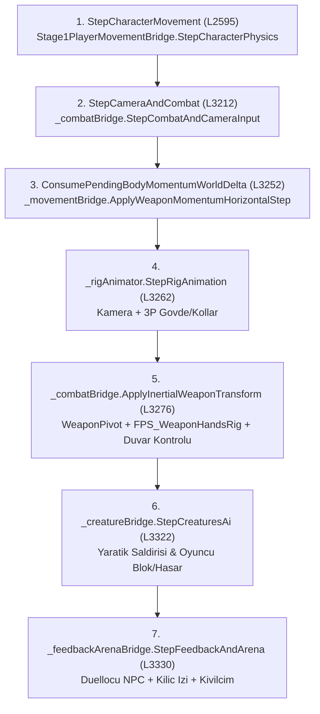

# DOK2: Mevcut Kod Debug ve Akış Raporu (Şu Anki Sistem Nasıl Çalışıyor?)

> **Doküman Seti Navigasyonu:**
> - **DOK1 (Hedef & Gereksinimler):** [DOK1_HEDEF_VE_GEREKSINIMLER.md](DOK1_HEDEF_VE_GEREKSINIMLER.md)
> - **DOK2 (Bu Doküman):** [DOK2_MEVCUT_KOD_DEBUG_VE_AKIS_RAPORU.md](DOK2_MEVCUT_KOD_DEBUG_VE_AKIS_RAPORU.md)
> - **DOK3 (Gerçek Hayat HEMA/Kenjutsu & Oyunlar Araştırması):** [DOK3_ENDUSTRI_VE_BENZER_PROJELER_ARASTIRMASI.md](DOK3_ENDUSTRI_VE_BENZER_PROJELER_ARASTIRMASI.md)
> - **DOK4 (Adım Adım Geliştirme Planı):** [DOK4_ADIM_ADIM_GELISTIRME_PLANI.md](DOK4_ADIM_ADIM_GELISTIRME_PLANI.md)

---

## 1. Kare İçi (Per-Frame) Savaş & Hareket Çağrı Akışı

Her `Update()` karesinde [Stage1InteractivePlayController.cs](../../Assets/_Stratocraft/Character/Stage1InteractivePlayController.cs) üzerinden yakın dövüş verisi şu sırayla akar:

---

## 2. Dosya Bazlı Teknik Durum ve Kök Neden Denetimi

### 2.1. [MeleeBiomechanicsSolver.cs](../../Assets/_Stratocraft/Character/MeleeBiomechanicsSolver.cs) (Saf C#, 0-GC)
- **Çalışan Kısımlar:**
  - `ComputeEffectiveBiomechanics` ([L44-130](../../Assets/_Stratocraft/Character/MeleeBiomechanicsSolver.cs#L44-L130)): Silah kütlesi, uzunluğu, 1H/2H tutuş (`gripTorqueMult=1.42`, `gripInertiaMult=0.86`), duruş (`Standing/Crouch/Prone/Airborne`) ve hız skalerine göre `EffectiveInertia`, `KpMuscle` (`680/380/165`), `KdDamping` (`zeta=0.78/0.94/0.90`), `MaxCumulativeCameraPullDeg` ve `FootMomentumScale` hesaplar.
  - `StepFixed240HzPd` ([L166-214](../../Assets/_Stratocraft/Character/MeleeBiomechanicsSolver.cs#L166-L214)): Sabit `1/240s` yarı-örtük Euler PD çözücü (`maxOmega=36 rad/s`, `X: ±1.45`, `Y: -1.28..1.36`).
  - `EvaluateCappedBodyAndCameraPull` ([L220-249](../../Assets/_Stratocraft/Character/MeleeBiomechanicsSolver.cs#L220-L249)): Sert kümülatif kamera çekme limiti + `targetFootMomentumLocalXZ`.
  - `StepDiscreteThrust` ([L256-301](../../Assets/_Stratocraft/Character/MeleeBiomechanicsSolver.cs#L256-L301)): Ayrık tek-vuruş saplama (`0.12s Extend -> 0.23s Retract`).
  - `ClassifyFrontWallClearance` & `ComputeSafeRetractedBladeTipY` (**Bu oturumda eklendi**): `< 0.62m` dar alan kilidi ve geri çekilmiş kılıcın asla baş aşağı (`Y < 0.42`) dönmemesi garantisi.
- **Eksik / Geliştirilecek Kısımlar:**
  1. **Posture (Denge)** ve **Bind / Winden** fizik çözücüsü henüz yok.
  2. **Bağıl Hız (`Dot(v_player - v_target, toTarget)`)**, **Sweet Spot (`u ∈ [0.68..0.92]`)** ve **Hilt-Hit Glance (`u < 0.28`)** çarpanları çözücüde yok.
  3. **Turn Cap (`deg/s` silaha özel kamera dönüş sınırı)** fonksiyonu yok.
  4. **2-Kemik Analitik IK (Kosinüs Teoremi)** çözücüsü henüz saf C# çekirdekte tanımlı değil.

### 2.2. [Stage1DirectionalCombatBridge.cs](../../Assets/_Stratocraft/Character/Stage1DirectionalCombatBridge.cs)
- **Bu Oturumda Acil Düzeltilen 2 Kritik Hata:**
  1. **GLB Kılıçta El Görünmemesi:** [StratocraftStage1SceneBuilder.cs:842-865](../../Assets/_Stratocraft/Editor/StratocraftStage1SceneBuilder.cs#L842-L865) sahneye GLB kabza (`weapon_hilt_ironwood_longsword.glb`) yerleştirdiği için `WeaponPivot` üzerinde `MeshFilter` yoktu ve `RebuildWeaponArchetypeVisualMesh` hiç çalışmıyordu. Acil çözüm olarak `EnsureFpsWeaponHandsRig` eklendi (ters `localScale` telafili zırhlı eldiven+önkol çocuk objesi, FPS'te görünür, TPS'te gizli).
  2. **Duvara Yaklaşınca Kılıcın Baş Aşağı Sapıtması:** Eski Katman 3 (`pushAwayAngles * 0.28f`) her karede `gy`'yi `-1.15`'e iterek kılıcı baş aşağı çeviriyordu. Ön 3-ışın `SampleFrontWallClearanceMeters` + `< 0.62m` geniş savurma kilidi + dikey göğüs katlaması eklendi.
- **Kalan Mimari Kısıtlar (Faz K.1–K.6 İçin):**
  1. **Katı Önkol vs. Gerçek 2-Kemik IK:** `FPS_WeaponHandsRig` şu an kabzaya katı bağlı bir el/önkol mesh'i olarak acil görsel boşluğu kapatıyor; ancak kılıç çok açılı döndüğünde önkolun omuz bağlantısının gerçek dirsek bükülmesiyle kameranın alt-arkasından çıkması için **Faz K.1: 2-Kemik Analitik IK** gerekiyor. Ayrıca `RebuildWeaponArchetypeVisualMesh` içindeki eski katı el kutularının (`L586-600`) temizlenmesi gerekiyor (aksi halde `[F8]` sonrası NPC/TPS kılıçlarında çifte el görünebilir).
  2. **Kılıç Duvar Süpürmesi (Swept Collision):** Aletlerde 4 alt-adımlı süpürme varken kılıç Katman 2 duvar testinde yalnızca anlık nokta örnekleniyor -> hızlı savurmada ince sütun atlama riski (**Faz K.2**).
  3. **Histerezisli 5-Işın Dar Alan Taraması:** Mevcut 3-ışın ön taramasına sol/sağ (`±75°`) ve üst tavan ışınları + sürekli `crampedFold01` histerezisi eklenmeli (**Faz K.2**).
  4. **Thrust (Saplama) Lunge Eksik:** `_isThrustMode` aktifken `_bodyMomentumLocalVel` ileri itilmiyor; saplama yerinde kol uzatması gibi kalıyor (**Faz K.3**).
  5. **MasterDeflect Yan Adımı Eksik:** Başarılı zamanlı saptırmada savunmacıya çapraz kaçış adımı verilmiyor (**Faz K.3**).
  6. **Parry PD Ezmesi & Ölü Kod:** `_isParryStance` sonunda `Vector2.Lerp` PD çıktısını hafif eziyor; `StepSecondOrderRotationalInertia` eski ölü metod olarak duruyor (**Faz K.4**).

### 2.3. [Stage1ArticulatedRigAnimator.cs](../../Assets/_Stratocraft/Character/Stage1ArticulatedRigAnimator.cs)
- **Mevcut Durum:** `IsFirstPersonBodyOccluder` ([L259-318](../../Assets/_Stratocraft/Character/Stage1ArticulatedRigAnimator.cs#L259-L318)) FPS'te gövde kollarını `ShadowsOnly` yaparak yüzen kahverengi kutu sorununu önlüyor.
- **Kalan Eksik:** TPS (`[F5]`) modunda sağ kol kaba Euler açısıyla dönüyor, **sol kol ise 2H kılıç tutarken bile kabzaya gitmiyor** (sadece yürüme salınımı yapıyor) -> **Faz K.1**'de aynı 2-kemik IK soket çözücüsü TPS kollarına da bağlanacak!

### 2.4. [Stage1InteractivePlayController.cs](../../Assets/_Stratocraft/Character/Stage1InteractivePlayController.cs) & [Stage1PlayerMovementBridge.cs](../../Assets/_Stratocraft/Character/Stage1PlayerMovementBridge.cs) & [Stage1CreatureSimulationBridge.cs](../../Assets/_Stratocraft/Character/Stage1CreatureSimulationBridge.cs)
- **Kritik Mimari Bulgu 1 — 1-Kare Gecikmeli Pushback Sıralaması:**
  - `ConsumePendingBodyMomentumWorldDelta` ([L3252](../../Assets/_Stratocraft/Character/Stage1InteractivePlayController.cs#L3252)) yaratık (`L3322`) ve düellocu (`L3330`) blok tepkilerinden **ÖNCE** çalışıyor! Bu nedenle blok/parry geri savrulması 1 kare bekliyor ve ertesi karede önce `frictionDecay` tarafından zayıflatılıyor.
- **Kritik Mimari Bulgu 2 — Yaratık Bloğunda Pushback Kayıp:**
  - Düellocu NPC (`Stage1CombatFeedbackAndArenaBridge.cs:579`) `EvaluateIncomingStrikeAgainstPlayerGuard` kullanırken, dünya yaratıkları ([Stage1CreatureSimulationBridge.cs:1801](../../Assets/_Stratocraft/Character/Stage1CreatureSimulationBridge.cs#L1801)) doğrudan `NotifyParryImpactAndCheckGuardBreak` / `NotifySuccessfulParryOrClash` çağırıyor -> **Kaya Golemi veya Ayı darbesini bloklarken oyuncuya sıfır fiziksel geri itme uygulanıyor!**
- **Kritik Mimari Bulgu 3 — `ApplyWeaponMomentumHorizontalStep` Wall-Slide Eksik:**
  - [Stage1PlayerMovementBridge.cs:1871-1900](../../Assets/_Stratocraft/Character/Stage1PlayerMovementBridge.cs#L1871-L1900) çapraz duvar temasında X/Z ayrı kayma yapmadığı için duvara sırt dönük blok geri itmesinde karakter sert kilitleniyor.

---

## 3. Bu Oturumda Tamamlanan Acil Düzeltmeler Özeti
1. **Duvar Yakınlığı Kılıç Sapıtması:** `SampleFrontWallClearanceMeters` + `< 0.62m` geniş savurma kilidi + dikey göğüs katlaması + Katman 3 `ComputeSafeRetractedBladeTipY >= 0.42f` (asla baş aşağı dönmez).
2. **FPS Kılıç Elleri (Acil Aşama):** `FPS_WeaponHandsRig` çocuk objesi (GLB + prosedürel uyumlu, 2H sağ+sol / 1H Rapier sağ eldiven+kolçak, TPS'te otomatik gizli).
3. **Yaratık Çok Yönlü Saldırı Animasyonları:** `StepCreatureArticulatedAnimation` artık `ActiveAttackDirection` üzerinden **6 farklı saldırı animasyonu** (`Overhead`, `Right`, `Left`, `Underhand`, `DualSide`, `Lunge`) oynatıyor ve aynı hamleyi üst üste tekrarlamıyor.
4. **Ölüm Ekranı & `BleedOutCrawl`:** Yere düşmüş (`0 HP`) oyuncuya gelen yaratık darbesi kanama sayacını hızla bitiriyor (coup-de-grace); `BleedOutCrawl` alt-orta karta + kenar kırmızı vinyete taşındı; Ölüm Ekranı `OnGUI` en üstünde opak perde + `[Enter]/[Space]` veya butonla yeniden doğma ile kesinleştirildi.
5. **F3 HUD Bozulması:** Koyu yarı-saydam arka plan dokusu + ekran genişliğine göre çakışmayan dinamik sol/sağ F3 kutuları + `CalcHeight` yükseklik hesabı + çakışmayan donma/ısınma şeridi.
