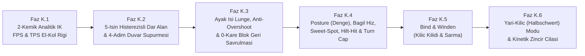

# DOK4: Gerçekçi Kılıç Ustalığı ve Düello Biyomekaniği — Adım Adım Geliştirme Planı

> **Doküman Seti Navigasyonu:**
> - **DOK1 (Hedef & Gereksinimler):** [DOK1_HEDEF_VE_GEREKSINIMLER.md](DOK1_HEDEF_VE_GEREKSINIMLER.md)
> - **DOK2 (Mevcut Kod Debug & Akış):** [DOK2_MEVCUT_KOD_DEBUG_VE_AKIS_RAPORU.md](DOK2_MEVCUT_KOD_DEBUG_VE_AKIS_RAPORU.md)
> - **DOK3 (Gerçek Hayat HEMA/Kenjutsu & Oyunlar Araştırması):** [DOK3_ENDUSTRI_VE_BENZER_PROJELER_ARASTIRMASI.md](DOK3_ENDUSTRI_VE_BENZER_PROJELER_ARASTIRMASI.md)
> - **DOK4 (Bu Doküman):** [DOK4_ADIM_ADIM_GELISTIRME_PLANI.md](DOK4_ADIM_ADIM_GELISTIRME_PLANI.md)

---

## 1. Faz Sırası ve Bağımlılık Diyagramı

---

## 2. Faz Faz Teknik Uygulama Detayları

### Faz K.1 — 2-Kemik Analitik IK FPS & TPS El-Kol Rigi
- **Amaç (`DOK1 §2, DOK2 §2.2, DOK3 §B.1`):** Acil düzeltme olarak eklenen katı `FPS_WeaponHandsRig` yerine gerçek omuz -> üst kol -> dirsek -> önkol/kolçak -> eldiven 2-kemik IK zincirine geçmek; kılıç ölçeğinden tamamen bağımsız, 1H/2H/sol-kol-kopuk uyumlu eller elde etmek.
- **Yeni / Değişecek Dosyalar:**
  1. [MeleeBiomechanicsSolver.cs](../../Assets/_Stratocraft/Character/MeleeBiomechanicsSolver.cs):
     - `public static void SolveTwoBoneArmIk(Vector3 shoulderPos, Vector3 targetHandPos, Vector3 elbowPoleDir, float upperArmLen, float forearmLen, out Vector3 elbowPos, out Vector3 clampedHandPos)` (saf C#, Kosinüs Teoremi, 0-GC).
  2. `Assets/_Stratocraft/Character/FirstPersonArmIkRenderer.cs` *(Yeni)*:
     - `PlayerCamera.transform` altında sabit `localScale = Vector3.one` ile Sağ ve Sol kol hiyerarşisi (`UpperArm 0.31m -> Elbow -> Forearm/Vambrace 0.29m -> Gauntlet/Hand`).
     - Omuz ankrajları kameranın alt-arkasında (`R: (+0.22, -0.26, -0.04)`, `L: (-0.22, -0.26, -0.04)`), dirsek pole vektörleri aşağı-dışa (`±0.45, -0.70, -0.35`).
     - Her `CombatWeaponArchetype` için soket tablosu: `RightGripLocalPos`, `LeftGripLocalPos`, `HalfSwordGripLocalPos`.
     - `leftHandIkWeight` yumuşak harmanlama (`1.0` = 2H kabza, `0.0` = 1H denge gardı; `PlayerLeftArmSevered == true` ise sol kol gizli).
  3. [Stage1DirectionalCombatBridge.cs](../../Assets/_Stratocraft/Character/Stage1DirectionalCombatBridge.cs):
     - `RebuildWeaponArchetypeVisualMesh` içindeki eski katı el/önkol `AddBox` satırlarını temizle (saf silah mesh'i — NPC ve TPS çifte el kirliliği biter).
  4. [Stage1InteractivePlayController.cs](../../Assets/_Stratocraft/Character/Stage1InteractivePlayController.cs):
     - `ApplyInertialWeaponTransform` çağrısının hemen ardından `_fpsArmIkRenderer.SolveToWeaponSockets(...)` çağır.
  5. [Stage1ArticulatedRigAnimator.cs](../../Assets/_Stratocraft/Character/Stage1ArticulatedRigAnimator.cs):
     - TPS modunda (`!isFirstPersonMode`) aynı `SolveTwoBoneArmIk` fonksiyonunu `_rightArmShoulderPivot` ve `_leftArmShoulderPivot` üzerine bağlayarak 2H kılıçta sol elin kabzayı tutmasını sağla.

### Faz K.2 — Proaktif 5-Işın Histerezisli Dar Alan & 4-Adım Duvar Süpürmesi
- **Amaç (`DOK1 §2.4, DOK2 §2.2, DOK3 §A.6 & §B.3`):** Dar koridorda, sütun yanında ve alçak tavanda sıfır titreşimle kılıç katlaması + hızlı savurmada ince duvarı atlamayan 4 alt-adımlı süpürme.
- **Değişecek Dosyalar:**
  1. [MeleeBiomechanicsSolver.cs](../../Assets/_Stratocraft/Character/MeleeBiomechanicsSolver.cs):
     - `public struct SpaceClearanceProbe { public float FrontM, LeftM, RightM, OverheadM; }`
     - `public static float EvaluateCrampedFoldTarget01(in SpaceClearanceProbe probe, float bladeLen, float prevFold01, float dt)` (histerezis bandı: giriş `< 0.62m`, çıkış `> 0.74m`, `MoveTowards` sönümleme `7.0/s`).
     - `public static bool IsSwingDirectionBlockedByWall(Vector2 slashDirUnit, in SpaceClearanceProbe probe, float bladeLen)` (ör. sağ duvar `< 0.50m` ise sağdan gelen kesik kilitlenir ama sol veya dikey kesik serbest kalır!).
  2. [Stage1DirectionalCombatBridge.cs](../../Assets/_Stratocraft/Character/Stage1DirectionalCombatBridge.cs):
     - 5-ışın 0-GC tarayıcı (`Forward`, `Left 65°`, `Right 65°`, `FwdLeft 30°`, `FwdRight 30°`, `Up`).
     - Katman 2 kılıç duvar kontrolüne (`L2898`) 4 alt-adımlı `_prevBladeWorldPoints[i] -> _currBladeWorldPoints[i]` süpürmesi ekle (`i = 1..4`, uç dahil, zemin/yokuş filtresi korunarak).
     - Duvar sekmesinde `50 ms` mikro hitstop + bilek şoku (`_wristRecoilOffset`) + net metalik çınlama + temiz toparlanma.

### Faz K.3 — Ayak İşi Lunge, Anti-Overshoot & 0-Kare Blok Geri Savrulması
- **Amaç (`DOK1 §2.1–2.3, DOK2 §2.4, DOK3 §A.2 & §B.2`):** Saldırıda gerçek adım hissi, hedefe çarpmadan duran Anti-Overshoot ve yaratık+NPC bloklarında anlık fiziksel geri savrulma.
- **Değişecek Dosyalar:**
  1. [Stage1PlayerMovementBridge.cs](../../Assets/_Stratocraft/Character/Stage1PlayerMovementBridge.cs):
     - `AddCombatFootworkImpulse(Vector3 worldVel, float decayRate, bool isKnockback)` + `FlushCombatFootworkImpulses(Transform, worldChunks, dt)` ekle.
     - `ApplyWeaponMomentumHorizontalStep` içine X/Z ayrı **Wall-Slide** desteği ve adım ritmi (`_locomotionCyclePhase`) geri bildirimi ekle.
  2. [Stage1DirectionalCombatBridge.cs](../../Assets/_Stratocraft/Character/Stage1DirectionalCombatBridge.cs):
     - `DiscreteThrustPhase.Extending` sırasında ileri Lunge itmesi (`Fencing_Punta` Rapier `0.85m`, Longsword `0.55m`).
     - `ActiveFullArcSwing` `s ∈ [0.05..0.50]` aralığında **Passing Step** itmesi (`0.40–0.75m`, kesik yönüne hafif çapraz).
     - **Anti-Overshoot:** En yakın düşmana yatay mesafe `< 1.15m` ise ileri bileşeni `0`'a sönümle.
     - `MasterDeflect` anında gelen saldırıya dik yönde `0.25–0.38m` **yan kaçış adımı (sidestep slip)** ekle.
  3. [Stage1CreatureSimulationBridge.cs](../../Assets/_Stratocraft/Character/Stage1CreatureSimulationBridge.cs):
     - `L1799-1813` blok yolunu `combatBridge.EvaluateIncomingStrikeAgainstPlayerGuard(...)` üzerinden geçir (yaratığın kütle/saldırı hızı profiliyle!). Ağır Golem darbesi bloklandığında oyuncuyu `0.45–0.80m` geriye iter ve diz/kamera çökmesi (`-5 cm`) üretir.
  4. [Stage1InteractivePlayController.cs](../../Assets/_Stratocraft/Character/Stage1InteractivePlayController.cs):
     - Yaratık (`L3322`) ve Düellocu (`L3330`) güncellemelerinin hemen ardından `_movementBridge.FlushCombatFootworkImpulses(...)` çağırarak **0-kare gecikmeli pushback** sağla!

### Faz K.4 — Denge (Posture), Bağıl Hız, Sweet-Spot / Hilt-Hit & Turn Cap
- **Amaç (`DOK1 §2.1 & §2.3, DOK3 §A.5 & §B.4`):** Savaşta mesafe, hız, zamanlama ve denge yönetimini matematiksel olarak ödüllendirmek.
- **Değişecek Dosyalar:**
  1. [MeleeBiomechanicsSolver.cs](../../Assets/_Stratocraft/Character/MeleeBiomechanicsSolver.cs):
     - `public static float EvaluateKineticHitMultiplier(float hitNormalizedU, float closingSpeedMps, float edgeAlignment01, out bool isHiltGlance, out bool isSweetSpot)`
       - `hitNormalizedU < 0.28f` -> `isHiltGlance = true`, `0.35x` (boğulmuş kabza teması).
       - `hitNormalizedU ∈ [0.68..0.92]` -> `isSweetSpot = true`, `1.25x`.
       - `closingSpeedMps` (`-4..+6 m/s`) -> `0.80x .. 1.25x` bağıl hız çarpanı.
     - `public static float GetWeaponMaxTurnCapDegPerSec(int weaponArchetype, bool isHeavySwing)` (Rapier `260°/s`, Katana `220°/s`, Longsword `175°/s`, Greatsword `115°/s`).
     - `public static void StepPosture(ref float posture01, float incomingImpulse, bool isMasterDeflect, bool isForteOnFoible, float dt, out bool postureBroken)`.
  2. [Stage1DirectionalCombatBridge.cs](../../Assets/_Stratocraft/Character/Stage1DirectionalCombatBridge.cs):
     - Ölü `StepSecondOrderRotationalInertia` kodunu ve parry PD `Lerp` ezmesini temizle.
     - `PlayerPosture01` (`0..1`) durumunu ve `Turn Cap` açısal hız sınırını entegre et.
  3. [Stage1VisualHotbarAndInventoryUi.cs](../../Assets/_Stratocraft/UI/Stage1VisualHotbarAndInventoryUi.cs):
     - Savaş aktifken ince, zarif **DENGE (POSTURE)** göstergesi ekle.

### Faz K.5 — Bind & Winden (Kılıç Kilidi & Kaldıraç Kaydırma)
- **Amaç (`DOK1 §2.3, DOK3 §A.5`):** İki kılıç çarpıştığında sadece sekip ayrılmak yerine gerçek HEMA *Bind* (sürtünmeli kılıç teması) ve *Winden* (kaldıraçla yön kırıp kontra saplama) dinamiği eklemek.
- **Değişecek Dosyalar:**
  1. [MeleeBiomechanicsSolver.cs](../../Assets/_Stratocraft/Character/MeleeBiomechanicsSolver.cs):
     - `public static float EvaluateBindLeverageAdvantage(float defenderContactU, float attackerContactU, float bladeCrossAngleDeg)` -> `r_att / r_def` oranıyla `[-1..+1]` baskı üstünlüğü.
  2. [Stage1DirectionalCombatBridge.cs](../../Assets/_Stratocraft/Character/Stage1DirectionalCombatBridge.cs) & [Stage1CombatFeedbackAndArenaBridge.cs](../../Assets/_Stratocraft/Character/Stage1CombatFeedbackAndArenaBridge.cs):
     - `BallisticSlashPhase.BoundInClash` durumu (`0.25–0.55s` pencere).
     - Oyuncu `BoundInClash` sırasında fareyi rakibin zayıf tarafına kırarsa (**Winden**), rakibin gardını yana düşürür ve anında garantili iç-hat saplaması/Riposte açar (kıvılcım + metal sürtünme sesi).

### Faz K.6 — Yarı-Kılıç (*Halbschwert*) Modu & Kinetik Zincir Cilası
- **Amaç (`DOK1 §2.4, DOK3 §A.6`):** Dar alanlarda ve ağır zırhlı düşmanlara karşı sol eli orta namluya alan tarihsel *Halbschwert* duruşu + tam kinetik zincir hissiyatı.
- **Değişecek Dosyalar:**
  1. [Stage1DirectionalCombatBridge.cs](../../Assets/_Stratocraft/Character/Stage1DirectionalCombatBridge.cs) & `FirstPersonArmIkRenderer.cs`:
     - `[X]` tuşu (veya dar alanda `< 0.62m` otomatik opsiyonel geçiş) ile **Yarı-Kılıç Modu**: Sol el IK'sı `HalfSwordGripLocalPos` (`y = +0.28m`) soketine kayar; etkin namlu boyu yarıya iner (`0.60m`), yan duvar çarpışma riski düşer, zırh delme (`ArmorPenetration`) artar!
  2. [Stage1ArticulatedRigAnimator.cs](../../Assets/_Stratocraft/Character/Stage1ArticulatedRigAnimator.cs):
     - Savurma başında (`0–12%`) kamera/gövde `1.2°` ters ön-gerilme (*Anticipation*), blok geri itmesinde `-4..-6 cm` diz amortisörü kamera çökmesi (*Vertical Dip*).

---

## 3. Doğrulama ve Test Planı
Her fazda `Tests/StandaloneCoreTests/WaveAMeleeBiomechanicsTests.cs` dosyasına deterministik `.NET 10` NUnit testleri eklenir ve `scripts/quality-gate.ps1 -Phase 4` + canlı Unity 6 PlayMode doğrulaması yapılır:
1. **Faz K.1 Testi:** `SolveTwoBoneArmIk` tüm 8 yön + `HalfSword` + `Lodged` pozlarında `|hand - target| < 1mm`, `|upper| == 0.31m`, `|forearm| == 0.29m` doğrular.
2. **Faz K.2 Testi:** 5-ışın dar alan histerezisinde 1000 karede sıfır salınım (`maxDeltaPerFrame < 0.15`), dar sağ duvarda sağ kesik kilitli / sol kesik açık, 4-adım süpürmede ince duvar tünellemesi `0`.
3. **Faz K.3 Testi:** Saplama lunge yer değiştirmesi `>= 0.50m`, `< 1.15m` düşman önünde `Anti-Overshoot` ile `<= 0.05m`, Golem bloğunda `>= 0.40m` pushback + 0-kare uygulama.
4. **Faz K.4 Testi:** `u = 0.18` Hilt-Hit Glance `0.35x`, `u = 0.80` Sweet-Spot `1.25x`, ileri koşu `+20%` vs geri kaçış `-15%`, Posture `0` -> `postureBroken = true`.
5. **Faz K.5 & K.6 Testi:** Forte-on-Foible (`u_def=0.25, u_att=0.80`) kaldıraç oranı `>= 2.5x`, *Winden* yön kırılmasıyla Riposte açılımı, *Halbschwert* efektif menzil ve dar alan açıklığı doğrulaması.
