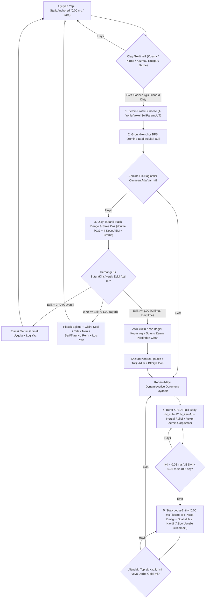
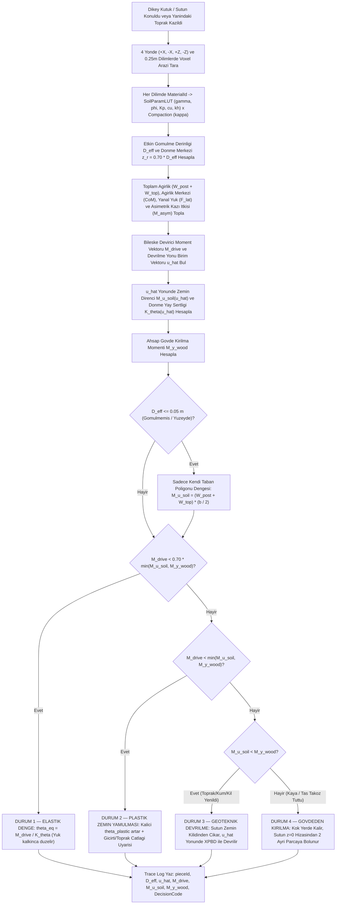
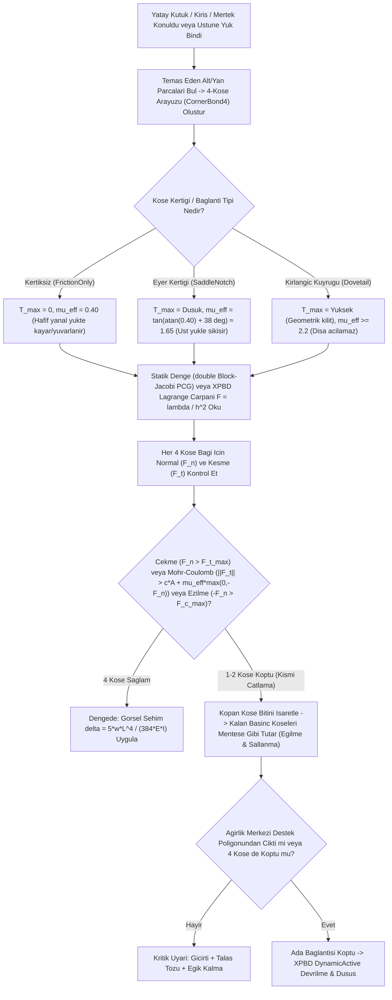
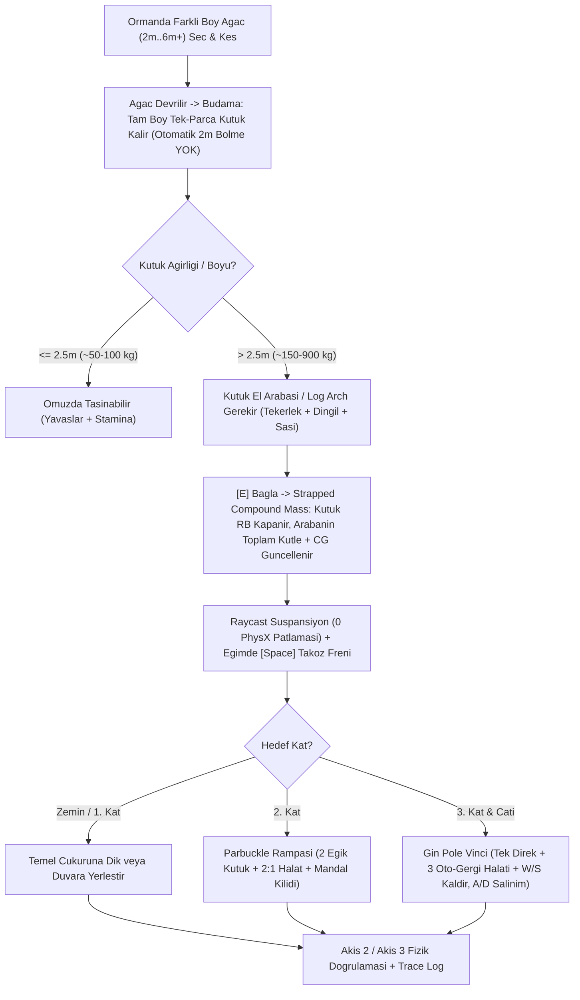

# DOK4 — Tam Akış Diyagramı ve Matematiksel Model (Tek-Parça Yapı Fiziği & 3 Katlı Kütük Ev)

> **Belge Seti Navigasyonu:**  
> [`DOK1 — Hedef ve Gereksinimler`](DOK1_HEDEF_VE_GEREKSINIMLER.md) | [`DOK2 — Mevcut Kod Debug ve Akış Raporu`](DOK2_MEVCUT_KOD_DEBUG_VE_AKIS_RAPORU.md) | [`DOK3 — Endüstri, Simülasyon, Açık Kaynak ve YouTube Araştırması`](DOK3_ENDUSTRI_SIMULASYON_OSS_YOUTUBE_ARASTIRMASI.md) | **[`DOK4 — Tam Akış Diyagramı ve Matematiksel Model`](DOK4_TAM_AKIS_DIYAGRAMI_VE_MATEMATIK_MODELI.md)** *(Bu belge)* | [`DOK5 — Adım Adım Geliştirme ve Doğrulama Planı`](DOK5_ADIM_ADIM_GELISTIRME_VE_DOGRULAMA_PLANI.md)

> [!IMPORTANT]
> **Ana Mantık Koruma Kuralı:** Geliştirme veya PlayTest sırasında bir hata çıktığında bu belgedeki ana fizik mantığı bypass edilmez (fizik susturulmaz). Akışta bir değişiklik gerekirse **ana mantığı bozmadan** önce bu belgedeki ilgili diyagram ve formül güncellenir, ardından kod düzeltilir.

---

## 1. Çekirdek Veri Yapıları (0 B GC, Blittable, Tek-Parça Kimlikli)

Tüm yapı elemanları (`[C]` kristali dışındaki kütük, sütun, kiriş, kalas, payanda, mertek) voksel dizisine gömülmez ve birbirine kaynaşmaz. Her parça aşağıdaki 4 hafif veri yapısıyla temsil edilir:

| Veri Yapısı | Temel Alanlar | Sorumluluğu |
| :--- | :--- | :--- |
| **`RigidStructurePiece`** | `PieceId (uint)`, `IslandId (int)`, `State (StaticAnchored / DynamicActive / StaticLooseEntity)`, `Kind (Log / Post / Beam / Plank / Rafter / Brace)`, `WoodSpecies`, `LengthM`, `DiameterM`, `MassKg`, `Pos (double3)`, `Rot (quaternion)`, `Vel`, `AngVel`, `InvInertiaLocal`, `NotchFlags (None / Saddle / Dovetail)`, `PlasticTiltRad`, `Damage01`, `SplitParentId` | Tek-parça cismin değişmez kimliği, boyutları, kütlesi, pozisyonu ve kalıcı kırılma geçmişi. |
| **`SoilEmbedProfile`** | `PieceId`, `EmbedDepthM (D)`, `DirDepth4 (N, S, E, W)`, `DirSoilMat4`, `CompactionFactor (kappa: 0.35..1.0)`, `HasStoneCollar (bool)`, `PivotDepthZr`, `ResistMoment4Dir (Mu)`, `RotStiffness4Dir (K_theta)`, `AsymmetricPushVec` | Gömülü dikey sütunun 4 yöndeki zemin derinliği, dolgu sıkılığı ve $O(1)$ devrilme/kırılma kapasitesi. |
| **`CornerBond4Interface`** | `BondId`, `PieceA`, `PieceB`, `JoineryKind (FrictionOnly / SaddleNotch / Dovetail / Pegged / JoistPocket)`, `CornerLocalA[4]`, `CornerLocalB[4]`, `CornerBrokenMask (4-bit)`, `LambdaN[4]`, `LambdaT[4]`, `LastStressRatio01` | İki tek-parça cisim arasındaki **Reduced-AEM 4-köşe** temas/kertik arayüzü. |
| **`RigidPhysicsTraceEvent`** | `Tick`, `PieceId`, `IslandId`, `Phase`, `EmbedD`, `DriveMomentNm`, `ResistMomentNm`, `WoodYieldNm`, `TiltDeg`, `StressRatio`, `DecisionCode`, `DirX/Y/Z` | Her kritik kararın 0-GC ring buffer + `telemetry_logs.db` kaydı. |

---

## 2. Ana Sistem Yaşam Döngüsü Akış Diyagramı (`StaticAnchored` ↔ `DynamicActive` ↔ `StaticLooseEntity`)

---

## 3. Gömülü Sütun / Kazık Karar Akışı ve Matematiksel Formülleri

### 3.1. Akış Diyagramı (Derinlik, Zemin Türü, Açı, Ağırlık Merkezi ve Devrilme Yönü)

### 3.2. Kesin Matematiksel Formüller (Broms 1964 + IBC 1807.3 + Winkler $p\text{-}y$)

1. **Tek Parça Kütük Kütlesi ve Ağırlığı:**
   $$V = \pi \left(\frac{b}{2}\right)^2 L, \qquad m_{\text{post}} = \rho_{\text{wood}} \cdot V, \qquad W_{\text{post}} = m_{\text{post}} \cdot g$$
   *(Örnek: Yaş Çam $\rho = 800\text{ kg/m}^3$, $L = 4.5\text{ m}$, $b = 0.30\text{ m} \implies m \approx 254\text{ kg}$; Meşe $\rho = 1000\text{ kg/m}^3 \implies m \approx 318\text{ kg}$.)*
2. **Dilim Bazlı Zemin Yanal Direnci ($p_{u,i}$) ve Yay Sertliği ($k_i$):**
   - **Kohezyonsuz (Kum, Çakıl, Normal Toprak):**
     $$K_p = \tan^2\!\left(45^\circ + \frac{\phi}{2}\right), \qquad p_{u,i} = 3\,\gamma\,z_i\,K_p\,b\,\kappa\,f_m, \qquad k_i = n_h\,z_i\,\kappa$$
   - **Kohezyonlu (Çamur, Kil):**
     $$p_{u,i} = \begin{cases} 0 & z_i < 1.5\,b \\ 9\,c_u\,b\,\kappa\,f_m & z_i \ge 1.5\,b \end{cases}, \qquad k_i = k_h\,b\,\kappa$$
   - *(Yüzeyde taş takoz halkası `HasStoneCollar == true` ise üst $0.35\text{ m}$ dilime çakıl/kaya sınıfı $p_{u}$ ve $K_\theta$ eklenir; yan tarafı kazılıp uçurum açıldıysa şev indirgeme çarpanı $f_m = 0.50$, tam bitişik kazıda o dilimde $p_{u,i} = 0$ olur.)*
3. **Yön Bağımlı Toplam Zemin Devrilme Kapasitesi ($M_{u,\text{soil}}$) ve Dönme Sertliği ($K_\theta$):**
   $$z_r = 0.70\,D_{\text{eff}}$$
   $$M_{u,\text{soil}}(\hat{u}) = \sum_{z_i < z_r} p_{u,i}(+\hat{u})\,\Delta z\,(z_r - z_i) + \sum_{z_i > z_r} p_{u,i}(-\hat{u})\,\Delta z\,(z_i - z_r)$$
   $$K_\theta(\hat{u}) = \sum_{z_i < z_r} k_i(+\hat{u})\,\Delta z\,(z_r - z_i)^2 + \sum_{z_i > z_r} k_i(-\hat{u})\,\Delta z\,(z_i - z_r)^2$$
   *(Eğer $D_{\text{eff}} \le 0.05\text{ m}$ yani gömülmemişse: $M_{u,\text{soil}} = (W_{\text{post}} + W_{\text{top}}) \cdot \frac{b}{2}$.)*
4. **Devirici Moment Vektörü ($\mathbf{M}_{\text{drive}}$, $P\text{-}\Delta$ ve Asimetrik Kazı Dahil):**
   $$\mathbf{M}_{\text{drive}} = \mathbf{r}_{\text{lat}} \times \mathbf{F}_{\text{lat}} + \mathbf{r}_{\text{CoM}} \times \big((W_{\text{post}} + W_{\text{top}})\,\hat{\mathbf{g}}\big) + \mathbf{M}_{\text{active\_asym}}$$
   - Burada $\mathbf{M}_{\text{active\_asym}}$: Bir tarafı kazılan çukurda karşı taraftaki dolu zeminin uyguladığı aktif itki ($p_a = K_a \gamma z b$, $K_a = \tan^2(45^\circ - \phi/2)$) momentidir; sütunu doğrudan **kazılan boşluk yönüne** iter.
   - Devrilme yönü birim vektörü: $\hat{u} = \frac{(\mathbf{M}_{\text{drive}} \times \hat{\mathbf{y}})_{xz}}{\|(\mathbf{M}_{\text{drive}} \times \hat{\mathbf{y}})_{xz}\|}$.
5. **Ahşap Gövde Kırılma Momenti ($M_{y,\text{wood}}$):**
   $$I = \frac{\pi b^4}{64}, \qquad M_{y,\text{wood}} = f_b \cdot \frac{\pi b^3}{32}$$
   *(Tipik eğilme dayanımı $f_b$: Çam `~28 MPa`, Meşe `~42 MPa`, Demir Odunu `~65 MPa`.)*
6. **Hiperbolik $p\text{-}y$ Eğilme ve Plastik Yamulma Açısı:**
   $$\theta_{\text{eq}} = \frac{M_{\text{drive}}}{K_\theta(\hat{u}) \cdot \left(1 - 0.85\,\frac{M_{\text{drive}}}{M_{u,\text{soil}}(\hat{u})}\right)}$$
   $M_{\text{drive}} / M_{u,\text{soil}} \ge 0.70$ olduğunda $\theta_{\text{plastic}} = \max(\theta_{\text{plastic}},\; 0.55\,\theta_{\text{eq}})$ kalıcı olarak kaydedilir.

---

## 4. Yatay Kütük / Kiriş, Kertik ve 4-Köşe Reduced-AEM Kırılma Akışı

### 4.1. Akış Diyagramı (Üst Üste Kütük Dizme, Kertik Kilidi ve Kısmi Çatlama → Devrilme)

### 4.2. Kesin Formüller (4-Köşe Reduced-AEM, Kiriş Sehimi, Çatı İtmesi & XPBD)

1. **Mohr-Coulomb & Çekme/Basınç Kırılma Kriteri (4 Köşenin Her Biri İçin):**
   - Çekme kopması: $F_{n,c} > F_{t,\max} = \sigma_t \cdot \frac{A_{\text{contact}}}{4}$
   - Kesme kayması: $\|\mathbf{F}_{t,c}\| > c_{\text{joinery}} \cdot \frac{A_{\text{contact}}}{4} + \mu_{\text{eff}} \cdot \max(0, -F_{n,c})$
   - Basınç ezilmesi: $-F_{n,c} > F_{c,\max} = \sigma_c \cdot \frac{A_{\text{contact}}}{4}$
2. **Kiriş Açıklığı Eğilme (Görsel Sehim & Kırılma):**
   $$\delta_{\text{mid}} = \frac{5\,w\,L^4}{384\,E\,I} + \frac{P_{\text{point}}\,L^3}{48\,E\,I}, \qquad M_{\max} = \frac{w\,L^2}{8} + \frac{P_{\text{point}}\,L}{4}$$
   - $M_{\max} / M_{y,\text{wood}} \in [0.75, 1.00)$ → Kiriş görsel olarak aşağı eğilir + gıcırdama/talaş uyarısı verir.
   - $M_{\max} \ge M_{y,\text{wood}}$ → Kiriş orta noktasından **kalıcı olarak 2 ayrı `RigidStructurePiece` parçasına bölünür** (`SplitParentId` ile izlenir) ve XPBD ile düşer.
3. **Çatı Dışa İtmesi (*Outward Thrust*):**
   $$H_{\text{thrust}} = \frac{W_{\text{roof}}}{2\,\tan\theta_{\text{roof}}}$$
   - Yapısal Mahya Kirişi (`RidgeBeam`) veya Alt `1/3` Gergi Kirişi (`RafterTie`) varsa $H_{\text{thrust}}$ çekme kuvveti olarak gergi kirişine aktarılır; yoksa doğrudan 3. kat üst duvarına yanal kuvvet olarak binip duvarları dışa devirir!
4. **XPBD Rigid Body Konum/Kuaterniyon Adımı ($N_{\text{sub}} = 12, N_{\text{iter}} = 1, h = \Delta t / 12$):**
   $$w_i = m_i^{-1} + (\mathbf{r}_i \times \mathbf{n})^T \mathbf{I}_i^{-1} (\mathbf{r}_i \times \mathbf{n}), \qquad \Delta\lambda = \frac{-c - (\alpha / h^2)\lambda}{w_1 + w_2 + \alpha / h^2}$$
   $$\mathbf{F}_{\text{bond}} = \frac{\lambda}{h^2}\,\mathbf{n}, \qquad e = 0 \text{ (eger } |v_n| \le 2gh \text{ ise — sifir mikro-ziplama!)}$$
5. **d'Alembert Inertial Relief (Havada Düşen Adada Sahte Kırılmayı Önleme):**
   $$\mathbf{f}_i^{\text{eff}} = \mathbf{f}_i^{\text{ext}} - m_i \Big(\mathbf{a}_{\text{com}} + \boldsymbol{\alpha} \times \mathbf{r}_i + \boldsymbol{\omega} \times (\boldsymbol{\omega} \times \mathbf{r}_i)\Big)$$

---

## 5. Tam Boy Kütük Lojistiği Akışı (Kesim → Kütük El Arabası → 2.–3. Kat Çıkarma)

---

## 6. Zorunlu 0-GC Debug & Telemetri Loglama Akışı

Her fonksiyonun ve değişkenin neden o kararı verdiğini canlı oyunda %100 görebilmek için iki kanallı loglama zorunludur:
1. **Yüksek Frekanslı Fizik Trace (`RigidTimberPhysicsTraceRecorder` — `0 B GC` Ring Buffer → `Logs/rigid_timber_trace.jsonl`):**
   - Her olayda (yerleştirme, gömme ölçümü, zemin kazısı, 4-köşe gerilme, sehim, devrilme, kırılma, uyuma) tek satır yapılandırılmış kayıt:
     `{tick, fn, pieceId, islandId, state, embedD, dirD:[N,S,E,W], soil:[N,S,E,W], kappa, mDrive, mSoil, mWood, tiltDeg, uHat:[x,z], brokenMask, reason}`
2. **Kritik Olay & Performans Telemetrisi (`IGameLogService` → `Logs/telemetry_logs.db`):**
   - `LogPipelineStart / End` (`RigidTimber.SolveIsland`, `RigidTimber.StepXpbd`, mikrosaniye süre + parça/bağ sayısı),
   - `LogFunctionError` (NaN/Inf koruması, bütçe aşımı `> 2.0 ms`, beklenmeyen durum geçişi).
