# DOK5 — Adım Adım Geliştirme, Teknoloji, SOLID ve Doğrulama Planı

> **Belge Seti Navigasyonu:**  
> [`DOK1 — Hedef ve Gereksinimler`](DOK1_HEDEF_VE_GEREKSINIMLER.md) | [`DOK2 — Mevcut Kod Debug ve Akış Raporu`](DOK2_MEVCUT_KOD_DEBUG_VE_AKIS_RAPORU.md) | [`DOK3 — Endüstri, Simülasyon, Açık Kaynak ve YouTube Araştırması`](DOK3_ENDUSTRI_SIMULASYON_OSS_YOUTUBE_ARASTIRMASI.md) | [`DOK4 — Tam Akış Diyagramı ve Matematiksel Model`](DOK4_TAM_AKIS_DIYAGRAMI_VE_MATEMATIK_MODELI.md) | **[`DOK5 — Adım Adım Geliştirme ve Doğrulama Planı`](DOK5_ADIM_ADIM_GELISTIRME_VE_DOGRULAMA_PLANI.md)** *(Bu belge)*

---

## 1. Değişmez Geliştirme Disiplini ve Çalışma Kuralları

Bu dokümandaki geliştirme süreci boyunca aşağıdaki **6 zorunlu disiplin kuralı** hiçbir aşamada ihlal edilmeyecektir:

### Kural 1 — Ana Mantığı Bozmadan İlerleme ve Doküman Senkronizasyonu
- Tüm kodlama, [`DOK1`](DOK1_HEDEF_VE_GEREKSINIMLER.md) (Tek-Parça Anayasası `TP-01..TP-06`) ve [`DOK4`](DOK4_TAM_AKIS_DIYAGRAMI_VE_MATEMATIK_MODELI.md) (Akış Diyagramı & Matematiksel Model) kurallarına bağlı kalır.
- Bir hata çıktığında **fiziği susturma, kütüğü voksele yapıştırma veya kuralı bypass etme kesinlikle yasaktır**.
- Gerçek bir akış değişikliği gerekirse, ana mantığı bozmadan **önce [`DOK4`](DOK4_TAM_AKIS_DIYAGRAMI_VE_MATEMATIK_MODELI.md) içindeki akış/formül güncellenir**, ardından kod düzeltilir.

### Kural 2 — Her Kilometre Taşında Zorunlu "Yap → Test Et → PlayTest Gör → Düzelt → Geç" Kapısı
- Küçük bir özellik grubu (**Kilometre Taşı `KM-0 .. KM-7`**) bittiğinde **asla bir sonraki kilometre taşına atlanmaz**.
- Her kilometre taşı sonunda şu 4 adım eksiksiz tamamlanır:
  1. **Derleme & Birim Testleri:** `.NET 10 Release` testleri (`0 Error / 0 Warning`) + yeni yazılan kilometre taşının fizik/matematik birim testleri.
  2. **Log Doğrulaması:** `Logs/rigid_timber_trace.jsonl` ve `Logs/telemetry_logs.db` içindeki değişkenlerin (`embedD`, `mDrive`, `mSoil`, `tiltDeg`, `brokenMask` vb.) beklenen değerleri ürettiği teyit edilir.
  3. **Unity 6 `recompile` & Canlı PlayTest Görsel/Oynanış Kontrolü:** Özelliğin sahnede doğru göründüğü, doğru çalıştığı ve FPS/GC bütçesini bozmadığı doğrulanır.
  4. **Düzeltme & Onay:** Sorun varsa ana mantık bozulmadan düzeltilir; **%100 çalıştığına emin olunduktan sonra** sonraki kilometre taşına geçilir.

### Kural 3 — Parça Parça Yazma & Her Dilimde Kısa İnsan-Dili Bildirim
- Hiçbir büyük sınıf veya özellik **tek seferde dev blok halinde yazılmaz** (yavaşlama, zaman aşımı ve çökme riskini sıfırlamak için).
- Her modül küçük, derlenebilir dilimlere (ör. `~120–250` satır) bölünür; her dilim yazıldığında kullanıcıya kısa ve net bir bildirim verilir (*"Şu dosyada şu fonksiyonu yazdım, şimdi sırada şu var"*).

### Kural 4 — Anti-Stall (Takılma/Çökme) Kontrolü ve Koordinatör Takibi
- Geliştirme sırasında subagent'lar kullanıldığında, koordinatör (veya ayrı bir takipçi rolü) belirli aralıklarla aktif ajanların durumunu kontrol eder; uzun süre yanıt vermeyen veya takılan bir görev varsa bekleyip zaman kaybetmeden tespit edip müdahale eder.
- Kullanıcıya düzenli olarak **insan dilinde** net durum özeti verilir (*"Şu an KM-3 aşamasındayız; A ajanı 4-yönlü zemin okumasını yazıyor, B ajanı testini hazırlıyor, şurası bitti, sırada şu var"*).

### Kural 5 — SOLID ve Temiz Kod Standartları
- **S (Single Responsibility):** Veri kontratı, zemin mekaniği (`SoilEmbedmentEvaluator`), statik denge (`TimberStaticEquilibriumSolver`), 4-köşe kırılma (`ReducedAemBondEvaluator`), dinamik XPBD (`XpbdRigidTimberSolver`), Unity görsel/girdi köprüsü (`Stage1RigidTimberBridge`) ve loglayıcı (`RigidTimberPhysicsTraceRecorder`) ayrı küçük sınıflarda tutulur.
- **O (Open/Closed) & D (Dependency Inversion):** Dinamik çözücü **`IStructuralDynamicsSolver`** arayüzü arkasına soyutlanır. Pilot fazında `XpbdRigidTimberSolver` bağlanır; ileride ağır taş kaleler için `AvbdRigidSolver` tek satırla tak-çıkar olarak eklenebilir.
- **L & I (Liskov & Interface Segregation):** Voxel arazi sorgusu (`IVoxelSoilSampler`) ve telemetri yazıcı (`IRigidPhysicsTraceSink`) ince arayüzlerdir; saf C# `.NET 10` testlerinde Unity olmadan 100% sahte/gerçek voksel verisiyle test edilebilir.
- **Sıfır-GC & Taşınabilirlik:** Hot-path'te `0 B/kare` GC (`Span<T>`, `NativeArray`, sabit havuzlar), `Domain Reload Disabled` için `[RuntimeInitializeOnLoadMethod(SubsystemRegistration)]` sıfırlaması ve `0` sabit mutlak yol (`D:\oyun` yasak).

### Kural 6 — Dokunulmaz Sistemler ve Bütçeler
- **4 Dondurulmuş Sıvı Dosyası (`0` diff):** `FluidSurfaceSkirtMesher.cs`, `FluidCellularAutomataJob.cs`, `StratocraftFluidSurface.shader`, `FluidSimulationSystem.cs`.
- **Bütçeler:** VRAM `< 16.0 MB` (`0` yeni gömülü doku, `%100 COLOR_0` Blender 4.2 `.glb`), RAM `< 2.5 GB`, uyuyan yapı `0.00 ms/kare`, aktif fizik `<= 2.0 ms/kare`, `60+ FPS`.

---

## 2. Teknoloji Yığını ve Dosya / Modül Haritası

| Katman | Kullanılacak Teknoloji | Hedef Klasör / Dosya |
| :--- | :--- | :--- |
| **Çekirdek Veri & Arayüzler** | Saf C# `struct` (blittable, `System.Numerics` / `Unity.Mathematics`), `Span<T>` | `Assets/_Stratocraft/Physics/RigidTimber/RigidTimberTypes.cs`, `IRigidTimberInterfaces.cs` |
| **0-GC Fizik Trace & Loglama** | Ring Buffer + JSONL (`Logs/rigid_timber_trace.jsonl`) + `IGameLogService` (`telemetry_logs.db`) | `Assets/_Stratocraft/Physics/Diagnostics/RigidTimberPhysicsTraceRecorder.cs` |
| **Zemin & Gömülü Sütun ($O(1)$)** | Saf C# + `SoilParamLUT` (Broms / IBC 1807.3 / Winkler hiperbolik $p\text{-}y$) | `Assets/_Stratocraft/Physics/RigidTimber/SoilEmbedmentEvaluator.cs` |
| **Statik Denge & 4-Köşe AEM** | Olay-Tabanlı BFS + `double` Matrix-Free Block-Jacobi PCG + 4-Köşe Mohr-Coulomb | `Assets/_Stratocraft/Physics/RigidTimber/TimberStaticEquilibriumSolver.cs`, `ReducedAemBondEvaluator.cs` |
| **Aktif Devrilme & Düşüş** | Saf C# / Burst `XPBD Rigid Body` ($N_{sub}=12, N_{iter}=1$) + Inertial Relief + Voxel Zemin Çarpışması | `Assets/_Stratocraft/Physics/RigidTimber/XpbdRigidTimberSolver.cs` |
| **Tek-Parça Render & Çarpışma** | GPU Instancing (`DrawMeshInstanced`) + Blender 4.2 UV-Free `COLOR_0` `.glb` + OBB Çarpışma | `Assets/_Stratocraft/Character/Stage1RigidTimberBridge.cs`, `Tools/AutonomousAssetFactory/generators/rigid_timber_kit_builder.py` |
| **Kütük El Arabası (Log Arch)** | Raycast Süspansiyon + `Strapped Compound Mass` (CG dengesi, `0` PhysX patlaması) | `Assets/_Stratocraft/Character/Stage1LogArchCartController.cs` |
| **2.–3. Kat Kaldırma (Parbuckle/Gin Pole)** | XPBD Mesafe/Halat Kısıtı + 1–2 Tuşlu Mandal Kilidi UX | `Assets/_Stratocraft/Character/Stage1TimberHoistController.cs` |
| **Otomatik Birim & Fizik Testleri** | `.NET 10` xUnit/NUnit Standalone Testleri (`Tests/StandaloneCoreTests/`) | `Tests/StandaloneCoreTests/RigidTimberPhysicsTests.cs` |

---

## 3. Adım Adım Geliştirme Yol Haritası (`KM-0 .. KM-7`)

Her kilometre taşı bittiğinde **Zorunlu Doğrulama & PlayTest Kapısı** geçilmeden bir sonrakine başlanmaz.

```mermaid
flowchart LR
    KM0["KM-0: Veri Kontrati, Loglama & Kapi/Tavan Fix"] --> KM1["KM-1: Farkli Boy Agaclar & Tam Boy Kutuk"]
    KM1 --> KM2["KM-2: Kutuk El Arabasi (Log Arch)"]
    KM2 --> KM3["KM-3: Temel Cukuru & Gomulu Sutun Fizigi"]
    KM3 --> KM4["KM-4: Burst XPBD Devrilme & StaticLooseEntity"]
    KM4 --> KM5["KM-5: Kirisler, Doseme & Kertikli Duvarlar"]
    KM5 --> KM6["KM-6: Parbuckle/Gin Pole & 3. Kat Cati"]
    KM6 --> KM7["KM-7: 3 Katli Ev Yikim Testi & Kalite Kapisi"]
```

### `KM-0` — Çekirdek Veri Kontratı, 0-GC Loglama & Acil Çarpışma Düzeltmesi
- **Ne Yapılacak?**
  1. `RigidTimberTypes.cs` (`RigidStructurePiece`, `SoilEmbedProfile`, `CornerBond4Interface`, `RigidPhysicsTraceEvent`) ve SOLID arayüzleri (`IStructuralDynamicsSolver`, `IVoxelSoilSampler`, `IRigidPhysicsTraceSink`).
  2. `RigidTimberPhysicsTraceRecorder.cs` (`0 B GC` JSONL + `telemetry_logs.db` bağlantısı).
  3. Mevcut oyundaki acil PlayTest bug'ı olan `Stage1PlayerMovementBridge.cs:1847` (`IsHardCollisionVoxel` içinde `IsPassableWalkthroughKit` eksikliği — kapıdan girememe ve zıplayınca havaya kafa vurma) düzeltmesi.
- **Doğrulama & PlayTest Kapısı:** `.NET 10` derleme (`0 Error/Warning`), log dosyasının oluşup okunduğunun testi, Unity'de kapıdan takılmadan geçme ve zıplayınca havaya kafa vurmama doğrulaması.

### `KM-1` — Farklı Uzunluk & Çapta Ağaçlar + Tam Boy Kütük Kesimi
- **Ne Yapılacak?**
  1. `StratocraftFloatingIslandWorldGen.cs` içinde ağaç boyu ve çap çeşitlendirmesi (`2m..6m+`, çam/meşe/sedir/demir odunu gerçek yoğunluk ve kütle tablosu).
  2. `Stage1StructuralCollapseBridge.cs` içinde otomatik sabit `2m` bölme zorlamasının kaldırılması: ağaç devrilip budanınca **tam boy tek-parça kütük** olarak kalır; oyuncu isterse baltayla hedeflediği yerden özel boyda keser.
  3. Kesilen kütüğün kalıcı olarak 2 ayrı `RigidStructurePiece` olması (asla geri birleşmeme).
- **Doğrulama & PlayTest Kapısı:** Ormanda farklı boy ağaçların görünmesi, kesilince `4–6 m` tam boy kütük olarak yere düşmesi, baltayla istenen yerden kesilip 2 ayrı parça kalması ve logda `LengthM / MassKg / SplitParentId` kayıtlarının doğrulanması.

### `KM-2` — Kütük El Arabası / Log Arch (Tam Boy Kütüğü Kesmeden Taşıma)
- **Ne Yapılacak?**
  1. İlk sürüm üretim tarifi: 2 tekerlek + dingil + şasi/kemer + çekme kolu (Blender 4.2 UV-Free `.glb`, `0` yeni doku).
  2. `Stage1LogArchCartController.cs`: **Raycast süspansiyon** (sıfır PhysX zıplama/fırlama) + `[E]` ile tam boy kütüğü bağlama (**Strapped Compound Mass** — gerçek CG öne/arkaya eğilme hissi) + eğimde `[Space]` takoz freni.
- **Doğrulama & PlayTest Kapısı:** `5–6 m` ağır kütüğü kesmeden arabaya bağlayıp engebeli arazide ve yokuşta patlama/fırlama olmadan inşaat alanına taşıma PlayTest'i + CG/süspansiyon log doğrulaması.

### `KM-3` — Temel Çukuru Kazma ve Tek-Parça Dikey Sütun Gömme Fiziği
- **Ne Yapılacak?**
  1. `SoilEmbedmentEvaluator.cs`: 4 yönde (`+X, -X, +Z, -Z`) 0.25 m dilimlerle voxel zemin okuma, `SoilParamLUT` (çamur, kum, toprak, kil, çakıl, kaya), sıkıştırma çarpanı ($\kappa$) ve Broms/IBC/Winkler $O(1)$ $M_{u,\text{soil}}(\hat{u})$ + $K_\theta(\hat{u})$ hesabı.
  2. Oyuncunun kürekle çukur kazıp uzun tek-parça kütüğü dikey yerleştirmesi, etrafını doldurup sıkıştırması (veya taş takoz koyması).
  3. 4 durum makinesi: Elastik denge → Plastik yamulma (eğik kalma + uyarı) → Geoteknik devrilme → Gövdeden kırılma.
- **Doğrulama & PlayTest Kapısı:**
  - Test A: Yüzeye gömmeden bırakılan sütuna yük/itme gelince devrilmeli.
  - Test B: Çamura sığ gömülen sütun eğilip yatmalı; sıkıştırılmış toprağa/çakıla `1/3` kuralıyla gömülen sütun dimdik durmalı.
  - Test C: Sağlam gömülü sütunun **bir tarafındaki toprak kazılınca** sütun doğrudan **kazılan yöne** eğilip devrilmeli.
  - Logda her kararın (`embedD`, `dirD[4]`, `mDrive`, `mSoil`, `uHat`, `DecisionCode`) birebir okunması.

### `KM-4` — Pure C# Burst XPBD Rigid Body + 4-Köşe Reduced-AEM + `StaticLooseEntity`
- **Ne Yapılacak?**
  1. `XpbdRigidTimberSolver.cs` (`IStructuralDynamicsSolver`): $N_{sub}=12, N_{iter}=1$, düşük hızda $e=0$, doğrudan bizim voksel arazi fonksiyonumuzla çarpışma (zemin içinden düşme `%0`), d'Alembert Inertial Relief.
  2. `ReducedAemBondEvaluator.cs`: 4-köşe temas/kertik arayüzü, Lagrange çarpanından ($\mathbf{F} = \lambda \mathbf{n}/h^2$) Mohr-Coulomb + çekme/basınç kırılması; 1–2 köşe kopunca basınç köşesi etrafında menteşelenip devrilme.
  3. `StaticLooseEntity` uyuma histerezisi (`||v|| < 0.05`, `||w|| < 0.05`, `0.6 s` → `0.00 ms`, voksele birleşmez, üstüne yürünür, altındaki toprak kazılınca tekrar uyanır).
- **Doğrulama & PlayTest Kapısı:** Devrilen sütun/kütüğün gerçek torkla yere çarpıp yuvarlanmadan/titremeyen şekilde durması, uyuyunca `0.00 ms` tüketmesi, üstüne yürünebilmesi, tekrar toplanabilmesi ve `0 B/kare` GC doğrulaması.

### `KM-5` — Kirişler, Döşemeler, Merdiven Karkası & Kertikli (`Saddle-Notch` / `Dovetail`) Duvar Örme
- **Ne Yapılacak?**
  1. `TimberStaticEquilibriumSolver.cs`: Olay-tabanlı Ground-Anchor BFS + `double` Matrix-Free Block-Jacobi PCG (`~0.2–0.4 ms`, uyurken `0.00 ms`).
  2. Yatay kütük dizimi: Kertiksiz yuvarlak kütüklerin kayıp yuvarlanması vs. baltayla açılan **Saddle-Notch** / **Dovetail** kertiklerin köşede kilitlenmesi (tek-parça kimliği korunur, `CompletedCourses` yutması yok!).
  3. Kiriş sehim görseli + `%75–95` gıcırtı/talaş ön-uyarısı + aşırı açıklıkta kirişin ortadan kalıcı olarak 2 parçaya kırılması.
  4. Merdiven boşluğu `Trimmer + Header` desteği ve 1. → 2. kat döşeme yürünebilirliği.
- **Doğrulama & PlayTest Kapısı:** Kertiksiz duvarın dağıldığını, kertikli duvarın sağlam durduğunu, aşırı uzun kirişin önce eğilip gıcırdadığını sonra ortadan kırıldığını, kapı ve merdiven geçişlerinin takılmasız çalıştığını canlı PlayTest'te doğrulama.

### `KM-6` — 2. ve 3. Kata Kütük Çıkarma (`Parbuckle` & `Gin Pole`) + Çatı Mekaniği
- **Ne Yapılacak?**
  1. `Stage1TimberHoistController.cs`: 2 eğik kütükle **Parbuckle Rampası** (`2:1` halat + bırakınca mandal kilidi) ve 2.–3. kat için **Gin Pole** tek direkli vinç (`W/S` kaldır/indir, `A/D` salınım, `Space` kilit).
  2. Çatı mekaniği: **Yapısal Mahya Kirişi** veya **Alt `1/3` `Rafter Tie` + Üst `1/3` `Collar Tie`** (konmazsa çatı dışa itmesi `H_thrust` üst duvarı dışa devirir) + kalkan duvar (`gable`) kavela pimi.
- **Doğrulama & PlayTest Kapısı:** Oyuncunun 1., 2. ve 3. kat kütük evi çatı dahil baştan sona hilesiz inşa edebilmesi; gergi kirişsiz çatının üst duvarı dışa ittiğinin, gergi kirişi/mahya eklenince yeşile dönüp dengelendiğinin görülmesi.

### `KM-7` — Tam 3 Katlı Kütük Ev Yıkım Senaryoları, Kalite Kapısı & Genişleme Hazırlığı
- **Ne Yapılacak?**
  1. 3 katlı bitmiş kütük evde 4 uçtan uca yıkım senaryosu: (a) Köşe sütununun altını kazma, (b) Zemin kat taşıyıcı sütunu/duvarı kesme, (c) Üst kat kirişini kırma, (d) Çatı gergi kirişini kesme — **havada `0` asılı parça**, gerçek tork yönünde devrilme ve yere düşen tüm kütüklerin tek parça uyuyup tekrar toplanabilmesi.
  2. `powershell -ExecutionPolicy Bypass -File scripts/quality-gate.ps1 -Phase 4` tam PASS + `DURUM_VE_DEVIR.md` güncellemesi.
  3. Pilot tamamlandıktan sonra aynı temiz motorun taş yığma, ahşap karkas ve köy/kasaba/şehir binalarına yaygınlaştırılması.
