# DOK2 — Mevcut Kod Debug ve Akış Raporu (Şu Anki Sistem Nasıl Çalışıyor?)

> **Doküman Navigasyonu (Ana 4'lü + Faz Bazlı Detaylı Geliştirme Belgeleri):**
> - [DOK1 — Hedef ve Gereksinimler](DOK1_HEDEF_VE_GEREKSINIMLER.md)
> - **[DOK2 — Mevcut Kod Debug ve Akış Raporu (Bu Doküman)](DOK2_MEVCUT_KOD_DEBUG_VE_AKIS_RAPORU.md)**
> - [DOK3 — Endüstri, Benzer Projeler ve Literatür Araştırması](DOK3_ENDUSTRI_VE_BENZER_PROJELER_ARASTIRMASI.md)
> - [DOK4 — Ana Mimari ve Fazlı Geliştirme Yol Haritası](DOK4_ADIM_ADIM_GELISTIRME_PLANI.md)
>   - [DOK4-FAZ1 — Doğal 3B Eşya DNA'sı, Biyom Florası, Elle Avuçlama, Yumruk ve Kristal Uyanışı](DOK4_FAZ1_DOGAL_ESYA_BIYOM_VE_YUMRUK.md)
>   - [DOK4-FAZ2 — Çömelmeli Fiziksel Taş Yontma (%Kalite) ve The Forest Tarzı 3B Çanta](DOK4_FAZ2_TAS_YONTMA_VE_THE_FOREST_CANTA.md)
>   - [DOK4-FAZ3 — Serbest Malzeme Dizme, [T] Zihin Menüsü, Ateş Yakma ve 3B Yemek Pişirme](DOK4_FAZ3_ZIHIN_INSA_KAMP_ATESI_VE_YEMEK.md)
>   - [DOK4-FAZ4 — Gerçekçi Bloomery Demircilik (Kömür, Körük, Sünger Demir, Dövme) ve El Arabası](DOK4_FAZ4_BLOOMERY_DEMIRCILIK_VE_EL_ARABASI.md)

---

## 1. Mevcut Ana Güncelleme (`Update`) Çağrı Zinciri

Oyun içi her karede [Stage1InteractivePlayController.cs](../../Assets/_Stratocraft/Character/Stage1InteractivePlayController.cs) aşağıdaki sırayla alt sistemleri yürütür:

```mermaid
flowchart TD
    A["Stage1InteractivePlayController.Update()"] --> B["StepDynamicContinentChunkStreaming() (#L589)"]
    B --> B1["UpdateNearPlayerColliderRing() + PopulateNearbySurfaceForagePickups() (#L2133)"]
    A --> C["StepMovementAndGravity()"]
    C --> C1["Stage1PlayerMovementBridge.StepFluidBuoyancyAndHazards() (#L615)"]
    A --> D["StepConsumablesAndArmor() (#L1375)"]
    A --> E["StepHolsterBackpackAndMining() (#L1481)"]
    E --> E1["_holsterCtrl.StepHolsterBackpackAndWorldInteraction() (#L1487)"]
    E --> E2["_miningCtrl.HandleHotkeysAndAim() (#L1494)"]
    E --> E3["_miningCtrl.ExecuteMiningOrBuilding() (#L1495)"]
    E --> E4["_miningCtrl.StepDroppedWorldItems() (#L1500)"]
    A --> F["StepCombatCreaturesAndRig() (#L1503)"]
    F --> F1["_combatBridge.ApplyInertialWeaponTransform() (#L1572)"]
    F --> F2["_creatureBridge.EvaluateSweptBladeCombat() (#L1577)"]
    F --> F3["_creatureBridge.StepCreaturesAi() (#L1582)"]
```



---

## 2. Play Mode Testinde Ortaya Çıkan 7 Kök Hatanın Satır Satır Teknik Analizi

> [!CAUTION]
> Aşağıdaki 7 bulgu, ilk denemede neden yalnızca su üstü yüzme/oksijen (`İP-4`) sisteminin kusursuz çalışıp diğer mekaniklerin sahnede kırıldığını kesin olarak açıklamaktadır.

### Kök Hata 1: Yerdeki Taşı Alırken `[E]` Basınca Neden `Kadim Mermer, Ametist, Altın, Mithril` Geldi?
- **Dosya & Satır:** [Stage1HolsterAndBackpackController.cs](../../Assets/_Stratocraft/Character/Stage1HolsterAndBackpackController.cs#L1904-L1955) ve [Stage1MatterCrystalAndMiningController.cs](../../Assets/_Stratocraft/Character/Stage1MatterCrystalAndMiningController.cs#L1128-L1160)
- **Veri Akışı Çakışması:**
  1. Oyunda **iki ayrı yer eşyası listesi** bulunmaktadır:
     - `_holsterCtrl._droppedWorldItems`: Yalnızca `[Q]/[X]` ile yere atılan silahları tutar ve `Input.GetKeyDown(KeyCode.E)` anında kontrol edilir.
     - `_miningCtrl._droppedWorldItems`: Yerdeki `Çakmaktaşı`, `Kuru Dal`, `Bitki Lifi` ve kırılan blok parçalarını tutar; ancak `StepDroppedWorldItems` içinde `Input.GetKey(KeyCode.E)` **basılı tutularak** `11.5 m/s` hızla oyuncuya doğru uçması (`dist <= 0.88m` olana kadar ~0.2 sn) bekleniyordu!
  2. Oyuncu yerdeki `Çakmaktaşı`na bakıp `[E]` tuşuna **tek kez basıp çektiğinde**:
     - `E1` adımında (`StepHolsterBackpackAndWorldInteraction`) `_holsterCtrl._droppedWorldItems` boş olduğu için kod doğrudan `ONCELIK 4: Koy/Tapinak/Harabe Hazine Sandiklari (#L1913)` bloğuna düştü!
     - `StratocraftFloatingIslandWorldGen.TryGetStructureLootChestInChunk` koordinatına `<= 4.8m` mesafede durulduğu için (`stType == 1`), ortada görünür bir sandık olmasa dahi çantaya anında `+8 Kadim Mermer, +6 Altın Cevheri, +4 Mithril Cevheri, +3 Ametist` eklendi (`#L1937-L1942`)!
     - Aynı karede yerdeki `DroppedLoot_Çakmaktaşı` ise sadece `0.18m` kıpırdayıp yerde kaldı!

### Kök Hata 2: Yerdeki Model ile Eldeki ve Çantadaki Model Neden Tamamen Farklı Görünüyor?
- **Dosya & Satır:**
  - Yerdeki eşya üretimi: [Stage1MatterCrystalAndMiningController.cs](../../Assets/_Stratocraft/Character/Stage1MatterCrystalAndMiningController.cs#L1083-L1102)
  - Eldeki eşya üretimi: [Stage1HolsterAndBackpackController.cs](../../Assets/_Stratocraft/Character/Stage1HolsterAndBackpackController.cs#L2303-L2375)
  - Çanta bezindeki eşya üretimi: [Stage1HolsterAndBackpackController.cs](../../Assets/_Stratocraft/Character/Stage1HolsterAndBackpackController.cs#L920-L1020)
- **Teknik Neden:**
  - `SpawnDroppedWorldItem` (`#L1083`):
    ```csharp
    byte displayMat = mat == MaterialIdCatalog.Grass ? MaterialIdCatalog.Dirt : mat;
    bool isWoodLog = displayMat == MaterialIdCatalog.OakWood || displayMat == MaterialIdCatalog.Ironwood;
    byte meshShape = shape == VoxelBitUtility.ChiseledMicroVoxelShapeId ? (byte)63 : (isWoodLog ? (byte)7 : (byte)1);
    ```
    Görüldüğü üzere `Grass` (yaprak/çimen) zorla kahverengi `Dirt` tam küpüne (`shape=1`), `Kuru Dal` ise `OakWood` olduğu için kalın kütük sütununa (`shape=7`) veya `shape=63` payanda küpüne dönüştürülmektedir!
  - Elde tutarken (`#L2323`) ise `shape=6` (kristal/taş piramidi) çizilmekte; çanta bezinde ise bambaşka ölçekli kutular çizilmektedir. Üç sistem ortak bir `PhysicalItemMeshBuilder` kullanmadığı için oyuncu yerden kahverengi küp alıp elinde bambaşka bir şekil görmektedir.

### Kök Hata 3: Taş Yontma (`[R]`) Neden Çalışmadı?
- **Dosya & Satır:** [Stage1MatterCrystalAndMiningController.cs](../../Assets/_Stratocraft/Character/Stage1MatterCrystalAndMiningController.cs#L268-L278) ve `#L1385-L1445`
- **Teknik Neden:**
  1. Kök Hata 1 yüzünden `[E]`'ye basıldığında `FlintStone` anında ele gelmedi; kazmayla kırılan veya yerden alınan normal taşlar ise `RoughStoneChunk` olarak kaydedildi (`#L1269`).
  2. `#L271`'deki koşul `GetActiveHotbarSlot().Kind == InventoryItemKind.FlintStone` kontrolü yaptığı için normal taşta `[R]` tamamen sessiz kaldı.
  3. Ayrıca mevcut kodda karakterin yerdeki bir taşa çömelmesi, kameranın yaklaşması, çakmaktaşıyla üstüne hayalet çizgi çizmesi ve `8x8` alt-parçaları kenarlardan vurarak `%Kalite` ile kırması **hiç yoktu**; sadece soyut bir sayaç (`1/3 -> 2/3 -> 3/3`) vardı.

### Kök Hata 4: Çıplak Elle Yere Sol Tıklayınca Neden Enerji (Stamina) Gidiyor ve Yumruk Yok?
- **Dosya & Satır:** [Stage1MatterCrystalAndMiningController.cs](../../Assets/_Stratocraft/Character/Stage1MatterCrystalAndMiningController.cs#L815-L885) ve [Stage1InteractivePlayController.cs](../../Assets/_Stratocraft/Character/Stage1InteractivePlayController.cs#L1520-L1524)
- **Teknik Neden:**
  - `#L864`: `slot == 0` (Boş El) iken oyuncu sert taşa veya çimene sol tıkladığında blok kırılmasa bile `_pendingMiningStaminaDrain += 3.5f;` ve `combatBridge?.TriggerHitStop(0.055f);` çalışarak her tıklamada `3.5 EP` enerji tüketmektedir!
  - `#L1523`: `canCombat` koşulu `(slot >= 1 && slot <= 3)` ile sınırlandığı için `slot == 0` iken hiçbir yumruk animasyonu veya canlıya yumruk hasarı çalışmamaktadır.

### Kök Hata 5: `[I]` 3B Çanta Örtüsünde Zırh Kutusunun Üst Üste Binmesi ve Karesel Envanter Kısıtı
- **Dosya & Satır:** [Stage1HolsterAndBackpackController.cs](../../Assets/_Stratocraft/Character/Stage1HolsterAndBackpackController.cs#L642-L660) ve [Stage1VisualHotbarAndInventoryUi.cs](../../Assets/_Stratocraft/Character/Stage1VisualHotbarAndInventoryUi.cs#L2460-L2530)
- **Teknik Neden:**
  - Çanta hala `VisualInventorySlot[24]` ızgarasını `6x4` kahverengi kare plaka (`SlotPad3D`) olarak dizmekte ve her yuvada adedi ne olursa olsun tek bir küp göstermektedir.
  - Sağ üstte IMGUI ile çizilen 2B `ANATOMİK BÖLGESEL ZIRHLAR` kutusu doğrudan 3B bezin sağ kenarının üstünü kapatmaktadır.

### Kök Hata 6: Yaratıcı Mod (`[F4]` -> `[Tab]`) Eksikleri ve Kuvarsla `[C]` Uyanışının Çalışmaması
- **Dosya & Satır:** [Stage1VisualHotbarAndInventoryUi.cs](../../Assets/_Stratocraft/Character/Stage1VisualHotbarAndInventoryUi.cs#L3323-L3343) ve [Stage1MatterCrystalAndMiningController.cs](../../Assets/_Stratocraft/Character/Stage1MatterCrystalAndMiningController.cs#L230-L257)
- **Teknik Neden:**
  - `CreativeSurvival` dizisinde yontulmuş başlıklar (`KnappedAxeHead`, `KnappedPickaxeHead`, `KnappedKnifeBlade`) hiç tanımlanmamıştı.
  - Yaratıcı Katalogdaki `Bloklar` sekmesinden alınan `QuartzGem`, `InventoryItemKind.VoxelBlock` olarak eklendiği halde `#L240`'taki `[C]` kontrolü yalnızca `InventoryItemKind.OreChunk` aradı; ayrıca `[F4]` açıkken `[C]` tuşu kuvars yedirme akışını tamamen atlayıp geçici `Tier 3` açtı (`#L233`).

### Kök Hata 7: Yaratık Ölüm Ganimetlerinde (`SpawnCreatureDeathLootDrops`) Çiğ Et ve Ham Deri Eksikliği
- **Dosya & Satır:** [Stage1CreatureSimulationBridge.cs](../../Assets/_Stratocraft/Character/Stage1CreatureSimulationBridge.cs#L1450-L1485)
- **Teknik Neden:**
  - Canlılar öldüğünde şu an yalnızca cevher/tüy (`PhoenixFeatherGold`, `StarCore`, `GoldOre` vb.) düşürmekte; kamp ateşinde pişirilecek **Çiğ Et (`RawMeat`)** ve izabe körüğü yapımında kullanılacak **Ham Deri (`RawHide`)** düşmemektedir.

---

## 3. Sorunsuz Çalışan ve Korunacak Mevcut Sistemler

1. **`İP-4` Su Üstü Yüzme ve Alt-Voksel Oksijen Hesabı (`#16`):** [Stage1PlayerMovementBridge.cs](../../Assets/_Stratocraft/Character/Stage1PlayerMovementBridge.cs#L154-L273) içindeki `ComputeEffectiveFluidSurfaceAndBed` ve `ComputeBreathSubmersionState` sahnede doğrulandı; **dokunulmadan korunacaktır**.
2. **Yüzey Yüksekliği Örnekleyici:** `VoxelSurfaceNetsGroundSampler.TrySampleSurfaceHeightAndNormal` hem eşyaların hem de serbest dizilen taş/dalların eğimli araziye milimetrik oturması için hazır ve hızlıdır.
3. **Sıcaklık Emisyonlu UV'siz Shader:** `StratocraftUberShader` içindeki `UberMeshVertex.Temp (0..255)` kanalı kor halindeki kömür, kavrulan cevher, `1250 °C` izabe ocağı, cüruf ve sıcak **Sünger Demir (`Iron Bloom`)** parlamasını **0 ek kaplama belleğiyle** çizmeye hazırdır!
