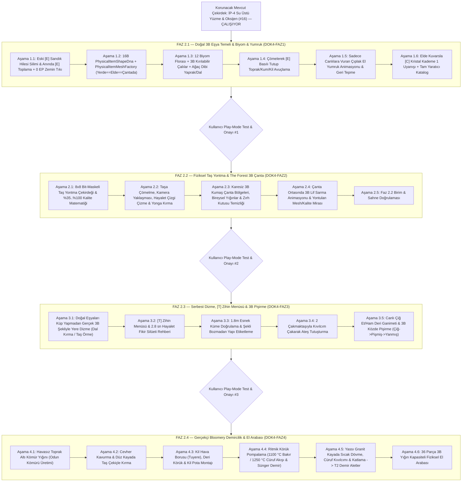

# DOK4 — Ana Mimari ve Adım Adım Geliştirme Yol Haritası (Nasıl Geliştireceğiz?)

> **Doküman Navigasyonu (Ana 4'lü + Faz Bazlı Detaylı Geliştirme Belgeleri):**
> - [DOK1 — Hedef ve Gereksinimler](DOK1_HEDEF_VE_GEREKSINIMLER.md)
> - [DOK2 — Mevcut Kod Debug ve Akış Raporu](DOK2_MEVCUT_KOD_DEBUG_VE_AKIS_RAPORU.md)
> - [DOK3 — Endüstri, Benzer Projeler ve Literatür Araştırması](DOK3_ENDUSTRI_VE_BENZER_PROJELER_ARASTIRMASI.md)
> - **[DOK4 — Ana Mimari ve Fazlı Geliştirme Yol Haritası (Bu Doküman)](DOK4_ADIM_ADIM_GELISTIRME_PLANI.md)**
>   - **[DOK4-FAZ1 — Doğal 3B Eşya DNA'sı, Biyom Florası, Elle Avuçlama, Yumruk ve Kristal Uyanışı (6 Alt Aşama)](DOK4_FAZ1_DOGAL_ESYA_BIYOM_VE_YUMRUK.md)**
>   - **[DOK4-FAZ2 — Çömelmeli Fiziksel Taş Yontma (%Kalite) ve The Forest Tarzı 3B Çanta (5 Alt Aşama)](DOK4_FAZ2_TAS_YONTMA_VE_THE_FOREST_CANTA.md)**
>   - **[DOK4-FAZ3 — Serbest Malzeme Dizme, [T] Zihin Menüsü, Ateş Yakma ve 3B Yemek Pişirme (5 Alt Aşama)](DOK4_FAZ3_ZIHIN_INSA_KAMP_ATESI_VE_YEMEK.md)**
>   - **[DOK4-FAZ4 — Gerçekçi Bloomery Demircilik (Kömür, Körük, Sünger Demir, Dövme) ve El Arabası (6 Alt Aşama)](DOK4_FAZ4_BLOOMERY_DEMIRCILIK_VE_EL_ARABASI.md)**

---

## 1. Neden 4 Ayrı Faz ve 22 Alt Aşamaya Ayırdık? (Mimari Strateji)

> [!IMPORTANT]
> **Tek Seferde Yüzeysel Kodlama Yerine "Faz-Faz Tam Doğrulamalı" İlerleme Kuralı:**
> İlk denemede [DOK2](DOK2_MEVCUT_KOD_DEBUG_VE_AKIS_RAPORU.md)'de gördüğümüz en kritik ders şuydu: Yerdeki eşyaların 3B şekil sistemi ve `[E]` toplama altyapısı oturmadan üstüne taş yontma ve fırın eklendiğinde sistemler birbirini kırdı.
>
> Bu yüzden tüm kapsamı **birbirinin üzerine sağlam basan 4 sıralı Faz (`Faz 2.1 -> 2.2 -> 2.3 -> 2.4`) ve toplam `22` granüler Alt Aşamaya** böldük. Her faz için ayrı bir mühendislik belgesi (`DOK4-FAZ1` .. `DOK4-FAZ4`) hazırlandı ve **her faz bittiğinde durup birlikte oyun içinde test etmeden bir sonraki faza geçilmeyecektir!**

---

## 2. Faz Sırası ve Bağımlılık Diyagramı

---

## 3. Tüm Fazlarda Oluşturulacak ve Değişecek Dosyaların Tam Haritası

### 3.1. Yeni Oluşturulacak Modüler Dosyalar (`10` Temiz Sınıf — Sıfır Spagetti Kod)

| Faz | Yeni Dosya Yolu | Sorumluluğu |
| :--- | :--- | :--- |
| **Faz 2.1** | `Assets/_Stratocraft/Inventory/Data/PhysicalItemShapeDna.cs` | `16 Byte` unmanaged şekil tohumu (`ShapeSeed`), `8x8` yontma maskesi (`KnapMask64`), `%Kalite` ve termal durum yapısı ([DOK4-FAZ1](DOK4_FAZ1_DOGAL_ESYA_BIYOM_VE_YUMRUK.md)). |
| **Faz 2.1** | `Assets/_Stratocraft/Inventory/Rendering/PhysicalItemMeshFactory.cs` | Tüm doğal eşyalar için 12'şer varyantlı prosedürel 3B mesh üretici ve önbelleği (`Yerde == Elde == Çantada == Dünyada %100 aynı model`, `0` doku VRAM). |
| **Faz 2.2** | `Assets/_Stratocraft/Inventory/Systems/StoneKnappingSessionSystem.cs` | `8x8` bit-maskeli taş yontma kalıpları (`Kazma, Balta, Çekiç, Bıçak`) ve `%35..%100` kalite / parçalanma matematiği ([DOK4-FAZ2](DOK4_FAZ2_TAS_YONTMA_VE_THE_FOREST_CANTA.md)). |
| **Faz 2.2** | `Assets/_Stratocraft/Character/Stage1StoneKnappingController.cs` | Yerdeki taşa çömelme, kamera yakınlaşması, çakmaktaşıyla hayalet çizgi çizme ve `Sol Tık` ile 3B yonga kırma kontrolcüsü. |
| **Faz 2.2** | `Assets/_Stratocraft/Inventory/Systems/ClothMatCraftingSystem.cs` | Karesiz 3B kumaş çanta orta birleştirme tarifleri, eksik malzeme ipuçları ve `%Kalite` miras aktarımı. |
| **Faz 2.3** | `Assets/_Stratocraft/Inventory/Systems/WorldLooseBuildSystem.cs` | Doğal parçaları küp yapmadan kendi 3B şekilleriyle yere/üst üste dizme (dal kırma & taş örme) sistemi ([DOK4-FAZ3](DOK4_FAZ3_ZIHIN_INSA_KAMP_ATESI_VE_YEMEK.md)). |
| **Faz 2.3** | `Assets/_Stratocraft/Inventory/Systems/MindStructureClusterValidator.cs` | `1.8m` yarıçapta esnek 3B nokta bulutu malzeme ve geometri doğrulayıcısı. |
| **Faz 2.3** | `Assets/_Stratocraft/Character/Stage1MindBuildingController.cs` | `[T]` Zihin Menüsü, `2.8 sn` hayalet fikir silüeti ve oyuncu taşlarının şeklini bozmadan yapı mühürleme kontrolcüsü. |
| **Faz 2.3** | `Assets/_Stratocraft/Character/Stage1CampfireAndCookingController.cs` | 2 çakmaktaşıyla kıvılcım çakma, ateş yanma süresi ve 3B köz üstü et pişirme/yanma (`Çiğ -> Pişmiş -> Yanmış`) kontrolcüsü. |
| **Faz 2.4** | `Assets/_Stratocraft/Inventory/Systems/BloomeryThermodynamicsSystem.cs` & `Stage1BloomeryAndForgingController.cs` & `Stage1WheelbarrowController.cs` | Kömür yığını, cevher kavurma/kırma, ritmik körük termodinamiği (`1100 °C` Bakır, `1250 °C` Cüruf + Sünger Demir), yassı kayada sıcak dövme ve `36` parçalık 3B El Arabası ([DOK4-FAZ4](DOK4_FAZ4_BLOOMERY_DEMIRCILIK_VE_EL_ARABASI.md)). |

### 3.2. Düzenlenecek Mevcut Dosyalar

- [Stage1HolsterAndBackpackController.cs](../../Assets/_Stratocraft/Character/Stage1HolsterAndBackpackController.cs): Görünmez `[E]` sandık ganimet hilesi silinecek (`Faz 2.1`); `6x4` kare `SlotPad3D` plakaları kaldırılıp organik 3B bez bölgeleri ve orta bağlama animasyonu bağlanacak (`Faz 2.2`).
- [Stage1MatterCrystalAndMiningController.cs](../../Assets/_Stratocraft/Character/Stage1MatterCrystalAndMiningController.cs): Anında `[E]` hedefli yerden alma, `0 EP` boş el zemin koruması, çömelerek toprak/kum/kil avuçlama ve elde Kuvarsla `1/3 -> 3/3` `[C]` Kristal Uyanışı (`Faz 2.1`); kristal kapalıyken sağ tıkın `WorldLooseBuildSystem`'a yönlendirilmesi (`Faz 2.3`).
- [Stage1VisualHotbarAndInventoryUi.cs](../../Assets/_Stratocraft/Character/Stage1VisualHotbarAndInventoryUi.cs): Yeni `InventoryItemKind` tanımları, tam `[F4]->[Tab]` Yaratıcı Katalog (`Faz 2.1`) ve bez üstünü kapatan 2B zırh kutusunun kaldırılması (`Faz 2.2`).
- [StratocraftFloatingIslandWorldGen.cs](../../Assets/_Stratocraft/WorldGen/Generators/StratocraftFloatingIslandWorldGen.cs) & [Stage1InteractivePlayController.cs](../../Assets/_Stratocraft/Character/Stage1InteractivePlayController.cs): 12 biyom florası, kırılabilir 3B çalılar ve ana `Update` orkestrasyonu (`Faz 2.1 – 2.4`).
- [Stage1DirectionalCombatBridge.cs](../../Assets/_Stratocraft/Character/Stage1DirectionalCombatBridge.cs) & [Stage1CreatureSimulationBridge.cs](../../Assets/_Stratocraft/Character/Stage1CreatureSimulationBridge.cs): Çıplak el sağ/sol yumruk animasyonu & canlıya vurma hasarı (`Faz 2.1`); canlı ölümünde `Çiğ Et` + `Ham Deri` düşmesi (`Faz 2.3`).
- [InventoryCasAndMatterCrystalTests.cs](../../Assets/_Stratocraft/Tests/EditMode/InventoryCasAndMatterCrystalTests.cs): Her fazın tüm matematiksel ve durum makinesi birim testleri.

---

## 4. Performans Bütçesi ve Taşınabilirlik Garantileri

1. **Kaplama VRAM Bütçesi (`< 16.0 MB` — Eklenen Yeni Kaplama: `0.0 MB`):**
   - Tüm 3B dal, taş, yaprak, et, çalı, körük, cüruf, sünger demir ve el arabası modelleri %100 prosedürel üçgenlerle (`FacetedVoxelTriangle` -> `StratocraftUberShader` tepe rengi + pürüzlülük + sıcaklık `Temp` emisyonu) üretilir.
2. **Sıfır Çöp Tahsisi (`0 B/kare` GC Alloc):**
   - Varyant mesh'ler ilk kullanımda önbelleklenir (`Dictionary`), `[T]` nokta bulutu doğrulaması sabit kapasiteli tampon diziler üzerinde çalışır, `Update` döngüsünde `new` veya LINQ kullanılmaz.
3. **Derleme ve Test Disiplini:**
   - Her alt aşama sonunda `0 Error / 0 Warning` + tüm EditMode ve Standalone testler koşulur; sabit `D:\oyun` mutlak yolu hiçbir kod veya betikte kullanılmaz.

---

## 5. Faz-Faz Uygulama ve Onay Protokolü (Sonraki Adım)

Doküman setini incelediğinde herhangi bir değişiklik isteğin yoksa **yalnızca Faz 2.1 ([DOK4-FAZ1](DOK4_FAZ1_DOGAL_ESYA_BIYOM_VE_YUMRUK.md))** geliştirmesine başlayacağız:
1. Faz 2.1'in `6` alt aşamasını adım adım şeffaf raporlayarak kodlayıp birim testlerinden geçireceğim,
2. Sahnede nasıl test edeceğini net maddelerle yazıp senin Play-Mode onayını bekleyeceğim,
3. Faz 2.1 tam istediğin gibi çalıştıktan sonra sırasıyla **Faz 2.2 -> Faz 2.3 -> Faz 2.4** adımlarına geçeceğiz.
