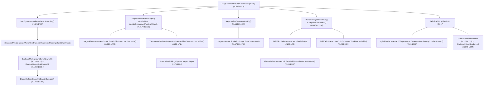

# DOK2 — Mevcut Kod Debug ve Akış Raporu (Şu Anki Sistem Nasıl Çalışıyor?)

> **Doküman Navigasyonu (Paket 3 — Mağara Ekolojisi, 3B Cevher Görünürlüğü ve Lav Katılaşması):**
> - [DOK1 — Hedef ve Gereksinimler](DOK1_HEDEF_VE_GEREKSINIMLER.md)
> - **[DOK2 — Mevcut Kod Debug ve Akış Raporu (Bu Doküman)](DOK2_MEVCUT_KOD_DEBUG_VE_AKIS_RAPORU.md)**
> - [DOK3 — Endüstri, Benzer Projeler ve Literatür Araştırması](DOK3_ENDUSTRI_VE_BENZER_PROJELER_ARASTIRMASI.md)
> - [DOK4 — Adım Adım Geliştirme Planı ve Swarm İş Dağılımı](DOK4_ADIM_ADIM_GELISTIRME_PLANI.md)

---

## 1. Mevcut Ana Güncelleme (`Update`), WorldGen ve Görselleştirme Çağrı Zinciri

Paket 3 kapsamındaki tüm sistemler ([Stage1InteractivePlayController.cs](../../Assets/_Stratocraft/Character/Stage1InteractivePlayController.cs#L589-L619)) her karede aşağıdaki deterministik sırayla yürütülmektedir:



---

## 2. Alt Sistemlerin Satır Satır Veri Akışı ve Bit/Byte Paketleme Analizi

### 2.1. Kanonik Malzeme ve Cevher Tabloları
- **[MaterialIdCatalog.cs](../../Assets/_Stratocraft/Core/Constants/MaterialIdCatalog.cs#L9-L294):**
  - Doğal kayaç ve sıvı yüzeyleri (`#L9-L68`): `Stone = 1`, `Dirt = 2`, `Grass = 3`, `Sand = 4`, `Bedrock = 5`, `NaturalObsidian = 6`, `Basalt = 7`, `MagmaBlock = 11`, `FiniteWaterSurface = 12`, `FiniteLavaSurface = 13`, `Clay = 16`, `Stalagnate = 17`, `Floatstone = 18`, `FiniteAcidSurface = 19`.
  - 14 kanonik yeraltı cevheri (`#L70-L112`): `CopperOre (30)` .. `VoidMetalOre (43)`.
  - Yakıt, kükürt ve mücevher damarları (`#L113-L162`): `Coal (44)`, `DarkMatter (45)`, `StarCore (46)`, `GemVeinStart..End (47..49)`, `SulfurOre (52)`, `QuartzGem (53)` .. `RedDiamondGem (59)`.
  - Madde Kristali vakum muafiyeti (`#L242-L246`): `IsVacuumImmuneResonanceOreOrGem(byte materialId)` fonksiyonu `[30..49]` ve `[52..59]` aralıkları için `true` dönerek cevherlerin Madde Kristali ile vakumlanmasını engeller; `GetRequiredCrystalTierForTerrain` (`#L271-L293`) `Basalt`, `MagmaBlock` ve `NaturalObsidian` için **Kademe 4** kristal şartı koyar.
- **[OreDistributionTable.cs](../../Assets/_Stratocraft/WorldGen/OreDistributionTable.cs#L39-L97):**
  - `OreCatalog` (`#L39-L67`) içinde `Coal`, 14 cevher, `SulfurOre` ve 7 mücevher için `MinRingTier`, `OptimalDepthY`, `DepthSigma`, `NoiseThreshold` ve `MaxAllowedWorldY` parametreleri tanımlıdır (ör. `TitaniumOre < -40m`, `RubyGem < -45m`, `RedDiamondGem < -50m`).
  - `SampleOreMaterial` (`#L84-L97`), Gauss derinlik olasılığı `EvaluateGaussianDepthProbability` (`#L71-L82`) ile `noiseSample01` çarpımını eşikle karşılaştırarak en nadir uygun cevheri döndürür.

### 2.2. `HybridSurfaceNetsAndShapeMesher`, `Color32` Sözleşmesi ve Analitik Zemin
- **[HybridSurfaceNetsAndShapeMesher.cs](../../Assets/_Stratocraft/Voxel/Jobs/HybridSurfaceNetsAndShapeMesher.cs):**
  - `FacetedVoxelTriangle` (`#L27-L38`) ve `UberMeshVertex` (`#L1114-L1122`): Her köşe `float3 Position`, `float3 Normal` ve `VertexAttributeFormat.UNorm8` (`Color32` 4 byte) taşır:
    - **`R` (`MatId`):** `0..255` malzeme kimliği,
    - **`G` (`Temp`):** Sıcaklık (`ResolveMaterialDefaultTemperature` `#L1079-L1084`: `FiniteLavaSurface = 242`, `MagmaBlock = 195`, `CampfireBlock = 210`, `PrimitiveStoneKilnBlock = 192`, `StarCore = 170`) veya ıslanabilir topraklarda nem (`1..120`, `ResolveQuadVertexTemperature` `#L1087-L1095`),
    - **`B` (`Sharp / FacetShade`):** Faset kontrast tonu (`72..245`, `#L704-L705`),
    - **`A` (`Ao`):** `PackAoAndWear(ao8Bit, wear4Bit)` (`#L510` -> üst 4 bit `CavityAO`, alt 4 bit `DamageState`).
  - **Sıfır-GC ve Su Geçirmezlik (`#L64-L74`, `#L205-L376`, `#L652-L717`):** `[ThreadStatic]` diziler (`_tsPaddedRaw`, `_tsDualVertices` vb.) kullanılarak `0 B` çöp tahsisiyle `18 x padY x 18` komşu-apronlu SDF ızgarası çözülür. `EmitDualQuadAsFacetedTriangles` (`#L652-L717`), 4 dual köşeden 3'ü geçerliyse paralelkenar tamamlaması yaparak delikleri kapatır ve en kısa köşegen boyunca **2 düz üçgen** üretir. `GetMaterialVisualPriority` (`#L1098-L1111`) cevherlere `52` öncelik vererek taş (`12`) ve bazalt (`28`) komşuluğunda cevher renginin kaybolmamasını sağlar.
- **[VoxelSurfaceNetsGroundSampler.cs](../../Assets/_Stratocraft/Voxel/Jobs/VoxelSurfaceNetsGroundSampler.cs#L170-L360):**
  - Oyuncu, yaratıklar ve yerdeki eşyalar için `MeshCollider` beklemeden `4x8x4` yerel `stackalloc` pencerede (`#L170-L216`) `ShapeID == 0` SDF yoğunluklarından `3x7x3` dual hücre köşelerini (`#L272-L343`) hesaplar ve dikey ışın kesişimiyle (`#L345-L360`) zemin yüksekliğini ve normalini bulur.

### 2.3. `StratocraftUberShader.hlsl` ve `256x16` Materyal LUT Hattı
- **[StratocraftUberShader.hlsl](../../Assets/_Stratocraft/Rendering/Shaders/StratocraftUberShader.hlsl#L175-L374)** ve **[bake_material_lut.py](../../Tools/AutonomousAssetFactory/textures/bake_material_lut.py#L16-L137):**
  - Vertex aşamasında (`#L191-L199`) `input.color.r * 255` ile `nointerpolation uint matId` çözülür.
  - Fragment aşamasında (`#L239-L264`) `_MaterialPaletteLUT` dokusundan Satır 0 (`albedo.rgb`, `roughness`) ve Satır 1 (`metallic`, `procMode`, `microLayer`, `matCapIdx`) okunur; `ApplyProceduralSolidPattern` (`#L130-L153`) yalnızca `procMode == 1` (Şam Çeliği), `2` (Ahşap) ve `3` (Kristal `sin*cos*sin`) desenlerini uygular.
  - URP 17 Forward+ `LIGHT_LOOP_BEGIN` döngüsü (`#L331-L341`) meşale ve nokta ışıkların `totalDiffuse` ve `totalSpecular` katkısını toplar; `#L356-L370` ise `heatNorm > 0.03` için Stefan-Boltzmann $T^4$ kor emisyonu ekler.

### 2.4. 5 Katmanlı Mağara WorldGen, Akışkan ve Canlı Sistemleri
- **[StratocraftFloatingIslandWorldGen.cs](../../Assets/_Stratocraft/WorldGen/StratocraftFloatingIslandWorldGen.cs):**
  - Sabit kotlar (`#L20-L23`): `MaxEditableVoxelY = 160`, `DefaultSurfaceBaseY = 96`, `SeaLevelY = 90`, `DeepMantleFloorY = 4`.
  - `EvaluateUndergroundCaveNetwork` (`#L726-L932`): 3B Domain Warp (`#L835-L839`), `swell01` oda genişlemesi (`#L869-L872`) ve `psi1/psi2/psi3` sıfır-geçiş tünel kesişimiyle (`#L875-L903`) 5 katmanlı mağara ağını oyar; `y <= 11` magma kubbelerinde `caveFluidType = (byte)FluidType.Lava` atar (`#L855-L858`) ve `#L1071-L1078`'de `FluidCell16.Pack(..., isSettled: true, pressureHead: 1)` olarak yazar.
  - `StampSurfaceStoneAndQuartzOutcrops` (`#L1708-L1756`): Yüzeye chunk başına 1 adet `Stone (shapeId=1)` ve 2 chunk'ta bir `QuartzGem (shapeId=6)` basar.
- **[FluidCell16.cs](../../Assets/_Stratocraft/Physics/Data/FluidCell16.cs#L27-L118)** & **[FluidCellularAutomataJob.cs](../../Assets/_Stratocraft/Physics/Jobs/FluidCellularAutomataJob.cs#L40-L269):**
  - `FluidCell16` 16-bit içinde `Mass (8b)`, `FluidType (2b)`, `IsSettled (1b)` ve `PressureHead (5b)` tutar. `TryReactWaterAndLava` (`#L40-L81`) yalnızca `Water` ile `Lava` temasını işler.
- **[Creature21BehaviorSystem.cs](../../Assets/_Stratocraft/CreaturesAI/CreaturesAndBosses/Creature21BehaviorSystem.cs#L9-L170)** & **[Stage1CreatureSimulationBridge.cs](../../Assets/_Stratocraft/Character/Stage1CreatureSimulationBridge.cs#L189-L265):**
  - `Catalog21` içinde `#7 Kararmış Şövalye`, `#9 Çelik Ağ Örümceği (WallClimbable)`, `#15 Zırhlı Akrep` ve `#17 Lav Golemi (CapLavaImmunity)` mevcuttur; `SpawnBiomeCreaturesNearPosition` (`#L209`) `distFromOrigin < 75.0f` güvenli bölge kuralını uygular.

---

## 3. Paket 3 Öncesi Tespit Edilen 6 Kök Kısıt ve Hatanın Teknik Analizi

> [!CAUTION]
> Kod tabanında yapılan satır-satır inceleme sonucunda, Paket 3 hedeflerinin şu an neden çalışmadığını açıklayan **6 somut kök neden** tespit edilmiştir:

### Kök Sorun 1: Mağara `U-Eğrisi`ni Tamamen Devre Dışı Bırakan `Mathf.Max(0f, ...)` Alt-Kot Hatası ve Çift Sıcaklık Kayması
- **Dosya & Satır:** [Stage1InteractivePlayController.cs](../../Assets/_Stratocraft/Character/Stage1InteractivePlayController.cs#L2283-L2308), [ThermalAndBiologySystem.cs](../../Assets/_Stratocraft/Character/Systems/ThermalAndBiologySystem.cs#L51-L63) ve [StratocraftFloatingIslandWorldGen.cs](../../Assets/_Stratocraft/WorldGen/StratocraftFloatingIslandWorldGen.cs#L215-L229).
- **Teknik Neden:**
  1. [Stage1InteractivePlayController.cs](../../Assets/_Stratocraft/Character/Stage1InteractivePlayController.cs#L2301-L2307) içinde ortam sıcaklığı hesaplanırken:
     ```csharp
     worldAltitudeMeters: Mathf.Max(0f, (transform.position.y - StratocraftFloatingIslandWorldGen.DefaultSurfaceBaseY) * 2.5f),
     ```
     yazılmıştır! Oyuncu `Y = 75m` (`-21m`) veya `Y = 12m` (`-84m`) mağaraya indiğinde `transform.position.y - 96f` negatif olduğu için `Mathf.Max(0f, ...)` her zaman **`0.0f`** döndürmektedir.
  2. Bu yüzden [ThermalAndBiologySystem.cs](../../Assets/_Stratocraft/Character/Systems/ThermalAndBiologySystem.cs#L53) içindeki `if (isUndergroundEnclosed && worldAltitudeMeters < 0f)` koşulu **%100 ölü kod haline gelmiş ve hiçbir zaman tetiklenmemiştir!**
  3. Dahası, `SampleBiomeAmbientTemperatureCelsius` (`#L225-L227`) `relAlt = -21m` sığ mağarada hiçbir soğutma yapmayıp yüzeyin `+20 °C` değerini aynen döndürmekte; `ThermalAndBiologySystem.cs#L55-L57` ise çalışsa bile sığ mağarayı `-6 °C .. +4 °C` soğuk hava tuzağına düşürmek yerine `+14 °C` ılık değere çekmektedir.

### Kök Sorun 2: Cevherlerin Düz `SurfaceNets` Üçgeni Olması, Tekdüze `procMode = 0` ve Meşale Işığını Ezen `MatCap` Karışımı
- **Dosya & Satır:** [HybridSurfaceNetsAndShapeMesher.cs](../../Assets/_Stratocraft/Voxel/Jobs/HybridSurfaceNetsAndShapeMesher.cs#L698-L717), [bake_material_lut.py](../../Tools/AutonomousAssetFactory/textures/bake_material_lut.py#L38-L58) ve [StratocraftUberShader.hlsl](../../Assets/_Stratocraft/Rendering/Shaders/StratocraftUberShader.hlsl#L331-L350).
- **Teknik Neden:**
  1. **Sıfır 3B Silüet:** `EmitDualQuadAsFacetedTriangles` (`#L698-L717`), `matA`/`matB` cevher olsa dahi kuadı sıradan `Stone` ile birebir aynı 2 düz üçgene böler; duvar veya tavanda dışa taşan hiçbir 3B maden yumrusu oluşmaz.
  2. **Ana-Kaya Damar Deseni Yokluğu:** [bake_material_lut.py](../../Tools/AutonomousAssetFactory/textures/bake_material_lut.py#L38-L58) içinde `CopperOre (30)`, `TinOre (31)`, `IronOre (32)`, `SilverOre (34)`, `GoldOre (35)`, `TitaniumOre (36)` ve `Coal (44)` malzemelerinin tamamında `proc_mode = 0` tanımlıdır. Özellikle `IronOre` `(148, 152, 160)` albedosu `Stone` `(122, 128, 138)` ile neredeyse aynı düz gri tondadır; üçgen içinde "kaya matrisi + parlak metalik damar" ayrımı yoktur.
  3. **Meşale Işığının Bastırılması:** [StratocraftUberShader.hlsl](../../Assets/_Stratocraft/Rendering/Shaders/StratocraftUberShader.hlsl#L345-L350) satırlarında:
     ```hlsl
     float3 metalTint = albedo * matCapCol * (1.15 + 0.35 * mainLight.shadowAttenuation);
     litRgb = lerp(litRgb, metalTint, saturate(metallic * _MatCapBlendWeight));
     ```
     formülü `totalDiffuse` (`litRgb`) içindeki Forward+ meşale ışığını (`#L338`) `%65`'e varan oranda silip yerine güneş gölgesinde sabitlenen statik `metalTint` yazmaktadır; ayrıca `addSpec` (`#L337`) fasetli cevher damarı için dar açılı mikro-kıvılcım (`glint`) üretmemektedir.

### Kök Sorun 3: Yüzey Kaya Çıkıntılarının (`Outcrops`) Derin Cevher Damarlarıyla Bağlantısız Olması
- **Dosya & Satır:** [StratocraftFloatingIslandWorldGen.cs](../../Assets/_Stratocraft/WorldGen/StratocraftFloatingIslandWorldGen.cs#L1708-L1756).
- **Teknik Neden:** `StampSurfaceStoneAndQuartzOutcrops` yalnızca sabit tohumla `Stone` ve `QuartzGem` yerleştirmekte; altındaki `y = topH - 58 .. topH - 18` jeolojik sütununda `ResolveGeologicalMaterial` / `OreDistributionTable` tarafından üretilmiş zengin bir Bakır, Demir, Kalay, Kömür veya Altın damarı bulunup bulunmadığını kontrol etmemektedir.

### Kök Sorun 4: Mağara Odalarında `%12–%18` Yeraltı Su Göletlerinin Hiç Üretilmemesi
- **Dosya & Satır:** [StratocraftFloatingIslandWorldGen.cs](../../Assets/_Stratocraft/WorldGen/StratocraftFloatingIslandWorldGen.cs#L868-L932) ve `#L1071-L1085`.
- **Teknik Neden:** `#L1073-L1076`'da `if (caveFluidType != 0) fluids[idx] = FluidCell16.Pack((FluidType)caveFluidType, 255, isSettled: true, pressureHead: 1).RawValue;` altyapısı hazır olmasına karşın, `EvaluateUndergroundCaveNetwork` yalnızca `y <= 11` magma kubbesinde `FluidType.Lava` atamakta; Katman 1–2 geniş odalarında (`swell01 > 0.62f`) ne `%12–%18` oranında `FluidType.Water` ataması ne de alt tünellere sızmayı önleyecek sızdırmaz çanak tabanı (`Clay/Stone FullDensity`) üretimi yapmaktadır.

### Kök Sorun 5: Serin Bölgede Lav Katılaşması, `3.5m` Radyal Isı ve Katı `MagmaBlock` Yanığının Bulunmaması
- **Dosya & Satır:** [FluidCellularAutomataJob.cs](../../Assets/_Stratocraft/Physics/Jobs/FluidCellularAutomataJob.cs#L40-L81), [Stage1InteractivePlayController.cs](../../Assets/_Stratocraft/Character/Stage1InteractivePlayController.cs#L1132-L1179), `#L2236-L2282` ve [Stage1PlayerMovementBridge.cs](../../Assets/_Stratocraft/Character/Stage1PlayerMovementBridge.cs#L684-L763).
- **Teknik Neden:**
  1. Akışkan simülasyonunda `FluidType.Lava` yalnızca su ile temas ettiğinde `NaturalObsidian` üretir; `T_ortam < 55 °C` serin ortamlarda hava ile temas eden lav kenarlarını `8–15 sn` içinde `MagmaBlock (11)` ve ardından `Basalt (7)` bloğuna dönüştüren bir soğuma durum makinesi yoktur.
  2. `HybridSurfaceNetsAndShapeMesher.ResolveMaterialDefaultTemperature` (`#L1081`) `MagmaBlock` için `195` sabit değerini döndürmektedir (`Temp = 220` taze katılaşmış kor seviyesine çıkarılmalıdır).
  3. `Stage1InteractivePlayController.cs#L2236-L2282` yalnızca sabit `(8.5, -7.2)` koordinatını, kamp ateşini ve fırınları ısı kaynağı saymakta; oyuncunun `3.5m` yakınındaki `MagmaBlock` voksellerinden ısı bonusu okumamaktadır.
  4. `Stage1PlayerMovementBridge.cs#L684-L763` yalnızca sıvı `FluidType.Lava` hücresine `-18 HP/s` yanık uygulamakta; katı `MagmaBlock (11)` üstüne basan oyuncuya temas yanığı vermemektedir.

### Kök Sorun 6: Mağara İçi Yaratık Doğumu, Tavan Tutunması ve Sesli Telgraf Eksikliği
- **Dosya & Satır:** [Stage1CreatureSimulationBridge.cs](../../Assets/_Stratocraft/Character/Stage1CreatureSimulationBridge.cs#L204-L265) ve `#L2262-L2289`.
- **Teknik Neden:**
  1. `SpawnBiomeCreaturesNearPosition` (`#L204-L249`) ve `SpawnProceduralContinentCreature` (`#L251-L265`), yaratık yüksekliğini `SampleVoxelOrTerrainHeight` ile dış yeryüzü kabuğuna oturtmakta; kapalı mağara galerilerinin iç tabanında veya tavanında (`isEnclosedCave`) katmana özgü mağara canlısı doğurmamaktadır.
  2. `SampleStandableHeight` (`#L2262-L2289`) yalnızca yukarıdan aşağı zemin aramakta, mağara tavan kotunu (`ceilingY`) örneklememektedir.
  3. Karanlıkta yaklaşan tavan/duvar avcıları için prosedürel ses dalgası (`AudioSource` + sıfır-dosya PCM sentetik ses) ve tavandan taş tozu dökülmesi telgrafı henüz mevcut değildir.
