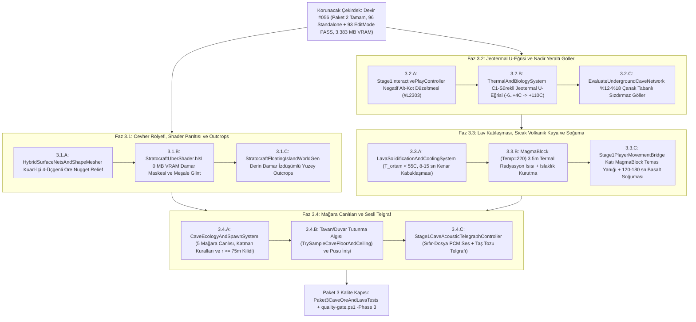

# DOK4 — Adım Adım Geliştirme Planı ve Swarm İş Dağılımı (Nasıl Geliştireceğiz?)

> **Doküman Navigasyonu (Paket 3 — Mağara Ekolojisi, 3B Cevher Görünürlüğü ve Lav Katılaşması):**
> - [DOK1 — Hedef ve Gereksinimler](DOK1_HEDEF_VE_GEREKSINIMLER.md)
> - [DOK2 — Mevcut Kod Debug ve Akış Raporu](DOK2_MEVCUT_KOD_DEBUG_VE_AKIS_RAPORU.md)
> - [DOK3 — Endüstri, Benzer Projeler ve Literatür Araştırması](DOK3_ENDUSTRI_VE_BENZER_PROJELER_ARASTIRMASI.md)
> - **[DOK4 — Adım Adım Geliştirme Planı ve Swarm İş Dağılımı (Bu Doküman)](DOK4_ADIM_ADIM_GELISTIRME_PLANI.md)**

---

## 1. Mimari Strateji ve Faz Bağımlılık Diyagramı

[DOK1](DOK1_HEDEF_VE_GEREKSINIMLER.md)'de tanımlanan 5 iş paketini ve [DOK2](DOK2_MEVCUT_KOD_DEBUG_VE_AKIS_RAPORU.md)'de tespit edilen 6 kök kısıtı, sıfır dosya çakışması ve `%100` birim testi kapsamıyla çözmek üzere geliştirmeyi **4 granüler alt faza (`Faz 3.1 .. Faz 3.4`)** ayırıyoruz:



> [!IMPORTANT]
> **Çift-Hedefli Derleme Uyum Kuralı (`Unity 6` + `.NET 10 Standalone`):**
> [Stratocraft.StandaloneCoreTests.csproj](../../Tests/StandaloneCoreTests/Stratocraft.StandaloneCoreTests.csproj#L20-L31) dosyası `Core`, `Voxel`, `Physics`, `WorldGen`, `Character`, `Inventory`, `CreaturesAI` ve `Assets/Tests/EditMode` altındaki tüm `.cs` dosyalarını `TreatWarningsAsErrors=true` ile doğrudan `.NET 10` altında derler. Bu nedenle saf simülasyon sınıflarında (`Physics/Systems`, `Character/Systems`, `CreaturesAI`) `UnityEngine` bağımlılıkları kullanılmaz veya `#if UNITY_5_3_OR_NEWER` ile korunur.

---

## 2. Oluşturulacak ve Düzenlenecek Dosyaların Tam Haritası

### 2.1. Yeni Oluşturulacak Modüler Dosyalar (`4` Dosya)

| Faz | Yeni Dosya Yolu (Göreli) | Sorumluluğu |
| :--- | :--- | :--- |
| **Faz 3.3** | `Assets/_Stratocraft/Physics/Systems/LavaSolidificationAndCoolingSystem.cs` | `0 B/kare` GC sabit kapasiteli açık-adreslemeli tablo ile `T_ortam < 55 °C` serin bölgede akan lavın kenarlardan `8–15 sn`'de `MagmaBlock (11)` ve `120–180 sn`'de `Basalt (7)` olma durum makinesi + `3.5m` radyal ısı sorgusu. |
| **Faz 3.4** | `Assets/_Stratocraft/CreaturesAI/CreaturesAndBosses/CaveEcologyAndSpawnSystem.cs` | 5 mağara canlısı varyant tanımı (`CaveCreatureVariantKind`), katman/derinlik olasılık tablosu, `r >= 75m` güvenli bölge denetimi ve mağara taban/tavan (`ceilingY`) tarayıcısı. |
| **Faz 3.4** | `Assets/_Stratocraft/Character/Stage1CaveAcousticTelegraphController.cs` | Başlangıçta bir kez üretilen (`Awake` önbellekli, `0 MB` kaplama, `0 B/kare` GC) 5 prosedürel PCM ses klibi, 3B uzamsal `AudioSource` havuzu ve tavandan dökülen taş tozu telgraf görseli. |
| **Tüm Fazlar** | `Assets/Tests/EditMode/Paket3CaveOreAndLavaTests.cs` | Faz `3.1..3.4` kabul kriterlerinin (`AK-1..AK-7`) hem Unity `EditMode` hem `.NET 10 Standalone` üzerinde koşan deterministik NUnit birim test paketi. |

### 2.2. Düzenlenecek Mevcut Dosyalar (`7` Dosya)

| Faz | Mevcut Dosya Yolu ve Satır Aralığı | Yapılacak Mühendislik Değişikliği |
| :--- | :--- | :--- |
| **Faz 3.1** | [HybridSurfaceNetsAndShapeMesher.cs](../../Assets/_Stratocraft/Voxel/Jobs/HybridSurfaceNetsAndShapeMesher.cs#L652-L717), `#L1079-L1084` | `EmitDualQuadAsFacetedTriangles` içine su geçirmez kuad-içi 4-üçgenli `EmitOreNuggetReliefQuad` dalı eklenmesi; `MagmaBlock` varsayılan vertex sıcaklığının `195 -> 220` güncellenmesi. |
| **Faz 3.1** | [StratocraftUberShader.hlsl](../../Assets/_Stratocraft/Rendering/Shaders/StratocraftUberShader.hlsl#L130-L153), `#L245-L264`, `#L331-L351` | Cevher/mücevher `matId` aralığı (`30..49`, `52..59`) için 3B ana-kaya + metalik damar maskesi (`EvaluateProceduralOreVein`), meşale ışığını ezmeyen `MatCap` harmanı ve mikro-faset `Glint` parıltısı. |
| **Faz 3.1 & 3.2** | [StratocraftFloatingIslandWorldGen.cs](../../Assets/_Stratocraft/WorldGen/StratocraftFloatingIslandWorldGen.cs#L215-L229), `#L868-L932`, `#L1071-L1139`, `#L1708-L1756` | `StampSurfaceStoneAndQuartzOutcrops` içine derin damar sütun izdüşümüyle cevher izi (`Outcrops`) eklenmesi; `EvaluateUndergroundCaveNetwork` içine `%12–%18` çanak tabanlı sızdırmaz yeraltı gölleri (`FluidType.Water`, `isSettled: true`) bağlanması; yüzey/yeraltı sıcaklık ayrımının netleştirilmesi. |
| **Faz 3.2** | [ThermalAndBiologySystem.cs](../../Assets/_Stratocraft/Character/Systems/ThermalAndBiologySystem.cs#L38-L71) | `EvaluateAmbientTemperatureCelsius` içine [DOK3 §2.3](DOK3_ENDUSTRI_VE_BENZER_PROJELER_ARASTIRMASI.md#23-speleolojik-soğuk-hava-tuzağı-ve-jeotermal-gradyan-u-eğrisi-denklemi)'teki $C^1$-sürekli `EvaluateUndergroundGeothermalCurveCelsius` modelinin eklenmesi. |
| **Faz 3.3** | [Stage1PlayerMovementBridge.cs](../../Assets/_Stratocraft/Character/Stage1PlayerMovementBridge.cs#L680-L772) | Ayak altında veya kapsül temasında katı `MagmaBlock (11)` algılandığında `-9.0 HP/s` temas yanığı + `+2.8 °C/s` çekirdek ısı artışı ve uyarı mesajı uygulanması. |
| **Faz 3.4** | [Stage1CreatureSimulationBridge.cs](../../Assets/_Stratocraft/Character/Stage1CreatureSimulationBridge.cs#L204-L265), `#L2085-L2289` | Kapalı mağarada (`isEnclosedCave`) 5 mağara varyantının doğurulması, Örümcek/Yarasa tavan asılması ve saldırıdan `1.2–2.0 sn` önce `Stage1CaveAcousticTelegraphController` tetiklemesi. |
| **Faz 3.2–3.4** | [Stage1InteractivePlayController.cs](../../Assets/_Stratocraft/Character/Stage1InteractivePlayController.cs#L1130-L1186), `#L1785-L1792`, `#L2236-L2308` | `#L2303` negatif kot hatasının kaldırılması, `StepFluidSimulation` sonuna lav soğuma adımının bağlanması, `#L2252`'ye `3.5m` `MagmaBlock` ısı yayılımının eklenmesi ve mağara telgraf güncellemesi. |

---

## 3. Alt Fazların Detaylı Mühendislik Tasarımı, İmzalar ve Formüller

### 3.1. Faz 3.1 — Cevher Rölyefi (`Ore Nugget Relief`), Shader Parıltısı & Yüzey `Outcrops`

#### A) `HybridSurfaceNetsAndShapeMesher.cs` — Su Geçirmez 3B Cevher Rölyefi
- **Yardımcı İmza:**
  ```csharp
  [MethodImpl(MethodImplOptions.AggressiveInlining)]
  public static bool IsReliefOreOrCrystalMaterial(byte matId) =>
      (matId >= MaterialIdCatalog.CopperOre && matId <= MaterialIdCatalog.GemVeinEnd) ||
      (matId >= MaterialIdCatalog.SulfurOre && matId <= MaterialIdCatalog.RedDiamondGem);
  ```
- **Algoritma (`EmitDualQuadAsFacetedTriangles`, `#L698-L717`):**
  1. `matA` veya `matB` için `IsReliefOreOrCrystalMaterial` doğruysa ve kuad dejenere değilse (`area > 0.015f`), dış köşeler `v0, v1, v2, v3` **değiştirilmeden** tutulur (`0.000m` manifold garantisi).
  2. Kuad merkezi $c_q = 0.25 \cdot (v_0 + v_1 + v_2 + v_3)$ ve dış birim normali $\hat{n}_q$ (`flipWinding` yönüne göre düzeltilmiş) bulunur.
  3. Kristal/mücevher (`46..49, 53..59, 41`) için taban yükseklik $h_0 = 0.145\text{ m}$, metalik cevher/kömür/kükürt (`30..44, 52`) için $h_0 = 0.105\text{ m}$ alınır; `seedHash` ile $\pm 22\%$ varyasyon eklenir.
  4. [DOK3 §2.1](DOK3_ENDUSTRI_VE_BENZER_PROJELER_ARASTIRMASI.md#21-surfacenets-su-geçirmezliğini-watertight-manifold-bozmayan-kuad-içi-3b-cevher-rölyefi) uyarınca zemin eğim sönümlemesi uygulanır: $\hat{n}_q.y > 0.72$ ise $h_{\text{eff}} = \min(0.042\text{f}, h_0 \cdot 0.28\text{f})$ yapılarak [VoxelSurfaceNetsGroundSampler.cs](../../Assets/_Stratocraft/Voxel/Jobs/VoxelSurfaceNetsGroundSampler.cs#L272-L343) ile yürüyüş uyumu korunur; duvar ve tavanda tam 3B silüet verilir.
  5. $v_{\text{apex}} = c_q + \vec{\tau}_{\text{tangent}} + \hat{n}_q \cdot h_{\text{eff}}$ hesaplanıp 4 fasetli üçgen (`shade0..shade3` kontrastlı `B` kanalıyla) `outTriangles` listesine yazılır.

#### B) `StratocraftUberShader.hlsl` — `0 MB` VRAM Metalik Damar & Meşale Kıvılcımı
- **Yeni HLSL Yardımcıları (`#L130-L153` sonrası):**
  ```hlsl
  bool IsOreOrGemVeinMat(uint matId)
  {
      return (matId >= 30u && matId <= 49u) || (matId >= 52u && matId <= 59u);
  }

  void ApplyProceduralOreVeinAndGlint(
      uint matId, float3 posWS, float sharpnessOrTone,
      inout float3 albedo, inout float roughness, inout float metallic, out float veinMask01)
  ```
- **Davranış:**
  - `IsOreOrGemVeinMat(safeMatId)` doğruysa 3B çarpıtılmış sırt gürültüsüyle `veinMask01` üretilir (`0.0 = koyu yan kayaç matrisi`, `1.0 = saf parlak cevher/kristal damarı`).
  - Bakır (`30`) kızıl-turuncu `(0.88, 0.42, 0.20)`, Demir (`32`) paslı-çelik halkalı `(0.72, 0.75, 0.80)` + oksit kenar `(0.48, 0.22, 0.14)`, Kömür (`44`) mat taş içinde camsı siyah `(0.06, 0.06, 0.07, roughness=0.22)`, Altın/Mithril/Kuvars ise yüksek yansıtıcılıklı damar rengi alır.
  - `#L337-L350`: Forward+ `LIGHT_LOOP_BEGIN` içindeki meşale/nokta ışıkları için `veinMask01 > 0.35` piksellerinde yüksek üslü (`pow(..., 96.0)`) mikro-faset `glintSpec` eklenir; `#L348-L350` `MatCap` katkısı ortam + nokta ışık enerjisiyle modüle edilerek meşale ışığının ezilmesi önlenir.

#### C) `StratocraftFloatingIslandWorldGen.cs` — Derin Damar İzdüşümlü Yüzey `Outcrops`
- **Yeni Metot (`#L1708-L1756` bölgesine):**
  ```csharp
  public static byte TrySampleUnderlyingRichOreForOutcrop(int wx, int wz, float topH, int radialRing)
  ```
- **Algoritma:** `StampSurfaceStoneAndQuartzOutcrops` çalışırken aday `(wx, wz)` sütununda `y = RoundToInt(topH) - 18` ile `Max(14, RoundToInt(topH) - 58)` aralığını `4m` adımla tarar. Sütunda en az `2` örnekte sığ/orta cevher (`Coal`, `CopperOre`, `TinOre`, `IronOre`, `GoldOre`, `QuartzGem`) bulunursa yüzeydeki kaya çıkıntısını doğrudan o cevher malzemesiyle (`shapeId = 1` yumru kaya veya `shapeId = 6` kristal uç) basar!

---

### 3.2. Faz 3.2 — Jeotermal `U-Eğrisi` & Nadir Yeraltı Gölleri (`%12–%18`)

#### A) `ThermalAndBiologySystem.cs` & `Stage1InteractivePlayController.cs` — Jeotermal `U-Eğrisi`
- **Yeni Fonksiyon İmzası (`ThermalAndBiologySystem.cs`):**
  ```csharp
  public static float EvaluateUndergroundGeothermalTemperatureCelsius(
      float surfaceBiomeTempCelsius,
      float depthBelowSurfaceMeters,
      float absoluteWorldY)
  ```
- **Entegrasyon:**
  1. [Stage1InteractivePlayController.cs](../../Assets/_Stratocraft/Character/Stage1InteractivePlayController.cs#L2284-L2307) içinde yüzey yüksekliği `float surfaceTopY = StratocraftFloatingIslandWorldGen.SampleIslandTopSurfaceY(transform.position.x, transform.position.z);` ve işaretli rölatif irtifa `float signedRelAltitudeMeters = transform.position.y - surfaceTopY;` hesaplanır (`Mathf.Max(0f, ...)` hatası tamamen kaldırılır!).
  2. Yüzey biyom taban sıcaklığı `SampleSurfaceBiomeBaseTemperatureCelsius(x, z)` ile yükseklikten bağımsız temiz alınır; `isUndergroundEnclosed && signedRelAltitudeMeters < -1.5f` olduğunda `EvaluateAmbientTemperatureCelsius` doğrudan `EvaluateUndergroundGeothermalTemperatureCelsius` fonksiyonunu çağırarak:
     - `Y = 85..55m` (`depth = 11..41m`) sığ mağarada **`-6.0 °C .. +4.0 °C`**,
     - `Y = 55..45m` geçişinde **`+5.0 °C .. +24.0 °C`**,
     - `Y = 44..25m` derin bazalt katmanında **`+28.0 °C .. +65.0 °C`**,
     - `Y = 24..5m` magma katmanında **`+65.0 °C .. +110.0 °C`** (`+ nearbyHeatSourceBonusCelsius`) değerini üretir.

#### B) `StratocraftFloatingIslandWorldGen.cs` — `%12–%18` Sızdırmaz Yeraltı Su Gölleri
- **Yeni Yardımcı İmza:**
  ```csharp
  public static bool TryEvaluateCaveChamberWaterLake(
      int wx, int y, int wz, float swell01, float provinceNoise,
      out bool inLakeWater, out bool isImpermeableLakeBasinSeal)
  ```
- **Algoritma:**
  1. Katman 1 ve Katman 2 geniş mağara odalarında (`y >= 46 && y <= 73`, `swell01 > 0.60f`, `provinceNoise > 0.58f`), `24m x 16m x 24m` makro-oda hücresi için deterministik PCG hash `hChamber = HashChamber(wx / 24, y / 16, wz / 24, ActiveWorldSeed)` hesaplanır.
  2. `(hChamber % 100) < 15` koşuluyla mağara odalarının tam **`%15`'i (`%12–%18` hedef bandının merkezi)** "Su Göletli Oda" seçilir.
  3. Seçilen odanın alt çukur kotu $y_{\text{water}}$ belirlenir: Mağara boşluğu (`inCaveVoid`) içinde $y == y_{\text{water}}$ olan hücrelere `caveFluidType = (byte)FluidType.Water` (`FluidCell16.Pack(FluidType.Water, 255, isSettled: true, pressureHead: 1)`) atanır; hemen altındaki $y \in [y_{\text{water}} - 2, y_{\text{water}} - 1]$ taban hücreleri ve yatay `1` blokluk çanak kenarı `inCaveVoid = false` + `FullDensity (127)` `Clay (16)` / `Stone (1)` olarak mühürlenir (`0` alt tünel sızıntısı!).

---

### 3.3. Faz 3.3 — Lav Katılaşması, Sıcak Volkanik Kaya (`Temp = 220`) ve Soğuma

#### A) `LavaSolidificationAndCoolingSystem.cs` (Sıfır-GC Çekirdek Sistem)
- **Veri Yapıları ve İmzalar:**
  ```csharp
  public struct CoolingVolcanicRockRecord
  {
      public int WorldX;
      public int WorldY;
      public int WorldZ;
      public float RemainingHotSeconds; // Varsayilan 150.0f (120..180 sn)
      public byte Active;
  }

  public sealed class LavaSolidificationAndCoolingSystem
  {
      public const float LavaLiquidRetentionMinAmbientCelsius = 55.0f;
      public const float HotRockThermalRadiusMeters = 3.5f;
      public const float HotRockPeakBonusCelsius = 22.0f;
      public const float DefaultBasaltCoolingDurationSeconds = 150.0f;

      public int StepChunkLavaCrusting(
          int chunkX, int chunkZ,
          Span<uint> solidVoxels, Span<ushort> fluids,
          int maxY, float deltaTime,
          Func<int, int, int, float> sampleLocalAmbientTempCelsius,
          out ushort dirtySubChunkMask);

      public int StepCoolingVolcanicRocks(
          float deltaTime,
          Dictionary<(int cx, int cz), uint[]> worldChunks,
          HashSet<(int cx, int cz)> dirtySolidChunks);

      public float EvaluateNearbyHotRockThermalBonus(
          float playerX, float playerY, float playerZ,
          Dictionary<(int cx, int cz), uint[]> worldChunks,
          out bool withinDryingZone);
  }
  ```
- **Çalışma Mantığı:**
  1. Sabit kapasiteli (`4096` girişli `struct[]`, `0 B/kare` GC) açık-adreslemeli lav soğuma sayacı (`_lavaChillTable`) ve sıcak kaya halkası (`_coolingRocks`) kullanır.
  2. `sampleLocalAmbientTempCelsius(wx, wy, wz) >= 55.0f` ise (`biomeId == 8` veya `wy <= 24`) hücre soğumaz ve tablodan silinir.
  3. `< 55.0f` ise en az 1 komşu yüzü hava veya soğuk taş olan (`exposedFaces >= 1`) `FluidType.Lava` hücreleri [DOK3 §2.4](DOK3_ENDUSTRI_VE_BENZER_PROJELER_ARASTIRMASI.md#24-stefan-kabuklaşma-fiziğiyle-kenar-öncelikli-lav-katılaşması-edge-first-solidification) denklemiyle `8.0 – 15.0 sn` içinde `1.0f` eşiğine ulaşır; `fluids[idx] = 0` yapılır, `solidVoxels[idx] = VoxelBitUtility.PackStandard(MaterialIdCatalog.MagmaBlock, VoxelBitUtility.FullDensity, 0, 0, BlokKokenDurumu.DogalKutle, 0)` yazılır, komşu sıvılar uyandırılır ve hücre `_coolingRocks` dizisine `150 sn` süreyle kaydedilir.
  4. Süre `<= 0` olduğunda hücre hâlâ `MagmaBlock` ise `MaterialIdCatalog.Basalt` (`Temp = 0`) bloğuna dönüştürülür ve chunk kirli (`_dirtyChunks`) işaretlenir.
  5. `EvaluateNearbyHotRockThermalBonus` oyuncunun çevresindeki `4x4x4` voksel komşuluğunu doğrudan `_worldChunks` üzerinden `O(1)` tarayarak hem yeni katılaşmış hem de doğal `MagmaBlock` blokları için `r < 3.5m` içinde $22.0 \cdot (1 - r / 3.5)^2\,^\circ\text{C}$ ısı bonusu döndürür!
  6. `Stage1PlayerMovementBridge.cs#L684-L763`: Oyuncunun bastığı blok (`feetWy - 1`) veya bel/ayak katı teması `MaterialIdCatalog.MagmaBlock` ise `-9.0f * dt` HP hasarı ve `+2.8f * dt` çekirdek ısı artışı uygulanır.

---

### 3.4. Faz 3.4 — Mağara Canlıları ve Tavan/Duvar Sesli Telgraf Sistemi

#### A) `CaveEcologyAndSpawnSystem.cs`
- **Veri Yapıları ve İmzalar:**
  ```csharp
  public enum CaveCreatureVariantKind : byte
  {
      None = 0,
      GiantCaveSpider = 1,       // Base Archetype #9 (WallClimbable, Katman 1-2)
      CaveBatCrawler = 2,        // Base Archetype #4/#14 hafif ucan/tavan varyanti (Katman 1-2)
      CrystalCavernScorpion = 3, // Base Archetype #15 (Kristal zirhli, Katman 2-3)
      AbyssalSkeletonKnight = 4, // Base Archetype #7 (Bloklanabilir kilic duellocusu, Zindan & Katman 3)
      MagmaSerpent = 5           // Base Archetype #17/#12 CapLavaImmunity varyanti (Katman 3-4)
  }

  public static class CaveEcologyAndSpawnSystem
  {
      public const float SafeOriginRadiusMeters = 75.0f;

      public static bool CanSpawnInCaveAt(float worldX, float worldY, float worldZ, bool isEnclosedCave);
      public static CaveCreatureVariantKind SelectCaveVariantForDepth(int worldY, bool nearCrystalWall, bool nearLavaOrMagma, int deterministicSeed);
      public static bool TrySampleCaveFloorAndCeiling(
          ReadOnlySpan<uint> chunkVoxels, int lx, int refY, int lz, int maxY,
          out int floorY, out int ceilingY);
  }
  ```
- **Davranış:**
  - `worldX * worldX + worldZ * worldZ < 75.0f * 75.0f` ise **kesinlikle `false`** döner (`r < 75m` Başlangıç Vadisi dokunulmazlığı!).
  - `GiantCaveSpider` ve `CaveBatCrawler`, `ceilingY - floorY >= 4` olan galerilerde başlangıçta `ceilingY - 0.65f` tavan noktasında ters (`pitch/roll = 180°` tavan tutunma pozu) doğar; oyuncu yatayda `<= 11.5m` yaklaştığında önce **`1.5 sn` telgraf durumuna (`CaveAmbushTelegraphTimer`)** girer, ardından ağ/süzülme inişiyle zemine iner!
  - `AbyssalSkeletonKnight`, oyuncunun yönlü kılıç bloklamasına (`isParrying`) tam uyumlu yakın dövüş darbeleri vurur; `MagmaSerpent` `CapLavaImmunity` bayrağıyla lav kenarlarında hasar almadan hareket eder.

#### B) `Stage1CaveAcousticTelegraphController.cs`
- `InitializeProceduralClipsOnce()` başlangıçta `AudioClip.Create` ile `22050 Hz` tek kanallı (`~0.55 sn`) 5 adet sentetik PCM telgraf klibini (`SpiderClick`, `BatScreech`, `CrystalChime`, `ArmorRattle`, `MagmaHiss`) üretir (`0` harici ses dosyası, `0` kaplama VRAM).
- 4 elemanlı sabit `AudioSource` havuzu (`spatialBlend = 1.0f`, `minDistance = 2.5f`, `maxDistance = 18.0f`) ve 16 elemanlı sabit mikro-taş/toz küp havuzu (`FallingCaveDustPool`) ile telgraf anında tavandan oyuncunun görüş alanına ufak taş kırıntıları düşürür ve yönlü diyajetik uyarı verir (`0 B/kare` GC).

---

## 4. Birim Testleri (`EditMode` + `Standalone`) ve Canlı `PlayMode` Doğrulama Planı

### 4.1. Otomatik NUnit Test Paketi (`Assets/Tests/EditMode/Paket3CaveOreAndLavaTests.cs`)
1. **`OreNuggetRelief_PreservesWatertightManifoldAndGroundSamplerTolerance`:** Cevher damarı içeren komşu chunk çiftini `GenerateSeamlessHybridChunkMesh` ile örer; açık/non-manifold kenar sayısının `0` olduğunu ve yatay cevher zemininde `VoxelSurfaceNetsGroundSampler` farkının `<= 0.05m` kaldığını doğrular (`AK-1`).
2. **`SurfaceOreOutcrops_MatchUnderlyingDeepVeinColumns`:** Tohumlu chunk taramasında yüzey cevher izi (`Outcrop`) basılan sütunların altında gerçekten ilgili cevher damarının bulunduğunu ve `IsVacuumImmuneResonanceOreOrGem == true` olduğunu doğrular (`AK-3`).
3. **`GeothermalUCurve_CoolsInShallowCaveAndHeatsInDeepMagma`:** Negatif alt-kot iletimini, `Y = 75m` kapalı mağarada ortam sıcaklığının `[-6.0f, +4.0f] °C` aralığında ve `Y = 12m` derin magmada `[+65.0f, +110.0f] °C` aralığında olduğunu doğrular (`AK-4`).
4. **`UndergroundCaveLakes_SpawnWithin12To18PercentAndRemainSettledLeakFree`:** Çoklu chunk örnekleminde Katman 1–2 mağara odalarının `%12–%18` oranında `FluidType.Water` (`IsSettled == true`) içerdiğini ve `StepFluidGridVolumeConservative` koşulduğunda alt boşluğa `0` birim su sızdırdığını doğrular (`AK-5`).
5. **`LavaSolidification_CrustsEdgeFirstInCoolZoneAndPreservesStoichiometricObsidian`:**
   - `T_env = 20 °C` ortamda lav şeridinin dış kenarlarının `8–15 sn` içinde `MagmaBlock (11)` bloğuna katılaştığını, `r < 3.5m` içinde ısı bonusu verdiğini ve `150 sn` adım sonunda `Basalt (7)` olduğunu,
   - `T_env = 68 °C` (Volkan / `Y = 12m`) ortamda `60 sn` boyunca `%100` sıvı kaldığını,
   - `Water >= 128 + Lava >= 128 -> 1 NaturalObsidian` kuralının hiç bozulmadığını doğrular (`AK-6`).
6. **`CaveEcology_EnforcesSafeZone75mAndTriggersPreAmbushTelegraph`:** `r < 75m` içinde `0` doğum olduğunu, `r >= 75m` kapalı galerilerde 5 varyantın katman kuralına göre seçildiğini ve tavan pususundan `>= 1.2 sn` önce telgraf bayrağının kalktığını doğrular (`AK-7`).

### 4.2. Kalite Kapısı ve Canlı `PlayMode` Kontrol Listesi
- Otomatik kapı: `powershell -ExecutionPolicy Bypass -File scripts/quality-gate.ps1 -Phase 3` (`ctest`, `ruff + pytest`, `dotnet test`, Unity Batchmode `EditMode`, `< 16.0 MB` VRAM kontrolü).
- Canlı `PlayMode` adımları:
  1. `[F12]` ile Katman 1 (`Y=75m`) ve Katman 2 (`Y=54m`) mağaralarına geçip meşale (`Slot 4`) çekerek Bakır/Kömür/Kuvars damarlarının 3B fasetli çıkıntısını ve meşale kıvılcımını gözlemle; ortam sıcaklığının `-6..+4 °C` bandına düştüğünü kontrol et.
  2. `[F12]` ile Katman 4 (`Y=12.2m`) magma odasına inerek ortam sıcaklığının `+65..+110 °C` bandına çıktığını ve lav denizinin sıvı kaldığını doğrula.
  3. Serin mağara veya yüzeyde (`T_ortam < 55 °C`) lav akıtıp `8–15 sn` içinde kenarlardan kor `MagmaBlock` (`Temp=220`) oluştuğunu, `3.5m` yanında ısınma sağladığını, üstüne basınca yanık verdiğini ve soğuyunca `Basalt` olduğunu doğrula.
  4. `r >= 75m` dışındaki mağara galerisinde tavan tıkırtısı + taş tozu telgrafıyla Dev Mağara Örümceği / Yarasa / Kristal Akrep / İskelet Şövalye karşılaşmalarını test et.

---

## 5. Aşama C — Swarm İşçi ve Model Dağılım Tablosu (`Multi-Agent Execution Plan`)

Dalga C.1'de çalışan 4 çekirdek geliştirici işçi **%100 ayrık dosya kümelerine (`0` çakışma)** sahip olacak şekilde kendi izole `workspace:"share"` kopyalarında paralel kodlama yapar; Dalga C.2'de orkestratör bağlantısı, bağımsız birim test doğrulaması ve kalite kapısı koşulur:

| Dalga | Swarm İşçi Adı (`name`) | Sabitlenecek Model (`model`) | Çalışma Alanı (`workspace`) | Sorumlu Olduğu Faz ve Münhasır Dosya Sahipliği (`%100` Çakışmasız) |
| :--- | :--- | :--- | :--- | :--- |
| **Dalga C.1 (Paralel)** | `worker-mesher-shader` | `gemini-4-carbon-high` | `share` | **Faz 3.1 (Geometri & HLSL):** `HybridSurfaceNetsAndShapeMesher.cs` (su geçirmez 4-üçgenli `Ore Nugget Relief` + `MagmaBlock Temp=220`) ve `StratocraftUberShader.hlsl` (`0 MB` VRAM 3B cevher damar maskesi + meşale `Glint` + `MatCap` düzeltmesi). |
| **Dalga C.1 (Paralel)** | `worker-worldgen-geothermal` | `gemini-4-argon-high` | `share` | **Faz 3.1 (`Outcrops`) & Faz 3.2 (`U-Eğrisi` + Göller):** `StratocraftFloatingIslandWorldGen.cs` (derin damar sütun izdüşümlü yüzey `Outcrops` + `%12–%18` çanak tabanlı sızdırmaz `isSettled` mağara gölleri) ve `ThermalAndBiologySystem.cs` ($C^1$-sürekli jeotermal `U-Eğrisi`). |
| **Dalga C.1 (Paralel)** | `worker-lava-cooling` | `gemini-4-carbon-high` | `share` | **Faz 3.3 (Termodinamik Faz Geçişi):** Yeni `LavaSolidificationAndCoolingSystem.cs` (`0 B/kare` GC kenar-öncelikli `8–15 sn` lav kabuklaşması, `3.5m` ısı yayılımı, `150 sn` `Basalt` soğuması) ve `Stage1PlayerMovementBridge.cs` (katı `MagmaBlock` temas yanığı). |
| **Dalga C.1 (Paralel)** | `worker-cave-ecology` | `gemini-4-argon-high` | `share` | **Faz 3.4 (Mağara AI & Akustik Telgraf):** Yeni `CaveEcologyAndSpawnSystem.cs`, yeni `Stage1CaveAcousticTelegraphController.cs` (sıfır-dosya PCM ses + taş tozu havuzu) ve `Stage1CreatureSimulationBridge.cs` (5 mağara canlısı, `r >= 75m` kilidi, tavan pususu). |
| **Dalga C.2 (Sıralı Birleştirme)** | `worker-playcontroller-glue` | `gemini-4-argon-high` | `share` | **Faz 3.2–3.4 Ana Orkestrasyon:** Dalga C.1 birleştirildikten sonra yalnızca `Stage1InteractivePlayController.cs` (`#L2303` negatif alt-kot düzeltmesi, `StepFluidSimulation` lav soğuma kancası, `#L2252` `3.5m` `MagmaBlock` ısı yayılımı ve mağara telgraf güncellemesi). |
| **Dalga C.2 (Doğrulama)** | `verifier-paket3-tests` | `gemini-4-hydrogen-high` | `share` | **Bağımsız Test & İnvariant Denetçisi:** `Assets/Tests/EditMode/Paket3CaveOreAndLavaTests.cs` (`AK-1..AK-7` manifold, zemin toleransı, `%12–%18` göl istatistiği, U-eğrisi, lav katılaşması + stokiyometrik obsidyen ve `r < 75m` birim testleri) + `.NET 10` derleme doğrulaması. |
| **Dalga C.3 (Kapanış)** | `gate-runner` | `gemini-3.8-flash-medium` | `inherit` | **Hızlı Kalite Kapısı & Telemetri Bekçisi:** `scripts/quality-gate.ps1 -Phase 3` tam 7-adım koşumu, `0 Error / 0 Warning`, `< 16.0 MB` VRAM denetimi, `docs/test-raporlari/` ve `DURUM_VE_DEVIR.md` devir özeti kontrolü. |
