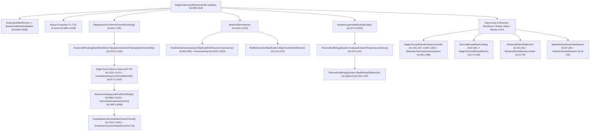

# DOK2 — Mevcut Kod Debug ve Akış Raporu (Şu Anki Sistem Nasıl Çalışıyor?)

> **Doküman Navigasyonu (Paket 4A — Dinamik İklim, Fiziksel Su Döngüsü ve Karst Yeraltı Hidrolojisi):**
> - [DOK1 — Hedef ve Gereksinimler](DOK1_HEDEF_VE_GEREKSINIMLER.md)
> - **[DOK2 — Mevcut Kod Debug ve Akış Raporu (Bu Doküman)](DOK2_MEVCUT_KOD_DEBUG_VE_AKIS_RAPORU.md)**
> - [DOK3 — Endüstri, Benzer Projeler ve Literatür Araştırması](DOK3_ENDUSTRI_VE_BENZER_PROJELER_ARASTIRMASI.md)
> - [DOK4 — Adım Adım Geliştirme Planı ve Swarm İş Dağılımı](DOK4_ADIM_ADIM_GELISTIRME_PLANI.md)

---

## 1. Mevcut Çalışma Zamanı (`Update`), WorldGen ve Akışkan Çağrı Zinciri

Paket 4A'nın dokunacağı zaman, iklim, sonlu akışkan, toprak nemi, mağara üretimi, termal biyoloji, istasyonlar, `[B]` rehber kitabı ve AOI ağ katmanlarının mevcut çağrı topolojisi aşağıdadır:

---

## 2. Dosya ve Satır Numaralı Mevcut Kod Akış Analizi

### 2.1. Zaman, Mevsimler, Ayarlar Menüsü ve Klavye Kısayolları

1. **[StratocraftConstants.cs](../../Assets/_Stratocraft/Core/Constants/StratocraftConstants.cs#L128-L160):**
   - `SecondsPerInGameDay = 3600.0` (`#L129`), `DaylightDurationSeconds = 2400.0` (`#L132`), `NightDurationSeconds = 1200.0` (`#L135`) halihazırda `1 gün = 60 gerçek dk` kuralına tam uygundur.
   - **Mevcut Sorun 1:** `DaysPerSeason = 24` (`#L138`) olarak sabitlenmiştir; bu değer `1 yıl = 96 gün` üretir ve `İP-1`'deki `365` günlük güneş yılı (`91/91/91/92` gün) ile uyumsuzdur.
   - Performans bütçesi sabitleri `#L151-L160` aralığında tanımlıdır (`MaxGameRamBudgetMb = 2500`, `MaxTextureVramBudgetMb = 16.0f`, `TargetFrameBudgetMs = 15.0f`, `FluidFrameBudgetMicroseconds = 100.0`).
2. **[SeasonAndWeatherSystem.cs](../../Assets/_Stratocraft/WorldGen/SeasonAndWeatherSystem.cs#L6-L64):**
   - `SeasonType` (`Spring=0, Summer=1, Autumn=2, Winter=3`, `#L6-L12`) ve `EvaluateAtWorldTime(double totalWorldSeconds, int ringTier, float altitudeMeters)` (`#L32-L63`) fonksiyonunu barındırır.
   - `seasonIndex = (totalDays / DaysPerSeason) & 0x3` (`#L43`) ile mevsim seçilir; sabit tablo sıcaklıkları (`16 °C, 28 °C, 11 °C, -8 °C`, `#L46-L53`), gece `-6.0f` soğuması (`#L55`) ve `-(altitudeMeters / 1000.0f) * 6.5f` (`#L56`) eklenir.
   - **Mevcut Sorun 2 (Sahte Sinüs Yağmuru):** `#L60-L62` satırlarında `weatherPhase = (clampedSeconds * 0.0025) + ringTier * 1.7` ve `PrecipitationIntensity01 = Math.Clamp((float)(Math.Sin(weatherPhase) * 0.5 + 0.35), 0f, 1f)` ile tamamen yapay/periyodik bir sinüs dalgası üretilmektedir! Güneş deklinasyonu (`23.44°`), buharlaşma, basınç, bulut, rüzgâr yönü veya orografik yağmur gölgesi **yoktur**.
3. **[Stage1EscapeMenuAndSettingsController.cs](../../Assets/_Stratocraft/Character/Stage1EscapeMenuAndSettingsController.cs#L12-L245) & [GameRuntimeOptions.cs](../../Assets/_Stratocraft/Core/Config/GameRuntimeOptions.cs#L7-L65):**
   - `Stage1GameSettings` (`#L12-L214`) ve `[ESC]` menüsü (`#L225-L245`) 4 sekmeden oluşur: `0: Fare/Ses`, `1: Zorluk/Çevre` (`EnableEnvironmentalEffects`, `DifficultyPreset 0..4`), `2: Çarpanlar`, `3: Kontroller`. Henüz `TimeScaleMultiplier (1x–600x)` kaydırıcısı bulunmamaktadır.
   - `GameRuntimeOptions.cs` (`#L7-L65`), `ServerExecutionMode` (`HostLoopback = 0`, `DedicatedServer = 1`), `NetcodePort = 7777`, `VoxelStreamPort = 7778`, `MaxPlayers = 64` ve `WorldSeed = 14532026` yapılandırmasını tutar.
4. **[Stage1InteractivePlayController.cs](../../Assets/_Stratocraft/Character/Stage1InteractivePlayController.cs#L1994-L2144) — Mevcut Kısayol Haritası ve `F9/F10` Çakışması:**
   - `#L227` üzerinde `_weatherSystem` tutulur, `#L1271`'de `isSunnyDay = !_weatherSystem.IsNight` toprak kurumasına bağlanır, `#L2456-L2465`'te `EvaluateAtWorldTime` çağrılır.
   - **Kısayol Denetimi (`#L1994-L2106`):**

| Tuş | Satır Aralığı | Mevcut Atanmış Görev | Paket 4A İçin Durum |
| :--- | :--- | :--- | :--- |
| `F1` | `#L1994-L1998` | Sinematik Mod / Tüm HUD Aç-Kapat | **DOLU** |
| `F3` | `#L1999-L2003` | Geliştirici & Simülasyon Bilgi Yazıları | **DOLU** |
| `F4` | `#L2004-L2007` | Yaratıcı (Creative) Uçuş & Kırma Modu | **DOLU** |
| `F5` | `#L2039-L2043` | 1. Şahıs / 3. Şahıs Kamera Geçişi | **DOLU** |
| `F6` | `#L2090` | Tüm Chunk'ları `.sregion` Olarak Kaydet | **DOLU** |
| `F7` | `#L2096` | Yeni Rastgele Tohumla Dünyayı Yeniden Üret | **DOLU** |
| `F8` | `#L2063-L2081` | Kılıç Arketipi Değiştir | **DOLU** |
| **`F9` / `Shift+F9`** | **`#L2091-L2095`** | **Uzuv Kopma Testi (`F9`) / `.sregion` Yükle (`Shift+F9`)** | **ÇAKIŞMA VAR — KULLANILAMAZ!** |
| **`F10`** | **`#L2082-L2087`** | **Düello Arenası Çağır ve Mod Değiştir** | **ÇAKIŞMA VAR — KULLANILAMAZ!** |
| `F11` | `#L2088, #L2108-L2126` | İklim/Termal Test Modu (`Doğal / -28°C / +68°C`) | **DOLU** |
| `F12` | `#L2089, #L2128-L2144` | 9 Noktalı Kıta / Biyom / Mağara Işınlanma | **DOLU** |
| `Insert` | `#L2097-L2105` | 3B Savurma & Akışkan Telemetri İzi | **DOLU** |

> [!CAUTION]
> Yukarıdaki tabloda görüldüğü üzere yalın `F9` ve `F10` tuşları halihazırda savaş/bölge testi tarafından kullanılmaktadır. Zaman hızlandırma kısayolu için yalın `F9/F10` yerine boş olan **`[` / `]` (`KeyCode.LeftBracket` / `KeyCode.RightBracket`)** veya değiştirici tuşlu **`Ctrl+F9` / `Ctrl+F10`** kullanılmalıdır.

---

### 2.2. Akışkan Bit Düzeni (`FluidCell16`), C++ SIMD ve Toprak Nemi (`SoilMoistureAndMudSystem`)

1. **[FluidCell16.cs](../../Assets/_Stratocraft/Physics/Data/FluidCell16.cs#L12-L115):**
   - 2 baytlık (`ushort`) bit sözleşmesi:
     - `Bit [0..7]` (`8-bit`): `Mass / Level` (`0..255`),
     - `Bit [8..9]` (`2-bit`): `FluidType` (`None=0, Water=1, Lava=2, Acid=3` — **2 bitin 4 değeri de doludur! Yeni bir `FluidType.SaltWater = 4` eklenemez!**),
     - `Bit [10]` (`1-bit`): `IsSettled` (`SettledBitMask = 1 << 10`, uyku bayrağı),
     - `Bit [11..15]` (`5-bit`): `PressureHead` (`0..31m`, `MaxPressureHead = 31`, `#L38`, `#L85`).
2. **[simd_world_noise.cpp](../../NativePlugins/StratocraftNative/src/simd_world_noise.cpp#L73-L101):**
   - `PackSettledFluid` (`#L92-L101`) C++20 tarafında `(static_cast<uint16_t>(pressureHead) & 0x1Fu) << 11` ile `FluidCell16` yapısını bit-özdeş üretir (`#L556, #L570, #L603, #L651` noktalarında çağrılır).
3. **[FluidCellularAutomataJob.cs](../../Assets/_Stratocraft/Physics/Jobs/FluidCellularAutomataJob.cs#L24-L25):**
   - `StepFluidGridVolumeConservative` (`#L96-L269`) kütle korunumlu yatay/düşey akışı yürütür.
   - `#L1043-L1078` aralığında dikey su sütunu taranarak (`cell.Mass >= 220` ise `head++`) `PressureHead` hesaplanır; `#L1080-L1233` aralığında ise U-borusu ve sifon aşımı (`MaxSiphonCrestBlocks = 10` metre, `#L25`) çözülür.
4. **[SoilMoistureAndMudSystem.cs](../../Assets/_Stratocraft/Physics/Systems/SoilMoistureAndMudSystem.cs#L19-L270):**
   - Chunk başına seyrek (`lazy-allocated`) `byte[65536]` nem tamponu (`SoilMoistureChunks`, `#L27`) ve aktif nemli chunk kümesi (`ActiveMoistChunks`, `#L30`) ile `0 B/kare` GC çalışır.
   - `MudSlowdownThreshold = 150` (`#L24`) aşıldığında `SampleGroundMudSlowdownMultiplier` (`#L86-L124`) oyuncuya `0.85f -> 0.65f` hız çarpanı uygular.
   - `EncodeSoilMoistureToVertexTempByte` (`#L55-L60`), `0..255` nemi `1..120` aralığına ölçekleyerek UberShader'ın `>= 170` kor ışıma (`Blackbody`) bandıyla çakışmasını önler.
   - `StepChunkSoilInfiltration` (`#L131-L270`), var olan `FluidCell16` suyunu toprağa emer ve `curMoisture >= MaxMoistureSaturation (255)` (`#L187`) olduğunda emilimi durdurur.
   - **Mevcut Eksik:** Şu an yalnızca zeminin üstünde zaten `FluidCell16` su varken toprağı ıslatmaktadır; atmosfer yağmurundan doğrudan `Moisture` artışı ve `Moisture == 255` doygunluğu aşıldığında yeni `FluidCell16` yağmur göleti doğurma (`ponding spawn`) adımı henüz yoktur.

---

### 2.3. Mağara Hidrolojisi, Kaya Stratigrafisi ve Korunacak Paket 3 Test Kısıtları

1. **[StratocraftFloatingIslandWorldGen.cs](../../Assets/_Stratocraft/WorldGen/StratocraftFloatingIslandWorldGen.cs#L763-L1430):**
   - **Deniz Dolumu (`#L22`, `#L1102-L1147`):** `SeaLevelY = 90` altında kalan doğal çukurlar (`isNaturalSea`, `#L1104`) `FluidCell16.Pack(FluidType.Water, 255, isSettled: true, pressureHead: head)` ile doldurulur.
   - **Mağara Girişleri ve Ağ (`#L422-L440`, `#L623-L755`, `#L817-L1034`):** `PrecomputeColumnCaveEntrance` ve `EvaluateNaturalCaveSurfaceEntranceFast` doğal mağara ağızlarını açar; giriş dışındaki yüzeyin ilk `18m`'si sızdırmaz kabuk olarak korunur (`#L849`, `#L908`).
   - **Mevcut Mağara Gölleri (`#L763-L815`, `#L1310-L1430`):** `IsCaveWaterChamber` (`hChamber % 100u < 15u`, `#L777`) ile Katman 1–2 odalarının `%15`'inde `PopulateNaturalCaveWaterPoolsInChunk` sıfır kil kutulu, masif kaya çanaklı `IsSettled = true` su gölcükleri üretir.
   - **Paket 3 Kaya Katmanları ve Kapsül Damarlar (`#L1997-L2123`):** `TryEvaluateCapsuleOreVein` (`#L1997-L2058`) 3B kapsül cevher damarlarını, `ResolveUndergroundHostRockStrata` (`#L2060-L2123`) ise 4 katmanlı derinlik kaya stratigrafisini üretir.
   - **Mevcut Eksik:** `IsCaveWaterChamber` üstteki örtü kayacın geçirgenliğine (`toprak/epikarst` vs `masif taş`) bakmamakta, tünel talweg birikintisi ile `1/5–8` büyük akifer gölü ayrımı yapmamakta ve su kullanıldığında azalıp yağmurla dolan dinamik bir rezervuar (`AquiferReservoir`) tutmamaktadır.
2. **[ChunkSkyOcclusionMap256.cs](../../Assets/_Stratocraft/Voxel/Data/ChunkSkyOcclusionMap256.cs#L12-L95):**
   - Chunk başına `256 Byte` `_maxOccluderY` dizisiyle `HasOpenSkyAbove(lx, y, lz)` (`#L26-L29`) sorgusunu `O(1)` sürede çözer! Yağmurun hangi bloğa, oyuncuya, fıçıya veya kamp ateşine değeceğini belirlemek için **doğrudan hazır ve ideal** veri yapısıdır (ancak `IronGrating` ve `MicroVoxel` yarı-geçirgen bloklarının yağmur suyunu geçirirken çatının engellemesi dikkate alınmalıdır).
3. **Kırılmaması Gereken Mevcut Test Kısıtları (`116` Standalone / `113` EditMode):**
   - [Paket3CaveOreAndLavaTests.cs](../../Assets/Tests/EditMode/Paket3CaveOreAndLavaTests.cs): `AK-3` (`#L284-L370` yüzey cevher izleri), `AK-5` (`#L465-L631` mağara göllerinin `IsSettled == true` ve sıfır sızıntılı başlaması), `CaveRockComposition` (`#L918-L1033` 4 katmanlı kaya oranları) ve `CaveWaterPools` (`#L1035-L1100` yapay kil kutusu bulunmaması).
   - [StructuralDominoCollapseTests.cs](../../Assets/Tests/EditMode/StructuralDominoCollapseTests.cs): `Devir046` (`#L678`, `#L760-L789` alt-chunk dikişsiz su sızdırmazlığı) ve **`Devir048b` (`#L970-L1070`: 4 yeni chunk tek çekirdekte `< 60 ms` üretim bütçesi)**.

---

### 2.4. Termal Biyoloji, Ocak Söndürme, `[B]` Kitabı, Render ve Ağ Katmanları

1. **[ThermalAndBiologySystem.cs](../../Assets/_Stratocraft/Character/Systems/ThermalAndBiologySystem.cs#L12-L219):**
   - `EvaluateUndergroundGeothermalTemperatureCelsius` (`#L42-L110`) $C^1$-sürekli mağara `U-Eğrisi`ni hesaplar.
   - `StepBiology` (`#L162-L219`) içinde `isSubmergedOrInRain` parametresi **zaten mevcuttur** (`#L166`, `#L175`)! Yağmurdayken `Wetness01 -> 0.85` hedefine üstel yaklaşır (`#L177-L179`), soğukta `wetColdLossMultiplier = 1.0f + 2.0f * effectiveWetness` (`3.0x` ısı kaybı, `#L194`) uygular ve kuru/sıcak ortamda `dryRate = 0.025f + max(0, T_env - 15) * 0.004f` (`#L184-L185`) ile kurutur. Yalnızca `isSubmergedOrInRain` bayrağının sahte sinüs yerine **gerçek 3B bulut altı yağışı + `ChunkSkyOcclusionMap256.HasOpenSkyAbove`** koşuluna bağlanması yeterlidir!
2. **[Stage1CampfireAndCookingController.cs](../../Assets/_Stratocraft/Character/Stage1CampfireAndCookingController.cs#L154-L167) & [BloomeryThermodynamicsSystem.cs](../../Assets/_Stratocraft/Inventory/Systems/BloomeryThermodynamicsSystem.cs#L381-L388):**
   - `TryExtinguishStation` (`#L807-L820`) ve `ExtinguishBloomery` (`#L381-L388`) yakıtı ve içindeki cevheri/yemeği silmeden `IsLit = false` yaparak söndürme altyapısına sahiptir; yağmur sönme sayacı ve ıslak odun tutuşturma zorluğu buraya kancalanacaktır.
3. **[SurvivalRecipeBookCatalog.cs](../../Assets/_Stratocraft/Inventory/Systems/SurvivalRecipeBookCatalog.cs#L9-L65) & [Stage1SurvivalRecipeBookUi.cs](../../Assets/_Stratocraft/Character/Stage1SurvivalRecipeBookUi.cs#L17-L100):**
   - `SurvivalRecipeBookTab` şu an 4 sekme içerir (`0: MaterialsAndResources`, `1: ClothAndKnappingRecipes`, `2: MindBuildingStructures`, `3: SmithingCookingAndCrystal`). Dikişli deri kitap arayüzü `EntriesPerPage = 2` (`0 B` GC) ile sayfa çevirir; meteoroloji rehberi 5. sekme (`MeteorologyAndForecasting = 4`) olarak veya mevcut sekmelere entegre edilerek eklenebilir.
4. **Render ve Ağ ([StratocraftUberShader.hlsl](../../Assets/_Stratocraft/Rendering/Shaders/StratocraftUberShader.hlsl#L16-L36), [StratocraftFluidSurface.shader](../../Assets/_Stratocraft/Rendering/Shaders/StratocraftFluidSurface.shader#L1-L70), [SpatialAoiAndSwarmNetSystem.cs](../../Assets/_Stratocraft/Networking/SpatialAoiAndSwarmNetSystem.cs#L50-L60), [LiteNetLibVoxelStreamer.cs](../../Assets/_Stratocraft/Networking/LiteNetLibVoxelStreamer.cs#L11-L42)):**
   - URP 17 Forward+ boru hattında gökyüzü şu an statik prosedürel renk geçişidir; 3B dünya-uzayı bulut hacmi ve zemin bulut gölgesi çarpanı henüz yoktur.
   - `StratocraftFluidSurface.shader` sığ/derin su rengini ve köpüğü çizer; tuzlu deniz suyu (hafif turkuaz-zümrüt kırınım) ile tatlı su (berrak mavi) ayrımı vertex/uniform parametresiyle `0 MB` VRAM ile verilebilir.
   - `SpatialAoiAndSwarmNetSystem` `60 Hz` sunucu tick'i ve kademeli AOI halkaları (`25m / 64m / 160m`) sunar; atmosfer `1 Hz` AOI delta paketi bu yapıya doğrudan eklenecektir.

---

## 3. Mimari Karar Analizi: Tatlı Su vs Tuzlu Su Temsili (`Seçenek A` vs `Seçenek B`)

`FluidCell16` içinde `FluidType` alanı yalnızca `2-bit` (`0=None, 1=Water, 2=Lava, 3=Acid`) olduğu için yeni bir enum değeri eklenemez. Tatlı Su ve Tuzlu Su ayrımı için iki teknik seçenek derinlemesine karşılaştırılmıştır:

| Karşılaştırma Kriteri | **Seçenek A (Önerilen): Chunk-Bazlı Seyrek `ChunkSalinityBitset`** | **Seçenek B (Alternatif): `FluidCell16` Bit 15 (`IsSaltWater`)** |
| :--- | :--- | :--- |
| **Veri Yapısı** | Yalnızca tuzlu su içeren chunk'lar için ayrılan seyrek `ulong[1024]` (`65.536 bit = 8 KB/chunk`); tamamen tatlı su veya kuru olan iç kara/mağara chunk'larında **`0 Byte`** bellek! | `FluidCell16` içinde `Bit [15]` = `IsSaltWater`, `Bit [11..14]` = `4-bit PressureHead (0..15m)`. Ek bellek **`0 Byte`**. |
| **`PressureHead` & Sifon Etkisi** | **5-bit (`0..31m`) `%100` korunur!** Derin deniz ve mağara U-borusu hidrostatik basıncı hiç değişmez. | `PressureHead` `0..15m`'ye iner. Sifon tepe sınırı `MaxSiphonCrestBlocks = 10m` (`<= 15m`) olduğundan **sifon bozulmaz**, ancak `> 15m` derin U-borularında basınç tavan yapar. |
| **C++20 `simd_world_noise.cpp` Etkisi** | **`0` Değişiklik!** C++ native eklentisi derlenmeden mevcut haliyle `%100` bit-özdeş kalır. | `simd_world_noise.cpp#L100` (`0x1Fu -> 0x0Fu` + deniz tuzluluk biti) güncellenmeli ve C++ `dll`/`ctest` yeniden derlenmelidir. |
| **Mevcut `116` Standalone / `113` EditMode Testine Etkisi** | **`%0` Kırılma Riski!** `FluidCell16.Pack` imzası ve `MaxPressureHead == 31` bekleyen tüm birim testler dokunulmadan geçer. | `FluidCell16` bit maskesini ve `PressureHead > 15` değerlerini sınayan mevcut testlerin ve `.sregion` formatının güncellenmesini gerektirir. |
| **Akışkan Karışımı & Buharlaşma** | `FluidCellularAutomataJob` su taşırken kaynak hücre tuzluysa hedef hücrenin bitini `1` yapar (acı/tuzlu karışım); buharlaşmada atmosfere daima tuzsuz buhar gider. | Hücre taşırken `Bit 15` doğrudan `ushort` içinde taşınır; buharlaşmada `Bit 15` sıfırlanarak atmosfere geçer. |

> [!TIP]
> **Mimari Öneri:** Hem C++20 SIMD eklentisini ve `5-bit PressureHead (0..31m)` kapasitesini `%100` koruması, hem de iç kara/mağara chunk'larında `0 Byte` bellek harcayarak mevcut `116/116` testi sıfır kırılmayla geçirmesi nedeniyle **Seçenek A (`ChunkSalinityBitset`)** birincil mimari olarak önerilmektedir (kodlama öncesi kullanıcı onayına sunulacaktır).
