# DOK4 — Adım Adım Geliştirme Planı ve Swarm İş Dağılımı (Nasıl Geliştireceğiz?)

> **Doküman Navigasyonu (Paket 4A — Dinamik İklim, Fiziksel Su Döngüsü ve Karst Yeraltı Hidrolojisi):**
> - [DOK1 — Hedef ve Gereksinimler](DOK1_HEDEF_VE_GEREKSINIMLER.md)
> - [DOK2 — Mevcut Kod Debug ve Akış Raporu](DOK2_MEVCUT_KOD_DEBUG_VE_AKIS_RAPORU.md)
> - [DOK3 — Endüstri, Benzer Projeler ve Literatür Araştırması](DOK3_ENDUSTRI_VE_BENZER_PROJELER_ARASTIRMASI.md)
> - **[DOK4 — Adım Adım Geliştirme Planı ve Swarm İş Dağılımı (Bu Doküman)](DOK4_ADIM_ADIM_GELISTIRME_PLANI.md)**

---

## 1. Mimari Strateji ve Faz Bağımlılık Diyagramı

[DOK1](DOK1_HEDEF_VE_GEREKSINIMLER.md) içindeki `İP-1 .. İP-9` gereksinimlerini, [DOK2](DOK2_MEVCUT_KOD_DEBUG_VE_AKIS_RAPORU.md)'de saptanan mevcut kısıtları ve [DOK3](DOK3_ENDUSTRI_VE_BENZER_PROJELER_ARASTIRMASI.md)'teki matematiksel modelleri sıfır dosya çakışmasıyla hayata geçirmek için geliştirmeyi **6 granüler alt faza (`Faz 4A.1 .. Faz 4A.6`)** ayırıyoruz:

```mermaid
flowchart TD
    BASE["Korunacak Çekirdek: Devir #058 (116 Standalone + 113 EditMode PASS, < 16 MB VRAM, 4-Katman Kaya & Kapsül Cevher)"] --> F1

    subgraph F1["Faz 4A.1: 365-Gün Takvim, 1x-600x Zaman Hızı ve İP-9 Hava Altyapısı"]
        F1A["SolarCalendarAndTimeScaleSystem (365 Gün, 91/91/91/92 Mevsim, 23.44 Derece Deklinasyon)"]
        F1B["WeatherPhenomenonTypes (Genişletilebilir Enum/Bayraklar; Aktif: Rain + ThunderLightning)"]
        F1C["Stage1EscapeMenuAndSettingsController (1x-600x Kaydırıcı) + Çakışmasız Kısayol"]
        F1A --> F1B --> F1C
    end

    F1 --> F2

    subgraph F2["Faz 4A.2: 64m x 64m 2B Fiziksel Atmosfer, ENSO ve AOI Ağ Senkronu"]
        F2A["RegionalAtmosphereSimulationSystem (Radyasyon, Dalton, LCL, Orografi, CAPE, 600x Yarı-Lagrange)"]
        F2B["EnsoRechargeOscillator (Jin 1997 Çok Yıllık Sıcak-Kurak / Serin-Yağışlı Döngü)"]
        F2C["AtmosphereAoiDeltaPacket (9x9 Hücre, 16 Byte/Hücre, < 0.5 KB/s/Oyuncu)"]
        F2A --> F2B --> F2C
    end

    F2 --> F3
    F2 --> F4
    F2 --> F5
    F2 --> F6

    subgraph F3["Faz 4A.3: 0 MB VRAM 3B Dünya-Uzayı Bulutları, Gölge ve Lokal Yağmur"]
        F3A["StratocraftProceduralClouds.hlsl (3B Worley-Perlin ALU Bulut Hacmi + Rayleigh Kızıl Ufuk)"]
        F3B["StratocraftUberShader.hlsl (Dünya-Uzayı Bulut Gölgesi Zayıflatması)"]
        F3C["Stage1LocalizedRainRenderer (Yalnızca Bulut İzdüşümü Altında + Çatı Kırpmalı Yağmur Perdesi)"]
        F3A --> F3B --> F3C
    end

    subgraph F4["Faz 4A.4: Tatlı/Tuzlu Su, 2-3 Yıl Buharlaşma ve Yüzey Etkileri"]
        F4A["ChunkSalinityBitset (Deniz = Tuzlu Su; Buharlaşma/Yağmur/Mağara = Özdeş Tatlı Su)"]
        F4B["WaterCycleAndEvaporationSystem (Dalton 2-3+ Yıl Göl Ömrü, Moisture==255 Göllenme, Açık Fıçı/Çukur)"]
        F4C["Açık Ateş/Bloomery Sönmesi + Islanma/Kuruma + CAPE Şimşek & Paratoner Koruma Konisi"]
        F4A --> F4B --> F4C
    end

    subgraph F5["Faz 4A.5: Karst Mağara Hidrolojisi (%60 Kuru / %40 Islak) ve Akiferler"]
        F5A["Örtü Kayaç Geçirgenlik Sınıflayıcısı (%60 Masif Taş Kuru / %40 Epikarst Islak, Paket 3 Korunur)"]
        F5B["Talweg Taban Birikintileri + 1/5-8 Büyük Yeraltı Karst Akifer Gölü (IsSettled = true)"]
        F5C["KarstHydrologyAndAquiferSystem (0 B GC Su Çekme Tükenmesi & Yağmur Süzülmesiyle Yavaş Dolum)"]
        F5A --> F5B --> F5C
    end

    subgraph F6["Faz 4A.6: 5 Fiziksel Ölçüm Aleti ve [B] Kitabı Meteoroloji Rehberi"]
        F6A["WeatherForecastInstrumentsSystem (Zambretti A-Z, P0, dP/dt, Beaufort 0-12, Psikrometre, mm Ölçer)"]
        F6B["PhysicalItemMeshFactory (5 Alet + Paratoner Hareketli 3B Color32 Meşleri, 0 MB VRAM)"]
        F6C["SurvivalRecipeBookCatalog & Stage1SurvivalRecipeBookUi (Tarifler, FitzRoy, Bulut & Kızıl Ufuk)"]
        F6A --> F6B --> F6C
    end

    F3 --> GATE["Paket 4A Kalite Kapısı: Paket4AClimateAndHydrologyTests + quality-gate.ps1 -Phase 4"]
    F4 --> GATE
    F5 --> GATE
    F6 --> GATE
```



> [!IMPORTANT]
> **Çift-Hedefli Derleme Uyum Kuralı (`Unity 6` + `.NET 10 Standalone`):**
> [Stratocraft.StandaloneCoreTests.csproj](../../Tests/StandaloneCoreTests/Stratocraft.StandaloneCoreTests.csproj) tüm çekirdek ve test dosyalarını `.NET 10` üzerinde `TreatWarningsAsErrors=true` ile derler. Bu yüzden `Core`, `Physics`, `WorldGen`, `Inventory` ve `Character/Systems` altındaki saf simülasyon sınıflarında `UnityEngine` tipleri kullanılmaz; render ve sahne köprüleri `#if UNITY_5_3_OR_NEWER` ile izole edilir.

---

## 2. Alt Fazların Teknik Tasarımı, Veri Yapıları ve Dosya Planı (`Faz 4A.1 .. Faz 4A.6`)

### 2.1. `Faz 4A.1` — 365-Gün Güneş Takvimi, `1x–600x` Zaman Ölçeği ve Ortak Hava Altyapısı (`İP-1`, `İP-9`)

- **Oluşturulacak Dosyalar:**
  - `Assets/_Stratocraft/Core/Weather/WeatherPhenomenonTypes.cs`
  - `Assets/_Stratocraft/WorldGen/SolarCalendarAndTimeScaleSystem.cs`
- **Güncellenecek Dosyalar:**
  - [StratocraftConstants.cs](../../Assets/_Stratocraft/Core/Constants/StratocraftConstants.cs#L128-L142): `DaysPerYear = 365`, mevsim gün dizisi `[91, 91, 91, 92]`, `SolarAxialTiltDegrees = 23.44f`, `MaxTimeAccelerationMultiplier = 600.0f`.
  - [SeasonAndWeatherSystem.cs](../../Assets/_Stratocraft/WorldGen/SeasonAndWeatherSystem.cs#L18-L64): Sahte `Math.Sin(weatherPhase)` kaldırılarak `SolarCalendarAndTimeScaleSystem` ve bölgesel atmosfer sorgusuna yönlendirilen geriye uyumlu adaptöre dönüştürülür.
  - [Stage1EscapeMenuAndSettingsController.cs](../../Assets/_Stratocraft/Character/Stage1EscapeMenuAndSettingsController.cs#L12-L245): Sekme 1 (`Zorluk/Çevre`) içine `TimeScaleMultiplier` (`1.0f .. 600.0f`) kaydırıcısı ve hazır kademe düğmeleri (`1x`, `10x`, `60x`, `300x`, `600x`) eklenir.
- **Veri Yapıları ve İmzalar:**
  ```csharp
  namespace Stratocraft.Core.Weather
  {
      // IP-9: Gelecek hava olaylarina hazir kanonik yagis tipi (Paket 4A'da yalnizca None ve Rain aktif uretilir)
      public enum PrecipitationKind : byte
      {
          None = 0,
          Rain = 1,
          Snow = 2,        // Altyapi hazir (ileri paket)
          Hail = 3,        // Altyapi hazir (ileri paket)
          VolcanicAsh = 4  // Altyapi hazir (ileri paket)
      }

      [Flags]
      public enum AtmosphericHazardFlags : ushort
      {
          None             = 0,
          ThunderLightning = 1 << 0, // Paket 4A'da AKTIF (CAPE > 1000 J/kg)
          GroundFog        = 1 << 1, // Altyapi hazir
          Sandstorm        = 1 << 2, // Altyapi hazir
          Blizzard         = 1 << 3, // Altyapi hazir
          Heatwave         = 1 << 4  // Altyapi hazir
      }
  }

  namespace Stratocraft.WorldGen
  {
      public readonly struct SolarEphemState
      {
          public readonly int YearIndex;              // 0, 1, 2...
          public readonly int DayOfYear;              // 0..364 (365 gun)
          public readonly SeasonType Season;          // Spring(91), Summer(91), Autumn(91), Winter(92)
          public readonly int DayOfSeason;            // 0..90 / 0..91
          public readonly float LocalHour0To24;       // 0.0 .. 24.0
          public readonly float DeclinationRad;       // [-23.44 deg .. +23.44 deg]
          public readonly float CosZenith;            // cos(theta_z)
          public readonly float ClearSkyInsolationWm2;// max(0, 1361 * cos(theta_z))
          public readonly float SunDirX, SunDirY, SunDirZ;
      }

      public static class SolarCalendarAndTimeScaleSystem
      {
          public const int DaysPerYear = 365;
          public static ReadOnlySpan<int> SeasonDayLengths => new int[] { 91, 91, 91, 92 };

          public static SolarEphemState EvaluateSolarEphem(double totalWorldSeconds, float latitudeDeg = 38.0f);
          public static int ComputeStableSubsteps(float realDeltaTime, float timeScaleMultiplier, float maxStepGameSeconds, out float substepGameDt);
      }
  }
  ```

---

### 2.2. `Faz 4A.2` — Bölgesel 2B Fiziksel Atmosfer Izgarası (`64m x 64m`), ENSO ve AOI Ağ Senkronu (`İP-2`, `İP-3` Ağ)

- **Oluşturulacak Dosyalar:**
  - `Assets/_Stratocraft/Physics/Data/AtmosphereCellState.cs`
  - `Assets/_Stratocraft/Physics/Systems/RegionalAtmosphereSimulationSystem.cs`
  - `Assets/_Stratocraft/Networking/AtmosphereAoiSyncPacket.cs`
- **Güncellenecek Dosyalar:**
  - [SpatialAoiAndSwarmNetSystem.cs](../../Assets/_Stratocraft/Networking/SpatialAoiAndSwarmNetSystem.cs#L50-L60): `1 Hz` frekansta oyuncu çevresi `9x9` atmosfer hücresi (`576m x 576m` görüş alanı) delta senkronu (`< 0.5 KB/s/oyuncu`).
- **Veri Yapıları, `600x` Alt-Adımlama ve İmzalar:**
  ```csharp
  [StructLayout(LayoutKind.Sequential, Pack = 4)]
  public struct AtmosphereCellState // 36 Byte blittable, 0 B GC
  {
      public float SurfaceTempCelsius;       // Yuzey isinma sicakligi (Ts)
      public float AirTempCelsius;           // 2m hava sicakligi (Ta)
      public float StationPressureHpa;       // Istasyon basinci (hPa)
      public float VaporPressureHpa;         // Gercek su buhari basinci (ea)
      public float CloudWaterKgPerM2;        // Yogusmus bulut sivi su sutunu (qc)
      public ushort CloudBaseWorldY;         // LCL bulut taban kotu (m)
      public ushort CloudTopWorldY;          // Bulut tavan kotu (m)
      public float WindVelX;                 // Bati->Dogu ruzgar hizi (m/s)
      public float WindVelZ;                 // Guney->Kuzey ruzgar hizi (m/s)
      public float PrecipitationMmPerHour;   // Aktif yagis siddeti (mm/saat)
      public ushort CapeJPerKg;              // Konvektif kararsizlik enerjisi
      public PrecipitationKind ActiveKind;   // None veya Rain
      public byte ReservedPad;
      public AtmosphericHazardFlags Hazards; // ThunderLightning bayragi
  }

  public struct EnsoRechargeOscillatorState
  {
      public float TempAnomalyCelsius;       // Te: + kurak/sicak, - serin/yagisli
      public float ThermoclineAnomaly;       // h: okyanus rezervuar hafizasi
      public void StepExactOrRk2(double gameDeltaSeconds);
  }

  public sealed class RegionalAtmosphereSimulationSystem
  {
      public const int CellSizeMeters = 64;  // 4x4 chunk = 64m x 64m
      public const int GridSideCells = 32;   // 2048m x 2048m aktif bolge = 1024 hucre (~36 KB RAM!)

      public void StepAtmosphere(double worldTimeSeconds, float gameDeltaSeconds);
      public AtmosphereCellState SampleBilinearAtWorldXZ(float worldX, float worldZ);
      public void InjectSurfaceEvaporationMass(int wx, int wz, float evaporatedKgPerM2);
  }
  ```
- **`600x` Kararlılık Garantisi:** `gameDeltaSeconds > 15.0f` olduğunda `StepAtmosphere`, `substepDt <= 15.0f` olacak şekilde döngüyü böler (`600x` hızda `60 FPS` iken kare başına `gameDeltaSeconds = 10.0s` olduğundan **yalnızca `1` alt-adım** yeterlidir; `20 FPS` düşüşünde bile en fazla `2` yarı-Lagrange alt-adım çalışır!). Tüm ısınma/buharlaşma/yoğuşma denklemleri $x(t+\Delta t) = x_{eq} + (x - x_{eq})e^{-\lambda \Delta t}$ analitik formuyla çözüldüğünden `NaN` veya salınım oluşması matematiksel olarak imkânsızdır.

---

### 2.3. `Faz 4A.3` — `0.0 MB` VRAM 3B Dünya-Uzayı Bulutları, Gölge ve Lokal Yağmur (`İP-3` Render)

- **Oluşturulacak Dosyalar:**
  - `Assets/_Stratocraft/Rendering/Shaders/StratocraftProceduralClouds.shader` (`0 Byte` Texture VRAM, saf GPU ALU 3B Worley-Perlin bulut hacmi + Rayleigh/Mie gün doğumu/batımı kızıl ufuk saçılması)
  - `Assets/_Stratocraft/Character/Stage1AtmosphereCloudAndRainRenderer.cs`
- **Güncellenecek Dosyalar:**
  - [StratocraftUberShader.hlsl](../../Assets/_Stratocraft/Rendering/Shaders/StratocraftUberShader.hlsl): Güneş vektörü yönünde dünya-uzayı bulut yoğunluğu örneklenerek zemin üzerine yumuşak dinamik bulut gölgesi (`cloudShadowAtten in [0.42, 1.0]`) düşürülür.
  - [StratocraftFluidSurface.shader](../../Assets/_Stratocraft/Rendering/Shaders/StratocraftFluidSurface.shader): Rüzgâr hızıyla (`_GlobalWindVector`) dalga genliği ölçeklenir; bulut gölgesi ve tuzlu/tatlı su ton farkı yansıtılır.
- **Lokal Yağmur İzdüşümü Kuralı:** `Stage1AtmosphereCloudAndRainRenderer`, kameraya yapışık küresel yağmur çizmez; yalnızca `CloudWaterKgPerM2 > threshold` ve `PrecipitationMmPerHour > 0.1f` olan atmosfer hücrelerinin dünya koordinatları altındaki `[x..x+64, z..z+64]` hacminde ve her sütunun `ChunkSkyOcclusionMap256.GetMaxOccluderY(lx, lz)` tavan kotunun üstünde GPU prosedürel yağmur çizgileri (`uzaktan görünen yağmur şaftı + yakında damla çizgileri`) üretir (`0 B/kare` GC, `0.0 MB` doku VRAM).

---

### 2.4. `Faz 4A.4` — İkili Su Sistemi, Kütle Korunumlu Buharlaşma ve Yağmur Yüzey Etkileri (`İP-4`, `İP-5`, `İP-6`)

- **Oluşturulacak Dosyalar:**
  - `Assets/_Stratocraft/Physics/Data/ChunkSalinityBitset.cs`: Seyrek `ulong[1024]` (`65536` bit) tuzluluk haritası (yalnızca deniz suyu içeren chunk'larda ayrılır; tatlı su chunk'larında `0 Byte`).
  - `Assets/_Stratocraft/Physics/Systems/WaterCycleAndEvaporationSystem.cs`
  - `Assets/_Stratocraft/Physics/Systems/ConvectiveLightningAndRodSystem.cs`
- **Güncellenecek Dosyalar:**
  - [StratocraftFloatingIslandWorldGen.cs](../../Assets/_Stratocraft/WorldGen/StratocraftFloatingIslandWorldGen.cs#L1141-L1147): `isNaturalSea` ile doldurulan deniz/okyanus hücreleri `ChunkSalinityBitset` içinde **Tuzlu Su (`true`)** olarak işaretlenir; tüm iç kara havzaları ve mağara suları **Tatlı Su (`false`)** kalır.
  - [FluidCellularAutomataJob.cs](../../Assets/_Stratocraft/Physics/Jobs/FluidCellularAutomataJob.cs): Su akışında kaynak hücre tuzluysa hedef hücreye tuzluluk biti taşınır (`FluidCell16` ve `simd_world_noise.cpp` bit düzenine **hiç dokunulmaz**!).
  - [SoilMoistureAndMudSystem.cs](../../Assets/_Stratocraft/Physics/Systems/SoilMoistureAndMudSystem.cs#L131-L270):
    1. `StepRainSurfaceWettingAndPonding(...)`: Aktif yağmur bulutu altındaki açık gökyüzü (`HasOpenSkyAbove`) gören emici zeminlerin `Moisture` değerini artırır (`>= 150` çamurlaşma); `Moisture == 255` tam doygunluğa ulaştığında yüzeyin üstündeki hava hücresine gerçek **`FluidCell16` Tatlı Su** (`isSaltWater = false`) doğurarak eğim aşağı çukurlara akmasını sağlar!
    2. Açık gökyüzü altındaki doğal kaya çukurlarında ve ağzı açık fıçı/kazan/çömlek istasyonlarında yağmur suyu doğrudan Tatlı Su olarak birikir.
    3. Dalton buharlaşma adımı: Okyanus (makro denge korumalı), iç göl (`2–3+` oyun yılı kuruma kalibrasyonlu `fractionalEvapAccumulator`), sığ yağmur birikintisi ve lav/ateş komşuluğundaki suları buharlaştırıp `RegionalAtmosphereSimulationSystem.InjectSurfaceEvaporationMass` ile atmosfere **tuzsuz buhar** olarak aktarır.
  - [Stage1CampfireAndCookingController.cs](../../Assets/_Stratocraft/Character/Stage1CampfireAndCookingController.cs#L154-L167) & [BloomeryThermodynamicsSystem.cs](../../Assets/_Stratocraft/Inventory/Systems/BloomeryThermodynamicsSystem.cs#L381-L388): `HasOpenSkyAbove == true` ve yerel `PrecipitationMmPerHour > 0.5f` iken tutuşturma zorluğu ve yağmur şiddetine bağlı sönme sayacı (`TryExtinguishStation` / `ExtinguishBloomery`) devreye girer.
  - [ThermalAndBiologySystem.cs](../../Assets/_Stratocraft/Character/Systems/ThermalAndBiologySystem.cs#L162-L186): `isSubmergedOrInRain` doğrudan gerçek lokal yağmur + açık gökyüzü koşuluna bağlanır; çatılı ateş yanında kuruma hızı doğrulanır.

---

### 2.5. `Faz 4A.5` — Karst Mağara Hidrolojisi (`%60` Kuru / `%40` Islak) ve Tükenip Dolabilen Yeraltı Akiferleri (`İP-7`)

- **Oluşturulacak Dosya:**
  - `Assets/_Stratocraft/Physics/Systems/KarstHydrologyAndAquiferSystem.cs`
- **Güncellenecek Dosya:**
  - [StratocraftFloatingIslandWorldGen.cs](../../Assets/_Stratocraft/WorldGen/StratocraftFloatingIslandWorldGen.cs#L763-L815) ve `#L1310-L1430` (**Paket 3'teki `#L1997-L2123` `TryEvaluateCapsuleOreVein` ve `ResolveUndergroundHostRockStrata` fonksiyonlarına KESİNLİKLE DOKUNULMAZ!**):
    - `EvaluateColumnOverburdenPermeability(int wx, int wz, float topH, byte surfaceMatId)`: Üst örtüdeki emici toprak kalınlığı ve epikarst kırık gürültüsünden deterministik geçirgenlik hesaplar; kıta genelinde mağaraların **`>= %60`'ı geçirimsiz masif kaya örtülü (KURU, `0` süzülme)**, **`~%40`'ı geçirgen toprak/epikarst örtülü (ISLAK)** olur.
    - Islak mağaralarda mevcut sıfır-GC `stackalloc` taban çukuru oyucusu (`PopulateNaturalCaveWaterPoolsInChunk`) tünelin en alçak **talweg** ekseninde küçük sızdırmaz (`IsSettled = true`) tatlı su birikintileri oluşturur; her **`5–8` ıslak mağara odasından `1` tanesinde** ise daha derin (`2–3` blok derinlikli) **Yeraltı Karst Akifer Gölü** oluşturur (`Devir048b < 60 ms` ve `AK-5` sızdırmazlık kuralları `%100` korunur!).
- **Tükenme ve Arka Plan Yeniden Dolum (`0 B/kare` GC):**
  ```csharp
  public struct KarstAquiferBasinRecord // Sabit dizide tutulur, 0 B GC
  {
      public int BasinId;
      public short AnchorChunkX, AnchorChunkZ;
      public byte EquilibriumWaterY;
      public bool IsImpermeableDryRoof;      // true ise yagmur suzulmesi = 0 ("tastan su gecmez")
      public float CurrentStoredUnits;       // Oyuncu su aldikca / buharlastikca duser
      public float MaxCapacityUnits;
      public float PendingVadosePercolation; // Yuzey yagmurundan suzulen gecikmeli tatli su
  }
  ```
  - Oyuncu mağara gölünden su aldığında `CurrentStoredUnits` ve `FluidCell16` kütlesi azalır (tamamen kuruyabilir). Üstteki geçirgen toprağa yağmur yağdığında ise vadoz gecikme tamponu üzerinden (`1 Hz` düşük frekanslı tik ile, `0 B` GC) talweg/akifer çanağının tabanından yukarıya doğru yavaşça Tatlı Su eklenerek eski denge kotuna (`EquilibriumWaterY`) kadar yeniden dolar.

---

### 2.6. `Faz 4A.6` — 5 Fiziksel Meteoroloji Aleti, Paratoner ve `[B]` Kitabı Meteoroloji Rehberi (`İP-8`)

- **Oluşturulacak Dosya:**
  - `Assets/_Stratocraft/Physics/Systems/WeatherForecastInstrumentsSystem.cs`
- **Güncellenecek Dosyalar:**
  - `Assets/_Stratocraft/Inventory/Systems/PrimitiveSurvivalCraftingCatalog.cs` & `WorldLooseBuildSystem.cs`: **Barometre**, **Termometre**, **Higrometre**, **Rüzgâr Gülü + Anemometre**, **Yağmur Ölçer** ve **Metal Paratoner** üretim tarifleri ve dünyaya yerleştirme tanımları.
  - `Assets/_Stratocraft/Inventory/Rendering/PhysicalItemMeshFactory.cs`: Her 5 alet ve Paratoner için `0.0 MB` doku VRAM prosedürel `Color32` 3B meş üreticileri (dönen rüzgâr gülü oku, fırıldayan anemometre kepçeleri, hareketli barometre pirinç ibresi, yükselen termometre ve yağmur ölçer sıvı sütunları).
  - [SurvivalRecipeBookCatalog.cs](../../Assets/_Stratocraft/Inventory/Systems/SurvivalRecipeBookCatalog.cs#L9-L65) & [Stage1SurvivalRecipeBookUi.cs](../../Assets/_Stratocraft/Character/Stage1SurvivalRecipeBookUi.cs#L17-L100): `[B]` kitabına 5 aletin + Paratoner'in yapım adımları, Zambretti okuma tablosu, **Amiral FitzRoy kuralları**, bulut okuma (`Cumulus`, `Cirrus`, `Cumulonimbus`, `LCL`) ve **Rayleigh gün batımı/doğumu kızıllığı okuma rehberi** eklenir.
- **Tahmin Motoru İmzaları:**
  ```csharp
  public readonly struct BarometerZambrettiReading
  {
      public readonly float SeaLevelPressureHpa;   // P0
      public readonly float ThreeHourDeltaHpa;     // dP / 3 saat
      public readonly sbyte TrendDirection;        // -1: Falling, 0: Steady, +1: Rising
      public readonly char ZambrettiLetter;        // 'A' .. 'Z'
      public readonly byte ZambrettiIndex1To26;    // 1 .. 26
  }

  public static class WeatherForecastInstrumentsSystem
  {
      public static float ComputeSeaLevelPressureHpa(float stationPressureHpa, float altitudeAboveSeaMeters, float tempCelsius);
      public static BarometerZambrettiReading EvaluateZambrettiForecast(
          float seaLevelPressureHpa, float threeHourDeltaHpa, float windVelX, float windVelZ, SeasonType season);
      public static byte EvaluateBeaufortScale0To12(float windSpeedMps);
      public static void EvaluatePsychrometer(float airTempCelsius, float vaporPressureHpa, out float relativeHumidity01, out float dewPointCelsius, out float estimatedCloudBaseMeters);
  }
  ```

---

## 3. Birim Test Planı (`EditMode` + `.NET 10 Standalone`) ve Kalite Kapısı

Yeni `Assets/Tests/EditMode/Paket4AClimateAndHydrologyTests.cs` dosyasında `AK-1 .. AK-12` kriterlerinin tamamı deterministik birim testlerle doğrulanacaktır:

1. **`Calendar365_AndSolarDeclination_MatchesSeasonLengthsAndSolstices` (`AK-1`):** `91+91+91+92 = 365` gün geçişini, yaz/kış gündönümlerinde `±23.44°` deklinasyonu ve öğle `ClearSkyInsolationWm2` farkını doğrular.
2. **`TimeScale600x_RemainsNumericallyStableOverFullGameYear` (`AK-2`):** `600x` hız çarpanıyla tam `365` oyun günü (`1.314.000s`) atmosfer adımı koşturur; hiçbir hücrede `NaN`/`Infinity` oluşmadığını ve basınç/sıcaklık/nem sınırlarının korunduğunu doğrular; kısayol tuşunun `F9`/`F10` ile çakışmadığını denetler.
3. **`RegionalAtmosphere_ProducesOrographicRainAndLeewardRainShadow_AndEnsoCycles` (`AK-3`):** Batıdan doğuya nemli rüzgâr verilen yapay dağ sırtında batı yamacında doğu yamacına kıyasla anlamlı derecede yüksek yağış (`Rain Shadow`) oluştuğunu ve ENSO osilatörünün çok yıllık pozitif/negatif anomali ürettiğini doğrular.
4. **`CloudFootprint_RestrictsRainLocally_AndAoiPacketStaysUnderHalfKilobytePerSec` (`AK-4`):** Yağışlı hücrenin altında yağmur varken `192m` uzaktaki açık hücrede yağışın `0` olduğunu ve `9x9` AOI delta paket boyutunun `< 512 Byte/s` kaldığını doğrular.
5. **`DaltonEvaporation_ConservesVapor_AndIsolatedLakeRequiresTwoToThreeYearsToDry` (`AK-5`):** Lav/ateş yakınında buharlaşmanın hızlandığını; `1.5m` derinliğindeki yalıtılmış bir gölün `1` oyun yılı sıcak/kurak havada tamamen kurumadığını, `2–3+` oyun yılı kesintisiz kuraklıkta kuruduğunu doğrular.
6. **`DualWaterSystem_OceanIsSalty_AndEvaporatedRainIsPureFreshWater` (`AK-6`):** `isNaturalSea` sularının Tuzlu Su olarak doğduğunu, denizden buharlaşıp yağan yağmurun ve mağara/nehir sularının `%100` özdeş Tatlı Su olduğunu doğrular.
7. **`RainWetting_FormsMudAt150_AndSpawnsFlowingFreshWaterAt255Saturation` (`AK-7`):** Yağmur altında toprağın `Moisture >= 150`'de yavaşlatma uyguladığını ve `Moisture == 255` doygunlukta gerçek `FluidCell16` Tatlı Su birikintisi oluşturup çukura aktığını doğrular.
8. **`OpenSkyFireAndBloomery_ExtinguishInHeavyRain_WhileRoofedRemainsLit` (`AK-8`):** Açık gökyüzü altındaki kamp ateşi ve bloomery'nin sağanakta söndüğünü, üstünde çatı varken sönmediğini; açık fıçının yağmur suyu biriktirdiğini ve ıslak oyuncunun çatılı ateş yanında kuruduğunu doğrular.
9. **`CapeLightning_StrikesTallestTarget_AndDivertsToNearbyLightningRod` (`AK-9`):** `CAPE > 1000` fırtınasında ahşap çatı yanına metal Paratoner konulduğunda yıldırımın `%100` Paratoner'e düştüğünü doğrular.
10. **`KarstHydrology_Enforces60PercentDryImpermeableRoof_DepletesAndRechargesWithRain` (`AK-10`):** Paket 3'ün 4 katmanlı kaya ve kapsül cevher testlerinin ve `Devir048b (< 60 ms)` hız testinin bozulmadığını; masif taş örtülü mağaraların `>= %60` kuru kaldığını (`0` süzülme), ıslak mağara gölünden su alındığında azaldığını ve yüzey yağmuruyla yeniden dolduğunu doğrular.
11. **`WeatherInstruments_ZambrettiBeaufortPsychrometer_AndRecipeBookEntriesAreValid` (`AK-11`):** Düşen/yükselen basınçta Zambretti `A..Z` harflerini, Beaufort `0..12` kademelerini ve `[B]` kitabı meteoroloji kayıtlarını doğrular.
12. **Kalite Kapısı (`AK-12`):** `powershell -ExecutionPolicy Bypass -File scripts/quality-gate.ps1 -Phase 4` koşularak C++20 `ctest`, Python `pytest`, `.NET 10 Standalone` ve Unity 6 Batchmode `EditMode` testleri `%100 PASS` ve `< 16.0 MB` VRAM ile kapatılır.

---

## 4. Swarm İşçi ve Model Atama Matrisi (`Multi-Agent Execution Plan`)

Kullanıcı onayının ardından kodlama aşamasında **%100 ayrık dosya sahipliği (`0` çakışma)** ile paralel çalışacak Swarm kadrosu:

| Dalga | Swarm İşçi Adı (`name`) | Sabitlenecek Model (`model`) | Çalışma Alanı (`workspace`) | Sorumlu Olduğu Alt Faz ve Münhasır Dosya Sahipliği (`%100` Çakışmasız) |
| :--- | :--- | :--- | :--- | :--- |
| **Dalga 1 (Paralel)** | `p4a-atmos-core` | `gemini-4-carbon-high` | `share` | **Faz 4A.1 & 4A.2 (Takvim, Atmosfer Fizik & AOI):** `WeatherPhenomenonTypes.cs`, `SolarCalendarAndTimeScaleSystem.cs`, `StratocraftConstants.cs`, `SeasonAndWeatherSystem.cs`, `AtmosphereCellState.cs`, `RegionalAtmosphereSimulationSystem.cs`, `AtmosphereAoiSyncPacket.cs`, `SpatialAoiAndSwarmNetSystem.cs`. |
| **Dalga 1 (Paralel)** | `p4a-water-karst` | `gemini-4-carbon-high` | `share` | **Faz 4A.4 & 4A.5 (İkili Su, Buharlaşma, Yüzey Göllenme & Karst Akifer):** `ChunkSalinityBitset.cs`, `WaterCycleAndEvaporationSystem.cs`, `ConvectiveLightningAndRodSystem.cs`, `KarstHydrologyAndAquiferSystem.cs`, `SoilMoistureAndMudSystem.cs`, `StratocraftFloatingIslandWorldGen.cs`, `FluidCellularAutomataJob.cs`. |
| **Dalga 1 (Paralel)** | `p4a-cloud-shader` | `gemini-4-argon-high` | `share` | **Faz 4A.3 (`0 MB` VRAM 3B Bulut, Gölge & Lokal Yağmur Render):** `StratocraftProceduralClouds.shader`, `Stage1AtmosphereCloudAndRainRenderer.cs`, `StratocraftUberShader.hlsl`, `StratocraftFluidSurface.shader`. |
| **Dalga 1 (Paralel)** | `p4a-instruments-book` | `gemini-4-argon-high` | `share` | **Faz 4A.6 (5 Ölçüm Aleti, Paratoner & `[B]` Kitabı):** `WeatherForecastInstrumentsSystem.cs`, `PrimitiveSurvivalCraftingCatalog.cs`, `PhysicalItemMeshFactory.cs`, `SurvivalRecipeBookCatalog.cs`, `Stage1SurvivalRecipeBookUi.cs`, `Stage1CampfireAndCookingController.cs`, `BloomeryThermodynamicsSystem.cs`. |
| **Dalga 2 (Sıralı Birleştirme)** | `p4a-controller-glue` | `gemini-4-argon-high` | `share` | **Ana Orkestrasyon & Ayarlar Menüsü:** Dalga 1 birleştirildikten sonra `Stage1InteractivePlayController.cs` (zaman hızı kısayolu, atmosfer/buharlaşma/şimşek/bulut kancaları) ve `Stage1EscapeMenuAndSettingsController.cs` (`1x–600x` kaydırıcısı). |
| **Dalga 2 (Doğrulama)** | `p4a-test-verifier` | `gemini-4-hydrogen-high` | `share` | **Bağımsız Birim Test & Regresyon Denetçisi:** `Assets/Tests/EditMode/Paket4AClimateAndHydrologyTests.cs` (`AK-1..AK-12` testleri) + mevcut `116` Standalone / `113` EditMode testinin sıfır regresyon doğrulaması. |
| **Dalga 3 (Kapanış)** | `p4a-gate-runner` | `gemini-3.8-flash-medium` | `inherit` | **Kalite Kapısı & Devir Bekçisi:** `scripts/quality-gate.ps1 -Phase 4` tam koşumu, `< 16.0 MB` VRAM ve `0 Error / 0 Warning` kontrolü, `docs/test-raporlari/` ve `DURUM_VE_DEVIR.md` güncellemesi. |

---

## 5. Kodlama Öncesi Kullanıcı Onayına Sunulacak Açık Tasarım ve Kalibrasyon Soruları

Kodlamaya (`Dalga 1`) başlamadan önce aşağıdaki **4 ince ayar kararında** onayınız/tercihiniz rica olunur:

1. **Zaman Hızlandırma Kısayol Tuşu Seçimi (`F9 / F10` Çakışması Nedeniyle):**
   - [DOK2 §2.1](DOK2_MEVCUT_KOD_DEBUG_VE_AKIS_RAPORU.md#21-zaman-mevsimler-ayarlar-menüsü-ve-klavye-kısayolları)'de belgelendiği üzere `F9` (`Uzuv Kopma Testi / Shift+F9 Bölge Yükle`) ve `F10` (`Düello Arenası`) şu an doludur.
   - **Öneri:** Tek tuş rahatlığı için boşta olan **`[` ve `]`** (`Azalt / Artır`, `Backspace` = `1x` sıfırla) **veya** **`Ctrl+F9` / `Ctrl+F10`** kullanılması. Hangisini tercih edersiniz?
2. **Tatlı Su vs Tuzlu Su Veri Temsili (`Seçenek A` vs `Seçenek B`):**
   - **Seçenek A (Önerilen):** Chunk-bazlı seyrek `ChunkSalinityBitset` (`FluidCell16` 5-bit `PressureHead 0..31m`, C++20 `simd_world_noise.cpp` ve mevcut `116` test `%100` dokunulmadan korunur; tatlı su chunk'larında `0 Byte` bellek).
   - **Seçenek B:** `FluidCell16` `Bit 15 = IsSaltWater` (`PressureHead` `0..15m`'ye iner; sifon `<= 10m` korunsa da C++ SIMD ve mevcut testlerin güncellenmesini gerektirir).
   - **Seçenek A** ile ilerlememizi onaylıyor musunuz?
3. **`[B]` Dikişli Deri Rehber Kitabı Sekme Düzeni:**
   - Meteoroloji aletleri, FitzRoy kuralları, bulut tipleri ve kızıl ufuk okuma rehberi `[B]` kitabına **yeni bir 5. Sekme (`Sekme 5: Hava & Denizci Tahmini`)** olarak mı eklensin, yoksa mevcut 4 sekmenin içine (alet tarifleri zanaat sekmelerine, okuma rehberi Sekme 1'e) mi dağıtılsın? (*Öneri: Kitapta kolay bulunması için ayrı 5. Sekme.*)
4. **`1x–600x` Zaman Hızlandırma Çok Oyunculu Yetkisi ve Göl Kuruma Hedefi:**
   - Çok oyunculu (`DedicatedServer` / `HostLoopback`) modda `1x–600x` zaman ölçeğinin yalnızca **Sunucu Yöneticisi / Host** tarafından değiştirilip tüm bağlı oyunculara senkron yayınlanması ve yalıtılmış `~1.5m` derinlikli bir iç gölün kesintisiz sıcak/kurak havada ortalama **`~2.5` oyun yılında** kuruması hedefi uygun mudur?
