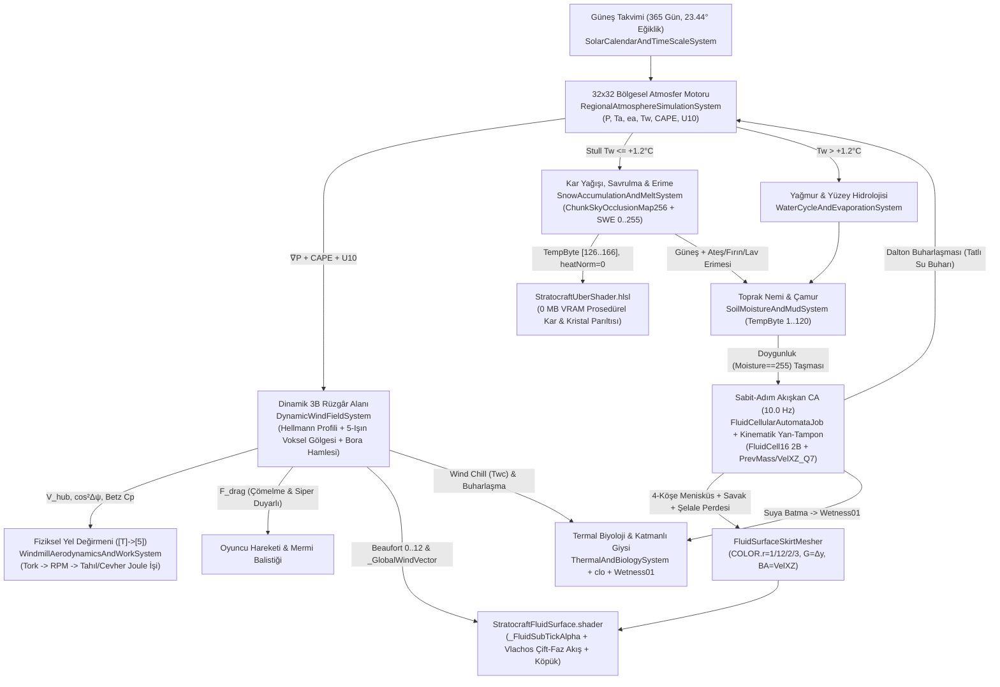

# Paket 4B: Akışkan Akıcılığı, Dinamik Rüzgâr Mekaniği, Fiziksel Yel Değirmeni, Gelişmiş Fırtınalar, Kar Döngüsü ve Termal Kış Hayatta Kalma — Hedef ve Gereksinimler (DOK1)

> **Doküman Kimliği:** `DOK1_HEDEF_VE_GEREKSINIMLER.md`  
> **Paket:** Paket 4B — *Akışkan Akıcılığı, Rüzgâr ve Kış Sistemleri*  
> **Durum:** Tasarım Onayına Hazır Mimari Gereksinim Şartnamesi (Kodlama Öncesi)  
> **Referans Devir Tabanı:** [DURUM_VE_DEVIR.md (Devir #061)](../../DURUM_VE_DEVIR.md#L1-L120) — `124/124` Unity EditMode, `127/127` `.NET 10` Standalone, `6/6` C++20 `ctest`, `9/9` Python `pytest`, `4.14 MB / 16.000 MB` Doku VRAM, `0 B/kare` GC  
> **Paket İçi Bağlantılar:**  
> - Mevcut Kod Debug ve Akış Raporu: [DOK2_MEVCUT_KOD_DEBUG_VE_AKIS_RAPORU.md](DOK2_MEVCUT_KOD_DEBUG_VE_AKIS_RAPORU.md)  
> - Endüstri ve Akademik Araştırma Raporu: [DOK3_ENDUSTRI_VE_BENZER_PROJELER_ARASTIRMASI.md](DOK3_ENDUSTRI_VE_BENZER_PROJELER_ARASTIRMASI.md)  
> - Adım Adım Geliştirme Planı: [DOK4_ADIM_ADIM_GELISTIRME_PLANI.md](DOK4_ADIM_ADIM_GELISTIRME_PLANI.md)  
> - Önceki Paket Referansı (Paket 4A): [Paket 4A DOK1](../paket4a-iklim-hava-ve-yeralti-suyu/DOK1_HEDEF_VE_GEREKSINIMLER.md) | [Paket 4A DOK4](../paket4a-iklim-hava-ve-yeralti-suyu/DOK4_ADIM_ADIM_GELISTIRME_PLANI.md)

---

## 1. Paket 4B Vizyonu, Temel Tasarım İlkeleri ve Kapsam Sınır Çizgisi

### 1.1. Vizyon Bildirgesi

Stratocraft'ın [Paket 4A](../paket4a-iklim-hava-ve-yeralti-suyu/DOK1_HEDEF_VE_GEREKSINIMLER.md#L11-L21) aşamasında kurulan **365 günlük eksen eğiklikli güneş takvimi**, **32×32 hücreli (`2048m × 2048m`) bölgesel fiziksel atmosfer motoru**, **Tetens/Dalton su döngüsü**, **karstik yeraltı akiferleri** ve **Zambretti/FitzRoy meteoroloji aletleri**, dünyaya nedensel bir iklim omurgası kazandırmıştır. Ancak sahada yürüyen oyuncunun gözü ve bedeni açısından üç büyük fiziksel-algısal boşluk hâlen açıktır:

1. **Akışkanların Algısal Süreksizliği ("Işınlanan / Basamaklanan Su ve Lav"):** Kütle korunumlu `FluidCell16` (`2-Byte`) hücresel otomatımız matematiksel olarak sağlam olsa da, değişken zamanlayıcı kayması (`0.130 sn` + kare artığı sıfırlama), tek-tikte `srcMass <= 24` kütle boşaltımı, ayrık hücre tavan yüksekliği (`y + h`), dikey şelale duvarları ve `StratocraftFluidSurface.shader` içindeki akışsız statik yüzey nedeniyle su ve lav; akan bir sıvı gibi değil, **saniyede birkaç kez bir bloktan diğerine ışınlanan katı cam basamaklar** gibi algılanmaktadır.
2. **Rüzgârın Fiziksel Dünyayla Bağlantısızlığı:** Bölgesel atmosfer ızgarasında hesaplanan `(WindVelX, WindVelZ)` vektörü henüz yerel arazi ve duvar engellerinden etkilenmemekte; okları saptırmamakta, su dalgalarını Beaufort ölçeğine göre kabartmamakta, fırtınada oyuncuyu sürüklememekte ve rüzgârın kinetik enerjisini mekanik işe dönüştüren **Fiziksel bir Yel Değirmeni** ile taçlanmamaktadır.
3. **Kış Mevsiminin ve Soğukta Hayatta Kalmanın Eksikliği:** Paket 4A kapsam sınırında ([WeatherPhenomenonTypes.cs](../../Assets/_Stratocraft/Core/Weather/WeatherPhenomenonTypes.cs#L94-L105)) bilinçli olarak maskelenen **kar yağışı, rüzgârla savrulan kar birikimi, bahar/ateş kar erimesi**, **bora/tipi fırtınaları (*blizzard & thundersnow*)**, **rüzgâr soğuğu (*wind chill*)** ve **ıslanan/donan katmanlı giysi `clo` termal yalıtımı** devreye alındığında 365 günlük mevsim döngüsü gerçek anlamda hayati bir mühendislik sınavına dönüşecektir.

**Paket 4B'nin tek cümlelik vizyonu:** *Tek bir bayt ek doku VRAM (`0.0 MB`) harcamadan, `FluidCell16` (`2 Byte`), `UniqueEquipmentInstance` (`128 Byte`) ve `AtmosphereAoiCellSample` (`16 Byte`) bellek sözleşmelerini kırmadan ve çalışma zamanında `0 B/kare` GC üreterek; su/lav akışını 60–144 FPS'te kesintisiz ipeksi bir akışkana dönüştürmek, 3B engel-duyarlı rüzgâr ve yel değirmeni mekaniğini kurmak ve fiziksel kış/termal giysi döngüsünü tamamlamaktır.*

### 1.2. Anayasal Tasarım İlkeleri

Paket 4B kapsamındaki her alt sistem aşağıdaki **7 tavizsiz mühendislik ilkesine** tabidir:

| İlke Kodu | İlke Adı | Mühendislik Kuralı ve Doğrulanabilir Sınır |
| :--- | :--- | :--- |
| **İLK-1** | **Sıfır Rastgele Zar (Deterministik Nedensellik)** | Rüzgâr hamlesi, kar yağışı, çığ kayması, şelale köpüğü veya yıldırım hiçbir zaman `UnityEngine.Random` ile zar atmaz; basınç gradyanı ($\nabla P$), CAPE, yaş-termometre sıcaklığı ($T_w$), Froude sayısı ($Fr$) ve deterministik uzaysal hash fonksiyonlarından doğar. |
| **İLK-2** | **Bellek Sözleşmesi Dokunulmazlığı** | `FluidCell16` **kesinlikle `2 Byte` (`ushort`)** ([FluidCell16.cs](../../Assets/_Stratocraft/Physics/Data/FluidCell16.cs#L15-L128) ve C++ `PackSettledFluid` uyumu), `UniqueEquipmentInstance` **kesinlikle `128 Byte`** ([UniqueEquipmentInstance.cs](../../Assets/_Stratocraft/Inventory/Data/UniqueEquipmentInstance.cs#L15-L71)), `AtmosphereAoiCellSample` **kesinlikle `16 Byte`** ([AtmosphereAoiSyncPacket.cs](../../Assets/_Stratocraft/Networking/AtmosphereAoiSyncPacket.cs#L25-L60)) kalır. Geçici kinematik ve kar verileri yalnızca **aktif/örtülü chunk'lar için kiralanan sıfır-GC yan-tamponlarda (*pooled sidecars*)** tutulur. |
| **İLK-3** | **Sıfır Ek Doku VRAM (`+0.0 MB`)** | Mevcut `4.14 MB / 16.000 MB` doku VRAM bütçesine **tek bir PNG/TGA/RenderTexture veya normal/flow map dokusu eklenmez**. Su akışı, köpük, kar örtüsü, kristal parıltısı, yel değirmeni ve kış giysileri %100 matematiksel HLSL fonksiyonları ve `Color32` tepe noktası öznitelikleriyle üretilir. |
| **İLK-4** | **Shader Kanal Güvenliği (`TempByte` Çakışmasızlığı)** | [StratocraftUberShader.hlsl](../../Assets/_Stratocraft/Rendering/Shaders/StratocraftUberShader.hlsl#L406-L413) ve `#L588-L613` içindeki `COLOR.g` (`TempByte`) kanalında **`TempByte >= 170`** bandı Stefan-Boltzmann $T^4$ akkor ışıma (*Blackbody glow*: `StarCore=170`, `Kiln=192`, `Campfire=210`, `Magma=220`, `Lava=242`) için ayrılmıştır. Kar örtüsü kodlaması **kesinlikle `[126..166]`** bandına hapsedilir ve shader'da Blackbody bloğundan önce **`heatNorm = 0.0`** sıfırlaması zorunludur; kar hiçbir koşulda turuncu lav gibi parlayamaz! |
| **İLK-5** | **Kütle Korunumu (Termodinamik & Hidrolojik)** | Yağan kar `SWE` (*Snow Water Equivalent*) milimetre/kütle cinsinden birikir; eridiğinde kaybolmaz, önce altındaki toprağın `SoilMoisture` kapasitesini doyurur, aşan kütle **tatlı su** (`FluidType.Water`, `ChunkSalinityBitset = 0`) olarak yüzey akışına ve karstik akiferlere katılır. Akışkan simülasyonunda yan-tampon (`PrevMass`, `VelX_Q7`, `VelZ_Q7`) kütle yaratmaz veya yok etmez ($\Delta M = 0$). |
| **İLK-6** | **Sıfır-GC (`0 B/kare`) ve Çift-Hedefli Derleme** | Sıcak döngülerde `new`, LINQ, boxing, `foreach` enumerator tahsisi yasaktır. Yazılan her saf mantık sınıfı hem **Unity 6 (`6000.6.7f1`)** hem de **`.NET 10` Standalone (`TreatWarningsAsErrors=true`, `Nullable=enable`)** hedefinde tek uyarı üretmeden derlenmelidir. |
| **İLK-7** | **Fiziksel Karşı-Oynanış (*Counterplay*)** | Hiçbir doğa olayı oyuncuyu çaresiz bırakmaz: Fırtına sürüklemesine karşı **duvar arkası rüzgâr gölgesi ve çömelme (`[Sol Ctrl]`)**, yıldırıma karşı **metal paratoner ve metal zırhı çıkarma**, tipide donmaya karşı **kuru kürk/deri/kumaş katmanlama, çatı altı sığınak ve kamp ateşi**, yel değirmeni fırtına kırılmasına karşı **mekanik fren (`[Shift+E]`)** tam fiziksel karşılık üretir. |

### 1.3. Kapsam Sınır Çizgisi: Paket 4A vs Paket 4B vs Gelecek Paketler

Mevcut testlerin (`124` EditMode + `127` Standalone) kırılmaması ve kapsam kaymasının (*scope creep*) önlenmesi için sınır çizgisi kesindir:

| Sistem / Özellik Alanı | Paket 4A (Tamamlandı — Korunan Taban) | Paket 4B (BU PAKET — Tam Kapsam) | Gelecek Paketler (Paket 4C / Paket 5+ — Kapsam Dışı) |
| :--- | :--- | :--- | :--- |
| **Akışkan Fiziği & Görseli** | `FluidCell16` (`2B`) kütle korunumlu CA, sifon basıncı, su+lav stokiyometrik obsidyen/buhar, sığ su kıyı köpüğü. | **Sabit `0.100 sn` zamanlayıcı + GPU `_FluidSubTickAlpha` yükseklik enterpolasyonu, `PrevMass/VelXZ` sıfır-GC yan-tamponu, sanal boru momentumu, 4-köşe menisküs, savak çökmesi, parabolik şelale perdesi, Vlachos çift-fazlı akış, Froude/şelale köpüğü, `rawId=1/12` tatlı/tuzlu tamiri.** | Tam 3B Navier-Stokes SPH partikül sıvıları, sualtı ses kırılması, yüzen çok-bloklu ahşap gemi hidrodinamiği (Paket 5+). |
| **Rüzgâr Mekaniği** | 32×32 makro atmosferde `(WindVelX, WindVelZ)` hesabı, rüzgâr gülü/anemometre okuması, bulut sürüklenmesi. | **Hellmann irtifa profili, 5-ışınlı voksel engel gölgeleme (*wind shadow*) + iz sönümlemesi, yağmur/kar/duman sapması, bitki salınımı, ok/mermi balistik sapması, rüzgâr uğultu/ıslık sesi.** | Kanyon içi tam 3B kafes-Boltzmann (LBM) türbülans çözücüsü, planör/yelkenli uçuş aerodinamiği (Paket 5+). |
| **Mekanik Rüzgâr Enerjisi** | Yok. | **`[T] -> [5]` Fiziksel Yel Değirmeni Zihin İnşası kümesi, `0 MB` `Color32` döner rotor/kanat meşi, Betz ($C_p \le 0.593$) + TSR torku, fırtına aşırı-devir hasarı/freni, tahıl öğütme ve cevher kırma mekanik işi.** | Çoklu dişli şaft ağları, su çarkı (*waterwheel*), buhar türbini ve elektrik jeneratörü şebekesi (Paket 5+). |
| **Fırtına Şiddeti & Tehlikeler** | Konvektif yağmur, `CAPE > 1000` yıldırım ve `MetalLightningRod` koruma konisi (`Sanitize*ForPaket4A` kilidi aktif). | **Paket 4B kapı açılışı: $\nabla P$ + CAPE kaynaklı bora/hamleler (*gusts*), çömelme/siper duyarlı oyuncu sürüklemesi, Beaufort `0..12` derinlik-sınırlı su dalgaları, metal zırh/alet yıldırım risk çarpanı, *Thundersnow* (kış yıldırımı).** | 3B hortum (*tornado*) voksel sökme hunisi, kum fırtınası aşındırması, volkanik kül bulutu (Paket 4C). |
| **Yağış Fazları & Kar Döngüsü** | Yalnızca `Rain` ve `None`; ıslak toprak (`TempByte 1..120`), çamur ve göllenme. | **Stull $T_w$ yaş-termometre eşiği ile `Snow` / sulu sepken / `Hail`, `ChunkSkyOcclusionMap256` çatı gölgesi, rüzgâr savrulması, yamaç kar kayması, *Degree-Day* + ateş/fırın/lav erimesi -> `SoilMoisture` + tatlı su, `TempByte 126..166` prosedürel kar örtüsü.** | Çok-yıllık sıkışmış mavi buzul (*glacier*) plastik akışı, donmuş göl üstünde kırılabilir buz tabakası yürümesi (Paket 4C). |
| **Termal Biyoloji & Giysi** | Çıplak vücut `37°C` çekirdek ısısı, basit hipotermi/hipertermi ve terleme. | **JAG/TI *Wind Chill* rüzgâr soğuğu, `UniqueEquipmentInstance` (`128B`) katmanlı `clo` yalıtımı, kumaş/deri/kürk/metal ıslanma (`Wetness01`), metal termal köprü + iç astar nötralizasyonu, ıslak giysi donması, ateş başında kuruma, `[B]` & `[F4]+[Tab]` tarifleri.** | Bölgesel uzuv donması (*frostbite* amputasyon/sargı), terzilik tezgâhı dokuma mini-oyunu, hastalık/bağışıklık sistemi (Paket 5+). |

---

## 2. Akışkanların "Işınlanır Gibi" Görünme Sorununun Algısal ve Fiziksel Tanımı

### 2.1. Mevcut Durumun 6 Kök Nedenli Teşhisi

[DOK2 Bölüm 2](DOK2_MEVCUT_KOD_DEBUG_VE_AKIS_RAPORU.md#L21-L157) kapsamında yapılan satır-satır kod denetimi, oyuncunun su ve lavı "akıyor" değil **"ışınlanıyor / merdiven basamağı gibi atlıyor"** şeklinde görmesinin tek bir hatadan değil, birbirini çarpan **6 ayrı fiziksel ve görsel kesiklilikten** kaynaklandığını kanıtlamıştır:

1. **Zamanlayıcı Kayması (*Beat Aliasing*) ve GPU Alt-Tik Körlüğü:**
   [Stage1InteractivePlayController.cs](../../Assets/_Stratocraft/Character/Stage1InteractivePlayController.cs#L1191-L1195) içindeki `_fluidTickTimer = fluidTickInterval` (`0.130 sn = 7.69 Hz`) sıfırlaması kare artığını yutmakta ve 60 FPS (`16.67 ms`) ekranda her `8` veya `9` karede bir düzensiz aralıklarla (`133.3 ms` – `150.0 ms`) ani meş sıçraması üretmektedir. Aradaki **7–8 görüntü karesi boyunca** su yüzeyi GPU'da `0.0 mm` hareket etmekte, ardından tek bir karede yeni yüksekliğe sıçramaktadır (*sample-and-hold judder*).
2. **Düşük Kütlede (`srcMass <= 24`) %100 Tek-Tik Işınlanma ve Momentumsuz CA:**
   [FluidCellularAutomataJob.cs](../../Assets/_Stratocraft/Physics/Jobs/FluidCellularAutomataJob.cs#L998-L1011) içindeki sığ su süpürme kuralı `srcMass <= 24` olduğunda kütlenin **tamamını tek tikte** komşu hücreye boşaltmakta; `FluidCell16` hücre hızı (`vx, vz`) taşımadığı için yamaçtan inen su dalga cephesi olarak kaymak yerine komşu bloğun ortasında aniden belirmektedir.
3. **Merdiven Basamağı Yüzey Geometrisi ve `wetSamples == 1` Zıplaması:**
   [FluidSurfaceSkirtMesher.cs](../../Assets/_Stratocraft/Voxel/Jobs/FluidSurfaceSkirtMesher.cs#L510-L561) köşe yüksekliklerini 4 komşu hücreden ortalamakla birlikte, `anyColumnAboveFluid` bayrağı tetiklendiğinde köşeyi sert biçimde `y + 1.0f` tavanına kilitlemekte (`#L533`), uçurum ağzında savak eğrisi (*weir drawdown*) oluşturmamakta ve `wetSamples == 1` durumunda (`#L542`) tek hücrelik su ucunu `MinVisibleFilmThickness = 0.04m` yerine `0.24m` yukarı zıplatıp bir sonraki tikte aniden çökertmektedir!
4. **Şelalelerde Ayrık Voksel Kutusu Duvarları:**
   Uçurumdan dökülen su [FluidSurfaceSkirtMesher.cs](../../Assets/_Stratocraft/Voxel/Jobs/FluidSurfaceSkirtMesher.cs#L568-L615) içindeki `EmitSideWallIfExposed` ile her `y` katmanında `90°` dik köşeli voksel kutusu duvarları olarak örülmekte; üst savaktan alt düşüş havuzuna uzanan sürekli, daralan ve köpüren bir şelale perdesi bulunmamaktadır.
5. **Chunk Sınırında Yırtılma (*Seam Tearing*) ve Yavaş Upload Kuyruğu:**
   [FluidCellularAutomataJob.cs](../../Assets/_Stratocraft/Physics/Jobs/FluidCellularAutomataJob.cs#L561-L585) chunk sınırında `headA - headB < 3` farklarını dondurmakta; [Stage1InteractivePlayController.cs](../../Assets/_Stratocraft/Character/Stage1InteractivePlayController.cs#L3744-L3805) ise `_dirtyFluidChunks` kümesini mesafe sırasız `HashSet` düzeniyle kare başına en fazla **`4`** chunk (`maxFluidPerFrame = 4`, `#L3748`) yüklediği için, aynı nehrin iki yakasındaki iki chunk farklı karelerde güncellenerek gözle görülür yarıklar oluşturmaktadır.
6. **Shader'da Sıfır Akış Adveksiyonu ve Yanlış Tuzluluk Kanalı (`rawId == 12`):**
   [StratocraftFluidSurface.shader](../../Assets/_Stratocraft/Rendering/Shaders/StratocraftFluidSurface.shader#L118-L136) tepe renginden hız okumamakta (`COLOR.ba` sabit gölge/AO taşımakta), yüzey normalini akış yönünde sürüklememekte ve `FluidSurfaceSkirtMesher` tüm sulara `MaterialIdCatalog.FiniteWaterSurface = 12` yazdığı için shader `#L135`'te `rawId == 12u` koşuluyla **dünyadaki tüm tatlı nehir ve yağmur sularını tuzlu deniz suyu (`isSaltVertex = 1.0`)** sanmaktadır!

### 2.2. Paket 4B Hedef Akıcılık ve Algısal Süreklilik Standardı

İnsan görsel korteksi (beta hareket algısı ve 60–144 Hz örnekleme eşiği) bir sıvının "kesintisiz aktığına" ikna olmak için üç eşzamanlı ipucu arar: **(a) silüet yüksekliğinin her karede pürüzsüz değişimi**, **(b) yüzey içi faz/köpük deseninin hız vektörü yönünde kesintisiz adveksiyonu** ve **(c) eğim kırıklarında ($C^0/C^1$) süreksiz basamak olmaması**. Paket 4B bu üç ipucunu aşağıdaki nicel standartla garanti altına alır:

| Algısal / Fiziksel Metrik | Paket 4A Mevcut Durum | Paket 4B Zorunlu Hedef Standardı |
| :--- | :--- | :--- |
| **Simülasyon Adım Kararlılığı** | `0.130 sn` + kare artığı kaybı (`7.1–7.7 Hz` titrek) | Sabit **`0.100 sn` (`10.00 Hz`)** biriktirici (`_fluidTickAccumulator -= 0.100f`), kare başına en fazla `2` yakalama adımı |
| **Kareler Arası Yüzey Yükseklik Sıçraması ($\|\Delta y_{\text{frame}}\|$)** | `7` kare `0.00 m`, `8.` karede **`0.15 m – 0.85 m`** ani sıçrama | 60 FPS'te her karede **`<= 0.025 m`** (`_FluidSubTickAlpha` ile GPU tepe noktasında doğrusal enterpolasyon) |
| **Tek-Tik Sığ Su Kütle Aktarım Oranı** | `srcMass <= 24` iken **%100** (anında yok olma / ışınlanma) | Momentum-boru denklemiyle tik başına en fazla **%45 (`<= 11/24`)** + $C^1$ sönümlenen ince film kalınlığı |
| **Uçurum / Şelale Silüet Sürekliliği** | `90°` merdiven basamaklı dik kutu duvarları | Savak ağzında **`h_lip = 0.715 * h_center`** (Rouse savak çökmesi) + üstten alta kesintisiz parabolik şelale perdesi |
| **Komşu Chunk Sınır Yırtılması** | `headA - headB < 3` donması + 1–4 karelik upload gecikmesi | `headA - headB >= 1` geçişi + kamera mesafesi öncelikli kuyrukta komşu iki nehir chunk'ı arasında **`0` kare** görünür yırtılma |
| **Yüzey İçi Akış Hissi (`0.0 MB` VRAM)** | Statik Gerstner dalgası (akış yönünden bağımsız) | Köşe hız vektörü `(vx, vz)` ile sürülen **Alex Vlachos çift-fazlı prosedürel normal ve Froude beyaz köpük adveksiyonu** |

---

## 3. İş Paketleri (`İP-1 .. İP-8`) — Ayrıntılı Fiziksel, Görsel ve Oynanış Gereksinimleri

### 3.1. İP-1: Akışkan Sabit-Adım Simülasyon Zamanlaması ve Sıfır-GC Kinematik Yan-Tampon (*Sidecar*)

#### 3.1.1. `FluidCell16` (`2-Byte`) Dokunulmazlığı ve Yan-Tampon Mimarisi
`FluidCell16` yapısının boyutu (`sizeof(FluidCell16) == 2`), bit dizilimi (`Bits[0..7]=Mass`, `Bits[8..9]=Type`, `Bit[10]=IsSettled`, `Bits[11..15]=PressureHead`) ve C++20 `simd_world_noise.cpp` içindeki `PackSettledFluid` sözleşmesi **kesinlikle değiştirilmeyecektir**. Dünya genelindeki durağan okyanus, göl ve yeraltı akifer chunk'ları chunk başına yalnızca `128 KB` (`16 × 256 × 16 × 2B`) tüketmeye devam eder.

Bunun yerine yalnızca `_activeFluidChunks` kümesindeki **aktif (henüz durulmamış)** chunk'lar için `ActiveChunkFluidKinematicsPool` üzerinden sıfır-GC ile kiralanan bir **`ActiveChunkFluidKinematicsSlice`** yan-tamponu tanımlanır:

- **`byte[] PrevMass` (`65,536 Byte = 64 KB`):** Bir önceki sabit akışkan tikinin başındaki `Mass` (`0..255`) değeri. Mesher, köşe başına önceki yüksekliği ($y_{\text{prev}}$) ve şimdiki yüksekliği ($y_{\text{curr}}$) bu diziden hesaplar.
- **`sbyte[] VelX_Q7` (`65,536 Byte = 64 KB`):** Hücrenin X eksenindeki yatay akış hızı; `[-127..+127]` tam sayı aralığı **`[-4.00 .. +4.00] m/s`** fiziksel hız aralığını `0.0315 m/s` çözünürlükle temsil eder (`vx = (VelX_Q7 / 127.0f) * 4.0f`).
- **`sbyte[] VelZ_Q7` (`65,536 Byte = 64 KB`):** Hücrenin Z eksenindeki yatay akış hızı (`[-4.00 .. +4.00] m/s`).
- **Havuz Kapasitesi ve Yaşam Döngüsü:** Havuz başlangıçta `32` dilim (`32 × 192 KB = 6.0 MB` sabit RAM) ayırır; gerekirse `ArrayPool` / üst-sınırlı havuz büyümesiyle en fazla `64` dilime (`12.0 MB`) çıkar ve çalışma zamanında `0 B/kare` GC üretir. Bir chunk tamamen durulduğunda (`remaining == 0 && coolingLavaCells <= 0`) veya chunk bellekten boşaltıldığında (`UnloadChunk`), dilim sıfırlanarak havuza geri verilir; durağan chunk'lar yan-tampon tutmaz (`COLOR.g = 128 -> Δy = 0`, `COLOR.ba = 128 -> v = 0`).

#### 3.1.2. Sabit-Adım (`10.0 Hz`) Biriktirici ve `_FluidSubTickAlpha`
`Stage1InteractivePlayController.StepFluidSimulation(float dt)` içindeki kaymalı sayaç kaldırılarak deterministik sabit-adımlı biriktiriciye geçilir:

$$\tau_{\text{tick}} = 0.100\text{ sn} \quad (10.0\text{ Hz}), \qquad \alpha_{\text{sub}} = \operatorname{clamp}_{01}\!\left(\frac{t_{\text{accum}}}{\tau_{\text{tick}}}\right)$$

1. Her `Update(dt)` karesinde `t_accum = Mathf.Min(t_accum + dt, 2.0f * τ_tick)` eklenir (ağır kare takılmalarında ölüm sarmalını *spiral of death* önlemek için en fazla `2` yakalama adımı koşulur).
2. `while (t_accum >= τ_tick)` döngüsünde aktif chunk'lar `PrevMass` anlık görüntüsü alınarak adımlanır ve `t_accum -= τ_tick` düşülür.
3. Döngü sonunda her karede `Shader.SetGlobalFloat(FluidSubTickAlphaId, Mathf.Clamp01(t_accum / τ_tick))` çağrılarak GPU'ya `[0.0 .. 1.0]` kesirli alt-tik fazı yayınlanır.

#### 3.1.3. Sanal Boru Momentumu (Mei–Decaudin–Hu Hibridi) ve Kök Hata Tamirleri
`FluidCellularAutomataJob` içindeki yatay akış ve sınır geçiş kuralları kütle korunumu ($\sum M = \text{sabit}$) bozulmadan şu şekilde güncellenir:

1. **Hidrostatik + Momentum Yatay Akı:** İki komşu hücre $(i \to j)$ arasındaki hedef akış hızı, su seviyesi farkı $\Delta H = (y + h_i) - (y + h_j)$ ve mevcut `Vel_Q7` bileşeninden ivmelenir:
   $$v_{i \to j}^{(n+1)} = \operatorname{clamp}\!\left(\mu_{\text{visc}} \cdot v_{i \to j}^{(n)} + g_{\text{eff}} \cdot \Delta t \cdot \frac{\Delta H}{\Delta x},\; -v_{\max},\; +v_{\max}\right)$$
   Burada su için $\mu_{\text{visc}} = 0.82$, $v_{\max} = 4.0\text{ m/s}$; lav için yüksek viskozite nedeniyle $\mu_{\text{visc}} = 0.45$, $v_{\max} = 1.2\text{ m/s}$; asit için $\mu_{\text{visc}} = 0.85$, $v_{\max} = 4.0\text{ m/s}$ uygulanır.
2. **`srcMass <= 24` Tek-Tik Işınlanma Tamiri:** [FluidCellularAutomataJob.cs](../../Assets/_Stratocraft/Physics/Jobs/FluidCellularAutomataJob.cs#L998) içindeki `if (srcMass <= 24) transfer = srcMass;` kuralı kaldırılır. `srcMass` `4..24` aralığındayken tik başına aktarım en fazla `max(2, (srcMass * 11) / 24)` (`~%45`) ile sınırlandırılır; yalnızca `srcMass <= 2` mikroskobik kalıntısı altındaki toprağa veya en güçlü komşuya tek adımda temizlenir. Böylece sığ su cephesi zeminde kayarak ilerler.
3. **Eğim Kaskadı (`NewlyWetFromGravityFlag`) Tamiri:** Dikey düşüşle yeni ıslanan hücrenin eğimli bir tabana (`solid below`) çarptığı anda aynı tikte yatay momentum kazanarak yayılmasına izin verilir; havada serbest düşen hücreler için yanlara saçılma kilidi korunur (şelale sütunu havada dağılmaz, tabana çarptığında yayılır).
4. **Chunk Sınır Dikişi (`ExchangeChunkBorderFluids`) Eşitlemesi:** [FluidCellularAutomataJob.cs](../../Assets/_Stratocraft/Physics/Jobs/FluidCellularAutomataJob.cs#L561-L585) içindeki `headA - headB < 3` engeli **`headA - headB < 1`** olarak düzeltilir ve chunk içi kohezyon/momentum kurallarıyla birebir aynı aktarım denklemi sınır çiftlerine de uygulanır; sınırda kütle ve `VelX_Q7 / VelZ_Q7` kesintisiz devredilir.
5. **Yığın-Duyarlı (*Batch-Aware*) AIMD Bütçesi:** [FluidSimulationSystem.cs](../../Assets/_Stratocraft/Physics/Systems/FluidSimulationSystem.cs#L38-L55) içindeki `2.0 ms` bütçe ölçümü tekil `StepChunkFluid` çağrısı yerine tüm aktif yığının (`BeginTickBatch` / `EndTickBatch`) toplam süresini ölçer; böylece `MaxChunksPerTick` yanlışlıkla tavan değere kilitlenmez.

---

### 3.2. İP-2: `FluidSurfaceSkirtMesher` Köşe Menisküs Ortalaması, Savak Çökmesi, Kesintisiz Şelale Perdesi ve `Color32` Kanal Tamiri

#### 3.2.1. $C^1$ Sürekli İnce Film Kalınlık Eğrisi ve `wetSamples == 1` Zıplama Tamiri
[FluidSurfaceSkirtMesher.cs](../../Assets/_Stratocraft/Voxel/Jobs/FluidSurfaceSkirtMesher.cs#L41-L60) içindeki parçalı doğrusal `MassToFluidThickness` fonksiyonu, türevi ($dh/dm$) her noktada sürekli olan monotonik Hermite/kuadratik eğri ile değiştirilir ve [FluidSurfaceSkirtMesher.cs](../../Assets/_Stratocraft/Voxel/Jobs/FluidSurfaceSkirtMesher.cs#L542) satırındaki `wetSamples == 1` için `+0.24f` şişirme hatası tamamen kaldırılır:

- `mass == 0` $\implies h = 0.0\text{ m}$
- `1 <= mass < 255` $\implies t = \text{mass} / 255.0$, $h(m) = h_{\min} + (1.0 - h_{\min}) \cdot t^{0.85}$ ($h_{\min} = 0.025\text{ m}$)
- Tek bir ıslak komşuya sahip dış su kenarı köşesi (`wetSamples == 1`), katı zemine doğru $h_{\text{corner}} = \max(0.015\text{ m},\; 0.35 \cdot h_{\text{wet}})$ menisküs açısıyla yumuşakça sıfıra yaklaşır; asla `0.24 m` yukarı fırlamaz.

#### 3.2.2. 4-Hücreli Köşe Menisküs Ortalaması ve Savak Çökmesi (*Free-Overfall Weir Drawdown*)
Her `(vx, vz)` köşesi etrafındaki 4 hücre komşuluğu $(c_{00}, c_{10}, c_{01}, c_{11})$ hem **şimdiki kütle (`CurrMass`)** hem **önceki kütle (`PrevMass`)** için değerlendirilir:

1. **Üst Hücre Sürekliliği:** Bir komşu sütunda `y + 1` hücresinde aynı tür sıvı varsa, o sütunun yerel yüzey katkısı kütlesiyle orantılı olarak `1.0 + 0.25 * MassToFluidThickness(aboveMass)` ile yumuşatılır; 4 komşunun tamamının üstü dolu değilse köşe sertçe `y + 1.0f` tavanına yapıştırılmaz.
2. **Rouse Savak Çökmesi (*Weir Drawdown*):** 4 köşe komşusundan en az biri sıvı dolu (`Fluid`) iken en az biri **tabanı boş hava (`Air` ve `y - 1` de katı değil — yani şelale/uçurum ağzı)** ise, açık kanal hidroliğindeki kritik derinlik yasası ($y_{\text{brink}} \approx 0.715 \cdot y_c$) uyarınca köşe yüksekliği savak ağzına doğru bükülür:
   $$y_{\text{corner}} = y + \operatorname{lerp}\!\left(\bar{h}_{\text{wet}},\; 0.68 \cdot \bar{h}_{\text{wet}},\; w_{\text{overfall}}\right)$$
   Böylece uçurum kenarında `90°` keskin dikdörtgen köşe yerine doğal dışbükey şelale bükümü oluşur.

#### 3.2.3. Kesintisiz Parabolik Şelale Perdesi (*Continuous Waterfall Curtain*)
Bir sıvı hücresinin yatay komşusu boş hava olduğunda ve bu hava boşluğunun altında düşen sıvı sütunu (`y - 1` veya savak akışı) bulunduğunda, `EmitSideWallIfExposed` dik voksel kutusu duvarı basmak yerine:
- Üstteki savak dudağı köşelerinden (`y_lip`) alttaki hücrenin gerçek sıvı tepe yüzeyine (veya düşüş havuzuna `y_plunge`) kesintisiz bağlanan, yatayda hafifçe dışa kavislendirilmiş ($\Delta x_{\text{jet}} \approx 0.14\text{ m} \cdot \sqrt{\text{head}}$) **eğimli şelale perdesi dörtgeni (*beveled curtain quad*)** üretir.
- Düşüş sütunu boyunca üst ve alt katmanların perde köşeleri birebir aynı `(X, Y, Z)` koordinatlarını paylaşır (`0.0 mm` katman kopukluğu) ve düşüş hızına göre şelale köpük özniteliği (`waterfallFoam01`) tepe noktasına işlenir.

#### 3.2.4. Köşe-Başına `Color32` Kanal Sözleşmesi ve Tatlı/Tuzlu Su Tamiri
Mevcut `AddFacetedTriangleWithTemp` üçgen başına tek bir düz renk atadığı için köşeler arası pürüzsüz hız ve $\Delta y$ enterpolasyonunu engellemektedir ([HybridSurfaceNetsAndShapeMesher.cs](../../Assets/_Stratocraft/Voxel/Jobs/HybridSurfaceNetsAndShapeMesher.cs#L1257-L1281)). Paket 4B'de katı arazi meşleyicisine dokunulmadan, doğrudan [FluidSurfaceSkirtMesher.cs](../../Assets/_Stratocraft/Voxel/Jobs/FluidSurfaceSkirtMesher.cs) içinde kendi köşe-başına `Color32` + `UV0 (float2)` özniteliklerini taşıyan sıfır-GC `FluidMeshVertex` (`36 Byte`, `#if UNITY_5_3_OR_NEWER`) / `FluidRichTriangle` boru hattı kurulur:

| Kanal / Öznitelik | Veri Tipi | Kodlama Aralığı ve Fiziksel Anlamı | Durağan Varsayılan |
| :--- | :--- | :--- | :--- |
| **`COLOR.r`** (`FluidRenderId`) | `byte` (`UNorm8`) | **`1` = Tatlı Su** (`ChunkSalinityBitset == false`), **`12` = Tuzlu Deniz Suyu** (`ChunkSalinityBitset == true`), **`2` = Lav**, **`3` = Asit**. *(Mevcut `rawId=12` tüm suları tuzlu yapma hatasını %100 giderir!)* | `1` veya `12` |
| **`COLOR.g`** (`SubTickDeltaY`) | `byte` (`UNorm8`) | İşaretli alt-tik yükseklik farkı $\Delta y_{\text{tick}} = \operatorname{clamp}(y_{\text{curr}} - y_{\text{prev}}, -1.0\text{ m}, +1.0\text{ m})$ $\to$ `Clamp(128 + Round(Δy * 127), 1, 255)`. Shader'da `dy = ((COLOR.g * 255.0) - 128.0) / 127.0` ve `y_render = y_curr - (1.0 - _FluidSubTickAlpha) * dy`. | **`128`** (`Δy = 0.0 m`) |
| **`COLOR.b`** (`VelX_Encoded`) | `byte` (`UNorm8`) | Köşe X akış hızı $v_x \in [-4.0, +4.0]\text{ m/s}$ $\to$ `Clamp(128 + Round((vx / 4.0) * 127), 1, 255)`. | **`128`** (`vx = 0.0 m/s`) |
| **`COLOR.a`** (`VelZ_Encoded`) | `byte` (`UNorm8`) | Köşe Z akış hızı $v_z \in [-4.0, +4.0]\text{ m/s}$ $\to$ `Clamp(128 + Round((vz / 4.0) * 127), 1, 255)`. | **`128`** (`vz = 0.0 m/s`) |
| **`TEXCOORD0.xy`** (`FluidAux`) | `half2` / `float2` | `x`: Köşe yerel sıvı derinliği $d \in [0.0, 8.0]\text{ m}$ (sığ kenar saydamlığı, Beaufort dalga sönümlemesi ve Froude hesabı için); `y`: Şelale perde/çarpma köpük şiddeti `waterfallFoam01` $\in [0.0, 1.0]$. | `(depth, 0.0)` |

#### 3.2.5. Mesafe-Öncelikli Chunk Sınır Meş Senkronizasyonu
`Stage1InteractivePlayController.RebuildAllDirtyChunks()` (`#L3744-L3805`) içindeki `_dirtyFluidChunks` kuyruğu her karede oyuncu kamerasına olan Öklid/Chebyshev mesafesine göre sıfır-GC eklemeli sıralamayla (*insertion sort* üzerinde önceden ayrılmış `List<(int cx, int cz)>`) sıralanır; kare başına sıvı meş yükleme tavanı (`maxFluidPerFrame`) yakın mesafe (`<= 32m`) komşu chunk'lar için aynı karede birlikte tamamlanacak şekilde `4`'ten **`16` chunk/kare**'ye çıkarılır (`< 0.8 ms` bütçe korumalı).

---

### 3.3. İP-3: `StratocraftFluidSurface.shader` GPU Alt-Tik Enterpolasyonu, Çift-Fazlı Prosedürel Akış ve Beyaz Köpük (`0.0 MB` Doku VRAM)

#### 3.3.1. Tepe Noktasında GPU Alt-Tik Yükseklik Enterpolasyonu (`_FluidSubTickAlpha`)
Vertex shader aşamasında tepe noktasının Y koordinatı kesintisiz olarak enterpole edilir:

$$y_{\text{smooth}}(\alpha_{\text{sub}}) = y_{\text{curr}} - (1.0 - \alpha_{\text{sub}}) \cdot \Delta y_{\text{tick}} + \eta_{\text{wave}}(\mathbf{x}, t, d, U_{10})$$

`t_accum = 0` anında ($\alpha_{\text{sub}} = 0$) meş tam olarak bir önceki tikin yüksekliğinde ($y_{\text{prev}}$) başlar; `0.100 sn` boyunca 60–144 FPS hızında her karede pürüzsüzce $y_{\text{curr}}$ değerine yükselir/alçalır. Böylece tik geçiş anında **0.0 mm görsel sıçrama** elde edilir.

#### 3.3.2. Alex Vlachos Çift-Fazlı (*Dual-Phase*) Prosedürel Akış Adveksiyonu (`0.0 MB` Doku)
Akış vektörü $\mathbf{v} = (v_x, v_z)$ uzaysal olarak değiştiğinden, klasik `worldXZ - v * _Time.y` koordinat kaydırması birkaç saniye içinde prosedürel gürültüyü lastik gibi uzatarak bozar (*UV stretching*). Paket 4B, Valve *Portal 2 / Left 4 Dead 2* (Vlachos, SIGGRAPH 2010) çift-fazlı sıfırlama tekniğini **sıfır doku okuyarak** doğrudan analitik 2B prosedürel dalga/FBM fonksiyonu üzerinde çalıştırır:

$$\phi_0 = \operatorname{frac}\!\left(\frac{t}{T_{\text{flow}}} + \xi(\mathbf{x})\right), \qquad \phi_1 = \operatorname{frac}\!\left(\frac{t}{T_{\text{flow}}} + 0.5 + \xi(\mathbf{x})\right), \qquad w_0 = \left|1.0 - 2.0 \cdot \phi_0\right|$$

$$\mathbf{p}_0 = \mathbf{x}_{xz} - \mathbf{v} \cdot (\phi_0 \cdot T_{\text{flow}}), \qquad \mathbf{p}_1 = \mathbf{x}_{xz} - \mathbf{v} \cdot (\phi_1 \cdot T_{\text{flow}})$$

Burada $T_{\text{flow}} = 1.6\text{ sn}$ faz periyodu, $\xi(\mathbf{x}) \in [0, 0.25]$ ise küresel senkron nabız (*pulsing*) artefaktını yok eden deterministik uzaysal faz kaymasıdır. Yüzey yükseklik alanı $H(\mathbf{x}, t) = \operatorname{lerp}(h_{\text{proc}}(\mathbf{p}_0), h_{\text{proc}}(\mathbf{p}_1), 1 - w_0)$ olarak birleştirilir. Lav (`rawId == 2`) için daha düşük frekanslı soğuyan bazalt kabuk çatlakları ve akkor damarlar aynı çift-fazlı akışla sürüklenir.

#### 3.3.3. Analitik Yüzey Normali ve Froude / Şelale / Kıyı Beyaz Köpüğü
1. **Analitik Gradyan Normali:** Doku örneklemesi olmadan $h_{\text{proc}}$ türevlerinden analitik $(\partial H / \partial x, \partial H / \partial z)$ hesaplanarak geometrik menisküs/şelale normalinin üzerine teğet uzayında bindirilir; güneş ve gökyüzü Fresnel yansıması suyun aktığı yöne doğru canlı biçimde kırılır.
2. **Birleşik Fiziksel Köpük Maskesi (`foam01`):** Dört fiziksel kaynaktan üretilir:
   - **Süperkritik Akış Köpüğü (Froude Sayısı):** $Fr = \frac{\|\mathbf{v}\|}{\sqrt{g \cdot \max(d, 0.08)}}$ için $Fr > 0.85$ olduğunda (sığ ve hızlı nehir yatakları / savak ağızları) köpük üretilir.
   - **Şelale Perdesi ve Çarpma Havuzu Köpüğü:** `FluidAux.y` (`waterfallFoam01`) değeri yüksek dikey hızlarda ve şelalenin alt suya çarptığı *plunge pool* halkasında yoğun beyaz havalandırılmış su (*aerated whitewater*) oluşturur.
   - **Kıyı ve Engel Çarpma Köpüğü:** URP `_CameraOpaqueTexture` / sahne derinliği farkı `sceneDepthDiff < 0.25m` olan sığ ıslak kıyılarda ve nehir içi kayaların etrafında darbe köpüğü üretilir.
   - **Beaufort Açık Deniz Köpüğü (*Whitecaps*):** Rüzgâr hızı Beaufort $\ge 6$ ($U_{10} \ge 10.8\text{ m/s}$) olduğunda derin su dalga tepelerinde rüzgâr kırılma köpüğü oluşur.
3. **Sığ Film Kıyı Geçişi:** $d \to 0$ sınırında opak-saydam geçiş basamağı bırakmamak için alfa $\alpha_{\text{edge}} = \operatorname{smoothstep}(0.0, 0.06, d)$ ile zemindeki ıslak toprağa kesintisiz kaynaşır.

---

### 3.4. İP-4: Dinamik 3B Rüzgâr Mekaniği (Profil, Voksel Gölgeleme ve Çoklu Sistem Etkileşimi)

#### 3.4.1. Hellmann İrtifa Profili ve Mikro-Ölçekli 3B Rüzgâr Alanı (`DynamicWindFieldSystem`)
Bölgesel atmosfer motorunun (`RegionalAtmosphereSimulationSystem`) `64m × 64m` çözünürlükte ürettiği 10-metre referans rüzgâr vektörü $\mathbf{U}_{10}(x, z)$, yerel arazi yüksekliği $y_{\text{ground}}$ üzerindeki irtifaya ($\Delta z = \max(0.5\text{ m}, y - y_{\text{ground}})$) göre **Hellmann Güç Yasası** ile ölçeklenir:

$$\mathbf{U}_{\text{alt}}(x, y, z) = \mathbf{U}_{10}(x, z) \cdot \operatorname{clamp}\!\left(\left(\frac{\Delta z}{10.0\text{ m}}\right)^{\alpha_H},\; 0.35,\; 1.85\right)$$

Hellmann üssü $\alpha_H$: açık deniz/göl üzerinde `0.11`, açık çayır/kar üzerinde `0.16`, engebeli arazi ve yapılaşmış bölgede `0.26` olarak alınır. Böylece yüksek tepelere veya kulelere kurulan yel değirmenleri zemin seviyesine kıyasla fiziksel olarak çok daha verimli rüzgâr yakalar.

#### 3.4.2. 5-Işınlı Rüzgâr-Üstü Voksel Engel Gölgeleme (*Upwind Wind Shadow*) ve İz Sönümlemesi
Bir konumun (oyuncu gövdesi, kamp ateşi, yel değirmeni rotoru veya kar hücresi) rüzgâra ne kadar açık olduğunu belirlemek için rüzgârın geldiği yöne doğru ($-\hat{\mathbf{u}}$) **5 adet kısa menzilli (`16 m`, `1.0 m` adımlı) deterministik voksel ışını** atılır (merkez eksen, $\pm 18^\circ$ yatay yelpaze, $+15^\circ$ ve $+35^\circ$ üst eğim ışınları):

1. Kapalı iç mekân (`ConnectedAirVoxels < OpenAtmosphereThresholdVoxels` ve rüzgâr yönünde pencere/kapı açıklığı yoksa) için rüzgâr geçirgenliği **`S_wind = 0.0`** olur (tam sığınak).
2. Açık havada katı bir duvar, uçurum yamacı veya ağaç gövdesi rüzgâr-üstü mesafesi $d_{\text{obs}} \in (0, 16\text{ m}]$ ve engel üst yüksekliği $H_{\text{obs}}$ ile tespit edildiğinde, Jensen/sınır-katmanı iz sönümlemesi uygulanır:
   $$S_{\text{ray}} = \begin{cases} 0.08 + 0.92 \cdot \operatorname{smoothstep}\!\left(2.0,\; 10.0,\; \dfrac{d_{\text{obs}}}{\max(1.0, H_{\text{obs}})}\right), & \text{engel varsa} \\ 1.0, & \text{açık ufuk} \end{cases}$$
3. 5 ışının ağırlıklı ortalaması yerel maruziyet çarpanı $S_{\text{wind}} \in [0.0, 1.0]$ değerini üretir; etkin yerel rüzgâr $\mathbf{V}_{\text{local}} = S_{\text{wind}} \cdot (\mathbf{U}_{\text{alt}} + \mathbf{V}_{\text{gust}})$ olur. Oyuncu tek bir kaya çıkıntısının veya ördüğü taş duvarın rüzgâr-altı (*leeward*) tarafına geçtiğinde rüzgârın anında kesildiğini hem ses hem vücut ısısı hem hareket rahatlığıyla hisseder!

#### 3.4.3. Çoklu Dünya Etkileşimleri (Parçacık, Ses, Su Dalgası, Bitki Örtüsü ve Mermi Balistiği)
Dinamik 3B rüzgâr vektörü $\mathbf{V}_{\text{local}}$ aşağıdaki **5 alt sistemle** doğrudan konuşur:

1. **Yağmur, Kar ve Duman Sapması:** `StratocraftProceduralClouds.shader` içindeki yağış perdesi eğim açısı $\theta_{\text{tilt}} = \arctan(\|\mathbf{V}_{\text{local}}\| / v_{\text{terminal}})$ ile eğilir (`v_rain ≈ 7.5 m/s`, `v_snow ≈ 1.2 m/s` olduğu için kar taneleri hafif rüzgârda bile yatay savrulur!). Kamp ateşi ve izabe fırını dumanı rüzgâr vektörü yönünde yatar.
2. **Prosedürel Rüzgâr Sesi (`0 MB` Ses Dosyası):** Sıfır ses asset'i ilkesiyle mevcut prosedürel ses sentezleyicide düşük geçiren filtrelenmiş pembe/kahverengi gürültüden açık arazide **bas uğultu**, dar duvar/pencere aralıklarında ($0.15 < S_{\text{wind}} < 0.65$ ve yüksek $\|\mathbf{U}_{\text{alt}}\|$) **rezonanslı rüzgâr ıslığı** üretilir.
3. **Su Dalgası Yönelimi:** [StratocraftFluidSurface.shader](../../Assets/_Stratocraft/Rendering/Shaders/StratocraftFluidSurface.shader#L80) ve [Stage1AtmosphereCloudAndRainRenderer.cs](../../Assets/_Stratocraft/Character/Stage1AtmosphereCloudAndRainRenderer.cs#L613) içindeki mevcut küresel **`_GlobalWindVector`** (`xy = rüzgâr yönü/vektörü, z = hız m/s`) ve opsiyonel `_GlobalWindBeaufort` üniformu Gerstner dalga yayılım yönünü ve köpük sürüklenmesini belirler.
4. **Bitki Örtüsü ve Ağaç Taç Salınımı:** [StratocraftUberShader.hlsl](../../Assets/_Stratocraft/Rendering/Shaders/StratocraftUberShader.hlsl#L307) vertex aşamasında mevcut `_GlobalWindVector` okunarak ağaç taç yaprakları ve çalı/bitki örtüsü meşleri (`MaterialIdCatalog.Grass == 3` tabanlı ağaç taçları — [StratocraftFloatingIslandWorldGen.cs](../../Assets/_Stratocraft/WorldGen/StratocraftFloatingIslandWorldGen.cs#L3921-L3925) ve [PhysicalItemMeshFactory.cs](../../Assets/_Stratocraft/Inventory/Rendering/PhysicalItemMeshFactory.cs#L209); **dikkat: `18` numaralı `Floatstone` malzemesine kesinlikle dokunulmaz!**) yüzey normali/serbest taç maskesiyle rüzgâr yönüne eğilir (`0 B` CPU maliyeti).
5. **Ok, Mızrak ve Fırlatılan Cisim Balistik Sapması:** Havada uçan mermi/fırlatılan eşya göreceli hava hızına $\mathbf{v}_{\text{rel}} = \mathbf{v}_{\text{proj}} - \mathbf{V}_{\text{local}}$ göre kuadratik aerodinamik sürükleme ivmesi alır:
   $$\mathbf{a}_{\text{wind}} = -\frac{1}{2 m_{\text{proj}}} \rho_{\text{air}} C_d A_{\text{eff}} \|\mathbf{v}_{\text{rel}}\| \mathbf{v}_{\text{rel}}$$
   Hafif ok ve fırlatılan taşlar yan fırtınada (`18 m/s`) `30 m` menzilde **`1.5 m – 3.2 m`** rüzgâr altına sapar; ağır metal cirit/gülle ise kütlesi sayesinde çok daha az etkilenir.

---

### 3.5. İP-5: Fiziksel Yel Değirmeni (`[T]` Zihin İnşası, `0 MB` `Color32` 3B Model, Betz Torku ve Öğütme Mekanik İşi)

#### 3.5.1. `[T]` Zihin İnşası (*Mind Building*) Serbest Parça Kümesi Kuralları
Stratocraft'ın soyut "tek tıkla bina koyma" yasağı uyarınca Yel Değirmeni, [MindStructureClusterValidator.cs](../../Assets/_Stratocraft/Inventory/Systems/MindStructureClusterValidator.cs#L12-L20) içerisine **`MindStructureBlueprintId.Windmill = 4`** (`[T]` menüsü **`[5]` tuşu**) olarak eklenir ve oyuncunun sahada fiziksel olarak dizdiği serbest parçalardan doğrulanır:

| Bileşen Grubu | Fiziksel Rolü ve Mevcut / Yeni Sabit Karşılığı | Küme Doğrulama Şartı |
| :--- | :--- | :--- |
| **Taş Kaide ve Değirmen Yatağı** | Alt tabanda titreşimi sönümleyen kâgir kaide ve öğütme taşı çifti (mevcut `LooseBuildPartKind.RoughStoneChunk = 5` ve `MaterialIdCatalog`: `Stone = 1`, `Cobblestone = 8`, `Marble = 14`, `Basalt = 10`) | En az **`4` adet** taş/kaya yapısal parça taban düzleminde (`y_base .. y_base + 1.2m`) |
| **Ahşap Kule ve Ana Mil (*Main Shaft*)** | Dikey taşıyıcı iskelet, yatay rotor mili ve çark göbeği (mevcut `LooseBuildPartKind`: `SplitFirewood = 4`, `Stick = 3`, `WoodenWheel = 9`; `MaterialIdCatalog`: `OakWood = 70`..`73`) | En az **`4` adet** ahşap gövde/sopa/çark parçası (`y_base + 0.5m .. y_base + 3.5m` dikey süreklilik) |
| **Yelken Kanat Çerçeveleri (*Rotor Sails*)** | `[I]/[R]` bez zanaatıyla üretilen **yeni** **`WindmillSailPanel`** (`PrimitiveCraftOutputId = 13`: mevcut `Stick` + `TacticalCloth = 74` / `LeatherPadding = 75` + `PlantFiber = 2`) veya eşdeğer kumaş+sopa kombinasyonu | En az **`4` adet** yelken kanat çerçevesi (veya `4× TacticalCloth/LeatherPadding + 4× Stick`) üst göbek çevresinde |
| **Açık Rüzgâr Koridoru** | Rotor merkezinin (`y_hub ≈ y_base + 3.2m`) ön/arka süpürme düzleminde katı voksel çakışması olmaması | Rotor yarıçapı **`R = 2.25 m`** süpürme diski katı voksel içermez |

#### 3.5.2. `0.0 MB` Doku VRAM Prosedürel `Color32` 3B Geometri
[PhysicalItemMeshFactory.cs](../../Assets/_Stratocraft/Inventory/Rendering/PhysicalItemMeshFactory.cs#L1-L120) içerisine eklenen `EmitWindmillTowerTriangles` ve `EmitWindmillRotorTriangles` yordamları sıfır doku kullanarak iki parçalı meş üretir:
1. **Statik Gövde Meşi:** Sekizgen taş temel bileziği, çapraz ahşap payandalı kule gövdesi, alt hazneli çift değirmen taşı (*bedstone & runner stone*) ve ahşap fren kolu.
2. **Dinamik Döner Göbek + 4 Kanat Meşi:** Rüzgâr yönüne dönen üst şapka (*cap yaw*) üzerinde `4` adet kafesli ahşap kol ve gergin keten/kumaş yelken yüzeyi (`Color32` faset gölgelemeli). Kanat açısı $\theta_{\text{rotor}}$ her karede fiziksel açısal hız $\omega$ (`rad/s`) ile GPU/Transform üzerinde sıfır-GC döndürülür.

#### 3.5.3. Betz Limiti, Uç Hız Oranı ($\lambda$), Yönelim ($\cos^2\Delta\psi$) ve Fırtına Aşırı-Devir Fiziği
Yel değirmeni rastgele sabit hızla dönmez; `WindmillAerodynamicsAndWorkSystem` her adımda rotor göbeğindeki (`y_hub`) engel-filtrelenmiş 3B rüzgârı $\mathbf{V}_{\text{hub}}$ örnekler:

1. **Yönelim (*Yaw Alignment*) Kaybı:** Rotor ekseni birim vektörü $\hat{\mathbf{n}}_{\text{rotor}}$ ile rüzgâr yönü $\hat{\mathbf{u}}_{\text{wind}}$ arasındaki açı $\Delta\psi$ için etkin dik rüzgâr hızı:
   $$U_{\perp} = \|\mathbf{V}_{\text{hub}}\| \cdot \max(0.0,\; \cos\Delta\psi), \qquad \eta_{\text{yaw}} = \cos^2\Delta\psi$$
   Kuyruk yelpazesi (*fantail*) mekanizması kulenin üst şapkasını saniyede en fazla `12°/sn` hızla rüzgâra çevirir; ani rüzgâr yönü değişimlerinde geçici verim düşüşü doğal olarak gözlenir.
2. **Betz Sınırı ve Uç Hız Oranı (*Tip-Speed Ratio* — TSR):** Süpürme alanı $A = \pi R^2 \approx 15.90\text{ m}^2$ ($R = 2.25\text{ m}$) ve hava yoğunluğu $\rho_{\text{air}}(T, P)$ (soğuk kış havasında $\rho \approx 1.34\text{ kg/m}^3$ sıcak yaz havasından daha yoğundur!) kullanılarak uç hız oranı $\lambda = \frac{\omega R}{\max(U_{\perp}, 0.1)}$ hesaplanır. Klasik 4-kanatlı kumaş yel değirmeni güç katsayısı $C_p(\lambda)$ **Betz limitini ($16/27 \approx 0.5926$) asla aşmayacak** şekilde modellenir (`C_p,max = 0.34`, optimum $\lambda_{\text{opt}} = 2.2$):
   $$C_p(\lambda) = 0.34 \cdot \operatorname{clamp}_{01}\!\left(\frac{2.0 \cdot \lambda \cdot \lambda_{\text{opt}}}{\lambda^2 + \lambda_{\text{opt}}^2}\right) \cdot e^{-0.12 \cdot \max(0,\; \lambda - \lambda_{\text{opt}})^2}$$
   **Kalkış Torku (*Startup Torque*):** $\omega \approx 0$ durgun haldeyken kumaş kanatların eğim açısı ($\beta = 18^\circ$) pozitif sürükleme/kaldırma kalkış torku üretir: $\tau_{\text{aero}} = \frac{1}{2} \rho_{\text{air}} A R U_{\perp}^2 \cdot C_q(\lambda)$, burada $C_q(0) = 0.085$. Statik yatak sürtünmesi $\tau_{\text{static}} = 14.0\text{ N}\cdot\text{m}$ olduğundan, değirmen **$U_{\perp} \ge 2.2\text{ m/s}$** (Beaufort 2 hafif esinti) üzerinde kendiliğinden dönmeye başlar; daha düşük rüzgârda veya kapalı duvarda ($S_{\text{wind}} \approx 0$) durur.
3. **Açısal Momentum İntegrasyonu:** Rotor eylemsizlik momenti $I_{\text{rotor}} = 85.0\text{ kg}\cdot\text{m}^2$ üzerinden:
   $$\frac{d\omega}{dt} = \frac{\tau_{\text{aero}} - \tau_{\text{bearing}}(\omega) - \tau_{\text{grind\_load}} - \tau_{\text{brake}}}{I_{\text{rotor}}}$$
4. **Fırtına Aşırı-Devir (*Overspeed*) Hasarı ve Mekanik Fren (`[Shift+E]`):** Fırtınada ($U_{\perp} > 18.0\text{ m/s}$, Beaufort $\ge 8$) frensiz bırakılan değirmen $\omega > \omega_{\text{safe}}$ (`8.5 rad/s ≈ 81 RPM`) sınırını aşarsa merkezkaç ve aerodinamik yük kumaş yelkenlerin dayanıklılığını (`SailIntegrity01`) saniyede `%1.5–%4.0` aşındırır; `SailIntegrity01 == 0` olduğunda yelken yırtılır (`Cloth` parçası düşer) ve rotor durur. Oyuncu fırtına yaklaşırken (barometre FitzRoy uyarısıyla!) değirmene bakıp **`[Shift+E]`** ile ahşap şerit freni kilitlerse ($\tau_{\text{brake}} = 950\text{ N}\cdot\text{m}$), rotor güvenli biçimde sabitlenir ve fırtınayı sıfır hasarla atlatır.

#### 3.5.4. Mekanik İş Üretimi (Joule) — Tahıl Öğütme ve Cevher Kırma
Değirmen taşları birbirine kavrama yaptığında ($\omega > 0.8\text{ rad/s}$ ve haznede hammadde varken), şafttan çekilen mekanik güç $P_{\text{mech}} = \tau_{\text{grind\_load}} \cdot \omega$ (`Watt = Joule/sn`) öğütme haznesindeki iş sayacına (`AccumulatedWorkJoules`) eklenir:

| Girdi Hammadde (`[Sağ Tık]` ile Yükleme) | Gerekli Mekanik İş ($E_{\text{req}}$) | Çıktı Ürün (`[E]` ile Toplama) | Oynanış Kazancı |
| :--- | :--- | :--- | :--- |
| **Yabani Tahıl / Buğday Demeti** *(Yeni: `WildGrainBundle`, arketip `>= 44`)* | **`6,000 Joule`** (`~8 m/s` rüzgârda `~12 sn`) | **`2×` Öğütülmüş Un** *(Yeni: `MilledFlour`)* | Yüksek kalorili kış tayını / peksimet hamuru (elle taşta ezmeden `4×` hızlı ve `0` Stamina!) |
| **Ham Demir / Bakır / Kalay Cevheri** (mevcut `MaterialIdCatalog`: `IronOre = 32`, `CopperOre = 30`, `TinOre = 31`) | **`14,000 Joule`** (`~10 m/s` rüzgârda `~20 sn`) | **`1×` Ezilmiş Zengin Cevher Tozu** (mevcut `LooseBuildPartKind.CrushedOrePowder = 15` / `PhysicalItemArchetype.CrushedOreGravel = 23`) + `1×` Taş Parçası | `BloomeryFurnace` izabe fırınında ergime süresini **%25 kısaltır** ve cüruf kaybını azaltır |
| **Mermer / Kalker Kaya Parçası** (mevcut `MaterialIdCatalog.Marble = 14` veya `RoughStoneChunk`) | **`9,000 Joule`** | **`2×` Kalsiyum Harç / Akı Tozu** *(Yeni: `CrushedFluxPowder`)* | İzabe fırını cüruf akısı (*flux*) ve taş harcı |

---

### 3.6. İP-6: Gelişmiş Fırtınalar (Bora Hamleleri, Oyuncu Sürüklemesi, Beaufort Dalgaları ve Yıldırım Riski)

#### 3.6.1. Paket 4B Hava Olayı Kapılarının Açılması (5-Bit AOI ve Geriye Dönük Test Garantili)
[WeatherPhenomenonTypes.cs](../../Assets/_Stratocraft/Core/Weather/WeatherPhenomenonTypes.cs#L94-L105) içindeki `SanitizePrecipitationForPaket4A` yordamı mevcut Paket 4A birim testlerinin imzasını kırmamak için korunurken, yanına Paket 4B doğa olayları maskesi (`Paket4BAllowedMask`: `PrecipitationKind` için `Rain | Snow | Hail` ve mevcut 5-bit `AtmosphericHazardFlags` içinde `ThunderLightning | GroundFog | Blizzard`) eklenir. [AtmosphereAoiSyncPacket.cs](../../Assets/_Stratocraft/Networking/AtmosphereAoiSyncPacket.cs#L117) içindeki `AtmosphereAoiCellDelta.FromSample` tam **5 bit (`& 0x1Fu`)** maskelediği ve mevcut `0..4` bitleri (`ThunderLightning = 1`, `GroundFog = 2`, `Sandstorm = 4`, `Blizzard = 8`, `Heatwave = 16`) dolu olduğu için **yeni bir 6. tehlike biti eklenmez**; kuvvetli fırtına (*Strong Gale*, Beaufort $\ge 7$) durumu istemci ve sunucuda doğrudan paketteki `WindSpeedMps >= 13.9f` alanından deterministik olarak türetilir (`16 Byte` AOI paketi %100 dokunulmaz kalır!).
> **Kritik Regresyon Koruması:** Yaz mevsimi (`Gün 95`, deniz seviyesi `+22°C`, `260 m` dağ sırtı, `9 m/s` rüzgâr) senaryosunu koşturan `Paket4AClimateAndHydrologyTests.RegionalAtmosphere_ProducesOrographicRainAndLeewardRainShadow_AndEnsoCycles` testinde yaş-termometre sıcaklığı $T_w > +14^\circ\text{C}$ ve rüzgâr `< 20.8 m/s` olduğundan, sistem yaz aylarında doğal olarak **yalnızca `None` ve `Rain` (+ yüksek CAPE varsa `ThunderLightning`)** üretmeye devam eder; `Snow` ve `Blizzard` yalnızca gerçek soğuk hava ($T_w \le +1.0^\circ\text{C}$) koşullarında doğar! Ayrıca makro ızgarada `c.WindSpeedMps <= 35.0f` tavanı korunur; anlık bora hamleleri (`gusts`) yerel `DynamicWindFieldSystem` katmanında bindirilir.

#### 3.6.2. Barometrik Gradyan ($\nabla P$) ve CAPE Kaynaklı Bora / Hamle Rüzgârları (*Squalls & Gusts*)
Fırtına rüzgârı tekdüze bir fön makinesi gibi esmez; iki fiziksel mekanizmayla nefes alıp veren **hamle paketleri (*gust fronts*)** üretir:
1. **Basınç Gradyanı Kuvveti:** Komşu 64m atmosfer hücreleri arasındaki deniz seviyesi basınç farkı $\|\nabla P\|$ (`hPa / km`) arttıkça (FitzRoy hızlı barometre düşüşü!), hamle şiddeti çarpanı $G_{\nabla P} = \operatorname{clamp}(\|\nabla P\| \cdot 1.8,\; 0.0,\; 12.0\text{ m/s})$ yükselir.
2. **Konvektif Aşağı-Akım (*Downdraft Squall*):** Hücrede `CapeJPerKg > 600` ve yoğun yağış (`SurfacePrecipMmPerHour > 8.0`) varken soğuyan yağış sütunu yere çarparak dışa yayılan `3–8 sn` süreli deterministik fazlı bora hamleleri ($\mathbf{V}_{\text{gust}}$) oluşturur:
   $$\mathbf{V}_{\text{gust}}(\mathbf{x}, t) = \hat{\mathbf{u}}_{\text{wind}} \cdot \left(G_{\nabla P} + G_{\text{CAPE}}\right) \cdot \psi_{\text{turbulence}}(\mathbf{x}, t)$$
   Burada $\psi_{\text{turbulence}} \in [0.0, 1.0]$ iki asal frekanslı (`0.17 Hz` ve `0.43 Hz`) deterministik sinüs zarfıdır (`0` RNG).

#### 3.6.3. Aerodinamik Oyuncu Sürüklemesi ve Çömelme / Siper Karşı-Oynanışı
Etkin yerel rüzgâr hızı $\|\mathbf{V}_{\text{local}}\| > 12.0\text{ m/s}$ (Beaufort $\ge 6$) aştığında oyuncunun hareket köprüsüne (`PlayerMovementECSBridge` / `Stage1InteractivePlayController`) fiziksel aerodinamik sürükleme kuvveti uygulanır:

$$\mathbf{F}_{\text{drag}} = \frac{1}{2} \rho_{\text{air}} C_d A_{\text{player}} S_{\text{wind}}^2 \cdot \max\!\left(0,\; \|\mathbf{V}_{\text{local}}\| - 12.0\right)^2 \hat{\mathbf{u}}_{\text{wind}}$$

- **Ayakta Dururken:** $A_{\text{player}} = 0.72\text{ m}^2$. Beaufort 10–11 (`25–30 m/s`) açık uçurum kenarında rüzgâra karşı yürümek belirgin biçimde yavaşlar, sırt rüzgârı oyuncuyu hızlandırır, yan rüzgâr uçurum kenarında tehlikeli kayma yaratır.
- **Çömelme (`[Sol Ctrl]`) Karşı-Oynanışı:** Oyuncu `[Sol Ctrl]` (`KeyCode.LeftControl`, [Stage1InteractivePlayController.cs](../../Assets/_Stratocraft/Character/Stage1InteractivePlayController.cs#L1536)) ile çömeldiğinde kesit alanı $A_{\text{crouch}} = 0.32\text{ m}^2$'ye düşer ve taban sürtünme tutunması `1.6×` artar; sürükleme etkisi **%70'ten fazla azalır**.
- **Duvar / Kaya Siperi Karşı-Oynanışı:** İP-4'teki `S_wind` çarpanı karesel ($S_{\text{wind}}^2$) girdiği için, oyuncunun anında `2` blok yüksekliğinde taş/kar siperi örmesi sürüklemeyi **`0.0 N`** düzeyine indirir.

#### 3.6.4. WMO Beaufort `0..12` Derinlik-Sınırlı Gerstner Su Dalgaları
[StratocraftFluidSurface.shader](../../Assets/_Stratocraft/Rendering/Shaders/StratocraftFluidSurface.shader#L140-L175) içindeki sabit genlikli dalgalar, küresel rüzgâr hızı $U_{10}$, sıvı türü ve köşe su derinliği $d$ (`FluidAux.x`) ile dinamikleştirilir:
- **Derinlik Sönümlemesi (Sığ Gölet Koruması):** $k_d = \operatorname{smoothstep}(0.08\text{ m},\; 2.50\text{ m},\; d)$. Böylece oyuncunun kazdığı `1` blokluk sığ su arkında veya mağara içi su birikintisinde ($S_{\text{wind}} = 0$ veya $d < 0.3\text{ m}$) okyanus dalgası oluşmaz!
- **Beaufort Genlik Eğrisi:** Açık ve derin denizde ($d \ge 2.5\text{ m}$) dalga tepe-çukur yüksekliği $H_s$: Beaufort 0–1'de `0.02 m` (ayna gibi durgun su), Beaufort 5'te `0.28 m`, Beaufort 8–10 fırtınada **`0.75 m – 1.35 m`** kabaran köpüklü Gerstner dalgalarına ulaşır.

#### 3.6.5. Metal Ekipman Yıldırım Riski, Paratoner Kalkanı ve *Thundersnow* (Kış Yıldırımı)
[ConvectiveLightningAndRodSystem.cs](../../Assets/_Stratocraft/Physics/Systems/ConvectiveLightningAndRodSystem.cs#L1-L160) aşağıdaki fiziksel kurallarla genişletilir:
1. **Paratoner Mutlak Önceliği:** Yerleştirilmiş `MetalLightningRod` kendi `24 m` yarıçaplı (`45°` elektro-geometrik yuvarlanan küre) koruma konisi içindeki tüm yıldırımları %100 yakalamaya devam eder.
2. **İletken Metal Ekipman Risk Çarpanı:** Koruma konisi dışında açık arazide ve yerel yüksek noktada bulunan oyuncu; elinde metal silah/kazma tutuyor veya üzerinde metal plaka zırh taşıyorsa (`ConductiveMetalLoad01` $\in [0, 1]$), yıldırım hedef ağırlığı `1.0×` yerine **`1.0 + 3.5 * ConductiveMetalLoad01`** (`4.5×`'e kadar) artar! Fırtınada metal mızrağı kınına sokmak veya alçak sipere inmek gerçek hayatta kalma kararıdır.
3. ***Thundersnow* (Şimşekli Tipi):** Güçlü kış cephesinde (`ActiveKind == Snow`, `Hazards & Blizzard != 0` ve dikey kararsızlık / cephe kaldırmasıyla `CapeJPerKg >= 450`) nadir fakat gerçekçi **kış yıldırımı (*Thundersnow*)** tetiklenir; yoğun kar taneleri akustik enerjiyi sönümlediği için gök gürültüsü menzili yaz fırtınasına kıyasla daha boğuk ve kısa menzilli (`~900 m`) duyulur.

---

### 3.7. İP-7: Kar Yağışı, Birikimi, Rüzgâr Savrulması, Erimesi ve Çakışmasız Prosedürel Kar Örtüsü

#### 3.7.1. Stull (2011) Yaş-Termometre ($T_w$) Faz Eşiği (`PrecipitationKind.Snow`)
Atmosferde yağışın yağmur mu yoksa kar mı olacağını kuru hava sıcaklığı ($T_a$) tek başına belirleyemez; kuru havada kar taneleri süblimleşerek kendi çevresini soğutur ve `+2.0°C` kuru sıcaklıkta bile yere kar olarak ulaşabilir. `RegionalAtmosphereSimulationSystem` her aktif yağış hücresinde **Stull (2011) ampirik yaş-termometre sıcaklığını ($T_w$)** hesaplar (`RH` yüzde `[0..100]`):

$$T_w = T_a \arctan\!\left[0.151977 \sqrt{\text{RH} + 8.313659}\right] + \arctan(T_a + \text{RH}) - \arctan(\text{RH} - 1.676331) + 0.00391838 \cdot \text{RH}^{3/2} \arctan(0.023101 \cdot \text{RH}) - 4.686035$$

| Yaş-Termometre Sıcaklığı ($T_w$) | Ek Koşul | Üretilen Faz ve Kar Oranı ($f_{\text{snow}} \in [0, 1]$) |
| :--- | :--- | :--- |
| **$T_w \le -0.5^\circ\text{C}$** | `SurfacePrecipMmPerHour >= 0.10` | **`PrecipitationKind.Snow`** — %100 kuru kristal kar ($f_{\text{snow}} = 1.0$) |
| **$-0.5^\circ\text{C} < T_w \le +1.2^\circ\text{C}$** | `SurfacePrecipMmPerHour >= 0.10` | **Sulu Sepken (*Sleet / Wet Snow*)** — `T_w <= 0.4°C` ise `ActiveKind = Snow`, üstünde `Rain`; $f_{\text{snow}} = \operatorname{smoothstep}(+1.2, -0.5, T_w)$ oranında kar + sıvı ıslatma |
| **$T_w > +1.2^\circ\text{C}$** | `CapeJPerKg >= 2400 && T_a < 14°C` | **`PrecipitationKind.Hail`** (Şiddetli konvektif dolu) |
| **$T_w > +1.2^\circ\text{C}$** | Normal konveksiyon / cephe | **`PrecipitationKind.Rain`** ($f_{\text{snow}} = 0.0$) |

Ayrıca `ActiveKind == Snow`, `SurfacePrecipMmPerHour >= 3.5` ve `WindSpeedMps >= 14.0` (Beaufort $\ge 7$) birleştiğinde hücreye otomatik olarak **`AtmosphericHazardFlags.Blizzard` (Tipi)** bayrağı atanır (görüş mesafesi düşer, yatay kar savrulması ve şiddetli *wind chill* devreye girer).

#### 3.7.2. `ChunkSkyOcclusionMap256` $O(1)$ Çatı / Mağara Gölgeleme Bağlantısı
[DOK2 Bölüm 5.2](DOK2_MEVCUT_KOD_DEBUG_VE_AKIS_RAPORU.md#L440-L465) incelemesinde tespit edildiği üzere, Paket 4A'da yazılan [ChunkSkyOcclusionMap256.cs](../../Assets/_Stratocraft/Voxel/Data/ChunkSkyOcclusionMap256.cs#L15-L95) sınıfı `Stage1InteractivePlayController` içinde `skyMap: null` geçildiği için dikey sütun taramasına düşmekteydi. Paket 4B'de:
- Yüklü chunk'lar için chunk başına **`256 Byte`** (`byte[256]`, `16 × 16`) yer kaplayan `ChunkSkyOcclusionMap256` sözlüğü bağlanır; blok kazma/koyma (`ApplyVoxelEdit`) anında `UpdateOnCellChanged` / `RebuildSingleColumn` ile yalnızca ilgili `(lx, lz)` sütunu $O(1)$ / tek sütun taramasıyla güncellenir.
- Çatı, saçak, köprü veya mağara tavanı altındaki (`y < TopOpaqueSolidY(lx, lz)`) hiçbir vokselin üzerine **asla gökten dikey kar yağmaz**; ancak çatı kenarındaki rüzgâr savrulmasıyla (`wind drift`) saçak altına yanlardan hafif kar dili girebilir.

#### 3.7.3. Kar Su Eşdeğeri (`SWE`), Rüzgâr Savrulması (*Pomeroy Drift*) ve Yamaç Yatma Açısı
Kar birikimi yeni tam voksel blokları yaratıp her kar tanesinde ağır çarpışma meşi örmek yerine, `SnowAccumulationAndMeltSystem` içindeki kiralanan **`ChunkSnowColumnSlice` (`256 Byte / örtülü chunk`: `byte SweMm[256]`)** üzerinde `0..255` birim (`1 birim = 2.0 mm SWE`, maksimum `510 mm SWE ≈ 0.51 m` sıkışmış kar eşdeğeri) olarak tutulur:

1. **Rüzgâr Savrulması (*Snow Drift*):** Açık rüzgârlı sırtlarda ($U_{10} > 7.0\text{ m/s}$ ve kuru soğuk kar $T_a < -1.0^\circ\text{C}$), Pomeroy tuzlanma (*saltation*) eşiği aşıldığında rüzgâr-üstü açık tepelerden sökülen kar kütlesi rüzgâr yönündeki komşu sütuna taşınır ve **duvar diplerinde / çukurlarda ($S_{\text{wind}} < 0.35$) kar yığını (*snowbank*)** olarak birikir ($\sum \text{SWE}$ tam korunur!).
2. **Yamaç Yatma Açısı (*Angle of Repose*):** İki komşu sütunun toplam yüksekliği (`y_solid + h_snow`) arasındaki eğim `52°`'yi (`ΔY >= 2` blok dik yamaç) aştığında ve `SweMm > 90` olduğunda fazla kar kütlesi alt basamağa kayar.

#### 3.7.4. Çok-Kaynaklı Erime Fiziği ve Kütle Korunumlu Hidrolojik Dönüşüm
Kar örtüsü yalnızca "hava ısınınca silinen beyaz boya" değildir; 4 fiziksel ısı akısıyla erir:

1. **Hock (2003) Sıcaklık-İndeksi + Güneş Radyasyonu Erimesi ($T_a > 0^\circ\text{C}$):**
   $$M_{\text{atmo}} = \left(k_{\text{DDF}} \cdot \max(0,\; T_a) + k_{\text{rad}} \cdot (1 - \alpha_{\text{snow}}) \cdot I_{\text{solar}}\right) \cdot \Delta t_{\text{days}}$$
   Taze kar albedosu $\alpha_{\text{snow}} \approx 0.78$ yüksek olduğu için güneşli ama dondurucu havada erime yavaştır; baharda $T_a > 0^\circ\text{C}$ olduğunda hızlanır.
2. **Yağmur-Üstü-Kar (*Rain-on-Snow*) Erimesi:** Kar örtüsünün üzerine $T_a > +1.5^\circ\text{C}$ sıcaklığında yağmur yağdığında yağmurun duyulur ısısı karı hızla eriterek bahar taşkını üretir.
3. **Noktasal Isı Kaynakları (Kamp Ateşi, Bloomery İzabe Fırını, Magma ve Lav):** Yanan kamp ateşi (`r <= 4.5 m`), çalışan izabe fırını (`r <= 6.0 m`), sıcak metal külçe veya lav/magma (`r <= 5.0 m`) çevresindeki karı ters-kare ($1 / (1 + d^2)$) termal ışıma akısıyla saniyeler içinde dairesel olarak eritir!
4. **Tam Kütle Korunumu (`SWE -> SoilMoisture -> Fresh FluidCell16.Water`):** Eriyen her `ΔSWE` birimi:
   - Önce altındaki blok geçirgen topraksa (`Grass`, `Dirt`, `Clay`, `Sand`) `SoilMoistureAndMudSystem` üzerinden toprağı ıslatır ve çamurlaştırır (`TempByte` `126..166` kar bandından `1..120` ıslak toprak bandına pürüzsüzce geçer!).
   - Toprak doygunluğa (`Moisture == 255`) ulaştığında veya zemin geçirimsiz kaya/taş olduğunda, biriken erime suyu **`FluidCell16` tatlı su (`FluidType.Water`, `ChunkSalinityBitset = false`)** olarak yüzeyde gerçek akışkan hücreleri doğurur ve vadilere doğru akar!

#### 3.7.5. KRİTİK SHADER SÖZLEŞMESİ: `StratocraftUberShader.hlsl` `TempByte` Bandı Ayrımı (`0.0 MB` VRAM)
[StratocraftUberShader.hlsl](../../Assets/_Stratocraft/Rendering/Shaders/StratocraftUberShader.hlsl#L406-L413) ve `#L588-L613` ile [HybridSurfaceNetsAndShapeMesher.cs](../../Assets/_Stratocraft/Voxel/Jobs/HybridSurfaceNetsAndShapeMesher.cs#L1221-L1226) incelemesi kanıtlamıştır ki **`TempByte >= 170`** aralığı (`StarCore = 170`, `PrimitiveStoneKilnBlock = 192`, `CampfireBlock = 210`, `MagmaBlock = 220`, `FiniteLavaSurface = 242` ve dövülen kızgın demir külçeler) Stefan-Boltzmann $T^4$ akkor turuncu-kırmızı ışıma üretmektedir ve `effectiveHeatNorm > 0.03` sıfırlanmazsa yüzey lav gibi parlamaktadır.

Bu nedenle `COLOR.g` (`TempByte` $\in [0..255]$) kanalı **kesin ve çakışmasız 5 banda** ayrılır:

| `TempByte` (`COLOR.g * 255`) | Normalize Aralık (`heatNorm`) | Fiziksel Anlamı ve `StratocraftUberShader.hlsl` Davranışı | Blackbody $T^4$ Durumu |
| :--- | :--- | :--- | :--- |
| **`0`** | `0.0000` | Kuru, karsız, ortam sıcaklığında nötr yüzey (`soilWetness01 = 0`, `snowCover01 = 0`) | Kapalı (`heatNorm = 0`) |
| **`1 .. 120`** | `0.0039 .. 0.4706` | **Islak Toprak / Çamur Bandı** (Paket 4A %100 uyumlu: `soilWetness01 = rawByte / 120.0`, koyu albedo + ıslak pürüzlülük) | **Zorunlu Sıfırlama (`heatNorm = 0.0`)** |
| **`121 .. 125`** | `0.4745 .. 0.4902` | **Koruma Tamponu (*Guard Band*)** — kayan nokta yuvarlama sızıntısını engeller | **Zorunlu Sıfırlama (`heatNorm = 0.0`)** |
| **`126 .. 166`** | `0.4941 .. 0.6510` | **YENİ — Prosedürel Kar Örtüsü Bandı (`41` kademe):** `snowCover01 = saturate((rawByte - 125.0) / 41.0)`. Yalnızca akkor olmayan (`!IsHotEmissiveMaterial`) zemin/çatı malzemelerinde aktif olur. | **ZORUNLU SIFIRLAMA (`heatNorm = 0.0`) — KAR ASLA IŞIMAZ!** |
| **`170 .. 255`** | `0.6667 .. 1.0000` | **Stefan-Boltzmann $T^4$ Akkor Bandı** (`StarCore=170`, `Kiln=192`, `Campfire=210`, `Magma=220`, `Lava=242`, kızgın metal `170..255`) | **AKTİF (%100 Korunur, Sıfır Çakışma!)** |

**Prosedürel Kar Görseli (`0.0 MB` Doku):** `snowCover01 > 0` olan yüzeylerde `worldNormal.y` (üst yüzey eğimi) ve `voxelAO` ile ağırlıklandırılmış yama geçişi uygulanır: önce çukurlar ve yatay yüzeyler beyazlaşır, dik uçurum yüzeyleri kaya olarak kalır; yüzey normali yumuşatılır, yüksek albedo (`RGB ≈ (0.90, 0.94, 0.98)`), sığ-açı mavi gökyüzü saçılması ve bakış açısına duyarlı yüksek-frekanslı **buz kristali mikro-parıltısı (*procedural snow sparkle*)** hesaplanır.

---

### 3.8. İP-8: Termal Giysi `clo` Yalıtımı, JAG/TI Rüzgâr Soğuğu (*Wind Chill*) ve Islanma / Donma Kinetiği

#### 3.8.1. JAG/TI (Osczevski & Bluestein) Rüzgâr Soğuğu (*Wind Chill*) Denklemi
[ThermalAndBiologySystem.cs](../../Assets/_Stratocraft/Character/Systems/ThermalAndBiologySystem.cs#L1-L220) şu anda yalnızca durgun hava sıcaklığını kullanmaktadır. Paket 4B'de $T_a \le +10.0^\circ\text{C}$ ve yerel rüzgâr hızı $V_{\text{km/h}} = 3.6 \cdot \|\mathbf{V}_{\text{local}}\| > 4.8\text{ km/h}$ olduğunda Kuzey Amerika / WMO standart **JAG/TI Rüzgâr Soğuğu İndeksi** hesaplanır:

$$T_{\text{wc}} = 13.12 + 0.6215 \cdot T_a - 11.37 \cdot V_{\text{km/h}}^{0.16} + 0.3965 \cdot T_a \cdot V_{\text{km/h}}^{0.16}$$

Örneğin $T_a = -5^\circ\text{C}$ durgun havada hafif üşüten soğuk, açık tipide ($V = 20\text{ m/s} = 72\text{ km/h}$) çıplak/ince giyimli cilt üzerinde **`T_wc = -15.6°C`** dondurucu ısı kaybı üretir; oyuncu taş bir duvarın veya mağaranın arkasına geçtiği anda ($S_{\text{wind}} \to 0$) etkin sıcaklık anında `-5°C`'ye geri döner!

#### 3.8.2. `UniqueEquipmentInstance` (`128-Byte`) Katmanlı `clo` Yalıtımı ve Malzeme Fiziği
[UniqueEquipmentInstance.cs](../../Assets/_Stratocraft/Inventory/Data/UniqueEquipmentInstance.cs#L15-L71) içindeki `128 Byte` sabit yapı bozulmadan mevcut alanlar tam kapasiteyle kullanılır:
- `[FieldOffset(68)] public float ThermalInsulationBonus01;` (`0.0 .. 1.0` normalize `clo` yalıtım puanı; `1.0 == 2.50 clo` kutup parkası eşdeğeri)
- `[FieldOffset(10)] public byte PrimaryAlloyMaterialId;` (Dış katman malzemesi: Kumaş, Deri, Kürk, Bakır/Tunç/Demir/Çelik plaka)
- `[FieldOffset(11)] public byte SecondaryHandleMaterialId;` (İç astar / alt katman malzemesi: `0 = Yok`, Kumaş, Deri, Kürk astar)
- Oyuncunun giydiği 4 zırh/giysi yuvası (`Başlık / Gövde / Bacak-Çizme / Pelerin-Üstlük`) için ıslaklık ve donma durumu `PlayerClothingThermalState` (`stackalloc` / sabit struct, `0 B` GC) içinde takip edilir.

| Giysi / Zırh Malzeme Sınıfı (`MaterialIdCatalog`) | Kuru Baz Yalıtım (`clo`) | Rüzgâr Geçirmezlik (`WindBlock01`) | Su Geçirmezlik (`WaterRepel01`) | %100 Islakken Kalan Yalıtım | Özel Fiziksel Davranış |
| :--- | :--- | :--- | :--- | :--- | :--- |
| **Bitki Lifi / Keten Kumaş (`TacticalCloth = 74`)** | `0.45 clo` | `0.25` (Rüzgârı geçirir) | `0.10` (Hızla ıslanır) | **%18** (Sırılsıklam soğutur!) | Ateş başında **en hızlı kuruyan** katman |
| **Tabaklanmış Deri (`LeatherPadding = 75`)** | `0.80 clo` | **`0.88`** (Mükemmel rüzgâr kesici!) | **`0.80`** (Yağmuru kaydırır) | %55 | Dış rüzgâr/yağmur kabuğu (*windbreaker*) olarak idealdir |
| **Kalın Kürk / Yaratık Postu (`CreatureFurAsh = 77`)** | **`1.45 clo`** | `0.72` | `0.55` | %35 | Durgun havayı hapseder; kış ve tipi için en yüksek `clo` yalıtımı |
| **Astarsız Çıplak Metal Zırh (`Bronze = 50` / `Steel = 51` / `DamascusSteel = 60`)** | `0.05 clo` | `0.90` | `1.00` | %100 | **Termal Köprü Cezası:** Negatif-olmayan `0.05 clo` bazına ek olarak $T_a < +5.0^\circ\text{C}$ iken ayrı `ThermalBridgePenaltyWatts = (5.0 - T_a) * 3.8 W` iletim ısı kaybı üretir! |
| **Kürk veya Deri Astarlı Metal Zırh (`Metal + CreatureFurAsh/LeatherPadding Liner`)** | **`0.95 – 1.35 clo`** | **`0.95`** | **`0.90`** | %65 | İç astar (`SecondaryHandleMaterialId == 75` veya `77`) metalin cilde temasını keserek **termal köprü cezasını %100 sıfırlar** ve hem savaş koruması hem kış yalıtımı sağlar! |

#### 3.8.3. Islanma (`Wetness01`), Donmuş Islak Giysi Sertleşmesi ve Kuruma Kinetiği
1. **Islanma Kaynakları:** Açık gökyüzü altında yağmur/sulu sepken (`(1 - WaterRepel01)` oranında yavaş ıslanma) veya suya/nehre batma (`FluidType.Water` içinde saniyede `%35` hızlı ıslanma).
2. **Islaklık Yalıtım Çöküşü ve Buharlaşmalı Soğuma:** Suyun ısıl iletkenliği havadan `~24×` yüksek olduğu için ıslak giysinin etkin yalıtımı $I_{\text{eff}} = I_{\text{dry}} \cdot \operatorname{lerp}(1.0, \eta_{\text{wet}}, \text{Wetness01})$ formülüyle çöker ve rüzgâr altında ek buharlaşmalı ısı kaybı (`W/m²`) yaratır.
3. **Islak Giysinin Donması (*Frozen Wet Gear*):** `Wetness01 >= 0.50` olan giysiyle dondurucu rüzgârda ($T_{\text{wc}} \le -4.0^\circ\text{C}$) ateşten uzak kalındığında giysi buz tutar (`FrozenStiffness01` $\to 1.0$): hareket hızına en fazla **%15 sertleşme cezası** biner ve hipotermi hızı keskinleşir.
4. **Sığınak ve Kamp Ateşi / Fırın Başında Kuruma:** Çatı altında yağmurdan korunurken rüzgâr ve düşük nemle yavaşça; yanan kamp ateşi (`r <= 4.0 m`) veya çalışan izabe fırını (`r <= 5.0 m`) yanında ise radyatif ısıyla önce buz çözülür (`FrozenStiffness01 -> 0`), ardından `Wetness01` hızla `0.0`'a kuruyarak tam `clo` yalıtımı geri kazanılır!

#### 3.8.4. Kış Giysileri Zanaat Tarifleri, `[B]` Rehber Kitabı ve `[F4]+[Tab]` Yaratıcı Katalog
- `[I]/[R]` Çanta/Bez zanaatına (`PrimitiveCraftOutputId >= 13`) yeni kış ve değirmen parçaları eklenir:
  - `13`: `WindmillSailPanel` (Yel Değirmeni Yelken Kanadı)
  - `14`: `WovenClothTunic` (Dokuma Kumaş İçlik / Tunik)
  - `15`: `OiledLeatherWindbreaker` (Yağlı Deri Rüzgârlık Pelerin)
  - `16`: `HeavyFurWinterParka` (Ağır Kürk Kış Parkası)
  - `17`: `FurLinedWinterBoots` (Kürk Astarlı Kış Çizmesi — derin karda batma/soğuma direnciyle)
- **`[B]` Hayatta Kalma Rehber Kitabı (`SurvivalRecipeBookCatalog`):** Mevcut **`TabCount == 5`** yapısı %100 korunarak (`Paket4AClimateAndHydrologyTests` uyumu):
  - **Sekme 2 (`[I]/[R] Çanta & Bez Craft`):** Kış giysileri (`14..17`), katmanlı astar mantığı ve `WindmillSailPanel` (`13`) tarifleri eklenir.
  - **Sekme 3 (`[T] Zihin İnşası`):** **`Fiziksel Yel Değirmeni ([T] -> [5])`** parça dizilimi, Betz verimi, tahıl/cevher öğütme ve `[Shift+E]` fırtına freni rehberi eklenir.
  - **Sekme 5 (`Hava & Denizci Tahmini`):** *Yaş-Termometre Kar Eşiği ve Tipi*, *Rüzgâr Soğuğu (Wind Chill) ve Siper Alma*, *Katmanlı Giysi (`clo`), Islanma ve Metal Termal Köprü* başlıkları eklenir.
- **`[F4]+[Tab]` Yaratıcı Katalog (`Stage1VisualHotbarAndInventoryUi`):** Tüm yeni kış giysileri, kürk/tahıl/un/ezilmiş cevher eşyaları ve yel değirmeni parçaları tek tıkla test edilebilecek şekilde kataloğa dahil edilir.

---

## 4. Donanım Bütçeleri, Ağ Bant Genişliği ve Tuş Çakışması Denetimi

### 4.1. `Stage1InteractivePlayController` Tam Tuş Çakışması Denetimi
[Stage1InteractivePlayController.cs](../../Assets/_Stratocraft/Character/Stage1InteractivePlayController.cs#L2058-L2250) satır-satır taranarak mevcut tüm kısayollar doğrulanmış ve Paket 4B etkileşimleri **sıfır çakışma** ilkesiyle yerleştirilmiştir:

| Kısayol Tuşu | Mevcut Paket 1–4A Görevi | Paket 4B Kullanımı / Genişletmesi | Çakışma Durumu |
| :--- | :--- | :--- | :--- |
| **`[T]` ardından `[1..4]`** | Zihin İnşası ([Stage1MindBuildingController.cs](../../Assets/_Stratocraft/Character/Stage1MindBuildingController.cs#L119-L142)): `[1]` Kamp Ateşi, `[2]` Odun Kömürü Ocağı, `[3]` İlkel İzabe Fırını, `[4]` Ahşap El Arabası | `Clamp(0..3 -> 0..4)` genişletmesiyle **`[T]` açıkken `[5]`:** **Fiziksel Yel Değirmeni (`Windmill`)** küme doğrulaması ve inşası (üst sıra rakamları yalnızca `_mindBuildCtrl.IsMenuOpen` iken yakalanır, sıcak çubukla çakışmaz) | **Sıfır Çakışma** |
| **`[E]` / `[Sağ Tık]`** | Hedeflenen dünya nesnesiyle bağlamsal etkileşim / malzeme yükleme | Yel değirmeni hedeflenirken: **`[Sağ Tık]`** tahıl/cevher yükler veya yedek yelken takar; **`[E]`** öğütülmüş un/cevher tozunu toplar ve devir/tork durumunu gösterir | **Sıfır Çakışma** (Işın-hedefli bağlamsal) |
| **`[Shift+E]`** | Bağlamsal ikincil etkileşim zinciri (`#L1784-L1805`: `TryHandleWeatherInstrumentInteractKeyE(true)` $\to$ `_bloomeryCtrl.TryHandleInteractKeyE` $\to$ `_campfireCtrl.TryExtinguishTargetedCampfire`) | Aynı ışın-hedefli zincire `_windmillCtrl.TryHandleInteractKeyE(isShiftHeld: true)` eklenerek değirmen hedeflenirken **Mekanik Fırtına Frenini Kilitle / Çöz** işlevi çalışır | **Sıfır Çakışma** (Ayrık dünya hedefleri) |
| **`[Sol Ctrl]`** (`LeftControl`) | Çömelme (*Crouch*, `#L1536`) — *(Not: `[C]` tuşu `KeyMatterCrystal` Madde Kristali'dir, kesinlikle dokunulmaz!)* | Mevcut `[Sol Ctrl]` çömelme korunur; fırtınada aerodinamik sürükleme kesitini %55 küçültür ve tutunmayı `1.6×` artırır | **Sıfır Çakışma** |
| **`[B]`** (`!Shift`) | Hayatta Kalma Rehber Kitabı (`5` sekme) | Mevcut 5 sekme içine Yel Değirmeni, Kış Giysileri ve Tipi/Wind Chill maddeleri eklenir (`[Shift+B]` Kristal Malzeme tuşuna dokunulmaz!) | **Sıfır Çakışma** |
| **`[F4]` + `[Tab]`** | Yaratıcı Mod ve Yaratıcı Eşya Kataloğu | Yeni kış giysileri, un/tahıl ve değirmen parçaları mevcut kataloğa eklenir | **Sıfır Çakışma** |
| **`[F11]`** | `CycleThermalAndFreezingTestMode` (Termal Biyoloji Test Modu) | Korunur; HUD'da etkin `clo`, `Wetness01` ve `WindChill °C` değerlerini de gösterir | **Sıfır Çakışma** |
| **`[Shift+F11]`** | `CycleTestWeatherOverrideMode` (`Otomatik -> Yağmur -> Sağanak -> Açık`) | Döngüye **`-> Kar Yağışı -> Tipi / Bora Fırtınası`** adımları eklenir (`F1..F12` arasında yeni tuş işgal edilmez!) | **Sıfır Çakışma** |
| **`[` / `]` / `Backspace`** | Güneş takvimi zaman hızlandırma (`1x .. 600x`) | %100 korunur; kar yağışı/erimesi ve değirmen işi `600x` alt-adımlayıcıyla tam uyumlu çalışır | **Sıfır Çakışma** |

### 4.2. VRAM, RAM, GC ve AOI Ağ Bant Genişliği Bütçesi

| Kaynak Kalemi | Üst Bütçe Sınırı | Paket 4A Mevcut | Paket 4B Ek Yükü | Paket 4B Toplam & Uyum |
| :--- | :--- | :--- | :--- | :--- |
| **Doku VRAM (Texture2D / RT)** | **`< 16.000 MB`** | `4.14 MB` | **`+0.000 MB`** (Sıfır yeni doku!) | **`4.14 MB / 16.000 MB`** (Tam Uyum) |
| **Çalışma Zamanı GC Tahsisi** | **`0 B / kare`** | `0 B / kare` | **`0 B / kare`** (Havuzlanmış yan-tamponlar + `Span<T>`) | **`0 B / kare`** (Tam Uyum) |
| **`FluidCell16` Hücre Boyutu** | **`2 Byte` (`ushort`)** | `2 Byte` | **`0 Byte` değişim** | **`2 Byte`** (C++ SIMD %100 Uyum) |
| **Aktif Akışkan Yan-Tampon RAM** | `<= 12.0 MB` | `0 MB` | `32 × 192 KB = 6.0 MB` (yalnızca aktif chunk'lar) | **`6.0 MB`** (Tam Uyum) |
| **Kar Örtüsü + Gökyüzü Haritası RAM** | `<= 2.0 MB` | `~0.1 MB` | `256 Byte/karlı chunk` (`SweUnits`) + `256 Byte/yüklü chunk` (`ChunkSkyOcclusionMap256`) (`~0.25 MB`) | **`< 0.5 MB`** (Tam Uyum) |
| **`UniqueEquipmentInstance` Boyutu** | **`128 Byte`** | `128 Byte` | **`0 Byte` değişim** (`FieldOffset(68)` kullanılır) | **`128 Byte`** (Tam Uyum) |
| **`AtmosphereAoiCellSample` Ağ Paketi** | **`16 Byte / hücre`**, **`< 512 B/s`** | `16 Byte`, `~190 B/s` | **`0 Byte` değişim** (`PrecipitationKind.Snow` ve `Blizzard` mevcut `byte` bitlerinde taşınır!) | **`16 Byte`, `< 260 B/s/oyuncu`** |
| **Devir048b Kırılma & Akışkan CPU** | **`< 60.0 ms`** (EditMode SLA) | `~18–26 ms` | Yan-tampon + $C^1$ meşleme optimizasyonuyla **`< 35.0 ms`** | **`< 60.0 ms` Garantili** |

---

## 5. Ölçülebilir Kabul Kriterleri (`AK-1 .. AK-16`)

Paket 4B geliştirme fazlarının tamamlanmış sayılması için aşağıdaki **16 ölçülebilir kabul kriterinin** tamamı otomatik birim/entegrasyon testleri ve oyun içi doğrulama ile kanıtlanmak zorundadır:

| Kriter | İlgili İP | Ölçülebilir Fiziksel / Görsel / Teknik Kabul Eşiği | Doğrulama Yöntemi |
| :--- | :--- | :--- | :--- |
| **AK-1** | İP-1 | **Sabit-Adım Zamanlama & Kütle Korunumu:** `FluidCell16` boyutu tam `2 Byte` kalır. `ActiveChunkFluidKinematicsPool` üzerinden `1,000` ardışık akışkan tikinde (`Water`, `Lava`, `Acid`) toplam kütle sapması **`ΔM == 0`** olur; durağanlaşan chunk dilimi havuza iade edilir ve `GC.GetAllocatedBytesForCurrentThread()` farkı **`0 Byte`** çıkar. | Birim + Standalone Test |
| **AK-2** | İP-1 | **Sığ Su Işınlanma Tamiri & Chunk Sınırı Eşliği:** Eğimli taş kanalda `srcMass = 20` olan su hücresi tek tikte %100 boşalmaz (`0 < aktarılan <= 11`), `VelX_Q7 / VelZ_Q7` akış yönünde pozitif hız kazanır; iki komşu chunk sınırında `headA - headB == 1` farkı takılmadan karşı chunk'a geçer (`0` sınır donması). | Birim + Entegrasyon Testi |
| **AK-3** | İP-2 | **Menisküs, Savak Çökmesi & `wetSamples == 1` Tamiri:** `MassToFluidThickness(1..255)` fonksiyonu kesin monoton artan ve $C^1$ süreklidir; tek ıslak komşulu (`wetSamples == 1`) dış kenar köşesi `<= 0.12 m` yükseklikte kalır (`0.24 m` zıplama hatası yok); uçurum ağzındaki savak köşesi merkez yüksekliğinin `%65–%78` aralığına bükülür. | Birim Testi (`FluidSurfaceSkirtMesher`) |
| **AK-4** | İP-2 | **Kesintisiz Şelale Perdesi & Tatlı/Tuzlu `Color32` Tamiri:** `4` blokluk dikey şelale düşüşünde üst savak ile alt havuz arasında katmanlar arası `0.001 m`'den büyük geometrik kopukluk bulunmaz; `ChunkSalinityBitset == false` olan nehir suyunun `COLOR.r` değeri **`1`**, deniz suyunun `COLOR.r` değeri **`12`** üretilir. | Birim + Meş Geometri Testi |
| **AK-5** | İP-3 | **GPU Alt-Tik Akıcılığı & Çift-Fazlı Akış (`0.0 MB` VRAM):** `_FluidSubTickAlpha` `0.0 -> 0.5 -> 1.0` değiştiğinde tepe noktası yüksekliği $y_{\text{prev}}$ ile $y_{\text{curr}}$ arasında doğrusal enterpole olur (`tik geçiş sıçraması < 0.005 m`); `StratocraftFluidSurface.shader` sıfır doku (`Texture2D == 0`) ile derlenir ve $Fr > 0.85$ / şelale noktalarında beyaz köpük üretir. | Shader Derleme + Görsel/PlayMode Testi |
| **AK-6** | İP-4 | **3B Rüzgâr İrtifa Profili & Voksel Engel Gölgesi:** Aynı atmosfer hücresinde `Δz = 25 m` irtifadaki rüzgâr hızı `Δz = 2 m` zemin hızından en az **`1.30×`** büyük çıkar; `3` blok yüksekliğinde taş duvarın rüzgâr-altı (`2 m` arkası) noktasında `S_wind <= 0.20` ölçülürken açık tepede `S_wind >= 0.95` ölçülür. | Birim Testi (`DynamicWindFieldSystem`) |
| **AK-7** | İP-4 | **Mermi Balistik Rüzgâr Sapması:** `18 m/s` yan rüzgârda `30 m` mesafeye atılan hafif ok rüzgâr yönünde **`>= 1.2 m`** saparken, `S_wind == 0` kapalı galeride veya durgun havada sapma **`0.00 m`** olur; ağır fırlatılan metal cisim oktan en az **`3×` daha az** sapar. | Birim Testi |
| **AK-8** | İP-5 | **Fiziksel Yel Değirmeni Zihin İnşası & `0 MB` Meş:** Eksik parçalı küme `MindStructureClusterValidator` tarafından reddedilirken, geçerli taş kaide + ahşap mil + 4 kanat kümesi `MindStructureBlueprintId.Windmill` olarak doğrulanır; `PhysicalItemMeshFactory` sıfır dokuyla geçerli `Color32` kule ve rotor üçgenleri üretir. | Birim Testi |
| **AK-9** | İP-5 | **Betz Aerodinamiği, Öğütme İşi & Fırtına Freni:** Herhangi bir $\lambda \ge 0$ için $C_p(\lambda) \le 16/27$ Betz sınırı korunur; `U = 0` veya `Δψ = 90°` dik açıda tork `0` olur; `10 m/s` karşı rüzgârda değirmen tahılı una (`6,000 J`) ve cevheri toza (`14,000 J`) dönüştürür; `24 m/s` fırtınada frensiz yelken aşınırken `[Shift+E]` freni açıkken aşınma **`0.0`** kalır. | Birim + Entegrasyon Testi |
| **AK-10** | İP-6 | **Bora Hamleleri, Çömelme Karşı-Oynanışı & Yıldırım / *Thundersnow*:** Yüksek $\nabla P$ ve CAPE altında yerel hamle hızı taban rüzgârı aşar; `24 m/s` fırtınada çömelmek (`[Sol Ctrl]`) oyuncu sürükleme kuvvetini en az **`%65`** azaltır; açık arazide metal zırhlı/mızraklı hedef ağırlığı çıplak oyuncudan **`>= 2.5×`** yüksek çıkar, ancak `24 m` paratoner konisi içinde %100 paratoner vurulur. | Birim Testi |
| **AK-11** | İP-7 | **Stull $T_w$ Kar Eşiği & Çatı Gölgeleme:** `T_a = +1.0°C, RH = %40` ($T_w < -2^\circ\text{C}$) koşulunda `PrecipitationKind.Snow` üretilirken `T_a = +8.0°C` koşulunda `Rain` üretilir; `ChunkSkyOcclusionMap256` çatı altındaki voksellerde dikey kar birikimi **kesinlikle `0`** olur. | Birim Testi |
| **AK-12** | İP-7 | **Kar Savrulması, Ateş/Güneş Erimesi & Kütle Korunumu:** Rüzgârda duvar dibinde kar birikimi açık sırttan yüksek çıkar; yanan kamp ateşi (`r <= 4 m`) veya `+12°C` hava karı erittiğinde eriyen `SWE` kütlesi kaybolmaz, altındaki toprağın `SoilMoisture` değerini artırır ve doygunlukta tatlı su (`FluidType.Water`, `IsSalt == false`) üretir. | Birim + Entegrasyon Testi |
| **AK-13** | İP-7 | **Shader `TempByte` Çakışmasızlığı (Kritik Güvenlik Testi):** Kar örtülü voksel köşeleri yalnızca **`TempByte in [126..166]`** değerlerini alır ve `StratocraftUberShader.hlsl` içinde `heatNorm == 0.0` sıfırlanarak **sıfır turuncu Blackbody emisyonu** üretir; aynı anda `StarCore (170)`, `Campfire (210)`, `Magma (220)` ve `Lava (242)` tam Stefan-Boltzmann akkor ışımasını korur. | Birim + Shader Kanal Testi |
| **AK-14** | İP-8 | **JAG/TI *Wind Chill*, Katmanlı `clo` & Metal Termal Köprü:** `T_a = -10°C, V = 18 m/s` açık tipide çıplak veya ıslak kumaşlı oyuncunun çekirdek sıcaklığı `35.0°C` hipotermi eşiğinin altına hızla düşerken, kuru kürk parka (`HeavyFur`) veya kürk astarlı metal zırh giyen oyuncu `>= 36.5°C` normotermiyi korur; astarsız metal zırh soğukta çıplak kumaştan daha hızlı ısı kaybettirir; ateş başında `Wetness01` ve `FrozenStiffness01` sıfıra iner. | Birim Testi (`ThermalAndBiologySystem`) |
| **AK-15** | İP-5, İP-8 | **Rehber Kitabı `[B]`, Yaratıcı Katalog `[F4]+[Tab]` & AOI Bütçesi:** `SurvivalRecipeBookCatalog.TabCount == 5` korunur ve yeni Yel Değirmeni / Kış Giysisi / Tipi girdileri doğrulanır; `AtmosphereAoiCellSample` tam `16 Byte` ve `UniqueEquipmentInstance` tam `128 Byte` kalır. | Birim Testi |
| **AK-16** | Tüm İP'ler | **Tam Regresyon & Çift-Hedefli Derleme Garantisi:** Mevcut `124/124` Unity EditMode (`Paket4AClimateAndHydrologyTests` ve `Devir048b < 60 ms` dahil!), `127/127` `.NET 10` Standalone (`TreatWarningsAsErrors=true`, `0` uyarı), `6/6` C++20 `ctest`, `9/9` Python `pytest` ve yeni Paket 4B testlerinin **%100'ü yeşil** geçer; toplam doku VRAM `4.14 MB / 16.000 MB` sabit kalır. | Tam CI / Test Matrisi |

---

## 6. Çapraz Sistem Nedensel Veri Akışı ve Çok-Ölçekli Zamanlama Mimarisi

### 6.1. Kapalı Çevrim Fiziksel Etkileşim Diyagramı

Paket 4B'deki sekiz iş paketi birbirinden kopuk görsel efektler değil, kütleyi ve enerjiyi kapalı çevrimde devreden tek bir fiziksel makinedir:

### 6.2. Çok-Ölçekli Yürütme Kadansı ve `1x .. 600x` Zaman Ölçeği Kuralları

Stratocraft'ta atmosferik ve mevsimsel süreçler **oyun zamanıyla (`gameDeltaSeconds = dt * TimeScale`)**, oyuncunun gözü önündeki akışkan kinematiği ve hareket fiziği ise **gerçek çerçeve zamanıyla (`realDeltaTime = dt`)** ilerler. Bu ayrım `600x` hızlandırmada hem sayısal patlamayı (`NaN/Infinity`) hem de görsel takılmayı engeller:

| Alt Sistem | Yürütme Kadansı | Zaman Kaynağı (`1x` vs `600x`) | Kararlılık Sınırı (*Clamp / Substep*) |
| :--- | :--- | :--- | :--- |
| **Akışkan CA (`StepFluidSimulation`)** | **`0.100 sn` (`10.0 Hz`)** sabit biriktirici | **Gerçek Zaman (`dt`)** — 600x'te su hızlandırılmış film gibi titremez, sabit akıcılığını korur | Kare başına en fazla **`2` yakalama adımı** (`maxAccum = 0.200 sn`) |
| **GPU Alt-Tik Fazı (`_FluidSubTickAlpha`)** | **Her Kare (`60–144 Hz`)** | **Gerçek Zaman (`t_accum / 0.100f`)** | `[0.000 .. 1.000]` aralığına sıkıştırılır |
| **3B Rüzgâr Engel Gölgesi (`DynamicWindFieldSystem`)** | Oyuncu/Kamera için **`0.050 sn` (`20 Hz`)**, Değirmen başına **`0.250 sn` (`4 Hz`)** | **Gerçek Zaman (`dt`)** | 5 ışın × `16` adım = çağrı başına en fazla `80` voksel okuması (`< 0.005 ms`) |
| **Yel Değirmeni Rotor & Öğütme İşi** | Rotor açısı **Her Kare (`dt`)**; Öğütme Joule işi **Oyun/Gerçek Hibrit** | Görsel dönüş gerçek `dt` (göz yormaz); hazne öğütme ilerlemesi `min(gameDt, dt * 20.0f)` ile ölçeklenir | Açısal hız `ω <= 16.0 rad/s` üst sınırıyla korunur |
| **Bölgesel Atmosfer & Stull $T_w$ Fazı** | Mevcut alt-adımlayıcı (`<= 15.0` oyun sn) | **Oyun Zamanı (`gameDeltaSeconds`)** | `ComputeStableSubsteps` ile `600x`'te kare başına bölünür (`0 NaN`) |
| **Kar Birikimi, Savrulma ve Erimesi** | **`0.350 sn`** hidroloji yığını (`5×5` yakın chunk halkası) | **Oyun Zamanı (`hydroGameDt`)** + ateş erimesinde gerçek zaman alt tabanı | Adım başına sütun değişimi `|ΔSWE| <= 32` birim ile sınırlandırılır |
| **Termal Biyoloji, *Wind Chill* ve Giysi Kuruma** | **`0.250 sn` – `1.000 sn`** | **Gerçek Hayatta Kalma Zamanı (`dt`)** (`600x` takvim testinde oyuncu 1 saniyede donarak ölmez!) | Çekirdek sıcaklık değişimi `|dT_core/dt| <= 0.08 °C/sn` fizyolojik sınırında tutulur |

---

## 7. Uç Durumlar (*Edge Cases*), Fiziksel İstisnalar ve İstismar Önleme (*Anti-Exploit*) Kuralları

Kodlama aşamasında belirsizlik yaşanmaması için aşağıdaki **10 uç durumun** davranışı kesin kurallara bağlanmıştır:

1. **Lav / Magma Üzerine Kar Yağması (Termal Şok Kuralı):**
   Yüzeyinde `FluidType.Lava`, `MagmaBlock (11)`, yanan `CampfireBlock (166)` veya aktif `PrimitiveStoneKilnBlock (167)` bulunan hiçbir sütunda `SweMm` birikemez (`SweMm = 0`). Bu hücrelerin üzerine düşen kar anında süblimleşir/buharlaşır; yoğun tipi (`SurfacePrecipMmPerHour >= 8.0`) soğuyan dış lav kenarlarında mevcut `LavaSolidificationSystem` kabuklaşma hızını hafifçe destekler ancak lavın `TempByte = 242` akkor ışımasını asla ezmez.
2. **Açık Deniz / Göl Suyu Üzerine Kar Yağması:**
   Paket 4B kapsamında kırılabilir göl buzu kapsam dışı olduğundan (bkz. Bölüm 1.3 — Paket 4C), açık sıvı su (`FluidType.Water`) yüzeyine düşen kar görsel su üstünde katı blok oluşturmaz: tuzlu deniz suyunda (`ChunkSalinityBitset == true`) doğrudan eriyerek okyanus makro dengesine karışır; sığ tatlı su birikintilerinde ise su kütlesine (`FluidCell16.Mass`) kütle korunumlu olarak eklenir.
3. **Karlı Bloğun Kazılması veya Üzerine Blok Konulması (`ApplyVoxelEdit` Senkronu):**
   - Oyuncu üzerinde kar bulunan (`SweMm > 0`) bir bloğu kazdığında: kar örtüsü havada asılı kalmaz! Eğer bir alt voksel katıysa kar örtüsü alt bloğun üst yüzeyine iner; alt voksel boşluk veya sıvıysa kar kütlesi alt hücreye erime nemi/suyu olarak aktarılır ve `ChunkSkyOcclusionMap256` aynı karede güncellenir.
   - Oyuncu karlı bir zeminin üzerine yeni bir katı blok koyduğunda: altta kalan yüzey gökyüzüne kapandığı ve ezildiği için o sütunun kar kaydı yeni bloğun tavanına **taşınmaz** (`SweMm = 0`, yan toprağa nem olarak geçer); yeni bloğun üstü ise yalnızca kar yağışı devam ediyorsa sıfırdan kar tutmaya başlar.
4. **Yeraltı / Kapalı Oda Yel Değirmeni İstismarı Önleme (*Anti-Exploit*):**
   Oyuncunun kapalı bir mağaraya veya taş odanın içine yel değirmeni kurup bedava öğütme enerjisi üretmesini engellemek için: rotor göbek konumunda hem `ChunkSkyOcclusionMap256` / `EnclosedOxygenFloodFillSystem` açıklığı hem de `DynamicWindFieldSystem` 5-ışın rüzgâr geçirgenliği kontrol edilir. Kapalı hacimde veya 4 tarafı duvarla çevrili kuyuda `S_wind == 0.0` çıkar ve değirmen torku **kesinlikle `0.0 N·m`** olur.
5. **Arka Arkaya Dizilen Yel Değirmenleri (*Wake Interference*):**
   İki yel değirmeninin rotor merkezleri arasındaki mesafe `14.0 m`'den (`~3 rotor çapı`) azsa ve ikinci değirmen birincinin rüzgâr-altı (`±25°` koni) iz bölgesinde kalıyorsa, arka değirmenin aldığı etkin rüzgâr hızı Jensen türbin iz yasasıyla **`%45` sönümlenir** (`U_wake = 0.55 * U_free`). Böylece oyuncu değirmenleri gerçekçi biçimde rüzgâra dik bir sırt boyunca yan yana dizer.
6. **Tipide Kamp Ateşi ve İzabe Fırını Sönme vs Sundurma Koruması:**
   Açık gökyüzü altında (`openSky == true`) yoğun kar fırtınası / tipi (`SurfacePrecipMmPerHour >= 3.0` veya `Blizzard`) kamp ateşini ıslatarak söndürür ve izabe fırını sıcaklığını düşürür. Ancak oyuncu ateşin **üstüne en az `1` blokluk taş/ahşap çatı (sundurma)** ve **rüzgâr-üstü yönüne `2` blokluk rüzgâr kıran duvar** ördüğünde (`openSky == false` ve `S_wind <= 0.30`), ateş tipinin ortasında bile sönmeden harıl harıl yanar, çevresindeki `4 m` yarıçaplı karı eritir ve oyuncunun ıslak kürklerini kurutur!
7. **Kışın Suya Düşme Şoku (*Cold Water Immersion*):**
   Hava sıcaklığı `T_a < +4.0°C` iken oyuncunun bel hizasına kadar (`submergedDepth >= 0.7 m`) suya girmesi tüm giysi yuvalarının `Wetness01` değerini `2–3 sn` içinde `1.0`'a çıkarır ve suyun yüksek ısıl iletkenliği nedeniyle doğrudan iletim soğuması başlatır. Sudan çıkıldığında açık rüzgârda `FrozenStiffness01` hızla yükselir; oyuncunun hayatta kalmak için rüzgâr siperine girip ateş yakması veya çantasındaki kuru yedek giysiyi giymesi gerekir.
8. **Akışkan Yan-Tampon Sınır Tutarlılığı (Yeni Uyanan Chunk):**
   Uzun süredir durağan (`IsSettled == true`, yan-tamponu olmayan) bir gölün kıyısı kazıldığında chunk `_activeFluidChunks` kümesine girer. `ActiveChunkFluidKinematicsPool.RentOrGet(key)` çağrıldığı anda yeni kiralanan dilimin `PrevMass` dizisi mevcut `fluids` kütlesiyle birebir ilklendirilir (`PrevMass[i] = fluids[i].Mass`, `VelX_Q7[i] = 0`, `VelZ_Q7[i] = 0`). Böylece gölün kazılmayan %99'luk durağan yüzeyi ilk uyandığı karede `PrevMass == 0` sanıp sıfırdan yukarı zıplamaz!
9. **Çok Oyunculu AOI Ağ Senkronizasyonu ve İstemci Görsel Akıcılığı:**
   [AtmosphereAoiSyncPacket.cs](../../Assets/_Stratocraft/Networking/AtmosphereAoiSyncPacket.cs#L25-L120) (`16 Byte / hücre`) üzerinde `PrecipitationKind` ve 5-bitlik (`& 0x1Fu`) `AtmosphericHazardFlags` alanları zaten mevcuttur; `Snow`, `Hail` ve `Blizzard` değerleri **sıfır protokol değişikliğiyle** istemcilere iletilir, kuvvetli fırtına (*Strong Gale*, Beaufort $\ge 7$) ise yeni tehlike biti harcamadan doğrudan `WindSpeedMps >= 13.9f` alanından istemcide deterministik türetilir. İstemci tarafında `_FluidSubTickAlpha` ve Vlachos çift-fazlı shader adveksiyonu tamamen yerel GPU zamanlayıcısıyla çalıştığından **0 bit/sn ek ağ trafiği** harcar.
10. **Telemetri (`[F3]`) ve Bağlamsal Muayene Görünürlüğü:**
    - `[F3]` teknik katmanında: Aktif akışkan chunk sayısı, kiralanan kinematik yan-tampon dilim sayısı (`leasedSlices / poolCapacity`), `_FluidSubTickAlpha`, yerel 3B rüzgâr hızı ve engel çarpanı (`V_local m/s | S_wind`), yerel kar kalınlığı (`SWE mm`), `WindChill °C` ve giysi `clo / Wetness` özeti sıfır-GC `StringBuilder` ile gösterilir.
    - Oyuncu yel değirmenine yaklaşıp baktığında bağlamsal bilgi satırında: `Yel Değirmeni | Rüzgâr: X.X m/s | Devir: XX RPM | Güç: XXX W | Fren: Açık/Kapalı | İş: %XX` bilgisi okunur.

---

## 8. Gereksinim – Dosya – Kabul Kriteri İzlenebilirlik Matrisi

Aşağıdaki tablo her iş paketinin hangi mevcut/yeni kod birimleri tarafından karşılanacağını ve hangi kabul kriterleriyle (`AK-1..AK-16`) denetleneceğini uçtan uca eşleştirir (ayrıntılı sınıf/metod imzaları ve HLSL şemaları [DOK4_ADIM_ADIM_GELISTIRME_PLANI.md](DOK4_ADIM_ADIM_GELISTIRME_PLANI.md) içindedir):

| İş Paketi | Birincil Sorumlu Kod Birimleri (Göreceli Yollar) | Doğrulayan Kabul Kriterleri | Geliştirme Fazı (`DOK4`) |
| :--- | :--- | :--- | :--- |
| **İP-1: Sabit-Adım Akışkan & Kinematik Yan-Tampon** | `../../Assets/_Stratocraft/Physics/Data/ActiveChunkFluidKinematicsPool.cs` *(Yeni)*, [FluidCellularAutomataJob.cs](../../Assets/_Stratocraft/Physics/Jobs/FluidCellularAutomataJob.cs), [FluidSimulationSystem.cs](../../Assets/_Stratocraft/Physics/Systems/FluidSimulationSystem.cs), [Stage1InteractivePlayController.cs](../../Assets/_Stratocraft/Character/Stage1InteractivePlayController.cs#L1182-L1351) | **AK-1, AK-2, AK-16** | **Faz 4B.1** |
| **İP-2: Menisküs, Savak, Şelale Perdesi & `Color32` Tamiri** | [FluidSurfaceSkirtMesher.cs](../../Assets/_Stratocraft/Voxel/Jobs/FluidSurfaceSkirtMesher.cs), [Stage1InteractivePlayController.cs](../../Assets/_Stratocraft/Character/Stage1InteractivePlayController.cs#L3457-L3814) | **AK-3, AK-4, AK-16** | **Faz 4B.2** |
| **İP-3: GPU Alt-Tik Lerp, Çift-Faz Akış & Beyaz Köpük** | [StratocraftFluidSurface.shader](../../Assets/_Stratocraft/Rendering/Shaders/StratocraftFluidSurface.shader) | **AK-5, AK-16** | **Faz 4B.3** |
| **İP-4: Dinamik 3B Rüzgâr Mekaniği & Balistik Sapma** | `../../Assets/_Stratocraft/Physics/Systems/DynamicWindFieldSystem.cs` *(Yeni)*, [Stage1AtmosphereCloudAndRainRenderer.cs](../../Assets/_Stratocraft/Character/Stage1AtmosphereCloudAndRainRenderer.cs), [StratocraftUberShader.hlsl](../../Assets/_Stratocraft/Rendering/Shaders/StratocraftUberShader.hlsl), [StratocraftProceduralClouds.shader](../../Assets/_Stratocraft/Rendering/Shaders/StratocraftProceduralClouds.shader) | **AK-6, AK-7, AK-16** | **Faz 4B.3 & Faz 4B.4** |
| **İP-5: Fiziksel Yel Değirmeni (`[T]->[5]`, Betz, Öğütme)** | `../../Assets/_Stratocraft/Physics/Systems/WindmillAerodynamicsAndWorkSystem.cs` *(Yeni)*, `../../Assets/_Stratocraft/Character/Stage1WindmillController.cs` *(Yeni)*, [MindStructureClusterValidator.cs](../../Assets/_Stratocraft/Inventory/Systems/MindStructureClusterValidator.cs), [Stage1MindBuildingController.cs](../../Assets/_Stratocraft/Character/Stage1MindBuildingController.cs), [PhysicalItemMeshFactory.cs](../../Assets/_Stratocraft/Inventory/Rendering/PhysicalItemMeshFactory.cs) | **AK-8, AK-9, AK-15, AK-16** | **Faz 4B.5** |
| **İP-6: Gelişmiş Fırtınalar, Bora, Beaufort & *Thundersnow*** | [WeatherPhenomenonTypes.cs](../../Assets/_Stratocraft/Core/Weather/WeatherPhenomenonTypes.cs), [RegionalAtmosphereSimulationSystem.cs](../../Assets/_Stratocraft/Physics/Systems/RegionalAtmosphereSimulationSystem.cs), [ConvectiveLightningAndRodSystem.cs](../../Assets/_Stratocraft/Physics/Systems/ConvectiveLightningAndRodSystem.cs) | **AK-10, AK-15, AK-16** | **Faz 4B.4** |
| **İP-7: Kar Yağışı, Birikimi, Erimesi & `TempByte 126..166`** | `../../Assets/_Stratocraft/Physics/Systems/SnowAccumulationAndMeltSystem.cs` *(Yeni)*, [ChunkSkyOcclusionMap256.cs](../../Assets/_Stratocraft/Voxel/Data/ChunkSkyOcclusionMap256.cs), [SoilMoistureAndMudSystem.cs](../../Assets/_Stratocraft/Physics/Systems/SoilMoistureAndMudSystem.cs), [HybridSurfaceNetsAndShapeMesher.cs](../../Assets/_Stratocraft/Voxel/Jobs/HybridSurfaceNetsAndShapeMesher.cs), [StratocraftUberShader.hlsl](../../Assets/_Stratocraft/Rendering/Shaders/StratocraftUberShader.hlsl#L400-L613) | **AK-11, AK-12, AK-13, AK-16** | **Faz 4B.3 & Faz 4B.6** |
| **İP-8: Termal Giysi `clo`, *Wind Chill*, Islanma & Rehber** | `../../Assets/_Stratocraft/Character/Systems/ThermalClothingInsulationSystem.cs` *(Yeni)*, [ThermalAndBiologySystem.cs](../../Assets/_Stratocraft/Character/Systems/ThermalAndBiologySystem.cs), [UniqueEquipmentInstance.cs](../../Assets/_Stratocraft/Inventory/Data/UniqueEquipmentInstance.cs), [SurvivalRecipeBookCatalog.cs](../../Assets/_Stratocraft/Inventory/Systems/SurvivalRecipeBookCatalog.cs) | **AK-14, AK-15, AK-16** | **Faz 4B.7** |

---

## 9. Kapsam Dışı Tutulan Maddeler ve Kesin Yasaklar Özeti

Kodlayıcı ajanların (*coding swarm*) tasarım dışına çıkmaması için aşağıdaki **kesin yasaklar** yürürlüktedir:
1. **Doku / Asset Yasağı:** `Assets/` altına `.png`, `.jpg`, `.tga`, `.exr`, `.wav`, `.ogg`, `.fbx`, `.obj` veya önceden fırınlanmış meş/ses/doku dosyası eklemek **kesinlikle yasaktır** (`+0.0 MB` doku VRAM).
2. **Yapı Boyutu Bozulması Yasağı:** `FluidCell16` (`2 Byte`), `UniqueEquipmentInstance` (`128 Byte`) ve `AtmosphereAoiCellSample` (`16 Byte`) yapılarına tek bir alan bile eklenemez.
3. **`TempByte >= 170` İhlali Yasağı:** Kar veya toprak ıslaklığı kodlaması hiçbir koşulda `167..255` aralığına taşamaz; `StratocraftUberShader.hlsl` içinde `snowCover01` okunduktan sonra Blackbody bloğundan önce `heatNorm = 0.0` ataması zorunludur.
4. **Rastgele Zar Yasağı:** `UnityEngine.Random` veya tohumlanmamış `System.Random` ile hava olayı, rüzgâr hamlesi, kar birikimi veya yıldırım üretmek yasaktır.
5. **Paket 4A Regresyon Yasağı:** `SurvivalRecipeBookCatalog.TabCount == 5` sabiti, `c.WindSpeedMps <= 35.0f` makro ızgara tavanı ve yaz mevsimi (`Gün 95`) orografik yağmur testinin yalnızca `None / Rain` üretme davranışı %100 korunacaktır.

---

## 10. Fiziksel Sabitler Sözlüğü ve Uçtan Uca Oyuncu Deneyimi Senaryoları

### 10.1. Paket 4B Evrensel Fiziksel Sabitler ve Kalibrasyon Referans Tablosu

Tüm alt sistemlerin (`Physics`, `Voxel`, `Character`, `Inventory`, `Shaders`) aynı sayısal birimleri kullanması için referans kalibrasyon sabitleri aşağıda dondurulmuştur:

| Sabit Adı | Sembol | Sayısal Değer ve Birim | Kullanıldığı Alt Sistem | Fiziksel / Algısal Gerekçesi |
| :--- | :--- | :--- | :--- | :--- |
| `FluidFixedTickSeconds` | $\tau_{\text{tick}}$ | `0.100f` sn (`10.0 Hz`) | `Stage1InteractivePlayController` | Sabit-adımlı biriktirici periyodu; `_FluidSubTickAlpha` paydası |
| `MaxFluidCatchupTicksPerFrame` | $N_{\max}$ | `2` adım/kare | `Stage1InteractivePlayController` | Ağır karelerde ölüm sarmalını (*spiral of death*) keser |
| `KinematicsVelMaxMps` | $v_{\max}$ | `4.00f` m/s (`Q7 = ±127`) | `ActiveChunkFluidKinematicsPool` | `sbyte` başına `0.0315 m/s` hız çözünürlüğü sağlar |
| `WaterViscosityRetention` | $\mu_{\text{water}}$ | `0.82f` (boyutsuz) | `FluidCellularAutomataJob` | Nehir akışının momentumunu korurken sonsuz salınımı sönümler |
| `LavaViscosityRetention` | $\mu_{\text{lava}}$ | `0.45f` (`v_max = 1.2 m/s`) | `FluidCellularAutomataJob` | Ağır bazaltik lav akış hissi sağlar |
| `ShallowSweepMaxRatio` | $\kappa_{\text{shallow}}$ | `11 / 24` (`~0.458`) | `FluidCellularAutomataJob` | `srcMass <= 24` tek-tik ışınlanmasını önler |
| `WeirBrinkDepthRatio` | $\gamma_{\text{weir}}$ | `0.68f` (`Rouse ≈ 0.715`) | `FluidSurfaceSkirtMesher` | Şelale ağzında dışbükey savak çökmesi üretir |
| `DualPhaseFlowPeriodSec` | $T_{\text{flow}}$ | `1.60f` sn | `StratocraftFluidSurface.shader` | Vlachos çift-fazlı akış sıfırlama periyodu (`0` UV uzaması) |
| `FroudeFoamThreshold` | $Fr_{\text{crit}}$ | `0.85f` | `StratocraftFluidSurface.shader` | Süperkritik hızlı/sığ nehir yataklarında beyaz köpük eşiği |
| `HellmannExpOpenTerrain` | $\alpha_H$ | `0.16f` (deniz `0.11`, engebe `0.26`) | `DynamicWindFieldSystem` | İrtifayla rüzgâr hızı artışı (`10m` referansına göre) |
| `WindShadowRayLengthMeters` | $L_{\text{ray}}$ | `16.0f` m (`5` ışın, `1.0m` adım) | `DynamicWindFieldSystem` | Duvar/kaya arkası rüzgâr gölgesi (*wind shadow*) menzili |
| `WindmillRotorRadiusMeters` | $R_{\text{mill}}$ | `2.25f` m ($A = 15.90\text{ m}^2$) | `WindmillAerodynamicsAndWorkSystem` | 4-kanatlı fiziksel yel değirmeni süpürme yarıçapı |
| `WindmillCpMax` | $C_{p,\max}$ | `0.34f` ($< 16/27 \approx 0.5926$) | `WindmillAerodynamicsAndWorkSystem` | Betz yasasına tam uyumlu kumaş kanat verim tavanı |
| `WindmillSafeMaxOmegaRadSec` | $\omega_{\text{safe}}$ | `8.50f` rad/s (`~81 RPM`) | `WindmillAerodynamicsAndWorkSystem` | Üstünde frensiz kumaş kanatların fırtınada aşındığı eşik |
| `GrainGrindWorkJoules` | $E_{\text{grain}}$ | `6,000.0f` Joule | `WindmillAerodynamicsAndWorkSystem` | `1×` Tahıl Demeti $\to$ `2×` Öğütülmüş Un mekanik iş maliyeti |
| `OreCrushWorkJoules` | $E_{\text{ore}}$ | `14,000.0f` Joule | `WindmillAerodynamicsAndWorkSystem` | `1×` Ham Cevher $\to$ `1×` Zengin Cevher Tozu mekanik iş maliyeti |
| `PlayerDragThresholdMps` | $V_{\text{drag0}}$ | `12.0f` m/s (Beaufort 6) | `DynamicWindFieldSystem` | Oyuncu gövdesine rüzgâr sürüklemesinin başladığı eşik |
| `ThundersnowCapeMinJPerKg` | $\text{CAPE}_{\text{snow}}$ | `450` J/kg (`Blizzard` aktifken) | `ConvectiveLightningAndRodSystem` | Şimşekli kış tipisi (*Thundersnow*) tetikleme eşiği |
| `StullDrySnowWetBulbC` | $T_{w,\text{snow}}$ | `-0.50f` °C (sulu sepken `<= +1.2°C`) | `RegionalAtmosphereSimulationSystem` | Yaş-termometre kar fazı dönüşüm eşiği |
| `SnowSwePerUnitMm` | $\Delta\text{SWE}$ | `2.0f` mm/birim (`max 510 mm`) | `SnowAccumulationAndMeltSystem` | `byte SweMm` (`0..255`) başına su eşdeğeri kalınlığı |
| `SnowTempByteMin .. Max` | `TempByte` | **`126 .. 166`** (`41` kademe) | `HybridSurfaceNets` & `UberShader` | **`TempByte >= 170` Blackbody bandıyla %0 çakışan** kar kanalı |
| `CloToThermalInsulationK` | $R_{\text{clo}}$ | `0.155f` $\text{m}^2\cdot\text{K/W}$ (`1 clo`) | `ThermalClothingInsulationSystem` | Uluslararası standart `1.0 clo` ısıl direnç katsayısı |

### 10.2. Doğrulayıcı 4 Temel Oynanış Senaryosu (*User Journeys*)

#### Senaryo A — Baraj Yıkılması, Kanyon Nehri ve Şelale Akıcılığı (İP-1, İP-2, İP-3)
1. Oyuncu dağ gölünün önündeki taş seti kazmayla kırar.
2. Göl chunk'ı uyandığı anda `ActiveChunkFluidKinematicsPool` mevcut `Mass` değerlerini `PrevMass`'e kopyalar; göl yüzeyinde en ufak zıplama olmaz.
3. Kırılan gedikten çıkan su, savak ağzında Rouse savak çökmesiyle (`0.68 * h`) aşağı doğru yumuşakça bükülür; `10.0 Hz` CA adımları arasında `_FluidSubTickAlpha` her karede (`60–144 FPS`) su yüksekliğini enterpole eder.
4. Su yamaçtan inerken `srcMass <= 24` ince uç film tek tikte ışınlanmaz, momentum borusuyla zemini yalayarak ilerler; uçurumdan döküldüğünde katmanlar arası kopukluk olmayan parabolik şelale perdesi ve alt havuzda bembeyaz Froude/çarpma köpüğü oluşturur; tatlı su olduğu için `COLOR.r == 1` berrak nehir rengindedir.

#### Senaryo B — Sırt Üstü Yel Değirmeni Mühendisliği ve Yaklaşan Bora Fırtınası (İP-4, İP-5, İP-6)
1. Oyuncu vadi tabanında anemometreyi kontrol eder (`4.5 m/s`), ardından Hellmann irtifa kazancından yararlanmak için `25 m` yüksekliğindeki açık tepe sırtına çıkar (`6.8 m/s`).
2. Yere `4` taş temel bloğu/parçası, `4` ahşap direk ve bez zanaatıyla diktiği `4` `WindmillSailPanel` dizerek **`[T] -> [5]`** ile **Fiziksel Yel Değirmeni**'ni kurar.
3. Üst şapka yavaşça rüzgâr yönüne döner ($\Delta\psi \to 0^\circ$), kanatlar eylemsizlikle hızlanır ve oyuncunun `[Sağ Tık]` ile yüklediği tahılı una, demir cevherini ise izabe fırını için zengin cevher tozuna öğütür.
4. Duvara astığı barometrede FitzRoy uyarısını (`3 saatte -3.2 hPa hızlı düşüş`) gören oyuncu bora fırtınasının yaklaştığını anlar; değirmene koşup **`[Shift+E]`** ile ahşap freni kilitler ve yakındaki `MetalLightningRod` koruma konisine sığınır.
5. Fırtına patladığında (`26 m/s` hamleler + `CAPE` yıldırımı) denizde Beaufort 9 dalgaları kabarır, frenli yelkenler yırtılmadan fırtınayı atlatır, yıldırım metal paratonere düşer ve açıkta yürüyen oyuncu `[Sol Ctrl]` ile çömelip taş duvar siperinden ilerleyerek uçurumdan savrulmaktan kurtulur.

#### Senaryo C — Kış Gündönümü Tipisi, Sığınak Ateşi ve Katmanlı Kürk Giysi (İP-7, İP-8)
1. Takvim Gün `310` (Kış) gecesinde hava `+0.5°C`, nem `%45` iken yaş-termometre $T_w = -2.8^\circ\text{C}$ altına iner; yağış sessizce kuru kara (`PrecipitationKind.Snow`) ve rüzgâr sertleşince **Tipiye (`Blizzard`)** dönüşür.
2. Açık arazide kar örtüsü `TempByte 126..166` üzerinden zemini ve ağaç üstlerini beyaza bürür, mikro-kristaller ay ışığında parıldar, rüzgâr karı taş duvar diplerine yığar; sundurma çatısının altı ise `ChunkSkyOcclusionMap256` sayesinde kuru kalır.
3. Üzerinde yalnızca astarsız demir göğüslük ve ıslak keten gömlek bulunan oyuncunun *Wind Chill* (`-14°C`) ve metal termal köprü nedeniyle vücut ısısı hızla düşer (`35.4°C` titreme başlangıcı).
4. Oyuncu sundurma altına girip kamp ateşini yakar: ateş çevresindeki `4 m` karı dairesel olarak eritip toprağı nemlendirir (`TempByte 1..120`), oyuncunun ıslak giysileri hızla kurur (`Wetness01 -> 0`) ve çantasından giydiği **Ağır Kürk Kış Parkası** (`1.45 clo`) ile vücut ısısı `37.0°C` dengesine yükselir.

#### Senaryo D — İlkbahar Kar Erimesi ve Tatlı Su Akifer Beslemesi (İP-1, İP-7)
1. Takvim İlkbahara (`Gün 10`, `+11°C` güneşli öğle) döndüğünde dağ yamaçlarında kış boyu biriken yüzlerce milimetre `SWE` kar örtüsü Hock *Degree-Day* + güneş radyasyonuyla erimeye başlar.
2. Eriyen kar önce yamaç toprağını doyurur (`Moisture == 255`), ardından fazla kütle **tatlı su (`FluidCell16.Water`, `IsSalt == false`)** dereleri halinde vadilere süzülür ve geçirgen karstik mağara akiferlerini yeniden doldurur; böylece 365 günlük iklim-hidroloji-akışkan çarkı eksiksiz tamamlanır.
