# Stratocraft — Paket 4B Mevcut Kod Debug, Akışkan Süreklilik Analizi ve Mimari Entegrasyon Raporu (DOK2)

> [!IMPORTANT]
> **Doküman Amacı ve Denetim Kapsamı:** Bu teknik rapor, Stratocraft Devir `#061` (Paket 4A tamamlandıktan sonraki mevcut kod tabanı) üzerinde **sıfır özetleme** ve **%100 kaynak doğrulaması** ilkesiyle hazırlanmıştır. Doküman üç temel soruyu dosya, sembol, satır aralığı (`#Lxx-Lyy`) ve matematiksel kanıtlarla yanıtlar:
> 1. **Uçtan Uca Çağrı Topolojisi:** Unity `Update` / `LateUpdate` kancalarından hücresel akışkan simülasyonuna, mesher'lara ve URP gölgelendiricilerine uzanan tam veri ve kontrol akışı nedir?
> 2. **"Işınlanma" (Teleporation / Stair-Stepped) Kök Nedenleri:** Mevcut sistem akışkanların nereye akacağını doğru hesapladığı halde, PlayMode'da akışkanların neden kesintisiz akmayıp adım adım sıçrayarak ("ışınlanır gibi") göründüğünün tüm sayısal, zamanlama, geometri ve shader sebepleri nelerdir?
> 3. **Paket 4B Kancaları ve Anayasal Kısıtlar:** Sıradaki **Paket 4B (Akışkan Akıcılığı, Rüzgâr Mekaniği, Yel Değirmeni, Gelişmiş Fırtınalar, Kar Yağışı ve Termal Giysi Yalıtımı)** için mevcut kod tabanındaki hazır kancalar nelerdir ve hangi kırmızı çizgiler korunmalıdır?
>
> **Bağlantı Standardı:** Bu dokümanda geçen tüm bağlantılar `oyun/docs/paket4b-akiskan-akiciligi-ruzgar-ve-kis/` dizinine göre görecelidir (`../../...#Lxx-Lyy`). Hiçbir mutlak sürücü veya URI öneki içermez.

---

## 0. Devir #061 Taban Çizgisi ve Mühendislik Sağlık Matrisi

[DURUM_VE_DEVIR.md](../../DURUM_VE_DEVIR.md#L1-L150) ve [Stratocraft.StandaloneCoreTests.csproj](../../Tests/StandaloneCoreTests/Stratocraft.StandaloneCoreTests.csproj#L1-L41) kayıtlarına göre Paket 4A bitişindeki çalışma zamanı metrikleri aşağıdaki tabloda özetlenmiştir:

| Denetim Kalemi | Devir #061 Ölçülen Değer | Anayasal / Mimari Sınır | Kaynak Doğrulaması & Paket 4B Etkisi |
| :--- | :--- | :--- | :--- |
| **Unity EditMode Testleri** | `124 / 124` Yeşil | `0` hata, `0` atlama | [Paket4AClimateAndHydrologyTests.cs](../../Assets/Tests/EditMode/Paket4AClimateAndHydrologyTests.cs#L1-L100) dahil tamamı korunacak |
| **Standalone `.NET 10` Testleri** | `127 / 127` Yeşil | `net10.0`, `TreatWarningsAsErrors = true` | Tüm Unity API'leri `#if UNITY_5_3_OR_NEWER` ile yalıtılmak zorunda |
| **C++20 Native (`ctest`)** | `6 / 6` Yeşil | `StratocraftNative.dll` C++/C# bit uyumu | [simd_world_noise.cpp](../../NativePlugins/StratocraftNative/src/simd_world_noise.cpp#L73-L101) `FluidCell16` bit düzeni dokunulmaz |
| **Python LUT / Shader (`pytest`)** | `9 / 9` Yeşil | Palet & materyal ID uyumu | Yeni `MaterialID` veya shader değişikliğinde Python testleri doğrulanacak |
| **Doku VRAM Bütçesi** | `4.14 MB / 16.000 MB` | `<= 16.0 MB` ([StratocraftConstants.cs](../../Assets/_Stratocraft/Core/Constants/StratocraftConstants.cs#L202)) | **Yeni `0.0 MB` ek doku** (sıfır `Texture2D`/`RenderTexture`; saf ALU + vertex verisi) |
| **Çalışma Zamanı GC Tahsisi** | `0 B/kare` | `0 B/kare` | Yeni hız/önceki-yükseklik yan tamponları ön-ayrılmış (`pooled`) olacak |
| **Sistem RAM Bütçesi** | `< 2.5 GB` (`8 GB` hedef) | `<= 2500 MB` ([StratocraftConstants.cs](../../Assets/_Stratocraft/Core/Constants/StratocraftConstants.cs#L199)) | Seyrek (lazy) chunk yan tamponları yalnızca aktif chunk'lara ayrılmalı |
| **Akışkan Fizik Tick Aralığı** | `0.130 sn` (~`7.69 Hz`) | `60..144 FPS` ile kesintisiz görünüm | Fizik tick'i ile GPU çizimi arasında **alt-tick interpolasyonu yok** |
| **Akışkan Shader Veri Sözleşmesi** | Bozuk (`Color.ba` = Shade/AO!) | `R=Type, G=Level, B=FluxX, A=FluxZ` | [StratocraftFluidSurface.shader](../../Assets/_Stratocraft/Rendering/Shaders/StratocraftFluidSurface.shader#L90) veriyi hiç alamıyor |
| **Yağış & Tehlike Kapıları** | Yalnızca `Rain`, `ThunderLightning` | `Snow`, `Hail`, `Blizzard` açılacak | [WeatherPhenomenonTypes.cs](../../Assets/_Stratocraft/Core/Weather/WeatherPhenomenonTypes.cs#L100-L105) kapıları güncellenecek |

---

## 1. Uçtan Uca Çağrı Topolojisi (`Update` / `LateUpdate` -> Simülasyon -> Mesher -> Render)

Canlı PlayMode çalışma zamanı tek bir merkezi MonoBehaviour orkestratörü olan [Stage1InteractivePlayController.cs](../../Assets/_Stratocraft/Character/Stage1InteractivePlayController.cs#L40-L725) içinden yönetilir. Kod tabanını incelerken gözden kaçmaması gereken en önemli yapısal gerçek, **iki birbirinden bağımsız voxel mesher hattının** varlığıdır:

1. **Canlı PlayMode Arazi ve Akışkan Hattı (`Stage1InteractivePlayController`):**
   - Katı araziyi ve yontulmuş mimari şekilleri [HybridSurfaceNetsAndShapeMesher.cs](../../Assets/_Stratocraft/Voxel/Jobs/HybridSurfaceNetsAndShapeMesher.cs#L1266-L1480) ile örer (`Chunk_{cx}_{cz}` ana `MeshFilter`).
   - Akışkan yüzeylerini [FluidSurfaceSkirtMesher.cs](../../Assets/_Stratocraft/Voxel/Jobs/FluidSurfaceSkirtMesher.cs#L66-L338) ile örer ve her chunk'ın alt nesnesi olan `FluidSurface_{cx}_{cz}` (`_fluidMeshFilters[key]`, [Stage1InteractivePlayController.cs](../../Assets/_Stratocraft/Character/Stage1InteractivePlayController.cs#L419-L449)) içine `HybridSurfaceNetsAndShapeMesher.BuildUnityMeshZeroGc` aracılığıyla yazar.
2. **İzole `ChunkMeshBuildSystem` Hattı:**
   - [ChunkMeshBuildSystem.cs](../../Assets/_Stratocraft/Voxel/Systems/ChunkMeshBuildSystem.cs#L1-L61) yalnızca `VoxelChunkComponent` üzerindeki `DirtySubChunkMask != 0` olan alt-chunk'ları tarar ve `BinaryGreedyMeshingJob.ExecuteSubChunk(voxels, subY, quadSpan)` çağırarak katı blok dikdörtgenleri üretir.
   - **Kritik Tespit:** `ChunkMeshBuildSystem` ne `_fluidChunks` dizisini okur, ne `FluidSurfaceSkirtMesher`'ı çağırır, ne de `Stage1InteractivePlayController` tarafından canlı PlayMode sahnesinde kullanılır. Tüm canlı PlayMode akışkan meshleri doğrudan `Stage1InteractivePlayController` içindeki 4 `GenerateChunkFluidSurfaceMesh` çağrı noktasından gelir.

### 1.1. Sistemler Arası Çağrı Topolojisi (Mermaid Flowchart)

```mermaid
flowchart TD
    UPD["Stage1InteractivePlayController.Update(dt)\n(#L694-L725)"] --> ATM["StepAtmosphereSolarCloudsAndHydrology(dt)\n(#L712, #L5082-L5264)"]
    UPD --> OXY["UpdateOxygenAndFloatingOrigin(dt)\n(#L713, #L2437-L2631)"]
    UPD --> WAK["WakeAllDirtyChunksFluid()\n(#L718, #L516-L523)"]
    UPD --> FLU["StepFluidSimulation(dt)\n(#L719, #L1182-L1351)"]
    UPD --> DRY["StepSoilSolarDrying(dt)\n(#L720, #L1353)"]
    UPD --> UWC["StepUnderwaterCameraAndSwimmerRipples(dt)\n(#L721, #L1383-L1437)"]
    UPD --> FRU["UpdateFrustumVisibility()\n(#L722)"]
    UPD --> REB["RebuildAllDirtyChunks(false)\n(#L723, #L3486-L3814)"]

    ATM -->|"hydroTimer >= 0.35s, 5x5 chunk, skyMap=null (#L5171)"| WC["WaterCycleAndEvaporationSystem\nStepRainSurfaceWettingAndPonding() (#L534-L755)"]
    WC -->|"Doygunluk 255 ustunde Tatli Su enjeksiyonu"| FMEM[("_fluidChunks[cx,cz] : ushort[65536]\nFluidCell16 (2 Byte)")]
    WC -->|"Chunk + 4 komsuyu uyandirir"| AF[("_activeFluidChunks")]

    OXY -->|"windSpd, ambientTemp, armorInsulation (#L2624-L2629)"| BIO["ThermalAndBiologySystem\nEvaluateAmbientTemperatureCelsius() + StepBiology()"]

    WAK -->|"Yaricap: NearPhysicsColliderRadius + 2"| AF
    FLU -->|"_fluidTickTimer > 0 (#L1192)\n60 FPS'de 7-8 kare, 144 FPS'de 18 kare ERKEN DONUS"| SKIP["Fizik adimi YOK (Donuk Kareler)"]
    FLU -->|"0.130s dolunca | budgetChunks = Clamp(12..24)\nRound-Robin (#L1197-L1216)"| FSS["FluidSimulationSystem.StepChunkFluid()\n(#L31-L72)"]
    FSS -->|"Tek chunk Stopwatch olcumu\nAIMD CurrentTickStride (1..20) hesaplanir ama OKUNMAZ"| FCA["FluidCellularAutomataJob\nStepFluidGridVolumeConservative() (#L98-L278)"]
    FCA -->|"Pass 0: AllSettled erken cikis (#L121-L146)\nPass 1: -Y Yercekimi + 0x08 kilidi (#L157-L222)\nPass 2: 4-gecis Even/Odd X/Z + 0x02/0x04 (#L226-L244)\nPass 3: U-Boru BFS (#L247)\nPass 4: IsSettled=1 (#L251-L275)"| FMEM
    FLU -->|"Yesil/Emici toprak infiltrasyonu (#L1255)"| SMI["SoilMoistureAndMudSystem\nStepChunkSoilInfiltration()"]
    FLU -->|"anyActiveStepped (#L1323-L1326)"| SEAM["FluidCellularAutomataJob\nExchangeChunkBorderFluids() (#L308-L625)"]
    SEAM -->|"Transfer veya remaining > 0"| DF[("_dirtyFluidChunks")]

    UWC -->|"_StratocraftSwimmerPos / _StratocraftSwimmerVel (#L1386-L1396)"| UWE["UnderwaterCameraEffect.Step()\n(#L42-L53)"]

    REB -->|"1) Uzak Arka Plan Task.Run (chebDist >= 3, #L3473)"| FSM1["FluidSurfaceSkirtMesher\nGenerateChunkFluidSurfaceMesh()"]
    REB -->|"2) Tam-Gecis Parallel.For (max=3, 1.6ms, #L3645)"| FSM2["FluidSurfaceSkirtMesher\nGenerateChunkFluidSurfaceMesh()"]
    REB -->|"3) Canli Sivi Kuyrugu (maxFluidPerFrame=4, #L3779)"| FSM3["FluidSurfaceSkirtMesher\nGenerateChunkFluidSurfaceMesh()"]
    INIT["4) EnsureChunksInitialized() Acilis Parallel.For (#L4162)"] --> FSM4["FluidSurfaceSkirtMesher\nGenerateChunkFluidSurfaceMesh()"]

    FSM1 & FSM2 & FSM3 & FSM4 -->|"AddFacetedTriangleWithTemp\nR=MatId, G=Temp, B=Shade, A=Ao (Flux/Level YOK!)"| HSN["HybridSurfaceNetsAndShapeMesher\nBuildUnityMeshZeroGc() (#L1266-L1323)"]
    HSN -->|"FluidSurface_{cx}_{cz} MeshFilter.sharedMesh"| SHD["StratocraftFluidSurface.shader\n(#L90, #L138-L154, #L222-L364)"]

    CMB["Izole Hat: ChunkMeshBuildSystem.RebuildDirtySubChunks()\n(#L15-L58)"] -.->|"Yalnizca VoxelChunkComponent kati quad\n(Akiskan hattina BAGLI DEGIL)"| BGM["BinaryGreedyMeshingJob.ExecuteSubChunk()"]

    LATE["Stage1InteractivePlayController.LateUpdate()\n(#L685-L692)"] --> CLR["Stage1AtmosphereCloudAndRainRenderer\nRenderProceduralCloudsAndLocalRain() (#L674-L700)"]
    CLR -->|"_GlobalWindVector, _GlobalCloudGridParams, _CloudWater81/Precip81"| CSH["StratocraftProceduralClouds.shader"]
```



### 1.2. Zaman Ekseni Boyunca Kare–Tick Etkileşimi (Mermaid SequenceDiagram)

Aşağıdaki sıra diyagramı, `60 FPS` (`16.67 ms/kare`) çalışan bir istemcide `24` aktif akışkan chunk'ı aynı tick'te adım attığında fizik ile GPU görüntüsünün nasıl birbirinden koptuğunu zaman damgalarıyla gösterir:

```mermaid
sequenceDiagram
    autonumber
    participant Main as Unity Ana Is Parcacigi (60 FPS = 16.67 ms/kare)
    participant Sim as StepFluidSimulation (0.130s sabit timer)
    participant CA as FluidCellularAutomataJob
    participant Reb as RebuildAllDirtyChunks (maxFluidPerFrame=4)
    participant Mesh as FluidSurfaceSkirtMesher + BuildUnityMeshZeroGc
    participant GPU as StratocraftFluidSurface.shader

    Note over Main,GPU: t = 0.000s (Kare 0) - _fluidTickTimer <= 0, Tick #1 baslar
    Main->>Sim: StepFluidSimulation(dt = 0.0167s)
    Sim->>CA: Budget = 24 chunk round-robin (StepChunkFluid + ExchangeChunkBorderFluids)
    CA-->>Sim: Kutleler tam sayi (byte) adimla kayar; vx/vz ve prevMass kaydedilmez
    Sim-->>Reb: 24 chunk _dirtyFluidChunks icine atilir
    Main->>Reb: RebuildAllDirtyChunks(false)
    Reb->>Mesh: Siradaki ilk 4 chunk (#0..#3) meshe cevrilir (#L3748, #L3779)
    Mesh-->>GPU: #0..#3 T_1 yuksekligine cikar; #4..#23 hala ESKI T_0 yuksekligindedir!

    Note over Main,GPU: t = 0.017s .. 0.083s (Kare 1..5) - Fizik durgun, meshler 4'er chunk gecikmeli gelir
    loop Kare 1..5 (her karede 4 yeni chunk)
        Main->>Sim: _fluidTickTimer > 0 -> Fizik ADIM ATMAZ (#L1192)
        Main->>Reb: _dirtyFluidChunks icinden siradaki 4 chunk orulur
        Reb->>Mesh: Kare 1: #4..#7, Kare 2: #8..#11, ..., Kare 5: #20..#23
        Mesh-->>GPU: 16x16 chunk sinirinda komsular farkli fizik nesillerini cizer!
    end

    Note over Main,GPU: t = 0.100s .. 0.117s (Kare 6..7) - Tum ekran tamamen donar
    Main->>GPU: _dirtyFluidChunks bos; shader yalnizca sabit sin/cos dikey titresimi cizer (akisa bagli kayma yok)

    Note over Main,GPU: t = 0.130s (Kare 8) - Tick #2 aniden patlar -> Gorsel "Isinlanma"
    Main->>Sim: Yeni 0.130s adimi -> Chunk_0..3 yine bir anda +1m sicrar!
```

### 1.3. Başlatma ve Çalışma Zamanında `GenerateChunkFluidSurfaceMesh` Çağrı Noktaları

| Çağrı Sırası | Dosya & Satır Aralığı | Yürütme Bağlamı | Bütçe / Yükseklik Kesmesi | Doğrudan Etkisi |
| :--- | :--- | :--- | :--- | :--- |
| **1. Açılış** | [Stage1InteractivePlayController.cs](../../Assets/_Stratocraft/Character/Stage1InteractivePlayController.cs#L4143-L4165) | `EnsureChunksInitialized` içindeki `Parallel.For` | `startupFluidMinY` = `64` veya `0` (`#L4135`) | Başlangıç deniz/göl yüzeylerini sahne açılışında topluca örer. |
| **2. Uzak Arka Plan** | [Stage1InteractivePlayController.cs](../../Assets/_Stratocraft/Character/Stage1InteractivePlayController.cs#L3457-L3484) | `StartBackgroundDistantMeshBatch` (`chebDist >= 3`, `Task.Run` + `Parallel.For`) | `MaxBgDistantMeshBatch = 6` (`#L107`), kare entegrasyonu `MaxBgDistantMeshIntegratePerFrame = 2` (`#L108`) | Uzak akışkan chunk'larını arka planda örer; ana iş parçacığına karede en fazla `2` chunk entegre edilir. |
| **3. Tam-Geçiş Paralel** | [Stage1InteractivePlayController.cs](../../Assets/_Stratocraft/Character/Stage1InteractivePlayController.cs#L3633-L3685) | `RebuildAllDirtyChunks` içinde katısı kirli (`_dirtyChunks`) chunk'lar için `Parallel.For` | `MaxRuntimeParallelMeshPerFrame = 3` (`#L106`), `MaxMeshingBudgetMsPerFrame = 1.6 ms` (`#L109`) | Katı arazi + akışkan birlikte örülür; katı mesh kuyruğundaki sınır akışkanı da bekletir. |
| **4. Canlı Sıvı Kuyruğu** | [Stage1InteractivePlayController.cs](../../Assets/_Stratocraft/Character/Stage1InteractivePlayController.cs#L3744-L3807) | `RebuildAllDirtyChunks` sonunda Ana İş Parçacığı `_dirtyFluidChunks` döngüsü | `maxFluidPerFrame = 4` (`#L3748`); `_dirtyChunks.Contains(key)` atlar (`#L3762`); `fluidMinY = 70` (`#L3778`) | **Ana darboğaz:** Sıralanmamış `HashSet` üzerinden karede yalnızca `4` chunk günceller. |
| **İzole Hat (Karşılaştırma)** | [ChunkMeshBuildSystem.cs](../../Assets/_Stratocraft/Voxel/Systems/ChunkMeshBuildSystem.cs#L15-L58) | `RebuildDirtySubChunks` -> `BinaryGreedyMeshingJob.ExecuteSubChunk` | Yalnızca `VoxelChunkComponent` (`DirtySubChunkMask != 0`) | Akışkanlarla ilgisizdir; yalnızca katı blok greedy quad'ları için yardımcı sınıftır. |

---

## 2. Akışkanların PlayMode'da Neden "Işınlanır Gibi" Göründüğünün Kök Nedenleri

Akışkan simülasyonu kütleyi koruyarak doğru kanalları ve gölleri bulsa da, görsel çıktının kesintisiz akmak yerine **adım adım sıçramasına** yol açan **6 bağımsız kök neden** aşağıda kod kanıtları ve matematiksel ispatlarıyla verilmiştir.

---

### 2.1. Kök Neden 1: Simülasyon Tick Periyodu, AIMD `CurrentTickStride` (`1..20`) / `MaxChunksPerTick` (`FrameBudgetMicroseconds = 1200.0`) Değişkenliği ve FPS Döngüsünden Kopuk Adımlar

#### Kaynak Kod İncelemesi
1. [Stage1InteractivePlayController.cs](../../Assets/_Stratocraft/Character/Stage1InteractivePlayController.cs#L1182-L1255) (`StepFluidSimulation`):
   ```csharp
   1191: _fluidTickTimer -= dt;
   1192: if (_fluidTickTimer > 0f) return;
   1193: const float fluidTickInterval = 0.130f;
   1194: float effectiveFluidTickDt = Mathf.Clamp(fluidTickInterval - _fluidTickTimer, fluidTickInterval, 0.30f);
   1195: _fluidTickTimer = fluidTickInterval;
   1197: int budgetChunks = Mathf.Clamp(_fluidSystem.MaxChunksPerTick, 12, 24);
   ...
   1208: _fluidRoundRobinCursor %= totalActive;
   1209: int countToPick = Mathf.Min(budgetChunks, totalActive);
   1210: for (int i = 0; i < countToPick; i++)
   1211: {
   1212:     int idx = (_fluidRoundRobinCursor + i) % totalActive;
   1213:     _activeFluidScratch.Add(_allActiveFluidKeysScratch[idx]);
   1214: }
   1215: _fluidRoundRobinCursor = (_fluidRoundRobinCursor + countToPick) % totalActive;
   ```
   - `StepChunkFluid` (`#L1247-1252`) herhangi bir `dt` parametresi almaz; `effectiveFluidTickDt` (`#L1194`) yalnızca `_lavaSolidificationSystem.StepChunkLavaCrusting` (`#L1285`) için kullanılır.
   - `Stage1InteractivePlayController` içinde `_fluidSystem.CurrentTickStride` **hiçbir yerde okunmaz**.
2. [FluidSimulationSystem.cs](../../Assets/_Stratocraft/Physics/Systems/FluidSimulationSystem.cs#L14-L72):
   ```csharp
   16: public const double FrameBudgetMicroseconds = 1200.0;
   20: public int MaxChunksPerTick { get; private set; } = 16;
   21: public int CurrentTickStride { get; private set; } = 1;
   ...
   50: _budgetStopwatch.Restart();
   51: long remaining = FluidCellularAutomataJob.StepFluidGridVolumeConservative(...);
   55: _budgetStopwatch.Stop();
   56: LastStepMicroseconds = _budgetStopwatch.Elapsed.TotalMilliseconds * 1000.0;
   57: LastStepSiphonTransfers = siphonTransfers;
   60: if (LastStepMicroseconds <= FrameBudgetMicroseconds * 0.8)
   61: {
   62:     MaxChunksPerTick = Math.Min(32, MaxChunksPerTick + 1);
   63:     CurrentTickStride = Math.Max(1, CurrentTickStride - 1);
   64: }
   65: else if (LastStepMicroseconds > FrameBudgetMicroseconds)
   66: {
   67:     MaxChunksPerTick = Math.Max(4, MaxChunksPerTick / 2);
   68:     CurrentTickStride = Math.Min(20, CurrentTickStride + 2);
   69: }
   ```
3. [StratocraftConstants.cs](../../Assets/_Stratocraft/Core/Constants/StratocraftConstants.cs#L204-L208):
   - `#L205`: `public const float TargetFrameBudgetMs = 15.0f;`
   - `#L208`: `public const double FluidFrameBudgetMicroseconds = 100.0;` (Anayasa `100.0 us` derken `FluidSimulationSystem.FrameBudgetMicroseconds` **`1200.0 us`** olarak sabitlenmiştir).

#### Matematiksel Kanıt
1. **Örnekleme Boşluğu ve Sabit Faz Kayması (Timer Reset Drift):**
   Simülasyon frekansı $f_{\text{sim}} = \frac{1}{0.130} \approx 7.692\text{ Hz}$'dir. Bir kare süresi $\Delta t_{\text{frame}} = \frac{1}{f_{\text{FPS}}}$ iken her fizik tick'i boyunca ekran donuk kare sayısı:
   $$N_{\text{donuk}} = \left\lfloor \frac{0.130}{\Delta t_{\text{frame}}} \right\rfloor = \begin{cases} 7\text{..}8\text{ kare} & (60\text{ FPS},\ \Delta t = 16.67\text{ ms}) \\ 15\text{..}16\text{ kare} & (120\text{ FPS},\ \Delta t = 8.33\text{ ms}) \\ 18\text{..}19\text{ kare} & (144\text{ FPS},\ \Delta t = 6.94\text{ ms}) \end{cases}$$
   Ayrıca `#L1195`'te `_fluidTickTimer = fluidTickInterval` (`+=` yerine `=`) yapıldığı için taşan eksi zaman $-\epsilon = \text{kalan} \in (-\Delta t_{\text{frame}}, 0]$ her tick'te çöpe atılır. `60 FPS`'de $8 \times 16.67\text{ ms} = 133.33\text{ ms}$ veya kare düşüşünde $146.7\text{ ms}$ aralıklarla **düzensiz titreşimli (jittery) atımlar** oluşur.
2. **Round-Robin Kuyruğunun Çoklu-Tick Katlaması:**
   `budgetChunks = clamp(MaxChunksPerTick, 12, 24)` (`#L1197`) nedeniyle aktif chunk sayısı $M_{\text{active}} > 24$ olduğu an (örneğin yağmur göllenmesinde `5x5 = 25` chunk + nehir/şelale chunk'larıyla $M_{\text{active}} = 48$):
   $$T_{\text{chunk}}(M_{\text{active}}) = \left\lceil \frac{M_{\text{active}}}{B_{\text{budget}}} \right\rceil \cdot \Delta t_{\text{sim}}$$
   - $M_{\text{active}} = 25, B = 24 \implies T_{\text{chunk}} = 2 \times 0.130 = 0.260\text{ sn}$ (`3.85 Hz` — sadece `1` fazla chunk tüm havzanın güncelleme hızını yarıya düşürür!).
   - $M_{\text{active}} = 48, B = 16 \implies T_{\text{chunk}} = 3 \times 0.130 = 0.390\text{ sn}$ (`2.56 Hz`).
3. **AIMD Ölçüm Ölçeği Hatası:**
   `StepChunkFluid` yalnızca **1 chunk'ın** süresini (`LastStepMicroseconds`) ölçer ve `1200.0 us` ile kıyaslar. Ancak `StepFluidSimulation` aynı karede en fazla `24` chunk koşturur. Tek bir chunk $t_1 = 950\text{ \mu s} \le 1200 \times 0.8 = 960\text{ \mu s}$ sürdüğünde AIMD kontrolcüsü `MaxChunksPerTick` değerini `16 -> 17 -> ... -> 32` yönünde **artırır**; oysa gerçek toplam harcama:
   $$T_{\text{kare, akışkan}} = 24 \times 0.95\text{ ms} = 22.8\text{ ms} > 15.0\text{ ms (TargetFrameBudgetMs)}$$
   olup kare süresini aşar. Tam tersine tek bir chunk `1300 us` sürdüğünde `MaxChunksPerTick` yarıya (`16 -> 8`) ve `CurrentTickStride` `+2`'ye (`1 -> 3`) çekilir, fakat `Stage1InteractivePlayController#L1197` alt sınırı `12`'ye kelepçelediği için `8`'e inmesini engeller ve `CurrentTickStride`'ı tamamen yoksayar.

---

### 2.2. Kök Neden 2: `FluidCellularAutomataJob.cs` 4-Geçişli Ayrık Tamsayı Kütle (`byte 0..255`) Sıçramaları, `IsSettled` ve `(vx, vz)` / `prevMass` Eksikliği

#### Kaynak Kod İncelemesi
1. **2-Bayt `FluidCell16` Yapısı** ([FluidCell16.cs](../../Assets/_Stratocraft/Physics/Data/FluidCell16.cs#L15-L60)):
   - `[StructLayout(LayoutKind.Explicit, Size = 2)]` -> Toplam 16 bit:
     - `Bits[0..7]`: `Mass` (`byte`, `0..255` birim; `255` = `1.00 m` blok hacmi),
     - `Bits[8..9]`: `FluidType` (`0=None, 1=Water, 2=Lava, 3=Acid`),
     - `Bit[10]`: `SettledBitMask` (`1 << 10`),
     - `Bits[11..15]`: `PressureHead` (`0..31` = `MaxPressureHead`).
   - Bu yapıda **hız vektörü `(vx, vz)`** veya **önceki tick kütlesi (`prevMass`)** için ayrılmış bit yoktur.
2. **Geçici `[ThreadStatic]` Tarama Tamponları** ([FluidCellularAutomataJob.cs](../../Assets/_Stratocraft/Physics/Jobs/FluidCellularAutomataJob.cs#L28-L32), `#L153`):
   - `_tlsVisitedStamp`, `_tlsBfsQueue`, `_tlsActiveNext` (`changedMask`) her `StepFluidGridVolumeConservative` çağrısında `Array.Clear` ile sıfırlanır; tickler arası hız veya kütle farkı hafızası yoktur.
3. **Pass 0 (`IsSettled` Erken Çıkışı)** ([FluidCellularAutomataJob.cs](../../Assets/_Stratocraft/Physics/Jobs/FluidCellularAutomataJob.cs#L121-L146), `#L251-L275`):
   - Pass 4 (`#L251-275`), o tick'te `changedMask[i] == 0` kalan tüm hücrelere `FluidCell16.SettleRaw(raw)` (`Bit[10] = 1`) yazar. Bir sonraki tick'te tüm hücreler `IsSettled` ise Pass 0 (`#L121-146`) hiç iş yapmadan döner.
4. **Pass 1 (`-Y` Yerçekimi ve Split-Tick Kilidi)** ([FluidCellularAutomataJob.cs](../../Assets/_Stratocraft/Physics/Jobs/FluidCellularAutomataJob.cs#L154-L205)):
   - `const byte NewlyWetFromGravityFlag = 0x08;` (`#L154`): Üstten aşağı düşerek kuru bir hücreyi (`belowWasDry == true`) yeni ıslatan su `changedMask[belowIdx] |= 0x08;` alır (`#L203`).
   - Lav yerçekimi akış hızı `maxRate = Math.Min((int)cell.Mass, 64)` (`#L189`) ile kısılırken su `cell.Mass`'in tamamını tek adımda aşağı aktarabilir.
5. **Pass 2 (4-Geçişli Ayrık Çiftli Değişim)** ([FluidCellularAutomataJob.cs](../../Assets/_Stratocraft/Physics/Jobs/FluidCellularAutomataJob.cs#L226-L244), `#L667-L823`):
   - `int mode = (pass + (stepParity & 3)) & 3;` sırasıyla `Even-X (0)`, `Odd-X (1)`, `Even-Z (2)`, `Odd-Z (3)` geçişleri çalıştırılır.
   - `RunLateralPairPass` içinde (`#L749-755`):
     ```csharp
     749: byte axisNewlyWetFlag = alongX ? (byte)0x02 : (byte)0x04;
     750: const byte gravityNewlyWetMask = 0x08;
     752: if (aCell.Mass > 0 && headA > headB)
     754: {
     755:     if ((changedMask[aIdx] & (axisNewlyWetFlag | gravityNewlyWetMask)) != 0) continue;
     ```
     Bu kontrol `CFL <= 1` hücre/tick sağlar; aynı eksen boyunca su tek tick'te en fazla `1` hücre (`1.0 m`) kayabilir, üstten düşen su ise o tick yatay hiç gidemez.
6. **`ComputeStableLateralTransfer` Tek-Tick %100 Boşaltma ve Kesme Eşikleri** ([FluidCellularAutomataJob.cs](../../Assets/_Stratocraft/Physics/Jobs/FluidCellularAutomataJob.cs#L965-L1058)):
   ```csharp
   996: if (isDownhill && dstPressure == 0)
   997: {
   998:     if (donorType == FluidType.Water && srcMass <= 24 && safeDrain >= srcMass && !hasSteeperAlternative)
   999:     {
   1000:        desired = srcMass;
   1001:    }
   1002:    else
   1003:    {
   1004:        int slopeCap = Math.Max(16, (srcMass * 42) / 100);
   1005:        desired = Math.Min(slopeCap, Math.Max(1, (diffH * 102) >> 8));
   1006:    }
   1007: }
   1008: else
   1009: {
   ...
   1034:    if (dstMass == 0 && diffH < 8) return 0;
   1035:    desired = Math.Min(72, Math.Max(1, (diffH * 112) >> 8));
   1036: }
   ```
7. **Yan Eğim Kesmesi (`EvaluateDonorSlopeRouting`) ve Chunk Dikiş Eşiği (`ExchangeSingleChunkSeam`):**
   - [FluidCellularAutomataJob.cs](../../Assets/_Stratocraft/Physics/Jobs/FluidCellularAutomataJob.cs#L900-L911): `srcMass < 135` ve daha dik yön varsa ikincil yön `slopeShare256 = 0` ile kesilir.
   - [FluidCellularAutomataJob.cs](../../Assets/_Stratocraft/Physics/Jobs/FluidCellularAutomataJob.cs#L561-L583): `if (bedA <= bedB && (headA - headB) < 3) continue;` (`#L561, #L583`) chunk sınırında `< 3` yükseklik farkını aktarmaz.

#### Matematiksel Kanıt (Ayrık Kütle Sıçraması ve İvme/Hız Yokluğu)
1. **%100 Tek-Adım Kütle Taşınımı ("Blok Işınlanması"):**
   Eğimli yüzeyde sığ su akarken ($m_{\text{src}} \le 24$), `#L998-1000` kuralı $\Delta m = m_{\text{src}}$ uygular. Dolayısıyla iki ardışık hücre $(x, x+1)$ arasındaki durum geçişi:
   $$\begin{pmatrix} m_x(t_k) \\ m_{x+1}(t_k) \end{pmatrix} = \begin{pmatrix} 24 \\ 0 \end{pmatrix} \xrightarrow{\text{Tick } k+1} \begin{pmatrix} 0 \\ 24 \end{pmatrix} \xrightarrow{\text{Tick } k+2} \begin{pmatrix} 0 \\ 0 \end{pmatrix},\ m_{x+2} = 24$$
   Sonuç: `x` hücresindeki `1 m x 1 m` su yüzeyi bir anda tamamen yok olur, `x+1` hücresinde `0.16 m` kalınlıkta yeni bir `1 m x 1 m` plaka yaratılır. Fiziksel kütle merkezi 130 ms'de bir tam $\Delta x = 1.0\text{ m}$ sıçrar (`v_step = 7.69 m/s`).
2. **Düz Zeminde Yüzey Gerilimi Erken Donması:**
   `dstMass == 0 && diffH < 8 -> return 0` (`#L1034`) kuralı, `7` birim ($\approx 0.06\text{ m}$ kalınlık) su birikintisinin düz taş/toprakta komşuya geçmesini engeller; ardından Pass 4 hücreye `IsSettled = 1` vurur ve su kenarı yapay keskin bir basamakla donar.
3. **Eksik Durum Değişkenleri `(vx, vz, prevMass)`:**
   [FluidCellularAutomataJob.cs](../../Assets/_Stratocraft/Physics/Jobs/FluidCellularAutomataJob.cs#L284-L299) içindeki `ComputeWaterwheelTorqueNm` metodu dahi yalnızca dışarıdan geçilen skaler `massUnitsTransferredPerTick` üzerinden tork tahmin eder; hücre başına `vx, vz` veya `prevMass` üreten bir dizi hiçbir katmanda mevcut değildir. Bu yüzden `FluidSurfaceSkirtMesher` bir su hücresinin hangi yöne doğru aktığını ve bir önceki tick'te yüksekliğinin ne olduğunu bilemez.

---

### 2.3. Kök Neden 3: `FluidSurfaceSkirtMesher.cs` Kalınlık Basamakları, Köşe/Menisküs Süreksizliği, Dik Yamaç/Şelale Kopukluğu ve `FacetedVoxelTriangle` `Color32` Paketlemesi

#### Kaynak Kod İncelemesi
1. **`ComputeVisualFluidThickness` Sabitleri ve Parçalı Eğrisi** ([FluidSurfaceSkirtMesher.cs](../../Assets/_Stratocraft/Voxel/Jobs/FluidSurfaceSkirtMesher.cs#L20-L60)):
   - `ShorelineSkirtExtensionMeters = 0.65f` (`#L20`), `MinThinFilmThicknessMeters = 0.025f` (`#L21`), `MinVisualFluidThicknessMeters = 0.22f` (`#L22`), `MaxVisualFluidThicknessMeters = 0.88f` (`#L23`), `MinSlopeStreamClearanceMeters = 0.24f` (`#L24`), `FoundationEmbedDepthMeters = 0.18f` (`#L25`).
   - Kalınlık fonksiyonu (`#L41-60`):
     $$T(m) = \begin{cases} 0.025 + 0.070 \cdot \frac{m - 1}{11}, & 1 \le m \le 12 \\ 0.095 + 0.125 \cdot \frac{m - 12}{20}, & 12 < m \le 32 \\ 0.220 + 0.660 \cdot \left(\frac{m - 32}{223}\right)^{0.60}, & 32 < m \le 255 \end{cases}$$
2. **`ComputeCornerHeightAndSkirt` Köşe Yükseltme ve Tavan Kilidi** ([FluidSurfaceSkirtMesher.cs](../../Assets/_Stratocraft/Voxel/Jobs/FluidSurfaceSkirtMesher.cs#L379-L566)):
   - Her köşe için `dx in [-1..0], dz in [-1..0]` (`2x2 = 4` komşu sütun) taranır (`#L420-502`).
   - `#L533-536`:
     ```csharp
     if (anyColumnAboveFluid)
     {
         return y + 1.0f;
     }
     ```
   - `#L542-553`:
     ```csharp
     if (embedFoundationIntoGround && wetSamples == 1 && maxWetMass < 80 && dualTerrainSamples > 0)
     {
         float dualTerrainY = dualTerrainSum / dualTerrainSamples;
         float clearance = maxWetMass < 18
             ? (0.030f + (MinSlopeStreamClearanceMeters - 0.030f) * (maxWetMass / 18.0f))
             : MinSlopeStreamClearanceMeters;
         float minVisibleStreamTopY = dualTerrainY + clearance;
         if (cornerTopY < minVisibleStreamTopY)
         {
             cornerTopY = minVisibleStreamTopY;
         }
     }
     ```
3. **`EmitSideWallIfExposed` Şelale Yan Duvarı** ([FluidSurfaceSkirtMesher.cs](../../Assets/_Stratocraft/Voxel/Jobs/FluidSurfaceSkirtMesher.cs#L568-L615)):
   - Aynı $Y$ katmanında aynı akışkan varsa yan duvar çizilmez (`#L595-598`).
   - Havaya açılan dikey duvarda alt köşe `outCornerBedY = baseMinBedY - 0.18f` (`#L507-509`, yalnızca altta aynı sıvı varsa `y - 0.02f` civarına iner); eğer alt sıradaki su hücresi henüz oluşmamışsa yan duvar havada `0.18 m` etekle biter.
4. **Üçgen Üretimi ve `Color32` Kanal Paketlemesi** ([FluidSurfaceSkirtMesher.cs](../../Assets/_Stratocraft/Voxel/Jobs/FluidSurfaceSkirtMesher.cs#L307-L333), `#L167-L169` ve [HybridSurfaceNetsAndShapeMesher.cs](../../Assets/_Stratocraft/Voxel/Jobs/HybridSurfaceNetsAndShapeMesher.cs#L1256-L1264), `#L869-L875, #L1221-L1226, #L1420-L1474`):
   - `renderMat = ResolveFluidRenderMaterial(fType)` (`#L708-716`: Water->`12`, Lava->`13`, Acid->`19`).
   - `temp = fType == 2 ? (byte)242 : (byte)20;` (`#L168`).
   - Üst yüzey üçgenleri: `shade = (i & 1) == 0 ? (byte)210 : (byte)202` (`#L309`); alt yüzey `180` (`#L317`); yan duvar `178` ve `168` (`#L613-614`); `packedAo = PackAoAndWear(240, 0) = 240`.
   - `AddFacetedTriangleWithTemp` bunları `FacetedVoxelTriangle` -> `UberMeshVertex` içine şu sırayla yazar:
     - `Color.r = MatId` (`12 / 13 / 19`)
     - `Color.g = Temp` (`20` veya `242`)
     - `Color.b = Sharp` (`210 / 202 / 180 / 178 / 168`)
     - `Color.a = Ao` (`240`)

#### Matematiksel Kanıt (Geometrik Sıçrama ve Kanal Çarpışması)
1. **`T(m)` Türev Patlaması (`m = 32 -> 33`):**
   - $m = 32$'de sol türev: $T'(32^-) = \frac{0.220 - 0.095}{20} = 0.00625\text{ m/birim}$.
   - $m = 33$'te sağ türev: $T'(33^+) = 0.660 \cdot 0.60 \cdot \frac{1}{223} \cdot (1/223)^{-0.40} \approx 0.01545\text{ m/birim}$.
   - `m = 32`'yi geçen her dalga cephesinde dikey kalınlaşma hızı **%147 ani artış** gösterir; ayrıca `m = 1` en küçük kütlenin `0.025 m` minimum tabanından sıfıra geçişi step fonksiyonudur ($T(0) = 0$, $T(1) = 0.025\text{ m}$).
2. **`wetSamples == 1` Köşe Çökme Paradoksu (`#L542-553`):**
   Bir köşe `2x2` alanında henüz `1` ıslak hücre (`m = 20`) barındırırken `dualTerrainY + 0.24f` yüksekliğine kaldırılır (`clearance = 0.24f`). Bir sonraki tick'te çapraz komşuya su aktığında `wetSamples` değeri `1 -> 2` olur, `#L542` koşulu bozulur ve bu yapay `+0.24 m` desteği aniden kapanır! Köşenin yüksekliği `(y + cellBedOffset + 0.14)` ortalamasına geri düşerken köşe **-0.10 m aşağı çöker**. Bu durum akarsu ucunun her adımda "şişip sönmesine" neden olur.
3. **`anyColumnAboveFluid` Menisküs / Şelale Basamağı (`#L533`):**
   Köşenin `2x2` sütunlarından biri bile `(y+1)`'de sıvı içeriyorsa köşe doğrudan `y + 1.0f` kotuna zıplar; yanındaki yalnızca `y`'de akan hücrenin diğer köşesi `y + 0.22f` ise `1.0 m`'lik hücre içinde **`0.78 m`'lik dik bir üçgen duvarı** oluşur ve akış ileri geçtikçe bu yüksek üçgen kare-kare kayar.
4. **Vertex Color Sözleşme Uyumsuzluğu:**
   `UberMeshVertex` (`28 Byte`) yapısında ek `UV`/`TEXCOORD` kanalı yoktur; mevcut `Color32` kanallarında `G` `FluidLevel` yerine `20/242`, `B` `FluxX` yerine `168..210`, `A` `FluxZ` yerine `240` taşınmaktadır. Üstelik `CanShareQuadVertices` (`HybridSurfaceNetsAndShapeMesher.cs#L1425`) `Math.Abs(a.FacetShade - b.FacetShade) > 18` ile `B` kanalını düzlem paylaşımı testi olarak kullanır; üçgen başına sabit `Color` basan `FacetedVoxelTriangle` akış hızını köşe bazında interpolasyonla taşıyamaz.

---

### 2.4. Kök Neden 4: 4 `GenerateChunkFluidSurfaceMesh` Çağrı Noktası, Mesh Yenileme Gecikmesi, `16x16` Sınır Senkronu ve `ChunkMeshBuildSystem` Ayrımı

#### Kaynak Kod İncelemesi
1. **Canlı Sıvı Yenileme Döngüsü** ([Stage1InteractivePlayController.cs](../../Assets/_Stratocraft/Character/Stage1InteractivePlayController.cs#L3744-L3807)):
   ```csharp
   3744: if (_dirtyFluidChunks.Count > 0)
   3745: {
   3746:     _sortedDirtyChunks.Clear();
   3747:     foreach (var k in _dirtyFluidChunks) _sortedDirtyChunks.Add(k);
   3748:     int maxFluidPerFrame = forceImmediateAll ? _sortedDirtyChunks.Count : 4;
   ...
   3762:     if (!forceImmediateAll && (_dirtyChunks.Contains(key) || _inFlightDistantMeshKeys.Contains(key)))
   3763:     {
   3764:         continue;
   3765:     }
   ...
   3778:     int fluidMinY = (Stage1GameSettings.EnableUndergroundCaveCulling && playerPos.y >= 70.0f) ? 70 : 0;
   3779:     FluidSurfaceSkirtMesher.GenerateChunkFluidSurfaceMesh(
   3780:         key.cx, key.cz, MaxEditableVoxelY, _worldChunks, _fluidChunks, _reusableFluidTris, minY: fluidMinY);
   ```
2. **Diğer 3 Çağrı Noktası:**
   - `#L3473` (`StartBackgroundDistantMeshBatch`): `chebDist >= 3` chunk'ları `Task.Run Parallel.For` ile örer; kare başına `MaxBgDistantMeshIntegratePerFrame = 2` (`#L108`) entegre edilir.
   - `#L3645` (`RebuildAllDirtyChunks` tam-geçiş `Parallel.For`): `MaxRuntimeParallelMeshPerFrame = 3` (`#L106`) ve `MaxMeshingBudgetMsPerFrame = 1.6 ms` (`#L109`) ile sınırlı katı+sıvı örümü yapar.
   - `#L4162` (`EnsureChunksInitialized`): Sahne başlangıcında `startupFluidMinY` (`64` veya `0`) ile tek seferlik örüm yapar.
3. **`ChunkMeshBuildSystem` Ayrımı** ([ChunkMeshBuildSystem.cs](../../Assets/_Stratocraft/Voxel/Systems/ChunkMeshBuildSystem.cs#L15-L58)):
   - Yalnızca `VoxelChunkComponent` üzerinde `BinaryGreedyMeshingJob.ExecuteSubChunk` koşar; akışkan verisine dokunmaz ve `Stage1InteractivePlayController` hattıyla bağlantısızdır.

#### Matematiksel Kanıt (Staggered Mesh Gecikmesi & `16x16` Chunk Sınırı Yırtılması)
1. **Kuyruk Boşaltma Süresi vs Fizik Periyodu Çakışması:**
   Bir `StepFluidSimulation` tick'inde $N_{\text{sim}} = 24$ chunk adım attığında ve sınır transferleriyle $\approx 24$ chunk `_dirtyFluidChunks`'a girdiğinde, `maxFluidPerFrame = 4` tavanı nedeniyle tüm chunk'ların görsel meshinin yenilenmesi:
   $$K_{\text{drain}} = \left\lceil \frac{N_{\text{sim}}}{4} \right\rceil = \frac{24}{4} = 6\text{ kare} \approx 100.0\text{ ms}\ (\text{@ 60 FPS})$$
   sürer. Yani yeni fizik tick'i (`130 ms`) gelene kadar sahnenin akışkan meshleri **`100 ms` boyunca kademeli (staggered) olarak parça parça yenilenir**.
2. **`16x16` Chunk Sınırı Faz Kayması:**
   `#L3747` `_dirtyFluidChunks` elemanlarını **mesafe sıralaması olmadan** (`_sortedDirtyChunks.Sort(...)` çağrısı bu blokta hiç yoktur!) listeye alır ve ilk `4` elemanı işler. Bitişik `Chunk(cx, cz)` ile `Chunk(cx+1, cz)` aynı fizik tick'inde (`T_k`) hesaplanmış olsa bile, örülme anları $\Delta K \in [1, 5]$ kare ($16.7\text{ ms} .. 83.3\text{ ms}$) farklı olacağından, `16 m` sınırında bir taraf `T_k` yüksekliğinde iken diğer taraf `T_{k-1}` yüksekliğinde kalır ve şerit halinde yırtılma görünür.
3. **Katı Mesh (`_dirtyChunks`) Kilidi (`#L3762`) ve Mağara `minY` Çelişkisi (`#L3778`):**
   - Yağmurda toprak nemlendiğinde veya lav soğuduğunda `_dirtyChunks.Add(key)` yapılır; `#L3762` sıvı döngüsünün bu chunk'ı atlamasına yol açar, `3 chunk/kare` + `1.6 ms` bütçeli paralel katı sırası beklenir.
   - `#L3778` `playerPos.y >= 70.0f` iken `fluidMinY = 70` geçirir; [FluidSurfaceSkirtMesher.cs](../../Assets/_Stratocraft/Voxel/Jobs/FluidSurfaceSkirtMesher.cs#L127-L150) (`#L89` `minY >= 68`) ise `y < 74` altında `>= 6` blok kaya tavanı olan akışkanları gizler. Açılışta (`#L4135`) `64`, uzak arka planda (`#L3470`) `64`/`48`/`0`, canlı kuyrukta (`#L3778`) `70` kullanıldığı için uzaklık değişiminde mağara içi sular aniden belirip kaybolabilir.

---

### 2.5. Kök Neden 5: `StratocraftFluidSurface.shader` Statik `flux` Hatası (`#L149`), Çift-Fazlı Prosedürel Adveksiyon / Köpük Eksikliği ve GPU Sub-Tick Lerp Yokluğu

#### Kaynak Kod İncelemesi
1. **Sözleşme Bildirimi ve Vertex Dönüşümü** ([StratocraftFluidSurface.shader](../../Assets/_Stratocraft/Rendering/Shaders/StratocraftFluidSurface.shader#L86-L154)):
   ```hlsl
   90:  float4 color : COLOR; // R=FluidType (1=FreshWater, 12=SaltWater/SeaWater, 2=Lava, 3=Acid), G=FluidLevel (0..255), B=FluxX, A=FluxZ
   ...
   138: float2 flux = float2(input.color.b * 2.0 - 1.0, input.color.a * 2.0 - 1.0);
   139: output.fluxVelocity = flux;
   ...
   148: float time = _Time.y * (_WaterWaveSpeed + clamp(windSpeed * 0.08, 0.0, 1.4));
   149: float2 advectedXZ = posWS.xz + flux + windXZ * (_Time.y * 0.06);
   150: float wave = sin(advectedXZ.x * _WaterWaveFrequency + time) *
   151:              cos(advectedXZ.y * _WaterWaveFrequency * 1.3 + time * 0.8);
   ```
2. **Fragment Su Dalı (`FluidFrag`)** ([StratocraftFluidSurface.shader](../../Assets/_Stratocraft/Rendering/Shaders/StratocraftFluidSurface.shader#L263-L338)):
   - `#L283-287`: `float sideWallMask = 1.0 - saturate(abs(normalWS.y) * 1.35);` ile dik şelale yan duvarı bulunur, fakat köpük üretmek yerine `waterColor = lerp(waterColor, deepTint * 1.15, sideWallMask * 0.38);` ile **koyulaştırılır**.
   - `#L295-298`: Kıyı köpüğü `SmoothValueNoise2D(input.positionWS.xz * 2.4 + _Time.y * 0.35)` ile hesaplanır; **`input.fluxVelocity` Su dalında hiçbir satırda okunmaz!**
3. **Fragment Lav Dalı (`FluidFrag`)** ([StratocraftFluidSurface.shader](../../Assets/_Stratocraft/Rendering/Shaders/StratocraftFluidSurface.shader#L341-L355)):
   - `#L345`: `+ input.fluxVelocity * (_Time.y * _LavaCrustSpeed);` — Lav dalı `_Time.y` ile çarpmayı yapmış olsa da `input.color.ba` mesher tarafından `Shade/AO` olarak gönderildiği için lav kabukları gerçek akış yönü yerine daima `(+0.58, +0.88)` yönüne kayar.

#### Matematiksel Kanıt
1. **`#L149` Statik Ofset Hatası:**
   `advectedXZ = posWS.xz + flux + windXZ * (_Time.y * 0.06)` içinde `flux` teriminin `_Time.y` çarpanı eksiktir. Doğrusu $\vec{x}(t) = \vec{x}_{\text{WS}} - \vec{f} \cdot t \cdot k_{\text{flow}}$ olmalıydı. Mevcut haliyle:
   $$\frac{\partial}{\partial t}\left(\text{posWS.xz} + \vec{f}\right) = \vec{0}$$
   olduğu için akarsu dalgaları akış boyunca **hiç sürüklenmez**; sadece sabit `(+0.58, +0.88)` faz kaymasıyla yerinde salınır.
2. **Çift-Fazlı Prosedürel Akış Gürültüsü Eksikliği:**
   Akış vektörü $\vec{u} = \text{input.fluxVelocity}$ boyunca sınırsız kayan doku-dışı (`0.0 MB` VRAM) yüzey kırışığı ve normal pertürbasyonu için shader'da iki adet `0.5` faz kaydırmalı örnek gerekir:
   $$\phi_0 = \text{frac}\!\left(\frac{t}{T_p}\right),\quad \phi_1 = \text{frac}\!\left(\frac{t}{T_p} + 0.5\right),\quad w = |2\phi_0 - 1|$$
   $$n_{\text{adv}}(\vec{x}, t) = (1 - w)\,\text{Noise}\big((\vec{x} - \vec{u}\phi_0 T_p) s\big) + w\,\text{Noise}\big((\vec{x} - \vec{u}\phi_1 T_p) s\big)$$
   Mevcut fragment shader bunu uygulamadığı için su yüzeyi ne yöne akarsa aksın durgun göl gibi sabit yönde parlar.
3. **Şelale & Hız Köpüğü Eksikliği:**
   `sideWallMask > 0` (`|normalWS.y| < 0.74`) dik düşüşlerde düşey akış gürültüsü (`posWS.y + _Time.y * speed`) ile beyaz köpük şeritleri üretilmediğinden şelaleler cam gibi düz yarı-saydam duvar görünümü verir.
4. **GPU Alt-Tick Yükseklik İnterpolasyonu Yokluğu:**
   Shader `prevY` / `DeltaY` verisi veya `_FluidSubTickAlpha` (`[0.0..1.0)`) uniform'u almadığı için $t \in [0, 0.130\text{ sn})$ aralığında suyun yükselme/alçalma hareketi tamamen `0` türevlidir; tüm yükselmeler bir sonraki mesh yüklemesinde anlık sıçrar.

---

### 2.6. Kök Neden 6: Ek Bulgular (`StepRainSurfaceWettingAndPonding`, `FluidTraceRecorder`, `UnderwaterCameraEffect`, `WakeAllDirtyChunksFluid`)

1. **Yağmur Göllenmesinde `skyMap: null` Geçilmesi ve `0.35s` Toplu Enjeksiyon:**
   - [Stage1InteractivePlayController.cs](../../Assets/_Stratocraft/Character/Stage1InteractivePlayController.cs#L5143-L5205): `_hydrologyStepTimer >= 0.35f` olunca `5x5 = 25` chunk için `pondingDt = Mathf.Max(hydroGameDt * 24.0f, hydroRealDt * 240.0f)` (`#L5146`) ile `StepRainSurfaceWettingAndPonding(..., skyMap: null, ...)` (`#L5171`) ve `StepSurfaceWaterEvaporation(..., skyMap: null, ...)` (`#L5200`) çağrılır.
   - `ChunkSkyOcclusionMap256` (`skyMap`) geçilmediği için [WaterCycleAndEvaporationSystem.cs](../../Assets/_Stratocraft/Physics/Systems/WaterCycleAndEvaporationSystem.cs#L609-L618) her `256` kolon için en üst katı bloğu baştan tarar ve `IronGrating = 125` veya cam/özel çatı filtrelerini standart `ChunkSkyOcclusionMap256.BlocksSkyOxygenColumn` ([ChunkSkyOcclusionMap256.cs](../../Assets/_Stratocraft/Voxel/Data/ChunkSkyOcclusionMap256.cs#L32-L51)) ile paylaşmaz. Üstelik `0.35 sn`'de bir `25` chunk'a birden su eklenmesi, hemen ardından `budgetChunks <= 24` sınırıyla birleşince en az `1` chunk'ın round-robin turu kaybetmesine yol açar!
2. **`FluidTraceRecorder.cs` Telemetri Eksikleri:**
   - [FluidTraceRecorder.cs](../../Assets/_Stratocraft/Physics/Diagnostics/FluidTraceRecorder.cs#L24-L72) `[INSERT]` açıldığında `ActiveChunks, SteppedChunks, GlobalActiveMass, SteppedMass, MissingRenderers, ZeroMeshChunks, SeamTransfers, SiphonTransfers, ObsidianFormed, SteamFizzled, StepParity` yazar (`#L47`).
   - Eksik sütunlar: Gerçek adım aralığı (`TickIntervalMs`), `CurrentTickStride`, kirli->upload arası kare sayısı (`MeshUploadLagFrames`) ve ortalama hız vektörü büyüklüğü. Bu yüzden kare atlama/ışınlanma profili mevcut CSV'den ölçülemez.
3. **`UnderwaterCameraEffect.cs` Ayrık Yüzey Geçişi:**
   - [UnderwaterCameraEffect.cs](../../Assets/_Stratocraft/Rendering/UnderwaterCameraEffect.cs#L42-L53) pürüzsüz `Exp` geçişi yapsa da, [Stage1InteractivePlayController.cs](../../Assets/_Stratocraft/Character/Stage1InteractivePlayController.cs#L1383-L1437) içindeki batma derinliği alt-tick düzeltmesiz ayrık `FluidCell16` seviyesinden okunur; sığ dalga baş hizasına sıçradığında kamera sisi anlık tetiklenir.
4. **`WakeAllDirtyChunksFluid()` Sınırlandırılmış Yarıçapı:**
   - [Stage1InteractivePlayController.cs](../../Assets/_Stratocraft/Character/Stage1InteractivePlayController.cs#L516-L523) yalnızca `NearPhysicsColliderRadius + 2` içindeki chunk'ları uyandırır; aktif görüş menzili içindeki uzak yamaç şelaleleri oyuncu yakına gelene kadar aktif akışkan kümesine girmez.

---

## 3. Paket 4B Mevcut Kod Kancaları (Tam Dosya Bazlı Envanter)

Sıradaki **Paket 4B** özelliklerinin (Akışkan Akıcılığı, Rüzgâr Mekaniği, Yel Değirmeni, Gelişmiş Fırtınalar, Kar Yağışı ve Termal Giysi Yalıtımı) inşa edileceği mevcut kod kancaları dosya dosya belgelenmiştir:

### 3.1. Rüzgâr Mekaniği ve Atmosfer / Render Entegrasyonu

1. **[RegionalAtmosphereSimulationSystem.cs](../../Assets/_Stratocraft/Physics/Systems/RegionalAtmosphereSimulationSystem.cs#L1-L720):**
   - `32 x 32` (`2048m x 2048m`, `64m` hücre) 2B atmosfer ızgarasında `WindVelX`, `WindVelZ` (`-220 * dP` basınç gradyanı + `+42 * dTs` deniz-kara meltemi, maks `35 m/s`), `CapeJPerKg`, `StationPressureHpa`, `VaporPressureHpa`, `CloudWaterKgPerM2` ve `SurfacePrecipMmPerHour` üretir.
   - `SampleBilinearAtWorldXZ(worldX, worldZ)` (`#L365-L417`) noktasal rüzgâr örneklemesi verir; Paket 4B'de rüzgâr şiddeti (`Beaufort 0..12`), yönlü hamle (gust), orografik türbülans ve oyuncuya/oklara/tozlara etkiyen kuvvetler bu alandan okunacaktır.
2. **[Stage1AtmosphereCloudAndRainRenderer.cs](../../Assets/_Stratocraft/Character/Stage1AtmosphereCloudAndRainRenderer.cs#L517-L700):**
   - `ApplyGlobalAtmosphereShaderUniforms` (`#L559-619`) zaten GPU'ya `_GlobalWindVector = (avgWindX, windSpeed, avgWindZ, stormDarkening01)` (`#L613`) ve `_GlobalCloudGridParams` (`#L606`) gönderir.
   - `SetAoiRenderGrid` (`#L646-672`) `9x9` (`81` hücre) `_CloudWater81` ve `_CloudPrecip81` dizilerini GPU'ya aktarır; kar/tipi perdesi için ek bir `float _CloudSnow81[81]` veya mevcut yağış/sıcaklık eşiği eklenebilir (`0.0 MB` doku VRAM).
3. **[StratocraftUberShader.hlsl](../../Assets/_Stratocraft/Rendering/Shaders/StratocraftUberShader.hlsl#L306-L310) (`#L405-L505`):**
   - `_GlobalCloudGridParams` (`#L306`), `_GlobalWindVector` (`#L307`), `_StratoNightDim01` (`#L310`) ve toprak nemi/çamurlaşma `soilWetness01` (`#L406-413`: `temp 1..120 -> 0..1`, koyulaştırma & `roughness = 0.11` `#L473-483`) hazır.
   - **Kar Görselliği Kancası:** Arazi üst yüzeyi (`normalWS.y > 0.55`) üzerinde kar birikimi ve rüzgârla savrulan bitki/kar efekti bu mevcut HLSL alt yapısına doğrudan entegre edilebilir.
4. **[StratocraftProceduralClouds.shader](../../Assets/_Stratocraft/Rendering/Shaders/StratocraftProceduralClouds.shader#L190-L347) (`#L66-L73`):**
   - Tek-pass ışın-kutu (`RayBox`) hacimsel bulut + yağmur çizgisi shader'ı `_GlobalWindVector` ve `_CloudPrecip81` kullanır; kar tanesi / tipi beyaz görüş sisi (whiteout) geçişi aynı hacim geçişinde sıfır ek render pass ile üretilebilir.

### 3.2. Yel Değirmeni, Zihin İnşası ve Zanaat Kancaları

1. **[PhysicalItemMeshFactory.cs](../../Assets/_Stratocraft/Inventory/Rendering/PhysicalItemMeshFactory.cs#L26-L98):**
   - Paket 4A'da `WeatherBarometer (38)`, `WeatherThermometer (39)`, `WeatherHygrometer (40)`, `WeatherWindVaneAnemometer (41)`, `WeatherRainGauge (42)` ve `MetalLightningRod (43)` eklendi.
   - [Stage1InteractivePlayController.cs](../../Assets/_Stratocraft/Character/Stage1InteractivePlayController.cs#L285-L296) içinde `RotatingVanePivot` ve `RotatingCupsPivot` rüzgâr yönü/hızıyla dönen fiziksel pivot deseni hazırdır; Paket 4B Yel Değirmeni (`Windmill`) pervane/dişli alt-ağları bu fabrikaya bağlanacaktır.
2. **[MindStructureClusterValidator.cs](../../Assets/_Stratocraft/Inventory/Systems/MindStructureClusterValidator.cs#L301-L517):**
   - `Campfire = 0`, `CharcoalPit = 1`, `BloomeryFurnace = 2`, `WoodenWheelbarrow = 3` (`ValidateWheelbarrow` `#L425-515`: `WoodenWheel`, `SplitFirewood`, `Stick`, `PlantFiber` kümesi) kalıpları yer almaktadır.
   - **Paket 4B Kancası:** Yel Değirmeni kümesi (`Windmill`: odun kule gövdesi + tekerlek/mil + rüzgâr kanat bezleri) doğrudan bu doğrulayıcıya yeni bir `MindStructureBlueprintId` olarak eklenmeye hazırdır.
3. **[PrimitiveSurvivalCraftingCatalog.cs](../../Assets/_Stratocraft/Inventory/Systems/PrimitiveSurvivalCraftingCatalog.cs#L20-L167):**
   - `PrimitiveCraftOutputId` (`1..12`) ve `CraftIngredientToken` (`1..14`) `[I]` Kumaş Çanta Bezinde sıfır-GC birleştirmeyi yönetir (`WeatherInstrumentAndRodRecipes`, `#L129-167`). Kürk/deri/bez kışlık giysi katmanları ve yel değirmeni kanat bileşenleri buraya eklenecektir.
4. **[SurvivalRecipeBookCatalog.cs](../../Assets/_Stratocraft/Inventory/Systems/SurvivalRecipeBookCatalog.cs#L9-L118):**
   - `[B]` Rehber Kitabındaki `SurvivalRecipeBookTab.WeatherAndMaritimeForecast` (`#L15, #L98, #L116`) ve diğer 4 sekme Paket 4B eşyalarını ve kullanım adımlarını listeleyecek hazır UI kataloğudur.

### 3.3. Gelişmiş Fırtınalar, Kar Yağışı, Birikim ve Erime Kancaları

1. **[WeatherPhenomenonTypes.cs](../../Assets/_Stratocraft/Core/Weather/WeatherPhenomenonTypes.cs#L12-L34) (`#L100-L105`):**
   - `PrecipitationKind` (`None=0, Rain=1, Snow=2, Hail=3, VolcanicAsh=4`) ve `AtmosphericHazardFlags` (`ThunderLightning = 1 << 0, GroundFog = 1 << 1, Sandstorm = 1 << 2, Blizzard = 1 << 3, Heatwave = 1 << 4`) enum değerleri **zaten tanımlıdır**.
   - **Açılacak Paket 4A Kapıları (`#L100-105`):**
     - `SanitizePrecipitationForPaket4A` (`#L100-101`) şu an `Rain` dışındaki `Snow`/`Hail` değerlerini `None` yapıyor!
     - `SanitizeHazardsForPaket4A` (`#L104-105`) şu an `ThunderLightning` dışındaki `Blizzard` vb. bayrakları sıfırlıyor!
     - Paket 4B'de `AtmosphereAoiCellSample.FromPhysical` (`#L94-95`) bu kısıtlı sanitasyondan kurtarılmalıdır.
2. **[RegionalAtmosphereSimulationSystem.cs](../../Assets/_Stratocraft/Physics/Systems/RegionalAtmosphereSimulationSystem.cs#L681) (`#L414`):**
   - Her iki yerde de yağış `ActiveKind = PrecipitationKind.Rain` olarak sabitlenmiştir; `AirTempCelsius` ve konvektif `CapeJPerKg` / rüzgâr hızı kullanılarak `Snow`, `Hail` ve `Blizzard` üretimi buradan açılacaktır.
3. **[SoilMoistureAndMudSystem.cs](../../Assets/_Stratocraft/Physics/Systems/SoilMoistureAndMudSystem.cs#L19-L61) & [MaterialIdCatalog.cs](../../Assets/_Stratocraft/Core/Constants/MaterialIdCatalog.cs#L41):**
   - `PackedIce = 10` ve `FiniteWaterSurface = 12` mevcuttur; ancak yüzeyde geçici kar örtüsü birikimi (birikip güneş/ateş altında eriyerek `FluidCell16` Tatlı Su'ya dönüşen sistem) için 32-bit `VoxelCell`'i bozmadan `SoilMoistureAndMudSystem` ile paralel bir seyrek kar kalınlık tamponu açılması en temiz sıfır-GC mimaridir.
4. **[ChunkSkyOcclusionMap256.cs](../../Assets/_Stratocraft/Voxel/Data/ChunkSkyOcclusionMap256.cs#L12-L95) & [Stage1InteractivePlayController.cs](../../Assets/_Stratocraft/Character/Stage1InteractivePlayController.cs#L5082-L5200):**
   - `HasOpenSkyAbove(lx, y, lz)` O(1) çatı/mağara tavan testi mevcuttur ama `StepAtmosphereSolarCloudsAndHydrology` içinde `skyMap: null` geçildiği için devre dışıdır. Kar yağışının çatı altına düşmemesi için bağlanması şarttır.

### 3.4. Termal Giysi Yalıtımı (`Clo`) ve Rüzgâr Soğutması Kancaları

1. **[ThermalAndBiologySystem.cs](../../Assets/_Stratocraft/Character/Systems/ThermalAndBiologySystem.cs#L210-L286):**
   - `EvaluateAmbientTemperatureCelsius` (`#L234-236`): `windChillDelta = (!isUndergroundEnclosed && baseSeasonTempCelsius < 18.0f) ? -Math.Min(10.0f, windSpeedMetersPerSec * 0.35f) : 0f;`
   - `StepBiology` (`#L244-286`): `insulation = Math.Clamp(armorThermalInsulation01, 0.0f, 0.95f) * (1.0f - 0.60f * effectiveWetness);` (`#L273`), tam ıslaklıkta `3.0x` soğuma çarpanı (`#L277`).
2. **[UniqueEquipmentInstance.cs](../../Assets/_Stratocraft/Inventory/Data/UniqueEquipmentInstance.cs#L10-L59):**
   - Tam `128` baytlık unmanaged ekipman yapısının `[FieldOffset(68)]` konumunda **`public float ThermalInsulationBonus01;`** (`#L42`) hazır olarak beklemektedir!
3. **[CharacterVitalsComponent.cs](../../Assets/_Stratocraft/Core/Data/CharacterVitalsComponent.cs#L50-L53), [Stage1VisualHotbarAndInventoryUi.cs](../../Assets/_Stratocraft/Character/Stage1VisualHotbarAndInventoryUi.cs#L684-L690) & [Stage1InteractivePlayController.cs](../../Assets/_Stratocraft/Character/Stage1InteractivePlayController.cs#L2624-L2629):**
   - Şu an `armorInsulation = 0.15f + (HelmetTier + ChestplateTier + VambracesTier + GreavesTier) * 0.08f` (`#L2625`) yalnızca sabit zırh kademesini okur.
   - [MaterialIdCatalog.cs](../../Assets/_Stratocraft/Core/Constants/MaterialIdCatalog.cs#L180-L189) içindeki `TacticalCloth = 74`, `LeatherPadding = 75`, `CreatureFurAsh = 77` malzemeleriyle üretilen kışlık/yalıtımlı giysilerin gerçek `Clo` yalıtımı, rüzgâr kesme (`windproof01`) ve su iticilik (`waterproof01`) katsayıları `SyncEquippedArmorToVitals` (`#L684`) ve `UniqueEquipmentInstance.ThermalInsulationBonus01` üzerinden `ThermalAndBiologySystem`'e bağlanacaktır.

---

## 4. Korunacak Anayasa Kısıtları ve Mimari Kırmızı Çizgiler

Paket 4B sırasında yapılacak hiçbir geliştirme aşağıdaki 5 anayasal kırmızı çizgiyi aşamaz:

1. **`.NET 10` (`net10.0`) & `#if UNITY_5_3_OR_NEWER` İzolasyonu:**
   - [Stratocraft.StandaloneCoreTests.csproj](../../Tests/StandaloneCoreTests/Stratocraft.StandaloneCoreTests.csproj#L3-L33) `Core`, `Voxel`, `Physics`, `WorldGen`, `Character` ve `Inventory` dosyalarını Unity Engine referansı olmadan `TreatWarningsAsErrors = true` ile derler.
   - Tüm çekirdek akışkan hız alanı, sub-tick saat hesabı, rüzgâr kuvveti, kar birikimi/erimesi, yel değirmeni ve giysi termodinamiği saf C# olarak yazılmalı; her türlü `UnityEngine.*` nesnesi (`Mesh`, `Shader`, `Material`, `Mathf`) `#if UNITY_5_3_OR_NEWER` koruması altına alınmalıdır.
2. **Doku VRAM (`< 16.0 MB` ve `+0.0 MB` Ek Doku):**
   - [StratocraftConstants.cs](../../Assets/_Stratocraft/Core/Constants/StratocraftConstants.cs#L202) sınırı `16.0 MB`, Devir `#061` mevcut kullanım `4.14 MB`tır.
   - Akışkan çift-fazlı gürültü adveksiyonu, şelale köpüğü, kar kaplaması veya rüzgâr/tipi efektleri için **sıfır adet** yeni `Texture2D`/`RenderTexture` oluşturulmalıdır (`+0.0 MB` VRAM).
3. **Kare Başına `0 B/kare` GC Tahsisi:**
   - Her aktif chunk için tutulacak `PrevMass` ve `(FluxX, FluxZ)` yan tamponları ile `FluidSurfaceSkirtMesher` / `HybridSurfaceNetsAndShapeMesher` geçici listeleri `ArrayPool` / chunk yaşam döngüsü içinde ön-ayrılmış ve tekrar kullanılabilir olmalıdır.
4. **`FluidCell16` C++/C# Bit Uyumu (`sizeof == 2` Bayt):**
   - [FluidCell16.cs](../../Assets/_Stratocraft/Physics/Data/FluidCell16.cs#L15-L60) ile [simd_world_noise.cpp](../../NativePlugins/StratocraftNative/src/simd_world_noise.cpp#L73-L101) (`PackSettledFluid`) bit düzeni `0..7 Mass`, `8..9 Type`, `10 IsSettled`, `11..15 PressureHead` olarak kilitlidir.
   - C++ dünya üreticisi ile `.sregion` kalıcılık biçimini kırmamak adına `FluidCell16` boyutu ve bit alanları **değiştirilmeyecek**, akış hızı ve önceki yükseklik verileri ayrı yan tamponlarda tutulacaktır.
5. **Yeşil Test Bariyeri (`124` EditMode + `127` Standalone + `6` C++20 + `9` Python):**
   - Her faz ve alt-modül sonunda `124` Unity EditMode testi, `127` Standalone `.NET 10` testi, `6` C++20 `ctest` ve `9` Python `pytest` testi eksiksiz yeşil kalacaktır.

---

## 5. Detaylı Kaynak İzleme Ekleri (`DOK3` İçin Sayısal Doğrulama Tabloları)

### 5.1. Kök Neden–Sabitler Çapraz Referans Tablosu

| Sembol / Sabit | Dosya & Satır | Mevcut Değer | Akışkan "Işınlanma" veya Paket 4B Etkisi |
| :--- | :--- | :--- | :--- |
| `fluidTickInterval` | [Stage1InteractivePlayController.cs](../../Assets/_Stratocraft/Character/Stage1InteractivePlayController.cs#L1193) | `0.130f` sn (`7.69 Hz`) | `60..144 FPS`'de `7..18` kare boyunca akışkan yüzeyini dondurur |
| `budgetChunks` | [Stage1InteractivePlayController.cs](../../Assets/_Stratocraft/Character/Stage1InteractivePlayController.cs#L1197) | `Clamp(MaxChunksPerTick, 12, 24)` | `>24` aktif chunk'ta güncelleme aralığını `0.26..0.39 sn`'ye katlar |
| `FrameBudgetMicroseconds` | [FluidSimulationSystem.cs](../../Assets/_Stratocraft/Physics/Systems/FluidSimulationSystem.cs#L16) vs [StratocraftConstants.cs](../../Assets/_Stratocraft/Core/Constants/StratocraftConstants.cs#L208) | `1200.0 us` vs `100.0 us` | Tek chunk ölçüp `24` chunk koştuğu için toplam kare bütçesi `22.8 ms`'ye taşabilir |
| `CurrentTickStride` | [FluidSimulationSystem.cs](../../Assets/_Stratocraft/Physics/Systems/FluidSimulationSystem.cs#L21) (`#L63, #L68`) | `1..20` | Hesaplanıyor ama `Stage1InteractivePlayController` içinde hiç okunmuyor |
| `Water <= 24` boşaltma | [FluidCellularAutomataJob.cs](../../Assets/_Stratocraft/Physics/Jobs/FluidCellularAutomataJob.cs#L998-L1002) | `desired = srcMass` (`%100`) | İnce yokuş suyunun tamamını `1` tick'te ileri hücreye ışınlar, arka hücre `0` olur |
| `dstMass == 0 && diffH < 8` | [FluidCellularAutomataJob.cs](../../Assets/_Stratocraft/Physics/Jobs/FluidCellularAutomataJob.cs#L1034) | `return 0` | Düz zeminde ince tabakayı `IsSettled = 1` ile aniden dondurur |
| `ExchangeSingleChunkSeam` | [FluidCellularAutomataJob.cs](../../Assets/_Stratocraft/Physics/Jobs/FluidCellularAutomataJob.cs#L561-L583) | `headA - headB < 3` | Chunk sınırında `1..2` birimlik su farkının geçişini durdurur (`#L561, #L583`) |
| `NewlyWetFromGravityFlag` | [FluidCellularAutomataJob.cs](../../Assets/_Stratocraft/Physics/Jobs/FluidCellularAutomataJob.cs#L750-L755) (`#L154, #L203`) | `0x08` | Şelaleden düşen su aynı tick yatay akamaz (`0.130s` ekstra gecikme; Pass 2 kontrolü `#L750/#L755`) |
| `ComputeVisualFluidThickness` | [FluidSurfaceSkirtMesher.cs](../../Assets/_Stratocraft/Voxel/Jobs/FluidSurfaceSkirtMesher.cs#L41-L60) | `<=12`, `<=32`, `Pow(0.60)` | `m=32->33` noktasında kalınlaşma türevi `2.46x` sıçrar |
| `wetSamples == 1` kuralı | [FluidSurfaceSkirtMesher.cs](../../Assets/_Stratocraft/Voxel/Jobs/FluidSurfaceSkirtMesher.cs#L542-L553) | `dualTerrainY + 0.24f` | `wetSamples` `1 -> 2` olunca köşe yüksekliği `-0.10..0.24 m` aşağı çöker |
| `FoundationEmbedDepthMeters` | [FluidSurfaceSkirtMesher.cs](../../Assets/_Stratocraft/Voxel/Jobs/FluidSurfaceSkirtMesher.cs#L507-L509) (`#L25`) | `0.18f` m | Şelale yan perdesi havaya açılan yerde `0.18 m` sarkıp kesik kalabilir |
| `maxFluidPerFrame` | [Stage1InteractivePlayController.cs](../../Assets/_Stratocraft/Character/Stage1InteractivePlayController.cs#L3748) | `4` chunk/kare | `24` kirli chunk'ı `6` kareye (`~100 ms`) yayarak chunk sınırlarını bozar |
| `advectedXZ` (`#L149`) | [StratocraftFluidSurface.shader](../../Assets/_Stratocraft/Rendering/Shaders/StratocraftFluidSurface.shader#L149) | `posWS.xz + flux + windXZ*t` | `flux` `_Time.y` ile çarpılmadığı için akış yönünde dalga hareketi `0`dır |
| `Color32` Kanal Sözleşmesi | [FluidSurfaceSkirtMesher.cs](../../Assets/_Stratocraft/Voxel/Jobs/FluidSurfaceSkirtMesher.cs#L310) vs [StratocraftFluidSurface.shader](../../Assets/_Stratocraft/Rendering/Shaders/StratocraftFluidSurface.shader#L90) | `G=20/242, B=168..210, A=240` | Shader `FluidLevel, FluxX, FluxZ` beklerken mesh `Temp, Shade, AO` gönderir |
| `Sanitize*ForPaket4A` | [WeatherPhenomenonTypes.cs](../../Assets/_Stratocraft/Core/Weather/WeatherPhenomenonTypes.cs#L100-L105) | Yalnızca `Rain` & `Thunder` | `Snow`, `Hail` ve `Blizzard` Paket 4B için açılmalıdır |

### 5.2. `FluidCellularAutomataJob.StepFluidGridVolumeConservative` Adım Akışı Özeti

[FluidCellularAutomataJob.cs](../../Assets/_Stratocraft/Physics/Jobs/FluidCellularAutomataJob.cs#L98-L278) içinde tek bir chunk'ın (`16 x MaxY x 16`) işlenme sırası:
1. **Pass 0 (`#L121-146`):** Tüm sıvı hücreleri taranır; hiç `Mass > 0 && !IsSettled` yoksa tüm adım `return totalRemainingMass;` ile atlanır.
2. **Pass 1 (`#L157-222`):** `y = startY .. endY` yukarı taranarak alttaki boş/gözenekli hücrelere `-Y` yerçekimi akışı yapılır; kuru hücreye yeni inen su `NewlyWetFromGravityFlag = 0x08` alır (`#L203`). Aynı anda dikey Su+Lav teması varsa `ExecuteCellPairReaction` obsidyen/buhar üretir.
3. **Pass 2 (`#L226-244`):** `stepParity` döndürmeli 4 ayrı çiftli geçiş (`Even-X`, `Odd-X`, `Even-Z`, `Odd-Z`) çalıştırılır. Her geçişte yalnızca `FluidPorosityUtility.ComputeCellBedElevationUnits255` (`[0..255*256]`) ve `PressureHead` toplamına göre donor -> receiver kütle transferi yapılır.
4. **Pass 3 (`#L247-248`):** `UpdateHydrostaticHeadAndSolveUPipes` (`#L1060-1281`) 5-bit `PressureHead` (`0..31`) basıncını günceller ve `<= 10 m` (`MaxSiphonCrestBlocks = 10`, `#L26`) U-borusu/sifon eşitlemesi yapar.
5. **Pass 4 (`#L251-275`):** `changedMask[i] == 0` olan tüm hücreler `SettleRaw` ile uyutulur.
6. **Sınır Değişimi (`#L308-625`):** `StepFluidSimulation#L1325` içinde `ExchangeChunkBorderFluids` yalnızca adım atmış chunk'ların `+X` ve `+Z` sınırlarını komşu chunk'larla dengeler.

### 5.3. `UberMeshVertex` (`28 B`) ve Akışkan Vertex Düzeni Kısıtı

[HybridSurfaceNetsAndShapeMesher.cs](../../Assets/_Stratocraft/Voxel/Jobs/HybridSurfaceNetsAndShapeMesher.cs#L1256-L1264) içinde tanımlanan ortak `UberVertexLayout`:
- `Position` (`VertexAttributeFormat.Float32`, `3` bileşen = `12 B`),
- `Normal` (`VertexAttributeFormat.Float32`, `3` bileşen = `12 B`),
- `Color` (`VertexAttributeFormat.UNorm8`, `4` bileşen = `4 B`: `MatId, Temp, Sharp, Ao`).

Ayrıca `CanShareQuadVertices` (`#L1420-1428`) ardışık iki üçgenin `FacetShade` farkı `> 18` ise quad paylaşımını iptal eder (`#L1425`). Bu sebeple:
- `FluidSurfaceSkirtMesher`'ın `AddFacetedTriangleWithTemp` ile ortak `FacetedVoxelTriangle` listesini kullanması, shader'ın ihtiyaç duyduğu **`PrevY`, `FluidLevel`, `FluxX`, `FluxZ`** verilerinin **köşe bazında (`per-vertex`)** taşınmasını yapısal olarak engellemektedir.
- Paket 4B çözümünde (DOK1/DOK4 dondurulmuş nihai kararı) yalnızca akışkanlara özel sıfır-GC **`FluidMeshVertex` (`36 B`)** düzeni (`Position float3 12 B` + `Normal float3 12 B` + `Color UNorm8x4 4 B` + **`TEXCOORD0 float2 8 B`**) kurulmalıdır; böylece her köşe hem renk kanalında `Type, SubTickDeltaY/Level, FluxX, FluxZ` bilgisini hem de `TEXCOORD0.xy`'de `(Depth, WaterfallFoam)` akış verisini tek vertex akışında taşır.

### 5.4. `WaterCycleAndEvaporationSystem` Yağış-Zemin-Göllenme Akışı

[WaterCycleAndEvaporationSystem.cs](../../Assets/_Stratocraft/Physics/Systems/WaterCycleAndEvaporationSystem.cs#L534-L755):
1. Yağış yoksa (`precip <= 0.001f`) `_solarDryCarryChunks` birikimiyle nemli toprak kurur (`#L560-588`).
2. Yağış varsa (`#L591-755`) her kolon için `rainFluidUnitsPerCol = (precipMmPerHour * (dt / 3600f)) * FluidUnitsPerMm` eklenir, emici zemin katmanları (`1..16` blok derinliğe kadar, `RainMoistureGainPerFluidUnit = 9`) ıslatılır; toprak tamamen doyduğunda (`255`) artan birimlerden `surfaceY + 1` hücresine `FluidCell16(Water)` göleti yazılır ve tuzluluk biti temizlenir (`salinityBitset`).
3. [Stage1InteractivePlayController.cs](../../Assets/_Stratocraft/Character/Stage1InteractivePlayController.cs#L5143-L5205) içinde bu döngü `0.35 sn`'de bir ve `skyMap: null` ile çalıştırıldığından, yağış altındaki sığ su oluşumu `0.35 sn` periyotlu toplu darbeler üretir ve `ChunkSkyOcclusionMap256` avantajını kullanamaz.

### 5.5. `StratocraftUberShader.hlsl`, `StratocraftProceduralClouds.shader` ve `StratocraftFluidSurface.shader` Ortak Uniform Haritası

| GPU Global Uniform | Tip | Üretici Sınıf & Satır | Mevcut Tüketiciler | Paket 4B Kullanımı |
| :--- | :--- | :--- | :--- | :--- |
| `_GlobalCloudGridParams` | `float4` | `Stage1AtmosphereCloudAndRainRenderer#L606` | `UberShader`, `FluidSurface` | Bulut gölge zayıflatması |
| `_GlobalWindVector` | `float4` | `Stage1AtmosphereCloudAndRainRenderer#L613` | `UberShader`, `FluidSurface`, `ProceduralClouds` | Rüzgâr dalga ölçeği + kar/yağmur savrulması + bitki salınımı |
| `_GlobalHorizonOpticsParams` | `float4` | `Stage1AtmosphereCloudAndRainRenderer#L616-618` | Gökyüzü / Ufuk | Rayleigh ufuk kızıllığı & fırtına habercisi |
| `_StratoNightDim01` | `float` | `Stage1SkyDayNightController` | `UberShader#L310` | Gece karanlığı ölçeklemesi |
| `_StratocraftSwimmerPos` / `Vel` | `float4` | `Stage1InteractivePlayController#L1386-L1396` | `FluidSurface#L155-172, #L300-330` | Yüzücü dairesel dalgası & V-izi köpüğü |
| `_CloudWater81` / `_CloudPrecip81` | `float[81]` | `Stage1AtmosphereCloudAndRainRenderer#L692-693` | `ProceduralClouds#L71-72` | `9x9` AOI bulut & yağış hacmi |
| *(DOK1/DOK4 Kararı)* `_FluidSubTickAlpha` | `float` | `Stage1InteractivePlayController` | `FluidSurface` (Yeni) | `[0.0..1.0)` alt-tick fazı (`_fluidTickAccumulator / 0.100f`, GPU vertex yükseklik lerp) |

---

## 6. İncelenen Kritik Kaynak Dosyaların Bit / Bellek Düzeni ve Sözleşme Dökümü

Bu bölüm, Paket 4B tasarım ve uygulama mühendislerinin başka dosyaları tekrar taramadan doğrudan referans alabileceği biçimde, denetlenen her kritik bileşenin tam bellek düzenini, sabitlerini ve çağrı sözleşmesini belgeler.

### 6.1. `FluidCell16.cs` ve `simd_world_noise.cpp` — 16-Bit C# / C++20 İkili Sözleşme

[FluidCell16.cs](../../Assets/_Stratocraft/Physics/Data/FluidCell16.cs#L15-L128) ile [simd_world_noise.cpp](../../NativePlugins/StratocraftNative/src/simd_world_noise.cpp#L73-L101) arasındaki bit düzeyi eşliği aşağıdaki tabloda doğrulanmıştır:

| Bit Aralığı | Genişlik | C# (`FluidCell16`) Anlamı | C++20 (`PackSettledFluid`) Eşdeğeri | Değer Aralığı |
| :--- | :--- | :--- | :--- | :--- |
| `[0..7]` | `8 bit` | `Mass` / `Level` (`RawValue & 0xFFu`) | `static_cast<uint16_t>(fluidLevel)` | `0..255` (`MaxMass = 255`) |
| `[8..9]` | `2 bit` | `Type` (`(RawValue >> 8) & 0x03u`) | `((fluidType & 0x03u) << 8)` | `0=None, 1=Water, 2=Lava, 3=Acid` |
| `[10]` | `1 bit` | `IsSettled` (`SettledBitMask = 1 << 10`) | `(1u << 10)` (başlangıçta uyur) | `0=Aktif, 1=Durgun (%0 CPU)` |
| `[11..15]` | `5 bit` | `PressureHead` (`(RawValue >> 11) & 0x1Fu`) | `((pressureHead & 0x1Fu) << 11)` | `0..31` (`MaxPressureHead = 31`) |

- **Doğrudan Gözlem ([simd_world_noise.cpp](../../NativePlugins/StratocraftNative/src/simd_world_noise.cpp#L541-L605)):**
  - `#L543-558`: `y <= kLavaSeaMaxArrayY` altında Voronoi bazalt/obsidyen sütunları dışındaki tüm boşluklar `PackSettledFluid(kFluidLava, 255u, head)` ile doldurulur.
  - `#L567-571` & `#L600-604`: `y <= kSeaLevelArrayY` altında açık ve gözenekli (`rawDensity == 0u`) hücrelere `PackSettledFluid(kFluidWater, 255u, head)` basılır.
  - `#L104-111`: `ComputePorousFluidCapacity(uint8_t rawDensity)` SDF kıyı gözenekliliği formülü (`rho = (rawDensity - 64)/63.0`, `porosity = clamp(0.5 - rho, 0, 1)`) C# tarafıyla senkron çalışır.
- **Mimari Sonuç:** `FluidCell16` (`Size = 2` bayt) içine tek bir bit dahi eklenemez; `vx`, `vz` ve `prevMass` mutlaka chunk anahtarı `(cx, cz)` üzerinden yönetilen harici yan tamponlarda tutulmalıdır.

### 6.2. `VoxelBitUtility.cs` & `VoxelChunkComponent.cs` — 32-Bit Katı Voxel ve Chunk Bileşenleri

[VoxelBitUtility.cs](../../Assets/_Stratocraft/Voxel/Data/VoxelBitUtility.cs#L11-L60) ve [VoxelChunkComponent.cs](../../Assets/_Stratocraft/Voxel/Data/VoxelChunkComponent.cs#L13-L60) üzerinde doğrulanan katı voxel bellek haritası:

| Bit Aralığı | Genişlik | Alan Adı | Erişim Metodu | Rolü & Paket 4B İlişkisi |
| :--- | :--- | :--- | :--- | :--- |
| `[0..7]` | `8 bit` | `MaterialId` | `GetMaterialId(uint)` | `0..255`; `12/13/19` görsel sıvı, `10` buz, `74..77` tekstil/deri/kürk |
| `[8..14]` | `7 bit` | `Density` | `GetDensityOrLiquid(uint)` | `0..127`; `IsoDensity = 64` (`StratocraftConstants.SdfIsoLevel`) |
| `[15..20]` | `6 bit` | `ShapeId` | `GetShapeId(uint)` | `0=Doğal SDF`, `63=ChiseledMicroVoxelShapeId` (4x4x4 mikro-pool) |
| `[21..25]` | `5 bit` | `Rotation` | `GetRotationState(uint)` | `0..23` SO(3) kübik + `24..31` eğik rotasyonlar |
| `[26..27]` | `2 bit` | `OriginState` | `GetOriginState(uint)` | `BlokKokenDurumu` (doğal vs oyuncu bloğu) |
| `[28..31]` | `4 bit` | `Damage` | `GetDamageState(uint)` | `0..15` hasar seviyesi |

`VoxelChunkComponent` (`16 x 256 x 16 = 65.536` hücre):
- `Voxels`: `uint[65536]` = `256 KB / chunk` (`#L25`),
- `Fluids`: `ushort[65536]` = `128 KB / chunk` (`#L28`),
- `DirtySubChunkMask` (`#L31`) ve `DirtyFluidSubChunkMask` (`#L34`): `16` adet dikey `16m` alt-chunk bit maskesi (`ushort`),
- `SkyOcclusionMap`: `ChunkSkyOcclusionMap256` (`256 B / chunk`, `#L43`).

### 6.3. `FluidPorosityUtility.cs` — Sabit Noktalı Taban Kotu ve Gözeneklilik Sözleşmesi

[FluidPorosityUtility.cs](../../Assets/_Stratocraft/Physics/Data/FluidPorosityUtility.cs#L20-L120) akışkan simülasyonunun hem `FluidCellularAutomataJob` hem de `FluidSurfaceSkirtMesher` ile paylaştığı ortak taban yüksekliği kaynağıdır:

1. `ComputeCellFluidCapacity(uint solidVoxelRaw, ulong optionalMicroMask64)` (`#L23-L67`):
   - `Air (0)` -> `255`,
   - `IronGrating (125)` -> `224` (su ve oksijen geçer),
   - `ChiseledMicroVoxelShapeId (63)` -> `((64 - PopCount(mask64)) * 255) / 64`,
   - `ShapeId == 0` -> `density < 64` ise `255`, `density >= 64` ise `0`,
   - Mimari şekiller: `HalfSlab = 128`, `QuarterBeam = 192`, `Ramp22Low = 160`, `Ramp45 = 128`, tam blok `0`.
2. `ComputeCellBedElevationUnits255(uint belowSolidRaw, uint currentSolidRaw, int y)` (`#L78-L115`):
   - Sabit noktalı kot birimi: **`255` birim = `1.00 metre`**.
   - Alt hücre katı değilse: `(y - 1) * 255`.
   - Alt hücre doğal SDF (`belowShape == 0`) ise:
     $$b(x, y, z) = (y - 1) \cdot 255 + \text{clamp}\!\left(\left\lfloor \frac{(d_{\text{below}} - 64) \cdot 255}{\max(1,\ d_{\text{below}} - d_{\text{curr}})} \right\rfloor,\ 20,\ 235\right)$$
   - `FluidSurfaceSkirtMesher` içindeki `ComputeColumnSurfaceNetsBedMeters` de bu değeri `255.0f`'e bölerek metreye çevirir; böylece fizik ve mesh taban kotu aynı yüzey eğimini izler.

### 6.4. `FluidSimulationSystem.cs` ve `FluidCellularAutomataJob.cs` — Bütçe, AIMD ve Taşıma Kuralları

[FluidSimulationSystem.cs](../../Assets/_Stratocraft/Physics/Systems/FluidSimulationSystem.cs#L14-L108):
- `FrameBudgetMicroseconds = 1200.0` (`#L16`) — [StratocraftConstants.cs](../../Assets/_Stratocraft/Core/Constants/StratocraftConstants.cs#L208) içindeki `FluidFrameBudgetMicroseconds = 100.0` ile çelişir.
- `MaxChunksPerTick`: Başlangıç `16`, sınır `[4, 32]` (`#L20, #L62, #L67`).
- `CurrentTickStride`: Başlangıç `1`, sınır `[1, 20]` (`#L21, #L63, #L68`).
- `StepChunkFluid` (`#L31-L72`): Tek chunk çalıştırır, süresini `LastStepMicroseconds` olarak kaydeder. `<= 960 us` ise `MaxChunksPerTick++`, `CurrentTickStride--`; `> 1200 us` ise `MaxChunksPerTick /= 2`, `CurrentTickStride += 2`.
- `WakeFluidNeighborhood` (`#L77-L108`): Bir `(lx, y, lz)` değişiminde 6-komşuyu (`±X, ±Y, ±Z`) `WakeRaw` ile uyandırır.

[FluidCellularAutomataJob.cs](../../Assets/_Stratocraft/Physics/Jobs/FluidCellularAutomataJob.cs#L25-L1058) içindeki kritik noktalar:
- `LavaBinghamYieldThreshold = 16` (`#L25`), `MaxSiphonCrestBlocks = 10` (`#L26`).
- `EvaluateDonorSlopeRouting` (`#L830-L959`): 4 yatay yön içindeki en dik düşüş `maxDownhillDrop > 6` ise eğim ağırlıklı Quinn MFD dağılımı yapar; `targetDrop + 6 < maxDownhillDrop` ve `srcMass < 135` olduğunda `slopeShare256 = 0` döner (`#L900-L910`).
- `ComputeStableLateralTransfer` (`#L965-L1058`):
  - Yokuş aşağı: `Water && srcMass <= 24 && safeDrain >= srcMass && !hasSteeperAlternative` -> **`desired = srcMass` (%100 aktarım!)** (`#L998-1001`).
  - Düz zemin: `dstMass == 0 && diffH < 8` -> **`return 0` (erken kuruma/donma)** (`#L1034`).
- `ExchangeSingleChunkSeam` (`#L540-L625`): `bedA <= bedB && headA - headB < 3` ise transferi durdurur (`#L561, #L583`).

### 6.5. `FluidSurfaceSkirtMesher.cs` ve `HybridSurfaceNetsAndShapeMesher.cs` — Geometri & Vertex Dökümü

[FluidSurfaceSkirtMesher.cs](../../Assets/_Stratocraft/Voxel/Jobs/FluidSurfaceSkirtMesher.cs#L18-L716):
- Sabitler (`#L20-L25`): `ShorelineSkirtExtensionMeters = 0.65f`, `MinThinFilmThicknessMeters = 0.025f`, `MinVisualFluidThicknessMeters = 0.22f`, `MaxVisualFluidThicknessMeters = 0.88f`, `MinSlopeStreamClearanceMeters = 0.24f`, `FoundationEmbedDepthMeters = 0.18f`.
- `GenerateChunkFluidSurfaceMesh` (`#L66-L338`):
  - `suppressUndergroundCaveFluids = minY >= 68` (`#L89`) ve `y < 74 && consecutiveSolid >= 6` (`#L127-L150`) mağara gizleme mantığı.
  - 4 köşe yüksekliği `ComputeCornerHeightAndSkirt` (`#L171-L183`, `#L379-L566`) + `0.5 m` Marching-Squares bevel kontur halkası (`stackalloc ContourVertex[16]`, `#L90`, `#L206-L300`).
  - `AddFacetedTriangleWithTemp` çağrılarında (`#L310-L333`) `renderMat = 12/13/19`, `temp = 20/242`, `shade = 210/202/180/178/168`, `packedAo = 240`.

[HybridSurfaceNetsAndShapeMesher.cs](../../Assets/_Stratocraft/Voxel/Jobs/HybridSurfaceNetsAndShapeMesher.cs#L869-L1505):
- `AddFacetedTriangleWithTemp` (`#L869-L875`): Yüzey normalini hesaplar ve `FacetedVoxelTriangle` ekler.
- `BuildUnityMeshZeroGc` (`#L1266-L1323`): `Mesh.AllocateWritableMeshData(1)` ile sıfır-GC native `MeshData` üretir; `vertCount > 65532` ise `UInt32`, değilse `UInt16` indeks tamponu kullanır.
- `UberMeshVertex` (`#L1257`, `Pack = 1`, `28 B`) ve `UberVertexLayout` (`#L1259-L1264`): Yalnızca `Position (float3)`, `Normal (float3)`, `Color (UNorm8 x 4)`. `TEXCOORD0` yoktur.
- `CanShareQuadVertices` (`#L1425-L1428`): `Math.Abs(a.FacetShade - b.FacetShade) > 18` şartı, üçgen renginin `B` kanalına yazılacak herhangi bir hızlı değişen `FluxX` değerinde quad paylaşım davranışını etkileyecektir; bu yüzden akışkanlar için ayrı vertex yolu kullanmak temizdir.

### 6.6. `ChunkMeshBuildSystem.cs` — Katı Greedy Mesher Sınırı

[ChunkMeshBuildSystem.cs](../../Assets/_Stratocraft/Voxel/Systems/ChunkMeshBuildSystem.cs#L1-L61):
- `RebuildDirtySubChunks(VoxelChunkComponent chunk)` yalnızca `DirtySubChunkMask != 0` olan `0..15` alt-chunk'ları gezer ve `BinaryGreedyMeshingJob.ExecuteSubChunk(voxels, subY, quadSpan)` çağırır.
- `DirtyFluidSubChunkMask` ([VoxelChunkComponent.cs](../../Assets/_Stratocraft/Voxel/Data/VoxelChunkComponent.cs#L34)) alanını okumaz ve PlayMode akışkan döngüsüne dahil değildir.

### 6.7. `StratocraftFluidSurface.shader` & `StratocraftUberShader.hlsl` — Gölgelendirici Kontratları

1. **[StratocraftFluidSurface.shader](../../Assets/_Stratocraft/Rendering/Shaders/StratocraftFluidSurface.shader#L86-L364):**
   - `Attributes` (`#L86-L92`): `positionOS`, `normalOS`, `color : COLOR`.
   - `FluidVert` (`#L108-L175`):
     - `rawId = round(input.color.r * 255.0)` (`#L118`); `1` veya `12` -> Su (`salinity01` `#L135-L136`).
     - `flux = float2(input.color.b * 2.0 - 1.0, input.color.a * 2.0 - 1.0)` (`#L138`) -> Mesher'dan gelen `Shade (168..210)` ve `AO (240)` yüzünden sahte `(+0.32..+0.65, +0.88)`.
     - `#L149`: `float2 advectedXZ = posWS.xz + flux + windXZ * (_Time.y * 0.06);` (`flux` zamansız!).
     - `#L155-L172`: `_StratocraftSwimmerPos` / `_StratocraftSwimmerVel` ile dairesel yüzücü dalgası.
   - `FluidFrag` (`#L222-L364`):
     - `#L233-L245`: `SampleSceneDepth` ile `opticalDepth` (SceneView/derinlik yoksa `1.4 m` fallback).
     - `#L249-L258`: `_GlobalCloudGridParams` dünya-uzayı bulut gölgesi.
     - `#L263-L338` (Su): Beer-Lambert derinlik soğurması, `#L283-L287` `sideWallMask` karartması (köpük yok), Schlick Fresnel (`0.08 + 0.92 * pow(1 - NdotV, 3.6)`), `#L297` statik `SmoothValueNoise2D(posWS.xz * 2.4 + _Time.y * 0.35)` kıyı köpüğü, `#L300-L330` yüzücü V-izi. **`input.fluxVelocity` hiç kullanılmaz.**
     - `#L341-L355` (Lav): `Voronoi2D` kabuk + Stefan-Boltzmann emisyon (`#L345` `input.fluxVelocity * (_Time.y * _LavaCrustSpeed)` — ancak sahte `flux` yüzünden hep kuzeydoğuya akar).
     - `#L358-L363` (Asit): Beer-Lambert soğurma + Fresnel.
2. **[StratocraftUberShader.hlsl](../../Assets/_Stratocraft/Rendering/Shaders/StratocraftUberShader.hlsl#L304-L510):**
   - `#L306-L310`: `_GlobalCloudGridParams`, `_GlobalWindVector`, `_StratoNightDim01`.
   - `#L406-L413`: `soilWetness01` (`matId` in `{2,3,4,9,15,16}` ve `temp` `1..120 / 255.0 <= 0.50`).
   - `#L473-L483`: Nemli toprakta albedo koyulaşması (`0.52`), çamur rengi (`float3(0.21, 0.125, 0.065)`) ve pürüzlülük düşüşü (`0.11`).
   - `#L502-L503`: `EvaluateWorldSpaceCloudShadowAttenuation`.

### 6.8. `Stage1InteractivePlayController.cs` — Orkestrasyon, Zamanlayıcılar ve Zırh/Hidroloji Köprüleri

[Stage1InteractivePlayController.cs](../../Assets/_Stratocraft/Character/Stage1InteractivePlayController.cs#L100-L5264) içinde Paket 4B'yi doğrudan etkileyen kritik alan ve çağrılar:
- Alanlar (`#L100-L296`): `MaxRuntimeParallelMeshPerFrame = 3` (`#L106`), `MaxBgDistantMeshBatch = 6` (`#L107`), `MaxBgDistantMeshIntegratePerFrame = 2` (`#L108`), `MaxMeshingBudgetMsPerFrame = 1.6` (`#L109`), `_activeFluidChunks`, `_dirtyFluidChunks`, `_fluidTickTimer`, `_fluidRoundRobinCursor`, `_hydrologyStepTimer`, `_testWeatherOverrideMode`.
- `LateUpdate()` (`#L685-L692`) ve `Update()` (`#L694-L725`).
- `StepFluidSimulation(dt)` (`#L1182-L1351`): `fluidTickInterval = 0.130f`, `budgetChunks = Clamp(MaxChunksPerTick, 12, 24)`.
- `StepUnderwaterCameraAndSwimmerRipples(dt)` (`#L1383-L1437`): `_StratocraftSwimmerPos/Vel` + `_underwaterCameraEffect.Step`.
- `UpdateOxygenAndFloatingOrigin(dt)` (`#L2437-L2631`): `_holsterCtrl.InventoryUi.SyncEquippedArmorToVitals` (`#L2624`), `armorInsulation` (`#L2625`) ve `_thermalSystem.StepBiology` (`#L2629`).
- 4 `GenerateChunkFluidSurfaceMesh` noktası (`#L3473`, `#L3645`, `#L3779`, `#L4162`) ve `maxFluidPerFrame = 4` (`#L3748`).
- `StepAtmosphereSolarCloudsAndHydrology` (`#L5082-L5264`): Yıldırım (`#L5082`), yağmur göllenmesi (`#L5171`, `skyMap: null`), buharlaşma (`#L5200`, `skyMap: null`).

### 6.9. `WaterCycleAndEvaporationSystem.cs`, `RegionalAtmosphereSimulationSystem.cs` ve `ChunkSkyOcclusionMap256.cs`

1. **[WaterCycleAndEvaporationSystem.cs](../../Assets/_Stratocraft/Physics/Systems/WaterCycleAndEvaporationSystem.cs#L534-L836):**
   - `StepRainSurfaceWettingAndPonding` (`#L534-L755`): `rainCarry` tamponuyla 1..16 zemin katmanını ıslatır (`RainMoistureGainPerFluidUnit = 9`), `255` doygunluk üstünde `FluidCell16.Pack(FluidType.Water, ...)` üretir.
   - `StepOpenContainerRainFill` (`#L760-L836`): Açık kovaların/fıçıların yağmurda dolmasını simüle eder.
2. **[RegionalAtmosphereSimulationSystem.cs](../../Assets/_Stratocraft/Physics/Systems/RegionalAtmosphereSimulationSystem.cs#L1-L720):**
   - `32 x 32` x `64 m` (`2048 m x 2048 m`), yarı-Lagrange adveksiyonu (`<= 15s` alt-adım), Kessler yağmur üretimi, CAPE yıldırım eşiğini hesaplar; `ActiveKind` şu an `#L414` ve `#L681`'de `Rain` olarak sabitlenmiştir.
3. **[ChunkSkyOcclusionMap256.cs](../../Assets/_Stratocraft/Voxel/Data/ChunkSkyOcclusionMap256.cs#L1-L96):**
   - `HasOpenSkyAbove(lx, y, lz)` (`#L26-L29`) O(1) çatı kontrolü; `BlocksSkyOxygenColumn` (`#L32-L51`) `Air`, `IronGrating (125)`, `GlowingMoss (165)`, `CampfireBlock (166)` ve `MicroVoxelShapeId (63)` bloklarını geçirgen sayar.

### 6.10. `ThermalAndBiologySystem.cs`, `WeatherPhenomenonTypes.cs` ve `CharacterVitalsComponent.cs`

1. **[WeatherPhenomenonTypes.cs](../../Assets/_Stratocraft/Core/Weather/WeatherPhenomenonTypes.cs#L12-L106):**
   - `PrecipitationKind` (`None=0, Rain=1, Snow=2, Hail=3, VolcanicAsh=4`),
   - `AtmosphericHazardFlags` (`ThunderLightning=1, GroundFog=2, Sandstorm=4, Blizzard=8, Heatwave=16`),
   - `AtmosphereAoiCellSample` (`16 Byte`, `Pack = 2`),
   - `SanitizePrecipitationForPaket4A` (`#L100-L101`) & `SanitizeHazardsForPaket4A` (`#L104-L105`).
2. **[ThermalAndBiologySystem.cs](../../Assets/_Stratocraft/Character/Systems/ThermalAndBiologySystem.cs#L210-L310):**
   - `EvaluateAmbientTemperatureCelsius` (`#L210-L239`): Jeotermal alt-kot, yükseklik soğuması (`-min(28, alt*0.14)`), gece (`-6.5°C`), rüzgâr soğutması (`-min(10, wind*0.35)` `< 18°C` iken).
   - `StepBiology` (`#L244-L310`): `Wetness01` ODE, yalıtım zayıflaması `1 - 0.60 * effectiveWetness` (`#L273`), soğukta `1 + 2 * effectiveWetness` (`3.0x` maksimum `#L277`), A-kararlı `exp(-baseConductance * dt)` gövde sıcaklığı çekirdeği (`#L284-L285`).
3. **[CharacterVitalsComponent.cs](../../Assets/_Stratocraft/Core/Data/CharacterVitalsComponent.cs#L35-L100):**
   - `Wetness01` (`#L46`), `SubmergedDepthMeters` (`#L47`), `EquippedHelmetTier`..`EquippedGreavesTier` (`#L50-L53`), `BiologicalAfflictionFlags` (`Hypothermia = 1 << 0`, `Hyperthermia = 1 << 1`, `BarotraumaCrush = 1 << 6`).

### 6.11. `UniqueEquipmentInstance.cs`, `PhysicalItemMeshFactory.cs`, `MindStructureClusterValidator.cs`, `PrimitiveSurvivalCraftingCatalog.cs`, `SurvivalRecipeBookCatalog.cs`

1. **[UniqueEquipmentInstance.cs](../../Assets/_Stratocraft/Inventory/Data/UniqueEquipmentInstance.cs#L10-L71):**
   - Tam `128 Byte` (`Size = 128`) unmanaged yapı; `[FieldOffset(68)] public float ThermalInsulationBonus01;` (`#L42`) termal giysi/zırh bonusunu kayıpsız saklamak için hazır.
2. **[PhysicalItemMeshFactory.cs](../../Assets/_Stratocraft/Inventory/Rendering/PhysicalItemMeshFactory.cs#L21-L98):**
   - Tek doğruluk kaynağı (`GetOrCreateMesh` -> `HybridSurfaceNetsAndShapeMesher.BuildUnityMeshZeroGc`). `WeatherBarometer (38)`..`MetalLightningRod (43)` eklendi; `StandardMeshCache (192)` + `CustomKnapMeshCache (64)` önbellekli.
3. **[MindStructureClusterValidator.cs](../../Assets/_Stratocraft/Inventory/Systems/MindStructureClusterValidator.cs#L301-L516):**
   - Yerdeki gevşek parçaları (`LooseBuildPartKind`) tarayarak `CharcoalPit`, `BloomeryFurnace`, `WoodenWheelbarrow` doğrulayan saf C# küme denetleyicisi; Paket 4B Yel Değirmeni (`Windmill`) buraya eklenecek.
4. **[PrimitiveSurvivalCraftingCatalog.cs](../../Assets/_Stratocraft/Inventory/Systems/PrimitiveSurvivalCraftingCatalog.cs#L20-L300):**
   - `PrimitiveCraftOutputId` (`1..12`), `CraftIngredientToken` (`1..14`), `WeatherInstrumentAndRodRecipes` (`#L129-L167`), sıfır-GC `TryMatchClothMatRecipe` (`stackalloc int[16]`, `#L203-L300`).
5. **[SurvivalRecipeBookCatalog.cs](../../Assets/_Stratocraft/Inventory/Systems/SurvivalRecipeBookCatalog.cs#L9-L200):**
   - `[B]` Rehber Kitabı (`5` sekme, `Tab 4 = WeatherAndMaritimeForecast`); Paket 4B tarifleri ve kar/rüzgâr/yel değirmeni/giysi rehberleri buraya işlenecektir.

### 6.12. Hidrostatik U-Borusu / Sifon Çözücü & Bölgesel Rüzgâr Alanı Matematiği

1. **`UpdateHydrostaticHeadAndSolveUPipes` ([FluidCellularAutomataJob.cs](../../Assets/_Stratocraft/Physics/Jobs/FluidCellularAutomataJob.cs#L1060-L1255)):**
   - **Pass A (`#L1074-1108`):** Her `(x, z)` sütununda yukarıdan aşağıya (`y = sizeY - 1` -> `0`) taranarak `5-bit PressureHead` (`0..31`) hesaplanır (`cell.Mass >= 220 && head < MaxPressureHead` -> `head++`; `cell.Mass < 200` -> `head = 0`).
   - **Pass B (`#L1110-1255`):** `qTail < 2048` sınırlı 6-komşu BFS ile aynı akışkan türündeki dolu (`Mass >= 192`) bağlı bileşenler taranır. Kapalı tavan şartı (`ComputeCellFluidCapacity(voxels[cur + strideY]) == 0`, `confinedTunnelCells >= 2`, `#L1165-1168, #L1246`) sağlanıyor, kaynak kotu çıkıştan yüksekse (`bestSourceY > bestOutletY`, `#L1250`) ve tepe noktası sifon sınırını aşmıyorsa (`maxPipeCrestY <= bestSourceY + MaxSiphonCrestBlocks` = `10`, `#L1251`) yalnızca dikey `+Y` çıkış ağızlarına (`dy[d] == 1`, `#L1213-1221`) kütle aktarılır.
   - **Paket 4B Akıcılık Bulgu Notu:** Sifon BFS çözücüsü kütleyi doğrudan `bestSourceIdx` hücresinden uzak `bestOutletIdx` hücresine taşır. Eğer yan hız tamponunda çıkış hücresinde yukarı yönlü (`+Y`) fışkırma veya yüzey yayılımı için hız/eksen işaretleri üretilmezse, borudan yükselen su kaynağı diğer hücreler gibi kütle basamaklı ışınlanma sergilemeye devam edecektir.

2. **`RegionalAtmosphereSimulationSystem.StepAtmosphere` ([RegionalAtmosphereSimulationSystem.cs](../../Assets/_Stratocraft/Physics/Systems/RegionalAtmosphereSimulationSystem.cs#L510-L610), `#L280-L375`):**
   - **Termal Basınç Anomalisi (`#L530-535`):** Dağ hidrostatik hatasından arındırılmış deniz seviyesi anomalisi hesaplanır:
     $$\Delta P_{\text{anom}} = \text{clamp}\!\big(-0.38(T_s - T_{\text{sea}}) - 0.90\,q_c - 0.16(e_a - 12.0) + 1.15\,T_e^{\text{ENSO}},\ -38.0,\ +32.0\big)\ \text{hPa}$$
   - **Rüzgâr Vektörü Güncellemesi (`#L559-571`):** Basınç gradyanı ve kara-deniz termal meltemi doğrudan hakim rüzgâra eklenir:
     $$u_{\text{hedef}} = u_{\text{hakim}} - 220\,\frac{\partial P_{\text{anom}}}{\partial x} + 42\,\frac{\partial T_s}{\partial x}, \qquad v_{\text{hedef}} = v_{\text{hakim}} - 220\,\frac{\partial P_{\text{anom}}}{\partial z} + 42\,\frac{\partial T_s}{\partial z}$$
     Sonuç `ClampWindVector(ref u, ref v, 35.0f)` ile `35.0 m/s` üst sınırında tutulur.
   - **Yarı-Lagrange Adveksiyonu & Föhn (`#L574-604`):** `depX = clamp(cx - u * dt * InvCellSize, 0, 31.9999)` (`CellSizeMeters = 64 m`) ile koşulsuz kararlı geriye iz sürülür. Orografik dikey hız $w_{\text{oro}} = u\,\partial h/\partial x + v\,\partial h/\partial z$ hesaplanır; yükselirken nemli (`0.0060 °C/m`) veya kuru (`0.0098 °C/m`) soğuma, arka yamaçta alçalırken ise kuru Föhn ısınması (`0.0125 °C/m` ve `w_oro < -0.05` iken `+min(7.5, -w_oro * 1.35) °C`) uygulanır.
   - **Paket 4B Rüzgâr & Kış Kancası:** `SampleBilinearAtWorldXZ(worldX, worldZ)` (`#L355-375`) halihazırda `0 B/kare` GC ile dünya koordinatında sürekli çift-doğrusal rüzgâr (`WindVelX`, `WindVelZ`) ve sıcaklık (`AirTempCelsius`) verir. Yel değirmeni kanat hızı, savrulan kar yağışı eğimi (`drifting snow`), fırtına hamleleri (`gusts`) ve kar örtüsü birikim/erime eşikleri ek bir atmosfer ızgarası gerektirmeden doğrudan bu çıktıya bağlanabilir.

### 6.13. `Stage1InteractivePlayController.cs` — Bulut, Yıldırım ve Hidroloji Alt-Döngüsü Profili

[Stage1InteractivePlayController.cs](../../Assets/_Stratocraft/Character/Stage1InteractivePlayController.cs#L4980-L5154) üzerinde `StepAtmosphereSolarCloudsAndHydrology` alt-adımlarının çalışma zamanı sıklıkları:

| Alt-Sistem | Tetikleme Sıklığı / Koşul | Satır Aralığı | Doğrudan Paket 4B İlişkisi & Bulgu |
| :--- | :--- | :--- | :--- |
| **AOI Ağ Paketi & Senkron** | Sabit ağ tick'i (`_aoiWirePacketBuffer`) | `#L4980-4995` | `AtmosphereAoiCellSample` (`16 B`) içinde `PrecipitationKind` (`#L54`) ve `Hazards` (`#L55`) alanı zaten ağdan akar; Paket 4B'de kar/tipi senkronu hazır |
| **9x9 Bulut & Yağış Render İtme** | Her `StepAtmosphereSolarCloudsAndHydrology` karesinde (`81` hücre) | `#L4997-5048` | Fiziksel LCL (`600..3000 m`) görsel `150..240 m` bandına sıkıştırılır (`#L5020-5023`); kar/tipi görselleştirmesi için `_aoiRenderPrecip81` yanına `PrecipKind`/sıcaklık maskesi eklenebilir |
| **Konvektif Yıldırım & Paratoner** | `StepConvectiveCharge` + `Cape > 1000 J/kg` | `#L5065-5110` | `TryStrikeWorldAtStormColumn(..., skyOcclusionMaps: null)` (`#L5082`) — gerçek `SkyOcclusionMap` bağlantısı yapılmalıdır; `< 3.5 m` yakında `-35 HP` hasar (`#L5103-5108`) |
| **Hidroloji & Yağmur Göllenmesi** | `_hydrologyStepTimer >= 0.35f` (`~2.86 Hz`), `5x5` chunk (`80m x 80m`) | `#L5113-5154` | `pondingDt = max(hydroGameDt * 24, hydroRealDt * 240)` (`#L5139`). Paket 4B kar birikimi ve kar erime akışı (`snowmelt -> FluidType.Water`) bu `0.35s` döngüye bağlanmalıdır |

### 6.14. `StratocraftProceduralClouds.shader` & `Stage1AtmosphereCloudAndRainRenderer` — Kar / Tipi Render Kancaları

[Stage1AtmosphereCloudAndRainRenderer.cs](../../Assets/_Stratocraft/Character/Stage1AtmosphereCloudAndRainRenderer.cs#L527-L715) ve [StratocraftProceduralClouds.shader](../../Assets/_Stratocraft/Rendering/Shaders/StratocraftProceduralClouds.shader#L250-L347) (`#L1-L100`) ikilisi Paket 4B kar yağışı, dolu, tipi ve fırtına gökyüzü kararması için ek doku gerektirmeden (`0.0 MB` VRAM) kullanıma hazır render altyapısı sunar:

1. **Global Atmosfer & Rüzgâr Uniform Paketi (`ApplyGlobalAtmosphereShaderUniforms`, `#L559-619`):**
   - `_GlobalCloudGridParams`: `(avgWater, avgBaseY, avgTopY, shadowStrength)` — bulut yoksa `Vector4.zero` yazılarak açık havada tam güneş parlaklığı korunur (`#L606-611`).
   - `_GlobalWindVector`: `(avgWindX, windSpeed, avgWindZ, stormDarkening01)` (`#L613`) — burada `stormDarkening01 = clamp01(maxPrecip / 18.0f)` halihazırda bulut taban kararmasını `lerp(_CloudShadowColor, float3(0.16, 0.18, 0.22), storm01)` ile sürer (`StratocraftProceduralClouds.shader#L316`).
   - `_GlobalHorizonOpticsParams`: `(westHumidity01, eastHumidity01, airPressureHpa, horizonTint.CrimsonIntensity01)` (`#L616-618`).
2. **`9x9` AOI Bulut & Yağış Izgarası (`SetAoiRenderGrid` & `RenderProceduralCloudsAndLocalRain`, `#L646-715`):**
   - Her bulut/yağış hücresi `64 m` genişliğinde `9x9 = 81` elemanlık `_CloudWater81[81]` ve `_CloudPrecip81[81]` uniform dizileriyle GPU'ya iletilir (`#L692-693`); dünya XZ düzleminde bilinear örneklenir.
   - Tek bir `3200 m` bulut slab'i ve tek bir `gridSpan + 128 m` yağmur hacmi çizilir (overdraw `= 1`, kutu ızgara çizgisi yok).
3. **Yağmur Çizgisinden Kar/Tipi Taneciklerine Geçiş Kancası (`StratocraftProceduralClouds.shader#L250-269`):**
   - Mevcut yağış döngüsü `tp.xz -= wind.xz * (p.y * 0.03)` (`#L254`) ile rüzgâr eğimini halihazırda uygular, ardından `fall = tp.y * 0.35 + _Time.y * max(_RainFallSpeed, 4.0) * 0.35` ve `smoothstep(0.10, 0.0, abs(fr.x)) * smoothstep(0.45, 0.2, abs(fr.y))` ile düşey yağmur çizgisi üretir (`#L255-261`).
   - **Paket 4B Kış/Fırtına Fırsatı:** `AtmosphericHazardFlags.Blizzard` veya `PrecipitationKind.Snow` aktifken (ek bir array veya mevcut `AtmosphereAoiCellSample` sıcaklığı üzerinden geçirilen global maske/parametre ile), aynı `Hash31` ALU hücresinde düşme hızı düşürülüp (`~1.5–2.5 m/s`), sinüzoidal savrulma (`sin(_Time.y * ... + h)`) ve yuvarlak kar tanesi SDF (`length(fr)`) üretilerek sıfır ek draw-call ve `0.0 MB` doku VRAM ile kar/tipi fırtınası çizilebilir.
4. **Arazi Üstü Kar Örtüsü (Albedo/Roughness Kancası — [StratocraftUberShader.hlsl](../../Assets/_Stratocraft/Rendering/Shaders/StratocraftUberShader.hlsl#L406-L483)):**
   - Mevcut çamur ıslaklığı sistemi `input.color.g` (`temperature byte`) kanalının `1..120` bandını okuyarak ıslak toprağı koyulaştırır (`#L406-413, #L473-483`).
   - Aynı mimari desenle, açık gökyüzü altındaki soğuk yüzeylerin vertex renk/kar derinliği eşlemesi üzerinden `StratocraftUberShader.hlsl` içinde kar albedosu (`~0.88`) ve kar parıltısı/pürüzlülüğü ek doku olmadan (`0.0 MB` VRAM) uygulanabilir; ancak mevcut sıcaklık/çamur (`1..120` & sıcak blok `>120`) kodlamasıyla çakışmaması için kar örtüsü verisinin ayrı bir vertex kanalı veya global hava/kar maskesi ile birleştirilmesi gerekir.

---

## 7. Paket 4B Bellek, VRAM ve CPU Bütçe Mühendisliği Analizi

Yeni sistemlerin [StratocraftConstants.cs](../../Assets/_Stratocraft/Core/Constants/StratocraftConstants.cs#L198-L210) sınırları içinde kalması için önceden hesaplanan ve DOK1/DOK4 nihai mimari kararlarıyla hizalanan bellek profili:

| Yeni Tampon / Yapı (DOK1/DOK4 Dondurulmuş Kararı) | Birim Boyut | Havuz / Chunk Sayısı | Toplam RAM / VRAM Etkisi | Anayasa Uyum Notu |
| :--- | :--- | :--- | :--- | :--- |
| **`ActiveChunkFluidKinematicsPool` (`PrevMass: byte[65536]` + `VelX_Q7 / VelZ_Q7: sbyte[65536]`)** | `192 KB / aktif chunk` (`64 + 128 KB`) | `32` prewarm, `HardMaxSlices = 64` | **`6.00 MB`** prewarm (`12.00 MB` tavan) RAM | `0 B/kare` GC (pooled), `IsSettled` olunca iade edilir; `FluidCell16` (`2 B`) korunur |
| **`ChunkSnowColumnSlice` (2D Kolon Kar Birikim Tamponu)** | `256 B / karlı chunk` | `<= 225` chunk (`15x15`) | `<= 57.6 KB` RAM | Çatı koruması `ChunkSkyOcclusionMap256` (`256 B/chunk`) ile sağlanır |
| **Doku VRAM Artışı (Akış / Köpük / Kar / Tipi)** | `0.0 MB` | Sabit | **`0.00 MB` (`4.14 / 16.0 MB` kalır)** | Saf ALU gürültü + global uniform + vertex kanalı |
| **`FluidMeshVertex` (`TEXCOORD0 float2`, `36 B` toplam)** | **`+8 B / vertex`** (`28 B -> 36 B`) | Aktif su yüzeyi (`~10K..40K` vtx) | `~0.08..0.32 MB` mesh VRAM | Yalnızca `FluidSurface_{cx}_{cz}` meshlerine uygulanır |

### 7.1. CPU Kare Bütçesi ve Alt-Tick Denge Analizi (`16.6 ms` / `60 FPS` Hedefi)

1. **Mevcut Akışkan Bütçesi Çatışması & DOK1/DOK4 Kalibrasyonu:**
   - [StratocraftConstants.cs](../../Assets/_Stratocraft/Core/Constants/StratocraftConstants.cs#L208): `FluidFrameBudgetMicroseconds = 100.0` (`0.10 ms`).
   - [FluidSimulationSystem.cs](../../Assets/_Stratocraft/Physics/Systems/FluidSimulationSystem.cs#L16): `FrameBudgetMicroseconds = 1200.0` (`1.20 ms`) — DOK1/DOK4 dondurulmuş kararıyla batch modunda **`2000.0 us`** (`2.00 ms`) toplam bütçeye hizalanacaktır.
   - [Stage1InteractivePlayController.cs](../../Assets/_Stratocraft/Character/Stage1InteractivePlayController.cs#L109): `MaxMeshingBudgetMsPerFrame = 1.6` (`1.60 ms`, akışkan ve katı mesher toplamı).
   - **Kritik Risk:** Tek bir `0.130s` tick'te `16..24` aktif akışkan chunk'ı aynı kareye yığıldığında (`StepFluidSimulation#L1216`) + arkasından aynı karede `4..16` adet `GenerateChunkFluidSurfaceMesh` çalıştırıldığında, tek karenin süresi `6..15 ms` fırlamakta, ara `7` kare ise `0 ms` boş kalmaktadır. Paket 4B'de iş yükünün sabit küçük tiklere + kare-sonu amortize kuyruğa yayılması hem ortalama CPU'yu korur hem `P99` kare süresini düşürür.
2. **Eklenecek Paket 4B Sistemlerinin Tahmini CPU Yükü:**
   - **Rüzgâr Vektörü & Yelken/Yel Değirmeni:** `SampleBilinearAtWorldXZ` O(1) bellek okumasıdır (~`15 ns` / sorgu); `N <= 16` aktif yel değirmeni için toplam `< 0.01 ms`.
   - **Kar Yağışı & Kar Örtüsü:** Hidroloji `0.35s` döngüsünde `5x5` chunk (`25 * 256 = 6.400` yüzey sütunu); her kareye amortize edilirse sütun başına `< 0.05 ms`.
   - **GPU Alt-Tick Enterpolasyonu & Prosedürel Köpük:** `FluidVert` + `FluidFrag` ek ALU maliyeti (~`18..28` GPU komutu / piksel), texture fetch yok (`0.0 MB` VRAM, `0` bant genişliği artışı).

---

## 8. Paket 4B Regresyon Risk Matrisi ve Korunacak Anayasa Kısıtları

Paket 4B geliştirme ve doğrulama aşamalarında Paket 4A'nın mevcut tüm fizik/iklim/biyoloji güvencelerinin bozulmaması için [Paket4AClimateAndHydrologyTests.cs](../../Assets/Tests/EditMode/Paket4AClimateAndHydrologyTests.cs#L35-L1188) içindeki `11` test grubuyla doğrudan eşleştirilmiş risk kontrol tablosu:

| Mevcut EditMode Testi (`Paket4AClimateAndHydrologyTests.cs`) | Doğruladığı Anayasa / Fizik Kuralı | Paket 4B Etkileşim Noktası | Korunacak İnvariant / Regresyon Riski |
| :--- | :--- | :--- | :--- |
| `Calendar365_AndSolarDeclination_...` (`#L35`) | `365` günlük eksen eğikliği (`23.44°`) ve yaz/kış güneşlenme farkı | Kış mevsimi kar yağışı / donma başlangıcı | Takvim ve solar deklinasyon katsayılarına dokunulmamalı |
| `TimeScale600x_RemainsNumericallyStableOverFullGameYear` (`#L97`) | `600x` hızda tam 1 oyun yılı (`0 NaN/Inf`, rüzgâr `<= 35.05 m/s`, `[-60, +60]°C`) | Rüzgâr hamleleri, kar/tipi fazı, yel değirmeni enerji üretimi | Tüm yeni rüzgâr/kar ODE'leri `600x` (`dt <= 15s` alt-adım) altında `IsFinite` ve sınır içinde kalmalı |
| `RegionalAtmosphere_ProducesOrographicRainAndLeewardRainShadow_...` (`#L189`) | Orografik yağış, rüzgâr altı yağmur gölgesi, ENSO döngüsü | Yağış faz ayrımı (`Rain` vs `Snow`/`Hail`) & fırtına hamleleri | Yağış fazı seçimi toplam su kütlesini (`kg/m^2`) ve orografik gölge oranını bozmamalı |
| `CloudFootprint_RestrictsRainLocally_...` (`#L269`) | Bulut altı yerel yağış ve AOI ağ paketi `< 512 B/s` limiti | `PrecipitationKind.Snow/Hail` + `AtmosphericHazardFlags.Blizzard` açılması | `AtmosphereAoiCellSample` (`16 B`) boyutu büyümemeli; delta paket `< 0.5 KB/s` korunmalı |
| `DaltonEvaporation_ConservesVapor_...` (`#L380`) | Dalton buharlaşma kütle korunumu (`1` göl `2..3` oyun yılında kurur) | Kar erimesi (`snowmelt`) + buharlaşma/süblimasyon | Süblimasyon ve kar erimesi mutlaka `InjectSurfaceEvaporationMass` veya göl su kütlesi ile korunumlu olmalı |
| `DualWaterSystem_OceanIsSalty_...` (`#L522`) | Tuzlu okyanus (`_salinityBits`) vs tatlı yağmur suyu ayrımı | Kar/dolu yağışının su kütlesine dönüşümü | Eriyen kar daima **tatlı su** (`salinity = 0`) üretmeli |
| `RainWetting_FormsMudAt150_AndSpawnsFlowingFreshWaterAt255Saturation` (`#L658`) | Yağmurda nemlenme (`>=150` çamur, `255` doygunlukta akışkan su) | **KRİTİK RİSK:** Kar yağarken `255`'te hemen sıvı su doğmamalı! | Soğukta (`AirTemp <= 0°C`) yağış kar biriktirmeli; sıvı göllenme yalnızca yağmurda veya erime (`> 0°C`) sırasında tetiklenmeli |
| `OpenSkyFireAndBloomery_ExtinguishInHeavyRain_...` (`#L794`) | Açık gökyüzü altındaki ateşin şiddetli yağmurda sönmesi, çatılının korunması | Kar/tipi altında açık ateş ve yel değirmeni rüzgâr sönümü | Çatı kontrolünde `ChunkSkyOcclusionMap256.HasOpenSkyAbove` (`skyMap != null`) korunmalı |
| `CapeLightning_StrikesTallestTarget_...` (`#L862`) | `CAPE > 1000 J/kg` konvektif yıldırım + `24m` paratoner konisi | Gelişmiş fırtına / şimşek / tipi efektleri | Paratoner menzili (`24m`) ve yüksek nokta seçimi korunmalı |
| `KarstHydrology_Enforces60PercentDryImpermeableRoof_...` (`#L923`) | Yer altı karst tavanı `%60` kuru geçirimsizliği & yağmurla beslenme | Akışkan hız/prevMass yan tamponları ve akıcı mesher | `FluidPorosityUtility` ve karst geçirimsizlik oranları değiştirilmemeli; `FluidSurfaceSkirtMesher` yer altı gizleme (`#L89, #L127`) karst görünürlüğünü bozmamalı |
| `WeatherInstruments_ZambrettiBeaufortPsychrometer_...` (`#L1106`) | Zambretti/Beaufort/Psikrometre hesapları & `[B]` Rehber Kitabı | Paket 4B rüzgâr gülü / anemometre / kar-giysi tarifleri | Mevcut `PrimitiveCraftOutputId (1..12)` ID'leri kaydırılmamalı; yeniler `>= 13` olmalı |

### 8.1. Değiştirilemez Mimari Anayasa Kontrolleri

1. **Çift Derleme Hedefi İzolasyonu ([Stratocraft.StandaloneCoreTests.csproj](../../Tests/StandaloneCoreTests/Stratocraft.StandaloneCoreTests.csproj#L1-L41)):**
   - `FluidCellularAutomataJob`, `FluidSimulationSystem`, `FluidSurfaceSkirtMesher`, `HybridSurfaceNetsAndShapeMesher`, `RegionalAtmosphereSimulationSystem`, `WaterCycleAndEvaporationSystem`, `ThermalAndBiologySystem`, `WeatherPhenomenonTypes`, `MindStructureClusterValidator`, `UniqueEquipmentInstance`, `PrimitiveSurvivalCraftingCatalog` ve `SurvivalRecipeBookCatalog` saf `.NET 10` derlemesinde derlenir.
   - Herhangi bir yeni Unity tipi (`Mesh`, `Shader`, `Time.time`, `Mathf`, `Color32` UnityEngine sürümü) saf fizik/veri dosyalarına **yalnızca `#if UNITY_5_3_OR_NEWER` koruması** ile veya yalnızca `Stage1*` / `Rendering` katmanına eklenebilir.
2. **İkili Doğrulama Kapıları ([DURUM_VE_DEVIR.md](../../DURUM_VE_DEVIR.md#L1-L120)):**
   - Her faz sonunda **`124/124` EditMode** + **`127/127` Standalone `.NET 10`** + **`6/6` C++20 `ctest`** + **`9/9` Python `pytest`** (ve Paket 4B yeni testleri) eksiksiz geçmelidir.
3. **Sıfır-GC & Sıfır-Ek-Doku Garantisi:**
   - PlayMode akışkan/rüzgâr/kar döngüsünde `0 B/kare` managed heap allocation (tüm yan tamponlar ve mesh dizileri pooled/preallocated).
   - Toplam doku VRAM kullanımı **`4.14 MB / 16.000 MB`** değerinde sabit kalmalı (`0.00 MB` ek doku).

### 8.2. Paket 4B Mevcut Modül Sahiplik & Müdahale Haritası (Ekipman, Zanaat ve Zihin İnşası)

Paket 4B sırasında yeni özelliklerin hangi mevcut dosyalara dokunacağı ve hangi kontratların kesinlikle korunacağı aşağıdaki modül haritasında sabitlenmiştir:

| Paket 4B Özelliği | Birincil Kanca Dosyası & Sembolü | Yapılacak Müdahale (Özetlenmemiş Kapsam) | Korunacak Sabit / Sözleşme |
| :--- | :--- | :--- | :--- |
| **Akışkan Zaman & Hız Alanı** | [FluidSimulationSystem.cs](../../Assets/_Stratocraft/Physics/Systems/FluidSimulationSystem.cs#L14-L108) & [FluidCellularAutomataJob.cs](../../Assets/_Stratocraft/Physics/Jobs/FluidCellularAutomataJob.cs#L150-L1058) | Yan tamponlar (`PrevMass`, `FluxXZ`), eğim akışı %100 tek-tick boşaltma düzeltmesi (`#L998`), `ExchangeSingleChunkSeam` (`<3`) sürekliliği, sabit küçük tick bütçesi | `FluidCell16` (`Size = 2`), C++ `PackSettledFluid` bit eşliği (`[0..7]`, `[8..9]`, `[10]`, `[11..15]`) |
| **Akışkan Mesher & GPU Adveksiyonu** | [FluidSurfaceSkirtMesher.cs](../../Assets/_Stratocraft/Voxel/Jobs/FluidSurfaceSkirtMesher.cs#L66-L615) & [StratocraftFluidSurface.shader](../../Assets/_Stratocraft/Rendering/Shaders/StratocraftFluidSurface.shader#L86-L364) | Köşe bazlı `PrevY`/`CurrY` ve `(vx, vz)` akışı, `wetSamples == 1` (`#L542`) yüksek sıçramasının kaldırılması, `float _FluidSubTickAlpha` vertex lerp, `#L149` `flux * _Time.y` onarımı, çift-fazlı gürültü + şelale köpüğü | `BuildUnityMeshZeroGc` (`0 B` GC), `HybridSurfaceNetsAndShapeMesher.CanShareQuadVertices` katı blok davranışı |
| **Rüzgâr Mekaniği & Yelken/Fırtına** | [RegionalAtmosphereSimulationSystem.cs](../../Assets/_Stratocraft/Physics/Systems/RegionalAtmosphereSimulationSystem.cs#L355-L610) & [WeatherPhenomenonTypes.cs](../../Assets/_Stratocraft/Core/Weather/WeatherPhenomenonTypes.cs#L12-L106) | `SanitizePrecipitationForPaket4A` & `SanitizeHazardsForPaket4A` (`#L100-105`) kapılarının kontrollü açılması, rüzgâr hamlesi/fırtına tipi (`Blizzard`, `Snow`, `Hail`) aktifleşmesi, `SampleBilinearAtWorldXZ` tüketimi | `AtmosphereAoiCellSample` (`16 B`), `WindSpeed <= 35.05 m/s` üst sınırı, `< 512 B/s` AOI ağ bütçesi |
| **Yel Değirmeni (Zihin İnşası + Mesh)** | [MindStructureClusterValidator.cs](../../Assets/_Stratocraft/Inventory/Systems/MindStructureClusterValidator.cs#L301-L516) & [PhysicalItemMeshFactory.cs](../../Assets/_Stratocraft/Inventory/Rendering/PhysicalItemMeshFactory.cs#L21-L98) | `MindStructureBlueprintId` içine `Windmill` eklenmesi, rotor/kanat arketip ID'lerinin (`>= 44`) `PhysicalItemMeshFactory.GetOrCreateMesh` üzerinden tek merkezden üretilmesi ve dönen rotorun `SampleBilinearAtWorldXZ` rüzgâr hızına bağlanması | `CharcoalPit`, `BloomeryFurnace`, `WoodenWheelbarrow` küme kuralları; `WeatherBarometer (38)..MetalLightningRod (43)` ID'leri |
| **Kar Yağışı, Örtü & Erime Döngüsü** | [Stage1AtmosphereCloudAndRainRenderer.cs](../../Assets/_Stratocraft/Character/Stage1AtmosphereCloudAndRainRenderer.cs#L559-L715), [StratocraftProceduralClouds.shader](../../Assets/_Stratocraft/Rendering/Shaders/StratocraftProceduralClouds.shader#L250-L347), [WaterCycleAndEvaporationSystem.cs](../../Assets/_Stratocraft/Physics/Systems/WaterCycleAndEvaporationSystem.cs#L534-L755) | Sıfır ek dokuyla kar/tipi parçacığı, zemin/çatı kar birikimi (`ChunkSkyOcclusionMap256` zorunlu!), `> 0°C` kar erimesinin tatlı su (`salinity = 0`) akışına çevrilmesi | `RainWetting_FormsMudAt150_...` testi (`AirTemp > 0°C` yağmurda korunur), `4.14 / 16.0 MB` VRAM |
| **Termal Giysi Yalıtımı & Zırh** | [UniqueEquipmentInstance.cs](../../Assets/_Stratocraft/Inventory/Data/UniqueEquipmentInstance.cs#L10-L71), [ThermalAndBiologySystem.cs](../../Assets/_Stratocraft/Character/Systems/ThermalAndBiologySystem.cs#L210-L310), [Stage1VisualHotbarAndInventoryUi.cs](../../Assets/_Stratocraft/Character/Stage1VisualHotbarAndInventoryUi.cs#L684-L690), [PrimitiveSurvivalCraftingCatalog.cs](../../Assets/_Stratocraft/Inventory/Systems/PrimitiveSurvivalCraftingCatalog.cs#L20-L300) | Kürk/deri/yün giysi parçalarının `ThermalInsulationBonus01` (`[FieldOffset(68)]`) değerlerinin `SyncEquippedArmorToVitals` ile toplanıp `StepBiology` (`#L273`) ve rüzgâr soğutmasına (`windChillDelta`, `#L234-236`) rüzgâr-kesici olarak uygulanması; yeni tariflerin `PrimitiveCraftOutputId >= 13` ve `SurvivalRecipeBookCatalog` eklenmesi | `UniqueEquipmentInstance` (`Size = 128 B`) ve `[FieldOffset(68)]` konumu, mevcut `1..12` zanaat ID'leri |

### 8.3. Termal Giysi, Biyoloji ve İlkel Zanaat Yapısal İncelemesi (Birebir Alan & Sabit Dökümü)

Paket 4B'nin "Kış, Rüzgâr Soğutması ve Termal Giysi Yalıtımı" ayağının mevcut kodla nasıl birleşeceğini netleştirmek için [UniqueEquipmentInstance.cs](../../Assets/_Stratocraft/Inventory/Data/UniqueEquipmentInstance.cs#L10-L71), [ThermalAndBiologySystem.cs](../../Assets/_Stratocraft/Character/Systems/ThermalAndBiologySystem.cs#L12-L100) (`#L210-L310`) ve [PrimitiveSurvivalCraftingCatalog.cs](../../Assets/_Stratocraft/Inventory/Systems/PrimitiveSurvivalCraftingCatalog.cs#L20-L118) dosyalarındaki tam bellek ve sabit yerleşimi aşağıda sabitlenmiştir:

1. **`UniqueEquipmentInstance` `128-Byte` Unmanaged Bellek Yerleşimi ([UniqueEquipmentInstance.cs](../../Assets/_Stratocraft/Inventory/Data/UniqueEquipmentInstance.cs#L10-L58)):**
   - `[FieldOffset(0)]` `ulong InstanceGuid` (`8 B`)
   - `[FieldOffset(8)]` `ushort ArchetypeItemId` (`2 B`), `[FieldOffset(10)]` `byte PrimaryAlloyMaterialId`, `[FieldOffset(11)]` `byte SecondaryHandleMaterialId`
   - `[FieldOffset(12..39)]` fiziksel kütle, ağırlık merkezi, sertlik, dayanıklılık ve `uintCraftsmithSignature` (`8 B`)
   - `[FieldOffset(40..55)]` 128-bit dövme voxel imzası (`AnvilVoxelSignatureLow64` / `High64`)
   - `[FieldOffset(56..67)]` 4 adet rün yuvası (`RuneSlot0..3`) + `RunePowerPacked`
   - **`[FieldOffset(68)]` `float ThermalInsulationBonus01`** (`4 B`): Zırh/giysi parçalarının termal yalıtım değeri için önceden ayrılmış yuva (`Size = 128 B` bozulmadan okunur/yazılır).
   - `[FieldOffset(80..83)]` `BloodStainLevel`, `RustOxidationLevel`, `IsHeavyBatteryPack`, `SocketCount`
   - `[FieldOffset(96..127)]` gelecek faz kontrat/mühür genişlemesi için ayrılmış `32 B` tampon (`ContractSealTokenA`, `ContractSealTokenB`, `CustomShaderWearPacked`, `ReservedTail64`).
   - **Kritik Boşluk:** Şu an yalnızca `CharacterVitalsComponent.EquippedHelmetTier`..`EquippedGreavesTier` (`byte`) seviyeleri `Stage1VisualHotbarAndInventoryUi.SyncEquippedArmorToVitals` (`#L684-690`) üzerinden basit bir sayısal toplama girer; ekipman örneklerinin `ThermalInsulationBonus01` alanı ve ıslaklık direnci (kürk/deri/yağlı bezin `StepRainWetnessAndDrying` üzerindeki yavaşlatıcı etkisi) henüz bağlı değildir.

2. **`ThermalAndBiologySystem` Isı Kaybı & Islaklık Çarpanı ([ThermalAndBiologySystem.cs](../../Assets/_Stratocraft/Character/Systems/ThermalAndBiologySystem.cs#L14-L100)):**
   - Çekirdek eşikleri: `NormalBodyTempCelsius = 37.0f` (`#L14`), `HypothermiaThresholdCelsius = 35.0f` (`#L15`), `SevereHypothermiaThresholdCelsius = 33.5f` (`#L16`), `HyperthermiaThresholdCelsius = 39.5f` (`#L17`), `SevereHyperthermiaThresholdCelsius = 40.5f` (`#L18`).
   - `StepRainWetnessAndDrying` (`#L30-69`):
     - Açık gökyüzünde yağmur altında (`hasOpenSkyAbove && precip > 0.05f`): `wettingRate = 0.016 + 0.0028 * clamp(precip, 0, 80)` (`#L54`).
     - Çatı altında (`!hasOpenSkyAbove`): baz kuruma `0.020/s`, açık havada `0.010/s`; yakın ateş ısısı varsa `+0.0075 * clamp(fireHeat, 0, 120)` (`#L60-64`).
   - `ComputeHypothermiaHeatLossMultiplier` (`#L90-100`):
     - `baseMult = 1.0f + w * 2.0f` (`#L93`); ortam `< 15.0°C` ve `w > 0.001f` ise `+w * coldSeverity01 * 0.5f` eklenerek maksimum **`3.5x`** soğuma hızına ulaşır (`#L94-98`).
   - **Paket 4B Entegrasyon Kancası:** Kar yağışı/tipi sırasında hem eriyen karın ıslatma hızı (`precip` su eşdeğeri + kar tutunması) hem de giysi katmanlarının (`ThermalInsulationBonus01`) su geçirmezlik + rüzgâr kesicilik etkisi doğrudan `StepRainWetnessAndDrying` ve `EvaluateAmbientTemperatureCelsius` içine (sıfır GC, saf `.NET 10` uyumlu statik/üye metotlarla) bağlanabilir.

3. **`PrimitiveSurvivalCraftingCatalog` Zanaat Kodları ([PrimitiveSurvivalCraftingCatalog.cs](../../Assets/_Stratocraft/Inventory/Systems/PrimitiveSurvivalCraftingCatalog.cs#L20-L57)):**
   - Mevcut çıktı kimlikleri (`PrimitiveCraftOutputId`, `#L20-35`):
     - `1..6`: `PrimitiveFlintAxe`, `PrimitiveStonePickaxe`, `PrimitiveFlintKnife`, `PrimitiveWoodenBucket`, `CampfireKit`, `PrimitiveStoneKilnKit`
     - `7..12`: `WeatherBarometer`, `WeatherThermometer`, `WeatherHygrometer`, `WeatherWindVaneAnemometer`, `WeatherRainGauge`, `MetalLightningRod`
   - Mevcut malzeme tokenları (`CraftIngredientToken`, `#L40-57`):
     - `1..14`: `Stick`, `PlantFiber`, `FlintStone`, `KnappedAxeHead`, `KnappedPickaxeHead`, `KnappedKnifeBlade`, `SplitFirewood`, `RoughStoneChunk`, `LooseDirtClod`, `QuartzCrystal`, `CopperIngot`, `WroughtIronBar`, `ClayLump`, `SlagGlassShard`
   - **Paket 4B Kancası:** `TryMatchClothMatRecipe` (`stackalloc int[16]`, `#L203-300`) sıfır-GC çalıştığı için, yeni tokenlar (ör. kürk/post, yün/kumaş veya yel değirmeni bez kanadı) `CraftIngredientToken` (`>= 15`) ve yeni çıktılar `PrimitiveCraftOutputId` (`>= 13`) olarak eklendiğinde mevcut `1..12` meteoroloji/hayatta kalma testleriyle sıfır çakışma yaratır (`int[16]` eşleme tamponunun `token <= 31` kapasitesine göre güncellenmesi yeterli olacaktır).

### 8.4. Hava Olayları AOI Ağ Paketi (`AtmosphereAoiCellSample`) & Zihin İnşası (`MindStructureClusterValidator`)

1. **`AtmosphereAoiCellSample` `16-Byte` Blittable Ağ Kontratı ([WeatherPhenomenonTypes.cs](../../Assets/_Stratocraft/Core/Weather/WeatherPhenomenonTypes.cs#L40-L106)):**
   - `[StructLayout(LayoutKind.Sequential, Pack = 2)]` (`16 B`):
     - `AirTempDeciC` (`short`, `0.1°C`),
     - `StationPressureDeciHpa` (`ushort`, `(P - 500) * 10`),
     - `CloudWaterCentiKgPerM2` (`ushort`, `0.01 kg/m^2`),
     - `PrecipDeciMmPerHour` (`ushort`, `0.1 mm/saat`),
     - `WindXCentiMps` / `WindZCentiMps` (`short`, `0.01 m/s`),
     - `CloudBase16m` (`byte`, `16 m` adım) ve `CloudThickness32m` (`byte`, `32 m` adım),
     - `ActiveKindRaw` (`byte`: `PrecipitationKind`),
     - `HazardFlagsLowByte` (`byte`: `AtmosphericHazardFlags` düşük `8` bit — `Blizzard = 1 << 3` bu bayt içinde taşınır!).
   - **Kritik Kapı (`#L94-105`):** `FromPhysical` şu an `SanitizePrecipitationForPaket4A` (`Rain` dışı -> `None`) ve `SanitizeHazardsForPaket4A` (`flags & ThunderLightning`) ile yeni hava olaylarını maskeler. Paket 4B'de `Snow (2)`, `Hail (3)` ve `Blizzard (8)` aktifleştiğinde hiçbir ağ struct boyutu (`16 B`) veya `AOI < 512 B/s` sınırı değiştirilmeden bu iki sanitizer kapısı Paket 4B maskesine yükseltilir.

2. **`MindStructureClusterValidator` Gevşek Parça Küme Kuralları ([MindStructureClusterValidator.cs](../../Assets/_Stratocraft/Inventory/Systems/MindStructureClusterValidator.cs#L301-L516)):**
   - Saf `.NET 10` uyumlu statik doğrulayıcı; yerdeki `LoosePartPoint` noktalarını `BoundStationId == 0u` ve `scanRadius` küresi içinde tarar (`#L359, #L443`).
   - Mevcut 3 küme (`CharcoalPit` `>= 4 odun + 4 toprak/kil`, `BloomeryFurnace` `>= 8 taş + 6 kil`, `WoodenWheelbarrow` `>= 1 tekerlek + 2 odun + 2 dal + 2 bitki lifi`, toplam `>= 6` ahşap) referans şablondur (`#L310-503`).
   - **Paket 4B Yel Değirmeni (`Windmill`) Önerisi:** Mevcut `WoodenWheelbarrow` tekerlek/ahşap/lif tasarım dilini koruyarak taş temel + dikey odun eksen + bez/fiber kanat kümesi olarak `MindStructureClusterValidator` içine eklendiğinde, sıfır yeni MonoBehaviour bağımlılığıyla hem EditMode hem Standalone `.NET 10` altında doğrulanabilir ve `PhysicalItemMeshFactory` (`#L21-98`) üzerinden dönen rotor/yelken meshleri üretilebilir.

3. **`Waterwheel` / Dönme Torku Kancası ([FluidCellularAutomataJob.cs](../../Assets/_Stratocraft/Physics/Jobs/FluidCellularAutomataJob.cs#L284-L299)):**
   - Akışkan tarafında halihazırda `ComputeWaterwheelTorqueNm(ReadOnlySpan<ushort> fluids, int centerIdx, ...)` fonksiyonu mevcuttur; bu da yel değirmeni mekanik enerji/tork üretimiyle paralel çalışan mekanik güç tasarım dilini doğrulamaktadır.

---

## 9. `DOK3` İçin Özet Eylem ve Tasarım Başlıkları

1. **Alt-Tick Zaman Sürekliliği (KN-1 + KN-4):** `StepFluidSimulation` mevcut `0.130s` sabit tikten **`0.100s` sabit tik** düzenine çekilip `StratocraftFluidSurface.shader` ile arasında `float _FluidSubTickAlpha` (`[0.0..1.0)`) fazı + köşe bazlı `prevY` / `currY` (`SubTickDeltaY`) interpolasyonu kurularak tikler arası donuk kareler tamamen akıcı hale getirilmelidir. `FluidSimulationSystem.FrameBudgetMicroseconds` toplam kare bütçesine (`2000.0 us` batch) kalibre edilmeli ve `maxFluidPerFrame = 4` sınırı yakınlık öncelikli **`16 chunk/kare`** yükleme hedefine çıkarılarak `16x16` chunk sınırlarındaki `~100 ms` yırtılma giderilmelidir.
2. **Hız Alanı `(vx, vz)` ve Eğim Akış Yumuşatması (KN-2 + KN-3):** `FluidCell16` (`2 B`) yapısına dokunmadan yan tamponda (`ActiveChunkFluidKinematicsPool`) akışkan hız vektörü `(vx, vz)` ve `prevMass` üretilmeli; `ComputeStableLateralTransfer#L998` (%100 tek-tick boşaltma), `ExchangeSingleChunkSeam#L561` (`<3` eşiği) ve `wetSamples == 1` köşe zıplaması (`FluidSurfaceSkirtMesher#L542`) kesintisiz akışa uyarlanmalıdır.
3. **Mesher–Shader Sözleşme Onarımı & GPU Adveksiyonu (KN-3 + KN-5):** `FluidSurfaceSkirtMesher` gerçek `SubTickDeltaY`/`FluidLevel`, `FluxX` ve `FluxZ` değerlerini `FluidMeshVertex (36 B)` köşe akışına yazmalı; `StratocraftFluidSurface.shader#L149` `flux * _Time.y` hatası düzeltilmeli ve fragment shader'a çift-fazlı prosedürel gürültü adveksiyonu, yönlü normal pertürbasyonu ve şelale/hız beyaz köpüğü (`0.0 MB` ek doku) eklenmelidir.
4. **Hidroloji & Telemetri Düzeltmeleri (KN-6):** `StepRainSurfaceWettingAndPonding` ve `StepSurfaceWaterEvaporation` çağrılarına gerçek `ChunkSkyOcclusionMap256` bağlanmalı; `FluidTraceRecorder`'a `TickDeltaMs`, `CurrentTickStride` ve `MeshUploadLagFrames` sütunları eklenmelidir.
5. **Paket 4B Yeni Sistemleri (Bölüm 3):** `WeatherPhenomenonTypes` kapıları açılarak `Snow`/`Hail`/`Blizzard` aktive edilmeli, kar birikim/erime döngüsü yeni **`SnowAccumulationAndMeltSystem`** (`SoilMoistureAndMudSystem` + `WaterCycleAndEvaporationSystem` uyumlu) üzerinden bağlanmalı, `MindStructureClusterValidator` + `PhysicalItemMeshFactory` ile Yel Değirmeni (`Windmill`) eklenmeli ve `UniqueEquipmentInstance.ThermalInsulationBonus01` + giysi rüzgâr kesiciliği `ThermalAndBiologySystem`'e entegre edilmelidir.

