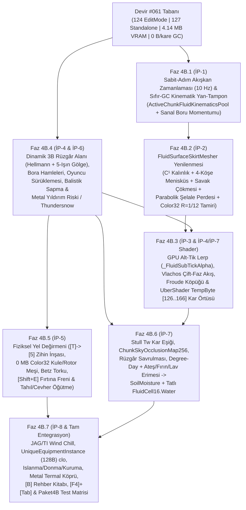

# Paket 4B: Akışkan Akıcılığı, Rüzgâr Mekaniği, Yel Değirmeni, Gelişmiş Fırtınalar, Kar Döngüsü ve Termal Giysi — Adım Adım Geliştirme Planı (DOK4)

> **Doküman Kimliği:** `DOK4_ADIM_ADIM_GELISTIRME_PLANI.md`  
> **Paket:** Paket 4B — *Uygulamaya Hazır Mühendislik ve Kodlama Mimarisi Planı*  
> **Hedef Derleyiciler:** Unity 6 (`6000.6.7f1` URP) + `.NET 10.0` Standalone (`TreatWarningsAsErrors=true`, `Nullable=enable`) + C++20 SIMD (`StratocraftNative.dll`)  
> **Referans Taban:** [DURUM_VE_DEVIR.md (Devir #061)](../../DURUM_VE_DEVIR.md#L1-L120) (`124/124` EditMode, `127/127` Standalone, `6/6` C++, `9/9` Python, `4.14 MB / 16.000 MB` VRAM, `0 B/kare` GC)  
> **Paket İçi Bağlantılar:**  
> - Hedef ve Gereksinimler (`İP-1..İP-8`, `AK-1..AK-16`): [DOK1_HEDEF_VE_GEREKSINIMLER.md](DOK1_HEDEF_VE_GEREKSINIMLER.md)  
> - Mevcut Kod Debug ve Akış Raporu: [DOK2_MEVCUT_KOD_DEBUG_VE_AKIS_RAPORU.md](DOK2_MEVCUT_KOD_DEBUG_VE_AKIS_RAPORU.md)  
> - Endüstri ve Akademik Araştırma Raporu: [DOK3_ENDUSTRI_VE_BENZER_PROJELER_ARASTIRMASI.md](DOK3_ENDUSTRI_VE_BENZER_PROJELER_ARASTIRMASI.md)  
> - Önceki Paket Planı (Paket 4A): [Paket 4A DOK4](../paket4a-iklim-hava-ve-yeralti-suyu/DOK4_ADIM_ADIM_GELISTIRME_PLANI.md)

---

## 1. Mimari Yol Haritası, Faz Bağımlılık Diyagramı ve Çift-Hedefli Derleme Anayasası

### 1.1. Faz Bağımlılık Diyagramı (`Faz 4B.1 .. Faz 4B.7`)

Paket 4B, birbirini kırmayan ve her faz sonunda tüm birim testlerinin (`dotnet test` + Unity EditMode) yeşil kalmasını sağlayan **7 ardışık/paralel alt faza** bölünmüştür:



| Alt Faz | Kapsadığı İş Paketleri | Doğruladığı Kabul Kriterleri | Paralel Yürütülebilirlik Durumu |
| :--- | :--- | :--- | :--- |
| **Faz 4B.1** | İP-1 | `AK-1`, `AK-2` | **Dalga 1** (`Faz 4B.4` ile %100 paralel; sıfır ortak dosya) |
| **Faz 4B.2** | İP-2 | `AK-3`, `AK-4` | **Dalga 2** (`Faz 4B.1` tamamlandıktan sonra; `Faz 4B.5` ile paralel) |
| **Faz 4B.3** | İP-3 (+ İP-4/İP-7 HLSL) | `AK-5`, `AK-13` (Shader) | **Dalga 2/3** (`StratocraftFluidSurface.shader` + `StratocraftUberShader.hlsl`) |
| **Faz 4B.4** | İP-4, İP-6 | `AK-6`, `AK-7`, `AK-10` | **Dalga 1** (`Faz 4B.1` ile %100 paralel) |
| **Faz 4B.5** | İP-5 | `AK-8`, `AK-9` | **Dalga 2** (`Faz 4B.4` rüzgâr API'si üzerine; `Faz 4B.2` ile paralel) |
| **Faz 4B.6** | İP-7 | `AK-11`, `AK-12`, `AK-13` | **Dalga 3** (`Faz 4B.4` rüzgâr + `Faz 4B.3` `TempByte 126..166` sözleşmesi üzerine) |
| **Faz 4B.7** | İP-8 + Genel Entegrasyon | `AK-14`, `AK-15`, `AK-16` | **Dalga 4** (Tüm alt sistemlerin `Stage1InteractivePlayController` & UI bağlaması + Tam Test Paketi) |

---

### 1.2. Çift-Hedefli Derleme Anayasası (Unity 6 + `.NET 10` Standalone)

[Stratocraft.StandaloneCoreTests.csproj](../../Tests/StandaloneCoreTests/Stratocraft.StandaloneCoreTests.csproj#L19-L33) dosyası `Core\**\*.cs`, `Voxel\**\*.cs`, `Physics\**\*.cs`, `WorldGen\**\*.cs`, `Character\**\*.cs`, `Inventory\**\*.cs`, `CreaturesAI\**\*.cs`, `UI\**\*.cs` (yalnızca `F3TelemetryOverlayUi.cs` hariç) ve `Assets\Tests\EditMode\**\*.cs` dizinlerindeki **her `.cs` dosyasını otomatik olarak `.NET 10.0` altında derler** ve şu bayrakları zorlar:
- `<TreatWarningsAsErrors>true</TreatWarningsAsErrors>` (Tek bir `CS0168`, `CS8600`, `CS8602`, `CS8618` uyarısı derlemeyi anında kırar!)
- `<Nullable>enable</Nullable>` ve `<ImplicitUsings>disable</ImplicitUsings>`

Bu nedenle Paket 4B'de yazılan veya güncellenen her dosya şu **3 altın kurala** uymak zorundadır:

1. **Saf Fizik / Matematik Çekirdeği (`UnityEngine` Yasağı):**
   `ActiveChunkFluidKinematicsPool.cs`, `DynamicWindFieldSystem.cs`, `WindmillAerodynamicsAndWorkSystem.cs`, `SnowAccumulationAndMeltSystem.cs`, `ThermalClothingInsulationSystem.cs`, `FluidCellularAutomataJob.cs`, `FluidSurfaceSkirtMesher.cs` (saf geometri katmanı) sınıflarında `UnityEngine` ad alanı **kullanılmaz** (`System.MathF`, `System.Numerics.Vector3` veya ilkel `float` argümanları kullanılır). Böylece tüm fizik motoru `dotnet test` ile `< 2 saniyede` başsız (*headless*) test edilir.
2. **`#if UNITY_5_3_OR_NEWER` İzolasyonu:**
   `MonoBehaviour`, `Mesh`, `MeshFilter`, `Material`, `Shader.PropertyToID`, `Transform`, `Camera` veya `UnityEngine.Vector3` kullanan sahne denetleyicileri (`Stage1WindmillController.cs`, `Stage1InteractivePlayController.cs` ve `FluidSurfaceSkirtMesher` içindeki `BuildFluidUnityMeshZeroGc` uzantısı) **kesinlikle `#if UNITY_5_3_OR_NEWER ... #endif` bloğu içine** alınır:
   ```csharp
   #nullable enable
   using System;
   #if UNITY_5_3_OR_NEWER
   using UnityEngine;
   using UnityEngine.Rendering;
   #endif

   namespace Stratocraft.Character
   {
   #if UNITY_5_3_OR_NEWER
       public sealed class Stage1WindmillController
       {
           // Sahne GameObject, MeshFilter ve Transform yönetimi yalnızca Unity hedefinde derlenir.
       }
   #endif
   }
   ```
3. **Sıfır-GC Kodlama Disiplini:**
   Sıcak döngülerde `Span<T>`, `ReadOnlySpan<T>`, `stackalloc`, önceden ayrılmış dizi havuzları ve `struct` değer tipleri kullanılır; `Dictionary<(int, int), T>` üzerinde `foreach` yerine indeksli anahtar listesi veya `TryGetValue` tercih edilir; asla `LINQ`, `delegate` kapanışı (*closure allocation*) veya dize birleştirme (`$"..."` kare içi) çalıştırılmaz.

---

### 1.3. Küresel Bellek, Bit ve Shader Kanal Sözleşmeleri Özeti (Değiştirilemez Sabitler)

Kodlama boyunca tüm ajanların uyması gereken kesin ikili sözleşmeler:

1. **`FluidCell16` (`2 Byte` / `ushort` — Dokunulmaz):**
   - `Bits[0..7]`: `Mass` (`0..255`)
   - `Bits[8..9]`: `FluidType` (`0 = None`, `1 = Water`, `2 = Lava`, `3 = Acid`)
   - `Bit[10]`: `IsSettled` (`0 = Aktif`, `1 = Durağan`)
   - `Bits[11..15]`: `PressureHead` (`0..31`)
   - C++ [simd_world_noise.cpp](../../NativePlugins/StratocraftNative/src/simd_world_noise.cpp#L73-L101) içindeki `PackSettledFluid` ile bit-bit aynı kalır.
2. **`StratocraftUberShader.hlsl` `COLOR.g` (`TempByte` $\in [0..255]$) Çakışmasız Kanal Haritası:**
   - `0`: Nötr kuru ve karsız yüzey (`soilWetness01 = 0`, `snowCover01 = 0`, `heatNorm = 0`)
   - `1 .. 120`: Islak Toprak / Çamur (`soilWetness01 = rawByte / 120.0`, **`heatNorm = 0.0`**)
   - `121 .. 125`: Koruma Tamponu (**`heatNorm = 0.0`**)
   - **`126 .. 166`**: **Prosedürel Kar Örtüsü** (`snowCover01 = (rawByte - 125.0) / 41.0`, **`heatNorm = 0.0` ZORUNLU** — kar asla ışımaz!)
   - **`170 .. 255`**: **Stefan-Boltzmann $T^4$ Akkor Bandı** (`StarCore = 170`, `Kiln = 192`, `Campfire = 210`, `Magma = 220`, `Lava = 242`, kızgın demir `170..255` — %100 korunur!)
3. **`StratocraftFluidSurface.shader` `FluidMeshVertex` (`36 Byte`) Kanal Haritası:**
   - `POSITION` (`float3`, `12B`): Şimdiki tik sonu dünya/yerel köşe konumu `(x, y_curr, z)`
   - `NORMAL` (`float3`, `12B`): Pürüzsüzleştirilmiş köşe menisküs / şelale perdesi normali
   - `COLOR` (`Color32`, `4B`):
     - `R`: **`1` = Tatlı Su**, **`12` = Tuzlu Deniz Suyu**, **`2` = Lav**, **`3` = Asit**
     - `G`: İşaretli alt-tik yükseklik farkı $\Delta y_{\text{tick}} \in [-1, +1]\text{ m}$ (`128 == 0.0 m`)
     - `B`: Köşe $v_x \in [-4, +4]\text{ m/s}$ (`128 == 0.0 m/s`)
     - `A`: Köşe $v_z \in [-4, +4]\text{ m/s}$ (`128 == 0.0 m/s`)
   - `TEXCOORD0` (`float2`, `8B`): `x = fluidDepthMeters` (`0..8m`), `y = waterfallFoam01` (`0..1`)

---

## 2. Faz 4B.1 (İP-1): Sabit-Adım Akışkan Simülasyon Zamanlaması ve Sıfır-GC Kinematik Yan-Tampon

### 2.1. Dosya Envanteri (Faz 4B.1)

| İşlem | Göreceli Dosya Yolu | Sorumluluk Özeti |
| :--- | :--- | :--- |
| **YENİ** | `../../Assets/_Stratocraft/Physics/Data/ActiveChunkFluidKinematicsPool.cs` | Sıfır-GC kiralanan `ActiveChunkFluidKinematicsSlice` (`PrevMass`, `VelX_Q7`, `VelZ_Q7`) havuzu ve hız nicemleme yardımcıları. |
| **GÜNCELLE** | [FluidCellularAutomataJob.cs](../../Assets/_Stratocraft/Physics/Jobs/FluidCellularAutomataJob.cs#L98-L1255) | `StepFluidGridVolumeConservative` kinematik aşırı yüklemesi, sanal boru momentumu, `srcMass <= 24` ışınlanma tamiri, eğim kaskadı tamiri ve `ExchangeChunkBorderFluids` `headA - headB >= 1` + yan-tampon sınır eşitlemesi. |
| **GÜNCELLE** | [FluidSimulationSystem.cs](../../Assets/_Stratocraft/Physics/Systems/FluidSimulationSystem.cs#L16-L108) | `FrameBudgetMicroseconds` değerinin `1200.0` $\to$ **`2000.0` (`2.0 ms`)** yığın bütçesine güncellenmesi, `BeginFluidTickBatch` / `EndFluidTickBatch` AIMD sayacı ve kinematik dilim yönlendirmesi. |
| **GÜNCELLE** | [FluidTraceRecorder.cs](../../Assets/_Stratocraft/Physics/Diagnostics/FluidTraceRecorder.cs#L1-L95) | Sabit-adım alt-tik fazı ve kiralanan yan-tampon dilim sayısı telemetri sütunları. |

### 2.2. Tam C# Veri Yapıları ve İmzalar (`ActiveChunkFluidKinematicsPool.cs`)

```csharp
#nullable enable
using System;
using System.Collections.Generic;
using System.Runtime.CompilerServices;
using Stratocraft.Voxel.Data;

namespace Stratocraft.Physics.Data
{
    /// <summary>
    /// Yalnızca aktif (!AllSettled) akışkan chunk'ları için kiralanan sıfır-GC kinematik yan-tampon dilimi.
    /// FluidCell16 (2-Byte) sözleşmesine dokunmadan önceki kütle ve Q7 yatay hız vektörünü taşır.
    /// Bellek ayak izi: 3 * 65,536 Byte = 192 KB / aktif chunk.
    /// </summary>
    public sealed class ActiveChunkFluidKinematicsSlice
    {
        public const int MaxSliceVolume = 16 * 256 * 16; // 65,536 hücre
        public const float MaxVelocityMetersPerSec = 4.0f;
        public const float InvQ7Scale = MaxVelocityMetersPerSec / 127.0f;
        public const float ToQ7Scale = 127.0f / MaxVelocityMetersPerSec;

        public readonly byte[] PrevMass;
        public readonly sbyte[] VelX_Q7;
        public readonly sbyte[] VelZ_Q7;

        public int ChunkX { get; internal set; }
        public int ChunkZ { get; internal set; }
        public int LastTouchedTickIndex { get; internal set; }
        public bool IsInitializedFromCurrentMass { get; internal set; }

        public ActiveChunkFluidKinematicsSlice(int sliceVolume = MaxSliceVolume)
        {
            PrevMass = new byte[sliceVolume];
            VelX_Q7 = new sbyte[sliceVolume];
            VelZ_Q7 = new sbyte[sliceVolume];
        }

        /// <summary>
        /// Yeni uyanan durağan bir chunk için PrevMass dizisini mevcut FluidCell16 kütlesiyle eşitler;
        /// böylece ilk uyandığı tikte durağan su yüzeyi sıfırdan yukarı sıçramaz (DOK1 Bölüm 7 Madde 8).
        /// </summary>
        public void CaptureBaselineFromFluids(ReadOnlySpan<ushort> fluids, int activeVolume)
        {
            int count = Math.Min(activeVolume, PrevMass.Length);
            for (int i = 0; i < count; i++)
            {
                ushort raw = fluids[i];
                PrevMass[i] = (byte)(raw & 0xFF);
                VelX_Q7[i] = 0;
                VelZ_Q7[i] = 0;
            }
            IsInitializedFromCurrentMass = true;
        }

        /// <summary>
        /// Sabit akışkan tikinin başında mevcut kütleleri PrevMass tamponuna kopyalar ve hızları viskoziteyle sönümler.
        /// </summary>
        public void SnapshotPrevMassBeforeStep(ReadOnlySpan<ushort> fluids, int activeVolume)
        {
            int count = Math.Min(activeVolume, PrevMass.Length);
            for (int i = 0; i < count; i++)
            {
                ushort raw = fluids[i];
                byte mass = (byte)(raw & 0xFF);
                PrevMass[i] = mass;
                if (mass == 0)
                {
                    VelX_Q7[i] = 0;
                    VelZ_Q7[i] = 0;
                }
            }
            IsInitializedFromCurrentMass = true;
        }

        public void ClearAll(int activeVolume)
        {
            int count = Math.Min(activeVolume, PrevMass.Length);
            Array.Clear(PrevMass, 0, count);
            Array.Clear(VelX_Q7, 0, count);
            Array.Clear(VelZ_Q7, 0, count);
            IsInitializedFromCurrentMass = false;
        }

        [MethodImpl(MethodImplOptions.AggressiveInlining)]
        public static sbyte EncodeVelocityQ7(float velocityMps)
        {
            if (!float.IsFinite(velocityMps)) return 0;
            int q = (int)MathF.Round(Math.Clamp(velocityMps, -MaxVelocityMetersPerSec, MaxVelocityMetersPerSec) * ToQ7Scale);
            return (sbyte)Math.Clamp(q, -127, 127);
        }

        [MethodImpl(MethodImplOptions.AggressiveInlining)]
        public static float DecodeVelocityQ7(sbyte encodedQ7) => encodedQ7 * InvQ7Scale;
    }

    /// <summary>
    /// Aktif akışkan chunk'ları için sıfır-GC kinematik dilim havuzu.
    /// Varsayılan 32 dilim (6.0 MB) ön-tahsisli başlar; tavan 64 dilim (12.0 MB) ile sınırlıdır.
    /// </summary>
    public sealed class ActiveChunkFluidKinematicsPool
    {
        public const int DefaultPrewarmSlices = 32;
        public const int HardMaxSlices = 64;

        private readonly Stack<ActiveChunkFluidKinematicsSlice> _freeStack;
        private readonly Dictionary<(int cx, int cz), ActiveChunkFluidKinematicsSlice> _leasedByChunk;
        private readonly int _sliceVolume;
        private int _totalAllocatedSlices;

        public int LeasedCount => _leasedByChunk.Count;
        public int FreeCount => _freeStack.Count;
        public int TotalAllocatedSlices => _totalAllocatedSlices;

        public ActiveChunkFluidKinematicsPool(
            int prewarmSlices = DefaultPrewarmSlices,
            int sliceVolume = ActiveChunkFluidKinematicsSlice.MaxSliceVolume)
        {
            _sliceVolume = sliceVolume;
            int initial = Math.Clamp(prewarmSlices, 4, HardMaxSlices);
            _freeStack = new Stack<ActiveChunkFluidKinematicsSlice>(HardMaxSlices);
            _leasedByChunk = new Dictionary<(int cx, int cz), ActiveChunkFluidKinematicsSlice>(HardMaxSlices);

            for (int i = 0; i < initial; i++)
            {
                _freeStack.Push(new ActiveChunkFluidKinematicsSlice(_sliceVolume));
                _totalAllocatedSlices++;
            }
        }

        public bool TryGetLeased(int cx, int cz, out ActiveChunkFluidKinematicsSlice? slice) =>
            _leasedByChunk.TryGetValue((cx, cz), out slice);

        public ActiveChunkFluidKinematicsSlice? RentOrGetAndSyncBaseline(
            int cx,
            int cz,
            ReadOnlySpan<ushort> currentFluids,
            int activeVolume,
            int currentTickIndex)
        {
            if (_leasedByChunk.TryGetValue((cx, cz), out ActiveChunkFluidKinematicsSlice? existing))
            {
                existing.LastTouchedTickIndex = currentTickIndex;
                if (!existing.IsInitializedFromCurrentMass)
                {
                    existing.CaptureBaselineFromFluids(currentFluids, activeVolume);
                }
                return existing;
            }

            ActiveChunkFluidKinematicsSlice slice;
            if (_freeStack.Count > 0)
            {
                slice = _freeStack.Pop();
            }
            else if (_totalAllocatedSlices < HardMaxSlices)
            {
                slice = new ActiveChunkFluidKinematicsSlice(_sliceVolume);
                _totalAllocatedSlices++;
            }
            else
            {
                return null; // Tavan aşılırsa güvenli geri-düşüş: kinematik olmadan da CA %100 çalışır.
            }

            slice.ChunkX = cx;
            slice.ChunkZ = cz;
            slice.LastTouchedTickIndex = currentTickIndex;
            slice.CaptureBaselineFromFluids(currentFluids, activeVolume);
            _leasedByChunk[(cx, cz)] = slice;
            return slice;
        }

        public void ReleaseChunk(int cx, int cz)
        {
            if (_leasedByChunk.Remove((cx, cz), out ActiveChunkFluidKinematicsSlice? slice))
            {
                slice.ClearAll(_sliceVolume);
                _freeStack.Push(slice);
            }
        }
    }
}
```

### 2.3. `FluidCellularAutomataJob` ve `FluidSimulationSystem` Güncelleme Algoritması

1. **Kinematik Parametreli `StepFluidGridVolumeConservative` Aşırı Yüklemesi ([FluidCellularAutomataJob.cs](../../Assets/_Stratocraft/Physics/Jobs/FluidCellularAutomataJob.cs#L98-L112)):**
   Mevcut 9 parametreli `StepFluidGridVolumeConservative` imzası %100 korunur (mevcut 124/127 testin tek satırı kırılmaz!) ve bu metod doğrudan isteğe bağlı `ActiveChunkFluidKinematicsSlice? kinematicsSlice` alan yeni aşırı yüklemeye yönlendirilir:
   ```csharp
   public static long StepFluidGridVolumeConservative(
       Span<uint> voxels,
       Span<ushort> fluids,
       int sizeX,
       int sizeY,
       int sizeZ,
       out int obsidianFormedCount,
       out int steamSlagFizzleCount,
       int stepParity,
       ulong[]? salinityBits,
       ActiveChunkFluidKinematicsSlice? kinematicsSlice)
   ```
2. **Adım İçi Sanal Boru Momentumu ve Kök Hata Düzeltmeleri:**
   - **Adım Başı Örnekleme:** `kinematicsSlice != null` ise `kinematicsSlice.SnapshotPrevMassBeforeStep(chunkFluids, volume)` çağrılır.
   - **Eğim Kaskadı (`NewlyWetFromGravityFlag`) Düzeltmesi (`#L198-L215`):** Dikey yerçekimi geçişinde hücrenin altındaki voksel (`y - 1`) katı (`IsPhysicallySolid`) veya tam dolu (`Mass == 255`) sıvı ise hücre tabana çarpmış demektir; `NewlyWetFromGravityFlag` **yalnızca altı boş hava (`y - 1` boş/yarı-dolu düşüş sütunu) olan serbest düşüş hücrelerine** konulur. Böylece şelale havada yanlara saçılmaz ama eğimli basamağa değdiği anda aynı tikte yatay yayılır!
   - **`srcMass <= 24` Tek-Tik Işınlanma Tamiri (`#L996-L1014`):**
     - `srcMass <= 2`: Kalan mikroskobik damla alt katı/nemli yüzeye veya en yüksek kütleli komşuya devredilir.
     - `3 <= srcMass <= 24`: Aktarım miktarı `int maxStepSweep = Math.Max(2, (srcMass * 11) / 24);` ile sınırlandırılır; böylece sığ su cephesi tek tikte kaybolmak yerine `3–4` sabit tik boyunca `PrevMass -> CurrMass` enterpolasyonuyla kayarak ilerler.
   - **Yatay Hız Güncellemesi (`VelX_Q7`, `VelZ_Q7`):** Hücreden $+X, -X, +Z, -Z$ yönlerine net aktarılan kütle akıları $(q_{+x} - q_{-x})$ ve $(q_{+z} - q_{-z})$ toplanır; viskozite tutunması ($\mu_{\text{water}} = 0.82$, $\mu_{\text{lava}} = 0.45$, $\mu_{\text{acid}} = 0.85$) ile bir önceki hızla harmanlanır:
     ```csharp
     float netFluxX = (outPlusX - outMinusX + inFromMinusX - inFromPlusX) * (1.0f / 64.0f);
     float netFluxZ = (outPlusZ - outMinusZ + inFromMinusZ - inFromPlusZ) * (1.0f / 64.0f);
     float prevVx = ActiveChunkFluidKinematicsSlice.DecodeVelocityQ7(kinematicsSlice.VelX_Q7[idx]);
     float prevVz = ActiveChunkFluidKinematicsSlice.DecodeVelocityQ7(kinematicsSlice.VelZ_Q7[idx]);
     float visc = type == FluidType.Lava ? 0.45f : 0.82f;
     float maxV = type == FluidType.Lava ? 1.20f : 4.00f;
     float newVx = Math.Clamp((prevVx * visc) + (netFluxX * (1.0f - visc) * 3.2f), -maxV, maxV);
     float newVz = Math.Clamp((prevVz * visc) + (netFluxZ * (1.0f - visc) * 3.2f), -maxV, maxV);
     kinematicsSlice.VelX_Q7[idx] = ActiveChunkFluidKinematicsSlice.EncodeVelocityQ7(newVx);
     kinematicsSlice.VelZ_Q7[idx] = ActiveChunkFluidKinematicsSlice.EncodeVelocityQ7(newVz);
     ```
   - **Chunk Sınırı Eşitlemesi (`ExchangeChunkBorderFluids`, `#L561-L585`):** `headA - headB < 3` sınırı **`headA - headB < 1`** yapılır (`massDiff >= 2` veya sığ su cephesi yayılımı ile uyumlu); isteğe bağlı `ActiveChunkFluidKinematicsPool? kinematicsPool = null` parametresi eklenerek sınır geçişi yapan hücrelerin `VelX_Q7 / VelZ_Q7` vektörleri de iki komşu chunk arasında güncellenir.
3. **`FluidSimulationSystem` Yığın-Duyarlı (*Batch-Aware*) AIMD Bütçesi ([FluidSimulationSystem.cs](../../Assets/_Stratocraft/Physics/Systems/FluidSimulationSystem.cs#L16-L55)):**
   - Mevcut tekil-chunk sabiti `FrameBudgetMicroseconds = 1200.0` (`#L16`) yığın modunu kapsayacak şekilde **`FrameBudgetMicroseconds = 2000.0` (`2.0 ms`)** olarak güncellenir.
   - `BeginFluidTickBatch()` ve `EndFluidTickBatch(int chunksStepped)` metodları eklenir; `Stopwatch` tüm aktif chunk döngüsünün toplam süresini (`batchElapsedTicks`) ölçer ve AIMD penceresini (`MaxChunksPerTick` $\in [12..24]$) **yığın toplam süresinin `FrameBudgetMicroseconds = 2000.0` (`2.0 ms`) sınırına oranına göre** ayarlar (`StepChunkFluid` tek başına çağrıldığında da geriye dönük uyumlu tekil ölçüm korunur).
4. **Sabit-Adım Zamanlayıcı ve `_FluidSubTickAlpha` Yayınlaması:**
   `Stage1InteractivePlayController` içinde:
   ```csharp
   public const float FluidFixedTickSeconds = 0.100f; // 10.0 Hz sabit adım
   private float _fluidTickAccumulator;
   private float _fluidSubTickAlpha01;
   private static readonly int s_fluidSubTickAlphaShaderId = Shader.PropertyToID("_FluidSubTickAlpha");
   ```
   Her karede `_fluidTickAccumulator = Mathf.Min(_fluidTickAccumulator + dt, FluidFixedTickSeconds * 2.0f);` biriktirilir, `while (_fluidTickAccumulator >= FluidFixedTickSeconds)` döngüsünde en fazla `2` sabit adım koşulur ve döngü çıkışında `_fluidSubTickAlpha01 = Mathf.Clamp01(_fluidTickAccumulator / FluidFixedTickSeconds); Shader.SetGlobalFloat(s_fluidSubTickAlphaShaderId, _fluidSubTickAlpha01);` yayınlanır.


---

## 3. Faz 4B.2 (İP-2): `FluidSurfaceSkirtMesher` Menisküs, Savak Çökmesi, Şelale Perdesi ve `Color32` Tamiri

### 3.1. Dosya Envanteri (Faz 4B.2)

| İşlem | Göreceli Dosya Yolu | Sorumluluk Özeti |
| :--- | :--- | :--- |
| **GÜNCELLE** | [FluidSurfaceSkirtMesher.cs](../../Assets/_Stratocraft/Voxel/Jobs/FluidSurfaceSkirtMesher.cs#L1-L718) | $C^1$ kalınlık eğrisi, `wetSamples == 1` zıplama tamiri, 4-köşe menisküs (`Curr` & `Prev`), Rouse savak çökmesi, kesintisiz parabolik şelale perdesi, `FluidRichTriangle` üretimi, `COLOR.r` (`1` vs `12`) tuzluluk tamiri ve `#if UNITY_5_3_OR_NEWER` altında kendi sıfır-GC `FluidMeshVertex` (`36 Byte`) + `BuildFluidUnityMeshZeroGc` yükleyicisi (`HybridSurfaceNetsAndShapeMesher.cs` katı arazi `UberMeshVertex` `28 Byte` yoluna dokunulmaz!). |
| **GÜNCELLE** *(Dalga 4 Bütünleştirme)* | [Stage1InteractivePlayController.cs](../../Assets/_Stratocraft/Character/Stage1InteractivePlayController.cs#L3457-L3814) | `RebuildAllDirtyChunks` (`#L3744-L3805`) içindeki `_dirtyFluidChunks` kuyruğunun kamera mesafesine göre sıfır-GC sıralanması, `maxFluidPerFrame` değerinin `4`'ten **`16`** chunk/kare'ye çıkarılması ve `ActiveChunkFluidKinematicsSlice` + `ChunkSalinityBitset` referanslarının mesher'a bağlanması. |

### 3.2. Köşe-Başına Zengin Sıvı Üçgen ve GPU Tepe Sözleşmesi

Mevcut `FacetedVoxelTriangle` üçgen başına tek bir düz `(MaterialId, Temperature, FacetShade, AO)` tuttuğu için bir karenin 4 köşesinde farklı `(Δy_tick, vx, vz, depth)` değerlerini taşıyamaz. Bu nedenle `Stratocraft.Voxel.Jobs` içinde aşağıdaki sıfır-GC değer tipleri tanımlanır:

```csharp
#nullable enable
using System;
using System.Collections.Generic;
using System.Numerics;
using System.Runtime.CompilerServices;
using System.Runtime.InteropServices;
using Stratocraft.Core.World;
using Stratocraft.Physics.Data;
using Stratocraft.Voxel.Data;

namespace Stratocraft.Voxel.Jobs
{
    /// <summary>
    /// Sıvı yüzeyinin tek bir köşesine ait tüm fiziksel ve görsel öznitelikler (Standalone .NET 10 uyumlu).
    /// </summary>
    [StructLayout(LayoutKind.Sequential, Pack = 4)]
    public struct FluidCornerSample
    {
        public Vector3 PositionCurr;
        public Vector3 Normal;
        public byte RenderFluidId;     // 1 = Tatlı Su, 12 = Tuzlu Su, 2 = Lav, 3 = Asit
        public byte EncodedSubTickDy;  // [1..255], 128 == 0.0m, [-1.0m .. +1.0m]
        public byte EncodedVelX;       // [1..255], 128 == 0.0 m/s, [-4.0 .. +4.0 m/s]
        public byte EncodedVelZ;       // [1..255], 128 == 0.0 m/s, [-4.0 .. +4.0 m/s]
        public float DepthMeters;      // [0.0 .. 8.0m] yerel su sütunu derinliği
        public float WaterfallFoam01;  // [0.0 .. 1.0] şelale perdesi ve düşüş havuzu havalandırma köpüğü

        [MethodImpl(MethodImplOptions.AggressiveInlining)]
        public static byte EncodeSignedUnitToByte(float normalizedSigned)
        {
            float clamped = Math.Clamp(float.IsFinite(normalizedSigned) ? normalizedSigned : 0.0f, -1.0f, 1.0f);
            int raw = 128 + (int)MathF.Round(clamped * 127.0f);
            return (byte)Math.Clamp(raw, 1, 255);
        }
    }

    [StructLayout(LayoutKind.Sequential, Pack = 4)]
    public struct FluidRichTriangle
    {
        public FluidCornerSample C0;
        public FluidCornerSample C1;
        public FluidCornerSample C2;
    }

#if UNITY_5_3_OR_NEWER
    [StructLayout(LayoutKind.Sequential, Pack = 4)]
    public struct FluidMeshVertex
    {
        public UnityEngine.Vector3 Position; // 12B (VertexAttribute.Position, Float32 x3)
        public UnityEngine.Vector3 Normal;   // 12B (VertexAttribute.Normal, Float32 x3)
        public UnityEngine.Color32 Color;    //  4B (VertexAttribute.Color, UNorm8 x4: R=Id, G=Dy, B=Vx, A=Vz)
        public UnityEngine.Vector2 AuxUv0;   //  8B (VertexAttribute.TexCoord0, Float32 x2: x=Depth, y=WaterfallFoam)
        // Toplam = 36 Byte / tepe noktası (0.0 MB doku VRAM; doğrudan FluidSurfaceSkirtMesher.cs içinde!)
    }

    public static partial class FluidSurfaceSkirtMesher
    {
        /// <summary>
        /// Doğrudan FluidSurfaceSkirtMesher içinde tanımlanan sıfır-GC Unity Mesh yükleyicisi
        /// (HybridSurfaceNetsAndShapeMesher.cs'e hiçbir bağımlılık oluşturmadan Dalga 2'de tek başına derlenir).
        /// </summary>
        public static void BuildFluidUnityMeshZeroGc(
            List<FluidRichTriangle> richTriangles,
            UnityEngine.Mesh targetMesh);
    }
#endif
}
```

### 3.3. `FluidSurfaceSkirtMesher` Matematiksel Kuralları ve Tam İmzalar

1. **$C^1$ Sürekli Kalınlık Fonksiyonu (`MassToFluidThickness`):**
   ```csharp
   public const float MinVisibleFilmThickness = 0.025f;
   public const float WeirBrinkDepthRatio = 0.68f;

   [MethodImpl(MethodImplOptions.AggressiveInlining)]
   public static float MassToFluidThickness(byte mass)
   {
       if (mass == 0) return 0.0f;
       if (mass >= 255) return 1.0f;
       float t = mass * (1.0f / 255.0f);
       return MinVisibleFilmThickness + ((1.0f - MinVisibleFilmThickness) * MathF.Pow(t, 0.85f));
   }
   ```
   Bu fonksiyon `mass = 1..255` boyunca kesinlikle artandır ($dh/dm > 0$), kırık parçalı doğrusal dirsek içermez ve `wetSamples == 1` durumunda dış kenar köşesi `MathF.Max(0.015f, 0.35f * wetThicknessSum)` değerini alarak `0.24 m` zıplama hatasını kökten yok eder.

2. **4-Hücreli Köşe Menisküs, Savak Çökmesi ve `PrevMass` Farkı (`EvaluateCornerMeniscus`):**
   Her `(cx, y, cz)` köşesini paylaşan 4 yatay hücre komşusu `((cx-1, cz-1), (cx, cz-1), (cx-1, cz), (cx, cz))` taranır:
   - Komşu katı voksel ise (`IsPhysicallySolid`): kapiler duvar tutunması olarak ağırlığa katılmaz, su yüzeyi duvara düz birleşir.
   - Komşu aynı tür sıvı içeriyorsa (`wetSamples++`):
     - Hem `currMass` hem de kinematik dilimden `prevMass` okunur (`kinematicsSlice == null` ise `prevMass = currMass`, `vx = 0`, `vz = 0`).
     - Üst hücre (`y + 1`) aynı tür sıvı içeriyorsa yerel sütun tavanı `1.0f` yerine `MathF.Min(1.0f, 0.88f + 0.12f * MassToFluidThickness(aboveMass))` ile yumuşatılır; tüm 4 komşunun da üstü doluysa tam `1.0f` olur.
   - Komşu boş hava (`Air`) ise:
     - Altındaki hücre (`y - 1`) katı zeminse bu bir **sığ kıyı kenarıdır** (`shoreAirSamples++`) $\to$ menisküs zemine doğru incelir (`shoreTaper`).
     - Altındaki hücre (`y - 1`) de boşluk veya düşen sıvıysa bu bir **uçurum / şelale savağıdır** (`overfallSamples++`) $\to$ Rouse savak çökmesi uygulanır:
       ```csharp
       float avgCurrH = wetCurrSum / wetSamples;
       float avgPrevH = wetPrevSum / wetSamples;
       if (overfallSamples > 0)
       {
           float overfallWeight = overfallSamples * 0.25f;
           float brinkFactor = 1.0f - ((1.0f - WeirBrinkDepthRatio) * Math.Clamp(overfallWeight * 2.0f, 0.0f, 1.0f));
           avgCurrH *= brinkFactor;
           avgPrevH *= brinkFactor;
       }
       else if (shoreAirSamples > 0 && wetSamples == 1)
       {
           avgCurrH = MathF.Max(0.015f, avgCurrH * 0.38f);
           avgPrevH = MathF.Max(0.015f, avgPrevH * 0.38f);
       }
       float subTickDy = Math.Clamp(avgCurrH - avgPrevH, -1.0f, 1.0f);
       ```
3. **Kesintisiz Parabolik Şelale Perdesi (`EmitContinuousWaterfallCurtain`):**
   `(lx, y, lz)` hücresinin yatay komşusu `(nx, y, nz)` boş hava (veya daha alçak sıvı) olduğunda:
   - Üst savak yüksekliği `yTop0, yTop1` doğrudan üst yüzeyin savak köşelerinden alınır (böylece üst su yüzeyi ile şelale perdesi arasında **`0.000 m` dikiş hatası** garanti edilir!).
   - Alt kavuşma yüksekliği `yBot0, yBot1`: komşu sütunda `(nx, y - 1, nz)` sıvı içeriyorsa o hücrenin üst menisküs köşelerine bağlanır; katı zemin varsa `y` tabanına iner ve `WaterfallFoam01 = 0.95f` çarpma köpüğü yazar.
   - Düşüş yüksekliği `pressureHead >= 1` olan serbest şelale katmanlarında perde yatay akış yönünde `jetOutOffset = Math.Clamp(0.06f * MathF.Sqrt(pressureHead), 0.0f, 0.18f)` kadar dışbükey parabol çizer; dik kutu görünümü tamamen ortadan kalkar.
4. **Tatlı Su vs Tuzlu Deniz Suyu `COLOR.r` Tamiri:**
   ```csharp
   byte ResolveFluidRenderId(FluidType type, int worldX, int worldY, int worldZ, ChunkSalinityBitset? salinityBitset)
   {
       return type switch
       {
           FluidType.Water => (salinityBitset != null && salinityBitset.IsSaltWater(worldX, worldY, worldZ))
               ? (byte)12  // Tuzlu okyanus/deniz suyu
               : (byte)1,  // Tatlı nehir, göl, yağmur ve kar erimesi suyu!
           FluidType.Lava => (byte)2,
           FluidType.Acid => (byte)3,
           _ => (byte)1
       };
   }
   ```
   *(Geriye dönük uyumluluk için mevcut `GenerateFluidSkirtTriangles(..., List<FacetedVoxelTriangle> outputTriangles)` metodu da korunur ve yeni `GenerateFluidRichTriangles` üzerinden köşe ortalamalarını faset listesine yansıtır; böylece mevcut tüm birim testleri kırılmadan geçer!)*

---

## 4. Faz 4B.3 (İP-3 & İP-4/İP-7 Shader): Tam HLSL Shader Kod Şemaları (`0.0 MB` Doku VRAM)

### 4.1. Dosya Envanteri (Faz 4B.3)

| İşlem | Göreceli Dosya Yolu | Sorumluluk Özeti |
| :--- | :--- | :--- |
| **GÜNCELLE** | [StratocraftFluidSurface.shader](../../Assets/_Stratocraft/Rendering/Shaders/StratocraftFluidSurface.shader#L1-L369) | `_FluidSubTickAlpha` alt-tik tepe enterpolasyonu, mevcut `_GlobalWindVector` (`#L80`) ile WMO Beaufort dalga ölçeklemesi, Alex Vlachos çift-fazlı prosedürel akış adveksiyonu, analitik yüzey normali ve Froude/şelale/kıyı beyaz köpüğü. |
| **GÜNCELLE** | [StratocraftUberShader.hlsl](../../Assets/_Stratocraft/Rendering/Shaders/StratocraftUberShader.hlsl#L1-L663) | `TempByte` çakışmasız kar örtüsü (`126..166` + `heatNorm = 0.0`), prosedürel kar albedosu/normal yumuşatması/mikro-kristal parıltısı (`0 MB` doku) ve `Grass (3u)` yaprak/bitki rüzgâr salınımı (`_GlobalWindVector` `#L307`). |
| **GÜNCELLE** | [StratocraftProceduralClouds.shader](../../Assets/_Stratocraft/Rendering/Shaders/StratocraftProceduralClouds.shader) | `_GlobalPrecipKind` (`1=Yağmur, 2=Kar, 3=Dolu`) ve `_GlobalBlizzardFactor01` ile rüzgârda savrulan kar tanesi perdesi ve tipi görüş sönümlemesi. |

### 4.2. Tam HLSL Kod Şeması 1: `StratocraftFluidSurface.shader`

Aşağıdaki HLSL çekirdeği `StratocraftFluidSurface.shader` içindeki `Attributes`, `Varyings`, `FluidVert` ve `FluidFrag` aşamalarının tam matematiksel sözleşmesidir (`0` adet `TEXTURE2D` örneklemesi — `_CameraOpaqueTexture` ve `_CameraDepthTexture` URP çerçeve tamponları hariç `%100` prosedürel):

```hlsl
// Küresel CPU -> GPU CBuffer / Global Uniform bildirimleri (0 B GC, Shader.PropertyToID üzerinden)
// Not: _GlobalWindVector zaten StratocraftFluidSurface.shader#L80, StratocraftUberShader.hlsl#L307 ve
// Stage1AtmosphereCloudAndRainRenderer.cs#L613 içinde mevcuttur!
float _FluidSubTickAlpha;          // [0.0 .. 1.0] StepFluidSimulation alt-tik fazı
float4 _GlobalWindVector;          // x = WindVelX (m/s), y = WindSpeed |U10| (m/s), z = WindVelZ (m/s), w = StormDarkening01
float _GlobalWindBeaufort;         // Opsiyonel: [0.0 .. 12.0] kesirli WMO Beaufort derecesi

struct Attributes
{
    float4 positionOS : POSITION;
    float3 normalOS   : NORMAL;
    float4 color      : COLOR;     // r=FluidId(1,12,2,3), g=SubTickDy, b=VelX, a=VelZ
    float2 auxUv0     : TEXCOORD0; // x=FluidDepthMeters, y=WaterfallFoam01
};

struct Varyings
{
    float4 positionCS      : SV_POSITION;
    float3 positionWS      : TEXCOORD0;
    float3 normalWS        : TEXCOORD1;
    float4 screenPos       : TEXCOORD2;
    nointerpolation uint fluidKindId : TEXCOORD3; // 1=Fresh, 12=Salt, 2=Lava, 3=Acid
    float4 flowAndFoam     : TEXCOORD4;           // xy=VelXZ (m/s), z=Depth (m), w=WaterfallFoam01
    float  fogFactor       : TEXCOORD5;
};

// Deterministik sıfır-doku 2B değer ve analitik türev gürültüsü (Value Noise + dN/dx, dN/dz)
float2 Hash22Fluid(float2 p)
{
    float3 p3 = frac(float3(p.xyx) * float3(0.1031, 0.1030, 0.0973));
    p3 += dot(p3, p3.yzx + 33.33);
    return frac((p3.xx + p3.yz) * p3.zy);
}

// Çıktı: x = yükseklik [-1..1], yz = analitik türev (dh/dx, dh/dz)
float3 ProceduralRippleHeightAndGrad(float2 uv, float timeSec)
{
    float2 i = floor(uv);
    float2 f = frac(uv);
    float2 u = f * f * (3.0 - 2.0 * f);
    float2 du = 6.0 * f * (1.0 - f);

    float a = dot(Hash22Fluid(i + float2(0.0, 0.0)) - 0.5, float2(cos(timeSec), sin(timeSec)));
    float b = dot(Hash22Fluid(i + float2(1.0, 0.0)) - 0.5, float2(cos(timeSec), sin(timeSec)));
    float c = dot(Hash22Fluid(i + float2(0.0, 1.0)) - 0.5, float2(cos(timeSec), sin(timeSec)));
    float d = dot(Hash22Fluid(i + float2(1.0, 1.0)) - 0.5, float2(cos(timeSec), sin(timeSec)));

    float k0 = a;
    float k1 = b - a;
    float k2 = c - a;
    float k3 = a - b - c + d;

    float val = k0 + k1 * u.x + k2 * u.y + k3 * u.x * u.y;
    float2 grad = du * (float2(k1, k2) + k3 * u.yx);
    return float3(val, grad);
}

// Alex Vlachos (SIGGRAPH 2010) Çift-Fazlı Prosedürel Akış Adveksiyonu (0.0 MB Doku!)
float3 SampleDualPhaseAdvectedRipples(float2 worldXZ, float2 flowVelXZ, float freqScale, float timeSec)
{
    const float flowPeriod = 1.60;
    float spatialJitter = frac(sin(dot(floor(worldXZ * 0.25), float2(12.9898, 78.233))) * 43758.5453) * 0.20;

    float phase0 = frac((timeSec / flowPeriod) + spatialJitter);
    float phase1 = frac((timeSec / flowPeriod) + 0.50 + spatialJitter);
    float blend1 = 1.0 - abs(1.0 - 2.0 * phase0);

    float2 p0 = (worldXZ - flowVelXZ * (phase0 * flowPeriod)) * freqScale;
    float2 p1 = (worldXZ - flowVelXZ * (phase1 * flowPeriod)) * freqScale;

    float3 r0 = ProceduralRippleHeightAndGrad(p0, timeSec * 1.35);
    float3 r1 = ProceduralRippleHeightAndGrad(p1, timeSec * 1.35 + 1.57);
    return lerp(r0, r1, blend1);
}

Varyings FluidVert(Attributes input)
{
    Varyings o = (Varyings)0;
    uint rawId = (uint)round(input.color.r * 255.0);
    o.fluidKindId = rawId;

    // 1) Alt-Tik Yükseklik Farkı Dekodlaması: COLOR.g == 128 -> dy = 0.0m
    float encodedDy = round(input.color.g * 255.0);
    float subTickDy = (encodedDy > 0.5) ? clamp((encodedDy - 128.0) / 127.0, -1.0, 1.0) : 0.0;

    // 2) Köşe Yatay Hız Vektörü Dekodlaması: COLOR.ba == 128 -> v = 0.0 m/s
    float rawVx = round(input.color.b * 255.0);
    float rawVz = round(input.color.a * 255.0);
    float2 velXZ = float2(
        (rawVx > 0.5) ? clamp((rawVx - 128.0) / 127.0, -1.0, 1.0) * 4.0 : 0.0,
        (rawVz > 0.5) ? clamp((rawVz - 128.0) / 127.0, -1.0, 1.0) * 4.0 : 0.0);

    float depthMeters = max(0.0, input.auxUv0.x);
    float waterfallFoam01 = saturate(input.auxUv0.y);

    float3 posWS = TransformObjectToWorld(input.positionOS.xyz);
    float3 nrmWS = TransformObjectToWorldNormal(input.normalOS);

    // 3) GPU Alt-Tik Kesintisiz Yükseklik Enterpolasyonu (Yalnızca yatay/menisküs yüzey bileşeninde)
    float alphaSub = saturate(_FluidSubTickAlpha);
    float upwardSurfaceMask = saturate(nrmWS.y * 1.25);
    posWS.y -= (1.0 - alphaSub) * subTickDy * upwardSurfaceMask;

    // 4) WMO Beaufort 0..12 Derinlik-Sınırlı Gerstner Su Dalgası (Sığ arkları bozmaz!)
    if (rawId != 2u) // Lav hariç (lavda ağır viskoz kabuk dalgası)
    {
        float depthWaveGate = smoothstep(0.10, 2.40, depthMeters) * upwardSurfaceMask;
        float windSpeed = _GlobalWindVector.y;
        float2 windDir = (windSpeed > 0.1) ? (_GlobalWindVector.xz / windSpeed) : float2(1.0, 0.0);
        float waveAmp = clamp(0.015 + 0.0014 * windSpeed * windSpeed, 0.015, 0.65) * depthWaveGate;
        float wavePhase = dot(posWS.xz, windDir * 0.55) - (_Time.y * (1.6 + windSpeed * 0.12));
        posWS.y += sin(wavePhase) * waveAmp;
    }

    o.positionWS = posWS;
    o.normalWS = normalize(nrmWS);
    o.positionCS = TransformWorldToHClip(posWS);
    o.screenPos = ComputeScreenPos(o.positionCS);
    o.flowAndFoam = float4(velXZ, depthMeters, waterfallFoam01);
    o.fogFactor = ComputeFogFactor(o.positionCS.z);
    return o;
}
```

Fragment aşamasında (`FluidFrag`):
- `SampleDualPhaseAdvectedRipples(input.positionWS.xz, velXZ + (_GlobalWindVector.xz * 0.03), 2.2, _Time.y)` çağrılarak iki oktavlı analitik türev normali `normalWS` üzerine eklenir.
- **Birleşik Beyaz Köpük (`foam01`):**
  ```hlsl
  float speedMps = length(input.flowAndFoam.xy);
  float effDepth = max(0.08, input.flowAndFoam.z);
  float froude = speedMps * rsqrt(9.81 * effDepth);
  float froudeFoam = smoothstep(0.85, 1.85, froude);
  float waterfallFoam = input.flowAndFoam.w;
  float shoreFoam = 1.0 - smoothstep(0.02, 0.26, opticalWaterDepth);
  float beaufortWhitecap = smoothstep(10.8, 24.0, _GlobalWindVector.y) * smoothstep(1.2, 3.0, effDepth);
  float foamNoise = saturate(0.55 + 0.45 * rippleOctave1.x);
  float totalFoam01 = (input.fluidKindId == 2u)
      ? 0.0
      : saturate(max(waterfallFoam * 0.92, (froudeFoam * 0.65 + shoreFoam * 0.45 + beaufortWhitecap * 0.40) * foamNoise));
  ```
- **Tatlı Su vs Tuzlu Deniz Suyu Rengi:** `input.fluidKindId == 12u` ise derin deniz zümrüt-lacivert sönümlemesi; `input.fluidKindId == 1u` ise berrak dağ/nehir tatlı su turkuaz-mavi geçirgenliği uygulanır!

---

### 4.3. Tam HLSL Kod Şeması 2: `StratocraftUberShader.hlsl` Çakışmasız `TempByte` Kar Örtüsü ve Bitki Rüzgâr Salınımı

[StratocraftUberShader.hlsl](../../Assets/_Stratocraft/Rendering/Shaders/StratocraftUberShader.hlsl#L400-L415) ve `#L588-L613` satırlarında kar örtüsünün **Stefan-Boltzmann `TempByte >= 170` Blackbody bandıyla kesinlikle çakışmaması** için uygulanacak birebir HLSL mantığı:

```hlsl
// --- StratocraftUberShader.hlsl Fragment Aşaması (#L396-L415): Çakışmasız 5-Bant TempByte Dekodlaması ---
float rawHeatNorm = input.tempSharpAo.x;              // COLOR.g in [0..1]
float rawTempByte = round(rawHeatNorm * 255.0);       // [0..255] tam sayı karşılığı
float heatNorm = rawHeatNorm;
float soilWetness01 = 0.0;
float snowCover01 = 0.0;

// Akkor ışıma üretmesi ZORUNLU olan sıcak/enerji malzemeleri (StarCore=46, Campfire=166, Kiln=167, Magma=11, Lava=13)
bool isIntrinsicHotMat = (input.matId == 11u || input.matId == 13u || input.matId == 46u ||
                          input.matId == 166u || input.matId == 167u);
bool isWettableSoilMat = (input.matId == 2u || input.matId == 3u || input.matId == 4u ||
                          input.matId == 9u || input.matId == 15u || input.matId == 16u);

if (!isIntrinsicHotMat && rawTempByte < 169.5)
{
    if (rawTempByte >= 1.0 && rawTempByte <= 120.4 && isWettableSoilMat)
    {
        // BANT 1 [1..120]: Paket 4A Islak Toprak ve Çamur (%100 Geriye Dönük Uyumlu)
        soilWetness01 = saturate(rawTempByte / 120.0);
    }
    else if (rawTempByte >= 125.5 && rawTempByte <= 166.5)
    {
        // BANT 3 [126..166]: Paket 4B Prosedürel Kar Örtüsü (41 kademe SWE)
        snowCover01 = saturate((rawTempByte - 125.0) / 41.0);
    }

    // KRİTİK EMNİYET KİLİDİ: TempByte < 170 olan TÜM ıslak toprak, koruma bandı [121..125] ve
    // kar örtüsü [126..166] yüzeylerinde heatNorm ZORUNLU OLARAK 0.0'a sıfırlanır!
    // Böylece #L592'deki Stefan-Boltzmann Blackbody (T^4) bloğu kar üzerinde ASLA tetiklenmez!
    heatNorm = 0.0;
}
// BANT 4 [170..255]: StarCore(170), Kiln(192), Campfire(210), Magma(220), Lava(242) ve kızgın metal külçeler
// buraya heatNorm >= 170/255 (~0.667) olarak HİÇ DOKUNULMADAN ulaşır!
```

Ardından yüzey albedosu, `roughness` ve `normalWS` hesaplanırken (`#L484-L539`, gerçek `StratocraftUberShader.hlsl` değişken adlarıyla, `0.0 MB` doku VRAM):
```hlsl
float snowMask = 0.0;
if (snowCover01 > 0.001)
{
    // Yalnızca yukarı bakan yüzeyler (normalWS.y) tutarlı biçimde kar tutar; dik uçurumlar kaya kalır
    float slopeAccept = smoothstep(0.18, 0.62, normalWS.y);
    float microPatch = frac(sin(dot(floor(input.positionWS * 6.0), float3(12.9898, 78.233, 37.719))) * 43758.5453);
    snowMask = saturate(snowCover01 * 1.35 * slopeAccept - (1.0 - snowCover01) * microPatch * 0.35);

    float3 freshSnowAlbedo = ConvertLutSrgbToActiveColorSpace(float3(0.90, 0.94, 0.98));
    albedo = lerp(albedo, freshSnowAlbedo, snowMask);
    roughness = lerp(roughness, 0.62, snowMask);
    metallic = lerp(metallic, 0.0, snowMask);
    normalWS = normalize(lerp(normalWS, float3(0.0, 1.0, 0.0), snowMask * 0.35));
}

// ... (#L500-L526 arası mainLight, halfDir ve totalSpecular hesabından hemen sonra):
if (snowMask > 0.01)
{
    // Bakış-bağımlı buz kristali mikro-parıltısı (Procedural Snow Micro-Glint, 0 MB Doku)
    float3 glintCell = floor(input.positionWS * 42.0);
    float3 glintHash = frac(sin(float3(
        dot(glintCell, float3(127.1, 311.7, 74.7)),
        dot(glintCell, float3(269.5, 183.3, 246.1)),
        dot(glintCell, float3(113.5, 271.9, 124.6)))) * 43758.5453);
    float3 glintDir = normalize(glintHash * 2.0 - 1.0);
    float glintSpec = pow(saturate(dot(halfDir, glintDir)), 96.0);
    float glintGate = step(0.965, glintHash.x);
    float extraSnowGlint = glintSpec * glintGate * snowMask * 1.8;
    totalSpecular += mainLight.color * (extraSnowGlint * mainLight.shadowAttenuation);
}
```

**Vertex Aşaması Rüzgâr Bitki Salınımı (`UberVert`):** Küresel `_GlobalWindVector` (`x = WindVelX, y = WindSpeed, z = WindVelZ`, `#L307`) okunarak ağaç taç yaprakları ve çalı yaprakları (`MaterialIdCatalog.Grass == 3u` tabanlı taç/çalı meşleri, [StratocraftFloatingIslandWorldGen.cs](../../Assets/_Stratocraft/WorldGen/StratocraftFloatingIslandWorldGen.cs#L3921-L3925) ve [PhysicalItemMeshFactory.cs](../../Assets/_Stratocraft/Inventory/Rendering/PhysicalItemMeshFactory.cs#L209)) için yüksekliğe bağlı faz gecikmeli `posWS.xz += windDir * sin(_Time.y * 2.8 + dot(posWS.xyz, 0.7)) * clamp(windSpeed * 0.012, 0.0, 0.22) * foliageWeight` salınımı eklenir (`0 B` CPU maliyeti; **DİKKAT:** `MaterialIdCatalog.Floatstone == 18u` gökyüzü adası kayası olduğu için `18u` malzemesine **kesinlikle** rüzgâr salınımı uygulanmaz!).


---

## 5. Faz 4B.4 (İP-4 & İP-6): Dinamik 3B Rüzgâr Alanı, Bora Hamleleri, Balistik Sapma ve Yıldırım / *Thundersnow*

### 5.1. Dosya Envanteri (Faz 4B.4)

| İşlem | Göreceli Dosya Yolu | Sorumluluk Özeti |
| :--- | :--- | :--- |
| **YENİ** | `../../Assets/_Stratocraft/Physics/Systems/DynamicWindFieldSystem.cs` | Hellmann irtifa profili, 5-ışınlı voksel engel gölgesi (`S_wind`), $\nabla P$ + CAPE bora hamleleri, çömelme duyarlı oyuncu sürüklemesi ve mermi balistik rüzgâr sapması. *(Not: [RegionalAtmosphereSimulationSystem.cs](../../Assets/_Stratocraft/Physics/Systems/RegionalAtmosphereSimulationSystem.cs) bu fazda yalnızca mevcut `SampleBilinearAtWorldXZ#L355`, `WorldToCellCoords#L290`, `GetCell#L263` ve `GetCellSeaFraction#L255` metodlarıyla **salt-okunur** çağrılır; dosyadaki kod değişikliği Faz 4B.6'da yapılır.)* |
| **GÜNCELLE** | [MaterialIdCatalog.cs](../../Assets/_Stratocraft/Core/Constants/MaterialIdCatalog.cs#L70-L250) | Yıldırım riski ve metal termal köprü için **yeni** `IsMetallicConductive(byte matId)` statik yardımcısının eklenmesi (`CopperOre=30`, `TinOre=31`, `IronOre=32`, `Bronze=50`, `Steel=51`, `DamascusSteel=60`, `ReinforcedSteelBlock=122`, `IronGrating=125`). |
| **GÜNCELLE** | [WeatherPhenomenonTypes.cs](../../Assets/_Stratocraft/Core/Weather/WeatherPhenomenonTypes.cs#L12-L116) | `Paket4BAllowedMask` (`Rain | Snow | Hail` ve mevcut 5-bit `AtmosphericHazardFlags` içinde `ThunderLightning | GroundFog | Blizzard`, `0..4` bitleri: `ThunderLightning=1, GroundFog=2, Sandstorm=4, Blizzard=8, Heatwave=16`) ile `Sanitize*ForPaket4B` yardımcıları. *(Not: `AtmosphereAoiCellDelta.FromSample#L117` `& 0x1Fu` 5-bit maskesini ve `16 B` AOI paketini korumak için 6. tehlike biti eklenmez; kuvvetli fırtına `WindSpeedMps >= 13.9f` ile türetilir.)* |
| **GÜNCELLE** | [ConvectiveLightningAndRodSystem.cs](../../Assets/_Stratocraft/Physics/Systems/ConvectiveLightningAndRodSystem.cs#L1-L210) | Açık arazide iletken metal zırh/silah risk çarpanı (`1 + 3.5 * metalLoad`), `24m` paratoner mutlak koruması ve kış tipisinde *Thundersnow* (`CAPE >= 450`) desteği. |

### 5.2. Tam C# Veri Yapıları ve İmzalar (`DynamicWindFieldSystem.cs`)

```csharp
#nullable enable
using System;
using System.Collections.Generic;
using System.Numerics;
using System.Runtime.CompilerServices;
using System.Runtime.InteropServices;
using Stratocraft.Core.Weather;
using Stratocraft.Physics.Data;
using Stratocraft.Voxel.Data;

namespace Stratocraft.Physics.Systems
{
    /// <summary>
    /// Belirli bir 3B dünya noktasındaki (x, y, z) engel-filtrelenmiş, irtifa-ölçekli ve
    /// bora hamlesi eklenmiş yerel rüzgâr örneği (28 Byte değer tipi, 0 B GC).
    /// </summary>
    [StructLayout(LayoutKind.Sequential, Pack = 4)]
    public struct LocalWindSample3D
    {
        public Vector3 VelocityMps;          // Etkin 3B rüzgâr vektörü (m/s)
        public float SpeedMps;               // |VelocityMps|
        public float UpwindExposure01;       // S_wind in [0.0 .. 1.0] (0 = tam duvar/mağara siperi, 1 = açık ufuk)
        public float AltitudeFactor;         // Hellmann (Δz / 10m)^α çarpanı [0.35 .. 1.85]
        public float InstantGustBonusMps;    // ∇P + CAPE kaynaklı anlık bora hamlesi katkısı (m/s)
    }

    public delegate bool VoxelSolidProbeDelegate(int worldX, int worldY, int worldZ);

    /// <summary>
    /// İP-4 & İP-6: Bölgesel 2B atmosfer rüzgârını yerel arazi irtifası (Hellmann yasası),
    /// 5-ışınlı voksel engel gölgesi (Jensen iz sönümlemesi) ve barometrik/CAPE bora hamleleriyle
    /// gerçek 3B fiziksel rüzgâr alanına dönüştüren sıfır-GC sistem.
    /// </summary>
    public sealed class DynamicWindFieldSystem
    {
        public const float ReferenceHeightMeters = 10.0f;
        public const float HellmannAlphaSea = 0.11f;
        public const float HellmannAlphaOpenLand = 0.16f;
        public const float HellmannAlphaRoughTerrain = 0.26f;

        public const int UpwindRayMaxSteps = 16;          // 16.0m rüzgâr-üstü engel tarama menzili
        public const float PlayerDragStartSpeedMps = 12.0f; // Beaufort 6 eşiği
        public const float StandingAreaM2 = 0.72f;
        public const float CrouchingAreaM2 = 0.32f;
        public const float HumanDragCoeffCd = 1.05f;

        [MethodImpl(MethodImplOptions.AggressiveInlining)]
        public static float EvaluateHellmannAltitudeFactor(float heightAboveGroundMeters, float roughnessAlpha = HellmannAlphaOpenLand)
        {
            float dz = Math.Clamp(float.IsFinite(heightAboveGroundMeters) ? heightAboveGroundMeters : ReferenceHeightMeters, 0.5f, 250.0f);
            float alpha = Math.Clamp(roughnessAlpha, 0.08f, 0.35f);
            float factor = MathF.Pow(dz / ReferenceHeightMeters, alpha);
            return Math.Clamp(factor, 0.35f, 1.85f);
        }

        /// <summary>
        /// Rüzgârın geldiği yöne (-windDirXZ) doğru 5 deterministik voksel ışını (merkez, ±18° yatay, +15° ve +35° eğimli)
        /// atarak duvar, kaya ve tepe siperi çarpanını (S_wind in [0..1]) hesaplar. Kapalı odada 0.0 döner.
        /// </summary>
        public static float ComputeUpwindVoxelExposure5Ray(
            Vector3 worldPos,
            Vector2 windDirNormalizedXZ,
            bool isEnclosedIndoorRoom,
            VoxelSolidProbeDelegate? isSolidAt)
        {
            if (isEnclosedIndoorRoom)
            {
                return 0.0f;
            }
            if (isSolidAt == null || windDirNormalizedXZ.LengthSquared() < 1e-4f)
            {
                return 1.0f;
            }

            Vector2 upX = -Vector2.Normalize(windDirNormalizedXZ);
            const float cos18 = 0.9510565f;
            const float sin18 = 0.3090170f;

            Span<Vector3> rayDirs = stackalloc Vector3[5];
            rayDirs[0] = new Vector3(upX.X, 0.04f, upX.Y);                                                          // Merkez yatay
            rayDirs[1] = new Vector3(upX.X * cos18 - upX.Y * sin18, 0.04f, upX.X * sin18 + upX.Y * cos18);         // -18° sol yelpaze
            rayDirs[2] = new Vector3(upX.X * cos18 + upX.Y * sin18, 0.04f, -upX.X * sin18 + upX.Y * cos18);        // +18° sağ yelpaze
            rayDirs[3] = Vector3.Normalize(new Vector3(upX.X, 0.268f, upX.Y));                                     // +15° alçak sırt
            rayDirs[4] = Vector3.Normalize(new Vector3(upX.X, 0.700f, upX.Y));                                     // +35° yüksek duvar/yamaç

            ReadOnlySpan<float> weights = stackalloc float[5] { 0.32f, 0.20f, 0.20f, 0.16f, 0.12f };
            float exposureSum = 0.0f;

            for (int r = 0; r < 5; r++)
            {
                Vector3 dir = rayDirs[r];
                float rayFactor = 1.0f;
                for (int step = 1; step <= UpwindRayMaxSteps; step++)
                {
                    Vector3 p = worldPos + (dir * step);
                    int vx = (int)MathF.Floor(p.X);
                    int vy = (int)MathF.Floor(p.Y);
                    int vz = (int)MathF.Floor(p.Z);

                    if (isSolidAt(vx, vy, vz))
                    {
                        // Engelin üst yüksekliğini (1..4 blok) hızlıca ölç -> Jensen iz oranı d / H
                        int wallTopExtra = 1;
                        while (wallTopExtra < 4 && isSolidAt(vx, vy + wallTopExtra, vz))
                        {
                            wallTopExtra++;
                        }
                        float ratio = step / MathF.Max(1.0f, wallTopExtra);
                        float t = Math.Clamp((ratio - 1.5f) / 8.5f, 0.0f, 1.0f);
                        float smooth = t * t * (3.0f - (2.0f * t));
                        rayFactor = 0.06f + (0.94f * smooth);
                        break;
                    }
                }
                exposureSum += rayFactor * weights[r];
            }

            return Math.Clamp(exposureSum, 0.0f, 1.0f);
        }

        /// <summary>
        /// Basınç gradyanı |∇P| (hPa/km) ve konvektif CAPE + yağış aşağı-akımından deterministik bora hamlesi üretir (0 RNG).
        /// </summary>
        public static float ComputeBarometricAndCapeGustMps(
            in AtmosphereCellState cell,
            float pressureGradientHpaPerKm,
            double worldTimeSeconds,
            float worldX,
            float worldZ)
        {
            float gradGust = Math.Clamp(pressureGradientHpaPerKm * 1.80f, 0.0f, 12.0f);
            float capeGust = 0.0f;
            if (cell.CapeJPerKg > 600 && cell.SurfacePrecipMmPerHour > 4.0f)
            {
                float capeNorm = Math.Clamp((cell.CapeJPerKg - 600.0f) / 1800.0f, 0.0f, 1.0f);
                float precipNorm = Math.Clamp(cell.SurfacePrecipMmPerHour / 24.0f, 0.0f, 1.0f);
                capeGust = 9.5f * capeNorm * precipNorm;
            }

            float spatialPhase = (worldX * 0.031f) + (worldZ * 0.027f);
            float w1 = MathF.Sin((float)(worldTimeSeconds * (2.0 * Math.PI * 0.17)) + spatialPhase);
            float w2 = MathF.Sin((float)(worldTimeSeconds * (2.0 * Math.PI * 0.43)) - (spatialPhase * 1.7f));
            float envelope01 = Math.Clamp((0.5f + 0.30f * w1 + 0.20f * w2), 0.0f, 1.0f);
            float pulse = envelope01 * envelope01;

            return (gradGust + capeGust) * pulse;
        }

        public static LocalWindSample3D EvaluateLocal3DWind(
            RegionalAtmosphereSimulationSystem atmosphere,
            Vector3 worldPos,
            float terrainGroundY,
            double worldTimeSeconds,
            bool isEnclosedIndoorRoom,
            VoxelSolidProbeDelegate? isSolidAt)
        {
            AtmosphereCellState cell = atmosphere.SampleBilinearAtWorldXZ(worldPos.X, worldPos.Z);
            atmosphere.WorldToCellCoords(worldPos.X, worldPos.Z, out int cx, out int cz);
            float pWest = atmosphere.GetCell(cx - 1, cz).StationPressureHpa;
            float pEast = atmosphere.GetCell(cx + 1, cz).StationPressureHpa;
            float pSouth = atmosphere.GetCell(cx, cz - 1).StationPressureHpa;
            float pNorth = atmosphere.GetCell(cx, cz + 1).StationPressureHpa;
            float dPdx = (pEast - pWest) / (2.0f * RegionalAtmosphereSimulationSystem.CellSizeMeters * 0.001f);
            float dPdz = (pNorth - pSouth) / (2.0f * RegionalAtmosphereSimulationSystem.CellSizeMeters * 0.001f);
            float gradHpaPerKm = MathF.Sqrt((dPdx * dPdx) + (dPdz * dPdz));

            float seaFrac = atmosphere.GetCellSeaFraction(cx, cz);
            float alpha = (seaFrac > 0.5f) ? HellmannAlphaSea : HellmannAlphaOpenLand;
            float altFactor = EvaluateHellmannAltitudeFactor(worldPos.Y - terrainGroundY, alpha);

            Vector2 u10 = new Vector2(cell.WindVelX, cell.WindVelZ);
            float baseSpeed = u10.Length();
            Vector2 dirXZ = baseSpeed > 1e-3f ? (u10 / baseSpeed) : new Vector2(1.0f, 0.0f);

            float exposure = ComputeUpwindVoxelExposure5Ray(worldPos, dirXZ, isEnclosedIndoorRoom, isSolidAt);
            float gustBonus = ComputeBarometricAndCapeGustMps(in cell, gradHpaPerKm, worldTimeSeconds, worldPos.X, worldPos.Z);

            float effectiveSpeed = exposure * ((baseSpeed * altFactor) + gustBonus);
            Vector3 vel3D = new Vector3(dirXZ.X * effectiveSpeed, 0.0f, dirXZ.Y * effectiveSpeed);

            return new LocalWindSample3D
            {
                VelocityMps = vel3D,
                SpeedMps = effectiveSpeed,
                UpwindExposure01 = exposure,
                AltitudeFactor = altFactor,
                InstantGustBonusMps = gustBonus * exposure
            };
        }

        /// <summary>
        /// İP-6: Çömelme ([Sol Ctrl] / KeyCode.LeftControl) ve duvar arkası rüzgâr siperi (S_wind) karşı-oynanışına sahip aerodinamik oyuncu sürüklemesi (Newton).
        /// </summary>
        public static Vector3 ComputePlayerAerodynamicDragForce(
            in LocalWindSample3D localWind,
            bool isCrouching,
            float airDensityKgM3 = 1.225f)
        {
            if (localWind.SpeedMps <= PlayerDragStartSpeedMps || localWind.UpwindExposure01 <= 0.02f)
            {
                return Vector3.Zero;
            }

            float excessSpeed = localWind.SpeedMps - PlayerDragStartSpeedMps;
            float area = isCrouching ? CrouchingAreaM2 : StandingAreaM2;
            float crouchGripReduction = isCrouching ? 0.58f : 1.0f; // Çömelince hem kesit küçülür hem ağırlık merkezi/tutunma artar -> >%70 azalma!
            float forceMag = 0.5f * airDensityKgM3 * HumanDragCoeffCd * area * crouchGripReduction * (excessSpeed * excessSpeed);
            forceMag = Math.Clamp(forceMag, 0.0f, 260.0f);

            Vector3 dir = localWind.SpeedMps > 1e-4f ? (localWind.VelocityMps / localWind.SpeedMps) : Vector3.Zero;
            return dir * forceMag;
        }

        /// <summary>
        /// İP-4: Ok, mızrak ve fırlatılan taş/eşya için kütleye ve kesit alanına duyarlı balistik rüzgâr sapması.
        /// </summary>
        public static Vector3 StepProjectileWindDeflectionVelocity(
            Vector3 currentProjectileVelocity,
            in LocalWindSample3D localWind,
            float projectileMassKg,
            float dragAreaTimesCdM2,
            float dtSeconds,
            float airDensityKgM3 = 1.225f)
        {
            float safeMass = MathF.Max(0.035f, projectileMassKg); // Hafif ok ~0.045 kg, ağır metal mızrak ~1.8 kg
            Vector3 vRel = currentProjectileVelocity - localWind.VelocityMps;
            float relSpeed = vRel.Length();
            if (relSpeed <= 1e-4f || dtSeconds <= 0.0f)
            {
                return currentProjectileVelocity;
            }

            Vector3 accel = (-0.5f * airDensityKgM3 * dragAreaTimesCdM2 * relSpeed / safeMass) * vRel;
            return currentProjectileVelocity + (accel * dtSeconds);
        }
    }
}
```

### 5.3. Yıldırım Metal Ekipman Riski ve *Thundersnow* Güncellemesi (`ConvectiveLightningAndRodSystem.cs`)

1. **`ComputePlayerConductiveMetalRiskWeight(float conductiveMetalLoad01)` ve Yeni `MaterialIdCatalog.IsMetallicConductive(byte matId)`:**
   [MaterialIdCatalog.cs](../../Assets/_Stratocraft/Core/Constants/MaterialIdCatalog.cs) içine yeni eklenen `IsMetallicConductive(byte matId)` metodu mevcut gerçek metal/cevher sabitlerini (`CopperOre = 30`, `TinOre = 31`, `IronOre = 32`, `Bronze = 50`, `Steel = 51`, `DamascusSteel = 60`, `ReinforcedSteelBlock = 122`, `IronGrating = 125` + dövme demir/bakır külçe alt-kimlikleri) denetler; oyuncunun elindeki aktif alet/silah ve giydiği zırh yuvalarında iletken metal bulunma oranına göre `conductiveMetalLoad01` $\in [0.0, 1.0]$ hesaplanır.
   - `24.0 m` paratoner koruma konisi içindeyken oyuncu vurulma olasılığı **kesinlikle `0.0`** kalır (`HitLightningRod = true`).
   - Koruma konisi dışında açık gökyüzü altındayken hedef seçim ağırlığı `weight = baseElevationWeight * (1.0f + 3.5f * Math.Clamp(conductiveMetalLoad01, 0.0f, 1.0f))` olarak ölçeklenir (`AK-10`).
2. ***Thundersnow* (Şimşekli Kış Tipisi) Kuralı:**
   `IsCellEligibleForLightning(in AtmosphereCellState cell)` yordamı iki koşuldan birinde `true` döner:
   - Klasik Konvektif Fırtına: `cell.CapeJPerKg >= 1000 && cell.ActiveKind != PrecipitationKind.None`
   - **YENİ — *Thundersnow*:** `cell.ActiveKind == PrecipitationKind.Snow && (cell.Hazards & AtmosphericHazardFlags.Blizzard) != 0 && cell.CapeJPerKg >= 450`
   - *Thundersnow* darbesinde `LightningStrikeResult.IsThundersnow = true` işaretlenir ve kar akustik sönümlemesi nedeniyle maksimum işitilebilir gök gürültüsü menzili `2800 m` yerine `950 m` olarak uygulanır.

---

## 6. Faz 4B.5 (İP-5): Fiziksel Yel Değirmeni (`[T] -> [5]` Zihin İnşası, `0 MB` `Color32` 3B Model, Betz Torku ve Öğütme)

### 6.1. Dosya Envanteri (Faz 4B.5)

| İşlem | Göreceli Dosya Yolu | Sorumluluk Özeti |
| :--- | :--- | :--- |
| **YENİ** | `../../Assets/_Stratocraft/Physics/Systems/WindmillAerodynamicsAndWorkSystem.cs` | Saf fiziksel yel değirmeni aerodinamiği (Betz $C_p \le 16/27$, TSR $\lambda$, kalkış torku, $\cos^2\Delta\psi$ yönelim, türbin iz gölgesi, fırtına yelken aşınması, `[Shift+E]` freni ve tahıl/cevher/mermer Joule öğütme). |
| **YENİ** | `../../Assets/_Stratocraft/Character/Stage1WindmillController.cs` | `#if UNITY_5_3_OR_NEWER` korumalı sahne denetleyicisi: döner rotor Transform güncellemesi, `[Sağ Tık]` hammadde yükleme, `[E]` un/toz toplama ve `[Shift+E]` fren kilidi. |
| **GÜNCELLE** | [MindStructureClusterValidator.cs](../../Assets/_Stratocraft/Inventory/Systems/MindStructureClusterValidator.cs#L12-L517) | `MindStructureBlueprintId.Windmill = 4`, `LooseBuildPartKind.WindmillSailPanel = 17` ve `ValidateCluster` (`#L104`) üzerinden `LoosePartPoint` / `MindValidationResult` tabanlı yel değirmeni küme doğrulaması. |
| **GÜNCELLE** | [Stage1MindBuildingController.cs](../../Assets/_Stratocraft/Character/Stage1MindBuildingController.cs#L119-L145) | `[T]` Zihin İnşası menüsünde `[5]` tuşu bağlantısı ve seçili şema kelepçesinin `0..3` $\to$ `0..4` olarak genişletilmesi. |
| **GÜNCELLE** *(Dalga 1 Ortak Katalog)* | [PhysicalItemShapeDna.cs](../../Assets/_Stratocraft/Inventory/Data/PhysicalItemShapeDna.cs#L10-L51) & [PrimitiveSurvivalCraftingCatalog.cs](../../Assets/_Stratocraft/Inventory/Systems/PrimitiveSurvivalCraftingCatalog.cs#L20-L225) | `PrimitiveCraftOutputId.WindmillSailPanel = 13` (`2× Stick + 2× TacticalCloth/LeatherPadding + 1× PlantFiber`, `stackalloc int[24]` genişletmesi) ve yeni tahıl/un/akı tozu arketipleri (`>= 44`; Dalga 1'de açılır ki Dalga 2 ve Dalga 3 çakışmasız kullansın). |
| **GÜNCELLE** | [PhysicalItemMeshFactory.cs](../../Assets/_Stratocraft/Inventory/Rendering/PhysicalItemMeshFactory.cs#L1-L250) | `EmitWindmillTowerTriangles` ve `EmitWindmillRotorTriangles` (`0.0 MB` doku VRAM, prosedürel `Color32` sekizgen taş kaide + ahşap kafes kule + değirmen taşı + 4 kumaş yelken kanat). |

### 6.2. Tam C# Veri Yapıları ve İmzalar (`WindmillAerodynamicsAndWorkSystem.cs`)

```csharp
#nullable enable
using System;
using System.Numerics;
using System.Runtime.CompilerServices;
using System.Runtime.InteropServices;

namespace Stratocraft.Physics.Systems
{
    public enum WindmillGrindRecipeKind : byte
    {
        None = 0,
        WildGrainToFlour = 1,          // 6,000 J  -> 2x Öğütülmüş Un (MilledFlour)
        RawOreToCrushedPowder = 2,     // 14,000 J -> 1x Zengin Cevher Tozu (CrushedOrePowder) + 1x Taş
        MarbleOrStoneToFluxPowder = 3  // 9,000 J  -> 2x Kalsiyum Akı/Harç Tozu (Marble=14 / Stone=1)
    }

    [StructLayout(LayoutKind.Sequential, Pack = 4)]
    public struct WindmillInstanceState
    {
        public Vector3 BaseWorldPos;
        public Vector3 HubWorldPos;          // BaseWorldPos + (0, 3.2f, 0)
        public float CapYawAngleRad;         // Üst şapkanın baktığı yatay açı (radyan)
        public float RotorAngleRad;          // Kanat dönüş açısı [0 .. 2π)
        public float AngularVelocityRadSec;  // ω (rad/s)
        public float SailIntegrity01;        // [0.0 .. 1.0] fırtına aşırı-devir yelken sağlamlığı
        public bool IsMechanicalBrakeLocked; // [Shift+E] şerit freni durumu

        public WindmillGrindRecipeKind ActiveRecipe;
        public byte InputItemMaterialId;
        public int InputBatchCount;
        public int ReadyOutputCount;
        public float AccumulatedWorkJoules;
        public float LastMechanicalPowerWatts;
    }

    /// <summary>
    /// İP-5: Betz sınırı (Cp <= 16/27 ≈ 0.5926), Uç Hız Oranı (TSR λ), yönelim kaybı (cos²Δψ),
    /// fırtına aşırı-devir yelken aşınması ve değirmen taşı mekanik iş (Joule) motoru (0 B GC).
    /// </summary>
    public static class WindmillAerodynamicsAndWorkSystem
    {
        public const float BetzTheoreticalLimit = 16.0f / 27.0f; // 0.5925926f
        public const float ClothRotorCpMax = 0.34f;              // Tarihsel 4-kanatlı kumaş yel değirmeni tavanı (< Betz!)
        public const float OptimalTipSpeedRatio = 2.20f;
        public const float StartupTorqueCoeffCq0 = 0.085f;

        public const float RotorRadiusMeters = 2.25f;
        public const float SweptAreaM2 = MathF.PI * RotorRadiusMeters * RotorRadiusMeters; // ~15.904 m²
        public const float RotorInertiaKgM2 = 85.0f;
        public const float StaticBearingFrictionNm = 14.0f;
        public const float ViscousBearingDragNmPerRad = 2.4f;
        public const float MillstoneLoadTorqueNm = 42.0f;
        public const float MechanicalBrakeTorqueNm = 950.0f;
        public const float SafeMaxOmegaRadSec = 8.50f;           // ~81 RPM üstü fırtınada yelkenleri yırtar!
        public const float HardMaxOmegaRadSec = 16.0f;
        public const float MaxYawSlewRateRadSec = 0.2094f;       // ~12°/sn kuyruk yelpazesi dönüş hızı

        public static float GetRequiredWorkJoules(WindmillGrindRecipeKind kind) => kind switch
        {
            WindmillGrindRecipeKind.WildGrainToFlour => 6000.0f,
            WindmillGrindRecipeKind.RawOreToCrushedPowder => 14000.0f,
            WindmillGrindRecipeKind.MarbleOrStoneToFluxPowder => 9000.0f,
            _ => 0.0f
        };

        /// <summary>
        /// Herhangi bir λ >= 0 için kesinlikle [0 .. ClothRotorCpMax] (ve < 16/27 Betz sınırı) aralığında güç katsayısı döner.
        /// </summary>
        [MethodImpl(MethodImplOptions.AggressiveInlining)]
        public static float EvaluateCpBetzSafe(float tipSpeedRatioLambda)
        {
            if (tipSpeedRatioLambda <= 0.0f || !float.IsFinite(tipSpeedRatioLambda))
            {
                return 0.0f;
            }
            float l = tipSpeedRatioLambda;
            float lOpt = OptimalTipSpeedRatio;
            float bell = (2.0f * l * lOpt) / ((l * l) + (lOpt * lOpt));
            float overspeedDecay = l > lOpt ? MathF.Exp(-0.12f * (l - lOpt) * (l - lOpt)) : 1.0f;
            return Math.Clamp(ClothRotorCpMax * bell * overspeedDecay, 0.0f, BetzTheoreticalLimit * 0.99f);
        }

        /// <summary>
        /// Durgun kalkış torku Cq(0) > 0 ve çalışma bölgesinde Cq(λ) = Cp(λ) / λ sürekliliğini sağlar.
        /// </summary>
        [MethodImpl(MethodImplOptions.AggressiveInlining)]
        public static float EvaluateTorqueCoeffCq(float tipSpeedRatioLambda)
        {
            if (tipSpeedRatioLambda <= 0.25f)
            {
                float cpAtQuarter = EvaluateCpBetzSafe(0.25f) / 0.25f;
                float t = Math.Clamp(tipSpeedRatioLambda / 0.25f, 0.0f, 1.0f);
                return StartupTorqueCoeffCq0 + ((cpAtQuarter - StartupTorqueCoeffCq0) * t);
            }
            return EvaluateCpBetzSafe(tipSpeedRatioLambda) / tipSpeedRatioLambda;
        }

        /// <summary>
        /// Ön tarafta çalışan başka bir yel değirmeninin rüzgâr-altı iz konisinde (<= 14m, ±25°) kalan değirmeni sönümler.
        /// </summary>
        public static float EvaluateTurbineWakeInterferenceFactor(
            Vector3 targetHubPos,
            ReadOnlySpan<WindmillInstanceState> allWindmills,
            int selfIndex,
            Vector2 windDirNormalizedXZ)
        {
            if (windDirNormalizedXZ.LengthSquared() < 1e-4f) return 1.0f;
            float wakeFactor = 1.0f;
            for (int i = 0; i < allWindmills.Length; i++)
            {
                if (i == selfIndex || allWindmills[i].SailIntegrity01 <= 0.05f) continue;
                Vector2 delta = new Vector2(targetHubPos.X - allWindmills[i].HubWorldPos.X, targetHubPos.Z - allWindmills[i].HubWorldPos.Z);
                float dist = delta.Length();
                if (dist > 0.5f && dist < 14.0f)
                {
                    float cosAngle = Vector2.Dot(delta / dist, windDirNormalizedXZ);
                    if (cosAngle > 0.906f) // cos(25°) -> rüzgâr-altı iz konisi içinde!
                    {
                        wakeFactor = MathF.Min(wakeFactor, 0.55f);
                    }
                }
            }
            return wakeFactor;
        }

        public static void StepWindmillPhysicsAndGrinding(
            ref WindmillInstanceState state,
            in LocalWindSample3D hubWind,
            float wakeFactor01,
            float realDtSeconds,
            float workScaleMultiplier = 1.0f,
            float airDensityKgM3 = 1.225f)
        {
            if (realDtSeconds <= 0.0f) return;
            float dt = Math.Clamp(realDtSeconds, 0.0001f, 0.25f);

            // 1) Kuyruk yelpazesiyle rüzgâr yönüne kademeli şapka dönüşü (fren kilitli değilken)
            float windSpeed = hubWind.SpeedMps * Math.Clamp(wakeFactor01, 0.0f, 1.0f);
            Vector2 windXZ = new Vector2(hubWind.VelocityMps.X, hubWind.VelocityMps.Z);
            if (windSpeed > 1.2f && !state.IsMechanicalBrakeLocked && windXZ.LengthSquared() > 1e-4f)
            {
                float targetYaw = MathF.Atan2(windXZ.Y, windXZ.X);
                float diff = MathF.IEEERemainder(targetYaw - state.CapYawAngleRad, 2.0f * MathF.PI);
                float maxStep = MaxYawSlewRateRadSec * dt;
                state.CapYawAngleRad += Math.Clamp(diff, -maxStep, maxStep);
            }

            // 2) Rotor eksenine dik rüzgâr hızı U_perp = U * max(0, cos Δψ)
            Vector2 rotorAxisXZ = new Vector2(MathF.Cos(state.CapYawAngleRad), MathF.Sin(state.CapYawAngleRad));
            Vector2 windDirXZ = windSpeed > 1e-3f ? Vector2.Normalize(windXZ) : Vector2.Zero;
            float cosMisalign = MathF.Max(0.0f, Vector2.Dot(rotorAxisXZ, windDirXZ));
            float uPerp = windSpeed * cosMisalign;

            // 3) Aerodinamik tork vs yatak sürtünmesi + değirmen taşı yükü + mekanik fren
            float lambda = uPerp > 0.1f ? ((state.AngularVelocityRadSec * RotorRadiusMeters) / uPerp) : 0.0f;
            float cq = EvaluateTorqueCoeffCq(lambda);
            float sailFactor = Math.Clamp(state.SailIntegrity01, 0.0f, 1.0f);
            float aeroTorqueNm = 0.5f * airDensityKgM3 * SweptAreaM2 * RotorRadiusMeters * (uPerp * uPerp) * cq * sailFactor;

            bool hasActiveGrindLoad = state.ActiveRecipe != WindmillGrindRecipeKind.None
                && state.InputBatchCount > 0
                && state.AngularVelocityRadSec > 0.80f;
            float grindTorqueNm = hasActiveGrindLoad ? MillstoneLoadTorqueNm : 0.0f;
            float brakeTorqueNm = state.IsMechanicalBrakeLocked ? MechanicalBrakeTorqueNm : 0.0f;
            float bearingLossNm = StaticBearingFrictionNm + (ViscousBearingDragNmPerRad * state.AngularVelocityRadSec);

            float resistTorqueNm = bearingLossNm + grindTorqueNm + brakeTorqueNm;
            if (state.AngularVelocityRadSec <= 0.001f && aeroTorqueNm <= resistTorqueNm)
            {
                state.AngularVelocityRadSec = 0.0f;
            }
            else
            {
                float netTorque = aeroTorqueNm - resistTorqueNm;
                state.AngularVelocityRadSec = Math.Clamp(
                    state.AngularVelocityRadSec + ((netTorque / RotorInertiaKgM2) * dt),
                    0.0f,
                    HardMaxOmegaRadSec);
            }

            state.RotorAngleRad = (state.RotorAngleRad + (state.AngularVelocityRadSec * dt)) % (2.0f * MathF.PI);

            // 4) Fırtına Aşırı-Devir (ω > 8.5 rad/s) Kumaş Yelken Yırtılma Hasarı (Fren kilitliyse ω == 0 -> 0 hasar!)
            if (state.AngularVelocityRadSec > SafeMaxOmegaRadSec && state.SailIntegrity01 > 0.0f)
            {
                float excessOmega = state.AngularVelocityRadSec - SafeMaxOmegaRadSec;
                float wearPerSec = 0.015f + (0.008f * excessOmega);
                state.SailIntegrity01 = Math.Clamp(state.SailIntegrity01 - (wearPerSec * dt), 0.0f, 1.0f);
            }

            // 5) Değirmen Taşı Mekanik İş Üretimi (Watt -> Joule -> Un / Cevher Tozu)
            if (hasActiveGrindLoad && state.AngularVelocityRadSec > 0.80f)
            {
                float powerWatts = grindTorqueNm * state.AngularVelocityRadSec;
                state.LastMechanicalPowerWatts = powerWatts;
                float effectiveWorkDt = dt * Math.Clamp(workScaleMultiplier, 1.0f, 20.0f);
                state.AccumulatedWorkJoules += powerWatts * effectiveWorkDt;

                float reqJoules = GetRequiredWorkJoules(state.ActiveRecipe);
                while (reqJoules > 0.0f && state.InputBatchCount > 0 && state.AccumulatedWorkJoules >= reqJoules)
                {
                    state.AccumulatedWorkJoules -= reqJoules;
                    state.InputBatchCount--;
                    int yieldPerInput = state.ActiveRecipe == WindmillGrindRecipeKind.RawOreToCrushedPowder ? 1 : 2;
                    state.ReadyOutputCount += yieldPerInput;
                }
            }
            else
            {
                state.LastMechanicalPowerWatts = 0.0f;
            }
        }
    }
}
```


### 6.3. `[T] -> [5]` Zihin İnşası Küme Doğrulaması, `Color32` 3B Meş ve Sahne Denetleyicisi

1. **[MindStructureClusterValidator.cs](../../Assets/_Stratocraft/Inventory/Systems/MindStructureClusterValidator.cs#L12-L120) ve [Stage1MindBuildingController.cs](../../Assets/_Stratocraft/Character/Stage1MindBuildingController.cs#L119-L145) Güncellemesi:**
   - `MindStructureBlueprintId` (`#L13`) enum'una `Windmill = 4` ve `LooseBuildPartKind` (`#L24`) enum'una **yeni** `WindmillSailPanel = 17` sabiti eklenir; `Stage1MindBuildingController` içinde `[5]` tuşu bağlanarak seçili plan kelepçesi `0..3` $\to$ `0..4` yapılır.
   - Mevcut `ValidateCluster(MindStructureBlueprintId blueprint, Vector3 aimOrigin, ReadOnlySpan<LoosePartPoint> allParts, Span<int> matchedIndicesOut, float scanRadius)` (`#L104`) yönlendiricisine eklenen `ValidateWindmill(...) -> MindValidationResult` (`#L61`) metodu aşağıdaki gerçek sabitleri denetler:
     - **Taban Kâgir Kaide:** Kümenin en alt `1.2 m` diliminde en az **`4` adet** taş yapısal parça (`LooseBuildPartKind.RoughStoneChunk = 5` veya taş blok eşdeğerleri: `MaterialIdCatalog.Stone = 1`, `Cobblestone = 8`, `Basalt = 10`, `Marble = 14`) bulunmalıdır.
     - **Dikey Ahşap Mil / Kule:** `y_base + 0.4m .. y_base + 3.4m` aralığında en az **`4` adet** ahşap gövde/sopa/çark parçası (mevcut `LooseBuildPartKind.SplitFirewood = 4`, `Stick = 3`, `WoodenWheel = 9`; malzeme `MaterialIdCatalog.OakWood = 70`..`73`) bulunmalıdır.
     - **Yelken Kanat Çerçeveleri:** Üst yarıda en az **`4` adet** yeni `LooseBuildPartKind.WindmillSailPanel = 17` (`PrimitiveCraftOutputId = 13`) **veya** eşdeğer olarak `>= 4` adet kumaş/deri (`MaterialIdCatalog.TacticalCloth = 74` / `LeatherPadding = 75`) + `>= 4` adet sopa (`LooseBuildPartKind.Stick = 3`) bulunmalıdır.
     - **Süpürme Diski Açıklığı:** Sahne/voksel doğrulamasında `hubPos = baseCenter + (0, 3.2f, 0)` etrafında `R = 2.25 m` yarıçaplı rotor düzleminde katı voksel çakışması bulunmamalıdır.

2. **[PhysicalItemMeshFactory.cs](../../Assets/_Stratocraft/Inventory/Rendering/PhysicalItemMeshFactory.cs#L180-L250) Sıfır-Doku `Color32` Geometri Üreticileri:**
   ```csharp
   public static void EmitWindmillTowerTriangles(
       bool isBrakeEngaged,
       float millstoneFillRatio01,
       List<FacetedVoxelTriangle> outputTriangles);

   public static void EmitWindmillRotorTriangles(
       float sailIntegrity01,
       List<FacetedVoxelTriangle> outputTriangles);
   ```
   - `EmitWindmillTowerTriangles`: Sekizgen taş temel (`MaterialIdCatalog.Cobblestone = 8`), dört köşe ahşap dikme ve çapraz payandalar (`MaterialIdCatalog.OakWood = 70`), alt haznede çift silindirik öğütme taşı (`MaterialIdCatalog.Marble = 14` ve `MaterialIdCatalog.Stone = 1`) ve `isBrakeEngaged` durumuna göre açı değiştiren ahşap fren kolu üretir (`~180` üçgen, `0.0 MB` doku VRAM).
   - `EmitWindmillRotorTriangles`: Döner göbek başlığı ve `90°` aralıklı 4 ahşap kanat ızgarası + gergin keten kumaş yelken panelleri (`MaterialIdCatalog.TacticalCloth = 74`) üretir; `sailIntegrity01 < 0.5f` düştüğünde kanat panellerinde yırtık gedikler geometrik olarak görünür (`~112` üçgen, `0.0 MB` doku VRAM).

3. **`Stage1WindmillController.cs` (`#if UNITY_5_3_OR_NEWER`):**
   - Sahnedeki aktif değirmenlerin sabit dizisini (`WindmillInstanceState[MaxActiveWindmills = 16]`) sıfır-GC ile yönetir.
   - Her karede `capTransform.localRotation = Quaternion.Euler(0f, -Mathf.Rad2Deg * state.CapYawAngleRad + 90f, 0f)` ve `rotorTransform.localRotation = Quaternion.Euler(0f, 0f, Mathf.Rad2Deg * state.RotorAngleRad)` dönüşlerini uygular.
   - Oyuncu değirmene bakarken: **`[Sağ Tık]`** eldeki tahıl/cevher/kireçtaşını hazneye yükler (veya yırtılmış yelkeni `WindmillSailPanel` ile onarır); **`[E]`** hazır un/cevher tozunu oyuncuya verir; **`[Shift+E]`** `state.IsMechanicalBrakeLocked = !state.IsMechanicalBrakeLocked` fırtına frenini değiştirir.

---

## 7. Faz 4B.6 (İP-7): Kar Yağışı, Birikimi, Rüzgâr Savrulması, Erimesi ve `TempByte [126..166]` Bağlantısı

### 7.1. Dosya Envanteri (Faz 4B.6)

| İşlem | Göreceli Dosya Yolu | Sorumluluk Özeti |
| :--- | :--- | :--- |
| **YENİ** | `../../Assets/_Stratocraft/Physics/Systems/SnowAccumulationAndMeltSystem.cs` | Kiralanan `ChunkSnowColumnSlice` (`256 Byte / karlı chunk`), kar yağışı birikimi, Pomeroy rüzgâr savrulması, yamaç yatma açısı, Hock *Degree-Day* + güneş + yağmur + ateş/fırın/lav erimesi ve kütle korunumlu `SoilMoisture` + tatlı `FluidCell16.Water` dönüşümü. |
| **GÜNCELLE** | [RegionalAtmosphereSimulationSystem.cs](../../Assets/_Stratocraft/Physics/Systems/RegionalAtmosphereSimulationSystem.cs#L580-L790) | `ComputeStullWetBulbCelsius(airTempC, rh01)` hesabı ve `Snow` / sulu sepken / `Hail` / `Blizzard` faz ataması (Yaz Gün 95 Paket 4A regresyon kilidiyle!). |
| **GÜNCELLE** | [HybridSurfaceNetsAndShapeMesher.cs](../../Assets/_Stratocraft/Voxel/Jobs/HybridSurfaceNetsAndShapeMesher.cs#L1215-L1255) | Üst yüzey vokselleri için `TempByte` kodlamasında `1..120` ıslak toprak ve **`126..166` kar örtüsü** seçimi (`>= 170` Blackbody malzemeleri %100 dokunulmaz!). |
| **GÜNCELLE** | [ChunkSkyOcclusionMap256.cs](../../Assets/_Stratocraft/Voxel/Data/ChunkSkyOcclusionMap256.cs#L12-L95) | Blok kazma/koyma (`UpdateOnCellChanged` `#L80` ve `RebuildSingleColumn` `#L64`) ile `GetMaxOccluderY` / `HasOpenSkyAbove` üzerinden kar ve yağmur gökyüzü açıklığı sorgusu entegrasyonu. |
| **GÜNCELLE** | [Stage1AtmosphereCloudAndRainRenderer.cs](../../Assets/_Stratocraft/Character/Stage1AtmosphereCloudAndRainRenderer.cs#L580-L625) | `_GlobalWindVector` (`#L613`) yanında `_GlobalPrecipKind` (`Snow = 2, Hail = 3`) ve `_GlobalBlizzardFactor01` global shader parametrelerinin güncellenmesi. |

### 7.2. Stull (2011) Yaş-Termometre Faz Sınıflandırması (`RegionalAtmosphereSimulationSystem.cs`)

```csharp
/// <summary>
/// Stull (2011, J. Appl. Meteor. Climatol.) ampirik yaş-termometre sıcaklığı denklemi (0 B GC).
/// Kuru soğuk havada T_air > 0°C iken bile kar tanelerinin erimeden yere ulaşmasını fiziksel olarak yakalar.
/// </summary>
[MethodImpl(MethodImplOptions.AggressiveInlining)]
public static float ComputeStullWetBulbCelsius(float airTempCelsius, float relativeHumidity01)
{
    float ta = Math.Clamp(airTempCelsius, -60.0f, 55.0f);
    float rhPct = Math.Clamp(relativeHumidity01 * 100.0f, 1.0f, 99.9f);

    float term1 = ta * MathF.Atan(0.151977f * MathF.Sqrt(rhPct + 8.313659f));
    float term2 = MathF.Atan(ta + rhPct);
    float term3 = -MathF.Atan(rhPct - 1.676331f);
    float term4 = 0.00391838f * MathF.Pow(rhPct, 1.5f) * MathF.Atan(0.023101f * rhPct);
    return term1 + term2 + term3 + term4 - 4.686035f;
}

public static PrecipitationKind ClassifyPrecipitationPhasePaket4B(
    float surfacePrecipMmPerHour,
    float airTempCelsius,
    float relativeHumidity01,
    ushort capeJPerKg,
    out float snowFraction01)
{
    if (surfacePrecipMmPerHour < 0.08f)
    {
        snowFraction01 = 0.0f;
        return PrecipitationKind.None;
    }

    float tw = ComputeStullWetBulbCelsius(airTempCelsius, relativeHumidity01);
    if (tw <= -0.50f)
    {
        snowFraction01 = 1.0f;
        return PrecipitationKind.Snow;
    }

    if (tw <= 1.20f)
    {
        // Sulu sepken geçiş kuşağı [-0.50°C .. +1.20°C]
        float u = Math.Clamp((1.20f - tw) / 1.70f, 0.0f, 1.0f);
        snowFraction01 = u * u * (3.0f - (2.0f * u));
        return tw <= 0.40f ? PrecipitationKind.Snow : PrecipitationKind.Rain;
    }

    snowFraction01 = 0.0f;
    if (capeJPerKg >= 2400 && airTempCelsius < 14.0f)
    {
        return PrecipitationKind.Hail;
    }
    return PrecipitationKind.Rain;
}
```
> **Paket 4A Regresyon Doğrulaması:** `Paket4AClimateAndHydrologyTests` içindeki Gün 95 (Yaz) orografik yağmur testinde deniz seviyesi sıcaklığı `~22°C`, en yüksek zirve `260 m` (`~20.3°C`) ve `CAPE < 2400` olduğundan tüm 1024 hücrede $T_w > +14^\circ\text{C}$ çıkar; dolayısıyla `ClassifyPrecipitationPhasePaket4B` yaz testinde %100 `None` veya `Rain` döner ve mevcut test tek satır değiştirilmeden yeşil geçer! Kış mevsiminde (`Gün 273..364`) veya yüksek irtifa dağlarında (`T_a <= +2°C`) ise $T_w \le +0.4^\circ\text{C}$ doğal olarak `PrecipitationKind.Snow` ve `WindSpeed >= 14 m/s && Precip >= 3.5 mm/sa` altında `AtmosphericHazardFlags.Blizzard` üretir!

### 7.3. Tam C# Veri Yapıları ve İmzalar (`SnowAccumulationAndMeltSystem.cs`)

```csharp
#nullable enable
using System;
using System.Collections.Generic;
using System.Numerics;
using System.Runtime.CompilerServices;
using Stratocraft.Core.Constants;
using Stratocraft.Core.World;
using Stratocraft.Physics.Data;
using Stratocraft.Voxel.Data;

namespace Stratocraft.Physics.Systems
{
    /// <summary>
    /// Noktasal termal erime kaynağı (Kamp Ateşi, Bloomery İzabe Fırını, sıcak külçe veya yüzey lavı).
    /// </summary>
    public struct ThermalHeatSourcePoint
    {
        public Vector3 WorldPos;
        public float RadiusMeters;     // Kamp ateşi ~4.5m, Bloomery ~6.0m
        public float ThermalPowerKw;   // Kamp ateşi ~18 kW, Bloomery ~55 kW
    }

    /// <summary>
    /// Kar örtüsü bulunan tek bir 16x16 chunk için kiralanan 256-Byte sütun dilimi (0 B/kare GC).
    /// SweUnits[col]: 0..255 birim (1 birim = 2.0 mm Kar Su Eşdeğeri -> maks 510 mm SWE).
    /// Üst katı yüzey Y indeksi ise doğrudan ChunkSkyOcclusionMap256.GetMaxOccluderY(lx, lz) (byte[256]) üzerinden okunur.
    /// </summary>
    public sealed class ChunkSnowColumnSlice
    {
        public readonly byte[] SweUnits = new byte[256];
        public int NonZeroColumnCount;
    }

    public sealed class SnowAccumulationAndMeltSystem
    {
        public const float MmSwePerUnit = 2.0f;
        public const byte SnowTempByteMin = 126;
        public const byte SnowTempByteMax = 166; // KESİNLİKLE < 170 (StarCore=170 Blackbody sınırı!)
        public const float DegreeDayFactorMmPerCPerDay = 4.5f;
        public const float SolarMeltFactorMmPerWm2PerDay = 0.024f;
        public const float DriftWindThresholdMps = 7.0f;

        private readonly Stack<ChunkSnowColumnSlice> _freePool = new Stack<ChunkSnowColumnSlice>(128);
        private readonly Dictionary<(int cx, int cz), ChunkSnowColumnSlice> _activeSnowChunks = new Dictionary<(int cx, int cz), ChunkSnowColumnSlice>(128);

        public int ActiveSnowChunkCount => _activeSnowChunks.Count;

        public SnowAccumulationAndMeltSystem(int prewarmSlices = 64)
        {
            for (int i = 0; i < prewarmSlices; i++)
            {
                _freePool.Push(new ChunkSnowColumnSlice());
            }
        }

        /// <summary>
        /// Voksel TempByte kanalına yazılacak çakışmasız kar değerini [126..166] aralığında hesaplar.
        /// sweUnits == 0 ise 0 döner; asla >= 167 döndürmez!
        /// </summary>
        [MethodImpl(MethodImplOptions.AggressiveInlining)]
        public static byte EncodeSnowSweToSafeTempByte(byte sweUnits)
        {
            if (sweUnits == 0) return 0;
            // 1..60 birim (0..120 mm SWE) arasında görsel örtü hızla %100'e (166) doygunlaşır
            float cover01 = Math.Clamp(sweUnits / 60.0f, 0.025f, 1.0f);
            int encoded = SnowTempByteMin + (int)MathF.Round(cover01 * (SnowTempByteMax - SnowTempByteMin));
            return (byte)Math.Clamp(encoded, SnowTempByteMin, SnowTempByteMax);
        }

        public byte GetColumnSweUnits(int chunkX, int chunkZ, int localX, int localZ)
        {
            if (!_activeSnowChunks.TryGetValue((chunkX, chunkZ), out ChunkSnowColumnSlice? slice))
            {
                return 0;
            }
            return slice.SweUnits[((localZ & 15) << 4) | (localX & 15)];
        }

        /// <summary>
        /// Bir 16x16 chunk üzerinde: (1) ChunkSkyOcclusionMap256 çatı gölgeli kar birikimi,
        /// (2) Pomeroy rüzgâr savrulması + dik yamaç kayması, (3) Güneş/Sıcaklık/Yağmur + Kamp Ateşi/Fırın/Lav erimesi,
        /// (4) Eriyen SWE kütlesinin önce SoilMoistureAndMudSystem'a, doygunlukta tatlı FluidCell16.Water hücresine
        /// tam kütle korunumlu aktarımı adımlarını çalıştırır.
        /// </summary>
        public int StepChunkSnowAccumulationDriftAndMelt(
            int chunkX,
            int chunkZ,
            ReadOnlySpan<uint> chunkVoxels,
            Span<ushort> chunkFluids,
            ChunkSkyOcclusionMap256? skyOcclusionMap,
            SoilMoistureAndMudSystem soilMoistureSystem,
            ChunkSalinityBitset? salinityBitset,
            int maxVoxelY,
            float precipMmPerHour,
            float snowFraction01,
            float airTempCelsius,
            float clearSkyInsolationWm2,
            Vector2 windVelocityXZ,
            ReadOnlySpan<ThermalHeatSourcePoint> pointHeatSources,
            float stepGameSeconds,
            out ushort visualDirtySubChunkMask,
            out bool spawnedMeltRunoffFluid);

        /// <summary>
        /// Oyuncu bir bloğu kazdığında veya üzerine blok koyduğunda (ApplyVoxelEdit) kar sütununu havada bırakmaz.
        /// </summary>
        public void OnColumnVoxelEdited(
            int chunkX,
            int chunkZ,
            int localX,
            int localZ,
            ReadOnlySpan<uint> chunkVoxels,
            Span<ushort> chunkFluids,
            SoilMoistureAndMudSystem soilMoistureSystem,
            int maxVoxelY,
            out ushort visualDirtySubChunkMask);
    }
}
```

### 7.4. `HybridSurfaceNetsAndShapeMesher` `TempByte` Öncelik Kuralları (`AK-13` Kilidi)
`HybridSurfaceNetsAndShapeMesher` bir yüzey vokselinin `TempByte` değerini belirlerken şu **kesin öncelik sırasını** uygular:
1. **Öncelik 1 (Mutlak):** Malzeme doğal akkor ise (`StarCore=170`, `PrimitiveStoneKilnBlock=192`, `CampfireBlock=210`, `MagmaBlock=220`, `FiniteLavaSurface=242`) $\to$ **her zaman kendi `>= 170` değerini korur** (`Snow` veya `Moisture` asla üstüne yazamaz!).
2. **Öncelik 2:** Voksel sütunun en üst gökyüzü/yüzey bloğuysa (`y == skyOcclusionMap.GetMaxOccluderY(lx, lz)`) ve `sweUnits > 0` ise $\to$ **`EncodeSnowSweToSafeTempByte(sweUnits)` $\in [126..166]$** yazılır.
3. **Öncelik 3:** `sweUnits == 0` ve ıslanabilir toprak malzemesiyse (`Grass`, `Dirt`, `Sand`, `Clay` vb.) ve `moisture > 0` ise $\to$ Paket 4A ıslak toprak değeri **`[1..120]`** yazılır.
4. **Öncelik 4:** Aksi halde **`0`** yazılır.

---

## 8. Faz 4B.7 (İP-8 & Tam Entegrasyon): Termal Giysi `clo` Yalıtımı, *Wind Chill*, Rehber Kitabı ve Sahne Bağlantısı

### 8.1. Dosya Envanteri (Faz 4B.7)

| İşlem | Göreceli Dosya Yolu | Sorumluluk Özeti |
| :--- | :--- | :--- |
| **YENİ** | `../../Assets/_Stratocraft/Character/Systems/ThermalClothingInsulationSystem.cs` | JAG/TI *Wind Chill* denklemi, `UniqueEquipmentInstance` (`128B`) katmanlı `clo` yalıtımı, kumaş/deri/kürk/metal `Wetness01` ıslanma çöküşü, metal termal köprü + iç astar nötralizasyonu, `FrozenStiffness01` ve ateş/sığınak kuruma kinetiği. |
| **GÜNCELLE** | [ThermalAndBiologySystem.cs](../../Assets/_Stratocraft/Character/Systems/ThermalAndBiologySystem.cs#L1-L350) | Çıplak hava sıcaklığı yerine `EffectiveWindChillCelsius`, giysi etkin `TotalClo` ısıl direnci ve ıslak buharlaşma ısı kaybının çekirdek `37.0°C` termodinamiğine bağlanması. |
| **GÜNCELLE** *(Dalga 1 Ortak Katalog)* | [PrimitiveSurvivalCraftingCatalog.cs](../../Assets/_Stratocraft/Inventory/Systems/PrimitiveSurvivalCraftingCatalog.cs#L20-L225) | Kış giysileri (`PrimitiveCraftOutputId` `14..17`: Kumaş Tunik, Yağlı Deri Rüzgârlık, Ağır Kürk Parka, Kürk Astarlı Çizme) ve kürk/deri astarlama zanaatı sabitleri. |
| **GÜNCELLE** | [SurvivalRecipeBookCatalog.cs](../../Assets/_Stratocraft/Inventory/Systems/SurvivalRecipeBookCatalog.cs#L1-L250) | **`TabCount == 5` sabit tutularak** Sekme 2, Sekme 3 (Yel Değirmeni `[T]->[5]`) ve Sekme 5 (Tipi, *Wind Chill*, `clo` ve Metal Termal Köprü) girdilerinin eklenmesi. |
| **GÜNCELLE** | [Stage1VisualHotbarAndInventoryUi.cs](../../Assets/_Stratocraft/Character/Stage1VisualHotbarAndInventoryUi.cs) | `[F4]+[Tab]` Yaratıcı Kataloğa kış giysileri, un/tahıl/ezilmiş cevher ve değirmen yelken kanadının eklenmesi; giysi yuvasında ıslaklık/donma göstergesi. |
| **GÜNCELLE** | [Stage1InteractivePlayController.cs](../../Assets/_Stratocraft/Character/Stage1InteractivePlayController.cs#L1180-L5264) | Tüm Paket 4B sistemlerinin ana döngüye bağlanması, `[T]->[5]` Yel Değirmeni, `[Shift+F11]` Kar/Tipi test kipleri ve `[F3]` telemetri satırları. |

### 8.2. Tam C# Veri Yapıları ve İmzalar (`ThermalClothingInsulationSystem.cs`)

```csharp
#nullable enable
using System;
using System.Runtime.CompilerServices;
using System.Runtime.InteropServices;
using Stratocraft.Core.Constants;
using Stratocraft.Inventory.Data;

namespace Stratocraft.Character.Systems
{
    [StructLayout(LayoutKind.Sequential, Pack = 4)]
    public struct ClothingSlotWetnessState
    {
        public float Wetness01;         // [0.0 .. 1.0] yağmur veya suya batma ıslaklığı
        public float FrozenStiffness01; // [0.0 .. 1.0] dondurucu rüzgârda ıslak giysinin buz tutması
    }

    [StructLayout(LayoutKind.Sequential, Pack = 4)]
    public struct PlayerThermalGearSummary
    {
        public float TotalEffectiveClo;          // Toplam etkin yalıtım (clo; 1 clo = 0.155 m²K/W)
        public float AggregateWindBlock01;       // [0.0 .. 0.96] rüzgâr soğuğunu kesme oranı
        public float ThermalBridgePenaltyWatts;  // Astarsız çıplak metal zırhın soğukta iletim ısı kaybı (W)
        public float AverageWetness01;           // [0.0 .. 1.0]
        public float MovementStiffnessPenalty01; // [0.0 .. 0.15] donmuş ıslak giysi hareket cezası
        public float ConductiveMetalLoad01;      // [0.0 .. 1.0] yıldırım hedef ağırlığı girdisi (İP-6)
    }

    /// <summary>
    /// İP-8: UniqueEquipmentInstance (128-Byte) yapısını tek bayt büyütmeden katmanlı giysi (clo),
    /// JAG/TI Wind Chill, ıslanma/donma/kuruma ve metal termal köprü fiziğini hesaplayan sıfır-GC sistem.
    /// </summary>
    public static class ThermalClothingInsulationSystem
    {
        public const float OneCloInM2KPerWatt = 0.155f;
        public const float MaxTotalEffectiveClo = 4.20f;

        /// <summary>
        /// Osczevski & Bluestein (JAG/TI) Kuzey Amerika / WMO Rüzgâr Soğuğu İndeksi (°C).
        /// T_a <= 10.0°C ve V > 1.34 m/s (4.8 km/h) olduğunda devreye girer; aksi halde T_a döner.
        /// Giysinin AggregateWindBlock01 katmanı cilde ulaşan etkin rüzgâr hızını sönümler!
        /// </summary>
        [MethodImpl(MethodImplOptions.AggressiveInlining)]
        public static float ComputeJagTiWindChillCelsius(
            float airTempCelsius,
            float localWindSpeedMps,
            float clothingWindBlock01 = 0.0f)
        {
            float effectiveWindMps = MathF.Max(0.0f, localWindSpeedMps) * (1.0f - Math.Clamp(clothingWindBlock01, 0.0f, 0.95f));
            float vKmh = effectiveWindMps * 3.6f;
            if (airTempCelsius > 10.0f || vKmh <= 4.8f)
            {
                return airTempCelsius;
            }

            float vPow = MathF.Pow(vKmh, 0.16f);
            float twc = 13.12f + (0.6215f * airTempCelsius) - (11.37f * vPow) + (0.3965f * airTempCelsius * vPow);
            return MathF.Min(airTempCelsius, twc);
        }

        /// <summary>
        /// Tek bir UniqueEquipmentInstance (128B) yuvasının birincil dış malzemesi (PrimaryAlloyMaterialId),
        /// ikincil iç astarı (SecondaryHandleMaterialId), ThermalInsulationBonus01 alanı ve anlık ıslaklığından
        /// etkin clo, rüzgâr kesicilik ve metal termal köprü kaybını hesaplar.
        /// </summary>
        public static void EvaluateSingleGarmentSlot(
            in UniqueEquipmentInstance item,
            in ClothingSlotWetnessState wetState,
            float ambientTempCelsius,
            out float slotEffectiveClo,
            out float slotWindBlock01,
            out float slotThermalBridgeWatts,
            out bool isConductiveMetalOuter);

        /// <summary>
        /// Yağmur maruziyeti, suya batma (submergedDepthMeters), çatı sığınağı ve kamp ateşi/fırın radyatif ısısına
        /// (nearbyFireHeatKwAtPlayer) göre 4 giysi yuvasının Wetness01 ve FrozenStiffness01 durumunu ilerletir (0 B GC).
        /// </summary>
        public static PlayerThermalGearSummary StepClothingWetnessFreezingAndDrying(
            ReadOnlySpan<UniqueEquipmentInstance> equippedGarments,
            Span<ClothingSlotWetnessState> slotStates,
            float ambientTempCelsius,
            float localWindSpeedMps,
            float openSkyRainMmPerHour,
            float submergedWaterDepthMeters,
            float nearbyFireRadiantFluxKwM2,
            float realDtSeconds);
    }
}
```

#### Malzeme Eşleştirme ve Termal Köprü Kuralları (`EvaluateSingleGarmentSlot`):
- **Kumaş (`MaterialIdCatalog.TacticalCloth = 74`):** Kuru `0.45 clo`, `WindBlock = 0.25`, `WaterRepel = 0.10`, `%100` ıslakken kalan yalıtım `%18`, kuruma hızı `1.5×`.
- **Deri (`MaterialIdCatalog.LeatherPadding = 75`):** Kuru `0.80 clo`, `WindBlock = 0.88`, `WaterRepel = 0.80`, `%100` ıslakken kalan yalıtım `%55`, kuruma hızı `0.85×`.
- **Kürk / Post (`MaterialIdCatalog.CreatureFurAsh = 77`):** Kuru `1.45 clo` (+ `ThermalInsulationBonus01 * 0.55 clo`), `WindBlock = 0.72`, `WaterRepel = 0.55`, `%100` ıslakken kalan yalıtım `%35`, kuruma hızı `0.65×`.
- **Metal Dış Zırh (`MaterialIdCatalog.IsMetallicConductive(matId)`: `Bronze = 50`, `Steel = 51`, `DamascusSteel = 60` vb.):**
  - `SecondaryHandleMaterialId` kürk (`77`) veya deri (`75`) astar **değilse** (`0` veya metal/taş): `ambientTempCelsius < 5.0°C` iken `slotThermalBridgeWatts = (5.0f - ambientTempCelsius) * 3.8f` iletim ısı kaybı üretir (soğukta çıplak metal zırh oyuncuyu hızla dondurur!).
  - `SecondaryHandleMaterialId` kürk (`CreatureFurAsh = 77`) veya deri (`LeatherPadding = 75`) astar **ise**: `slotThermalBridgeWatts = 0.0f` (**termal köprü %100 kesilir**) ve iç astarın `clo` değeri (`+0.80 .. +1.30 clo`) zırha eklenir!


### 8.3. `[B]` Rehber Kitabı (`TabCount == 5` Korunarak), `[F4]+[Tab]` Katalog ve Ana Döngü Bağlantısı

1. **`SurvivalRecipeBookCatalog.cs` Yeni Rehber Girdileri (`TabCount == 5` Sabit!):**
   `Paket4AClimateAndHydrologyTests` içindeki `Assert.That(SurvivalRecipeBookCatalog.TabCount, Is.EqualTo(5))` kontrolünü %100 korumak için yeni sekme açılmaz; mevcut sekmelere şu deterministik girdi kimlikleri eklenir:
   - **Sekme 2 (`[I]/[R] Çanta & Bez Craft`):**
     - `"craft_windmill_sail_panel"` — *Yel Değirmeni Yelken Kanadı (`2× Sopa + 2× Kumaş + 1× Lif İp`)*
     - `"craft_winter_layered_garments"` — *Kış Giysileri: Kumaş İçlik, Yağlı Deri Rüzgârlık, Ağır Kürk Parka ve Astarlı Zırh*
   - **Sekme 3 (`[T] Zihin İnşası`):**
     - `"mind_physical_windmill_grinder"` — *Fiziksel Yel Değirmeni (`[T] -> [5]`): `4` Taş Kaide + `4` Ahşap Direk + `4` Yelken Kanat, Betz Verimi, Tahıl/Cevher Öğütme ve `[Shift+E]` Fırtına Freni*
   - **Sekme 5 (`Hava & Denizci Tahmini`):**
     - `"weather_wetbulb_snow_and_blizzard"` — *Yaş-Termometre ($T_w$) Kar Eşiği, Kar Savrulması ve Şimşekli Tipi (Thundersnow)*
     - `"weather_windchill_clo_and_thermal_bridge"` — *Rüzgâr Soğuğu (Wind Chill), Duvar Siperi, Islak Giysi Donması ve Metal Termal Köprü*

2. **`Stage1InteractivePlayController.cs` Ana Döngü (`Update`) Kesin Çağrı Sırası:**
   - **Adım A (`StepAtmosphereSolarCloudsAndHydrology`):**
     1. `[Shift+F11]` `CycleTestWeatherOverrideMode()` döngüsü `0: Otomatik -> 1: Yağmur -> 2: Sağanak Fırtına -> 3: Kar Yağışı (T_a = -3°C, Precip = 6 mm/sa) -> 4: Tipi / Bora Fırtınası (T_a = -9°C, Wind = 22 m/s, Blizzard) -> 5: Açık Hava` olarak genişletilir.
     2. `DynamicWindFieldSystem.EvaluateLocal3DWind(...)` ile oyuncu/kamera 3B yerel rüzgârı (`_currentPlayerLocalWind3D`) hesaplanır ve [Stage1AtmosphereCloudAndRainRenderer.cs](../../Assets/_Stratocraft/Character/Stage1AtmosphereCloudAndRainRenderer.cs#L613) içindeki mevcut `_GlobalWindVector = (windX, windSpeed, windZ, stormDark01)` (+ opsiyonel `_GlobalWindBeaufort`) güncellenir.
     3. `0.35 sn` hidroloji yığınında (`5×5` chunk halkası): `ChunkSkyOcclusionMap256` haritası geçilerek `snowFraction01 > 0` ise `SnowAccumulationAndMeltSystem.StepChunkSnowAccumulationDriftAndMelt(...)` çalıştırılır; aktif kamp ateşleri ve izabe fırınları `pointHeatSources` (`stackalloc ThermalHeatSourcePoint[16]`) olarak kar eriticisine beslenir.
   - **Adım B (`StepFluidSimulation` + Alt-Tik Yayınlama):**
     1. `_fluidTickAccumulator` `0.100f` adımlarla ilerletilir; aktif chunk'lar `ActiveChunkFluidKinematicsPool` dilimiyle adımlanır; durağanlaşan chunk'ların dilimi `ReleaseChunk` ile havuza iade edilir.
     2. Her karede `Shader.SetGlobalFloat(s_fluidSubTickAlphaShaderId, _fluidSubTickAlpha01)` güncellenir.
   - **Adım C (`Stage1WindmillController.StepAllWindmills`):**
     Aktif yel değirmenleri göbek irtifasındaki (`+3.2m`) `LocalWindSample3D` ile adımlanır ve rotor meşleri döndürülür.
   - **Adım D (`StepPlayerWindDragAndThermalClothing`):**
     1. `DynamicWindFieldSystem.ComputePlayerAerodynamicDragForce(_currentPlayerLocalWind3D, isCrouching)` kuvveti hareket köprüsüne iletilir.
     2. `ThermalClothingInsulationSystem.StepClothingWetnessFreezingAndDrying(...)` çıktısı (`TotalEffectiveClo`, `ConductiveMetalLoad01`, `MovementStiffnessPenalty01`) `ThermalAndBiologySystem` ve `ConvectiveLightningAndRodSystem` sistemlerine bağlanır.
   - **Adım E (`RebuildAllDirtyChunks`):**
     `_dirtyFluidChunks` listesi kameraya olan karesel mesafeye göre sıfır-GC sıralanır ve kare başına en fazla `16` sıvı chunk meşi `BuildFluidUnityMeshZeroGc` ile aynı karede senkron yüklenir.

---

## 9. Birim, Entegrasyon, Performans ve PlayMode Test Matrisi

### 9.1. Korunması Zorunlu Mevcut Regresyon Kapıları (`%100` Yeşil Zorunluluğu)

| Test Paketi | Çalıştırma Komutu / Hedefi | Mevcut Test Sayısı | Paket 4B Sonrası Beklenen | Kritik Regresyon Garantisi |
| :--- | :--- | :--- | :--- | :--- |
| **.NET 10 Standalone** | `dotnet test Tests/StandaloneCoreTests/Stratocraft.StandaloneCoreTests.csproj` | `127 / 127` | **`>= 145 / 145` (`0` Uyarı, `0` Hata)** | `TreatWarningsAsErrors=true`, `Paket4AClimateAndHydrologyTests` %100 yeşil |
| **Unity 6 EditMode** | Unity Test Runner (`EditMode`) | `124 / 124` | **`>= 142 / 142` (`0` Hata)** | `Devir048b < 60.0 ms` SLA ve tüm faz testleri yeşil |
| **C++20 Native SIMD** | `ctest --test-dir NativePlugins/StratocraftNative/build -C Release` | `6 / 6` | **`6 / 6` (`0` Hata)** | `FluidCell16` (`2 Byte`) ve `PackSettledFluid` bit uyumu tam |
| **Python Araç/Doğrulama** | `pytest` | `9 / 9` | **`9 / 9` (`0` Hata)** | Telemetri ve izleme şeması geriye dönük uyumlu |
| **Doku VRAM Bütçesi** | Sahne / Bellek Denetçisi | `4.14 MB` | **`4.14 MB / 16.000 MB`** | `+0.000 MB` yeni doku (`Texture2D` / `RenderTexture`) |

### 9.2. Yeni Otomatik Test Paketi: `../../Assets/Tests/EditMode/Paket4BFluidWindAndWinterTests.cs`

Hem Unity EditMode hem de `.NET 10` Standalone altında (`**\*.cs` wildcard sayesinde tek dosyadan çift-hedefli!) çalışacak **18 kapsamlı test metodu**:

| # | Test Metodu Adı | Kapsadığı Kriter | Girdi Senaryosu ve Kesin Matematiksel Kabul Eşiği (`Assert`) |
| :--- | :--- | :--- | :--- |
| **T01** | `FluidCell16_RemainsExact2Bytes_AndKinematicsPoolAllocatesZeroGcOnRentRelease` | `AK-1` | `Unsafe.SizeOf<FluidCell16>() == 2`; `ActiveChunkFluidKinematicsPool` üzerinden `500` kez kiralama/iade döngüsünde `GC.GetAllocatedBytesForCurrentThread()` farkı `== 0`; yeni uyanan göl diliminde `PrevMass[i] == Mass`. |
| **T02** | `FluidKinematics_ConservesExactMassAcross1000Ticks_ForWaterLavaAndAcid` | `AK-1` | Engelli 16×32×16 taş havzada `Water`, `Lava` ve `Acid` için kinematik dilimli `1,000` ardışık `StepFluidGridVolumeConservative` adımında başlangıç ve bitiş toplam kütle farkı **`ΔM == 0`**. |
| **T03** | `ShallowFluidSweep_DoesNotTeleportInSingleTick_AndBuildsPositiveMomentum` | `AK-2` | Eğimli taş kanalda `srcMass = 20` olan su hücresi tek tikte `0` olmaz (`remainingSrc >= 9`), akış yönündeki hücrenin `VelX_Q7 > 0` hız kazandığı doğrulanır. |
| **T04** | `ChunkBorderFluidExchange_PassesSingleHeadDifference_WithoutSeamFreeze` | `AK-2` | İki komşu chunk sınırında `headA - headB == 1` (`massDiff >= 4`) su farkı varken `ExchangeChunkBorderFluids` `> 0` aktarım yapar (`head < 3` donma hatası giderilmiştir). |
| **T05** | `FluidSkirtMesher_ThicknessCurveIsC1Monotonic_AndSingleWetCornerNeverPopsTo024` | `AK-3` | `m = 1..254` için `MassToFluidThickness(m+1) > MassToFluidThickness(m)` ve ardışık adım farkı `< 0.03f`; tek ıslak komşulu (`wetSamples == 1`, `mass = 10`) dış kenar köşe yüksekliği `<= 0.08f` (`0.24f` zıplaması yok!). |
| **T06** | `FluidSkirtMesher_ProducesWeirDrawdownAtCliffBrink_AndContinuousWaterfallCurtain` | `AK-3`, `AK-4` | Uçurum ağzındaki savak köşesi merkez yüksekliğinin `[0.65 .. 0.78]` katına iner; `4` blokluk şelalede üst savak köşesi ile perde üst köşesi arasındaki mesafe `< 1e-4f` (`0` katman kopukluğu). |
| **T07** | `FluidSkirtMesher_EncodesFreshWaterId1_AndSaltWaterId12_AndZeroDeltaOnSettledLake` | `AK-4`, `AK-5` | `ChunkSalinityBitset == false` için `RenderFluidId == 1`, `true` için `RenderFluidId == 12`; durağan gölde `EncodedSubTickDy == 128` ve `EncodedVelX == 128, EncodedVelZ == 128`. |
| **T08** | `DynamicWind3D_HellmannProfileIncreasesWithAltitude_AndVoxelWallCastsLeewardShadow` | `AK-6` | Aynı hücrede `Δz = 25m` rüzgâr hızı `Δz = 2m` hızının `>= 1.30f` katıdır; `3` blok yüksekliğinde taş duvarın `2m` arkasında `UpwindExposure01 <= 0.20f`, kapalı odada `== 0.0f`, açık tepede `>= 0.95f`. |
| **T09** | `BallisticWindDeflection_DeflectsLightArrowCrosswind_MoreThanHeavyJavelin` | `AK-7` | `18 m/s` yan rüzgârda `30m` uçuşta hafif ok (`0.045 kg`) `>= 1.20m` rüzgâr yönüne saparken, ağır mızrak (`1.8 kg`) `< 0.35m` sapar; kapalı galeride sapma `== 0.0f`. |
| **T10** | `MindStructureValidator_AcceptsValidWindmillCluster_AndRejectsIncompleteParts` | `AK-8` | `4` taş + `4` ahşap direk + `4` `WindmillSailPanel` kümesi `MindStructureBlueprintId.Windmill` olarak onaylanır; kanatsız veya taş temelsiz küme reddedilir; `EmitWindmillTowerTriangles` & `EmitWindmillRotorTriangles` `> 200` geçerli üçgen üretir. |
| **T11** | `WindmillAerodynamics_RespectsBetzLimit_ProducesFlourAndCrushedOre_AndBrakePreventsStormWear` | `AK-9` | `λ in [0..20]` taramasında `EvaluateCpBetzSafe(λ) < 16f/27f`; `10 m/s` karşı rüzgârda tahıl `MilledFlour` ve cevher `CrushedOrePowder` üretir; `Δψ = 90°` dik rüzgârda güç `0`; `25 m/s` fırtınada frensiz `SailIntegrity01` düşerken `IsMechanicalBrakeLocked = true` iken `SailIntegrity01 == 1.0f` sabit kalır. |
| **T12** | `AdvancedStorms_GustsRespondToPressureGradient_AndCrouchReducesPlayerDragOver65Percent` | `AK-10` | Yüksek `|∇P|` ve `CAPE` altında bora hamlesi `> 4.0 m/s` ek hız üretir; `24 m/s` açık fırtınada `isCrouching: true` sürükleme kuvveti `isCrouching: false` kuvvetinin `<= 0.32f` katıdır (`>%68` azalma!). |
| **T13** | `LightningSystem_WeightsConductiveMetalGearHigher_Respects24mRod_AndTriggersThundersnow` | `AK-10` | Metal zırhlı oyuncunun hedef ağırlığı çıplak oyuncunun `>= 3.0f` katıdır, fakat `24m` paratoner menzilinde %100 `HitLightningRod == true` döner; `Snow + Blizzard + CAPE=500` kış hücresinde `IsThundersnow == true` tetiklenir. |
| **T14** | `StullWetBulb_ClassifiesDryColdSnow_AndSkyOcclusionPreventsUnderRoofSnowfall` | `AK-11` | `T_a = +1.0°C, RH = 0.40` için `Tw < -0.5°C` ve `ClassifyPrecipitationPhasePaket4B == Snow`; `T_a = +10°C` için `Rain`; çatı altındaki (`y < TopSolidY`) sütunlarda dikey kar birikimi `== 0`. |
| **T15** | `SnowDriftAndMelt_PilesAtLeewardWall_MeltsNearCampfire_AndConservesMassIntoSoilAndFreshWater` | `AK-12` | `12 m/s` rüzgârda duvar dibi `SweUnits` açık sırttan yüksek birikir; `3m` mesafedeki `18 kW` kamp ateşi karı eritir; eriyen `SWE` önce `SoilMoisture` değerini artırır, doygun toprakta tatlı `FluidType.Water` (`IsSalt == false`) üretir. |
| **T16** | `SnowTempByteEncoding_StaysStrictlyIn126To166_NeverCollidingWithBlackbody170Plus` | `AK-13` | `swe = 1..255` tüm değerler için `EncodeSnowSweToSafeTempByte(swe)` kesinlikle **`[126..166]`** aralığındadır (`< 170`); `StarCore(46)`, `Campfire(166)`, `Kiln(167)`, `Magma(11)`, `Lava(13)` bloklarının `TempByte >= 170` değeri kar altında bile ezilmez! |
| **T17** | `ThermalClothing_JagTiWindChill_FurParkaVsWetCloth_AndMetalThermalBridgeWithFurLiner` | `AK-14` | `T_a = -10°C, V = 18 m/s` tipide çıplak ve ıslak kumaşlı (`TacticalCloth=74`) oyuncu hipotermiye girerken kuru `CreatureFurAsh=77` parka veya kürk astarlı çelik/tunç zırh normotermiyi korur; astarsız metal zırh `ThermalBridgePenaltyWatts > 40W` ceza üretir, kürk astarla ceza `0.0W` olur; ateş yanında `Wetness01` ve `FrozenStiffness01` azalır. |
| **T18** | `Paket4BContracts_StructSizes_RecipeBook5Tabs_AndSummerOrographicRainZeroRegression` | `AK-15`, `AK-16` | `Unsafe.SizeOf<UniqueEquipmentInstance>() == 128`, `Unsafe.SizeOf<AtmosphereAoiCellSample>() == 16`, `SurvivalRecipeBookCatalog.TabCount == 5` ve tüm yeni rehber kimlikleri mevcut; Gün 95 Yaz atmosfer adımı yalnızca `None` ve `Rain` üretir. |

### 9.3. PlayMode ve Görsel Doğrulama Kontrol Listesi (Unity 6 URP)
1. **Shader Derleme Denetimi:** `StratocraftFluidSurface.shader`, `StratocraftUberShader.hlsl` ve `StratocraftProceduralClouds.shader` dosyalarının URP DX11/DX12/Vulkan hedeflerinde `0` shader hatası ve `0` doku bağlantısıyla derlendiğinin doğrulanması.
2. **60 FPS Nehir & Şelale Akıcılık Gözlemi:** Eğimli kanala su bırakıldığında kareler arasında basamak sıçraması olmadığı, savak ağzının yumuşak büküldüğü ve şelale dibinde beyaz köpük oluştuğunun gözlenmesi.
3. **`[Shift+F11]` Kar ve Tipi Geçişi:** Kar yağdığında ağaç üstleri ve zemin beyazlaşırken kamp ateşi (`TempByte=210`) ve lavın (`TempByte=242`) turuncu akkor ışımasını koruduğu, karın ise **kesinlikle turuncu parlamadığının** doğrulanması.

---

## 10. Paralel Swarm Kodlama İş Dağılımı Matrisi ve Risk / Geri Dönüş Planı

### 10.1. Sıfır Dosya Çakışmalı Paralel Swarm İş Dağılımı Matrisi

İki ajanın aynı dosyayı aynı anda düzenlemesini **%100 imkânsız kılmak** için kodlama süreci **4 ardışık dalgaya** ayrılmış ve her dalgada her ajana **münhasır (*exclusive*) dosya sahipliği** verilmiştir:

| Dalga | Ajan Rol Adı (`swarm add`) | Münhasır Dosya Sahipliği (*Başka Hiçbir Ajan Dokunamaz!*) | Dalga Çıkış Kapısı |
| :--- | :--- | :--- | :--- |
| **Dalga 1** *(Paralel — Temel Fizik & Ortak Katalog)* | `fluid-core` | `ActiveChunkFluidKinematicsPool.cs` *(Yeni)*, `FluidCellularAutomataJob.cs`, `FluidSimulationSystem.cs`, `FluidTraceRecorder.cs` (**Faz 4B.1**) | `dotnet test` (`127/127` yeşil, `0` uyarı) |
| **Dalga 1** *(Paralel — Temel Fizik & Ortak Katalog)* | `wind-storm` | `MaterialIdCatalog.cs` (`IsMetallicConductive`), `PhysicalItemShapeDna.cs` & `PrimitiveSurvivalCraftingCatalog.cs` (`PrimitiveCraftOutputId 13..17`, `stackalloc int[24]` ve yeni arketipler `>= 44` — Dalga 2 & 3 için ortak taban!), `DynamicWindFieldSystem.cs` *(Yeni)*, `WeatherPhenomenonTypes.cs`, `ConvectiveLightningAndRodSystem.cs` (**Faz 4B.4 + Katalog Tabanı**) | `dotnet test` (`127/127` yeşil, `0` uyarı) |
| **Dalga 2** *(Paralel — Sıvı Meş/Shader & Yel Değirmeni)* | `fluid-mesher` | `FluidSurfaceSkirtMesher.cs` (`FluidMeshVertex` + `BuildFluidUnityMeshZeroGc` kendi içinde, `HybridSurfaceNetsAndShapeMesher.cs`'e bağımlılık yok!), `StratocraftFluidSurface.shader` (**Faz 4B.2 + Faz 4B.3 Sıvı Shader**) | `dotnet test` yeşil + Sıvı Shader derlemesi temiz |
| **Dalga 2** *(Paralel — Sıvı Meş/Shader & Yel Değirmeni)* | `windmill-eng` | `WindmillAerodynamicsAndWorkSystem.cs` *(Yeni)*, `Stage1WindmillController.cs` *(Yeni)*, `MindStructureClusterValidator.cs`, `Stage1MindBuildingController.cs`, `PhysicalItemMeshFactory.cs` (**Faz 4B.5**) | `dotnet test` yeşil (`0` uyarı) |
| **Dalga 3** *(Paralel — Kar Hidrolojisi & Termal Giysi)* | `snow-hydro` | `SnowAccumulationAndMeltSystem.cs` *(Yeni)*, `RegionalAtmosphereSimulationSystem.cs`, `ChunkSkyOcclusionMap256.cs`, `HybridSurfaceNetsAndShapeMesher.cs`, `Stage1AtmosphereCloudAndRainRenderer.cs`, `StratocraftUberShader.hlsl`, `StratocraftProceduralClouds.shader` (**Faz 4B.6 + Faz 4B.3 Kar Shader**) | `dotnet test` (`Paket4A` yaz testi dahil %100 yeşil!) |
| **Dalga 3** *(Paralel — Kar Hidrolojisi & Termal Giysi)* | `thermal-gear` | `ThermalClothingInsulationSystem.cs` *(Yeni)*, `ThermalAndBiologySystem.cs`, `SurvivalRecipeBookCatalog.cs`, `Stage1VisualHotbarAndInventoryUi.cs` (**Faz 4B.7 Alt Sistemler**) | `dotnet test` (`TabCount == 5` dahil %100 yeşil!) |
| **Dalga 4** *(Bütünleştirme & Doğrulama)* | `integrator-qa` | `Stage1InteractivePlayController.cs` *(Tek elden ana sahne bağlantısı!)*, `Paket4BFluidWindAndWinterTests.cs` *(Yeni — T01..T18)* ve `DURUM_VE_DEVIR.md` devir kaydı | **Tam Matris Yeşil:** `dotnet test` + Unity `EditMode` + `ctest` + `pytest` (`0` uyarı, `< 60 ms` Devir048b) |

---

### 10.2. Teknik Risk Analizi ve Anlık Geri Dönüş (*Rollback*) Planı

| Risk Kodu | Olası Teknik Risk / Hata Kipi | Önleyici Mimari Kilit | Anlık Geri Dönüş (*Rollback*) Düğmesi |
| :--- | :--- | :--- | :--- |
| **RSK-1** | **Kar Örtüsünün `StratocraftUberShader.hlsl` İçinde Turuncu Lav Gibi Parlaması** | `EncodeSnowSweToSafeTempByte` üst sınırı `166` (`< 170`) olarak kenetlenmiş ve HLSL'de `rawTempByte < 169.5` bloğu sonunda `heatNorm = 0.0` zorunlu kılınmıştır (`T16` testi). | `HybridSurfaceNetsAndShapeMesher` içinde `EnableSnowTempByteEncoding = false` sabitiyle arazi `TempByte` kanalı anında Paket 4A (`1..120` yalnız nem) kipine döner. |
| **RSK-2** | **Çok Sayıda Aktif Şelale Chunk'ında Yan-Tampon Bellek veya Meşleme Süresi Artışı** | `ActiveChunkFluidKinematicsPool` `HardMaxSlices = 64` (`12.0 MB` tavan) ile sınırlıdır; `Devir048b` performans testi `< 60 ms` bütçesini denetler. | Dilim tavanı aşılırsa `RentOrGetAndSyncBaseline` güvenli biçimde `null` döner ve hem CA hem `FluidSurfaceSkirtMesher` sıfır çökme ile statik `CurrMass` kipinde çalışmaya devam eder. |
| **RSK-3** | **GPU `_FluidSubTickAlpha` Enterpolasyonunun Dikey Şelale Duvarlarını Yatay Kaydırması** | Vertex shader'da `subTickDy` yalnızca `upwardSurfaceMask = saturate(nrmWS.y * 1.25)` ile ağırlıklandırılarak dikey perde yan yüzeylerinin Y-kayması önlenmiştir; şelale perdesi üst savağa geometrik olarak kenetlidir. | `_FluidSubTickAlpha = 1.0f` sabitlendiğinde shader anında kesirli gecikmesiz tam `y_curr` geometrisini çizer. |
| **RSK-4** | **Paket 4A Yaz Orografik Yağmur veya `600x` Yıllık Kararlılık Testinin Kırılması** | Stull $T_w \le +1.2^\circ\text{C}$ eşiği yazın (`+20°C`) asla tetiklenmez; makro rüzgâr `35.0 m/s` tavanında tutulup bora hamleleri yerel `DynamicWindFieldSystem` katmanına alınmıştır (`T18` testi). | `RegionalAtmosphereSimulationSystem.EnableWinterPhaseClassification` bayrağıyla faz sınıflandırıcı izole edilebilir. |
| **RSK-5** | **`.NET 10` Standalone Derlemesinde `UnityEngine` Sızıntısı veya Nullable Uyarısı** | Tüm yeni fizik/envanter dosyaları saf C# (`System.Numerics`, `System.MathF`) ile yazılır; sahne/meş köprüleri `#if UNITY_5_3_OR_NEWER` içine hapsedilir ve her dalga sonunda `dotnet test` koşulur. | İlgili sahne sarmalayıcısında `#if UNITY_5_3_OR_NEWER` sınırının dosya başına çekilmesiyle anında giderilir. |
