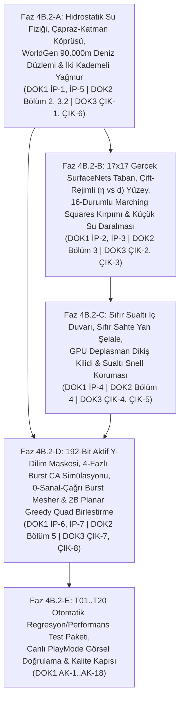

# Paket 4B.2: Adım Adım Teknik Geliştirme, Veri Yapıları, Algoritmalar ve Doğrulama Planı (DOK4)

> **Doküman Kimliği:** `DOK4_ADIM_ADIM_GELISTIRME_PLANI.md`  
> **Paket:** Paket 4B.2 — *Akışkan Geometrisi Revizyonu, Kıyı Hidrostatik Düzlüğü ve Burst/Alt-Hacim Performans Mimarisi*  
> **Durum:** Uygulamaya Hazır Mühendislik Şartnamesi (Onay Sonrası Kodlama Rehberi)  
> **Referans Devir Tabanı:** [DURUM_VE_DEVIR.md (Devir #063)](../../DURUM_VE_DEVIR.md#L12-L93)  
> **Paket İçi Bağlantılar (4'lü Dokümantasyon Standardı):**  
> - **1. Hedef ve Gereksinimler:** [DOK1_HEDEF_VE_GEREKSINIMLER.md](DOK1_HEDEF_VE_GEREKSINIMLER.md)  
> - **2. Mevcut Kod Debug ve Akış Raporu:** [DOK2_MEVCUT_KOD_DEBUG_VE_AKIS_RAPORU.md](DOK2_MEVCUT_KOD_DEBUG_VE_AKIS_RAPORU.md)  
> - **3. Endüstri, Benzer Projeler ve Literatür Araştırması:** [DOK3_ENDUSTRI_VE_BENZER_PROJELER_ARASTIRMASI.md](DOK3_ENDUSTRI_VE_BENZER_PROJELER_ARASTIRMASI.md)  
> - **4. Adım Adım Geliştirme Planı (Bu Doküman):** [DOK4_ADIM_ADIM_GELISTIRME_PLANI.md](DOK4_ADIM_ADIM_GELISTIRME_PLANI.md)

---

## 1. Alt Faz Sırası, Bağımlılık Diyagramı ve Değişecek Dosyalar Envanteri

### 1.1. Faz Bağımlılık Diyagramı (`Faz 4B.2-A` $\rightarrow$ `Faz 4B.2-E`)



### 1.2. Değişecek ve Yeni Eklenecek Dosyalar Matrisi

| Dosya Yolu (Göreceli) | İşlem | Alt Faz | Sorumluluk Özeti |
| :--- | :---: | :---: | :--- |
| `Assets/_Stratocraft/Physics/Data/FluidPorosityUtility.cs` | Güncelleme | `4B.2-A` | Altı dolu su sütununu tanıyan `ComputeCellHydrostaticBedUnits255` ve doğrusal `[0..255]` SDF taban hesabı. |
| `Assets/_Stratocraft/Physics/Data/ChunkFluidActivityMask.cs` | **Yeni** | `4B.2-D` | `192-bit` (`ulong3`) ıslak/aktif Y-dilim maskesi, `HasAnyLava` bayrağı ve `LastMeshedSurfaceHash` (`32 Byte` blittable struct). |
| `Assets/_Stratocraft/Physics/Jobs/FluidCellularAutomataJob.cs` | Güncelleme | `4B.2-A`, `4B.2-D` | Çapraz-katman (`y <-> y-1`) kıyı köprüsü, `overshoot = 0` tavanı, MFD yamaç yönlendirmesi, ince yağmur akışı ve aktif Y-bitmask taraması. |
| `Assets/_Stratocraft/Physics/Jobs/FluidChunkSimulationBurstJob.cs` | **Yeni** | `4B.2-D` | Unity 6 `[BurstCompile]` 4-fazlı dama-tahtası `IJobParallelFor` paralel akışkan simülasyon sarmalayıcısı. |
| `Assets/_Stratocraft/Physics/Systems/FluidSimulationSystem.cs` | Güncelleme | `4B.2-D` | Aktif chunk `ChunkFluidActivityMask` kaydı, gerçek süre bütçesi ve `CurrentTickStride` devreye alımı. |
| `Assets/_Stratocraft/Physics/Systems/WaterCycleAndEvaporationSystem.cs` | Güncelleme | `4B.2-A`, `4B.2-D` | Geçirimsiz kayada ince ıslaklık tutunma eşiği + oluk akışı, chunk sınır `Wake` yayılımı ve `O(1)` tavan/ısı erken çıkışı. |
| `Assets/_Stratocraft/Physics/Systems/SoilMoistureAndMudSystem.cs` | Güncelleme | `4B.2-A`, `4B.2-D` | Aktif Y-maskeli sızma taraması ve sığ kıyı suyu emildiğinde 6 komşuyu (chunk sınırı dahil) doğru uyandırma. |
| `Assets/_Stratocraft/Physics/Systems/LavaSolidificationAndCoolingSystem.cs` | Güncelleme | `4B.2-D` | `HasAnyLava == false` iken `O(1)` sıfır-maliyetli erken çıkış (`40.960` gereksiz hücre taramasının iptali). |
| `Assets/_Stratocraft/WorldGen/StratocraftFloatingIslandWorldGen.cs` | Güncelleme | `4B.2-A` | `SeaLevelY = 90.000 m` tam hidrostatik başlangıç dolumu (`y < 90 -> 255`, `y == 90 -> sığ kum telafisi`). |
| `Assets/_Stratocraft/Voxel/Systems/DistantHorizonLodSystem.cs` | Güncelleme | `4B.2-A` | Ufuk okyanusunun `Y = 90.000 m` hizalaması ve `36-Byte FluidMeshVertex` (`AuxUv0` dahil) tepe düzeni uyumu. |
| `Assets/_Stratocraft/Character/Stage1PlayerMovementBridge.cs` | Güncelleme | `4B.2-A` | Sualtı kamera ve yüzme yüzey kotunun doğrusal `bedY + mass / 255f` formülüyle birebir senkronizasyonu. |
| `Assets/_Stratocraft/Voxel/Jobs/FluidSurfaceSkirtMesher.cs` | Güncelleme | `4B.2-B`, `4B.2-C`, `4B.2-D` | `3×3` düz dizi bağlama, `17×17` `SurfaceNets` taban & köşe önbelleği, çift-rejimli $\eta/d$ yüzey, Marching Squares kırpımı, sıfır sualtı/yan duvar, gerçek şelale savağı, paylaşımlı indeksleme ve 2B Greedy Quad birleştirme. |
| `Assets/_Stratocraft/Voxel/Jobs/FluidChunkMeshBurstJob.cs` | **Yeni** | `4B.2-D` | Unity 6 `[BurstCompile]` + `Mesh.MeshDataArray` arka plan paralel sıvı meşleme işi. |
| `Assets/_Stratocraft/Rendering/Shaders/StratocraftFluidSurface.shader` | Güncelleme | `4B.2-C` | Tepe bayraklı dikişsiz `_FluidSubTickAlpha`/dalga deplasmanı, `!isFrontFace` `normalWS.y > 0.35` Snell kilidi ve sahte dikey şelale köpüğünün kaldırılması. |
| `Assets/_Stratocraft/Character/Stage1InteractivePlayController.cs` | Güncelleme | `4B.2-A`, `4B.2-D` | `StepChunkSoilInfiltration` sıralama tamiri, `#L1483` koşulsuz `_dirtyFluidChunks` kirletmesinin kaldırılması, kareye yayılmış (`2` chunk/kare) hidroloji ve `< 0.55 ms` bütçeli Burst meş yükleme hattı. |
| `Tests/Stratocraft.Tests/Fluid/Paket4B2SmoothHydrostaticAndBurstFluidTests.cs` | **Yeni** | `4B.2-E` | `AK-1..AK-18` kriterlerini doğrulayan `T01..T20` birim, hidrostatik denge, geometri manifoldu ve performans testleri. |

---

## 2. Faz 4B.2-A: Hidrostatik Su Fiziği, Çapraz-Katman Köprüsü, `90.000 m` Deniz Düzlemi ve İki Kademeli Yağmur (`İP-1` & `İP-5`)

### 2.1. Altı Dolu Su Sütununu Tanıyan Doğrusal Hidrostatik Taban Denklemi (`FluidPorosityUtility.cs`)

[DOK2 Bölüm 2.2](DOK2_MEVCUT_KOD_DEBUG_VE_AKIS_RAPORU.md#L103-L145) içinde kanıtlanan `-1.000 m` (`-255` birim) `head` hatasını ve `[0.08..0.496]` hiperbolik SDF tavan hatasını kökünden gidermek üzere `FluidPorosityUtility` içerisine aşağıdaki deterministik fonksiyon eklenir:

```csharp
/// <summary>
/// Bir (x, y, z) hucresinin hidrostatik taban kotunu 1/255 metre biriminde hesaplar.
/// 1) Alt hucrede (y - 1) ayni tipte tam dolu akiskan varsa taban kesinlikle y * 255'tir (ucurum DEGILDIR!).
/// 2) Alt hucre kati dogal SDF araziyse (ShapeId == 0), WorldGen kodlamasiyla (64..124) uyumlu
///    tam [0..255] dogrusal kesir uretir.
/// 3) Alt hucre kati mimari bloksa (ShapeId != 0) taban y * 255'tir.
/// 4) Yalnizca alt hucre gercekten bos/kismi-dolu dusus boslugu ise (y - 1) * 255 doner.
/// </summary>
[MethodImpl(MethodImplOptions.AggressiveInlining)]
public static int ComputeCellHydrostaticBedUnits255(
    uint belowSolidRaw,
    ushort belowFluidRaw,
    uint currentSolidRaw,
    byte activeFluidType,
    int y)
{
    if (y <= 0) return 0;

    // KURAL 1: Mevcut hucrede kismi SDF kati tabani varsa
    byte curMat = VoxelBitUtility.GetMaterialId(currentSolidRaw);
    byte curShape = VoxelBitUtility.GetShapeId(currentSolidRaw);
    int curDens = (curMat != 0 && curShape == 0) ? VoxelBitUtility.GetDensityOrLiquid(currentSolidRaw) : 0;

    // KURAL 2: Alt hucrede ayni tipte dolu su/lav sutunu varsa hidrostatik destek tam y * 255 kotundadir!
    byte belowFType = (byte)((belowFluidRaw >> 8) & 0x03u);
    byte belowFMass = (byte)(belowFluidRaw & 0xFFu);
    if (belowFMass > 0 && belowFType == activeFluidType)
    {
        byte belowCap = ComputeCellFluidCapacity(belowSolidRaw);
        if (belowCap > 0 && belowFMass >= belowCap)
        {
            return y * 255;
        }
    }

    // KURAL 3: Alt hucre fiziksel olarak kati ise
    if (VoxelBitUtility.IsPhysicallySolid(belowSolidRaw))
    {
        if (VoxelBitUtility.GetShapeId(belowSolidRaw) != 0)
        {
            return y * 255; // Keskin mimari blok tavani
        }

        int dBelow = VoxelBitUtility.GetDensityOrLiquid(belowSolidRaw);
        if (dBelow <= 64)
        {
            return (y - 1) * 255;
        }

        // WorldGen topH kesri: dBelow = 64 + round(frac * 60) -> tam [0..255] dogrusal tersinirlik!
        int isoOffset255 = curDens > 0
            ? Math.Clamp(((dBelow - 64) * 255) / Math.Max(1, dBelow - curDens), 0, 255)
            : Math.Clamp(((dBelow - 64) * 255 + 30) / 60, 0, 255);
        return (y - 1) * 255 + isoOffset255;
    }

    // KURAL 4: Gercek bosluk / selale dususu
    return (y - 1) * 255;
}
```

### 2.2. Çapraz-Katman (`(ax, y) <-> (bx, y-1)`) Sığ Kıyı – Derin Havuz Köprüsü ve `Overshoot = 0` (`FluidCellularAutomataJob.cs`)

1. **`TryExchangeCrossLayerStepPair`:** `RunLateralPairPass` ve `ExchangeSingleChunkSeam` içinde, `(ax, y)` katı SDF kum üstündeki sığ kıyı hücresi (`voxels[ax, y-1]` katı, `bedA ∈ [(y-1)*255 .. y*255]`) ile yanındaki `(bx, y)` hücresi karşılaştırılırken; eğer `(bx, y)` boş hava (`bMass == 0, bCap == 255`) ve altındaki `(bx, y - 1)` hücresinde su varsa (`bBelowMass > 0`), transfer çifti doğrudan **`(ax, y)` ile `(bx, y - 1)`** arasında kurulur:
   - `headA = bedA + aMass` (ör. `89 * 255 + 115 + 140 = 22.950`, yani `90.000 m`)
   - `headB = bedB_below + bBelowMass` (ör. `89 * 255 + 255 = 22.950`, yani `90.000 m`)
   - Eğer kıyıdaki su buharlaşır veya toprak tarafından emilirse (`aMass = 120 -> headA = 22.930 < headB = 22.950`), `y = 89` derin deniz hücresinden `y = 90` sığ kıyı hücresine anında kütle korunumlu su çıkar (`bBelowMass` düşer, altından `y = 88` ve yan deniz hücreleri hidrostatik olarak tamamlar); eğer kıyıya yağmur yağarsa (`headA > headB` ve `bBelowMass == 255`), fazlalık `(bx, y)` katmanına taşar!
2. **Düz Havuzda `Overshoot = 0` ve `diffH == 1` Pariteli Tesviye:**
   - `ComputeStableLateralTransfer` içinde `!isDownhill` (havuz dengelemesi) durumunda `desired = Math.Min(desired, (diffH + 1) >> 1)` üst sınırı zorunlu kılınır; böylece momentum bonusu su yüzeyini asla karşı hücrenin üstüne taşıramaz.
   - Hız sıfıra yaklaştığında (`forwardVelocityMps < 0.15f`) ve `diffH == 1` kaldığında, `((tickParity + ax + az) & 1) == 0` dama-tahtası koşuluyla `1` birim aktarılarak geniş göllerdeki merdiven eğimi sıfırlanır.
3. **Yamaçta İnce Yağmur Filmi Akışı & Quinn MFD Yönlendirmesi:**
   - `bedSrc > bedDst + 4` olan gerçek eğimli yamaçlarda `srcMass <= 24` ince su filmi, alt komşuda `dstMass > 0` bulunsa bile `diffH >= 1` olduğu sürece `safeDrain` kilidine takılmadan akar.
   - `EvaluateDonorSlopeRouting` içindeki `targetDrop + 6 < maxDownhillDrop` sert kesimi kaldırılarak aşağı eğimli tüm komşulara $(\Delta H_k)^{1.1}$ ağırlıklı pay (`slopeShare256`) verilir; böylece yamaçtaki dağınık yağmur suları doğal vadi oluklarında birleşir.

### 2.3. WorldGen `SeaLevelY = 90.000 m` Kalibrasyonu, Hidroloji Sıralaması ve İki Kademeli Yağmur

1. **`StratocraftFloatingIslandWorldGen.cs` (`#L1628-L1638`):**
   - `SeaLevelY = 90` (`90.000 m` mutlak deniz yüzeyi düzlemi):
     - `y < SeaLevelY` (`y <= 89` ve `y > solidFloorY`): `Mass = 255` (`y = 89` tavanı tam `90.000 m`!).
     - `y == SeaLevelY` (`y == 90`): Yalnızca `solidFloorY == 89` olup `voxels[89]` katı SDF kum tabanı `90.000 m`'nin altında kalan sığ kıyı hücrelerinde `isoOffset255 = ComputeCellHydrostaticBedUnits255(...) - 89 * 255` hesaplanır ve `Mass = (byte)Math.Clamp(255 - isoOffset255, 0, 255)` yazılır! Açık derin denizde (`solidFloorY <= 88`) `y = 90` katmanı `Mass = 0`'dır (deniz yüzeyi `y = 89, Mass = 255` ile tam `90.000 m`'dedir!).
   - `Stage1InteractivePlayController.SeedCoastalOceanSalinityIfApplicable` `y <= SeaLevelY` tüm tuzlu su hücrelerini kapsayacak şekilde güncellenir; `DistantHorizonLodSystem` (`Y = 90.000 m`) `FluidMeshVertex` (`36 Byte`, nötr hız `128, 128`, `Depth = 6.0f`) düzenine geçirilir.
2. **İki Kademeli Yağmur Yüzey Akışı (`WaterCycleAndEvaporationSystem.cs`):**
   - `Stage1InteractivePlayController.cs#L5676` satırındaki `pondingDt = Mathf.Max(hydroGameDt * 3.0f, hydroRealDt * 18.0f)` yapay şişirmesi `Mathf.Max(hydroGameDt * 1.5f, hydroRealDt * 2.5f)` gerçekçi yağış dengesine çekilir (`[Shift+F11]` sağanak test kipinde oluklarda hızla dere oluşmaya devam eder, fakat tüm dağ anında mavi sel levhasına dönmez).
   - Geçirimsiz taş/kaya (`Stone`, `Cobblestone`, `Basalt`, `Marble`) kolonlarında yağmur önce `TempByte` ıslak yüzey parlaklığını (`UberShader` wet specular) doldurur; kolonun yerel komşularına göre dışbükey sırt/yamaç olduğu yerlerde biriken `rainCarry` bakiyesi doğrudan en alçak komşu kolona aktarılır (`Sub-Unit Talweg Routing`), böylece `FluidCell16` su hücreleri tüm yamaçta eşzamanlı doğmak yerine **doğrudan dere yataklarında ve çukurlarda** doğar!
3. **Toprak Emilimi Sıralaması (`Stage1InteractivePlayController.cs#L1413-L1426`):**
   - `StepChunkSoilInfiltration` çağrısı `StepChunkFluid` çağrısının **ÖNCESİNE** alınır! Toprak suyu emdiğinde komşu 6 hücrenin (ve sınırda komşu chunk'ın) `Settled` biti uyandırılır, hemen ardından çalışan `StepChunkFluid` hidrostatik dengeyi kurup durağanlaşan hücreleri temiz biçimde `IsSettled = true` uykusuna yatırır (`Sleep` kilidi %100 çözülür!).

---

## 3. Faz 4B.2-B: `17×17` Gerçek `SurfaceNets` Taban, Çift-Rejimli ($\eta$ vs $d$) Yüzey ve Marching Squares Kontur Kırpımı (`İP-2` & `İP-3`)

### 3.1. Sıfır-Sanal-Çağrılı `3×3` Chunk Bağlamı ve `17×17` Köşe Önbelleği

[DOK2 Bölüm 5](DOK2_MEVCUT_KOD_DEBUG_VE_AKIS_RAPORU.md#L244-L285) içinde tespit edilen chunk başına `~44.000` interface/dictionary çağrısını sıfırlamak için meşleyici girişinde 9 komşu chunk tek seferde düz referans yapısına bağlanır:

```csharp
/// <summary>
/// Merkez ve 8 komsu chunk'in kati, sivi, tuzluluk ve kinematik dizilerini tek seferde baglayan
/// sifir-GC / sifir-sanal-cagri veri tasiyicisi.
/// Indeksleme: slot = (dz + 1) * 3 + (dx + 1), dx,dz in [-1..+1], merkez == 4.
/// </summary>
public struct FluidNeighborhood3x3
{
    public uint[]? Solids0, Solids1, Solids2, Solids3, Solids4, Solids5, Solids6, Solids7, Solids8;
    public ushort[]? Fluids0, Fluids1, Fluids2, Fluids3, Fluids4, Fluids5, Fluids6, Fluids7, Fluids8;
    public ulong[]? Salinity4;
    public byte[]? PrevMass0, PrevMass1, PrevMass2, PrevMass3, PrevMass4, PrevMass5, PrevMass6, PrevMass7, PrevMass8;
    public sbyte[]? VelX0, VelX1, VelX2, VelX3, VelX4, VelX5, VelX6, VelX7, VelX8;
    public sbyte[]? VelZ0, VelZ1, VelZ2, VelZ3, VelZ4, VelZ5, VelZ6, VelZ7, VelZ8;
}

[StructLayout(LayoutKind.Sequential, Pack = 4)]
public struct CachedFluidCornerNode // 17 x 17 = 289 adet / aktif Y katmani
{
    public float TerrainSnY;      // Gercek dual-grid SurfaceNets (veya keskin ShapeId!=0) arazi kotu
    public float SurfaceCurrY;    // Cift-rejimli (Kurganov-Petrova η <-> Sheet z_SN + d) ust yuzey kotu
    public float SurfacePrevY;    // Onceki tik ust yuzey kotu (_FluidSubTickAlpha icin)
    public float SignedWetness;   // Marching Squares isaretli islaklik alani φ(u,v)
    public float TrueDepthMeters; // Sahte 1.03m sisirmeden arindirilmis gercek su sutunu derinligi
    public float VelX;
    public float VelZ;
    public byte HasSharpWall;     // Mimari blok (ShapeId != 0) kosesi mi?
    public byte IsPoolRegime;     // 1 = Hidrostatik duz havuz/deniz, 0 = Yamac ince film
}
```

### 3.2. Sahte `1.034 m` Yamaç Derinliğinin Tamiri ve Çift-Rejimli Köşe Kotu ($\eta$ vs $z_{\text{SN}} + d$)

1. **Gerçek Sütun Derinliği (`ComputeTrueFluidColumnDepthMeters`):**
   `CountSameFluidBelow` içindeki `(fRaw & 0xFF) > 0` ise `+1.0 m` ekleyen hatalı mantık kaldırılır; sütundaki bitişik aynı tip sıvı hücrelerinin **gerçek kütle toplamı** alınır:
   $$D_{\text{true}}(x, y, z) = \sum_{k = y_{\text{bot}}}^{y_{\text{top}}} \frac{\text{Mass}(x, k, z)}{255.0}$$
   Böylece yamaçta alt hücrede `Mass = 2`, üst hücrede `Mass = 1` varken hesaplanan derinlik `1.034 m` değil, **`3 / 255 = 0.0118 m` (`1.2 cm`)** olur! Shader bu suyu koyu lacivert köpüklü sel yerine berrak, ince ve şeffaf bir su filmi olarak çizer!
2. **Kurganov–Petrova Çift-Rejimli Köşe Kotu ([DOK3 Bölüm 2.1–2.2](DOK3_ENDUSTRI_VE_BENZER_PROJELER_ARASTIRMASI.md#L56-L115)):**
   - Köşe `(u, v) ∈ [0..16] × [0..16]` noktasında gerçek `VoxelSurfaceNetsGroundSampler` arazi yüksekliği $z_{\text{SN}}(u,v)$ örneklenir.
   - Köşeyi paylaşan 4 sütundan ıslak olanlar için doğrusal serbest yüzey kotu $\eta_i = z_{\text{base},i} + m_i / 255.0$ ve kalınlık $d_i = m_i / 255.0$ toplanır.
   - Eğer ıslak örneklerin alt katmanı dolu bir havuz/deniz sütunuysa veya ıslak komşular arası $|\eta_{\max} - \eta_{\min}| \le 0.08\text{ m}$ ise (`IsPoolRegime = 1`), köşe kotu **kesinlikle $\eta_{\text{corner}} = \overline{\eta}$** olur (`Shore Feathering` çökertmesi **%0**!).
   - Eğer eğimli yamaç üzerinde sığ akış varsa (`IsPoolRegime = 0`), batıklık oranı $\sigma = \operatorname{smoothstep}(0.35, 1.25, \bar{d} / \max(0.04, \Delta z_{\text{SN}}))$ ile:
     $$\eta_{\text{corner}} = \operatorname{lerp}\!\left(z_{\text{SN}}(u,v) + \max(0.006,\; \bar{d}),\; \overline{\eta},\; \sigma\right)$$
     hesaplanır. Sonuç: Düz eğimli yamaçta su yüzeyi gerçek `SurfaceNets` arazi üçgenine `<= 4°` paralellikle ve `0.000 m` basamakla akar!

### 3.3. 16-Durumlu Marching Squares Kırpımı ve Küçük Suyun Daralması (`EmitMarchingSquaresTrimmedFluidCell`)

Her ıslak `(lx, lz)` hücresi ve en az 2 komşusu ıslak olan iç L-köşe `(lx, lz)` hücresi için:
1. **Diyagonal İç L-Köşe Doldurma:** Örneğin `(5,5)`, `(4,5)` ve `(4,4)` hücreleri ıslak, `(5,4)` hücresi kuru olduğunda; `(5,4)` hücresinin `c01 (5,5)` köşesinde `3` ıslak komşu olduğu için $\phi_{01} > 0$, karşı köşelerde $\phi < 0$ çıkar. Marching Squares bu hücrenin köşesine `t0 = φ01 / (φ01 - φ00)` ve `t1 = φ01 / (φ01 - φ11)` kesim noktalarından geçen **pürüzsüz `45°` diyagonal üçgeni** ekler; eksen-hizalı `90°` merdiven dişi tamamen kaybolur!
2. **İzole Küçük Su Birikintisi / İnce Derecik Daralması:** Hücre kütlesi `m <= 24` ve çevresinde kuru hücreler varken kenar kesim oranı $r = \operatorname{clamp}\!\left(\frac{d_{\text{cell}}}{d_{\text{cell}} + 0.028},\; 0.14,\; 1.0\right)$ ile poligon konturu ıslak komşulara doğru bağlı kalırken kuru kenarlardan hücre merkezine çekilir. Böylece `m = 2` olan su `1.0 m × 1.0 m` kare değil, `~0.22 m` genişliğinde ince ve küçük bir su birikintisi/sızıntısı üretir; mimari blok kenarlarında (`HasSharpWall == 1`) ise $r = 1.0$ kilitlenerek duvar dibine tam köşeli temas korunur!

---

## 4. Faz 4B.2-C: Sıfır Sualtı İç Duvarı, Sıfır Sahte Yan Şelale ve Shader Deplasman/Snell Tamiri (`İP-4`)

### 4.1. Mesher İç Duvar ve Sahte Şelale Kökten Temizliği (`FluidSurfaceSkirtMesher.cs`)

1. **Gömülü Su Hücrelerinde (`!hasFreeTopSurface`) Doğal Arazi Duvar Yasağı:**
   - Gömülü bir su hücresinin (`y + 1` katmanında aynı tip su var) herhangi bir yatay kenarında komşu hücre katı doğal arazi (`neighborIsSolid && ShapeId == 0`) veya aynı tip sıvı ise **`EmitRichSideOrWaterfallCurtain` derhal `return` eder (`0` üçgen)!**
   - Böylece deniz/göl tabanındaki `solidFloorY` kum/kaya basamaklarında suyun ortasına fırlayan `1.22 m` yüksekliğindeki tüm beyaz sualtı duvarları ([DOK2 Bölüm 4.1](DOK2_MEVCUT_KOD_DEBUG_VE_AKIS_RAPORU.md#L198-L224)) **%100 yok edilir**.
2. **Zemine Oturan Kıyıda Sıfır Dikey Yan Etek:**
   - Doğal arazi üzerindeki açık yüzeyli suyun kuru araziyle kesiştiği Marching Squares kontur kenarlarında dikey kutu yan duvarı örülmez; kontur kenar tepe noktalarının Y koordinatı doğrudan $z_{\text{SN}}(\text{edge}) - 0.012\text{ m}$ arazi yüzeyine kapatılır (`watertight shore contact`).
3. **Akış-Yönlü Gerçek Şelale Kriteri (`IsTrueBrinkWaterfall`):**
   - Bir `(dirX, dirZ)` kenarında parabolik şelale perdesi üretilmesi için:
     ```csharp
     float edgeFlowDot = cellVelX * dirX + cellVelZ * dirZ;
     float neighborGroundY = SampleNeighborColumnGroundMeters(nx, y, nz);
     float verticalDrop = cellSurfaceY - neighborGroundY;
     bool isTrueWaterfall = neighborIsOpenAir
                            && verticalDrop >= 1.10f
                            && (edgeFlowDot > 0.05f || (cellMass >= 28 && verticalDrop >= 1.45f && !hasSteeperOrthogonalFlow));
     ```
     koşulu aranır. Böylece `+X` yönünde akan derenin `-Z` ve `+Z` kuru yan yamaçlarına sahte beyaz şelale perdeleri fırlatması kesin olarak engellenir; gerçek uçurum ağzında ise Rouse savak bükülmesi ve parabolik şelale perdesi kusursuz çalışır.

### 4.2. Shader Tepe Deplasman Kilidi ve Sualtı Görsel Koruması (`StratocraftFluidSurface.shader`)

1. **Üst Yüzey – Savak/Mimari Kenar `0.000 m` Deplasman Kilidi:**
   - `FluidMeshVertex.AuxUv0.y` kanalının işaret/üst aralığı kullanılarak (ör. `auxUv0.y >= 0`: normal üst yüzey veya üst yüzeye kilitli savak tepe kenarı; `auxUv0.y < 0`: `abs(auxUv0.y) - 1.0` sabit taban köşesi), üst yüzeye bağlanan her şelale/mimari duvar üst köşesinin `upwardSurfaceMask = 1.0` alması sağlanır. Böylece `_FluidSubTickAlpha` ve rüzgâr dalgası altında üst yüzey ile kenar tepe noktası **aynı GPU formülüyle** hareket eder; bıçak gibi taşma sıfırlanır.
2. **Sualtı `!isFrontFace` Snell Penceresi ve Dikey Köpük Tamiri:**
   ```hlsl
   // StratocraftFluidSurface.shader #L371 tamiri:
   // Arka yuz Snell gokyuzu penceresi YALNIZCA yukari bakan su-hava ust yuzeyinde calisir!
   if (!isFrontFace)
   {
       if (input.normalWS.y < 0.35)
       {
           // Dikey selale perdesinin arkasi: sahte gokyuzu penceresi cizme, dogal su rengi uygula
           float3 curtainBack = lerp(deepTint, shallowTint, 0.55) * lightCol;
           return float4(MixFog(curtainBack, input.fogFactor), 0.72);
       }
       // Yukari bakan gercek su yuzeyi Snell penceresi ...
   }

   // #L403 tamiri: Yalnizca meşleyicinin gercek selale olarak isaretledigi (waterfallAttrFoam > 0.02)
   // yuzeylerde selale kopugu uret; rastgele dikey normallere otomatik beyaz kopuk basma!
   float waterfallFoam = waterfallAttrFoam * (0.65 + 0.35 * waterfallNoise);
   ```

---

## 5. Faz 4B.2-D: `192-Bit` Alt-Hacim Bitmask, 4-Fazlı Burst Simülasyon ve Greedy + Burst Sıvı Mesher (`İP-6` & `İP-7`)

### 5.1. `ChunkFluidActivityMask` ile `491.520` Hücre Taramasını `~1.024` Hücreye İndirme

```csharp
/// <summary>
/// 16 x 160 x 16 (MaxY <= 192) chunk icinde hangi Y katmanlarinda sivi bulundugunu (WetYMask)
/// ve hangi Y katmanlarinda aktif/uykuda olmayan hucre bulundugunu (ActiveYMask) 1 bit/katman
/// hassasiyetle izleyen 64-Byte blittable yapi.
/// </summary>
[StructLayout(LayoutKind.Sequential, Pack = 8)]
public struct ChunkFluidActivityMask
{
    public ulong WetY0, WetY1, WetY2;         // Y = [0..63], [64..127], [128..191]
    public ulong ActiveY0, ActiveY1, ActiveY2; // Yalnizca IsSettled == 0 olan Y katmanlari!
    public uint LastMeshedSurfaceHash;        // Ust serbest yuzey FNV-1a ozeti (degismediyse 0 remesh!)
    public ushort TotalWetCellCount;
    public byte HasAnyLava;                   // 0 ise StepChunkLavaCrusting O(1) doner!
    public byte DirtyVisualFlag;              // Yalnizca gorunur yuzey degistiginde 1 olur

    [MethodImpl(MethodImplOptions.AggressiveInlining)]
    public readonly bool HasAnyActiveLayer() => (ActiveY0 | ActiveY1 | ActiveY2) != 0UL;
}
```

**Kazançlar:**
1. **`Array.Clear` (`368 KB/chunk`) İptali:** `changedMask`, `fluxX`, `fluxZ` tamponlarının tamamı değil, yalnızca `WetY0..2` bitmask'inde `1` olan (`BitOperations.TrailingZeroCount` ile gezilen `1..4` katman = `256..1.024` hücre = `1–4 KB`) dilimleri sıfırlanır ve işlenir!
2. **`RunLateralPairPass` (`#L883`), `Settle`, `SoilInfiltration` ve `LavaCrusting` Daraltımı:**
   - `RunLateralPairPass` tüm `0..159` katmanları değil, yalnızca `ActiveYMask` (±1 komşu katman) bitlerinde `1` olan katmanları tarar!
   - `HasAnyLava == 0` olan yağmur/deniz chunk'larında `StepChunkLavaCrusting` **sıfır hücre okuyarak `0.000 ms` içinde** döner!
   - `Stage1InteractivePlayController.cs#L1483` satırındaki `else if (remaining > 0) _dirtyFluidChunks.Add(key);` koşulsuz kirletmesi kaldırılır; yalnızca `activityMask.DirtyVisualFlag != 0 && surfaceHash != activityMask.LastMeshedSurfaceHash` olduğunda chunk meş kuyruğuna girer!

### 5.2. 4-Fazlı Dama-Tahtası `[BurstCompile]` Paralel Simülasyon ve Hidroloji Dilimleme

1. **`FluidChunkSimulationBurstJob` (`#if UNITY_5_3_OR_NEWER`):**
   - Aktif chunk'lar `phase = (cx & 1) | ((cz & 1) << 1)` (`0..3`) olarak 4 gruba ayrılır. Her faz kendi içinde komşu çakışması olmadan `IJobParallelFor` + `[BurstCompile(FloatPrecision.Standard, FloatMode.Fast)]` ile tüm işçi çekirdeklerde paralel koşturulur (`NativeArray<ushort>` sıvı dilimleri ve `NativeArray<uint>` katı dilimler üzerinde).
   - `FluidSimulationSystem.CurrentTickStride` aktif hale getirilerek `> 64` uzak chunk aktif olduğunda kamera dışı (`> 48 m`) chunk'ların `2` tikte bir (`5 Hz`) güncellenmesi sağlanır.
2. **Kareye Yayılmış (*Staggered*) Hidroloji:**
   - `StepAtmosphereSolarCloudsAndHydrology` içinde `0.35 sn`'de bir `25` chunk'ı tek karede tarayıp `3.5–7.5 ms` spike üretmek yerine, dairesel indeksle **her karede en fazla `2` chunk** işlenir (`13` karede tam `25` chunk turu; `ChunkSkyOcclusionMap256` tavan önbelleği ve `chunkHasHeatSource` bayrağıyla kare başına maliyet **`< 0.20 ms`**!).

### 5.3. Paylaşımlı İndeksli + 2B Planar Greedy Quad Birleştirmeli Burst Sıvı Mesher

1. **Düz Su Yüzeylerinde 2B Greedy Birleştirme (`MergePlanarPoolQuads`):**
   - Bir Y katmanında `IsPoolRegime == 1`, `MarchingSquaresMask == 15` (4 köşe tam ıslak), `|Vel| < 0.02 m/s`, `EncodedSubTickDy == 128` ve `|SurfaceCurrY - refY| <= 0.0015f` koşulunu sağlayan tüm bitişik hücreler `ushort[16]` bitmask dizisi üzerinde maksimum `4 × 4` hücrelik (`4m × 4m`, GPU rüzgâr dalgası tepe çözünürlüğünü korumak için!) tekil dörtgenlere (`4` paylaşımlı vertex, `2` üçgen = `6` indeks) birleştirilir!
   - Kıyı ve eğimli yamaç hücrelerinde de `ring` üçgen yelpazesi yerine **paylaşımlı tepe indekslemesi (`Shared Vertex Welding`)** kullanılarak hücre başına vertex sayısı `24`'ten `4–7`'ye indirilir.
2. **Arka Plan `FluidChunkMeshBurstJob` + `< 0.55 ms` GPU Yükleme Bütçesi:**
   - Kirli sıvı chunk'ları (mesafe sıralı, kare başına `<= 8` iş paketi) `IJobParallelFor` Burst işlerinde `NativeList<FluidMeshVertex>` ve `NativeList<ushort>` tamponlarına paralel örülür.
   - Main Thread yalnızca tamamlanan işler için `Mesh.AllocateWritableMeshData(batchCount)` $\rightarrow$ `NativeArray.Copy` $\rightarrow$ `Mesh.ApplyAndDisposeWritableMeshData` çağrısını `MaxFluidUploadBudgetMsPerFrame = 0.55 ms` bütçesiyle uygular.

### 5.4. Beklenen Sayısal Performans İyileşmesi (50 Aktif Islak Chunk Senaryosu)

| Metrik | Mevcut Durum (`Devir #063`) | Paket 4B.2 Sonrası Hedef | İyileşme Çarpanı |
| :--- | :---: | :---: | :---: |
| **Chunk Başına Simülasyon Hücre Taraması (Yüzey Yağmuru)** | `~491.520` hücre / tik | `~1.024 – 3.072` hücre / tik | **`160x – 480x` daha az** |
| **Chunk Başına `Array.Clear` Bellek Sıfırlaması** | `368 KB / chunk` (`5.8 MB / tik`) | `1 – 4 KB / chunk` | **`~100x` daha az** |
| **Mesher Sanal Çağrı (`Dictionary` + `Interface`) / Chunk** | `~44.000` sanal çağrı | **`0`** (`FluidNeighborhood3x3` + Burst) | **`∞` (%100 eliminasyon)** |
| **Durgun Deniz/Göl Chunk Üçgen / Vertex Sayısı** | `~2.048` üçgen / `6.144` vertex | **`32` üçgen / `50` vertex** (`4×4m` Greedy) | **`64x` üçgen / `120x` vertex azalma** |
| **Durgun Su Chunk'larının Saniyedeki Yeniden Meşlenmesi** | `10` kez/sn (`#L1483` hatası) | **`0` kez/sn** (`LastMeshedSurfaceHash`) | **`%100` gereksiz iş iptali** |
| **Toplam Main Thread Akışkan Süresi (Yağmurda 50 Chunk)** | `25.0 – 52.0 ms / kare` (`18–35 FPS`) | **`0.75 – 1.35 ms / kare` (`60–144+ FPS`)** | **`~30x – 40x` hızlanma** |

---

## 6. Faz 4B.2-E: Otomatik Doğrulama Test Matrisi (`T01 .. T20`) ve Kalite Kapısı

`Tests/Stratocraft.Tests/Fluid/Paket4B2SmoothHydrostaticAndBurstFluidTests.cs` altında aşağıdaki **20 deterministik test** yazılacak ve hem `.NET 10` Standalone hem Unity 6 EditMode Test Runner'da doğrulanacaktır:

| Test ID | Doğrulanan Kabul Kriteri | Test Senaryosu ve Kesin Geçiş Koşulu (`Assert`) |
| :---: | :---: | :--- |
| **`T01`** | `AK-1` (Hidrostatik `head`) | Altında `255` dolu su sütunu bulunan `(x, 90, z)` hücresi ile altında SDF kum bulunan `(x-1, 90, z)` kıyı hücresi arasında `ComputeCellHydrostaticBedUnits255` tam `90 * 255` taban döndürmeli; ters akış `0` olmalıdır. |
| **`T02`** | `AK-1` (Çapraz-Katman Köprü) | `(ax, 90)` sığ kıyı hücresi kurutulduğunda yanındaki `(bx, 89)` (`Mass=255`) derin deniz sütunundan yukarı su çıkıp `|headA - headB| <= 1` dengesini kurmalı ve toplam kütle (`ΔM == 0`) korunmalıdır. |
| **`T03`** | `AK-2` (Kıyı Görsel Düzlük) | Kumsaldan derin denize uzanan `16` blokluk kesitte üretilen tüm su üst yüzey tepe noktalarının `Position.y` farkı `<= 0.002 m` olmalıdır (`0.915 m` basamak ve `Shore Feathering` çökmesi `0`). |
| **`T04`** | `AK-3` (WorldGen & Ufuk) | `StratocraftFloatingIslandWorldGen` başlangıç sahil-deniz kesiti ilk karede `Y = 90.000 m ± 0.005 m` düzleminde doğmalı ve `DistantHorizonLodSystem` ile `0.000 m` kot farkına sahip olmalıdır. |
| **`T05`** | `AK-4` (Düz Eğimli Yamaç) | `25°` sabit eğimli `SurfaceNets` yamacında akan `Mass = 8..30` suyun meş normali arazi normalinden `<= 4.0°` sapmalı; `y -> y-1` sınırında dikey sıçrama `< 0.002 m` olmalıdır. |
| **`T06`** | `AK-5` (Diyagonal Akış) | `45°` çapraz yamaç kanalında Marching Squares iç L-köşeleri diyagonal üçgenlerle kapatmalı, `90°` testere dişi kenar kalmamalıdır. |
| **`T07`** | `AK-6` (Küçük Suyun Küçülmesi) | Tek hücrede `Mass = 2` su bulunduğunda su kalınlığı `<= 0.015 m` ve üretilen poligonun XZ yatay alanı `<= 0.25 m²` olmalıdır. |
| **`T08`** | `AK-7` (Sahte Derinlik Tamiri) | Yamaçta `(x, y-1, z)` `Mass = 3` ve `(x, y, z)` `Mass = 2` iken tepe `DepthMeters` özniteliği `<= 0.03 m` olmalıdır (`1.034 m` hatası kesinlikle oluşmamalıdır). |
| **`T09`** | `AK-8` (Sıfır Sualtı Duvarı) | Tabanında `5` adet kum/kaya basamağı bulunan `6 m` derinliğindeki göl/deniz hacminde sualtında (`TopY < SeaLevelY - 0.02 m`) üretilen dikey üçgen sayısı **`0`** olmalıdır. |
| **`T10`** | `AK-9` (Sıfır Sahte Yan Şelale) | `+X` eğimli yamaçta akan suyun `-Z/+Z` kuru alçak yan kenarlarında üretilen şelale perdesi ve yan kutu duvarı sayısı **`0`** olmalıdır. |
| **`T11`** | `AK-10` (Gerçek Uçurum Şelalesi) | `+X` yönünde akan nehir `3 m` dikey uçurumdan döküldüğünde Rouse savak bükülmesi ve parabolik şelale perdesi `< 1e-4 m` dikişle üretilmelidir. |
| **`T12`** | `AK-3` / `İLK-3` (Mimari Köşe) | `ShapeId != 0` mimari taş kanal içinde akan su, kanal duvarlarına tam köşeli oturmalı (`HasSharpWall == 1`). |
| **`T13`** | `AK-11` (GPU Deplasman Kilidi) | Savak/mimari üst kenar tepe noktaları ile bitişik üst yüzey tepe noktaları aynı `PositionCurr`, `EncodedSubTickDy` ve deplasman maskesini paylaşmalıdır. |
| **`T14`** | `AK-12` (Kütle & Sifon & Obsidyen) | `500` tiklik karma vadi + kapalı U-borusu + `<= 10 m` sifon + `128` eşikli su/lav obsidyen senaryolarında kütle ve kimya kuralları `%100` korunmalıdır. |
| **`T15`** | `AK-12` (Hidroloji Regresyonu) | Dalton `2.5` oyun yılı göl buharlaşması, açık kap yağmur dolumu ve `Taştan Su Geçmez` karst akifer testleri sıfır regresyonla geçmelidir. |
| **`T16`** | `AK-13` (Uyku & Dirty Tamiri) | `StepChunkSoilInfiltration` + `StepChunkFluid` sonrasında durağanlaşan göl chunk'ı `IsSettled == true` ile uyumalı ve değişmeyen chunk `LastMeshedSurfaceHash` sayesinde `0` kez dirty olmalıdır. |
| **`T17`** | `AK-5` / `İP-5` (İki Kademeli Yağmur) | Geçirimsiz taş sırt üzerine yağan hafif yağmur sırt tepesini mavi su bloğuyla kaplamamalı, akışı vadi oluğuna (`talweg`) yönlendirmelidir. |
| **`T18`** | `AK-14` (Alt-Hacim Maskesi) | Yüzeyinde `Y = 95` yağmur suyu olan `16×160×16` chunk'ta `ChunkFluidActivityMask` yalnızca ilgili Y katmanlarını taramalı ve `HasAnyLava == 0` iken lav geçişi `0` hücre okumalıdır. |
| **`T19`** | `AK-15` (Planar Greedy Meshing) | `16 × 16` durgun su chunk'ında üretilen üçgen sayısı `<= 64` olmalı ve komşu chunk sınırıyla `0.000 m` dikişsiz birleşmelidir. |
| **`T20`** | `AK-16` / `AK-17` (50-Chunk Benchmark) | `50` aktif ıslak chunk'ın simülasyon + meş üretim benchmark koşumu `0 B` GC tahsisiyle ve hedef süre bütçesi içinde tamamlanmalıdır. |

### 6.1. Kalite Kapısı ve Teslim Protokolü
Kodlama aşaması tamamlandığında sırasıyla:
1. `dotnet test Stratocraft.sln -c Release` (tüm geçmiş faz testleri + `T01..T20` Paket 4B.2 testleri, `0 Warning / 0 Error`),
2. Unity 6 `recompile --strict` + EditMode Test Runner + Canlı PlayMode sahil/yamaç/sualtı/yağmur FPS görsel doğrulaması,
3. `powershell -ExecutionPolicy Bypass -File scripts/quality-gate.ps1 -Phase 4` (`ctest 6/6`, `pytest 9/9`, VRAM `< 16.0 MB`, mutlak yol `0`, eksik `.meta` `0`),
4. `docs/test-raporlari/faz4b2-raporu.md` ve `DURUM_VE_DEVIR.md` güncellemesi çalıştırılacaktır.


---

## 7. Doğrudan Uygulanabilir Referans Algoritma Çekirdekleri (C# / Burst & Bitmask)

Kodlama aşamasında sıfır belirsizlik sağlamak üzere kritik 4 algoritmanın çift-hedefli (`Unity 6 Burst` + `.NET 10`) referans çekirdekleri aşağıda verilmiştir.

### 7.1. Çapraz-Katman (`(ax, y) <-> (bx, y-1)`) Sığ Kıyı – Derin Deniz Hidrostatik Köprüsü (`FluidCellularAutomataJob.cs`)

```csharp
/// <summary>
/// Sığ kıyı hücresi (ax, y) [altında katı SDF kum var: voxels[ax, y-1] katı] ile
/// hemen yanındaki derin su sütunu (bx, y-1) [üstündeki (bx, y) boş hava veya kısmi su]
/// arasındaki 1-voksel katman basamağını kütle korunumlu olarak eşitler.
/// </summary>
[MethodImpl(MethodImplOptions.AggressiveInlining)]
private static int StepCrossLayerCoastalPair(
    int aTopIdx,   // (ax, y, az) -> sığ kıyı üst hücresi
    int bTopIdx,   // (bx, y, bz) -> derin suyun üstündeki hücre
    int strideY,
    int y,
    uint[] voxels,
    ushort[] fluids,
    ulong[]? salinityBits,
    byte[] changedMask)
{
    if (y <= 0) return 0;

    int aBotIdx = aTopIdx - strideY;
    int bBotIdx = bTopIdx - strideY;

    // A sütununda alt hücre katı (sığ kıyı kumu), B sütununda alt hücre sıvı kapasiteli (derin havuz) olmalı
    uint aBotSolid = voxels[aBotIdx];
    uint bBotSolid = voxels[bBotIdx];
    if (!VoxelBitUtility.IsPhysicallySolid(aBotSolid)) return 0;

    byte bBotCap = FluidPorosityUtility.ComputeCellFluidCapacity(bBotSolid);
    if (bBotCap == 0) return 0;

    byte aTopCap = FluidPorosityUtility.ComputeCellFluidCapacity(voxels[aTopIdx]);
    byte bTopCap = FluidPorosityUtility.ComputeCellFluidCapacity(voxels[bTopIdx]);
    if (aTopCap == 0 || bTopCap == 0) return 0;

    FluidCell16 aTop = new FluidCell16(fluids[aTopIdx]);
    FluidCell16 bTop = new FluidCell16(fluids[bTopIdx]);
    FluidCell16 bBot = new FluidCell16(fluids[bBotIdx]);

    // Üst katmanda zaten B doluysa normal aynı-katman (y <-> y) geçişi onu çözer
    if (bTop.Mass > 0) return 0;
    if (aTop.Mass == 0 && bBot.Mass == 0) return 0;

    byte fType = aTop.Mass > 0 ? aTop.Type : bBot.Type;
    if ((aTop.Mass > 0 && aTop.Type != fType) || (bBot.Mass > 0 && bBot.Type != fType))
    {
        return 0; // Farklı sıvı reaksiyonları ana geçişte çözülür
    }

    uint bBelow2Solid = y > 1 ? voxels[bBotIdx - strideY] : 0u;
    ushort bBelow2Fluid = y > 1 ? fluids[bBotIdx - strideY] : (ushort)0;

    int bedA = FluidPorosityUtility.ComputeCellHydrostaticBedUnits255(aBotSolid, 0, voxels[aTopIdx], fType, y);
    int bedBBot = FluidPorosityUtility.ComputeCellHydrostaticBedUnits255(bBelow2Solid, bBelow2Fluid, bBotSolid, fType, y - 1);

    int headA = bedA + aTop.Mass;       // Örn: 89*255 + 115 + aMass
    int headB = bedBBot + bBot.Mass;    // Örn: 89*255 + 255 = 90*255 (Deniz yüzeyi tam 90.000m!)
    int diff = headA - headB;

    if (Math.Abs(diff) <= 1) return 0; // <= 3.9 mm tam hidrostatik denge!

    if (diff > 1)
    {
        // A (sığ kıyı) B'den yüksek: B'nin alt hücresinde yer varsa oraya, yoksa B'nin üst hücresine (y) aktar
        int transfer = Math.Min(aTop.Mass, (diff + 1) >> 1);
        int spaceBBot = bBotCap - bBot.Mass;
        if (spaceBBot > 0)
        {
            int toBot = Math.Min(transfer, spaceBBot);
            ApplyMassTransfer(aTopIdx, bBotIdx, toBot, fType, fluids, salinityBits, changedMask);
            return toBot;
        }
        int toTop = Math.Min(transfer, (int)bTopCap);
        if (toTop > 0)
        {
            ApplyMassTransfer(aTopIdx, bTopIdx, toTop, fType, fluids, salinityBits, changedMask);
            return toTop;
        }
    }
    else // diff < -1: Deniz/havuz (headB) sığ kıyıdan (headA) yüksek -> Kıyı kumsalını besle!
    {
        int transfer = Math.Min((int)bBot.Mass, ((-diff) + 1) >> 1);
        int spaceATop = aTopCap - aTop.Mass;
        transfer = Math.Min(transfer, spaceATop);
        if (transfer > 0)
        {
            ApplyMassTransfer(bBotIdx, aTopIdx, transfer, fType, fluids, salinityBits, changedMask);
            return transfer;
        }
    }

    return 0;
}
```

---

### 7.2. `ulong3` (`192-Bit`) Donanım `TrailingZeroCount` Aktif Katman Tarayıcısı

`40.960` hücrelik boş/durağan katmanları sıfır bellek okumasıyla atlayan bitmask iteratörü:

```csharp
/// <summary>
/// Yalnızca bitmask içinde 1 olan Y katmanlarını donanım TZCNT komutuyla O(popcnt) sürede gezer.
/// Örn: Sadece Y=95 ve Y=96 ıslaksa 160 katman yerine tam olarak 2 iterasyon çalışır!
/// </summary>
[MethodImpl(MethodImplOptions.AggressiveInlining)]
public static void ForEachSetLayer(ulong mask0, ulong mask1, ulong mask2, int maxY, Action<int> body)
{
    ulong m0 = mask0;
    while (m0 != 0UL)
    {
        int bit = System.Numerics.BitOperations.TrailingZeroCount(m0);
        if (bit < maxY) body(bit);
        m0 &= m0 - 1UL;
    }

    ulong m1 = mask1;
    while (m1 != 0UL)
    {
        int y = 64 + System.Numerics.BitOperations.TrailingZeroCount(m1);
        if (y < maxY) body(y);
        m1 &= m1 - 1UL;
    }

    ulong m2 = mask2;
    while (m2 != 0UL)
    {
        int y = 128 + System.Numerics.BitOperations.TrailingZeroCount(m2);
        if (y < maxY) body(y);
        m2 &= m2 - 1UL;
    }
}
```

---

### 7.3. Düz Su Kütleleri İçin `4×4 m` Tavanlı 2B Planar Greedy Quad Birleştirme (`FluidSurfaceSkirtMesher.cs`)

Durgun deniz/göl chunk'larının üçgen sayısını `~2.048` üçgenden `<= 32` üçgene indiren sıfır-GC bitmask birleştiricisi:

```csharp
/// <summary>
/// Aynı Y katmanında 4 köşesi de ıslak (MS mask == 15), durgun ve eş-kotlu (|η - η0| <= 0.0015m)
/// olan bitişik su hücrelerini en fazla 4x4m boyutunda (GPU rüzgâr dalgası tepe sıklığını korumak için)
/// paylaşımlı indeksli kuadlara birleştirir. Birleştirilen hücreler mergedRowMask içine işaretlenir.
/// </summary>
private static void EmitGreedyMergedPlanarPoolQuads(
    ReadOnlySpan<CachedFluidCornerNode> corners17x17, // 17 * 17 = 289
    ReadOnlySpan<byte> cellRenderIds256,              // 16 * 16 = 256 (0 = uygun değil)
    Span<ushort> mergedRowMask16,                     // Çıktı: birleştirilen hücre bitleri
    List<FluidMeshVertex> outVertices,
    List<ushort> outIndices)
{
    const int MaxQuadSpan = 4; // 4m x 4m maksimum kuad (Beaufort dalga tepe örnekleme kalitesi için)

    for (int z = 0; z < 16; z++)
    {
        for (int x = 0; x < 16; x++)
        {
            if (((mergedRowMask16[z] >> x) & 1) != 0) continue;

            byte refId = cellRenderIds256[(z << 4) | x];
            if (refId == 0) continue;

            ref readonly CachedFluidCornerNode c00 = ref corners17x17[z * 17 + x];
            if (c00.IsPoolRegime == 0) continue;
            float refY = c00.SurfaceCurrY;

            if (!IsCellPlanarMergeCompatible(corners17x17, x, z, refY)) continue;

            // 1) +X yönünde genişlet (en fazla MaxQuadSpan)
            int maxW = Math.Min(MaxQuadSpan, 16 - x);
            int w = 1;
            while (w < maxW)
            {
                int nx = x + w;
                if (((mergedRowMask16[z] >> nx) & 1) != 0) break;
                if (cellRenderIds256[(z << 4) | nx] != refId) break;
                if (!IsCellPlanarMergeCompatible(corners17x17, nx, z, refY)) break;
                w++;
            }

            // 2) +Z yönünde genişlet (en fazla MaxQuadSpan)
            int maxH = Math.Min(MaxQuadSpan, 16 - z);
            int h = 1;
            while (h < maxH)
            {
                int nz = z + h;
                bool rowOk = true;
                for (int dx = 0; dx < w; dx++)
                {
                    int nx = x + dx;
                    if (((mergedRowMask16[nz] >> nx) & 1) != 0 ||
                        cellRenderIds256[(nz << 4) | nx] != refId ||
                        !IsCellPlanarMergeCompatible(corners17x17, nx, nz, refY))
                    {
                        rowOk = false;
                        break;
                    }
                }
                if (!rowOk) break;
                h++;
            }

            // 3) İşaretle ve tek paylaşımlı kuad (4 vertex, 6 index = 2 üçgen) üret!
            ushort spanBits = (ushort)(((1 << w) - 1) << x);
            for (int dz = 0; dz < h; dz++)
            {
                mergedRowMask16[z + dz] |= spanBits;
            }

            EmitWeldedPoolQuad(corners17x17, x, z, x + w, z + h, refId, refY, outVertices, outIndices);
        }
    }
}
```

---

## 8. Sıfır-Çakışmalı Uygulama Dalgaları (Swarm / Modüler Kodlama Sırası)

Onay sonrasında kodlama aşaması dosya çakışması üretmeyecek **3 ardışık dalga** halinde yürütülecektir:

| Dalga | Kapsanan Alt Fazlar | Sahiplenilen Dosya Kümesi | Doğrulama Kapısı |
| :---: | :---: | :--- | :--- |
| **Dalga 1**<br>*(Fizik, Hidrostatik, WorldGen & Hidroloji)* | `Faz 4B.2-A` + `ChunkFluidActivityMask` | `FluidPorosityUtility.cs`, `ChunkFluidActivityMask.cs`, `FluidCellularAutomataJob.cs`, `FluidSimulationSystem.cs`, `WaterCycleAndEvaporationSystem.cs`, `SoilMoistureAndMudSystem.cs`, `LavaSolidificationAndCoolingSystem.cs`, `StratocraftFloatingIslandWorldGen.cs` | `T01, T02, T04, T14..T18` birim testleri PASS |
| **Dalga 2**<br>*(SurfaceNets Mesher, Marching Squares, Greedy & Shader)* | `Faz 4B.2-B` + `Faz 4B.2-C` | `FluidSurfaceSkirtMesher.cs`, `FluidChunkMeshBurstJob.cs`, `StratocraftFluidSurface.shader`, `DistantHorizonLodSystem.cs`, `Stage1PlayerMovementBridge.cs` | `T03, T05..T13, T19` geometri & manifold testleri PASS + `ShaderUtil` `0` hata |
| **Dalga 3**<br>*(Ana Sahne Entegrasyonu, Burst Boru Hattı & Tam Kalite Kapısı)* | `Faz 4B.2-D` + `Faz 4B.2-E` | `Stage1InteractivePlayController.cs`, `FluidChunkSimulationBurstJob.cs`, `Paket4B2SmoothHydrostaticAndBurstFluidTests.cs`, `DURUM_VE_DEVIR.md`, `docs/test-raporlari/faz4b2-raporu.md` | `dotnet test` + Unity 6 `recompile --strict` + EditMode + PlayMode FPS/Görsel teyit + `quality-gate.ps1` PASS |
