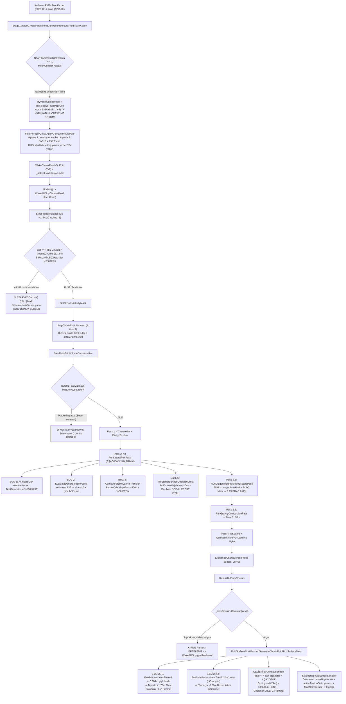

# DOK 2 — Mevcut Kod Envanteri, Tam Akış Şeması ve Gerçek Log vs Beklenen Değer Sapma Raporu

> **Belge Zinciri:**
> [DOK 1: Hedef ve Gereksinimler](DOK1_HEDEF_VE_GEREKSINIMLER.md) |
> **[DOK 2: Mevcut Kod Debug, Akış Şeması ve Gerçek Log Sapma Raporu](DOK2_MEVCUT_KOD_DEBUG_VE_AKIS_RAPORU.md)** |
> [DOK 3: Endüstri Araştırması ve Olması Gereken İdeal Akış Şeması](DOK3_ENDUSTRI_VE_BENZER_PROJELER_ARASTIRMASI.md) |
> [DOK 4: Adım Adım Geliştirme Planı](DOK4_ADIM_ADIM_GELISTIRME_PLANI.md)

---

## 1. Projedeki Tüm Sıvı Kodlarının Tam Envanteri (`39` Dosya)

### 1.1. Çekirdek Veri, Hidrostatik, Kinematik ve Teşhis (`9` Dosya)
| # | Dosya | Sorumluluk / Temel Fonksiyonlar |
| :-: | :--- | :--- |
| 1 | [`Assets/_Stratocraft/Physics/Data/FluidCell16.cs`](../../Assets/_Stratocraft/Physics/Data/FluidCell16.cs) | 2-byte `FluidCell16` (`Mass[0..7]`, `Type[8..9]`, `IsSettled[10]`, `PressureHead[11..15]`), `Pack`, `WakeRaw`, `SettleRaw` |
| 2 | [`Assets/_Stratocraft/Voxel/Data/FluidHydrostaticsShared.cs`](../../Assets/_Stratocraft/Voxel/Data/FluidHydrostaticsShared.cs) | Paylaşılan kapasite (`ComputeCellFluidCapacity`), taban (`ComputeCellHydrostaticBedUnits255`, `ComputeCellBedElevationUnits255`) ve head (`ComputeCellHydrostaticHeadUnits255`) matematiği |
| 3 | [`Assets/_Stratocraft/Physics/Data/FluidPorosityUtility.cs`](../../Assets/_Stratocraft/Physics/Data/FluidPorosityUtility.cs) | Hidrostatik wrapper'lar + dökme/çekme (`TryResolveFluidPourCell`, `ApplyContainerFluidPour`, `ApplySingleFlaskFluidPour`, `ScoopFluidIntoContainer`, `DisplaceExcessFluidOnSolidEdit`) |
| 4 | [`Assets/_Stratocraft/Voxel/Data/IFluidKinematicsSlice.cs`](../../Assets/_Stratocraft/Voxel/Data/IFluidKinematicsSlice.cs) | `PrevMass[65536]`, `VelX_Q7`, `VelZ_Q7` arayüzü |
| 5 | [`Assets/_Stratocraft/Physics/Data/ActiveChunkFluidKinematicsPool.cs`](../../Assets/_Stratocraft/Physics/Data/ActiveChunkFluidKinematicsPool.cs) | `HardMaxSlices=128`, `192 KB/chunk` 0-GC kinematik dilim havuzu, `SnapshotPrevMassWindow`, `QuiescentTicks` |
| 6 | [`Assets/_Stratocraft/Physics/Data/ChunkFluidActivityMask.cs`](../../Assets/_Stratocraft/Physics/Data/ChunkFluidActivityMask.cs) | 192-bit `WetY0..2` & `ActiveY0..2` katman maskesi, `BuildFromChunkFluids`, `ComputeFastSurfaceVisualHash` |
| 7 | [`Assets/_Stratocraft/Physics/Data/ChunkSalinityBitset.cs`](../../Assets/_Stratocraft/Physics/Data/ChunkSalinityBitset.cs) | 1 bit/hücre tuzlu/tatlı su ayrımı |
| 8 | [`Assets/_Stratocraft/Physics/Diagnostics/FluidTraceRecorder.cs`](../../Assets/_Stratocraft/Physics/Diagnostics/FluidTraceRecorder.cs) | Mevcut 16-tiklik CSV telemetri kaydedicisi (`[Insert]`) |
| 9 | [`Assets/_Stratocraft/Core/Logging/FluidDeepDiagnosticProbe.cs`](../../Assets/_Stratocraft/Core/Logging/FluidDeepDiagnosticProbe.cs) | **YENİ (Paket 4B.4):** Tüm sıvı katmanlarını kapsayan 0-GC merkezi teşhis probu (`23` `FluidTransferRejectReason`, çift-karar, reaksiyon, mesher, hidroloji, JSONL çıktısı) |

### 1.2. Sıvı Fiziği, Simülasyon ve Yardımcı Hidroloji (`12` Dosya)
| # | Dosya | Sorumluluk / Temel Fonksiyonlar |
| :-: | :--- | :--- |
| 10 | [`Assets/_Stratocraft/Physics/Jobs/FluidCellularAutomataJob.cs`](../../Assets/_Stratocraft/Physics/Jobs/FluidCellularAutomataJob.cs) | `StepFluidGridVolumeConservative` (Pass 1..4), `RunLateralPairPass`, `TryExchangeInChunkCoastalStep`, `ExecuteInChunkCrossLayerTransfer`, `EvaluateDonorSlopeRouting`, `ComputeStableLateralTransfer`, `RunDiagonalSteepSlopeEscapePass`, `RunGravityCompactionPass`, `UpdateHydrostaticHeadAndSolveUPipes`, `ExchangeChunkBorderFluids`, `ExecuteCellPairReaction`, `TryStampSurfaceObsidianCrest` |
| 11 | [`Assets/_Stratocraft/Physics/Jobs/FluidBurstSurfaceScanUtility.cs`](../../Assets/_Stratocraft/Physics/Jobs/FluidBurstSurfaceScanUtility.cs) | Burst hızlandırılmış yüzey tarama ve görsel hash (Not: `AccumulateWordHash` ile hash formülü uyumsuz!) |
| 12 | [`Assets/_Stratocraft/Physics/Systems/FluidSimulationSystem.cs`](../../Assets/_Stratocraft/Physics/Systems/FluidSimulationSystem.cs) | `16 Hz` sabit-adım akümülatör (`MaxCatchupTicksPerFrame=1`), `2500 us` AIMD (`MaxChunksPerTick 32..64`), `ShouldStepChunkAtDistance`, `GetOrBuildActivityMask` |
| 13 | [`Assets/_Stratocraft/Physics/Systems/SoilMoistureAndMudSystem.cs`](../../Assets/_Stratocraft/Physics/Systems/SoilMoistureAndMudSystem.cs) | `StepChunkSoilInfiltration` (4 tikte 1 topraktan su emilimi + çamur görsel dirty mask) |
| 14 | [`Assets/_Stratocraft/Physics/Systems/WaterCycleAndEvaporationSystem.cs`](../../Assets/_Stratocraft/Physics/Systems/WaterCycleAndEvaporationSystem.cs) | `StepRainCore` (yağmur göllenmesi), `DeductColumnWaterTopDown` (buharlaşma) |
| 15 | [`Assets/_Stratocraft/Physics/Systems/SnowAccumulationAndMeltSystem.cs`](../../Assets/_Stratocraft/Physics/Systems/SnowAccumulationAndMeltSystem.cs) | `StepChunkSnowCore` (açık suya kar ekleme), `ApplyMeltwaterToSoilAndFreshFluid` (erime suyu) |
| 16 | [`Assets/_Stratocraft/Physics/Systems/LavaSolidificationAndCoolingSystem.cs`](../../Assets/_Stratocraft/Physics/Systems/LavaSolidificationAndCoolingSystem.cs) | `StepChunkLavaCrusting`, `FlushPendingCrustBatch` (kenar lav -> `MagmaBlock`) |
| 17 | [`Assets/_Stratocraft/Physics/Systems/KarstHydrologyAndAquiferSystem.cs`](../../Assets/_Stratocraft/Physics/Systems/KarstHydrologyAndAquiferSystem.cs) | Yeraltı karst akifer muhasebesi (runtime'da `fluids[]` dizisine yazmıyor) |
| 18 | [`Assets/_Stratocraft/Physics/Systems/ChunkHydrologyMaterializer.cs`](../../Assets/_Stratocraft/Physics/Systems/ChunkHydrologyMaterializer.cs) | `MaterializeChunkFromLedger` (yeni açılan chunk'lara çanak yağmuru damgalama) |
| 19 | [`Assets/_Stratocraft/Physics/Systems/WorldHydrologyLedger.cs`](../../Assets/_Stratocraft/Physics/Systems/WorldHydrologyLedger.cs) | `< 1 MB` uzak bölge hidroloji defteri |
| 20 | [`Assets/_Stratocraft/Physics/Data/WorldHydrologyTypes.cs`](../../Assets/_Stratocraft/Physics/Data/WorldHydrologyTypes.cs) | Hidroloji veri yapıları |
| 21 | [`Assets/_Stratocraft/Physics/Data/AtmosphereTerrainSample.cs`](../../Assets/_Stratocraft/Physics/Data/AtmosphereTerrainSample.cs) | Atmosfer-arazi örnekleme |

### 1.3. Mesher, Shader ve Su Altı Rendering (`3` Dosya)
| # | Dosya | Sorumluluk / Temel Fonksiyonlar |
| :-: | :--- | :--- |
| 22 | [`Assets/_Stratocraft/Voxel/Jobs/FluidSurfaceSkirtMesher.cs`](../../Assets/_Stratocraft/Voxel/Jobs/FluidSurfaceSkirtMesher.cs) | `5.231` satır: `GenerateChunkFluidRichSurfaceMesh`, `EmitGreedyMergedPlanarPoolQuads`, `ResolveCanonicalFreeSurfaceCornerY`, `EvaluateRichCornerFast`, `GetOrComputeSharedCornerNormal`, `TryEmitMarchingSquaresConcaveCorners`, `EmitRichSideOrWaterfallCurtain`, `IsMidAirFreeFallStreamCell`, `EmitVolumetricWaterfallColumnCell`, `BuildFluidUnityMeshZeroGc` |
| 23 | [`Assets/_Stratocraft/Rendering/Shaders/StratocraftFluidSurface.shader`](../../Assets/_Stratocraft/Rendering/Shaders/StratocraftFluidSurface.shader) | URP `Transparent-10` / `ZWrite On` su-lav-asit shader'ı (`FluidVert`, `FluidFrag`, Vlachos dual-phase ripple, Beer-Lambert, Fresnel, köpük, yeni `_FluidDebugView 1..6`) |
| 24 | [`Assets/_Stratocraft/Rendering/UnderwaterCameraEffect.cs`](../../Assets/_Stratocraft/Rendering/UnderwaterCameraEffect.cs) | Su/lav/asit altı sis + URP Post-Processing (`ColorAdjustments`, `Gaussian DoF`) + GUI perde |

### 1.4. Orkestrasyon, Etkileşim, WorldGen ve Diğer Bağlı Dosyalar (`15` Dosya)
| # | Dosya | Sıvı Etkileşim Noktası |
| :-: | :--- | :--- |
| 25 | [`Assets/_Stratocraft/Character/Stage1InteractivePlayController.cs`](../../Assets/_Stratocraft/Character/Stage1InteractivePlayController.cs) | `StepFluidSimulation` (`L1918`), `WakeAllDirtyChunksFluid` (`L736`), `WakeChunkAndNeighborsFluid` (`L543`), `RebuildAllDirtyChunks` (`L4814`), `StartBackgroundDistantMeshBatch` (`L4784`), `StepSingleChunkCloudHydrology` (`L6649`), `[Insert]` prob kaydı |
| 26 | [`Assets/_Stratocraft/Character/Stage1MatterCrystalAndMiningController.cs`](../../Assets/_Stratocraft/Character/Stage1MatterCrystalAndMiningController.cs) | `ExecuteFluidFlaskAction` (`L829-989`), `UpdateTargetAimProbe` (`L2777`), `TryVoxelDdaRaycast` (`L2976`), `WakeChunkFluidsOnEdit` (`L2718`) |
| 27 | [`Assets/_Stratocraft/Character/Stage1PlayerMovementBridge.cs`](../../Assets/_Stratocraft/Character/Stage1PlayerMovementBridge.cs) | `ApplySwimmerDisplacement` (`L138, 146`), yüzme / oksijen / boğulma |
| 28 | [`Assets/_Stratocraft/Character/Stage1VisualHotbarAndInventoryUi.cs`](../../Assets/_Stratocraft/Character/Stage1VisualHotbarAndInventoryUi.cs) | Matara (`380`), Kova (`1275`), Dev Kazan (`3825`) kapasite ve HUD |
| 29 | [`Assets/_Stratocraft/WorldGen/StratocraftFloatingIslandWorldGen.cs`](../../Assets/_Stratocraft/WorldGen/StratocraftFloatingIslandWorldGen.cs) | `SeaLevelY=90`, başlangıç göleti, lav denizi sınır uyanışı, karst akifer, sahil son-uzlaştırma |
| 30–39 | `Stage1AtmosphereCloudAndRainRenderer.cs`, `EnclosedOxygenFloodFillSystem.cs`, `ToolChopArcProfile.cs`, `IWorldPersistenceService.cs`, `StratocraftStage1SceneBuilder.cs`, `ConvectiveLightningAndRodSystem.cs`, `ChunkDeltaLog.cs`, `VoxelChunkComponent.cs`, `NavSpanRebuildJob.cs` | Yardımcı yağmur/oksijen/kalıcılık/navigasyon bağlantıları |

---

## 2. Mevcut Sistemin Tam Akış Şeması (Bugün Gerçekte Ne Oluyor?)

---

## 3. Kurulan Derin Loglama Altyapısı (`FluidDeepDiagnosticProbe`)

Kullanıcı talebi doğrultusunda **sıvıyla ilgili tüm katmanlara** sıfır-GC (`FluidDeepDiagnosticProbe.Enabled == false` iken `0 B` alloc) enstrümantasyon yerleştirilmiştir:

| Katman / Dosya | Enstrümante Edilen Fonksiyonlar | Yakalanan Değişkenler / Kayıt Türü |
| :--- | :--- | :--- |
| [`FluidDeepDiagnosticProbe.cs`](../../Assets/_Stratocraft/Core/Logging/FluidDeepDiagnosticProbe.cs) | Merkezi `BeginSession`, `EndSession`, `FlushToJsonl`, `BuildSummaryText`, `SetWatchCenter` | `23` maddelik `FluidTransferRejectReason` histogramı + 10 ayrı kayıt listesi -> `Logs/*.jsonl` |
| [`FluidPorosityUtility.cs`](../../Assets/_Stratocraft/Physics/Data/FluidPorosityUtility.cs) | `TryResolveFluidPourCell`, `ApplyContainerFluidPour` | `exactHit`, `aimMat`, `aimDens`, `aimCap`, `stepTag`, `stage1`, `stage2Dy0..2`, `wetCells`, `upslopeDy1`, `rem` |
| [`FluidSimulationSystem.cs`](../../Assets/_Stratocraft/Physics/Systems/FluidSimulationSystem.cs) | `AdvanceFixedStepAccumulator` | `rawDt`, `clampedDt`, `ticksToRun`, `subTickAlpha01`, `maxChunksPerTick`, `stride`, `lastBatchUs` |
| [`FluidCellularAutomataJob.cs`](../../Assets/_Stratocraft/Physics/Jobs/FluidCellularAutomataJob.cs) | `StepFluidGridVolumeConservative`, `RunLateralPairPass`, `ExecuteInChunkCrossLayerTransfer`, `EvaluateDonorSlopeRouting`, `ComputeStableLateralTransfer`, `RunDiagonalSteepSlopeEscapePass`, `RunGravityCompactionPass`, `ExecuteCellPairReaction`, `TryStampSurfaceObsidianCrest` | 6 Pass kütle toplamları, 23-maddelik `RejectHistogram`, watch penceresindeki her çiftin `(bed, head, diffH, gndA, cmA, share, maxDrop, freeDrop, sSlope, dSlope, maxEq, preShare, xfer, reason)` ve her reaksiyonun `(preW/L, needW/L, availW/L, obs, crestTry/Ok/Block, aboveVox/Fld)` kayıtları |
| [`FluidSurfaceSkirtMesher.cs`](../../Assets/_Stratocraft/Voxel/Jobs/FluidSurfaceSkirtMesher.cs) | `GenerateChunkFluidRichSurfaceMesh`, `ResolveCanonicalFreeSurfaceCornerY`, `EvaluateRichCornerFast`, `EmitSingleConcaveBridgeTriangle`, `EmitRichSideOrWaterfallCurtain` | Tüm köşe rejimleri, `MaxBedVsSnDiff`, `MinCornerSurfMinusTrueSnY` (gerçek `dCurr`-dahil gömülme!), `MaxCornerSurfMinusTrueSnY` (şişme!), `MaxTopSlopeDeg`, `InvTri`, `ConcaveHoles`, `DryVirtBank`, `MaxSkirt`, `OppBank`, `OppCoplanar`, `ZeroVelSlope` |
| [`Stage1InteractivePlayController.cs`](../../Assets/_Stratocraft/Character/Stage1InteractivePlayController.cs) | `StepFluidSimulation`, `RecordFluidFlaskEventInternal`, `[Insert]` kısayolu | `active`, `budget`, `nearActive`, `nearSel`, `nearStarved`, `watchStepped`, `seamXfer`, `dirtyFluid`, `solidBlocked` + PlayMode'da `[Insert]` ile `Logs/fluid_deep_probe_*.jsonl` |
| [`SoilMoistureAndMudSystem.cs`](../../Assets/_Stratocraft/Physics/Systems/SoilMoistureAndMudSystem.cs) & [`WaterCycleAndEvaporationSystem.cs`](../../Assets/_Stratocraft/Physics/Systems/WaterCycleAndEvaporationSystem.cs) | `StepChunkSoilInfiltration`, `StepRainCore` | `deltaMass`, `cells`, `wokeChunks`, `markedSolidDirty`, `detail` |
| [`UnderwaterCameraEffect.cs`](../../Assets/_Stratocraft/Rendering/UnderwaterCameraEffect.cs) | `Step` | `targetSubmersion01`, `blend01`, `fluidType`, `fogEnabled` |
| [`StratocraftFluidSurface.shader`](../../Assets/_Stratocraft/Rendering/Shaders/StratocraftFluidSurface.shader) | `FluidFrag` (`_FluidDebugView 1..6`) | `1: activeMotionGate`, `2: subTickDy`, `3: Normal vs FaceNormal`, `4: opticalDepth/clip`, `5: sideWall/foam`, `6: FluidId` |

---

## 4. GERÇEK LOG ÇIKTILARI vs BEKLENEN DEĞERLER (Sapma ve Kök Neden Tablosu)

[`FluidDeepDiagnosticProbeRunnerTests.cs`](../../Assets/Tests/EditMode/FluidDeepDiagnosticProbeRunnerTests.cs) mevcut kod üzerinde (0 davranış değişikliğiyle) çalıştırılmış ve `Logs/fluid_probe_baseline/S1..S6.jsonl` dosyaları üretilmiştir (`6/6` koşu tamamlandı, mevcut `220/220` `.NET 10` testi korundu).

### 4.1. Senaryo `S4` — PlayController `81` Yakın Aktif Chunk Açlık (Starvation) Deneyi
*Log dosyası: `Logs/fluid_probe_baseline/S4_controller_starvation.jsonl`*

| Metrik | Beklenen (`DOK 1`) | **GERÇEK LOG DEĞERİ** | Durum | Kök Neden (Dosya & Satır) |
| :--- | :---: | :---: | :---: | :--- |
| `Watch(0,0)` atlanan tik (`budget=48`) | **`0 / 16`** | **`16 / 16` (`%100 DONUK!`)** | ❌ **KRİTİK SAPMA** | `Stage1InteractivePlayController.cs:1943-1954`: `chebDist <= 4` içinde `81` chunk varken mesafe sıralaması olmadan `HashSet`'in ilk `48` elemanını alıyor; sonradan dökülen `(0,0)` chunk'ı `else` bloğuna düşüp `remSlots == 0` olduğu için **HİÇ ÇALIŞTIRILMIYOR!** |
| `Watch(0,0)` atlanan tik (`budget=32`) | **`0 / 16`** | **`16 / 16` (`%100 DONUK!`)** | ❌ **KRİTİK SAPMA** | Aynı kod: AIMD `MaxChunksPerTick`'i `32`'ye düşürünce açlık daha da sertleşiyor (`NearStarved = 49` chunk/tik!). |

> **Kullanıcı Şikayetiyle Doğrudan Eşleşme:** Yağmur, okyanus kıyısı veya `WakeAllDirtyChunksFluid` sebebiyle `dist <= 4` içinde `> 48` chunk aktifken su döktüğünüz chunk **öndeki 48 chunk tek tek uykuya geçene kadar tamamen donuk bekler**, sonra aralıklı sıra bulup ağır aksak akar!

---

### 4.2. Senaryo `S1` — `20°` Buzul Yamacına Dev Kazan (`3825 Br`) Dökümü (`32` Tik)
*Log dosyası: `Logs/fluid_probe_baseline/S1_glacier_cauldron_3825.jsonl` (`1.519` JSONL satırı)*

| Metrik | Beklenen (`DOK 1`) | **GERÇEK LOG DEĞERİ** | Durum | Kök Neden (Dosya & Satır) |
| :--- | :---: | :---: | :---: | :--- |
| Döküm Hedef Adımı (`pour_resolve`) | Serbest hava (`aimY+1`) | `step="2_SemiPermeableAimCell"`, `aimDens=33`, `dst=[4,103,8]` | ❌ **SAPMA** | `NearPhysicsColliderRadius=-1` yüzünden `exactHit=false`; `FluidPorosityUtility.cs:199` yarı-katı SDF hücresinin **içine** döküyor. |
| Yokuş Yukarı Yazma (`upslopeDy1`) | **`0`** (`dx >= 0`) | **`6` hücre** (`T=0 centroidDx = -0.13 m` yokuş yukarı!) | ❌ **SAPMA** | `FluidPorosityUtility.cs:495`: Aşama 2 `ResolvePourNeighborY` yokuş yukarı `y+1`'e `nBed > centerBed + 90` filtresi olmadan `255` yazıyor! |
| `T=0` Tepe Şişmesi (`MaxSurfMinusTrueSn`) | **`<= 1.05 m`** | **`+1.734 m`** (`T=1: +1.472 m`, `T=32: +1.126 m`) | ❌ **KRİTİK SAPMA** | `FluidHydrostaticsShared.cs:155`: `dBelow >= 124, dCurr == 0` için `cellBedY = y.000 m` (gerçek SurfaceNets `y - 0.504 m`'nin **`+0.504 m` üstü**!) + `upslopeDy1` üst üste yığılma -> **EKRAN GÖRÜNTÜSÜNDEKİ MAVİ BALONCUK!** |
| `T=0` Yüzey Eğimi (`MaxTopSlopeDeg`) | **`<= 35°`** | **`65.0°`** (`T=1: 54.8°`, `T=4: 42.2°`) | ❌ **KRİTİK SAPMA** | İç köşe `y + 0.7..1.0 m` vs 1 m yandaki Rejim-3 kenar `snTerrainY + 0.14 = y - 0.36 m` -> 1 m'de `1.3+ m` kırılma -> sivri üçgen piramit! |
| `T=4..32` Buz Altına Gömülme (`MinSurfMinusTrueSn`) | **`>= -0.02 m`** | **`-0.278 m`** (`T=4: -0.266 m`, `T=8: -0.268 m`, `T=16: -0.278 m`) | ❌ **KRİTİK SAPMA** | `FluidSurfaceSkirtMesher.cs:4186-4188`: `EvaluateSurfaceNetsTerrainYAtCorner` `dCurr` yoğunluğunu **HİÇ OKUMUYOR** ve `t0 = 0.496`'ya kilitliyor -> Rejim 1 & Rejim 3 suyu **gerçek buzun `27.8 cm` altına bastırıyor!** |
| Zemin Çelişkisi (`MaxBedVsSnDiff`) | **`<= 0.05 m`** | **`0.700 m`** (`T=1`) | ❌ **KRİTİK SAPMA** | Fizik `bed` (`y.000m`) ile Mesher `snTerrainY` (`y - 0.504m`) birbirinden **`70 cm`** kopuk! |
| `T=8` (`0.5 sn`) `centroidDx` | **`>= 5.5 m`** | **`3.87 m`** (`centerCol` hâlâ `101 Br`!) | ❌ **SAPMA** | Aşağıdaki 5 üst üste binmiş fizik freni yüzünden akış boğuluyor: |
| └ `SlopeRoutingStarved` / `ZeroShare` | **`0`** | **`367` starved + `101` zero-share** | ❌ **SAPMA** | `FluidCellularAutomataJob.cs:2152, 2220`: `srcMass < 135 -> share=0` (`[6,103,9] mA=83 diffH=113 -> xfer=0`!) ve `share=28..42` çifte bölünme (`[6,103,7] mA=141 -> xfer=8`!). |
| └ `srcSlope223 + dstSlope223` | **`446`** (sığda) | **`787 .. 905`** (`sSlope=400, dSlope=461 -> maxEq=16`!) | ❌ **SAPMA** | `FluidCellularAutomataJob.cs:2528-2535`: `mA=14, mB=6` (`<= 32` doğrusal bölge!) iken bile üst bölge eğimi (`461`) kullanılıp `maxEq` yarı yarıya düşürülüyor! |
| └ `NotGrounded` (Üst Katman Kilidi) | **`0`** | **`6`** (`a=[4,104,6] mA=91 diffH=152 -> xfer=0`!) | ❌ **SAPMA** | `FluidCellularAutomataJob.cs:1541, 1647`: Aşağıdan-yukarıya taramada alt hücre `254` olunca üst katman `%100` kilitleniyor. |
| └ `DiagChangedMaskSkip` (`Pass 2.5`) | **`< %30`** | **`2.082` skip -> `P25_Diag = 0` (`%100` İŞLEVSİZ!)** | ❌ **KRİTİK SAPMA** | `FluidCellularAutomataJob.cs:2391, 2472`: `changedMask != 0` kontrolü + 3×3×3 işaretleme yüzünden `Pass 2.5` 32 tikte **TEK 1 BİRİM BİLE** çapraz akıtamadı! |
| └ **YENİ KEŞİF:** Chunk `(1,0)` `MaskEarlyExitNoWet` | **`0`** (su geçince) | **`chunk[1,0]` `T=10..15` boyunca `entryMass=0`, `MaskEarlyExitNoWet=1`!** | ❌ **KRİTİK SAPMA** | `chunk[0,0]` kütlesi `3825 -> 3152` düşerek `(1,0)`'a `673 Br` aktardı; ama `masks[(1,0)]` yenilenmeden `StepFluidGridVolumeConservative:204` `!HasAnyWetLayer()` ile **673 Br suyu görmeyip 0 dönerek dondurdu!** |
| Mesher Concave Delikleri (`ConcaveHoles`) | **`0`** | **`4`** (`T=0: 1`, `T=1: 3`) | ❌ **SAPMA** | `FluidSurfaceSkirtMesher.cs:1700` vs `:3328`: Köprü `SkirtOffset > 0.2m` yüzünden iptal ediliyor, ama yan duvar `SkirtOffset`'e bakmadan kendini de iptal ediyor -> **4 açık delik!** |
| Mesher Sahte Kuru Banka (`DryVirtBank`) | **`0`** | **`44`** (`T=8: 14`, `T=16: 15`) | ❌ **SAPMA** | `FluidSurfaceSkirtMesher.cs:2571`: Şişik `pendingDryBedY` yüzünden düz kuru buz `44` kez sahte duvar sanıldı! |
| Yamaçta Sıfır Hız (`ZeroVelOnSlope`) | **`0`** | **`15`** (`T=0`) | ⚠️ **SAPMA** | Shader `activeMotionGate` hızı 0 olan yamaç köşelerinde donuk yama üretir. |

---

### 4.3. Senaryo `S2` — `2.5°` Hafif Eğimli Doğal SDF Arazide Kova (`1275 Br`) Dökümü (`48` Tik)
*Log dosyası: `Logs/fluid_probe_baseline/S2_gentle_slope_bucket_1275.jsonl` (`5.905` JSONL satırı)*

| Metrik | Beklenen (`DOK 1`) | **GERÇEK LOG DEĞERİ** | Durum | Kök Neden |
| :--- | :---: | :---: | :---: | :--- |
| `T=16` (`1.0 sn`) `centroidDx` | **`>= 4.0 m`** | **`2.58 m`** (`T=8: 0.85 m`!) | ❌ **SAPMA** | Düşük-iso (`d=70..86`) SDF'de `slopeSum ≈ 880` (`%50` fren) + `DiffTooSmall = 3.828` + `FlatCohesionMinMass = 448` + `LyapunovOvershootGuard = 475`! |
| `T=16` Merkez Kolon (`centerCol`) | **`<= 12 Br`** | **`16 Br`** (`T=24: 11 Br`, `T=32: 8 Br`) | ❌ **SAPMA** | Kova döküldüğü yerde uzun süre oyalanıp ince ince sızıyor. |
| `Pass 2.5` (`DiagChangedMaskSkip`) | `< %30` | **`8.998` skip -> `P25_Diag = 0`!** | ❌ **KRİTİK SAPMA** | `48` tik boyunca tek bir çapraz transfer bile yapılamadı. |

---

### 4.4. Senaryo `S3` — `7×7` Kazılmış Çukur Havuz Kontrolü (`1275 Br`, `40` Tik)
*Log dosyası: `Logs/fluid_probe_baseline/S3_dug_pit_control.jsonl`*

| Metrik | Beklenen (`DOK 1`) | **GERÇEK LOG DEĞERİ** | Durum | Yorum |
| :--- | :---: | :---: | :---: | :--- |
| Kütle & Durulma | `1275`, `49/49` settled | **`1275`, `49/49` settled** | ✅ **UYUMLU** | Çukur fiziği ve durgunluk sağlam! |
| Yüzey Eğimi (`MaxTopSlopeDeg`) | `<= 1.0°` | **`0.2°`** (`InvTri = 0`) | ✅ **UYUMLU** | Durgun havuz düzlüğü sağlam! |
| Zemin Çelişkisi (`MaxBedVsSnDiff`) | `<= 0.05 m` | **`0.504 m`** (`MinSurfMinusTrueSn = -0.894 m` kıyı eteği!) | ❌ **SAPMA** | Çukurda bile `FluidHydrostaticsShared` `+0.504 m` ofset farkı duruyor! |

---

### 4.5. Senaryo `S5` — Su + Lav Sınırı, Obsidyen Crest & Mesher Çarpışması (`8` Tik)
*Log dosyası: `Logs/fluid_probe_baseline/S5_water_lava_obsidian.jsonl` (`595` JSONL satırı)*

| Metrik | Beklenen (`DOK 1`) | **GERÇEK LOG DEĞERİ** | Durum | Kök Neden (Dosya & Satır) |
| :--- | :---: | :---: | :---: | :--- |
| Dar-Bant SDF Hava Vokselli (`d=24`) Crest | **`5 / 5`** | **`0 / 5` (`5/5 CrestBlockedBySdfAir`!)** | ❌ **KRİTİK SAPMA** | `FluidCellularAutomataJob.cs:2976`: `voxels[aboveIdx] != 0u` kontrolü `aboveVox = 6151` (`Basalt, d=24`, fiziksel hava!) gördüğü için obsidyen tepe setini **%100 iptal etti!** |
| Mühür Sonrası Buharlaşma (`Steam`) | **`0`** | **`30` buharlaşma (`-10.850 Br` kayıp!)** | ❌ **KRİTİK SAPMA** | `y=90` açık kaldığı için üstten sızan su ve lav her tik `[8,90,2..6]`'da buharlaşıp yok oldu! |
| Doğrudan Temasta Coplanar Duvar (`OppCoplanar`) | **`0`** | **`18` coplanar duvar (`MaxTopSlope = 89.8°`)** | ❌ **KRİTİK SAPMA** | `FluidSurfaceSkirtMesher.cs:3208, 3367`: Karşıt sıvı `neighborIsOpenAir` sayıldığı için hem Su hem Lav aynı ara düzleme `ZWrite On` duvar çizip Z-fighting yaptı! |
| İnce Obsidyen Etek Uzatması (`MaxSkirt`) | **`<= 0.18 m`** (d=84'te) | **`0.800 m`** (`OppBank = 8`, crest varken `0.42 m` > `0.238 m` bıçak!) | ❌ **KRİTİK SAPMA** | `FluidSurfaceSkirtMesher.cs:2720`: `y+1` crest varken `anyBankAtYPlus1 == true` -> `0.42 m` uzatma; `Density=84` (`0.238 m`) obsidyeni iki yandan delip geçiyor! |
| Derin Deniz Üst Katman `NotGrounded` | **`0`** | **`65` kez `NotGrounded`** (`[6,89,9..13] mA=255 -> xfer=0`!) | ❌ **SAPMA** | `y=88` reaksiyondan eksilince `y=89` üst katmanı `NotGrounded` kilidine girip akamadı! |

---

### 4.6. Senaryo `S6` — Emici Toprak (`Dirt/Grass`) Yamacı + Yardımcı Hidroloji (`32` Tik = `2.0 sn`)
*Log dosyası: `Logs/fluid_probe_baseline/S6_soil_hydrology_intervention.jsonl`*

| Metrik | Beklenen (`DOK 1`) | **GERÇEK LOG DEĞERİ** | Durum | Kök Neden (Dosya & Satır) |
| :--- | :---: | :---: | :---: | :--- |
| 2 Saniyede Toprak Emilimi | **`%10 .. %30`** (`125..380 Br`) | **`1.264 / 1.275 Br` (`%99.1 YUTULDU!`)** | ❌ **KRİTİK SAPMA** | `SoilMoistureAndMudSystem.cs:350-405`: Her 4 tikte 1 (`4 Hz`) her ıslak kolondan agresif çekim yapınca yayılan kova (`~80` kolon) `2 sn`'de neredeyse tamamen buhar gibi yok oluyor! |
| Solid-Dirty Tetiklemesi (`_dirtyChunks`) | Fluid remesh'i bloklamamalı | **`8 / 8` (%100 her adımda solid dirty!)** | ❌ **SAPMA** | `Stage1InteractivePlayController.cs:2034, 5113`: Her nem kovası geçişi chunk'ı `_dirtyChunks`'a atıp fluid remesh'ini erteliyor! |

---

### 4.7. Kullanıcının 3 Canlı `Seed 1453` PlayMode Testi Mikroskobu (`S7`, `S8`, `S9` — 10 Ekran Görüntüsü Eşleşmesi)

Kullanıcının `2026-11-20` tarihinde canlı PlayMode'da (`Seed 1453`) çektiği 10 ekran görüntüsündeki birebir koordinatlar (`[F3]` HUD: `Su (28/128 -> 47/128)`), gerçek `StratocraftFloatingIslandWorldGen` üzerinde `FluidDeepDiagnosticProbe` ile çalıştırılmıştır (`Logs/fluid_probe_baseline/S7..S9.jsonl`):

| Canlı Test / Görseller | `Seed 1453` Koordinatı | **GERÇEK LOG ÇIKTISI** | Görseldeki Sorunun %100 Kanıtlanmış Kök Nedeni |
| :--- | :--- | :--- | :--- |
| **`S7` — Test 1: Dağ Taşması** (Görsel 1..5, `12:13–12:40`) | `Chunk (-6, -9)`, `XYZ (-84, 108, -142)` | `MinSurfMinusTrueSn = -1.116 m`, `MaxSurfMinusTrueSn = +2.439 m`, `MaxBedVsSnDiff = 1.959 m`, `MaxTopSlope = 42.2°`, `NotGrounded = 196`, `SlopeRoutingZeroShare = 273`, `SlopeRoutingStarved = 347`, `DiagChangedMaskSkip = 7.939`, `ConcaveHoles = 1`, `DryVirtBank = 14` | Görsel 5'te suyun buz yamacında kesik şeritler halinde kaybolması **`-1.116 m` buz altına gömülme**; Görsel 3–4'teki dev duvarlar **`+2.439 m` / `1.959 m` zemin çelişkisi**; yavaş akış **`NotGrounded=196` + `620` yamaç yönlendirme freni**! |
| **`S8` — Test 2: Göletin Ortasından Merkeze Delik** (Görsel 6..8, `13:27–13:38`) | `Chunk (-7, -4)`, `XYZ (-111, 47..95, -49)` | `1.432,3` blokluk gölette `80` tikte (`5.0 sn`) yalnızca **`%15.1` (`215.6` blok)** boşaldı (`T=10: %0.7`, `T=20: %3.3`, `T=40: %7.5`)! Histogram: **`GravityNewlyWetLock = 22.001`**, **`NotGrounded = 1.873`**, **`DiffTooSmall = 16.420`**, **`LyapunovOvershootGuard = 6.528`**, **`DiagChangedMaskSkip = 105.463`**, `MaxBedVsSnDiff = 3.225 m`, `MaxSurfMinusTrueSn = +2.325 m`, `ConcaveHoles = 2` | 1) Kuyu açıldığında alt katman (`y=88`) kuyuya boşalırken üst katman (`y=89`) **`NotGrounded` (`1.873` kez)** yüzünden kilitleniyor; 2) `Pass 1` aşağıdan yukarıya çalıştığından düşen su tikte yalnız 1 blok inebiliyor ve **`GravityNewlyWetLock` (`22.001` kez)** yan/alt akışı durduruyor; 3) Geniş gölet yüzeyindeki `diffH = 1..4` farkları **`DiffTooSmall (16.420)` + `Lyapunov (6.528)`** tarafından yapıştırıcı gibi tutuluyor; 4) Görsel 6'daki kuyu içi sivri dikenler **`MaxBedVsSnDiff = 3.225 m`** + `0.80 m` etek! |
| **`S9` — Test 3: Normal Yamaç Akışı (Dev Balon + Tepede `1×1m` Parlak Turkuaz Kare)** (Görsel 9–10, `13:53–14:00`) | `Chunk (-4, -6)`, `XYZ (-61, 102, -85)` (`Su: 46..47/128`!) | **`flatCapTris = 21` (`T=4`), `31` (`T=8`)**, **`DryVirtBank = 119`**, **`MaxSurfMinusTrueSn = +1.905 m`**, **`MaxTopSlope = 68.8°`**, `T=32`'de **`centerCol = 510 Br` hâlâ dolu**, **`SlopeRoutingStarved = 683`**, **`SlopeRoutingZeroShare = 269`**, **`AxisNewlyWetLock = 614`**, **`DiagChangedMaskSkip = 10.616`** | **1) Tepedeki `1×1m` parlak turkuaz kare:** `DryVirtBank = 119` (şişik `pendingDryBedY` düz kuru buzu 119 kez duvar sandı!) -> tepedeki tek hücre `isPoolRegime = true` (`Normal = (0,1,0)` düz parlak turkuaz kare, `31` üçgen!) oldu, 1 m dışı ise `68.8°` Rejim-3 kubbe yamacına kırıldı! **2) Yamaçta top gibi bekleme:** `[F3]` `Su = 47/128` tam `budgetChunks = 32..48` starvation sınırına dayandı + `952` kez yamaç yönlendirme freni (`683 + 269`)! |

---

## 5. Tek Cümlelik Teşhis Özeti

> **Su neden uzun uzun bekleyip çok yavaş akıyor ve kötü görünüyor?**
> Çünkü: **(1)** `StepFluidSimulation` 81 yakın chunk'ı sıralamasız `32..64` kesmesiyle döküm chunk'ını **%100 aç (starved)** bırakabiliyor + `MaskEarlyExitNoWet` komşu chunk'a geçen suyu görmeyebiliyor; **(2)** CA çekirdeğinde `NotGrounded`, `EvaluateDonorSlopeRouting` (`srcMass<135` + çifte bölünme), doğrusal bölgede `slopeSum~900` (`%50` fren), `Pass 2.5` `changedMask` kilidi (`0` transfer) ve toprağın 2 sn'de `%99.1` su yutması akışı boğuyor; **(3)** Mesher'da `FluidHydrostaticsShared` (`+0.504 m`) ile `EvaluateSurfaceNetsTerrainYAtCorner` (`-0.278 m`, `dCurr` kör!) arasındaki **`0.70 m` zemin çelişkisi** tepede `+1.73 m` / `65°` mavi baloncuk ve yamaçta buz altına gömülen üçgenler üretiyor; **(4)** `TryStampSurfaceObsidianCrest` dar-bant SDF'de `%100` iptal oluyor ve `0.42 m` etek + `18` coplanar duvar Su+Lav fermuarı yaratıyor.
