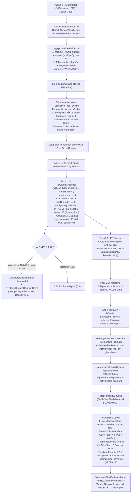

# DOK 3 — Endüstri, Benzer Projeler Araştırması ve Olması Gereken İdeal Akış Şeması

> **Belge Zinciri:**
> [DOK 1: Hedef ve Gereksinimler](DOK1_HEDEF_VE_GEREKSINIMLER.md) |
> [DOK 2: Mevcut Kod Debug, Akış Şeması ve Gerçek Log Sapma Raporu](DOK2_MEVCUT_KOD_DEBUG_VE_AKIS_RAPORU.md) |
> **[DOK 3: Endüstri Araştırması ve Olması Gereken İdeal Akış Şeması](DOK3_ENDUSTRI_VE_BENZER_PROJELER_ARASTIRMASI.md)** |
> [DOK 4: Adım Adım Geliştirme Planı](DOK4_ADIM_ADIM_GELISTIRME_PLANI.md)

---

## 1. Endüstri ve Benzer Voxel Oyunları Karşılaştırmalı Araştırması

Smooth-voxel (eğimli `SurfaceNets` / `Marching Cubes` / `Dual Contouring`) arazide **sonlu (finite) akışkan fiziği ve kesintisiz su yüzeyi meshleme** oyun endüstrisinin en zor problemlerinden biridir. Güncel endüstri çözümleri ve akademik modellerin karşılaştırması aşağıdadır:

| Referans Oyun / Model | Simülasyon Mimarisi | Yüzey Meshleme / Rendering | Güçlü Yönleri | Zayıf Yönleri / Bizim İçin Çıkarım |
| :--- | :--- | :--- | :--- | :--- |
| ***Enshrouded* ("Wake of the Water", Keen Games — Stempfle & Mantler)** | **Stackable Simulation Columns** (çok katlı sütun aralıkları: taban, sıvı aralığı, katı engel) + **Dirty Boxes** (sadece değişen 3B kutular) | **Sparse Surface SDF + GPU "Brick Tree"** (yalnızca su yüzey sınırında SDF üretimi, materyal ıslaklık entegrasyonu) | $O(N^3)$ yerine sütun-tabanlı akış -> **üst katmanlar alttaki 1 hücrelik dar boğazda kilitlenmez**; Dirty Boxes sayesinde açlık/starvation yok | Tam GPU Brick Tree yüksek mimari maliyetlidir; ancak **sütun bazlı toplam akış + mesafe-öncelikli Dirty Boxes + su yüzeyini tek sürekli SDF/yükseklik alanından okuma** ilkesini doğrudan almalıyız! |
| ***Timberborn* (Update 6: *Wonders of Water*)** | **3D Layered Eulerian / Virtual Pipe SWE** (üst üste kanallar, barajlar, tüneller) | Yükseklik alanı (heightfield) + katmanlı su yüzeyleri, akıntı yönlü köpük | Çok katlı yapılarda bile hızlı, öngörülebilir ve akıcı yayılım; kütle korunumu `%100` | Düzgün kübik bloklu arazide çalışır; bizim `SurfaceNets` arazimizle köprü kurmak için tek bir **gerçek SDF zemin kotu** gerektirir |
| ***7 Days to Die* (Alpha 21+)** | **Water Voxel** (ayrık sonlu voksel hacmi + uyuyan göller + komşu uyanışı) | Smooth terrain üzerinde yumuşatılmış su yüzeyi + sahil kenarı gömülmesi | Düşük bellek (`2 Byte` düzeyinde), açık dünyada geniş ölçekli uyuyan göller | Çok ince katmanlarda ve dik smooth yamaçlarda kliplenme/yavaş yayılım eğilimi — bizim `DOK 2`'deki sorunlarımızla birebir aynı tuzağa düşer |
| ***Vintage Story* (Finite / Realistic Water)** | 3B Hücresel Otomat (CA) + basınç tahmini + uzak bölge makro-hidrolojisi | Kübik/yamaç yüzey şeritleri | Sonlu kütle korunumu ve dünya ölçeği | Saf CA'da satranç tahtası (checkerboard) ve düz zeminde yavaş yayılım; çözüm için **sanal boru momentumu + tek geçişli basınç yayılımı** gerekir |
| **Mei, Decaudin & Hu (2007) — Virtual Pipe Model (VPM)** | Hücreler arası sanal borular ($f_{i \to j}^{t+\Delta t} = \max(0, f^t + \Delta t \cdot A \frac{g \Delta H}{L})$) + toplam çıkış ölçekleme ($\sum f_{\text{out}} \le V$) | 2.5B yükseklik alanı + akış hızına bağlı normal/köpük | **Sıralı 4-geçiş çifte bölünmesi yok!** 4 komşuya eşzamanlı ve orantılı akış; momentum sayesinde yamaçta doğal hız | Saf 2.5B sürümü mağaraları desteklemez; bizim 3B `FluidCell16` ızgaramız üzerinde **katmanlı / sütun-farkında VPM** olarak uygulanmalıdır |
| **Kurganov & Petrova (2007) — Well-Balanced Lake-at-Rest SWE** | $H = b + h$ yüzey kotu üzerinden akı; durgun gölde $\nabla H = 0 \implies F = 0$ | Zemin yüksekliği $b(x,z)$ ile su yüzeyi $\eta(x,z)$ **tek matematiksel yüzeyden** gelir | Durgun göl ayna gibi düz kalır (`0` salınım) | $b_{\text{fizik}} \neq b_{\text{mesher}}$ olursa (bizim `DOK 2`'de `0.70 m` fark!) **tüm teori çöker** -> tepe baloncuğu + buz altına gömülme! |
| **Smooth Voxel Su Meshleme (Heightfield-Over-SDF vs Marching Cubes / SurfaceNets)** | Fizik ızgarasından su yüzeyi yüksekliği $\eta(x,z)$ + zemin SDF $b_{\text{SN}}(x,z)$ | 1) **Augmented Heightfield + Gerçek Terrain SDF** (açık alan & yamaç), 2) **Depth-Fade Shoreline Shader** ($\alpha \to 0$ iken $h \to 0$), 3) **Uçurum/Şelale için 3B Sütun / Partikül** | Açık dünyada 60–144 FPS; `SurfaceNets` araziye `0` gömülme, `0` baloncuk, `0` rejim sıçraması | Mevcut `FluidSurfaceSkirtMesher`'daki 6 farklı sert rejim (`Pool / Overfall / Regime1 / Regime2Lip / Regime2Val / Regime3Mound`) yerine **tek sürekli formül** kullanılmalıdır! |

---

## 2. Stratocraft İçin Sentezlenen İdeal Algoritma (5 Temel Mühendislik İlkesi)

### İlke 1 — Açlıksız (Starvation-Free) Mesafe-Öncelikli Simülasyon ve Bayatlamayan Aktivite Maskesi (`P1`)
1. **3-Kademeli Öncelikli Chunk Seçimi (`StepFluidSimulation`):**
   - **Kademe 0 (`chebDist <= 1`, oyuncunun kendi `3×3` = `9` chunk'ı):** Bütçe sınırından **önce** ve **her tikte %100 kesin** çalıştırılır (`Starved == 0`).
   - **Kademe 1 (`chebDist == 2..4`, kalan `<= 72` yakın chunk):** `chebDist` artan sırada (veya `dist` grupları içinde dairesel cursor ile) seçilir; böylece hiçbir yakın chunk `HashSet` sırasından dolayı sonsuza kadar donmaz!
   - **Kademe 2 (`chebDist > 4`):** Kalan bütçe dairesel round-robin ile paylaştırılır.
2. **Dış Yazmada Anında Maske Senkronizasyonu:**
   - `ExchangeChunkBorderFluids`, `ApplyContainerFluidPour`, `StepRainCore`, `SnowMelt`, `SwimmerDisplacement` herhangi bir `(cx, cz)` chunk'ına su yazdığı anda o chunk'ın `ChunkFluidActivityMask` katmanı (`MarkLayerWetAndActive(y)`) doğrudan güncellenir veya `IsInitialized = 0` yapılır; **`MaskEarlyExitNoWet` kaynaklı donma %100 imkânsız olur!**
3. **Kuyruk İzolasyonu:** `RebuildAllDirtyChunks` içinde `_dirtyChunks.Contains(key)` (yalnızca toprak nemi / görsel ton değişikliği) artık `_dirtyFluidChunks` remesh'ini **asla bloklamaz**; su mesh'i solid mesh'ten bağımsız olarak aynı karede güncellenir.

### İlke 2 — Üst-Katman Serbest, Çifte-Bölünmesiz ve Bölge-Doğru Fizik CA / VPM (`P2`)
1. **Döküm Hijyeni (`TryResolveFluidPourCell` & `ApplyContainerFluidPour`):**
   - `TryResolveFluidPourCell`, dar-bant SDF hava hücresi (`aimDens < 64`) üzerinde gerçek yüzey yüksekliği hücrenin üst yarısındaysa (`aimDens >= 32`) veya serbest hava gerekiyorsa suyun yarı-gömülü kalmasını önler; `ApplyContainerFluidPour` 2. aşamada `nBed > centerBed + 64` yokuş yukarı hücrelere (`upslopeDy1`) **asla** su yazmaz!
2. **Üst-Katman Yatay Serbestliği (Yukarıdan-Aşağıya `RunLateralPairPass`):**
   - `RunLateralPairPass` `y` döngüsünü **`clampedEndY -> clampedStartY` (YUKARIDAN AŞAĞIYA)** çalıştırır!
   - Sonuç: `(x, y+1)` üst katmanı değerlendirilirken altındaki `(x, y)` hâlâ `255` doludur -> **`IsFluidColumnGrounded == true`** -> dev kazan su kulesi **aynı tik içinde tüm katmanlardan yanlara çöker (`NotGrounded == 0`)!**
3. **Sadeleştirilmiş Yamaç Yönlendirmesi (Quinn MFD — Sıfır Kilit, Sıfır Çifte Bölünme):**
   - `EvaluateDonorSlopeRouting`'deki `srcMass < 135 -> share = 0` sert sıfırlaması **kaldırılır**.
   - Yalnızca `nCap - nMass >= 4` (gerçekten boş yeri olan) komşular ağırlık paylaşımına girer (`space = 1` ağırlık çalması biter).
   - Kuru kıyı / havuz yatak terslenmesinde `nMass == 0` için de gerçek yatak/head kontrolü uygulanır.
   - `slopeShare256`, `ComputeStableLateralTransfer` içinde `rawPipe/slopeCap` üstüne ikinci kez vurulmak yerine yalnızca çoklu-iniş toplam çıkışını dengeleyecek şekilde yumuşak uygulanır.
4. **Bölge-Doğru Hidrostatik Eğim (`dH / dM`):**
   - `ComputeStableLateralTransfer` ve `ExecuteInChunkCrossLayerTransfer` içinde `srcSlope223` yalnızca `srcMass > 32` ise üst bölge eğimini kullanır; `srcMass <= 32` iken gerçek eğim olan **`223`** kullanılır. Aynı şekilde `dstSlope223` yalnızca `dstMass >= 32` ise üst bölge eğimini, **`dstMass < 32` (kuru hedef dahil!) iken `223`** kullanır -> **`%50` yapay cephe freni tek hamlede biter!**
5. **`Pass 2.5` (45° Çapraz Kaçış) ve `QuiescentTicks` Düzeltmesi:**
   - `RunDiagonalSteepSlopeEscapePass`, `changedMask[idx] != 0` kontrolünü **tüm `changedMask` yerine yalnızca diyagonal/yeni-ıslak bitine (`0x10 | 0x06 | 0x08`)** bağlar ve `MarkChanged3x3Horizontal` (27 hücre susturma) yerine sadece kaynak + hedef çiftini işaretler.
   - `QuiescentTicks = 24` emniyet ağı yalnızca gerçekten durgun (`bedDrop <= 2` ve `diffH <= 2`) kapalı havuzlarda sayar; eğimli yamaçta akan suyu asla dondurmaz.

### İlke 3 — Fizik ve Mesher İçin TEK GERÇEK `SurfaceNets` Zemin Fonksiyonu & Sürekli Su Yüzeyi (`P3`)
Bu, haftalardır süren tüm görsel bozuklukların (tepedeki `+1.73 m` mavi baloncuk + yamaçtaki `-0.28 m` buz altına gömülme + `65°` faset piramit + `44` sahte kıyı bankası) **kökten çözümüdür**:

1. **Tek Gerçek Zemin Yüksekliği ($b_{\text{true}}$ — `FluidHydrostaticsShared`):**
   - Gerçek `HybridSurfaceNetsAndShapeMesher` izo-yüzeyi:
     $$t_{\text{SN}} = \mathrm{clamp}\!\left(\frac{d_{\text{below}} - 64}{\max(1,\, d_{\text{below}} - d_{\text{curr}})},\; 0.05,\; 0.95\right), \quad b_{\text{true}}(x,y,z) = (y - 1) + t_{\text{SN}}$$
   - **Dikkat:** `dBelow = 127, dCurr = 0` (düz katı buz/kaya) için $t_{\text{SN}} = \frac{63}{127} = 0.496 \implies b_{\text{true}} = y - 0.504\,\text{m}$!
   - `dBelow = 127, dCurr = 45` (dar-bant SDF kar yamacı) için $t_{\text{SN}} = \frac{63}{82} = 0.768 \implies b_{\text{true}} = y - 0.232\,\text{m}$!
   - Hem `FluidHydrostaticsShared` (fizik) hem `FluidSurfaceSkirtMesher` (mesher) **birebir bu tek fonksiyonu** (ve köşede 4 komşu sütunun simetrik ortalamasını — `+X/+Z` asimetrisi olmadan!) okur -> **`MaxBedVsSnDiff == 0.000 m`!**
2. **Sürekli Su Yüzeyi Kotu ($\eta$ — 6 Sert Rejimin Yerine Tek Formül):**
   - Her ıslak sütunun su üst yüzeyi doğrudan $\eta_{\text{col}} = b_{\text{true}} + h(m)$ (`h(m) = m / 255` doğrusal kalınlık, dolu sütunda $y + 1$ ile sürekli).
   - Köşe yüksekliği: 4 köşe sütununda ıslak komşuların kalınlık-ağırlıklı sürekli ortalaması + açık kenarda ($w_{\text{wet}} < 4$) yumuşak `smoothstep` incelmesi ($h_{\text{rim}} \to 0.015\,\text{m}$, **asla $b_{\text{true,corner}} + 0.015\,\text{m}$ altına inmez!**).
   - Böylece:
     * **Tepede `+1.73 m` mavi baloncuk imkânsız** (çünkü su yüzeyi artık gerçek buzdan tam olarak `h(m) <= 1.0 m` yukarıda!).
     * **Yamaçta `-0.28 m` buz altına gömülme imkânsız** (çünkü $b_{\text{true}}$ dar-bant `dCurr`'ı tam okuyor ve $\eta \ge b_{\text{true,corner}} + 0.015\,\text{m}$ garanti!).
     * **`pendingDryBedY` sahte kıyı bankası (`44` hata) biter** (çünkü kuru ve ıslak hücreler aynı $b_{\text{true}}$ ölçeğindedir).
     * **`ConcaveBridge` delikleri (`4` hata) biter** (köprü iptal koşulu ile yan etek iptal koşulu birebir aynı yardımcı fonksiyondan sorulur!).
     * **Normal sürekliliği:** `GetOrComputeSharedCornerNormal` komşuları `canonicalY` üzerinden `y±2` destekli ve `SkirtOffset` gerçeğine uyumlu hesaplar.

### İlke 4 — Sızdırmaz ve Fermuarsız Su + Lav Obsidyen Sınırı (`P4`)
1. **`TryStampSurfaceObsidianCrest` Tamiri:**
   - `voxels[aboveIdx] != 0u` yerine **`VoxelBitUtility.IsPhysicallySolid(voxels[aboveIdx])`** kontrolü -> dar-bant SDF hava voksellerinde (`d = 1..63`) obsidyen seti artık **%100 yazılır (`CrestBlockedBySdfAir == 0`)!**
   - Hazne çekimi öncesi/sonrası `hasFullSurfaceOnNaturalBed` kontrolü `Math.Max(origPreW, origPreL) >= 128` veya `availW + origPreW >= 200` olarak güncellenir -> hazne çekimi crest'i iptal etmez.
   - `NaturalObsidian` crest yoğunluğu `84` (`0.238 m` ince bıçak) yerine **`116..127`** (sağlam `0.45..0.50 m` volkanik set) yapılır VE `FluidSurfaceSkirtMesher` karşıt sıvı destekli tek-voksel duvarda `y` + `y±1` tarayıp etek uzatmasını gerçek duvar yarım-kalınlığının içine (`<= 0.28 m`) kilitler -> **0 etek delmesi!**
2. **Coplanar Su-Lav Duvarı İptali:**
   - `EmitRichSideOrWaterfallCurtain` karşıt sıvıya bakan doğrudan temas kenarında (henüz reaksiyon gerçekleşmeden önceki 1 karede) yalnızca yüksek kotlu veya deterministik tek tarafın (`fluidType == Water`) kenarını çizer veya `0.02 m` içe çeker -> **`OppCoplanar == 0` (sıfır Z-fighting)!**

### İlke 5 — Fasetsiz, Gölgeli ve Akıcı Shader + Dengeli Toprak Hidrolojisi (`P5`, `P6`)
1. **Shader (`StratocraftFluidSurface.shader`):**
   - `FluidSurfaceSkirtMesher` tüm yan etek/şelale üst köşelerinde `seamLockedTopVertex` (`+2.0f`) bayrağını gerçekten kodlar -> alt-tik ve dalgada **0 yırtılma**.
   - `activeMotionGate` yamaçtaki (`slopeSin > 0.12`) akışlı suyu asla donuklaştırmaz (`stillness01` temizlenir, `max(flowMotion01, dyMotion01, slopeMotion01)`).
   - `upwardMask` ve `sideWallMask` `faceNormalWS` (`ddx`/`ddy` faset!) yerine pürüzsüz paylaşılan `geomNormalWS` kullanır.
   - `GetMainLight(shadowCoord)` ile gerçek arazi/dağ gölgeleri eklenir ve kıyı alpha'sı derinlik sıfıra indikçe gerçek `0.0`'a yumuşar (kar/buz üstünde sert mavi sınır çizgisi kalkar).
2. **Toprak Emilimi & Arka Plan Mesh Güvenliği:**
   - `SoilMoistureAndMudSystem`: Her 4 tikte değil kontrollü emilim hızıyla (`2 sn`'de `%10..%30`) çalışır; `StepFluidSimulation` içinde `_dirtyChunks` nem değişikliği fluid remesh'ini bloklamaz.
   - `StartBackgroundDistantMeshBatch`: Arka plan thread'e canlı `_fluidChunks` referansı yerine kopya/havuzlu snapshot verir (0 race condition).

---

## 3. OLMASI GEREKEN İDEAL SİSTEMİN TAM AKIŞ ŞEMASI

---

## 4. Durum -> İdeal Tepki Karar Matrisi (Suyun Her Durumda Ne Yapması Gerekir?)

| Durum | Fiziksel Tepki (Olması Gereken) | Görsel / Mesher & Shader Tepkisi (Olması Gereken) |
| :--- | :--- | :--- |
| **1. Dik/Orta Yamaca (`10°–35°`) Dev Kazan Dökümü** | İlk tikte (`62.5 ms`) 0 bekleme; tüm katmanlar (`y, y+1`) aynı anda aşağı ve hafifçe yanlara çöker; `0.5 sn` içinde kütle merkezi `>= 5.5 m` iner; `1.0 sn` içinde döküm tepesi boşalır (`<= 20 Br`) | Tek sürekli akış örtüsü: tepede `+1.7 m` baloncuk yok, kenarlarda buz altına gömülme (`< 0 m`) yok, `<= 35°` yumuşak eğim, akış yönünde canlı dalga/köpük |
| **2. Hafif Eğime (`1°–5°`) Kova Dökümü** | Düşük-iso SDF'de `2x` yapay fren yemeden `1.0 sn`'de `>= 4.0 m` yayılır; erken `QuiescentTicks` ile donmaz; vadi tabanına inince tek havuzda birleşir | İnce film yamaca yapışık, kıyı kenarı `alpha -> 0.0` yumuşak erir, sert mavi üçgen çerçevesi görünmez |
| **3. Düz / Kazılmış Çukura Döküm** | Hızla çukur tabanına yayılır, `ΔM == 0`, tüm hücreler `<= 2 mm` eşit yüzey kotuna (`IsSettled = 1`) oturur | `<= 0.5°` ayna düzlüğü, kıyıya `0` yarıkla yaslı, durgun su modunda sakin ayna yansıması |
| **4. 81 Yakın Chunk Aktifken (Yağmur / Okyanus Kıyısı) Döküm** | Oyuncunun `3×3` (`dist <= 1`) chunk'ları **her tikte %100** çalışır; diğer yakın chunk'lar mesafe-sıralı adil sırayla ilerler | `0` donma, `0` gecikme, `_FluidSubTickAlpha` geriye zıplamadan 60–144 FPS akıcılık |
| **5. Chunk Sınırından (`lx=15 -> 0`) Geçiş** | `ExchangeChunkBorderFluids` kütleyi + hızı komşuya aktarır ve komşu chunk'ın `ActivityMask`'ini anında uyandırır | `0.000 m` chunk sınırı dikişi, komşu chunk'ta `0` duraksama |
| **6. Su + Lav Teması (Doğal SDF Zemin veya Okyanus)** | `>= 128` (hazne destekli) -> lav hücresinde `NaturalObsidian` + üst hava hücresinde (dar-bant SDF dahil!) sağlam `NaturalObsidian` (`d=116`) tepe seti; `T >= 2` sonrası `0` sızıntı/buharlaşma | Obsidyen seti su/lav yüzeyinin temizce üstünde durur; Su ve Lav etekleri obsidyeni delmez (`0` örtüşme), doğrudan temasta `0` coplanar Z-fighting |
| **7. Emici Toprak (`Dirt/Grass`) Üstünde Akış** | Toprak suyu nemlendirip `2 sn`'de `%10..%30` oranında gerçekçi hızda emer (kovayı anında yok etmez); nem rengi değişimi fluid remesh'ini engellemez | Su toprakta görünür biçimde akar, gerisinde nemli/koyu toprak izi bırakır, mesh takılmaz |
| **8. Uçurum / Şelale Kenarı** | Serbest düşüş (`Pass 1`) tam yerçekimiyle iner; alt havuza ulaşınca `Pass 2` ile yayılır | Üst kenar `seamLockedTopVertex` ile kilitli (yırtılma 0), düşüş sütunu pürüzsüz şelale köpüğüyle akar |
